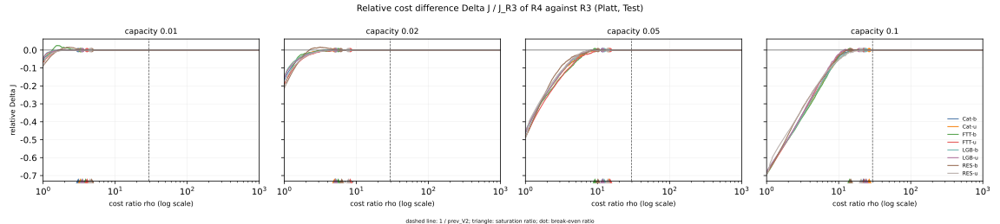
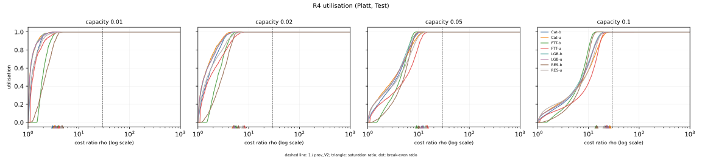
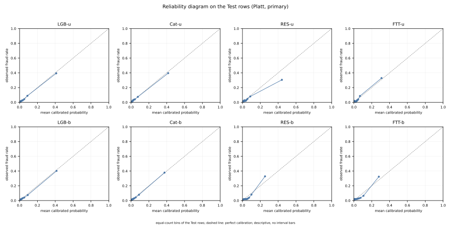
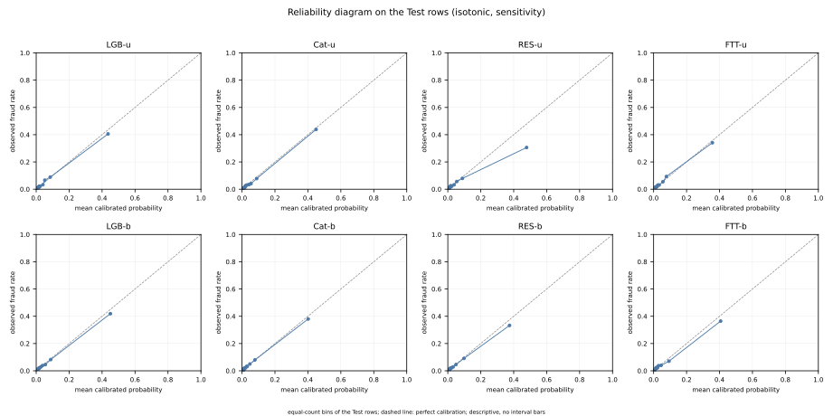

# Confirmatory run 2026-11-01T104408Z

Generated from the saved JSON (JavaScript Object Notation) records of this run directory; not edited by hand. Values are recorded fields, or deterministic comparisons and arithmetic derived from recorded fields.

## Run

| Item | Value |
|---|---|
| Run identifier | `"2026-11-01T104408Z"` |
| Freeze tag | `"protocol-freeze-v1"` |
| Tag commit | `"9997da7a292c266908e97c5458d10912fbd81d74"` |
| Evaluator commit | `"9997da7a292c266908e97c5458d10912fbd81d74"` |
| Evaluator source SHA-256 | `"e4c4343ed3a28cd2744ca08ef7baf0a33224b1e7d353c12197f8de86a8284fee"` |
| Training run | `"2026-10-25T134341Z"` |
| Training commit | `"6e2ff564e7b5a0dc505b7ee9c9465b4449da0092"` |
| Frozen-state identity | `"252e81b35cd8355fbdb53cbbf2769f76e917c6bf6040a5d57ad6088d4c09b67e"` |
| Dataset manifest SHA-256 | `"eb67c7bdca3509c11abba36147a3ed66406db4caa1570035dc62eeb7910bdfeb"` |
| Seeds | `{"main": 42, "additional": [43, 44], "sampler": 42, "preprocessing": 0, "resampling": 42}` |
| Started | `"2026-11-01T10:44:09.908587Z"` |
| Test partition | `{"first_day": 155, "last_day": 182, "rows": 78542, "transaction_id_sha256": "9f266b2bdf2da9f11a819f768e0a4c3a77fc84b228975c71cf6e19231cde24a3"}` |
| H3 configuration | `"LGB-b"` |

### Attempts

| Phase | Attempt | Outcome | Reached the consumption marker | Started | Finished |
|---|---|---|---|---|---|
| `"evaluation"` | `1` | `"completed"` | `true` | `"2026-11-01T10:50:49.498466Z"` | `"2026-11-01T15:58:57.310188Z"` |
| `"scoring"` | `1` | `"completed"` | `false` | `"2026-11-01T10:44:12.440064Z"` | `"2026-11-01T10:50:49.492872Z"` |

Closed: `"completed"` at `"2026-11-01T15:58:58.200395Z"`.

## Primary confirmatory results

Holm over H1, H2 and H3; the adjusted p-value decides, the interval positions only describe.

| Hypothesis | Estimate | p | Holm-adjusted p | Rejected | 90 % interval | Position |
|---|---|---|---|---|---|---|
| H1 family effect | `-0.06506849315068491` | `0.00019998000199980003` | `0.0005999400059994001` | `true` | `[-0.08318160133759174, -0.0474739179706843]` | `"beyond"` |
| H2 weighting equivalence | — | `0.6874312568743126` | `0.6874312568743126` | `false` | — | — |
| H3 alert-rate transfer (LGB-b) | `0.021364365562374272` | `0.014198580141985802` | `0.028397160283971604` | `true` | `[0.01885881535754523, 0.02332113803636083]` | `"inside"` |

Decisions: `h1_rejected` = `true`, `h2_equivalent` = `false`, `h3_preserved` = `true`, `h1_category` = `"difference of practically meaningful size"`.

### H2 by model

| Model | Estimate | p lower | p upper | 90 % interval | Position | 95 % interval |
|---|---|---|---|---|---|---|
| `"LGB"` | `0.007209805335255948` | `0.0032996700329967` | `0.0851914808519148` | `[-0.008400599212299107, 0.02293233082706764]` | `"crossing"` | `[-0.011319778553366432, 0.02635976731986703]` |
| `"Cat"` | `-0.02595529920692141` | `0.6874312568743126` | `0.00029997000299970003` | `[-0.04668158927690972, -0.006165612455480744]` | `"crossing"` | `[-0.05106905574709808, -0.002256205372813476]` |
| `"RES"` | `0.006488824801730353` | `0.08339166083391661` | `0.2450754924507549` | `[-0.024598603284978583, 0.03962941094172018]` | `"crossing"` | `[-0.030764478828092634, 0.04637255584943434]` |
| `"FTT"` | `-0.0007209805335255948` | `0.0710928907109289` | `0.06429357064293571` | `[-0.02267514283223851, 0.021844799741001078]` | `"crossing"` | `[-0.026785714285714246, 0.026527901986218745]` |

### H3 variants and tolerance views

| Block length | p lower | p upper | p | 90 % interval | Position |
|---|---|---|---|---|---|
| `3` | `0.00029997000299970003` | `0.014198580141985802` | `0.014198580141985802` | `[0.01885881535754523, 0.02332113803636083]` | `"inside"` |
| `1` | `9.999000099990002e-05` | `0.010498950104989501` | `0.010498950104989501` | `[0.019541233053754804, 0.023242898564572522]` | `"inside"` |
| `7` | `9.999000099990002e-05` | `0.0081991800819918` | `0.0081991800819918` | `[0.019622818147103385, 0.02317356747128343]` | `"inside"` |

| Tolerance | Lower bound | Upper bound | Position |
|---|---|---|---|
| `0.1` | `0.018000000000000002` | `0.022000000000000002` | `"crossing"` |
| `0.25` | `0.015` | `0.025` | `"inside"` |
| `0.5` | `0.01` | `0.03` | `"inside"` |

Infimum of the tolerances whose open band contains the interval (t_min; containment holds for every larger tolerance): `0.16605690181804145`.

H3 of the other configurations is descriptive and outside the Holm family:

| Configuration | Alert rate | 90 % interval | Position |
|---|---|---|---|
| `"LGB-u"` | `0.02099513636016399` | `[0.018656568144081363, 0.022793266769064877]` | `"inside"` |
| `"Cat-u"` | `0.022497517251916174` | `[0.020005190219808934, 0.024519914411912713]` | `"crossing"` |
| `"RES-u"` | `0.03022586641542105` | `[0.023503077369868428, 0.04057891098428832]` | `"crossing"` |
| `"FTT-u"` | `0.021593542308573757` | `[0.019416277788502183, 0.023494034100047755]` | `"inside"` |
| `"Cat-b"` | `0.021644470474395865` | `[0.020011863137074735, 0.023569892184006482]` | `"inside"` |
| `"RES-b"` | `0.022026431718061675` | `[0.019963376152189145, 0.02411020788756249]` | `"crossing"` |
| `"FTT-b"` | `0.023656133024369128` | `[0.021615610115360187, 0.025292137415377305]` | `"crossing"` |

### Descriptive estimands (95 % intervals)

| Estimand | Estimate | 95 % interval |
|---|---|---|
| `"within:Cat-LGB"` | `-0.008651766402307137` | `[-0.02834569402014841, 0.011098986276476827]` |
| `"within:FTT-RES"` | `0.03208363374188894` | `[-0.00019122518330868672, 0.06475375849118796]` |
| `"family:u"` | `-0.0711968276856525` | `[-0.1003063139862632, -0.04413999013234267]` |
| `"family:b"` | `-0.058940158615717386` | `[-0.08179751405058702, -0.036764639303747584]` |
| `"cell:LGB-b-LGB-u"` | `0.007209805335255948` | `[-0.011319778553366432, 0.02635976731986703]` |
| `"cell:Cat-b-Cat-u"` | `-0.02595529920692141` | `[-0.05106905574709808, -0.002256205372813476]` |
| `"cell:RES-b-RES-u"` | `0.006488824801730353` | `[-0.030764478828092634, 0.04637255584943434]` |
| `"cell:FTT-b-FTT-u"` | `-0.0007209805335255948` | `[-0.026785714285714246, 0.026527901986218745]` |
| `"cell:Cat-u-LGB-u"` | `0.007930785868781542` | `[-0.01454602213603252, 0.031025158045914013]` |
| `"cell:Cat-b-LGB-b"` | `-0.025234318673395817` | `[-0.05288877784460086, 0.0019267553618907106]` |
| `"cell:FTT-u-RES-u"` | `0.03568853640951691` | `[-0.005583715127497705, 0.08140617639698516]` |
| `"cell:FTT-b-RES-b"` | `0.028478731074260966` | `[-0.00979415105507048, 0.06512676885008861]` |
| `"interaction"` | `0.012256669069935111` | `[-0.01449372350153792, 0.0396679229556071]` |

### Effect units

| Estimand | Percentage points | Frauds per partition | Frauds per day | Precision@K equivalent (points) | Normalised recall |
|---|---|---|---|---|---|
| `"family"` | `-6.506849315068491` | `-180.49999999999994` | `-6.446428571428569` | `-11.51147959183673` | `-0.11526181353767558` |
| `"interaction"` | `1.225666906993511` | `34.0` | `1.2142857142857142` | `2.1683673469387754` | `0.021711366538952743` |
| `"family:u"` | `-7.11968276856525` | `-197.50000000000003` | `-7.05357142857143` | `-12.595663265306126` | `-0.12611749680715198` |
| `"family:b"` | `-5.894015861571739` | `-163.50000000000003` | `-5.839285714285715` | `-10.42729591836735` | `-0.10440613026819925` |
| `"within:Cat-LGB"` | `-0.8651766402307137` | `-24.0` | `-0.8571428571428571` | `-1.530612244897959` | `-0.01532567049808429` |
| `"within:FTT-RES"` | `3.208363374188894` | `88.99999999999991` | `3.1785714285714257` | `5.67602040816326` | `0.056832694763729194` |
| `"cell:LGB-b-LGB-u"` | `0.7209805335255948` | `20.0` | `0.7142857142857143` | `1.2755102040816326` | `0.012771392081736908` |
| `"cell:Cat-b-Cat-u"` | `-2.595529920692141` | `-72.0` | `-2.5714285714285716` | `-4.591836734693878` | `-0.045977011494252866` |
| `"cell:RES-b-RES-u"` | `0.6488824801730353` | `18.0` | `0.6428571428571429` | `1.1479591836734695` | `0.011494252873563216` |
| `"cell:FTT-b-FTT-u"` | `-0.07209805335255948` | `-2.0` | `-0.07142857142857142` | `-0.12755102040816327` | `-0.0012771392081736908` |
| `"cell:Cat-u-LGB-u"` | `0.7930785868781542` | `22.0` | `0.7857142857142857` | `1.403061224489796` | `0.014048531289910599` |
| `"cell:Cat-b-LGB-b"` | `-2.523431867339582` | `-70.0` | `-2.5` | `-4.464285714285714` | `-0.044699872286079176` |
| `"cell:FTT-u-RES-u"` | `3.5688536409516916` | `98.99999999999991` | `3.5357142857142825` | `6.313775510204077` | `0.06321839080459765` |
| `"cell:FTT-b-RES-b"` | `2.8478731074260963` | `78.99999999999991` | `2.8214285714285685` | `5.038265306122443` | `0.050446998722860736` |
| `"weighting:LGB"` | `0.7209805335255948` | `20.0` | `0.7142857142857143` | `1.2755102040816326` | `0.012771392081736908` |
| `"weighting:Cat"` | `-2.595529920692141` | `-72.0` | `-2.5714285714285716` | `-4.591836734693878` | `-0.045977011494252866` |
| `"weighting:RES"` | `0.6488824801730353` | `18.0` | `0.6428571428571429` | `1.1479591836734695` | `0.011494252873563216` |
| `"weighting:FTT"` | `-0.07209805335255948` | `-2.0` | `-0.07142857142857142` | `-0.12755102040816327` | `-0.0012771392081736908` |

Basis: `{"frauds": 2774, "days": 28, "k": 56, "oracle_ceiling": 0.5645277577505408}`.

### Effect units with converted intervals

The interval of each estimand multiplied by the same recorded factors as its point estimate (percentage points x 100; frauds per partition x frauds; per day / days; Precision@K points x frauds / (K x days) x 100; normalised recall / oracle ceiling).

| Estimand | Level | Percentage points | Frauds per partition | Frauds per day | Precision@K equivalent (points) | Normalised recall |
|---|---|---|---|---|---|---|
| `"family"` | 90 % | `-8.318160133759173` to `-4.74739179706843` | `-230.7457621104795` to `-131.69264845067826` | `-8.240920075374268` to `-4.70330887323851` | `-14.715928706025478` to `-8.398765845068766` | `-0.1473472299556063` to `-0.08409492238229772` |
| `"interaction"` | 95 % | `-1.449372350153792` to `3.96679229556071` | `-40.20558899326619` to `110.0388182788541` | `-1.4359138926166497` to `3.9299577956733605` | `-2.56413195110116` to `7.0177817779881435` | `-0.025674067045508422` to `0.07026744462251219` |
| `"family:u"` | 95 % | `-10.030631398626321` to `-4.413999013234267` | `-278.2497149978941` to `-122.44433262711856` | `-9.937489821353362` to `-4.373011879539948` | `-17.745517538131004` to `-7.808949784892764` | `-0.17768181034348282` to `-0.07818922900837712` |
| `"family:b"` | 95 % | `-8.179751405058703` to `-3.6764639303747586` | `-226.9063039763284` to `-101.9851094285958` | `-8.103796570583157` to `-3.6423253367355644` | `-14.471065304612782` to `-6.504152387027794` | `-0.14489546869497344` to `-0.06512459095057203` |
| `"within:Cat-LGB"` | 95 % | `-2.8345694020148406` to `1.1098986276476828` | `-78.63095521189169` to `30.78858793094672` | `-2.808248400424703` to `1.0995924261052399` | `-5.014729286472684` to `1.9635579037593571` | `-0.05021133793862815` to `0.019660656405457673` |
| `"within:FTT-RES"` | 95 % | `-0.01912251833086867` to `6.475375849118796` | `-0.530458658498297` to `179.6269260545554` | `-0.018944952089224892` to `6.415247359091265` | `-0.03383027158790159` to `11.455798855520115` | `-0.00033873477554169666` to `0.1147042950539945` |
| `"cell:LGB-b-LGB-u"` | 95 % | `-1.131977855336643` to `2.635976731986703` | `-31.40106570703848` to `73.12199454531114` | `-1.1214666323942315` to `2.6114998051896836` | `-2.00261898641827` to `4.663392509267292` | `-0.020051766096448584` to `0.04669348310683981` |
| `"cell:Cat-b-Cat-u"` | 95 % | `-5.106905574709808` to `-0.22562053728134762` | `-141.66556064245006` to `-6.258713704184583` | `-5.059484308658931` to `-0.22352548943516368` | `-9.03479340831952` to `-0.39915265970564945` | `-0.09046332097219034` to `-0.003996624332174063` |
| `"cell:RES-b-RES-u"` | 95 % | `-3.0764478828092634` to `4.637255584943434` | `-85.34066426912896` to `128.63746992633085` | `-3.047880866754606` to `4.594195354511816` | `-5.44264440491894` to `8.203920275913957` | `-0.05449595419484608` to `0.08214397824159057` |
| `"cell:FTT-b-FTT-u"` | 95 % | `-2.6785714285714244` to `2.6527901986218745` | `-74.30357142857132` to `73.5884001097708` | `-2.653698979591833` to `2.6281571467775287` | `-4.738748177842559` to `4.6931377621027295` | `-0.04744800218938143` to `0.046991315523480716` |
| `"cell:Cat-u-LGB-u"` | 95 % | `-1.4546022136032521` to `3.1025158045914014` | `-40.35066540535421` to `86.06378841936547` | `-1.4410951930483649` to `3.073706729263052` | `-2.5733842733006513` to `5.488762016541166` | `-0.02576670843253781` to `0.054957719297168243` |
| `"cell:Cat-b-LGB-b"` | 95 % | `-5.288877784460086` to `0.19267553618907107` | `-146.7134697409228` to `5.344819373884831` | `-5.239766776461528` to `0.19088640621017253` | `-9.356726386538442` to `0.34086858251816526` | `-0.09368676228666845` to `0.0034130391914973376` |
| `"cell:FTT-u-RES-u"` | 95 % | `-0.5583715127497705` to `8.140617639698517` | `-15.489225763678633` to `225.82073332523683` | `-0.553186634417094` to `8.06502619018703` | `-0.9878332757448107` to `14.401832482476841` | `-0.00989094876352403` to `0.1442022562740976` |
| `"cell:FTT-b-RES-b"` | 95 % | `-0.979415105507048` to `6.512676885008862` | `-27.168975026765512` to `180.6616567901458` | `-0.9703205366701969` to `6.452202028219493` | `-1.7327152440539229` to `11.521789336106238` | `-0.017349281626287044` to `0.11536504265015696` |
| `"weighting:LGB"` | 95 % | `-1.131977855336643` to `2.635976731986703` | `-31.40106570703848` to `73.12199454531114` | `-1.1214666323942315` to `2.6114998051896836` | `-2.00261898641827` to `4.663392509267292` | `-0.020051766096448584` to `0.04669348310683981` |
| `"weighting:Cat"` | 95 % | `-5.106905574709808` to `-0.22562053728134762` | `-141.66556064245006` to `-6.258713704184583` | `-5.059484308658931` to `-0.22352548943516368` | `-9.03479340831952` to `-0.39915265970564945` | `-0.09046332097219034` to `-0.003996624332174063` |
| `"weighting:RES"` | 95 % | `-3.0764478828092634` to `4.637255584943434` | `-85.34066426912896` to `128.63746992633085` | `-3.047880866754606` to `4.594195354511816` | `-5.44264440491894` to `8.203920275913957` | `-0.05449595419484608` to `0.08214397824159057` |
| `"weighting:FTT"` | 95 % | `-2.6785714285714244` to `2.6527901986218745` | `-74.30357142857132` to `73.5884001097708` | `-2.653698979591833` to `2.6281571467775287` | `-4.738748177842559` to `4.6931377621027295` | `-0.04744800218938143` to `0.046991315523480716` |

## Sensitivities

### S1 (Owen-corrected Wald)

| Quantity | Estimate | Pigeonhole variance | Fraud-level variance | Standard error |
|---|---|---|---|---|
| `"family"` | `-0.06506849315068491` | `0.00011871884767389136` | `2.075405957081458e-05` | `0.008786963555874248` |
| `"weighting:LGB"` | `0.007209805335255948` | `9.266052121529867e-05` | `2.205537091713474e-05` | `0.006967767173279342` |
| `"weighting:Cat"` | `-0.02595529920692141` | `0.00015191860261030854` | `4.190082715166679e-05` | `0.008253299237697308` |
| `"weighting:RES"` | `0.006488824801730353` | `0.00038563271993056325` | `4.7065657115127784e-05` | `0.017073412245368753` |
| `"weighting:FTT"` | `-0.0007209805335255948` | `0.0001828024412808933` | `3.818549689958539e-05` | `0.010316561805258695` |

p(H1) = `1.3103489593974006e-13`; 90 % interval `[-0.07952176202545508, -0.05061522427591475]`; position `"beyond"`; p(H2) = `0.7647192914780963`.

| Model | S1 90 % interval of the weighting effect |
|---|---|
| `"LGB"` | `[-0.004251151771465985, 0.01867076244197788]` |
| `"Cat"` | `[-0.03953076839236365, -0.012379830021479174]` |
| `"RES"` | `[-0.021594439254502117, 0.03457208885796283]` |
| `"FTT"` | `[-0.017690214636574386, 0.016248253569523197]` |

Comparison with the primary: `{"p_h1": 1.3103489593974006e-13, "p_h2": 0.7647192914780963, "holm": {"adjusted": [3.931046878192202e-13, 0.7647192914780963, 0.028397160283971604], "rejected": [true, false, true]}, "h1_rejected": true, "h2_rejected": false, "h1_category": "difference of practically meaningful size", "differs": false}`.

### S2 (day-level moving block)

p(H1) = `0.00019998000199980003`; p(H2) = `0.9713028697130287`; H1 90 % interval `[-0.07801154089806203, -0.054556431200805784]`; position `"beyond"`.

Comparison with the primary: `{"p_h1": 0.00019998000199980003, "p_h2": 0.9713028697130287, "holm": {"adjusted": [0.0005999400059994001, 0.9713028697130287, 0.028397160283971604], "rejected": [true, false, true]}, "h1_rejected": true, "h2_rejected": false, "h1_category": "difference of practically meaningful size", "differs": false}`.

### SESOI views (not confirmatory)

| SESOI | H1 position | H1 category | H2 positions |
|---|---|---|---|
| `0.01` | `"beyond"` | `"difference of practically meaningful size"` | `["crossing", "crossing", "crossing", "crossing"]` |
| `0.03` | `"beyond"` | `"difference of practically meaningful size"` | `["inside", "crossing", "crossing", "inside"]` |
| `0.05` | `"crossing"` | `"difference of uncertain practical size"` | `["inside", "inside", "inside", "inside"]` |

### Exact McNemar tests (descriptive, outside the Holm family)

| First | Second | Only first | Only second | p |
|---|---|---|---|---|
| `"LGB-b"` | `"LGB-u"` | `95` | `75` | `0.14483096954373903` |
| `"Cat-b"` | `"Cat-u"` | `124` | `196` | `6.76089212654319e-05` |
| `"RES-b"` | `"RES-u"` | `193` | `175` | `0.3755407854902259` |
| `"FTT-b"` | `"FTT-u"` | `148` | `150` | `0.9538185474056513` |
| `"Cat-u"` | `"LGB-u"` | `145` | `123` | `0.19947967705602676` |
| `"Cat-b"` | `"LGB-b"` | `159` | `229` | `0.0004455492796988992` |
| `"FTT-u"` | `"RES-u"` | `262` | `163` | `1.803989394424926e-06` |
| `"FTT-b"` | `"RES-b"` | `239` | `160` | `8.978141070357746e-05` |

## Secondary outcomes

95 % percentile bootstrap intervals (DR-006).

### R3 at capacity `0.01` (K = `28`)

| Configuration | Recall | Recall interval | Precision | Precision interval | Lift | Lift interval | Normalised recall | Normalised interval | Amount-weighted recall | Amount interval | False negatives | FN interval |
|---|---|---|---|---|---|---|---|---|---|---|---|---|
| `"LGB-u"` | `0.23179524152847872` | `[0.19584603761290614, 0.2699568584645772]` | `0.8201530612244898` | `[0.692955240227298, 0.9551789864550219]` | `23.221507474655326` | `[19.620075875246016, 27.04458109378166]` | `0.8201530612244898` | `[0.692955240227298, 0.9551789864550219]` | `0.1371497967847628` | `[0.09976121079701442, 0.18306299247604813]` | `2131` | `[2025.139674619263, 2230.723091661798]` |
| `"Cat-u"` | `0.23143475126171592` | `[0.1954018970940954, 0.27134867937911294]` | `0.8188775510204082` | `[0.6913837532385467, 0.9601036181092593]` | `23.1853931550991` | `[19.57558137954648, 27.184015275247816]` | `0.8188775510204082` | `[0.6913837532385467, 0.9601036181092593]` | `0.1548638681757124` | `[0.11190316803397225, 0.20811272389017793]` | `2132` | `[2021.2787634023407, 2231.955137460979]` |
| `"RES-u"` | `0.18601297764960345` | `[0.15250243352998064, 0.2228035553755147]` | `0.6581632653061225` | `[0.5395940696583754, 0.7883380900659156]` | `18.634988891014228` | `[15.27786496723436, 22.320710263142445]` | `0.6581632653061225` | `[0.5395940696583754, 0.7883380900659156]` | `0.12928963026908605` | `[0.08965024439148633, 0.17912110159096425]` | `2258` | `[2155.942937388322, 2350.958249387834]` |
| `"FTT-u"` | `0.2080028839221341` | `[0.17493743081646956, 0.24455474837089095]` | `0.735969387755102` | `[0.6189750422001105, 0.865299581608229]` | `20.837962383944205` | `[17.525428177534632, 24.499769192023617]` | `0.735969387755102` | `[0.6189750422001105, 0.865299581608229]` | `0.1505836616977931` | `[0.10966350791066569, 0.20127546359013054]` | `2197` | `[2095.6051280191487, 2288.723566915113]` |
| `"LGB-b"` | `0.23215573179524152` | `[0.19630029394090368, 0.2707965587977962]` | `0.8214285714285714` | `[0.6945625196327383, 0.95815006901159]` | `23.257621794211556` | `[19.66558378406436, 27.12870321568432]` | `0.8214285714285714` | `[0.6945625196327383, 0.95815006901159]` | `0.14190801837417905` | `[0.10154931586510803, 0.19334522228004572]` | `2130` | `[2022.8103458949133, 2229.4629846079333]` |
| `"Cat-b"` | `0.220620043258832` | `[0.18665482955922796, 0.2576579340076272]` | `0.7806122448979592` | `[0.6604343076496153, 0.911662128746375]` | `22.101963568412224` | `[18.699290335766435, 25.812461036769207]` | `0.7806122448979592` | `[0.6604343076496153, 0.911662128746375]` | `0.1281544295674122` | `[0.09423185624490461, 0.169907764755346]` | `2162` | `[2059.256891062842, 2256.2195028027018]` |
| `"RES-b"` | `0.18637346791636625` | `[0.1546424844438683, 0.22028374070045909]` | `0.6594387755102041` | `[0.5471661375603197, 0.7794223172233081]` | `18.671103210570458` | `[15.492257669885591, 22.06827240063196]` | `0.6594387755102041` | `[0.5471661375603197, 0.7794223172233081]` | `0.12168871107561144` | `[0.08732154220724797, 0.16368481130850993]` | `2257` | `[2162.9329032969263, 2345.0217481527093]` |
| `"FTT-b"` | `0.21052631578947367` | `[0.1762158451357536, 0.24747700757892147]` | `0.7448979591836735` | `[0.6234984112328834, 0.8756393099795003]` | `21.090762620837808` | `[17.653501158995358, 24.792524399570986]` | `0.7448979591836735` | `[0.6234984112328834, 0.8756393099795003]` | `0.11944629805779323` | `[0.0863554255146814, 0.1614704875457336]` | `2190` | `[2087.498780976072, 2285.1772455934197]` |
| `"LR"` | `0.19790915645277576` | `[0.1635094345354868, 0.2359426752933251]` | `0.7002551020408163` | `[0.5785397594406129, 0.8348277822240865]` | `19.82676143636979` | `[16.380558682763017, 23.637002044500434]` | `0.7002551020408163` | `[0.5785397594406129, 0.8348277822240865]` | `0.12731475699623399` | `[0.0904449742520394, 0.17428770611695496]` | `2225` | `[2119.495018736316, 2320.4248285985595]` |

### R3 at capacity `0.02` (K = `56`)

| Configuration | Recall | Recall interval | Precision | Precision interval | Lift | Lift interval | Normalised recall | Normalised interval | Amount-weighted recall | Amount interval | False negatives | FN interval |
|---|---|---|---|---|---|---|---|---|---|---|---|---|
| `"LGB-u"` | `0.3781542898341745` | `[0.3321770364981486, 0.4270648745936057]` | `0.6690051020408163` | `[0.5876652418659849, 0.7555344146190449]` | `18.941960607242176` | `[16.638934184080092, 21.391919247660063]` | `0.6698595146871009` | `[0.5884157721876527, 0.7564993372430794]` | `0.25047509187493294` | `[0.19029720238741263, 0.32020344024213565]` | `1725` | `[1589.3220378773378, 1852.540900754136]` |
| `"Cat-u"` | `0.386085075702956` | `[0.339916404965541, 0.4346205740664236]` | `0.6830357142857143` | `[0.6013572113357212, 0.7689014492731244]` | `19.339218122360695` | `[17.0266034941349, 21.770388474697093]` | `0.6839080459770115` | `[0.602125228208436, 0.7698834434612126]` | `0.255375799366332` | `[0.1959639456207235, 0.3263472010125479]` | `1703` | `[1568.362527539741, 1831.0718926255893]` |
| `"RES-u"` | `0.2930785868781543` | `[0.24627166532276612, 0.3419232062780269]` | `0.5184948979591837` | `[0.43568724464627123, 0.6049075090658461]` | `14.680470899607139` | `[12.335885929707077, 17.127125298143362]` | `0.5191570881226054` | `[0.4362436779089101, 0.6056800601629927]` | `0.2307592581025851` | `[0.16819976531469852, 0.3038141229505105]` | `1961` | `[1825.5050257847533, 2090.8424003946466]` |
| `"FTT-u"` | `0.3287671232876712` | `[0.28297979952164176, 0.3768893866975952]` | `0.5816326530612245` | `[0.5006288034904556, 0.6667673205989344]` | `16.46812971764048` | `[14.174616973232645, 18.878600899236304]` | `0.5823754789272031` | `[0.5012681761641343, 0.6676188752868002]` | `0.26702251063930915` | `[0.19993535171974344, 0.3441532462092399]` | `1862` | `[1728.508841300871, 1989.0140361269657]` |
| `"LGB-b"` | `0.38536409516943043` | `[0.3397345704788768, 0.43279457973291435]` | `0.6817602040816326` | `[0.6010355220079109, 0.7656710230734085]` | `19.30310380280447` | `[17.01749530264792, 21.678923393738877]` | `0.6826309067688378` | `[0.6018031280385723, 0.7666488915575379]` | `0.26440009320561825` | `[0.20304860260505436, 0.33649719163567127]` | `1705` | `[1573.4278358208956, 1831.5763014915956]` |
| `"Cat-b"` | `0.3601297764960346` | `[0.3158753493913336, 0.40629679325557044]` | `0.6371173469387755` | `[0.5588253949053313, 0.7187929237824952]` | `18.039102618336447` | `[15.822373527993701, 20.351634397882023]` | `0.6379310344827587` | `[0.559539092727688, 0.7197109224080155]` | `0.23649322454913202` | `[0.180721534290941, 0.3025871117572277]` | `1775` | `[1646.9326955090476, 1897.7617807884408]` |
| `"RES-b"` | `0.29956741167988465` | `[0.2604948430479679, 0.3419294302529985]` | `0.5299744897959183` | `[0.4608499327902187, 0.6049185201032002]` | `15.0054997756132` | `[13.048332884358095, 17.127437060542736]` | `0.5306513409961686` | `[0.4614385023084693, 0.6056910852629743]` | `0.20773294119221497` | `[0.15613831347363133, 0.2727330892429267]` | `1943` | `[1825.487760478182, 2051.387305384937]` |
| `"FTT-b"` | `0.3280461427541456` | `[0.28172097733439044, 0.3757268646957145]` | `0.5803571428571429` | `[0.49840178005459124, 0.6647106649655052]` | `16.432015398084253` | `[14.111561863391385, 18.82036951972628]` | `0.5810983397190294` | `[0.4990383085093225, 0.6655595930178237]` | `0.2124367170630161` | `[0.1598693648530036, 0.2741396024944044]` | `1864` | `[1731.733677334088, 1992.506008874401]` |
| `"LR"` | `0.30930064888248016` | `[0.26916402393529204, 0.352039038084355]` | `0.5471938775510204` | `[0.47618686377327824, 0.6228037574272964]` | `15.493043089622294` | `[13.482577020360784, 17.633832990574877]` | `0.5478927203065134` | `[0.4767950206874203, 0.6235991645249047]` | `0.20138113907043675` | `[0.151125046056113, 0.2599687301149722]` | `1916` | `[1797.4437083539992, 2027.3389976034996]` |

### R3 at capacity `0.05` (K = `139`)

| Configuration | Recall | Recall interval | Precision | Precision interval | Lift | Lift interval | Normalised recall | Normalised interval | Amount-weighted recall | Amount interval | False negatives | FN interval |
|---|---|---|---|---|---|---|---|---|---|---|---|---|
| `"LGB-u"` | `0.5573179524152848` | `[0.5075613824652836, 0.6063243968186185]` | `0.3972250770811922` | `[0.3617613758886682, 0.43215413072323944]` | `11.24688248165501` | `[10.242776490644475, 12.23585066159505]` | `0.5605511240029006` | `[0.5105059010002526, 0.6098418697515765]` | `0.45593316220430313` | `[0.37837211242401964, 0.5380874510786773]` | `1228` | `[1092.0561232251523, 1366.0247250413036]` |
| `"Cat-u"` | `0.5558759913482336` | `[0.5051507030184049, 0.6057230766778027]` | `0.3961973278520041` | `[0.3600431783589556, 0.43172554334640917]` | `11.217783173811142` | `[10.194128087479847, 12.223715798671112]` | `0.5591007976794778` | `[0.5080812364659373, 0.6092370611690444]` | `0.41198095962642245` | `[0.3317424322688606, 0.5006371609926619]` | `1232` | `[1093.7241852957754, 1372.7119498269449]` |
| `"RES-u"` | `0.43583273251622207` | `[0.37481071890859036, 0.4947158099840887]` | `0.3106372045220966` | `[0.26714412493638995, 0.3526057700143531]` | `8.795265795809124` | `[7.563818983689234, 9.983548085244166]` | `0.43836113125453224` | `[0.3769851103163269, 0.4975858074314221]` | `0.4016280903610908` | `[0.3046263032965816, 0.501396795781457]` | `1565` | `[1401.6583431041379, 1734.2750657475704]` |
| `"FTT-u"` | `0.4603460706560923` | `[0.40963217378375083, 0.5114389644062517]` | `0.32810894141829394` | `[0.291962911119251, 0.3645250995022976]` | `9.289954029154881` | `[8.2665288266504, 10.32102752887868]` | `0.46301667875271935` | `[0.41200857508198874, 0.5144059779778617]` | `0.4071630526648293` | `[0.3276396409270639, 0.4942483552153019]` | `1497` | `[1355.2683127370576, 1637.680349923875]` |
| `"LGB-b"` | `0.5652487382840663` | `[0.5147056250771826, 0.6141147506860354]` | `0.4028776978417266` | `[0.36685339259098276, 0.4377066594046922]` | `11.406928674796283` | `[10.386949949848942, 12.393062884990387]` | `0.5685279187817259` | `[0.5176915895446356, 0.6176774178401241]` | `0.45086893551118884` | `[0.3674063514993385, 0.5349501486426023]` | `1206` | `[1070.445681596938, 1346.2065960358952]` |
| `"Cat-b"` | `0.5328046142754146` | `[0.48025486103133147, 0.5841134893386026]` | `0.37975334018499485` | `[0.3422988141060929, 0.41632343767350566]` | `10.752194248309252` | `[9.691720784975034, 11.787626330840835]` | `0.5358955765047135` | `[0.4830409660989535, 0.587502110016419]` | `0.4215059589611382` | `[0.35116781574200284, 0.4996361784310317]` | `1296` | `[1153.6691805747162, 1441.7730154990863]` |
| `"RES-b"` | `0.4657534246575342` | `[0.41810999784204794, 0.5137688539107581]` | `0.3319630010277492` | `[0.29800543011660874, 0.3661857144780173]` | `9.399076433569387` | `[8.437614452854607, 10.36804556111479]` | `0.4684554024655547` | `[0.42053558158587423, 0.5167493838826843]` | `0.38589555792253566` | `[0.30633302284221714, 0.47115762313576276]` | `1482` | `[1348.805199251557, 1614.162865986159]` |
| `"FTT-b"` | `0.45313626532083634` | `[0.40020089410182064, 0.5045324107659391]` | `0.32297019527235354` | `[0.2852408222606502, 0.3596024942098446]` | `9.144457489935542` | `[8.076202113192496, 10.181650721063304]` | `0.4557650471356055` | `[0.4025225816673135, 0.5074593573113543]` | `0.3654838304734526` | `[0.2869408299653393, 0.4521356718852744]` | `1517` | `[1374.427092535285, 1663.8427197615497]` |
| `"LR"` | `0.4852198990627253` | `[0.4401772400330566, 0.531704259275445]` | `0.3458376156217883` | `[0.313733726580601, 0.3789690686613783]` | `9.791917089461606` | `[8.882939564921976, 10.729988677289825]` | `0.4880348078317622` | `[0.44273084258582274, 0.5347888380094578]` | `0.4023341319281098` | `[0.3260842058983243, 0.48608971299336906]` | `1428` | `[1299.0523847699158, 1552.948336148301]` |

### R3 at capacity `0.1` (K = `278`)

| Configuration | Recall | Recall interval | Precision | Precision interval | Lift | Lift interval | Normalised recall | Normalised interval | Amount-weighted recall | Amount interval | False negatives | FN interval |
|---|---|---|---|---|---|---|---|---|---|---|---|---|
| `"LGB-u"` | `0.6852919971160779` | `[0.6374286450139912, 0.7307415399519127]` | `0.24421891058581707` | `[0.22716174990606522, 0.26041585712058146]` | `6.914723026399151` | `[6.431772949214915, 7.3733173215445955]` | `0.6852919971160779` | `[0.6374286450139912, 0.7307415399519127]` | `0.6365731571563111` | `[0.5453560378989772, 0.721887579989815]` | `873` | `[746.9229681733941, 1005.7729387311884]` |
| `"Cat-u"` | `0.6669069935111752` | `[0.6174444579992301, 0.7156727078891258]` | `0.23766700924974307` | `[0.22003994430753654, 0.2550457466192748]` | `6.729214938894492` | `[6.230128805264071, 7.221270018374579]` | `0.6669069935111752` | `[0.6174444579992301, 0.7156727078891258]` | `0.5880886799205614` | `[0.5007227664540091, 0.6726547691389614]` | `924` | `[788.7239083155649, 1061.2090735101356]` |
| `"RES-u"` | `0.5342465753424658` | `[0.474893053121784, 0.5900471030642165]` | `0.19039054470709146` | `[0.16923860860223908, 0.210276292895701]` | `5.39064677807656` | `[4.791758758773273, 5.953684425599909]` | `0.5342465753424658` | `[0.474893053121784, 0.5900471030642165]` | `0.5106676755866607` | `[0.41595178120984533, 0.6033835676813256]` | `1292` | `[1137.2093360998635, 1456.6466706401711]` |
| `"FTT-u"` | `0.5847152126892574` | `[0.5342996247301613, 0.6325108675522014]` | `0.20837615621788283` | `[0.19040945002588228, 0.22540919149406563]` | `5.899884665344252` | `[5.391182056212273, 6.3821516648618974]` | `0.5847152126892574` | `[0.5342996247301613, 0.6325108675522014]` | `0.5537525206176167` | `[0.47212751346800974, 0.6334368024166981]` | `1152` | `[1019.4148534101932, 1291.8528409985324]` |
| `"LGB-b"` | `0.6748377793799567` | `[0.6253506875994586, 0.7222910982329711]` | `0.24049331963001028` | `[0.22285750352015649, 0.25740435592218164]` | `6.809238035465129` | `[6.309904124542223, 7.288050801312181]` | `0.6748377793799567` | `[0.6253506875994586, 0.7222910982329711]` | `0.6297228761001272` | `[0.5412190086300539, 0.7124638409816915]` | `902` | `[770.3644935017381, 1039.2771925991021]` |
| `"Cat-b"` | `0.6463590483056958` | `[0.592511492785632, 0.6964820645406435]` | `0.230344295991778` | `[0.21115453250094338, 0.24820673780007005]` | `6.5218823705069315` | `[5.978550573788425, 7.0276328768179885]` | `0.6463590483056958` | `[0.592511492785632, 0.6964820645406435]` | `0.5698223677155635` | `[0.488835899928223, 0.6501496996075046]` | `981` | `[841.958752964255, 1130.3731190126568]` |
| `"RES-b"` | `0.5760634462869503` | `[0.5261507768712498, 0.6234630177514793]` | `0.2052929085303186` | `[0.18750542844820747, 0.22218479075573017]` | `5.812586741812647` | `[5.308958673820875, 6.290857186566892]` | `0.5760634462869503` | `[0.5261507768712498, 0.6234630177514793]` | `0.5177910837956625` | `[0.42863495042605737, 0.6065634193152096]` | `1176` | `[1044.5135887573963, 1314.4577449591532]` |
| `"FTT-b"` | `0.5432588320115357` | `[0.48806831329395184, 0.5932537137292051]` | `0.19360226104830422` | `[0.17393390301611286, 0.21141903929661035]` | `5.481582115088648` | `[4.924699571265874, 5.986039720416138]` | `0.5432588320115357` | `[0.48806831329395184, 0.5932537137292051]` | `0.49973161770940544` | `[0.4117848587502508, 0.5854590884664992]` | `1267` | `[1128.314198115185, 1420.0984989225776]` |
| `"LR"` | `0.6124729632299928` | `[0.566327318125071, 0.6565285352850485]` | `0.21826824254881808` | `[0.20182322462473626, 0.23396841686545797]` | `6.1799655033414815` | `[5.714347407525607, 6.624494375431435]` | `0.6124729632299928` | `[0.566327318125071, 0.6565285352850485]` | `0.5679895252300196` | `[0.4884409029216744, 0.6481230168609899]` | `1075` | `[952.7898431192752, 1203.008019521053]` |

The per-day tables, the cutoff ties and the remaining counts of every policy are in the records (section Records).

### Ranking measures (day-level moving block)

| Configuration | Average Precision | Interval | ROC-AUC | Interval |
|---|---|---|---|---|
| `"LGB-u"` | `0.5146513863271832` | `[0.4707582442080408, 0.5545003235773093]` | `0.8866572364833657` | `[0.871844760159647, 0.8994036788325606]` |
| `"Cat-u"` | `0.5110967830334272` | `[0.468098574413435, 0.5525190203835154]` | `0.8813403238223433` | `[0.86876129791691, 0.8913400320698873]` |
| `"RES-u"` | `0.27722776862003856` | `[0.1841288123706656, 0.3916593497127199]` | `0.7954753846923296` | `[0.7710871674094859, 0.8164628183612411]` |
| `"FTT-u"` | `0.4059654886116558` | `[0.369201479649014, 0.4331165981772138]` | `0.7977611707449531` | `[0.779685408090481, 0.8124184497571706]` |
| `"LGB-b"` | `0.514271889490769` | `[0.4717171481924151, 0.5525668691645098]` | `0.8855419566365721` | `[0.8715831439520701, 0.8958233997203385]` |
| `"Cat-b"` | `0.47058435122605785` | `[0.42296491410409615, 0.5079895133477191]` | `0.8672269357596525` | `[0.8538235986120088, 0.8778615595854855]` |
| `"RES-b"` | `0.3594597334273915` | `[0.32885508834447874, 0.3810177370530792]` | `0.8095301326623974` | `[0.7942367669367587, 0.8198916616640322]` |
| `"FTT-b"` | `0.3953844178915845` | `[0.3506447312024034, 0.43616083343897183]` | `0.8016939821495846` | `[0.7827020603968171, 0.8164517908839188]` |
| `"LR"` | `0.3855695956330178` | `[0.34494355780692343, 0.41920287009608836]` | `0.8644895924469316` | `[0.8515425555404871, 0.8742894584552642]` |

### R0 (uncapped alerts) against each budget

| Configuration | Capacity | Threshold | Recall | Recall interval | Precision | Precision interval | F1 | F1 interval | Alerts | Total overflow | Total unused | Mean load ratio | Zero-alert days |
|---|---|---|---|---|---|---|---|---|---|---|---|---|---|
| `"LGB-u"` | `0.01` | `0.5` | `0.30245133381398703` | `[0.26014123503298814, 0.33902675023575696]` | `0.8306930693069307` | `[0.7896328228157155, 0.8729678352017642]` | `0.44344608879492603` | `[0.39670178126891825, 0.4816457783570878]` | `1010` | `302` | `76` | `1.288265306122449` | `0` |
| `"LGB-u"` | `0.02` | `0.5` | `0.30245133381398703` | `[0.26014123503298814, 0.33902675023575696]` | `0.8306930693069307` | `[0.7896328228157155, 0.8729678352017642]` | `0.44344608879492603` | `[0.39670178126891825, 0.4816457783570878]` | `1010` | `20` | `578` | `0.6441326530612245` | `0` |
| `"LGB-u"` | `0.05` | `0.5` | `0.30245133381398703` | `[0.26014123503298814, 0.33902675023575696]` | `0.8306930693069307` | `[0.7896328228157155, 0.8729678352017642]` | `0.44344608879492603` | `[0.39670178126891825, 0.4816457783570878]` | `1010` | `0` | `2882` | `0.25950668036998975` | `0` |
| `"LGB-u"` | `0.1` | `0.5` | `0.30245133381398703` | `[0.26014123503298814, 0.33902675023575696]` | `0.8306930693069307` | `[0.7896328228157155, 0.8729678352017642]` | `0.44344608879492603` | `[0.39670178126891825, 0.4816457783570878]` | `1010` | `0` | `6774` | `0.12975334018499488` | `0` |
| `"Cat-u"` | `0.01` | `0.5` | `0.36950252343186735` | `[0.3266595963070505, 0.40895919925624696]` | `0.7570162481536189` | `[0.7126622799320168, 0.8023257809133134]` | `0.49660852713178294` | `[0.45242292338882895, 0.5341700698737106]` | `1354` | `585` | `15` | `1.7270408163265305` | `0` |
| `"Cat-u"` | `0.02` | `0.5` | `0.36950252343186735` | `[0.3266595963070505, 0.40895919925624696]` | `0.7570162481536189` | `[0.7126622799320168, 0.8023257809133134]` | `0.49660852713178294` | `[0.45242292338882895, 0.5341700698737106]` | `1354` | `116` | `330` | `0.8635204081632653` | `0` |
| `"Cat-u"` | `0.05` | `0.5` | `0.36950252343186735` | `[0.3266595963070505, 0.40895919925624696]` | `0.7570162481536189` | `[0.7126622799320168, 0.8023257809133134]` | `0.49660852713178294` | `[0.45242292338882895, 0.5341700698737106]` | `1354` | `0` | `2538` | `0.34789311408016443` | `0` |
| `"Cat-u"` | `0.1` | `0.5` | `0.36950252343186735` | `[0.3266595963070505, 0.40895919925624696]` | `0.7570162481536189` | `[0.7126622799320168, 0.8023257809133134]` | `0.49660852713178294` | `[0.45242292338882895, 0.5341700698737106]` | `1354` | `0` | `6430` | `0.17394655704008222` | `0` |
| `"RES-u"` | `0.01` | `0.5` | `0.3561643835616438` | `[0.313669011019713, 0.38874091703803876]` | `0.39456869009584666` | `[0.26338367505145505, 0.5219800420168067]` | `0.37438423645320196` | `[0.2930585001294077, 0.4348579087731123]` | `2504` | `1720` | `0` | `3.193877551020408` | `0` |
| `"RES-u"` | `0.02` | `0.5` | `0.3561643835616438` | `[0.313669011019713, 0.38874091703803876]` | `0.39456869009584666` | `[0.26338367505145505, 0.5219800420168067]` | `0.37438423645320196` | `[0.2930585001294077, 0.4348579087731123]` | `2504` | `1008` | `72` | `1.596938775510204` | `0` |
| `"RES-u"` | `0.05` | `0.5` | `0.3561643835616438` | `[0.313669011019713, 0.38874091703803876]` | `0.39456869009584666` | `[0.26338367505145505, 0.5219800420168067]` | `0.37438423645320196` | `[0.2930585001294077, 0.4348579087731123]` | `2504` | `329` | `1717` | `0.643371017471737` | `0` |
| `"RES-u"` | `0.1` | `0.5` | `0.3561643835616438` | `[0.313669011019713, 0.38874091703803876]` | `0.39456869009584666` | `[0.26338367505145505, 0.5219800420168067]` | `0.37438423645320196` | `[0.2930585001294077, 0.4348579087731123]` | `2504` | `57` | `5337` | `0.3216855087358685` | `0` |
| `"FTT-u"` | `0.01` | `0.5` | `0.31218457101658253` | `[0.27269446907559297, 0.3504710244119485]` | `0.6605644546147978` | `[0.6191238389724526, 0.6985015419974648]` | `0.4239902080783354` | `[0.37972645426675966, 0.4639506870274401]` | `1311` | `540` | `13` | `1.6721938775510203` | `0` |
| `"FTT-u"` | `0.02` | `0.5` | `0.31218457101658253` | `[0.27269446907559297, 0.3504710244119485]` | `0.6605644546147978` | `[0.6191238389724526, 0.6985015419974648]` | `0.4239902080783354` | `[0.37972645426675966, 0.4639506870274401]` | `1311` | `97` | `354` | `0.8360969387755102` | `0` |
| `"FTT-u"` | `0.05` | `0.5` | `0.31218457101658253` | `[0.27269446907559297, 0.3504710244119485]` | `0.6605644546147978` | `[0.6191238389724526, 0.6985015419974648]` | `0.4239902080783354` | `[0.37972645426675966, 0.4639506870274401]` | `1311` | `0` | `2581` | `0.33684480986639265` | `0` |
| `"FTT-u"` | `0.1` | `0.5` | `0.31218457101658253` | `[0.27269446907559297, 0.3504710244119485]` | `0.6605644546147978` | `[0.6191238389724526, 0.6985015419974648]` | `0.4239902080783354` | `[0.37972645426675966, 0.4639506870274401]` | `1311` | `0` | `6473` | `0.16842240493319632` | `0` |
| `"LGB-b"` | `0.01` | `0.5` | `0.37779379956741166` | `[0.3377691264849201, 0.4089977642627099]` | `0.7677655677655678` | `[0.7283928665507613, 0.8062614035710483]` | `0.5064025126842232` | `[0.4662977875825564, 0.5352678963548528]` | `1365` | `593` | `12` | `1.7410714285714286` | `0` |
| `"LGB-b"` | `0.02` | `0.5` | `0.37779379956741166` | `[0.3377691264849201, 0.4089977642627099]` | `0.7677655677655678` | `[0.7283928665507613, 0.8062614035710483]` | `0.5064025126842232` | `[0.4662977875825564, 0.5352678963548528]` | `1365` | `110` | `313` | `0.8705357142857143` | `0` |
| `"LGB-b"` | `0.05` | `0.5` | `0.37779379956741166` | `[0.3377691264849201, 0.4089977642627099]` | `0.7677655677655678` | `[0.7283928665507613, 0.8062614035710483]` | `0.5064025126842232` | `[0.4662977875825564, 0.5352678963548528]` | `1365` | `0` | `2527` | `0.35071942446043164` | `0` |
| `"LGB-b"` | `0.1` | `0.5` | `0.37779379956741166` | `[0.3377691264849201, 0.4089977642627099]` | `0.7677655677655678` | `[0.7283928665507613, 0.8062614035710483]` | `0.5064025126842232` | `[0.4662977875825564, 0.5352678963548528]` | `1365` | `0` | `6419` | `0.17535971223021582` | `0` |
| `"Cat-b"` | `0.01` | `0.5` | `0.6052631578947368` | `[0.5637197586827917, 0.6373889479591234]` | `0.27309694209499025` | `[0.24597649021294343, 0.29954151176633986]` | `0.37637301053575434` | `[0.3458570776367387, 0.404442329095563]` | `6148` | `5364` | `0` | `7.841836734693877` | `0` |
| `"Cat-b"` | `0.02` | `0.5` | `0.6052631578947368` | `[0.5637197586827917, 0.6373889479591234]` | `0.27309694209499025` | `[0.24597649021294343, 0.29954151176633986]` | `0.37637301053575434` | `[0.3458570776367387, 0.404442329095563]` | `6148` | `4580` | `0` | `3.9209183673469385` | `0` |
| `"Cat-b"` | `0.05` | `0.5` | `0.6052631578947368` | `[0.5637197586827917, 0.6373889479591234]` | `0.27309694209499025` | `[0.24597649021294343, 0.29954151176633986]` | `0.37637301053575434` | `[0.3458570776367387, 0.404442329095563]` | `6148` | `2256` | `0` | `1.579650565262076` | `0` |
| `"Cat-b"` | `0.1` | `0.5` | `0.6052631578947368` | `[0.5637197586827917, 0.6373889479591234]` | `0.27309694209499025` | `[0.24597649021294343, 0.29954151176633986]` | `0.37637301053575434` | `[0.3458570776367387, 0.404442329095563]` | `6148` | `43` | `1679` | `0.789825282631038` | `0` |
| `"RES-b"` | `0.01` | `0.5` | `0.6020187454938717` | `[0.5810218336690056, 0.6151967261534635]` | `0.17743306417339566` | `[0.15456503545901376, 0.19479246248167295]` | `0.27408501559166254` | `[0.2449366632729414, 0.29442735444413104]` | `9412` | `8628` | `0` | `12.005102040816327` | `0` |
| `"RES-b"` | `0.02` | `0.5` | `0.6020187454938717` | `[0.5810218336690056, 0.6151967261534635]` | `0.17743306417339566` | `[0.15456503545901376, 0.19479246248167295]` | `0.27408501559166254` | `[0.2449366632729414, 0.29442735444413104]` | `9412` | `7844` | `0` | `6.002551020408164` | `0` |
| `"RES-b"` | `0.05` | `0.5` | `0.6020187454938717` | `[0.5810218336690056, 0.6151967261534635]` | `0.17743306417339566` | `[0.15456503545901376, 0.19479246248167295]` | `0.27408501559166254` | `[0.2449366632729414, 0.29442735444413104]` | `9412` | `5520` | `0` | `2.4182939362795475` | `0` |
| `"RES-b"` | `0.1` | `0.5` | `0.6020187454938717` | `[0.5810218336690056, 0.6151967261534635]` | `0.17743306417339566` | `[0.15456503545901376, 0.19479246248167295]` | `0.27408501559166254` | `[0.2449366632729414, 0.29442735444413104]` | `9412` | `1783` | `155` | `1.2091469681397737` | `0` |
| `"FTT-b"` | `0.01` | `0.5` | `0.5522710886806056` | `[0.5148852350182135, 0.5771569560773531]` | `0.19078455790784557` | `[0.17005946785111303, 0.2083760206486487]` | `0.283598667160311` | `[0.2567662365155873, 0.30507243150600033]` | `8030` | `7246` | `0` | `10.24234693877551` | `0` |
| `"FTT-b"` | `0.02` | `0.5` | `0.5522710886806056` | `[0.5148852350182135, 0.5771569560773531]` | `0.19078455790784557` | `[0.17005946785111303, 0.2083760206486487]` | `0.283598667160311` | `[0.2567662365155873, 0.30507243150600033]` | `8030` | `6462` | `0` | `5.121173469387755` | `0` |
| `"FTT-b"` | `0.05` | `0.5` | `0.5522710886806056` | `[0.5148852350182135, 0.5771569560773531]` | `0.19078455790784557` | `[0.17005946785111303, 0.2083760206486487]` | `0.283598667160311` | `[0.2567662365155873, 0.30507243150600033]` | `8030` | `4138` | `0` | `2.063206577595067` | `0` |
| `"FTT-b"` | `0.1` | `0.5` | `0.5522710886806056` | `[0.5148852350182135, 0.5771569560773531]` | `0.19078455790784557` | `[0.17005946785111303, 0.2083760206486487]` | `0.283598667160311` | `[0.2567662365155873, 0.30507243150600033]` | `8030` | `632` | `386` | `1.0316032887975335` | `0` |

### R1 (uncapped alerts) against each budget

| Configuration | Capacity | Threshold | Recall | Recall interval | Precision | Precision interval | F1 | F1 interval | Alerts | Total overflow | Total unused | Mean load ratio | Zero-alert days |
|---|---|---|---|---|---|---|---|---|---|---|---|---|---|
| `"LGB-u"` | `0.01` | `0.07662240167576256` | `0.4589041095890411` | `[0.4108586760331564, 0.49688587248689386]` | `0.5943043884220355` | `[0.5592334074147799, 0.6298721688939081]` | `0.5179007323026851` | `[0.4759633402762943, 0.5520292310290383]` | `2142` | `1358` | `0` | `2.732142857142857` | `0` |
| `"LGB-u"` | `0.02` | `0.07662240167576256` | `0.4589041095890411` | `[0.4108586760331564, 0.49688587248689386]` | `0.5943043884220355` | `[0.5592334074147799, 0.6298721688939081]` | `0.5179007323026851` | `[0.4759633402762943, 0.5520292310290383]` | `2142` | `614` | `40` | `1.3660714285714286` | `0` |
| `"LGB-u"` | `0.05` | `0.07662240167576256` | `0.4589041095890411` | `[0.4108586760331564, 0.49688587248689386]` | `0.5943043884220355` | `[0.5592334074147799, 0.6298721688939081]` | `0.5179007323026851` | `[0.4759633402762943, 0.5520292310290383]` | `2142` | `0` | `1750` | `0.5503597122302158` | `0` |
| `"LGB-u"` | `0.1` | `0.07662240167576256` | `0.4589041095890411` | `[0.4108586760331564, 0.49688587248689386]` | `0.5943043884220355` | `[0.5592334074147799, 0.6298721688939081]` | `0.5179007323026851` | `[0.4759633402762943, 0.5520292310290383]` | `2142` | `0` | `5642` | `0.2751798561151079` | `0` |
| `"Cat-u"` | `0.01` | `0.30627193766643723` | `0.4434030281182408` | `[0.39857022346724386, 0.48335165153061305]` | `0.6392931392931392` | `[0.5973461389372811, 0.6822369650797246]` | `0.5236270753512133` | `[0.4814892090892519, 0.5561430604162168]` | `1924` | `1140` | `0` | `2.454081632653061` | `0` |
| `"Cat-u"` | `0.02` | `0.30627193766643723` | `0.4434030281182408` | `[0.39857022346724386, 0.48335165153061305]` | `0.6392931392931392` | `[0.5973461389372811, 0.6822369650797246]` | `0.5236270753512133` | `[0.4814892090892519, 0.5561430604162168]` | `1924` | `427` | `71` | `1.2270408163265305` | `0` |
| `"Cat-u"` | `0.05` | `0.30627193766643723` | `0.4434030281182408` | `[0.39857022346724386, 0.48335165153061305]` | `0.6392931392931392` | `[0.5973461389372811, 0.6822369650797246]` | `0.5236270753512133` | `[0.4814892090892519, 0.5561430604162168]` | `1924` | `0` | `1968` | `0.4943473792394656` | `0` |
| `"Cat-u"` | `0.1` | `0.30627193766643723` | `0.4434030281182408` | `[0.39857022346724386, 0.48335165153061305]` | `0.6392931392931392` | `[0.5973461389372811, 0.6822369650797246]` | `0.5236270753512133` | `[0.4814892090892519, 0.5561430604162168]` | `1924` | `0` | `5860` | `0.2471736896197328` | `0` |
| `"RES-u"` | `0.01` | `0.4055411416380115` | `0.3727469358327325` | `[0.33092567566123315, 0.4045029147557822]` | `0.3766848816029144` | `[0.25544929541032646, 0.4937271745626353]` | `0.3747055626019206` | `[0.29382108354615866, 0.4347035620520645]` | `2745` | `1961` | `0` | `3.501275510204082` | `0` |
| `"RES-u"` | `0.02` | `0.4055411416380115` | `0.3727469358327325` | `[0.33092567566123315, 0.4045029147557822]` | `0.3766848816029144` | `[0.25544929541032646, 0.4937271745626353]` | `0.3747055626019206` | `[0.29382108354615866, 0.4347035620520645]` | `2745` | `1217` | `40` | `1.750637755102041` | `0` |
| `"RES-u"` | `0.05` | `0.4055411416380115` | `0.3727469358327325` | `[0.33092567566123315, 0.4045029147557822]` | `0.3766848816029144` | `[0.25544929541032646, 0.4937271745626353]` | `0.3747055626019206` | `[0.29382108354615866, 0.4347035620520645]` | `2745` | `367` | `1514` | `0.7052929085303186` | `0` |
| `"RES-u"` | `0.1` | `0.4055411416380115` | `0.3727469358327325` | `[0.33092567566123315, 0.4045029147557822]` | `0.3766848816029144` | `[0.25544929541032646, 0.4937271745626353]` | `0.3747055626019206` | `[0.29382108354615866, 0.4347035620520645]` | `2745` | `89` | `5128` | `0.3526464542651593` | `0` |
| `"FTT-u"` | `0.01` | `0.2055995018704535` | `0.37022350396539294` | `[0.33281332642612105, 0.4021560941551965]` | `0.5197368421052632` | `[0.48527767889882045, 0.5459116093286948]` | `0.43242105263157893` | `[0.3964862711177015, 0.46062960118238466]` | `1976` | `1192` | `0` | `2.520408163265306` | `0` |
| `"FTT-u"` | `0.02` | `0.2055995018704535` | `0.37022350396539294` | `[0.33281332642612105, 0.4021560941551965]` | `0.5197368421052632` | `[0.48527767889882045, 0.5459116093286948]` | `0.43242105263157893` | `[0.3964862711177015, 0.46062960118238466]` | `1976` | `467` | `59` | `1.260204081632653` | `0` |
| `"FTT-u"` | `0.05` | `0.2055995018704535` | `0.37022350396539294` | `[0.33281332642612105, 0.4021560941551965]` | `0.5197368421052632` | `[0.48527767889882045, 0.5459116093286948]` | `0.43242105263157893` | `[0.3964862711177015, 0.46062960118238466]` | `1976` | `0` | `1916` | `0.5077081192189106` | `0` |
| `"FTT-u"` | `0.1` | `0.2055995018704535` | `0.37022350396539294` | `[0.33281332642612105, 0.4021560941551965]` | `0.5197368421052632` | `[0.48527767889882045, 0.5459116093286948]` | `0.43242105263157893` | `[0.3964862711177015, 0.46062960118238466]` | `1976` | `0` | `5808` | `0.2538540596094553` | `0` |
| `"LGB-b"` | `0.01` | `0.09106209605793067` | `0.4542177361211247` | `[0.41010951055277817, 0.4888304240830042]` | `0.6363636363636364` | `[0.6000961538461539, 0.6759668406471083]` | `0.5300799326882625` | `[0.4909208275071839, 0.5611012573904507]` | `1980` | `1196` | `0` | `2.5255102040816326` | `0` |
| `"LGB-b"` | `0.02` | `0.09106209605793067` | `0.4542177361211247` | `[0.41010951055277817, 0.4888304240830042]` | `0.6363636363636364` | `[0.6000961538461539, 0.6759668406471083]` | `0.5300799326882625` | `[0.4909208275071839, 0.5611012573904507]` | `1980` | `482` | `70` | `1.2627551020408163` | `0` |
| `"LGB-b"` | `0.05` | `0.09106209605793067` | `0.4542177361211247` | `[0.41010951055277817, 0.4888304240830042]` | `0.6363636363636364` | `[0.6000961538461539, 0.6759668406471083]` | `0.5300799326882625` | `[0.4909208275071839, 0.5611012573904507]` | `1980` | `0` | `1912` | `0.5087358684480987` | `0` |
| `"LGB-b"` | `0.1` | `0.09106209605793067` | `0.4542177361211247` | `[0.41010951055277817, 0.4888304240830042]` | `0.6363636363636364` | `[0.6000961538461539, 0.6759668406471083]` | `0.5300799326882625` | `[0.4909208275071839, 0.5611012573904507]` | `1980` | `0` | `5804` | `0.25436793422404935` | `0` |
| `"Cat-b"` | `0.01` | `0.847501779171403` | `0.42429704397981255` | `[0.3902188101607815, 0.46114254794077186]` | `0.59175465057818` | `[0.5438505336306444, 0.6339473767989948]` | `0.4942263279445728` | `[0.45841551251890034, 0.5275524134266213]` | `1989` | `1205` | `0` | `2.5369897959183674` | `0` |
| `"Cat-b"` | `0.02` | `0.847501779171403` | `0.42429704397981255` | `[0.3902188101607815, 0.46114254794077186]` | `0.59175465057818` | `[0.5438505336306444, 0.6339473767989948]` | `0.4942263279445728` | `[0.45841551251890034, 0.5275524134266213]` | `1989` | `458` | `37` | `1.2684948979591837` | `0` |
| `"Cat-b"` | `0.05` | `0.847501779171403` | `0.42429704397981255` | `[0.3902188101607815, 0.46114254794077186]` | `0.59175465057818` | `[0.5438505336306444, 0.6339473767989948]` | `0.4942263279445728` | `[0.45841551251890034, 0.5275524134266213]` | `1989` | `0` | `1903` | `0.5110483042137719` | `0` |
| `"Cat-b"` | `0.1` | `0.847501779171403` | `0.42429704397981255` | `[0.3902188101607815, 0.46114254794077186]` | `0.59175465057818` | `[0.5438505336306444, 0.6339473767989948]` | `0.4942263279445728` | `[0.45841551251890034, 0.5275524134266213]` | `1989` | `0` | `5795` | `0.25552415210688595` | `0` |
| `"RES-b"` | `0.01` | `0.9550327389326784` | `0.38031723143475127` | `[0.34834263885345257, 0.41037566604994974]` | `0.4705619982158787` | `[0.4292836258096568, 0.499792641429179]` | `0.4206539074960128` | `[0.38774191442113365, 0.44341330889246633]` | `2242` | `1458` | `0` | `2.8596938775510203` | `0` |
| `"RES-b"` | `0.02` | `0.9550327389326784` | `0.38031723143475127` | `[0.34834263885345257, 0.41037566604994974]` | `0.4705619982158787` | `[0.4292836258096568, 0.499792641429179]` | `0.4206539074960128` | `[0.38774191442113365, 0.44341330889246633]` | `2242` | `695` | `21` | `1.4298469387755102` | `0` |
| `"RES-b"` | `0.05` | `0.9550327389326784` | `0.38031723143475127` | `[0.34834263885345257, 0.41037566604994974]` | `0.4705619982158787` | `[0.4292836258096568, 0.499792641429179]` | `0.4206539074960128` | `[0.38774191442113365, 0.44341330889246633]` | `2242` | `0` | `1650` | `0.5760534429599178` | `0` |
| `"RES-b"` | `0.1` | `0.9550327389326784` | `0.38031723143475127` | `[0.34834263885345257, 0.41037566604994974]` | `0.4705619982158787` | `[0.4292836258096568, 0.499792641429179]` | `0.4206539074960128` | `[0.38774191442113365, 0.44341330889246633]` | `2242` | `0` | `5542` | `0.2880267214799589` | `0` |
| `"FTT-b"` | `0.01` | `0.9399731065305874` | `0.3889689978370584` | `[0.35358459861342034, 0.4186947406153872]` | `0.4832064487236901` | `[0.44200187090739007, 0.5216221351145953]` | `0.43099660475334534` | `[0.39529418582161946, 0.4612158172006712]` | `2233` | `1449` | `0` | `2.8482142857142856` | `0` |
| `"FTT-b"` | `0.02` | `0.9399731065305874` | `0.3889689978370584` | `[0.35358459861342034, 0.4186947406153872]` | `0.4832064487236901` | `[0.44200187090739007, 0.5216221351145953]` | `0.43099660475334534` | `[0.39529418582161946, 0.4612158172006712]` | `2233` | `700` | `35` | `1.4241071428571428` | `0` |
| `"FTT-b"` | `0.05` | `0.9399731065305874` | `0.3889689978370584` | `[0.35358459861342034, 0.4186947406153872]` | `0.4832064487236901` | `[0.44200187090739007, 0.5216221351145953]` | `0.43099660475334534` | `[0.39529418582161946, 0.4612158172006712]` | `2233` | `0` | `1659` | `0.5737410071942446` | `0` |
| `"FTT-b"` | `0.1` | `0.9399731065305874` | `0.3889689978370584` | `[0.35358459861342034, 0.4186947406153872]` | `0.4832064487236901` | `[0.44200187090739007, 0.5216221351145953]` | `0.43099660475334534` | `[0.39529418582161946, 0.4612158172006712]` | `2233` | `0` | `5551` | `0.2868705035971223` | `0` |

### R2 (uncapped alerts) against each budget

| Configuration | Capacity | Threshold | Recall | Recall interval | Precision | Precision interval | F1 | F1 interval | Alerts | Total overflow | Total unused | Mean load ratio | Zero-alert days |
|---|---|---|---|---|---|---|---|---|---|---|---|---|---|
| `"LGB-u"` | `0.01` | `0.6952102262094803` | `0.25666906993511174` | `[0.2211212392673051, 0.28681357117873385]` | `0.8704156479217604` | `[0.8213398706360394, 0.9160074152335113]` | `0.39643652561247217` | `[0.35236034216522183, 0.43181833769796735]` | `818` | `164` | `130` | `1.0433673469387756` | `0` |
| `"LGB-u"` | `0.02` | `0.14197828700092482` | `0.41204037490987744` | `[0.36619706087968285, 0.45130499492450543]` | `0.6931473620375985` | `[0.655324303660781, 0.7309921871100833]` | `0.5168437711960208` | `[0.47332997711442604, 0.5505894546978799]` | `1649` | `239` | `158` | `1.0516581632653061` | `0` |
| `"LGB-u"` | `0.05` | `0.01806749854307146` | `0.5757029560201875` | `[0.5381707861022125, 0.6059866292348687]` | `0.37156817124243835` | `[0.33930158730518445, 0.40744462873505555]` | `0.4516402714932127` | `[0.41877513125960425, 0.4845503613584206]` | `4298` | `565` | `159` | `1.10431654676259` | `0` |
| `"LGB-u"` | `0.1` | `0.005119755904099807` | `0.7090843547224225` | `[0.6757283527667589, 0.7381043646877427]` | `0.21887170357182598` | `[0.19311002929151053, 0.24430290036451982]` | `0.3344953660403027` | `[0.301875714251305, 0.365861897208964]` | `8987` | `1394` | `191` | `1.1545477903391572` | `0` |
| `"Cat-u"` | `0.01` | `0.7630891750464689` | `0.2620764239365537` | `[0.22259710921890666, 0.3022797789028815]` | `0.8623962040332147` | `[0.8194922563363175, 0.9113661987884352]` | `0.40199059994470554` | `[0.35410669415819673, 0.44689323738326375]` | `843` | `192` | `133` | `1.0752551020408163` | `0` |
| `"Cat-u"` | `0.02` | `0.3511892794751023` | `0.4275414563806777` | `[0.3804046708750407, 0.4683049135547486]` | `0.6711941143180532` | `[0.6291934573583159, 0.7140382267772672]` | `0.5223519048667694` | `[0.47701009695997665, 0.5574456415305168]` | `1767` | `328` | `129` | `1.1269132653061225` | `0` |
| `"Cat-u"` | `0.05` | `0.09090708665931331` | `0.5807498197548666` | `[0.5442120316634395, 0.6147669814596733]` | `0.35847797062750336` | `[0.3212221004647322, 0.39802542076574693]` | `0.4433131535498074` | `[0.4093311317914909, 0.47829766265468227]` | `4494` | `745` | `143` | `1.154676258992806` | `0` |
| `"Cat-u"` | `0.1` | `0.039983052398728534` | `0.6838500360490267` | `[0.6484784721743306, 0.7169112587655266]` | `0.21401173285198555` | `[0.19131171734543811, 0.2379976735567865]` | `0.32600103110500084` | `[0.298096248444877, 0.3550864529759296]` | `8864` | `1267` | `187` | `1.1387461459403905` | `0` |
| `"RES-u"` | `0.01` | `0.9702438091477426` | `0.23648161499639508` | `[0.20227691121366334, 0.2702500841558198]` | `0.45746164574616455` | `[0.25400416837186607, 0.7183936329079554]` | `0.311787072243346` | `[0.23305167894781065, 0.3778686635317954]` | `1434` | `725` | `75` | `1.8290816326530612` | `0` |
| `"RES-u"` | `0.02` | `0.5581504924553096` | `0.3457101658255227` | `[0.30623036529821557, 0.3790292763862195]` | `0.4039595619208088` | `[0.26796023183990014, 0.5438207235406352]` | `0.3725718725718726` | `[0.29204624263260104, 0.4348590236467689]` | `2374` | `903` | `97` | `1.514030612244898` | `0` |
| `"RES-u"` | `0.05` | `0.0842635006262148` | `0.48053352559480894` | `[0.44847109130171703, 0.5023662118114054]` | `0.2510357815442561` | `[0.18160293859595592, 0.3145691803008954]` | `0.32978723404255317` | `[0.26155290703407863, 0.3822526482899249]` | `5310` | `1549` | `131` | `1.3643371017471737` | `0` |
| `"RES-u"` | `0.1` | `0.02422898654323243` | `0.5775054073540015` | `[0.5484809791998786, 0.5959816702745779]` | `0.16801258521237547` | `[0.1370108858836077, 0.19382967709209828]` | `0.26029734340726296` | `[0.22109939675687643, 0.2901468602031255]` | `9535` | `2002` | `251` | `1.2249486125385405` | `0` |
| `"FTT-u"` | `0.01` | `0.8505193997402175` | `0.23828406633020907` | `[0.20211364666784348, 0.27201875663822245]` | `0.7588978185993112` | `[0.7183827858855196, 0.7955068664169788]` | `0.3626886145404664` | `[0.316830145747494, 0.4038625080396882]` | `871` | `199` | `112` | `1.1109693877551021` | `0` |
| `"FTT-u"` | `0.02` | `0.28631121078720395` | `0.3514780100937275` | `[0.3107382088435406, 0.3869828824365956]` | `0.5748820754716981` | `[0.5349536814408202, 0.6027482960982042]` | `0.436241610738255` | `[0.39449535840354344, 0.469292935273043]` | `1696` | `267` | `139` | `1.0816326530612244` | `0` |
| `"FTT-u"` | `0.05` | `0.05473001066516577` | `0.4740447007930786` | `[0.4451987175840204, 0.4948033372098045]` | `0.32373215164943375` | `[0.29828431901856584, 0.3429593398142488]` | `0.38472791105909887` | `[0.3598569344635088, 0.40132705724252304]` | `4062` | `424` | `254` | `1.0436793422404933` | `0` |
| `"FTT-u"` | `0.1` | `0.02082628468498437` | `0.5969718817591925` | `[0.5726219495954411, 0.6161617045189474]` | `0.1979204015776264` | `[0.18228261095006518, 0.2121358255743038]` | `0.29728031595009424` | `[0.2776754041550503, 0.31424954598413257]` | `8367` | `919` | `336` | `1.0748972250770812` | `0` |
| `"LGB-b"` | `0.01` | `0.9735869803049816` | `0.25847152126892575` | `[0.22358346141933724, 0.2902293772365827]` | `0.8535714285714285` | `[0.8050231767262714, 0.900763857054591]` | `0.3967902600996126` | `[0.35394855031777467, 0.4337629789142315]` | `840` | `183` | `127` | `1.0714285714285714` | `0` |
| `"LGB-b"` | `0.02` | `0.2075948431746507` | `0.42141312184571017` | `[0.37978475132765555, 0.4538160271776623]` | `0.6966626936829559` | `[0.6611236838409917, 0.7333729975518039]` | `0.5251572327044025` | `[0.48731646102577025, 0.5528189945963141]` | `1678` | `276` | `166` | `1.0701530612244898` | `0` |
| `"LGB-b"` | `0.05` | `0.003598669076211942` | `0.5879596250901226` | `[0.5485650221544619, 0.6209069805906653]` | `0.3674250957422843` | `[0.33636966043507205, 0.4024178077758385]` | `0.4522390128933869` | `[0.42083746055031057, 0.484236824714101]` | `4439` | `681` | `134` | `1.1405447070914696` | `0` |
| `"LGB-b"` | `0.1` | `0.00032098095667353423` | `0.6888968997837058` | `[0.6536408604079447, 0.7200435829639049]` | `0.22089931799791931` | `[0.20170431453996537, 0.24233540809491233]` | `0.33452954048140043` | `[0.31068479525885156, 0.36067518548300076]` | `8651` | `1131` | `264` | `1.111382322713258` | `0` |
| `"Cat-b"` | `0.01` | `0.9742203357352986` | `0.24044700793078586` | `[0.21258492419433467, 0.2682939989471837]` | `0.8174019607843137` | `[0.7650257269355032, 0.8544065593183251]` | `0.3715877437325905` | `[0.33485017155198976, 0.4049398028534645]` | `816` | `155` | `123` | `1.0408163265306123` | `0` |
| `"Cat-b"` | `0.02` | `0.8843363266188482` | `0.39401586157173757` | `[0.358926402543483, 0.43102855870188284]` | `0.6429411764705882` | `[0.5937125378251562, 0.6792343387470998]` | `0.4886008046490836` | `[0.45073083399212654, 0.5203017266008114]` | `1700` | `248` | `116` | `1.0841836734693877` | `0` |
| `"Cat-b"` | `0.05` | `0.6289843294283783` | `0.5450612833453496` | `[0.5087105433914656, 0.5813169780179025]` | `0.3593155893536122` | `[0.3266246475677125, 0.39308131408688474]` | `0.433113720996849` | `[0.4022693486337395, 0.46318932764192655]` | `4208` | `535` | `219` | `1.0811921891058582` | `0` |
| `"Cat-b"` | `0.1` | `0.40330571809153126` | `0.6532083633741889` | `[0.6150508810804011, 0.6836488812392427]` | `0.21884057971014492` | `[0.19683826842116106, 0.23954195453272947]` | `0.32784512393703635` | `[0.3004205599032965, 0.35287432790663054]` | `8280` | `837` | `341` | `1.0637204522096608` | `0` |
| `"RES-b"` | `0.01` | `0.996052641989318` | `0.2054794520547945` | `[0.17642743087078638, 0.2348043198832792]` | `0.6643356643356644` | `[0.6004504264885467, 0.7363636363636363]` | `0.31387665198237885` | `[0.27719425237864875, 0.3453280067415536]` | `858` | `207` | `133` | `1.094387755102041` | `0` |
| `"RES-b"` | `0.02` | `0.9754800204278046` | `0.3294881038211968` | `[0.3002398199968103, 0.362149943478318]` | `0.5283236994219653` | `[0.490709890218087, 0.5661060805149299]` | `0.4058614564831261` | `[0.377256736702102, 0.4316643047339519]` | `1730` | `326` | `164` | `1.1033163265306123` | `0` |
| `"RES-b"` | `0.05` | `0.8176766335693431` | `0.4891852919971161` | `[0.4623850275411123, 0.5071926087541302]` | `0.30189098998887653` | `[0.2625318617574571, 0.3317746197992954]` | `0.37336635025450543` | `[0.3362493830484139, 0.3976611092021851]` | `4495` | `734` | `131` | `1.1549331963001028` | `0` |
| `"RES-b"` | `0.1` | `0.5332420563296848` | `0.5933669790915646` | `[0.5714285714285714, 0.6062758577527786]` | `0.18766389237259148` | `[0.16294050518915248, 0.20592343743699437]` | `0.28514508445214376` | `[0.25429861921333125, 0.3057003657265135]` | `8771` | `1239` | `252` | `1.1267985611510791` | `0` |
| `"FTT-b"` | `0.01` | `0.992514351076142` | `0.25630857966834897` | `[0.22242409515978634, 0.2912486308334348]` | `0.7367875647668394` | `[0.6800870511425462, 0.7955609535439667]` | `0.3803155924043862` | `[0.33699000067538987, 0.423419083609301]` | `965` | `257` | `76` | `1.2308673469387756` | `0` |
| `"FTT-b"` | `0.02` | `0.9610908701309973` | `0.36481614996395095` | `[0.3273908005006918, 0.3956765598005954]` | `0.5446716899892358` | `[0.4982626067638685, 0.5873378777980263]` | `0.4369602763385147` | `[0.3962972207832718, 0.47136100680792903]` | `1858` | `386` | `96` | `1.1849489795918369` | `0` |
| `"FTT-b"` | `0.05` | `0.7759786624093643` | `0.4704397981254506` | `[0.43330651309507684, 0.49657580904034937]` | `0.2984221358335239` | `[0.2673244580011935, 0.32784390961430865]` | `0.3651881908493074` | `[0.3326460491919788, 0.39344775883838384]` | `4373` | `603` | `122` | `1.1235868448098665` | `0` |
| `"FTT-b"` | `0.1` | `0.46612413739406366` | `0.5623648161499639` | `[0.5257977895812495, 0.5873580861618747]` | `0.18198786747550164` | `[0.1623456732619663, 0.1989275343407871]` | `0.2749867794817557` | `[0.24897404943761473, 0.2960924465080835]` | `8572` | `976` | `188` | `1.1012332990750255` | `0` |

## RQ2: daily-budget fidelity of R2 (point values)

The H3 configuration is listed first. The decomposition is against the V2 reference volume; the budget term is the rounding of K.

### Capacity `0.01` (K = `28`)

| Configuration | Threshold | Mean alerts | Mean deviation | Mean absolute deviation | Days above | Days below | Total overflow | Total unused | Mean load ratio | Zero-alert days | Mean rate | Mean volume | Mean budget | Mean total |
|---|---|---|---|---|---|---|---|---|---|---|---|---|---|---|
| `"LGB-b"` | `0.9735869803049816` | `30.0` | `2.0` | `11.071428571428571` | `15` | `13` | `183` | `127` | `1.0714285714285714` | `0` | `-0.0357522462439536` | `0.002517565651741207` | `-0.007399759796098393` | `-0.0406344403883107` |
| `"LGB-u"` | `0.6952102262094803` | `29.214285714285715` | `1.2142857142857142` | `10.5` | `12` | `16` | `164` | `130` | `1.0433673469387756` | `0` | `-0.0641378005467553` | `0.002517565651741207` | `-0.007399759796098393` | `-0.0690199946911124` |
| `"Cat-u"` | `0.7630891750464689` | `30.107142857142858` | `2.107142857142857` | `11.607142857142858` | `12` | `14` | `192` | `133` | `1.0752551020408163` | `0` | `-0.041814489916849336` | `0.002517565651741207` | `-0.007399759796098393` | `-0.04669668406120643` |
| `"RES-u"` | `0.9702438091477426` | `51.214285714285715` | `23.214285714285715` | `28.571428571428573` | `17` | `11` | `725` | `75` | `1.8290816326530612` | `0` | `0.2741471892675379` | `0.002517565651741207` | `-0.007399759796098393` | `0.2692649951231808` |
| `"FTT-u"` | `0.8505193997402175` | `31.107142857142858` | `3.107142857142857` | `11.107142857142858` | `12` | `16` | `199` | `112` | `1.1109693877551021` | `0` | `0.011801601736613319` | `0.002517565651741207` | `-0.007399759796098393` | `0.006919407592256232` |
| `"Cat-b"` | `0.9742203357352986` | `29.142857142857142` | `1.1428571428571428` | `9.928571428571429` | `12` | `15` | `155` | `123` | `1.0408163265306123` | `0` | `-0.04359907782190341` | `0.002517565651741207` | `-0.007399759796098393` | `-0.04848127196626049` |
| `"RES-b"` | `0.996052641989318` | `30.642857142857142` | `2.642857142857143` | `12.142857142857142` | `11` | `15` | `207` | `133` | `1.094387755102041` | `0` | `-0.04494698536855527` | `0.002517565651741207` | `-0.007399759796098393` | `-0.04982917951291236` |
| `"FTT-b"` | `0.992514351076142` | `34.464285714285715` | `6.464285714285714` | `11.892857142857142` | `17` | `10` | `257` | `76` | `1.2308673469387756` | `0` | `0.11555973312548211` | `0.002517565651741207` | `-0.007399759796098393` | `0.11067753898112502` |

### Capacity `0.02` (K = `56`)

| Configuration | Threshold | Mean alerts | Mean deviation | Mean absolute deviation | Days above | Days below | Total overflow | Total unused | Mean load ratio | Zero-alert days | Mean rate | Mean volume | Mean budget | Mean total |
|---|---|---|---|---|---|---|---|---|---|---|---|---|---|---|
| `"LGB-b"` | `0.2075948431746507` | `59.92857142857143` | `3.9285714285714284` | `15.785714285714286` | `15` | `13` | `276` | `166` | `1.0701530612244898` | `0` | `0.02152574284588733` | `0.002517565651741207` | `-0.007399759796098393` | `0.01664354870153023` |
| `"LGB-u"` | `0.14197828700092482` | `58.892857142857146` | `2.892857142857143` | `14.178571428571429` | `14` | `14` | `239` | `158` | `1.0516581632653061` | `0` | `0.009493468022926685` | `0.002517565651741207` | `-0.007399759796098393` | `0.004611273878569592` |
| `"Cat-u"` | `0.3511892794751023` | `63.107142857142854` | `7.107142857142857` | `16.321428571428573` | `17` | `11` | `328` | `129` | `1.1269132653061225` | `0` | `0.07273134639877109` | `0.002517565651741207` | `-0.007399759796098393` | `0.067849152254414` |
| `"RES-u"` | `0.5581504924553096` | `84.78571428571429` | `28.785714285714285` | `35.714285714285715` | `20` | `8` | `903` | `97` | `1.514030612244898` | `0` | `0.2578958980530645` | `0.002517565651741207` | `-0.007399759796098393` | `0.2530137039087074` |
| `"FTT-u"` | `0.28631121078720395` | `60.57142857142857` | `4.571428571428571` | `14.5` | `16` | `11` | `267` | `139` | `1.0816326530612244` | `0` | `0.03642545983182429` | `0.002517565651741207` | `-0.007399759796098393` | `0.03154326568746722` |
| `"Cat-b"` | `0.8843363266188482` | `60.714285714285715` | `4.714285714285714` | `13.0` | `14` | `14` | `248` | `116` | `1.0841836734693877` | `0` | `0.05012963800719531` | `0.002517565651741207` | `-0.007399759796098393` | `0.04524744386283821` |
| `"RES-b"` | `0.9754800204278046` | `61.785714285714285` | `5.785714285714286` | `17.5` | `14` | `14` | `326` | `164` | `1.1033163265306123` | `0` | `0.042154332175393286` | `0.002517565651741207` | `-0.007399759796098393` | `0.037272138031036205` |
| `"FTT-b"` | `0.9610908701309973` | `66.35714285714286` | `10.357142857142858` | `17.214285714285715` | `19` | `8` | `386` | `96` | `1.1849489795918369` | `0` | `0.1343362588322918` | `0.002517565651741207` | `-0.007399759796098393` | `0.12945406468793472` |

### Capacity `0.05` (K = `139`)

| Configuration | Threshold | Mean alerts | Mean deviation | Mean absolute deviation | Days above | Days below | Total overflow | Total unused | Mean load ratio | Zero-alert days | Mean rate | Mean volume | Mean budget | Mean total |
|---|---|---|---|---|---|---|---|---|---|---|---|---|---|---|
| `"LGB-b"` | `0.003598669076211942` | `158.53571428571428` | `19.535714285714285` | `29.107142857142858` | `20` | `7` | `681` | `134` | `1.1405447070914696` | `0` | `0.10846783619880405` | `0.002517565651741207` | `-0.00023127031748582759` | `0.11075413153305953` |
| `"LGB-u"` | `0.01806749854307146` | `153.5` | `14.5` | `25.857142857142858` | `16` | `12` | `565` | `159` | `1.10431654676259` | `0` | `0.07873009248952627` | `0.002517565651741207` | `-0.00023127031748582759` | `0.08101638782378173` |
| `"Cat-u"` | `0.09090708665931331` | `160.5` | `21.5` | `31.714285714285715` | `20` | `8` | `745` | `143` | `1.154676258992806` | `0` | `0.12010407117030217` | `0.002517565651741207` | `-0.00023127031748582759` | `0.12239036650455769` |
| `"RES-u"` | `0.0842635006262148` | `189.64285714285714` | `50.642857142857146` | `60.0` | `22` | `6` | `1549` | `131` | `1.3643371017471737` | `0` | `0.21948482849783718` | `0.002517565651741207` | `-0.00023127031748582759` | `0.22177112383209266` |
| `"FTT-u"` | `0.05473001066516577` | `145.07142857142858` | `6.071428571428571` | `24.214285714285715` | `16` | `12` | `424` | `254` | `1.0436793422404933` | `0` | `0.0205375831281369` | `0.002517565651741207` | `-0.00023127031748582759` | `0.0228238784623924` |
| `"Cat-b"` | `0.6289843294283783` | `150.28571428571428` | `11.285714285714286` | `26.928571428571427` | `16` | `12` | `535` | `219` | `1.0811921891058582` | `0` | `0.053291638448169934` | `0.002517565651741207` | `-0.00023127031748582759` | `0.055577933782425426` |
| `"RES-b"` | `0.8176766335693431` | `160.53571428571428` | `21.535714285714285` | `30.892857142857142` | `19` | `8` | `734` | `131` | `1.1549331963001028` | `0` | `0.11956833922598796` | `0.002517565651741207` | `-0.00023127031748582759` | `0.12185463456024345` |
| `"FTT-b"` | `0.7759786624093643` | `156.17857142857142` | `17.178571428571427` | `25.892857142857142` | `20` | `8` | `603` | `122` | `1.1235868448098665` | `0` | `0.09848205095353639` | `0.002517565651741207` | `-0.00023127031748582759` | `0.10076834628779187` |

### Capacity `0.1` (K = `278`)

| Configuration | Threshold | Mean alerts | Mean deviation | Mean absolute deviation | Days above | Days below | Total overflow | Total unused | Mean load ratio | Zero-alert days | Mean rate | Mean volume | Mean budget | Mean total |
|---|---|---|---|---|---|---|---|---|---|---|---|---|---|---|
| `"LGB-b"` | `0.00032098095667353423` | `308.9642857142857` | `30.964285714285715` | `49.82142857142857` | `20` | `8` | `1131` | `264` | `1.111382322713258` | `0` | `0.08826505294065796` | `0.002517565651741207` | `-0.00023127031748582759` | `0.09055134827491343` |
| `"LGB-u"` | `0.005119755904099807` | `320.9642857142857` | `42.964285714285715` | `56.607142857142854` | `21` | `7` | `1394` | `191` | `1.1545477903391572` | `0` | `0.12318181211604488` | `0.002517565651741207` | `-0.00023127031748582759` | `0.12546810745030038` |
| `"Cat-u"` | `0.039983052398728534` | `316.57142857142856` | `38.57142857142857` | `51.92857142857143` | `20` | `8` | `1267` | `187` | `1.1387461459403905` | `0` | `0.1131784635901185` | `0.002517565651741207` | `-0.00023127031748582759` | `0.11546475892437398` |
| `"RES-u"` | `0.02422898654323243` | `340.5357142857143` | `62.535714285714285` | `80.46428571428571` | `22` | `6` | `2002` | `251` | `1.2249486125385405` | `0` | `0.15751967455798863` | `0.002517565651741207` | `-0.00023127031748582759` | `0.1598059698922442` |
| `"FTT-u"` | `0.02082628468498437` | `298.82142857142856` | `20.821428571428573` | `44.82142857142857` | `17` | `11` | `919` | `336` | `1.0748972250770812` | `0` | `0.05516735899764117` | `0.002517565651741207` | `-0.00023127031748582759` | `0.057453654331896635` |
| `"Cat-b"` | `0.40330571809153126` | `295.7142857142857` | `17.714285714285715` | `42.07142857142857` | `17` | `11` | `837` | `341` | `1.0637204522096608` | `0` | `0.04510954270127439` | `0.002517565651741207` | `-0.00023127031748582759` | `0.047395838035529915` |
| `"RES-b"` | `0.5332420563296848` | `313.25` | `35.25` | `53.25` | `18` | `10` | `1239` | `252` | `1.1267985611510791` | `0` | `0.09761364059990214` | `0.002517565651741207` | `-0.00023127031748582759` | `0.09989993593415765` |
| `"FTT-b"` | `0.46612413739406366` | `306.14285714285717` | `28.142857142857142` | `41.57142857142857` | `19` | `9` | `976` | `188` | `1.1012332990750255` | `0` | `0.0832677637714401` | `0.002517565651741207` | `-0.00023127031748582759` | `0.08555405910569558` |

## Calibration diagnostics on the Test rows

Intercept and slope are the diagnostics of logistic recalibration on the Test rows; Brier score and clipped log loss are reported as recorded. No threshold for a material miscalibration is applied here.

### platt (primary)

| Configuration | Brier | Interval | Log loss | Interval | Intercept | Interval | Slope | Interval | Clipped | Out of range |
|---|---|---|---|---|---|---|---|---|---|---|
| `"LGB-u"` | `0.022829030110021672` | `[0.02087343534126091, 0.02488087979840885]` | `0.09593631994340461` | `[0.08900027170341462, 0.10356419892028865]` | `-0.05925340229990796` | `[-0.1784934905791483, 0.05450870006800256]` | `0.9588184860469035` | `[0.9120547912375843, 1.0130818067885297]` | `0` | `{"below": 1, "above": 0}` |
| `"Cat-u"` | `0.02279799395985081` | `[0.02076928716989362, 0.0248274717626235]` | `0.0967254229472006` | `[0.0893039430436525, 0.10437087643578216]` | `-0.07320906506698055` | `[-0.22087725126119334, 0.05180428761730517]` | `0.9799407428632205` | `[0.927213787637142, 1.0428555389967273]` | `0` | `{"below": 0, "above": 2}` |
| `"RES-u"` | `0.03177558326709075` | `[0.025590565300184318, 0.04159343961475894]` | `0.1311114000444262` | `[0.11183396633863288, 0.15990075548849028]` | `-0.3029731638849316` | `[-0.8800893712856867, 0.015530227192100069]` | `0.6612669664226146` | `[0.49204653845780627, 0.8942345632623654]` | `0` | `{"below": 0, "above": 3}` |
| `"FTT-u"` | `0.025967438059454697` | `[0.02342120304576595, 0.02854402185924553]` | `0.11482855756851088` | `[0.10546432490847643, 0.12460427672027949]` | `0.0038753996661359084` | `[-0.10002211718967864, 0.09887370137835699]` | `0.9642973833922719` | `[0.9135242132423932, 1.0146045607177838]` | `0` | `{"below": 1, "above": 1}` |
| `"LGB-b"` | `0.022701649346057815` | `[0.02074510504222137, 0.024715882789837468]` | `0.09612281843949629` | `[0.08889305045619615, 0.10416416184503433]` | `-0.05374750469056677` | `[-0.1681050169076008, 0.054266854471524656]` | `0.9392218360740228` | `[0.8875026883326647, 0.9941352551891812]` | `0` | `{"below": 2, "above": 3}` |
| `"Cat-b"` | `0.0239732505561158` | `[0.021902204377917407, 0.02606546664652135]` | `0.10207130031270065` | `[0.09387253603452761, 0.1107590270544131]` | `-0.0007981812324695898` | `[-0.12999183708385817, 0.10219179665297769]` | `0.9509527814254234` | `[0.8977857698949891, 0.9950993203546048]` | `0` | `{"below": 0, "above": 0}` |
| `"RES-b"` | `0.027886206377854238` | `[0.025349097776118924, 0.030350290159224236]` | `0.12257140816457363` | `[0.11345625182461201, 0.13157064551711506]` | `-0.039837008901216796` | `[-0.14700426351455081, 0.05536816695562457]` | `0.9339848152992032` | `[0.8784775895088428, 0.9785869657649439]` | `0` | `{"below": 1, "above": 2}` |
| `"FTT-b"` | `0.02714472179406549` | `[0.02481439452717668, 0.029377431950144996]` | `0.12028955896252667` | `[0.11146210042437647, 0.12956166380302256]` | `-0.02588137224207593` | `[-0.11919050336374604, 0.055062670106641134]` | `0.9320234639992815` | `[0.865834173749106, 0.9878977241582514]` | `0` | `{"below": 1, "above": 1}` |

#### Reliability table: LGB-u (platt)

| Bin | Min probability | Max probability | Mean probability | Transactions | Frauds | Observed rate |
|---|---|---|---|---|---|---|
| `1` | `0.0005859236929686783` | `0.001639266402186795` | `0.0013092263587149656` | `3928` | `10` | `0.0025458248472505093` |
| `2` | `0.0016396320376389519` | `0.0021704510088675117` | `0.0019046566849346184` | `3927` | `9` | `0.002291825821237586` |
| `3` | `0.0021704953102077967` | `0.0027166690705407717` | `0.002436283711981721` | `3927` | `7` | `0.0017825311942959` |
| `4` | `0.002716740470061884` | `0.003311060754626315` | `0.0030097115872643786` | `3927` | `8` | `0.002037178507766743` |
| `5` | `0.0033112222970275115` | `0.003974795051836302` | `0.0036399903838616955` | `3927` | `23` | `0.005856888209829387` |
| `6` | `0.00397494320536733` | `0.0047311884415957356` | `0.004341624507068027` | `3927` | `13` | `0.0033104150751209573` |
| `7` | `0.004731227614226409` | `0.00558724017314145` | `0.0051498764398144655` | `3927` | `33` | `0.008403361344537815` |
| `8` | `0.005587366720638538` | `0.006558583662117087` | `0.00606615014796725` | `3927` | `28` | `0.0071301247771836` |
| `9` | `0.006558615020368853` | `0.0077045701837532695` | `0.007108484662069829` | `3927` | `28` | `0.0071301247771836` |
| `10` | `0.007705055345054753` | `0.009067792578444192` | `0.00836283726127876` | `3927` | `24` | `0.006111535523300229` |
| `11` | `0.009067819083196205` | `0.010750056535639032` | `0.009886707612560223` | `3928` | `49` | `0.012474541751527495` |
| `12` | `0.010751587518963542` | `0.01288991811771403` | `0.011779336802817994` | `3927` | `61` | `0.015533486121721415` |
| `13` | `0.012890180405404532` | `0.015567432803078027` | `0.014189075010295994` | `3927` | `60` | `0.015278838808250574` |
| `14` | `0.015567816349302356` | `0.01921558499978628` | `0.017316997766275828` | `3927` | `67` | `0.017061370002546473` |
| `15` | `0.019216137341309607` | `0.024210731368535778` | `0.02155516015727168` | `3927` | `77` | `0.0196078431372549` |
| `16` | `0.024211767794386076` | `0.03176184283227518` | `0.027682110986607916` | `3927` | `99` | `0.025210084033613446` |
| `17` | `0.03176257837828336` | `0.043485193435953695` | `0.037224858282561335` | `3927` | `116` | `0.029539088362617774` |
| `18` | `0.043485344174127735` | `0.06366795526770173` | `0.05198623451320737` | `3927` | `167` | `0.04252610134963076` |
| `19` | `0.06366978898207894` | `0.12692154478050333` | `0.0878282076507499` | `3927` | `349` | `0.08887191240132417` |
| `20` | `0.1269622547495958` | `0.9971095165862883` | `0.4106517300542548` | `3927` | `1546` | `0.3936847466259231` |

#### Reliability table: Cat-u (platt)

| Bin | Min probability | Max probability | Mean probability | Transactions | Frauds | Observed rate |
|---|---|---|---|---|---|---|
| `1` | `0.0004908975540004512` | `0.00345735740045135` | `0.002763312771702954` | `3928` | `17` | `0.004327902240325866` |
| `2` | `0.0034581625274728973` | `0.004376669683063304` | `0.003928959433426868` | `3927` | `9` | `0.002291825821237586` |
| `3` | `0.004376890171680439` | `0.00519571286639183` | `0.004794082102845388` | `3927` | `13` | `0.0033104150751209573` |
| `4` | `0.005195853799450363` | `0.005991550194876393` | `0.005597159036399395` | `3927` | `10` | `0.002546473134708429` |
| `5` | `0.005991693777399913` | `0.006750905981257356` | `0.006372805376128089` | `3927` | `24` | `0.006111535523300229` |
| `6` | `0.0067511276330437485` | `0.007548001799725505` | `0.007140993274923223` | `3927` | `22` | `0.0056022408963585435` |
| `7` | `0.007548059334649012` | `0.008388804269881707` | `0.007953376639768117` | `3927` | `23` | `0.005856888209829387` |
| `8` | `0.008389212297544123` | `0.009369315917825664` | `0.008863546956760492` | `3927` | `29` | `0.0073847720906544435` |
| `9` | `0.00936958124349196` | `0.010452930550376476` | `0.009902188207541957` | `3927` | `23` | `0.005856888209829387` |
| `10` | `0.010452991333050674` | `0.011577286550292313` | `0.011012488003848962` | `3927` | `31` | `0.00789406671759613` |
| `11` | `0.011577480172030648` | `0.012833750689818811` | `0.01218830767362445` | `3928` | `39` | `0.009928716904276986` |
| `12` | `0.012833772141395545` | `0.014274277599145752` | `0.013531849665613526` | `3927` | `48` | `0.012223071046600458` |
| `13` | `0.014274281438513168` | `0.01615032327660403` | `0.015169360469387307` | `3927` | `49` | `0.012477718360071301` |
| `14` | `0.01615043862844385` | `0.018542578576336385` | `0.01727186975545735` | `3927` | `95` | `0.024191494779730073` |
| `15` | `0.018544025844087028` | `0.022163527306177763` | `0.020219109077070658` | `3927` | `90` | `0.02291825821237586` |
| `16` | `0.02216384281754058` | `0.02774547572269489` | `0.024843716434538095` | `3963` | `107` | `0.026999747665909665` |
| `17` | `0.027748017628747047` | `0.03610570627457064` | `0.03154597969324784` | `3891` | `140` | `0.0359804677460807` |
| `18` | `0.03610937335046144` | `0.05322876494935281` | `0.04337931013792653` | `3927` | `159` | `0.04048892284186402` |
| `19` | `0.05323495815075025` | `0.1157540140365713` | `0.076488570424383` | `3927` | `292` | `0.07435701553348611` |
| `20` | `0.11579612525490367` | `0.9986659304657524` | `0.4169354066378147` | `3927` | `1554` | `0.39572192513368987` |

#### Reliability table: RES-u (platt)

| Bin | Min probability | Max probability | Mean probability | Transactions | Frauds | Observed rate |
|---|---|---|---|---|---|---|
| `1` | `0.0008453234642832364` | `0.0032564059602869615` | `0.0026438509002710744` | `3928` | `55` | `0.0140020366598778` |
| `2` | `0.0032573389158045145` | `0.00411465232400245` | `0.0036976455601444446` | `3927` | `41` | `0.010440539852304559` |
| `3` | `0.004114821014830587` | `0.004923472795871457` | `0.004518876161145108` | `3927` | `29` | `0.0073847720906544435` |
| `4` | `0.004923555731412166` | `0.00578148015260417` | `0.005339436002932728` | `3927` | `40` | `0.010185892538833716` |
| `5` | `0.005781599572158645` | `0.006733590999907827` | `0.006246002327472279` | `3927` | `37` | `0.009421950598421186` |
| `6` | `0.006733657902710706` | `0.007832957058089696` | `0.007270463422082916` | `3927` | `34` | `0.008658008658008658` |
| `7` | `0.007833082637843299` | `0.009114501245919246` | `0.008458383574645614` | `3927` | `42` | `0.0106951871657754` |
| `8` | `0.009115373427739252` | `0.010586076961109095` | `0.00982188622054428` | `3927` | `50` | `0.012732365673542145` |
| `9` | `0.01058629859521463` | `0.012361659505949387` | `0.011447678293230725` | `3927` | `65` | `0.016552075375604786` |
| `10` | `0.012362185593719738` | `0.014645704086772186` | `0.013457050542920882` | `3927` | `79` | `0.020117137764196588` |
| `11` | `0.014646378684913655` | `0.01731182717652994` | `0.015947919350098767` | `3928` | `59` | `0.015020366598778005` |
| `12` | `0.017312622421725182` | `0.020634135805723024` | `0.018904854157449108` | `3927` | `65` | `0.016552075375604786` |
| `13` | `0.02063492107218666` | `0.024564706077985117` | `0.02256901547987226` | `3927` | `109` | `0.027756557168321875` |
| `14` | `0.024565420531926493` | `0.02895952509328224` | `0.026707042672526157` | `3927` | `86` | `0.021899668958492487` |
| `15` | `0.02896049340499989` | `0.034073635930117134` | `0.031424041150824124` | `3927` | `80` | `0.02037178507766743` |
| `16` | `0.03407590258711073` | `0.0404132666710844` | `0.037083317748716274` | `3927` | `85` | `0.021645021645021644` |
| `17` | `0.04041766825717657` | `0.04952125852916236` | `0.044712652279366126` | `3927` | `125` | `0.03183091418385536` |
| `18` | `0.049524853255825105` | `0.06635307884070206` | `0.056662957609907375` | `3927` | `182` | `0.04634581105169341` |
| `19` | `0.06636058104062038` | `0.12407231187860734` | `0.0879104707007296` | `3927` | `312` | `0.07944996180290298` |
| `20` | `0.12425292639949705` | `0.9995523039865062` | `0.4420144752091107` | `3927` | `1199` | `0.30532212885154064` |

#### Reliability table: FTT-u (platt)

| Bin | Min probability | Max probability | Mean probability | Transactions | Frauds | Observed rate |
|---|---|---|---|---|---|---|
| `1` | `0.0029039417332878733` | `0.0034815400279536277` | `0.0032766514037740105` | `3928` | `67` | `0.01705702647657841` |
| `2` | `0.003481564393452659` | `0.00394074966066525` | `0.0037039991747802466` | `3927` | `25` | `0.006366182836771072` |
| `3` | `0.003941076533679147` | `0.004552922042692036` | `0.0042333464664611065` | `3927` | `54` | `0.013750954927425516` |
| `4` | `0.004553006163440404` | `0.005371780891589907` | `0.0049414979439508` | `3927` | `68` | `0.017316017316017316` |
| `5` | `0.0053719175837977085` | `0.0065897198035479235` | `0.0059436576578589095` | `3927` | `73` | `0.01858925388337153` |
| `6` | `0.006589864294956378` | `0.008540970816988925` | `0.007510834466369961` | `3927` | `67` | `0.017061370002546473` |
| `7` | `0.00854128091694588` | `0.010785999198803619` | `0.009679687140976757` | `3927` | `54` | `0.013750954927425516` |
| `8` | `0.010786098216623019` | `0.012762090397243811` | `0.011741197595698543` | `3927` | `39` | `0.009931245225362872` |
| `9` | `0.012762795121732078` | `0.015279170597361159` | `0.014018035711222801` | `3927` | `35` | `0.008912655971479501` |
| `10` | `0.01527977440744154` | `0.017896761388523027` | `0.01659712767844717` | `3927` | `32` | `0.008148714031066972` |
| `11` | `0.017898908453319422` | `0.02031671972502522` | `0.019107505706186998` | `3928` | `30` | `0.007637474541751527` |
| `12` | `0.020316964347834858` | `0.022797470786174927` | `0.021559576000937938` | `3927` | `37` | `0.009421950598421186` |
| `13` | `0.02279772782012888` | `0.025581675880310305` | `0.024156929337833005` | `3927` | `56` | `0.0142602495543672` |
| `14` | `0.025582519942028252` | `0.028641466749382186` | `0.02711362791614112` | `3927` | `68` | `0.017316017316017316` |
| `15` | `0.028641543507989847` | `0.03224695145052927` | `0.030359386217229077` | `3927` | `62` | `0.01578813343519226` |
| `16` | `0.03224746022920938` | `0.03676632074526048` | `0.03441070483795299` | `3927` | `104` | `0.02648332060096766` |
| `17` | `0.036766560576626646` | `0.04327090427747407` | `0.03975012746795632` | `3927` | `115` | `0.02928444104914693` |
| `18` | `0.043271402688455377` | `0.05491443139765287` | `0.04824660571984398` | `3927` | `159` | `0.04048892284186402` |
| `19` | `0.05491888344048429` | `0.0883611008005508` | `0.0678505845590444` | `3927` | `336` | `0.0855614973262032` |
| `20` | `0.08836124223048641` | `0.9145943420742335` | `0.3101527913219271` | `3927` | `1293` | `0.3292589763177998` |

#### Reliability table: LGB-b (platt)

| Bin | Min probability | Max probability | Mean probability | Transactions | Frauds | Observed rate |
|---|---|---|---|---|---|---|
| `1` | `3.539279690826944e-05` | `0.000786152376724509` | `0.00048198746309481967` | `3928` | `10` | `0.0025458248472505093` |
| `2` | `0.0007863049668454261` | `0.0013450511337132923` | `0.0010647539466561884` | `3927` | `9` | `0.002291825821237586` |
| `3` | `0.0013451778772742551` | `0.0019280264952324553` | `0.001629666109184578` | `3927` | `12` | `0.0030557677616501145` |
| `4` | `0.001928373152970026` | `0.0025402120857500993` | `0.0022307401896877526` | `3927` | `10` | `0.002546473134708429` |
| `5` | `0.0025402211003901554` | `0.003266289371967337` | `0.002900014446360832` | `3927` | `9` | `0.002291825821237586` |
| `6` | `0.003266574765587875` | `0.004093349496817085` | `0.003672882717848954` | `3927` | `19` | `0.004838298955946015` |
| `7` | `0.004093443354671365` | `0.005030343753055227` | `0.004544897465980978` | `3927` | `18` | `0.004583651642475172` |
| `8` | `0.005030928524894225` | `0.006091619821905075` | `0.0055430107680718875` | `3927` | `30` | `0.007639419404125287` |
| `9` | `0.006091640889762641` | `0.00736468633368571` | `0.006703529517532386` | `3927` | `33` | `0.008403361344537815` |
| `10` | `0.007364913733897774` | `0.008811318010248544` | `0.008075913821058458` | `3927` | `41` | `0.010440539852304559` |
| `11` | `0.008811806008872396` | `0.010592162868598001` | `0.009667209119007975` | `3928` | `50` | `0.012729124236252547` |
| `12` | `0.010592211025175154` | `0.012695351747143722` | `0.011616906040841727` | `3927` | `65` | `0.016552075375604786` |
| `13` | `0.012695610245834371` | `0.015371971231165849` | `0.013969278078759697` | `3927` | `56` | `0.0142602495543672` |
| `14` | `0.015372739721546898` | `0.01887548308958029` | `0.017040936838144664` | `3927` | `67` | `0.017061370002546473` |
| `15` | `0.01887778129020392` | `0.02380445999644949` | `0.02118717191408391` | `3927` | `79` | `0.020117137764196588` |
| `16` | `0.023804919925625525` | `0.0306576098757941` | `0.0269609170735299` | `3927` | `104` | `0.02648332060096766` |
| `17` | `0.030657655879097367` | `0.04224868027976395` | `0.035932666619397965` | `3927` | `128` | `0.032594856124267886` |
| `18` | `0.04225458519921902` | `0.06501471752763632` | `0.052126237783593245` | `3927` | `161` | `0.040998217468805706` |
| `19` | `0.06502601655058345` | `0.13471187379559685` | `0.09108635186686045` | `3927` | `292` | `0.07435701553348611` |
| `20` | `0.13476957599221784` | `0.9990122704832152` | `0.41436129487804046` | `3927` | `1581` | `0.4025974025974026` |

#### Reliability table: Cat-b (platt)

| Bin | Min probability | Max probability | Mean probability | Transactions | Frauds | Observed rate |
|---|---|---|---|---|---|---|
| `1` | `4.231457632212808e-07` | `0.000557635630212236` | `0.0002882680746568106` | `3939` | `7` | `0.001777100787001777` |
| `2` | `0.0005576498345910782` | `0.0011383680336039868` | `0.0008369774031032875` | `3916` | `19` | `0.004851889683350358` |
| `3` | `0.0011386850934048095` | `0.0018237030778359268` | `0.0014745228113430594` | `3927` | `30` | `0.007639419404125287` |
| `4` | `0.0018237497280046882` | `0.0025963739251092352` | `0.0022010293555238983` | `3927` | `18` | `0.004583651642475172` |
| `5` | `0.002596467006961864` | `0.003439211130331125` | `0.003012599639256364` | `3927` | `23` | `0.005856888209829387` |
| `6` | `0.0034394915493438944` | `0.004424661027803552` | `0.003924916492021489` | `3927` | `19` | `0.004838298955946015` |
| `7` | `0.004424788510727624` | `0.005527247471117362` | `0.004971769932284455` | `3927` | `20` | `0.005092946269416858` |
| `8` | `0.00552753862387036` | `0.006815214180874902` | `0.006145196495589799` | `3927` | `25` | `0.006366182836771072` |
| `9` | `0.006815330604240484` | `0.00827455925586559` | `0.007535863590276863` | `3927` | `46` | `0.011713776419658773` |
| `10` | `0.008274831535515498` | `0.009984278183561391` | `0.009099366991656548` | `3927` | `45` | `0.01145912910618793` |
| `11` | `0.009984403916720896` | `0.011997568060373881` | `0.010973633205450537` | `3928` | `40` | `0.010183299389002037` |
| `12` | `0.01199798545096589` | `0.014446946438647084` | `0.013200759088929882` | `3927` | `55` | `0.014005602240896359` |
| `13` | `0.014447384908793125` | `0.017406601162034623` | `0.015857695869305653` | `3927` | `68` | `0.017316017316017316` |
| `14` | `0.017409281851141194` | `0.02117886822951112` | `0.019244998795214907` | `3927` | `85` | `0.021645021645021644` |
| `15` | `0.021179007169738456` | `0.02606336818038259` | `0.02350729372343314` | `3927` | `79` | `0.020117137764196588` |
| `16` | `0.02606350553357205` | `0.03304852824398568` | `0.029348191980004337` | `3927` | `107` | `0.02724726254138019` |
| `17` | `0.03304892919922937` | `0.04392124153527779` | `0.038005994257625644` | `3927` | `123` | `0.03132161955691368` |
| `18` | `0.043928697256033954` | `0.06489685777539506` | `0.05302448904914146` | `3927` | `169` | `0.043035395976572445` |
| `19` | `0.06489781246269623` | `0.12655051548429375` | `0.08854248633638222` | `3927` | `307` | `0.07817672523554876` |
| `20` | `0.1265979616145659` | `0.9966989554959534` | `0.375579703719876` | `3927` | `1489` | `0.37916984975808504` |

#### Reliability table: RES-b (platt)

| Bin | Min probability | Max probability | Mean probability | Transactions | Frauds | Observed rate |
|---|---|---|---|---|---|---|
| `1` | `1.371103861025177e-06` | `0.0002972643715064145` | `0.00015601648981167815` | `3928` | `23` | `0.005855397148676171` |
| `2` | `0.0002976205922746266` | `0.0006523067147508506` | `0.00046835642778206873` | `3927` | `26` | `0.006620830150241915` |
| `3` | `0.0006525181115661524` | `0.0011539991804742707` | `0.0008941437633116985` | `3927` | `45` | `0.01145912910618793` |
| `4` | `0.0011540415238786173` | `0.0018493853811193174` | `0.0014774673581427716` | `3927` | `44` | `0.011204481792717087` |
| `5` | `0.0018496897129655432` | `0.0027986684697578063` | `0.0022991608734206728` | `3927` | `38` | `0.00967659791189203` |
| `6` | `0.00279889808978739` | `0.0040843905198114224` | `0.0034129788937740783` | `3927` | `44` | `0.011204481792717087` |
| `7` | `0.004084470790282739` | `0.005868071145362735` | `0.00492009452213621` | `3927` | `48` | `0.012223071046600458` |
| `8` | `0.005868512150217213` | `0.008207808466008618` | `0.006994268793995141` | `3927` | `47` | `0.011968423733129615` |
| `9` | `0.008208690789150819` | `0.011317341295911896` | `0.00967920335366084` | `3927` | `62` | `0.01578813343519226` |
| `10` | `0.011318790188708305` | `0.015294037372287196` | `0.013236606738659704` | `3927` | `71` | `0.018079959256429846` |
| `11` | `0.015294051088637517` | `0.020146662833338082` | `0.01763405327832874` | `3928` | `72` | `0.018329938900203666` |
| `12` | `0.020146935521872137` | `0.026022428193073446` | `0.023055571441020935` | `3927` | `76` | `0.01935319582378406` |
| `13` | `0.026023580481956576` | `0.032395196629800435` | `0.029164576906712866` | `3927` | `78` | `0.019862490450725745` |
| `14` | `0.0324032864407856` | `0.03923360988621808` | `0.03583766053881033` | `3927` | `72` | `0.01833460656990069` |
| `15` | `0.039234908760852776` | `0.04636221769665463` | `0.042736713934924966` | `3927` | `81` | `0.020626432391138275` |
| `16` | `0.04636253648401444` | `0.05484923070297904` | `0.05050349913194127` | `3927` | `80` | `0.02037178507766743` |
| `17` | `0.05485425539773201` | `0.06597418516863077` | `0.06007443314642084` | `3927` | `106` | `0.026992615227909345` |
| `18` | `0.06597717905475485` | `0.08354141558334084` | `0.07400028793450529` | `3927` | `153` | `0.03896103896103896` |
| `19` | `0.08355325895193041` | `0.12569490956943408` | `0.10088588298075059` | `3927` | `318` | `0.08097784568372804` |
| `20` | `0.12571090814730887` | `0.9052816295278703` | `0.25317415068386256` | `3927` | `1290` | `0.3284950343773873` |

#### Reliability table: FTT-b (platt)

| Bin | Min probability | Max probability | Mean probability | Transactions | Frauds | Observed rate |
|---|---|---|---|---|---|---|
| `1` | `0.0027324865190041336` | `0.0031256668268925657` | `0.003009437887957693` | `3928` | `24` | `0.006109979633401222` |
| `2` | `0.0031256831338145356` | `0.003295448808220387` | `0.0032121698672466204` | `3927` | `23` | `0.005856888209829387` |
| `3` | `0.0032954602680529076` | `0.0034485706226162548` | `0.003369525143035302` | `3927` | `24` | `0.006111535523300229` |
| `4` | `0.003448635371631907` | `0.003629824619524415` | `0.0035366948147618417` | `3927` | `29` | `0.0073847720906544435` |
| `5` | `0.0036299280915349833` | `0.0038457467288288247` | `0.003733337616130625` | `3927` | `33` | `0.008403361344537815` |
| `6` | `0.0038458042033640855` | `0.004165483007860155` | `0.003996865796732911` | `3927` | `81` | `0.020626432391138275` |
| `7` | `0.004165606027474586` | `0.004650300447333589` | `0.004388006157970561` | `3927` | `53` | `0.013496307613954673` |
| `8` | `0.004650424798457277` | `0.005394990021576633` | `0.004994181872515139` | `3927` | `64` | `0.016297428062133943` |
| `9` | `0.005395015295494833` | `0.006708947280811912` | `0.006001814631765202` | `3927` | `72` | `0.01833460656990069` |
| `10` | `0.0067110494294058175` | `0.008961531938399945` | `0.007750981594217193` | `3927` | `78` | `0.019862490450725745` |
| `11` | `0.008963082934114412` | `0.012789729828592068` | `0.010751921218495575` | `3928` | `86` | `0.02189409368635438` |
| `12` | `0.012789906038565863` | `0.017789777242173736` | `0.015206343731647606` | `3927` | `72` | `0.01833460656990069` |
| `13` | `0.01779253910922111` | `0.024258175824101` | `0.020912850498025347` | `3927` | `74` | `0.018843901196842372` |
| `14` | `0.024258588741493486` | `0.03205979513838098` | `0.02807089197297184` | `3927` | `83` | `0.021135727018079958` |
| `15` | `0.03205991152820344` | `0.04117304310111708` | `0.03654572482877656` | `3927` | `86` | `0.021899668958492487` |
| `16` | `0.041174740739579066` | `0.05156058564287807` | `0.04615566316542608` | `3927` | `105` | `0.026737967914438502` |
| `17` | `0.05156483418774308` | `0.06521951235985683` | `0.058164182669428764` | `3927` | `119` | `0.030303030303030304` |
| `18` | `0.06522706123908713` | `0.08681043668456065` | `0.07473434830051581` | `3927` | `144` | `0.03666921313980138` |
| `19` | `0.086821890168206` | `0.13823472330147318` | `0.10748928796867717` | `3927` | `253` | `0.06442577030812324` |
| `20` | `0.13823870296795066` | `0.6918803052228883` | `0.2796760384769877` | `3927` | `1271` | `0.3236567354214413` |

### isotonic (sensitivity)

| Configuration | Brier | Interval | Log loss | Interval | Intercept | Interval | Slope | Interval | Clipped | Out of range |
|---|---|---|---|---|---|---|---|---|---|---|
| `"LGB-u"` | `0.02290334809816407` | `[0.02087994062460474, 0.025023262774284745]` | `0.09803091609809711` | `[0.0903948654630946, 0.10678913675549745]` | `-0.05870745307252405` | `[-0.17685187410634892, 0.05519103732233705]` | `0.9198214698798594` | `[0.8605836126591174, 0.974905969719498]` | `209` | `{"below": 1, "above": 0}` |
| `"Cat-u"` | `0.022814438380977343` | `[0.020777883532515043, 0.0248451865030834]` | `0.0982994246467012` | `[0.09018926728029579, 0.10705474054974407]` | `-0.07628951270260154` | `[-0.22091555102237884, 0.048196904262043684]` | `0.9540782062723785` | `[0.8847085734158937, 1.023737317122396]` | `186` | `{"below": 0, "above": 2}` |
| `"RES-u"` | `0.03187904138636264` | `[0.025809816848066477, 0.04161828784722752]` | `0.13007321058892998` | `[0.11143229261610345, 0.15822264719993687]` | `-0.3166846709213342` | `[-0.9000988836516044, 0.015094749777771576]` | `0.6715163971904827` | `[0.5039356399449685, 0.8833379081979363]` | `93` | `{"below": 0, "above": 3}` |
| `"FTT-u"` | `0.02595641038578506` | `[0.0234179193205951, 0.02854151125907041]` | `0.11203061578154995` | `[0.1029718232629202, 0.12143492543458405]` | `0.0014988881222185561` | `[-0.1037257121014496, 0.09710636143766284]` | `0.9631996924623428` | `[0.9220018208982771, 1.0044555274477913]` | `15` | `{"below": 1, "above": 1}` |
| `"LGB-b"` | `0.02268524104611107` | `[0.02072124594828699, 0.02472268025077858]` | `0.09732181434873421` | `[0.0891543116947633, 0.10657782410530031]` | `-0.05733859216927339` | `[-0.17422575640946977, 0.05474851207062034]` | `0.9142272821332716` | `[0.8495096830493293, 0.9722677929038093]` | `160` | `{"below": 2, "above": 3}` |
| `"Cat-b"` | `0.02399351792580807` | `[0.021957148530369768, 0.026078825332133092]` | `0.10602065762104536` | `[0.09680304207591282, 0.11622323573422591]` | `-0.0007324446301229338` | `[-0.13674954385380172, 0.10748005062877654]` | `0.890982647361717` | `[0.8181547245636811, 0.9489872742057781]` | `2156` | `{"below": 0, "above": 0}` |
| `"RES-b"` | `0.027218808930284364` | `[0.024905657469857127, 0.029499502859977777]` | `0.11721156281150238` | `[0.10912962475247599, 0.12524878792234553]` | `-0.05088311938046419` | `[-0.17525111082792869, 0.06211310014908351]` | `0.8831470781055342` | `[0.811234786206485, 0.9329852516299966]` | `79` | `{"below": 1, "above": 2}` |
| `"FTT-b"` | `0.026119239682615286` | `[0.023859058404533156, 0.028297974000043476]` | `0.11428573705136992` | `[0.10649440572936639, 0.12275507978167688]` | `-0.05234529466107551` | `[-0.15434212485758397, 0.038043581739878485]` | `0.9113105421901743` | `[0.8645517854952869, 0.952523274937307]` | `98` | `{"below": 1, "above": 1}` |

#### Reliability table: LGB-u (isotonic)

| Bin | Min probability | Max probability | Mean probability | Transactions | Frauds | Observed rate |
|---|---|---|---|---|---|---|
| `1` | `0.0` | `0.0012040939193257074` | `0.0009399598551568009` | `6968` | `18` | `0.0025832376578645237` |
| `2` | `0.0016344320348678834` | `0.0016344320348678834` | `0.0016344320348678834` | `10364` | `22` | `0.0021227325357005018` |
| `3` | `0.0016420449208733347` | `0.0028443722064201544` | `0.0026437903152394973` | `5765` | `29` | `0.005030355594102341` |
| `4` | `0.004` | `0.004576659038901602` | `0.0045227572494853895` | `2677` | `25` | `0.009338812103100485` |
| `5` | `0.005604614199619946` | `0.009085009733939001` | `0.008642361617327399` | `1993` | `12` | `0.006021073758153537` |
| `6` | `0.009231540034171006` | `0.009413034354577611` | `0.009413023299983846` | `16418` | `142` | `0.008649043732488731` |
| `7` | `0.009832900426226844` | `0.015503875968992248` | `0.012680794464606182` | `3068` | `47` | `0.015319426336375489` |
| `8` | `0.01569773764119906` | `0.018089315997738834` | `0.01790383024563944` | `5422` | `80` | `0.014754703061600885` |
| `9` | `0.01814092699651755` | `0.018356164383561645` | `0.018356106771841345` | `3736` | `76` | `0.020342612419700215` |
| `10` | `0.02003338898163606` | `0.02036599763872491` | `0.02031654614236214` | `4324` | `95` | `0.02197039777983349` |
| `11` | `0.020698230507802923` | `0.024291497975708502` | `0.02421081438026595` | `2934` | `66` | `0.022494887525562373` |
| `12` | `0.03433777154870357` | `0.047867298578199054` | `0.040933984949177674` | `5887` | `195` | `0.03312383217258366` |
| `13` | `0.051470588235294115` | `0.05263157894736842` | `0.05220719373394255` | `1387` | `92` | `0.06633020908435472` |
| `14` | `0.052631578947368425` | `0.1111111111111111` | `0.08512389234842739` | `3806` | `337` | `0.08854440357330531` |
| `15` | `0.11731890591394842` | `1.0` | `0.4361407527376799` | `3793` | `1538` | `0.40548378592143425` |

#### Reliability table: Cat-u (isotonic)

| Bin | Min probability | Max probability | Mean probability | Transactions | Frauds | Observed rate |
|---|---|---|---|---|---|---|
| `1` | `0.0` | `0.0013717421124828531` | `0.0012079083860207565` | `6382` | `23` | `0.003603885929175807` |
| `2` | `0.0022204599524187152` | `0.0022204599524187152` | `0.0022204599524187152` | `5887` | `16` | `0.0027178528962119924` |
| `3` | `0.0026612261404405833` | `0.0034875610323180655` | `0.00348687553546732` | `4007` | `14` | `0.0034938857000249564` |
| `4` | `0.0036999915178466685` | `0.0040460628695922814` | `0.003909007413172458` | `5481` | `29` | `0.005291005291005291` |
| `5` | `0.004078813452400311` | `0.006078514140987759` | `0.006036620661922521` | `11581` | `80` | `0.00690786633278646` |
| `6` | `0.006375770896475362` | `0.009496810772501772` | `0.009383609031851512` | `8973` | `69` | `0.007689735874289535` |
| `7` | `0.010040160642570281` | `0.010882708585247884` | `0.010579314027907556` | `1308` | `14` | `0.010703363914373088` |
| `8` | `0.011331004850168632` | `0.017094017094017096` | `0.01678417770722086` | `6369` | `75` | `0.011775788977861516` |
| `9` | `0.017939657515629245` | `0.017939657515629245` | `0.017939657515629245` | `3743` | `72` | `0.01923590702644937` |
| `10` | `0.019799247016310313` | `0.02058893943021307` | `0.020588620674310033` | `4318` | `102` | `0.023622047244094488` |
| `11` | `0.02529960053262317` | `0.02529960053262317` | `0.02529960053262317` | `1525` | `44` | `0.028852459016393443` |
| `12` | `0.0271408516612073` | `0.0350412249705536` | `0.03224960402990859` | `6427` | `202` | `0.03142990508791038` |
| `13` | `0.03557975398439768` | `0.04316546762589928` | `0.04310803282265177` | `866` | `30` | `0.03464203233256351` |
| `14` | `0.043222198987529444` | `0.07121057985757885` | `0.05473697897916713` | `3851` | `158` | `0.04102830433653597` |
| `15` | `0.07180851063829788` | `0.1079136690647482` | `0.08907473868758828` | `4396` | `343` | `0.07802547770700637` |
| `16` | `0.12742980561555076` | `1.0` | `0.4496222398623559` | `3428` | `1503` | `0.4384480746791132` |

#### Reliability table: RES-u (isotonic)

| Bin | Min probability | Max probability | Mean probability | Transactions | Frauds | Observed rate |
|---|---|---|---|---|---|---|
| `1` | `0.0` | `0.008662991458169263` | `0.008637961948338279` | `15575` | `164` | `0.010529695024077046` |
| `2` | `0.008950742249203926` | `0.008986520219670493` | `0.008986510777081295` | `3789` | `33` | `0.00870942201108472` |
| `3` | `0.009016974352089098` | `0.00904392764857881` | `0.009043877067432204` | `778` | `10` | `0.012853470437017995` |
| `4` | `0.011363636363636364` | `0.011363636363636364` | `0.011363636363636364` | `3774` | `36` | `0.009538950715421303` |
| `5` | `0.011437648927720413` | `0.011437648927720413` | `0.011437648927720413` | `12274` | `163` | `0.013280104285481506` |
| `6` | `0.012237791393910942` | `0.015215311004784689` | `0.015085975007516305` | `11350` | `197` | `0.0173568281938326` |
| `7` | `0.015556639760661996` | `0.01834097540641934` | `0.01724111596005598` | `8090` | `206` | `0.025463535228677378` |
| `8` | `0.018789144050104383` | `0.019853709508881923` | `0.01974682851223893` | `4418` | `88` | `0.019918515165233137` |
| `9` | `0.023722627737226276` | `0.023722627737226276` | `0.023722627737226276` | `2911` | `66` | `0.022672621092408106` |
| `10` | `0.024768578206196205` | `0.04073394495412844` | `0.037780773811869166` | `5470` | `176` | `0.03217550274223035` |
| `11` | `0.04824120603015075` | `0.06611570247933884` | `0.054301578846427806` | `2357` | `133` | `0.05642766228256258` |
| `12` | `0.0667195050451628` | `0.12755102040816324` | `0.08860689389952958` | `3841` | `304` | `0.07914605571465765` |
| `13` | `0.12817101403612752` | `1.0` | `0.4783384350483454` | `3915` | `1198` | `0.3060025542784163` |

#### Reliability table: FTT-u (isotonic)

| Bin | Min probability | Max probability | Mean probability | Transactions | Frauds | Observed rate |
|---|---|---|---|---|---|---|
| `1` | `0.0` | `0.010204081632653059` | `0.010202175989917881` | `16064` | `223` | `0.013881972111553785` |
| `2` | `0.010866585472178746` | `0.012793948363755959` | `0.012793861695759717` | `31273` | `362` | `0.011575480446391456` |
| `3` | `0.01391305907041064` | `0.014190744055228842` | `0.014190707246508694` | `7544` | `117` | `0.015509013785790032` |
| `4` | `0.014271026198925181` | `0.01644736842105263` | `0.016424350954207294` | `309` | `6` | `0.019417475728155338` |
| `5` | `0.01730613100311416` | `0.022951977401129944` | `0.020805378190898727` | `6155` | `120` | `0.01949634443541836` |
| `6` | `0.023314404080828303` | `0.02590673575129533` | `0.025713586506096474` | `1864` | `57` | `0.0305793991416309` |
| `7` | `0.026726057906458798` | `0.03645377661125693` | `0.0334786783181157` | `5766` | `177` | `0.030697190426638918` |
| `8` | `0.042286819532801105` | `0.059684684684684686` | `0.05639281166824874` | `2685` | `147` | `0.054748603351955305` |
| `9` | `0.059823860921716855` | `0.08084358523725835` | `0.07734636691791968` | `3151` | `293` | `0.09298635353855919` |
| `10` | `0.086798877688527` | `1.0` | `0.35667351033550376` | `3731` | `1272` | `0.3409273653176092` |

#### Reliability table: LGB-b (isotonic)

| Bin | Min probability | Max probability | Mean probability | Transactions | Frauds | Observed rate |
|---|---|---|---|---|---|---|
| `1` | `0.0` | `0.002135231316725979` | `0.0016752993864827417` | `5042` | `12` | `0.002380007933359778` |
| `2` | `0.002280130293159609` | `0.002347417840375587` | `0.0023042487026916957` | `4302` | `10` | `0.0023245002324500234` |
| `3` | `0.002389704978716655` | `0.002483801295896328` | `0.0024837801374404914` | `8622` | `23` | `0.002667594525632104` |
| `4` | `0.00250779221194321` | `0.0025220680958385876` | `0.0025220641500442557` | `3618` | `12` | `0.003316749585406302` |
| `5` | `0.003278688524590164` | `0.003290826820238585` | `0.003289398785456417` | `2584` | `14` | `0.005417956656346749` |
| `6` | `0.005125237662230305` | `0.005125237662230305` | `0.005125237662230305` | `11887` | `96` | `0.008076049465802978` |
| `7` | `0.00992063492063492` | `0.010575427682737169` | `0.010461483863696707` | `8109` | `90` | `0.011098779134295227` |
| `8` | `0.01192504258943782` | `0.01192504258943782` | `0.01192504258943782` | `3270` | `53` | `0.01620795107033639` |
| `9` | `0.013792760509870883` | `0.01749457285148768` | `0.01720956936664977` | `9883` | `165` | `0.016695335424466256` |
| `10` | `0.020328381548084442` | `0.020328381548084442` | `0.020328381548084442` | `2701` | `62` | `0.022954461310625694` |
| `11` | `0.025058731401722788` | `0.029838488913222008` | `0.028484969680430038` | `5648` | `162` | `0.02868271954674221` |
| `12` | `0.0380952380952381` | `0.0380952380952381` | `0.0380952380952381` | `2386` | `91` | `0.038139145012573344` |
| `13` | `0.040599282625010016` | `0.061208875286916584` | `0.055607279425867545` | `3667` | `167` | `0.04554131442596128` |
| `14` | `0.06608648672024747` | `0.12669683257918551` | `0.08797907106663273` | `3097` | `255` | `0.08233774620600581` |
| `15` | `0.1267506443524477` | `1.0` | `0.4503966982545871` | `3726` | `1562` | `0.4192163177670424` |

#### Reliability table: Cat-b (isotonic)

| Bin | Min probability | Max probability | Mean probability | Transactions | Frauds | Observed rate |
|---|---|---|---|---|---|---|
| `1` | `0.0` | `0.0023752969121140144` | `0.0008401658782498162` | `4081` | `7` | `0.0017152658662092624` |
| `2` | `0.0026427427184322213` | `0.003595685177786656` | `0.0035438506302586797` | `6136` | `41` | `0.006681877444589309` |
| `3` | `0.004646531695984069` | `0.004646531695984069` | `0.004646531695984069` | `5992` | `30` | `0.005006675567423231` |
| `4` | `0.004776697466765799` | `0.008050809553627336` | `0.007934919333897273` | `11088` | `56` | `0.005050505050505051` |
| `5` | `0.008849557522123894` | `0.00931098696461825` | `0.009263943217682105` | `1236` | `7` | `0.0056634304207119745` |
| `6` | `0.009324883950265423` | `0.009706439393939394` | `0.009706225441075574` | `3876` | `32` | `0.008255933952528379` |
| `7` | `0.009869896576687055` | `0.010318396226415094` | `0.010311505582757457` | `6789` | `79` | `0.011636470761525998` |
| `8` | `0.010948105977665865` | `0.010948105977665865` | `0.010948105977665865` | `4324` | `43` | `0.009944495837187789` |
| `9` | `0.011419536191145467` | `0.011419536191145467` | `0.011419536191145467` | `5579` | `80` | `0.01433948736332676` |
| `10` | `0.011479405586385133` | `0.014337508239947264` | `0.013808935961480055` | `7421` | `153` | `0.020617167497641826` |
| `11` | `0.016460905349794237` | `0.022465753424657533` | `0.021638105219804016` | `4355` | `94` | `0.02158438576349024` |
| `12` | `0.0227280246887406` | `0.02743142144638404` | `0.02696187600868244` | `3129` | `97` | `0.031000319590923617` |
| `13` | `0.03146853146853147` | `0.031566043518234756` | `0.031550587062803934` | `3861` | `126` | `0.03263403263403263` |
| `14` | `0.03186502831995508` | `0.054707379134860054` | `0.04787294967237456` | `3126` | `156` | `0.04990403071017274` |
| `15` | `0.05499079809011375` | `0.11904761904761904` | `0.07830469409680112` | `3649` | `291` | `0.0797478761304467` |
| `16` | `0.12271575223821958` | `1.0` | `0.4015185022731235` | `3900` | `1482` | `0.38` |

#### Reliability table: RES-b (isotonic)

| Bin | Min probability | Max probability | Mean probability | Transactions | Frauds | Observed rate |
|---|---|---|---|---|---|---|
| `1` | `0.0` | `0.005786015494753358` | `0.005760016242121704` | `9792` | `74` | `0.00755718954248366` |
| `2` | `0.006604623236265386` | `0.006604623236265386` | `0.006604623236265386` | `3201` | `32` | `0.00999687597625742` |
| `3` | `0.006819572592883097` | `0.009009009009009009` | `0.008500555738978193` | `3463` | `40` | `0.01155067860236789` |
| `4` | `0.009732360097323601` | `0.010003572704537335` | `0.009964196978390268` | `3190` | `30` | `0.009404388714733543` |
| `5` | `0.012062726176115802` | `0.012062726176115802` | `0.012062726176115802` | `5529` | `61` | `0.011032736480376198` |
| `6` | `0.013434378229417844` | `0.013434378229417844` | `0.013434378229417844` | `2786` | `34` | `0.012203876525484566` |
| `7` | `0.01369824799366528` | `0.015258358662613982` | `0.015258262750240389` | `16266` | `267` | `0.016414607156030984` |
| `8` | `0.01571177028308277` | `0.01571177028308277` | `0.01571177028308277` | `15369` | `302` | `0.01964994469386427` |
| `9` | `0.01606425702811245` | `0.027244819646968534` | `0.02379063135699654` | `4891` | `112` | `0.022899202617051726` |
| `10` | `0.029421470301072464` | `0.03217908359566282` | `0.03217816653104872` | `3007` | `86` | `0.028599933488526772` |
| `11` | `0.034174967220630764` | `0.05701179554390563` | `0.049845048793762045` | `4382` | `202` | `0.046097672295755364` |
| `12` | `0.0684326710816777` | `0.16470588235294117` | `0.09814983070083819` | `2833` | `258` | `0.09106953759265796` |
| `13` | `0.18181818181818182` | `1.0` | `0.37474973840588616` | `3833` | `1276` | `0.33289851291416644` |

#### Reliability table: FTT-b (isotonic)

| Bin | Min probability | Max probability | Mean probability | Transactions | Frauds | Observed rate |
|---|---|---|---|---|---|---|
| `1` | `0.0` | `0.006172839506172839` | `0.0032320886709681276` | `4159` | `24` | `0.005770617937004088` |
| `2` | `0.0076929108248089155` | `0.008386878593168756` | `0.008386797561124192` | `15497` | `111` | `0.007162676647092986` |
| `3` | `0.013869625520110958` | `0.013941801086163573` | `0.013934226620306625` | `13731` | `226` | `0.01645910712985216` |
| `4` | `0.01445413803798319` | `0.015136226034308779` | `0.014821429820270588` | `2513` | `57` | `0.022682053322721846` |
| `5` | `0.015591867353366096` | `0.015593483320403414` | `0.015593483190866978` | `12475` | `248` | `0.019879759519038077` |
| `6` | `0.015776699029126214` | `0.01949252226516552` | `0.019020571531566145` | `6465` | `129` | `0.019953596287703015` |
| `7` | `0.02312944127072593` | `0.02312944127072593` | `0.02312944127072593` | `7316` | `168` | `0.022963367960634227` |
| `8` | `0.023375187116552214` | `0.024096385542168676` | `0.02400770427583296` | `3406` | `97` | `0.028479154433352905` |
| `9` | `0.02786377708978328` | `0.031496062992125984` | `0.02981621147166906` | `2250` | `84` | `0.037333333333333336` |
| `10` | `0.03188389837482722` | `0.05690376569037657` | `0.04578252252635538` | `3873` | `156` | `0.040278853601859024` |
| `11` | `0.059113300492610835` | `0.11864406779661017` | `0.09303193993684213` | `3489` | `246` | `0.0705073086844368` |
| `12` | `0.12222222222222222` | `0.9074074074074074` | `0.40656348986761454` | `3368` | `1228` | `0.3646080760095012` |

## RQ3: R4 against R3

The RQ3 intervals are conditional: the fitted models and the frozen calibrators stay fixed and whole Test days are resampled (day-level moving block, B replicates). They describe Test-period variation for the fitted policy and exclude model-development and calibrator-estimation uncertainty. Costs are scenario assumptions, never institutional costs; amounts are exposure proxies.

### Calibration sensitivity (isotonic against Platt)

Platt is primary; a change under isotonic in the break-even classification or in the regime of a grid cell is a calibration sensitivity of the RQ3 result (DR-007 section 8).

Classification changes: 11 of 32 configuration-capacity pairs; regime changes: 8 of 288 grid cells.

| Configuration | Capacity | Platt classification | Platt break-even ratio | Isotonic classification | Isotonic break-even ratio | Classification changed | Regime cells changed | Changed cells (rho: Platt to isotonic) |
|---|---|---|---|---|---|---|---|---|
| `"LGB-u"` | `0.01` | `"coincidence"` | `3.5251485566814065` | `"coincidence"` | `2.8352941176470585` | `false` | `0` | — |
| `"LGB-u"` | `0.02` | `"coincidence"` | `5.158788365997601` | `"coincidence"` | `5.3809523809523805` | `false` | `0` | — |
| `"LGB-u"` | `0.05` | `"coincidence"` | `11.788792867089077` | `"crossing"` | `9.0` | `true` | `0` | — |
| `"LGB-u"` | `0.1` | `"crossing"` | `19.289956120033462` | `"crossing"` | `20.89108910891089` | `false` | `0` | — |
| `"Cat-u"` | `0.01` | `"coincidence"` | `3.3043132914218374` | `"coincidence"` | `3.571428571428571` | `false` | `0` | — |
| `"Cat-u"` | `0.02` | `"coincidence"` | `4.980578148523948` | `"crossing"` | `3.9142857142857137` | `true` | `0` | — |
| `"Cat-u"` | `0.05` | `"coincidence"` | `14.258177663014395` | `"crossing"` | `10.26530612244898` | `true` | `0` | — |
| `"Cat-u"` | `0.1` | `"coincidence"` | `26.48247069032707` | `"crossing"` | `14.636363636363637` | `true` | `0` | — |
| `"RES-u"` | `0.01` | `"coincidence"` | `4.5023967204806805` | `"coincidence"` | `3.454545454545454` | `false` | `0` | — |
| `"RES-u"` | `0.02` | `"coincidence"` | `7.761298317298562` | `"crossing"` | `5.298507462686567` | `true` | `0` | — |
| `"RES-u"` | `0.05` | `"coincidence"` | `13.91037838170893` | `"coincidence"` | `14.584269662921347` | `false` | `0` | — |
| `"RES-u"` | `0.1` | `"coincidence"` | `20.466002909810776` | `"coincidence"` | `24.54954954954955` | `false` | `0` | — |
| `"FTT-u"` | `0.01` | `"coincidence"` | `4.073477995047379` | `"crossing"` | `3.0` | `true` | `0` | — |
| `"FTT-u"` | `0.02` | `"coincidence"` | `8.218637482519023` | `"coincidence"` | `7.712121212121212` | `false` | `0` | — |
| `"FTT-u"` | `0.05` | `"coincidence"` | `14.882361627284991` | `"crossing"` | `11.515151515151516` | `true` | `0` | — |
| `"FTT-u"` | `0.1` | `"coincidence"` | `22.707647788810196` | `"crossing"` | `19.0` | `true` | `0` | — |
| `"LGB-b"` | `0.01` | `"coincidence"` | `3.4713789403730524` | `"coincidence"` | `3.421052631578947` | `false` | `0` | — |
| `"LGB-b"` | `0.02` | `"coincidence"` | `5.214529026236256` | `"coincidence"` | `5.428571428571429` | `false` | `0` | — |
| `"LGB-b"` | `0.05` | `"coincidence"` | `12.341779086798942` | `"coincidence"` | `14.594202898550725` | `false` | `0` | — |
| `"LGB-b"` | `0.1` | `"coincidence"` | `23.755318169741308` | `"coincidence"` | `26.249999999999996` | `false` | `0` | — |
| `"Cat-b"` | `0.01` | `"coincidence"` | `3.081051243864407` | `"coincidence"` | `2.4415584415584415` | `false` | `0` | — |
| `"Cat-b"` | `0.02` | `"coincidence"` | `5.120985750122847` | `"coincidence"` | `5.166666666666667` | `false` | `0` | — |
| `"Cat-b"` | `0.05` | `"coincidence"` | `11.736688346110205` | `"crossing"` | `12.375` | `true` | `0` | — |
| `"Cat-b"` | `0.1` | `"coincidence"` | `22.073088043888678` | `"coincidence"` | `31.679611650485434` | `false` | `0` | — |
| `"RES-b"` | `0.01` | `"coincidence"` | `4.714075653877416` | `"coincidence"` | `3.24` | `false` | `1` | `2.0`: `"r3_cheaper"` to `"inconclusive"` |
| `"RES-b"` | `0.02` | `"crossing"` | `6.080116259791172` | `"coincidence"` | `4.71875` | `true` | `2` | `2.0`: `"inconclusive"` to `"r4_cheaper"`, `5.0`: `"inconclusive"` to `"identical"` |
| `"RES-b"` | `0.05` | `"coincidence"` | `10.143710579608959` | `"coincidence"` | `12.096153846153847` | `false` | `1` | `10.0`: `"inconclusive"` to `"r4_cheaper"` |
| `"RES-b"` | `0.1` | `"coincidence"` | `14.699799288901819` | `"coincidence"` | `31.076086956521735` | `false` | `1` | `20.0`: `"identical"` to `"inconclusive"` |
| `"FTT-b"` | `0.01` | `"crossing"` | `3.3215866234088254` | `"coincidence"` | `2.673469387755102` | `true` | `0` | — |
| `"FTT-b"` | `0.02` | `"coincidence"` | `5.603168916476131` | `"coincidence"` | `5.8307692307692305` | `false` | `1` | `2.0`: `"inconclusive"` to `"r4_cheaper"` |
| `"FTT-b"` | `0.05` | `"coincidence"` | `9.207026346398136` | `"coincidence"` | `11.953488372093023` | `false` | `1` | `10.0`: `"identical"` to `"inconclusive"` |
| `"FTT-b"` | `0.1` | `"coincidence"` | `14.228367801267055` | `"coincidence"` | `29.636363636363637` | `false` | `1` | `20.0`: `"identical"` to `"inconclusive"` |

### Non-monotone RQ3 curves

The set of ratios where R4 is cheaper than R3 is not a single interval in 38 of 64 results. The break-even ratio and the classification are the recorded values; R4 is cheaper on the listed intervals and on no other ratio, and the result is read from the full curve (DR-007 section 4).

| Calibrator | Configuration | Capacity | Classification | Break-even ratio | Cheaper intervals | Zero crossings |
|---|---|---|---|---|---|---|
| `"platt"` | `"LGB-u"` | `0.01` | `"coincidence"` | `3.5251485566814065` | `[{"start": 1.0, "end": 1.9747442165914562, "end_closed": false}, {"start": 2.184839442437978, "end": 2.1934296965130278, "end_closed": false}, {"start": 2.2321705296482914, "end": 2.25, "end_closed": false}, {"start": 2.263596815649329, "end": 3.0, "end_closed": false}, {"start": 3.2596875792303615, "end": 3.5251485566814065, "end_closed": false}]` | `[2.25, 3.0]` |
| `"platt"` | `"LGB-u"` | `0.02` | `"coincidence"` | `5.158788365997601` | `[{"start": 1.0, "end": 4.4, "end_closed": false}, {"start": 4.4048720382671895, "end": 5.158788365997601, "end_closed": false}]` | `[4.4]` |
| `"platt"` | `"LGB-u"` | `0.05` | `"coincidence"` | `11.788792867089077` | `[{"start": 1.0, "end": 8.991627140887172, "end_closed": false}, {"start": 10.992834729849198, "end": 11.074471267382851, "end_closed": false}, {"start": 11.30449979246706, "end": 11.788792867089077, "end_closed": false}]` | `[]` |
| `"platt"` | `"LGB-u"` | `0.1` | `"crossing"` | `19.289956120033462` | `[{"start": 1.0, "end": 11.78392500765487, "end_closed": false}, {"start": 11.789883724234109, "end": 11.807453416149068, "end_closed": false}, {"start": 11.821198861762609, "end": 11.836736983895355, "end_closed": false}, {"start": 11.84334832985144, "end": 11.850002076812164, "end_closed": false}, {"start": 11.850202066838765, "end": 11.880513052242286, "end_closed": false}, {"start": 11.880986910090819, "end": 11.896774193548387, "end_closed": false}, {"start": 11.907546292033462, "end": 11.91903883128295, "end_closed": false}, {"start": 12.582783827247434, "end": 12.58612530956279, "end_closed": false}, {"start": 12.5939396276081, "end": 13.570129793509947, "end_closed": false}, {"start": 13.580567236303725, "end": 13.685183936701373, "end_closed": false}, {"start": 13.71618038054087, "end": 13.7375, "end_closed": false}, {"start": 14.126743857916448, "end": 14.132320535037438, "end_closed": false}, {"start": 14.159522262850313, "end": 14.166388873171577, "end_closed": false}, {"start": 14.170305090791944, "end": 14.197721614467808, "end_closed": false}, {"start": 14.200354914937423, "end": 14.716610508670257, "end_closed": false}, {"start": 14.751784699447194, "end": 14.75727930166656, "end_closed": false}, {"start": 14.861301325677934, "end": 14.862745098039216, "end_closed": false}, {"start": 14.884585022274226, "end": 14.9, "end_closed": false}, {"start": 14.900193599173969, "end": 15.191792222026793, "end_closed": false}, {"start": 15.241208604902184, "end": 15.272727272727273, "end_closed": false}, {"start": 15.285018254086646, "end": 16.463517724060488, "end_closed": false}, {"start": 17.355388502271577, "end": 17.632970731591993, "end_closed": false}, {"start": 17.6678530815221, "end": 19.289956120033462, "end_closed": false}]` | `[11.807453416149068, 11.896774193548387, 13.7375, 14.862745098039216, 14.9, 15.272727272727273]` |
| `"platt"` | `"Cat-u"` | `0.02` | `"coincidence"` | `4.980578148523948` | `[{"start": 1.0, "end": 3.612807883910217, "end_closed": false}, {"start": 4.722971601759234, "end": 4.786813301316913, "end_closed": false}, {"start": 4.9261192658164585, "end": 4.980578148523948, "end_closed": false}]` | `[]` |
| `"platt"` | `"Cat-u"` | `0.05` | `"coincidence"` | `14.258177663014395` | `[{"start": 1.0, "end": 11.40178271155356, "end_closed": false}, {"start": 12.306101786480017, "end": 12.372132888081573, "end_closed": false}, {"start": 13.330359727824092, "end": 14.258177663014395, "end_closed": false}]` | `[]` |
| `"platt"` | `"Cat-u"` | `0.1` | `"coincidence"` | `26.48247069032707` | `[{"start": 1.0, "end": 17.712415133363635, "end_closed": false}, {"start": 17.80413519612606, "end": 17.824227771749268, "end_closed": false}, {"start": 26.25584867922121, "end": 26.48247069032707, "end_closed": false}]` | `[]` |
| `"platt"` | `"RES-u"` | `0.01` | `"coincidence"` | `4.5023967204806805` | `[{"start": 1.0, "end": 3.687584322832777, "end_closed": false}, {"start": 3.7393112980823746, "end": 4.5023967204806805, "end_closed": false}]` | `[]` |
| `"platt"` | `"RES-u"` | `0.02` | `"coincidence"` | `7.761298317298562` | `[{"start": 1.0, "end": 4.620968482368435, "end_closed": false}, {"start": 4.629170043499723, "end": 4.651411364025341, "end_closed": false}, {"start": 4.662102376351747, "end": 5.436901380076554, "end_closed": false}, {"start": 5.649707859274879, "end": 5.724509509460253, "end_closed": false}, {"start": 5.98205595806342, "end": 6.0, "end_closed": false}, {"start": 7.688781438327917, "end": 7.761298317298562, "end_closed": false}]` | `[6.0]` |
| `"platt"` | `"RES-u"` | `0.05` | `"coincidence"` | `13.91037838170893` | `[{"start": 1.0, "end": 8.015228893185597, "end_closed": false}, {"start": 8.070451824654711, "end": 8.073877747276669, "end_closed": false}, {"start": 8.255540048821782, "end": 8.25749989435835, "end_closed": false}, {"start": 8.842856592325909, "end": 8.863498477745942, "end_closed": false}, {"start": 8.909963165158537, "end": 8.918569073762033, "end_closed": false}, {"start": 8.923268571742227, "end": 9.354989377909497, "end_closed": false}, {"start": 9.383391919613725, "end": 13.91037838170893, "end_closed": false}]` | `[]` |
| `"platt"` | `"RES-u"` | `0.1` | `"coincidence"` | `20.466002909810776` | `[{"start": 1.0, "end": 20.055688058201063, "end_closed": false}, {"start": 20.07278498300917, "end": 20.466002909810776, "end_closed": false}]` | `[]` |
| `"platt"` | `"FTT-u"` | `0.01` | `"coincidence"` | `4.073477995047379` | `[{"start": 1.0, "end": 1.7912718026454746, "end_closed": false}, {"start": 1.792811902191608, "end": 1.7929166044951865, "end_closed": false}, {"start": 2.031499675117721, "end": 2.138888888888889, "end_closed": false}, {"start": 2.1756808214573673, "end": 2.1801112006095162, "end_closed": false}, {"start": 2.184976083570314, "end": 2.1875, "end_closed": false}, {"start": 2.1915560169549373, "end": 2.3452456674118265, "end_closed": false}, {"start": 2.3542768205509823, "end": 2.3665540637453377, "end_closed": false}, {"start": 2.438848633030406, "end": 3.2344982634222723, "end_closed": false}, {"start": 3.8954918725230328, "end": 4.073477995047379, "end_closed": false}]` | `[2.138888888888889, 2.1875]` |
| `"platt"` | `"FTT-u"` | `0.02` | `"coincidence"` | `8.218637482519023` | `[{"start": 1.0, "end": 6.36574491852755, "end_closed": false}, {"start": 6.415107387099885, "end": 6.459909499930312, "end_closed": false}, {"start": 6.505402633940889, "end": 6.577814500402957, "end_closed": false}, {"start": 6.6391124515843725, "end": 6.845094964725808, "end_closed": false}, {"start": 7.182895056041433, "end": 8.218637482519023, "end_closed": false}]` | `[]` |
| `"platt"` | `"FTT-u"` | `0.05` | `"coincidence"` | `14.882361627284991` | `[{"start": 1.0, "end": 10.984734812800886, "end_closed": false}, {"start": 11.056803479931837, "end": 11.05908149147444, "end_closed": false}, {"start": 11.121996700057421, "end": 11.123476917519632, "end_closed": false}, {"start": 11.1952159280442, "end": 11.214285714285714, "end_closed": false}, {"start": 11.537094091564201, "end": 11.775768885257612, "end_closed": false}, {"start": 11.828535236393613, "end": 11.836266354641673, "end_closed": false}, {"start": 11.876010005239872, "end": 11.888232409003555, "end_closed": false}, {"start": 11.962115641883091, "end": 12.561466254081733, "end_closed": false}, {"start": 12.643350167036308, "end": 12.708653814613578, "end_closed": false}, {"start": 14.418520183003324, "end": 14.882361627284991, "end_closed": false}]` | `[11.214285714285714]` |
| `"platt"` | `"FTT-u"` | `0.1` | `"coincidence"` | `22.707647788810196` | `[{"start": 1.0, "end": 12.597189189348565, "end_closed": false}, {"start": 12.601900925107202, "end": 12.607843137254902, "end_closed": false}, {"start": 12.607870804375175, "end": 12.631718330625969, "end_closed": false}, {"start": 12.641636039570415, "end": 12.686127197043337, "end_closed": false}, {"start": 12.724728825311981, "end": 12.73602242668592, "end_closed": false}, {"start": 12.75209521902228, "end": 12.757085020242915, "end_closed": false}, {"start": 12.757639561994088, "end": 12.769670382129561, "end_closed": false}, {"start": 12.772231561862538, "end": 12.837414824888393, "end_closed": false}, {"start": 12.848510867088347, "end": 12.857115929133085, "end_closed": false}, {"start": 12.859122048547457, "end": 12.932709102336222, "end_closed": false}, {"start": 12.946972996214134, "end": 12.953389830508474, "end_closed": false}, {"start": 12.962598060920119, "end": 12.970212765957447, "end_closed": false}, {"start": 13.450927212528994, "end": 13.45933014354067, "end_closed": false}, {"start": 13.470355981257027, "end": 13.532427724887546, "end_closed": false}, {"start": 13.563730619845293, "end": 13.564215915886356, "end_closed": false}, {"start": 13.584810987098523, "end": 13.601990049751244, "end_closed": false}, {"start": 13.607551992313807, "end": 13.619955507864482, "end_closed": false}, {"start": 13.628777155500613, "end": 14.600955294638117, "end_closed": false}, {"start": 14.698939882966618, "end": 14.7015222376948, "end_closed": false}, {"start": 14.715118978583707, "end": 14.72237586045835, "end_closed": false}, {"start": 14.740900189118852, "end": 14.75, "end_closed": false}, {"start": 15.059861435390122, "end": 15.089119209784103, "end_closed": false}, {"start": 15.09883522784107, "end": 15.099883763260538, "end_closed": false}, {"start": 15.124785054751891, "end": 15.18885892245375, "end_closed": false}, {"start": 15.251920430502377, "end": 15.255745809498274, "end_closed": false}, {"start": 15.925947678886075, "end": 15.953483620434746, "end_closed": false}, {"start": 15.967085748608556, "end": 15.978316348723983, "end_closed": false}, {"start": 15.985275621785622, "end": 16.030169435927064, "end_closed": false}, {"start": 16.09929903198305, "end": 16.104698620600708, "end_closed": false}, {"start": 16.140719307093974, "end": 16.15081850769389, "end_closed": false}, {"start": 16.151711557707152, "end": 16.28205128205128, "end_closed": false}, {"start": 16.284844581008723, "end": 16.414422157882576, "end_closed": false}, {"start": 16.434775753596593, "end": 16.45205479452055, "end_closed": false}, {"start": 16.47555390285156, "end": 16.49340573771302, "end_closed": false}, {"start": 16.516595459573786, "end": 16.560009280216214, "end_closed": false}, {"start": 16.801806862514297, "end": 19.461222498570105, "end_closed": false}, {"start": 19.605819378405993, "end": 19.607198432824656, "end_closed": false}, {"start": 21.464552959996116, "end": 21.546648250608467, "end_closed": false}, {"start": 21.682404358350773, "end": 22.707647788810196, "end_closed": false}]` | `[12.607843137254902, 12.757085020242915, 12.953389830508474, 12.970212765957447, 13.45933014354067, 13.601990049751244, 14.75, 16.28205128205128, 16.45205479452055]` |
| `"platt"` | `"LGB-b"` | `0.01` | `"coincidence"` | `3.4713789403730524` | `[{"start": 1.0, "end": 1.793103448275862, "end_closed": false}, {"start": 1.7957059659901258, "end": 1.8148148148148149, "end_closed": false}, {"start": 1.8159734551370283, "end": 3.4713789403730524, "end_closed": false}]` | `[1.793103448275862, 1.8148148148148149]` |
| `"platt"` | `"LGB-b"` | `0.02` | `"coincidence"` | `5.214529026236256` | `[{"start": 1.0, "end": 3.482507938063688, "end_closed": false}, {"start": 4.7451527444106825, "end": 5.214529026236256, "end_closed": false}]` | `[]` |
| `"platt"` | `"LGB-b"` | `0.05` | `"coincidence"` | `12.341779086798942` | `[{"start": 1.0, "end": 8.862007916589496, "end_closed": false}, {"start": 8.917589883597838, "end": 8.930829412227277, "end_closed": false}, {"start": 10.369609242017463, "end": 10.385203582933801, "end_closed": false}, {"start": 10.938176093953565, "end": 12.341779086798942, "end_closed": false}]` | `[]` |
| `"platt"` | `"LGB-b"` | `0.1` | `"coincidence"` | `23.755318169741308` | `[{"start": 1.0, "end": 17.97162378590332, "end_closed": false}, {"start": 18.16761161041088, "end": 23.755318169741308, "end_closed": false}]` | `[]` |
| `"platt"` | `"Cat-b"` | `0.01` | `"coincidence"` | `3.081051243864407` | `[{"start": 1.0, "end": 2.2222222222222223, "end_closed": false}, {"start": 2.226614093284998, "end": 2.5, "end_closed": false}, {"start": 2.575696890045335, "end": 3.081051243864407, "end_closed": false}]` | `[2.2222222222222223, 2.5]` |
| `"platt"` | `"Cat-b"` | `0.02` | `"coincidence"` | `5.120985750122847` | `[{"start": 1.0, "end": 4.377321639509445, "end_closed": false}, {"start": 4.390404699458812, "end": 5.120985750122847, "end_closed": false}]` | `[]` |
| `"platt"` | `"Cat-b"` | `0.05` | `"coincidence"` | `11.736688346110205` | `[{"start": 1.0, "end": 8.536794339303647, "end_closed": false}, {"start": 8.580046268210388, "end": 8.595890690990615, "end_closed": false}, {"start": 8.59989335044488, "end": 11.0, "end_closed": false}, {"start": 11.327854656405663, "end": 11.736688346110205, "end_closed": false}]` | `[11.0]` |
| `"platt"` | `"Cat-b"` | `0.1` | `"coincidence"` | `22.073088043888678` | `[{"start": 1.0, "end": 15.914968600514456, "end_closed": false}, {"start": 16.167021879044096, "end": 16.16909461219629, "end_closed": false}, {"start": 16.379914913664926, "end": 16.42105263157895, "end_closed": false}, {"start": 16.447051499241013, "end": 16.928571428571427, "end_closed": false}, {"start": 16.940540014656698, "end": 17.039170027168204, "end_closed": false}, {"start": 17.10855460208299, "end": 17.817823741279962, "end_closed": false}, {"start": 17.824833622646278, "end": 18.062024685528776, "end_closed": false}, {"start": 18.160454245540027, "end": 18.228291915076273, "end_closed": false}, {"start": 18.32454038994269, "end": 18.407038126372854, "end_closed": false}, {"start": 18.86694687761435, "end": 18.932736339799366, "end_closed": false}, {"start": 19.053807642080816, "end": 19.417354221486978, "end_closed": false}, {"start": 19.62175471261391, "end": 22.073088043888678, "end_closed": false}]` | `[16.42105263157895, 16.928571428571427]` |
| `"platt"` | `"RES-b"` | `0.01` | `"coincidence"` | `4.714075653877416` | `[{"start": 1.0, "end": 1.6556473829201102, "end_closed": false}, {"start": 4.521797678341624, "end": 4.714075653877416, "end_closed": false}]` | `[1.6556473829201102]` |
| `"platt"` | `"RES-b"` | `0.02` | `"crossing"` | `6.080116259791172` | `[{"start": 1.0, "end": 2.2315369261477045, "end_closed": false}, {"start": 5.434114614180669, "end": 5.447802544458084, "end_closed": false}, {"start": 5.454572751540166, "end": 5.4826800647411815, "end_closed": false}, {"start": 5.567740885635578, "end": 5.922394130978034, "end_closed": false}, {"start": 6.059414175130406, "end": 6.080116259791172, "end_closed": false}]` | `[2.2315369261477045]` |
| `"platt"` | `"RES-b"` | `0.1` | `"coincidence"` | `14.699799288901819` | `[{"start": 1.0, "end": 13.378601164986746, "end_closed": false}, {"start": 13.388492764830078, "end": 14.43502933960501, "end_closed": false}, {"start": 14.538297913677011, "end": 14.699799288901819, "end_closed": false}]` | `[]` |
| `"platt"` | `"FTT-b"` | `0.01` | `"crossing"` | `3.3215866234088254` | `[{"start": 1.0, "end": 1.3424657534246576, "end_closed": false}, {"start": 2.928928880143337, "end": 3.0085784920062344, "end_closed": false}, {"start": 3.008960106140745, "end": 3.0324797248548254, "end_closed": false}, {"start": 3.0449762456054903, "end": 3.046546514913892, "end_closed": false}, {"start": 3.0594409839557484, "end": 3.150056944961847, "end_closed": false}, {"start": 3.16441410023789, "end": 3.3215866234088254, "end_closed": false}]` | `[1.3424657534246576]` |
| `"isotonic"` | `"LGB-u"` | `0.1` | `"crossing"` | `20.89108910891089` | `[{"start": 1.0, "end": 12.038167938931299, "end_closed": false}, {"start": 19.42857142857143, "end": 20.89108910891089, "end_closed": false}]` | `[12.038167938931299]` |
| `"isotonic"` | `"Cat-u"` | `0.01` | `"coincidence"` | `3.571428571428571` | `[{"start": 1.0, "end": 1.826086956521739, "end_closed": false}, {"start": 1.9, "end": 3.571428571428571, "end_closed": false}]` | `[1.826086956521739]` |
| `"isotonic"` | `"RES-u"` | `0.05` | `"coincidence"` | `14.584269662921347` | `[{"start": 1.0, "end": 8.086206896551724, "end_closed": false}, {"start": 8.357142857142858, "end": 14.584269662921347, "end_closed": false}]` | `[8.086206896551724]` |
| `"isotonic"` | `"FTT-u"` | `0.01` | `"crossing"` | `3.0` | `[{"start": 1.0, "end": 1.8253968253968254, "end_closed": false}, {"start": 1.977272727272727, "end": 2.0833333333333335, "end_closed": false}, {"start": 2.3559322033898304, "end": 2.40625, "end_closed": false}, {"start": 2.857142857142857, "end": 3.0, "end_closed": false}]` | `[1.8253968253968254, 2.0833333333333335, 3.0]` |
| `"isotonic"` | `"FTT-u"` | `0.1` | `"crossing"` | `19.0` | `[{"start": 1.0, "end": 11.58, "end_closed": false}, {"start": 12.369565217391305, "end": 14.766355140186915, "end_closed": false}, {"start": 14.95, "end": 16.294871794871796, "end_closed": false}, {"start": 16.754716981132077, "end": 19.0, "end_closed": false}]` | `[11.58, 14.766355140186915, 16.294871794871796, 19.0]` |
| `"isotonic"` | `"LGB-b"` | `0.02` | `"coincidence"` | `5.428571428571429` | `[{"start": 1.0, "end": 3.421052631578947, "end_closed": false}, {"start": 4.0, "end": 5.428571428571429, "end_closed": false}]` | `[]` |
| `"isotonic"` | `"LGB-b"` | `0.05` | `"coincidence"` | `14.594202898550725` | `[{"start": 1.0, "end": 9.727272727272727, "end_closed": false}, {"start": 11.8, "end": 14.594202898550725, "end_closed": false}]` | `[9.727272727272727]` |
| `"isotonic"` | `"Cat-b"` | `0.05` | `"crossing"` | `12.375` | `[{"start": 1.0, "end": 9.148148148148149, "end_closed": false}, {"start": 11.040000000000001, "end": 12.375, "end_closed": false}]` | `[9.148148148148149, 12.375]` |
| `"isotonic"` | `"Cat-b"` | `0.1` | `"coincidence"` | `31.679611650485434` | `[{"start": 1.0, "end": 16.31818181818182, "end_closed": false}, {"start": 21.254237288135595, "end": 21.5, "end_closed": false}, {"start": 22.285714285714285, "end": 26.0, "end_closed": false}, {"start": 28.125, "end": 31.679611650485434, "end_closed": false}]` | `[21.5, 26.0]` |
| `"isotonic"` | `"RES-b"` | `0.02` | `"coincidence"` | `4.71875` | `[{"start": 1.0, "end": 3.6097560975609757, "end_closed": false}, {"start": 3.658536585365854, "end": 3.95, "end_closed": false}, {"start": 4.63265306122449, "end": 4.71875, "end_closed": false}]` | `[3.6097560975609757, 3.95, 4.0]` |
| `"isotonic"` | `"RES-b"` | `0.1` | `"coincidence"` | `31.076086956521735` | `[{"start": 1.0, "end": 14.224, "end_closed": false}, {"start": 14.61290322580645, "end": 17.0, "end_closed": false}, {"start": 17.540229885057474, "end": 18.304347826086957, "end_closed": false}, {"start": 25.176470588235297, "end": 31.076086956521735, "end_closed": false}]` | `[14.224, 17.0, 18.304347826086957]` |

### platt, capacity `0.01` (K = `28`)

Break-even and saturation ratios:

| Configuration | Classification | Break-even ratio | Saturation ratio | Single interval | C_FP conversions | R3 queue (reviews, frauds, captured) | Curve segments (all in the record) |
|---|---|---|---|---|---|---|---|
| `"LGB-u"` | `"coincidence"` | `3.5251485566814065` | `3.5251485566814065` | `false` | `[6.050297113362813, 16.15089134008844]` | `{"reviews": 784, "frauds": 2774, "captured": 643}` | `785` |
| `"Cat-u"` | `"coincidence"` | `3.3043132914218374` | `3.3043132914218374` | `true` | `[5.608626582843675, 14.825879748531023]` | `{"reviews": 784, "frauds": 2774, "captured": 642}` | `784` |
| `"RES-u"` | `"coincidence"` | `4.5023967204806805` | `4.5023967204806805` | `false` | `[8.004793440961361, 22.014380322884083]` | `{"reviews": 784, "frauds": 2774, "captured": 516}` | `785` |
| `"FTT-u"` | `"coincidence"` | `4.073477995047379` | `4.073477995047379` | `false` | `[7.146955990094758, 19.440867970284273]` | `{"reviews": 784, "frauds": 2774, "captured": 577}` | `785` |
| `"LGB-b"` | `"coincidence"` | `3.4713789403730524` | `3.4713789403730524` | `false` | `[5.942757880746105, 15.828273642238315]` | `{"reviews": 784, "frauds": 2774, "captured": 644}` | `785` |
| `"Cat-b"` | `"coincidence"` | `3.081051243864407` | `3.081051243864407` | `false` | `[5.162102487728814, 13.486307463186442]` | `{"reviews": 784, "frauds": 2774, "captured": 612}` | `781` |
| `"RES-b"` | `"coincidence"` | `4.714075653877416` | `4.714075653877416` | `false` | `[8.428151307754831, 23.284453923264493]` | `{"reviews": 784, "frauds": 2774, "captured": 517}` | `785` |
| `"FTT-b"` | `"crossing"` | `3.3215866234088254` | `3.895195002368646` | `false` | `[5.643173246817651, 14.929519740452953]` | `{"reviews": 784, "frauds": 2774, "captured": 584}` | `785` |

Regime map (ratio grid in columns):

| Configuration | rho = 2 | rho = 5 | rho = 10 | rho = 20 | rho = 50 | rho = 100 | rho = 200 | rho = 500 | rho = 1000 |
|---|---|---|---|---|---|---|---|---|---|
| `"LGB-u"` | `"inconclusive"` | `"identical"` | `"identical"` | `"identical"` | `"identical"` | `"identical"` | `"identical"` | `"identical"` | `"identical"` |
| `"Cat-u"` | `"inconclusive"` | `"identical"` | `"identical"` | `"identical"` | `"identical"` | `"identical"` | `"identical"` | `"identical"` | `"identical"` |
| `"RES-u"` | `"inconclusive"` | `"identical"` | `"identical"` | `"identical"` | `"identical"` | `"identical"` | `"identical"` | `"identical"` | `"identical"` |
| `"FTT-u"` | `"inconclusive"` | `"identical"` | `"identical"` | `"identical"` | `"identical"` | `"identical"` | `"identical"` | `"identical"` | `"identical"` |
| `"LGB-b"` | `"inconclusive"` | `"identical"` | `"identical"` | `"identical"` | `"identical"` | `"identical"` | `"identical"` | `"identical"` | `"identical"` |
| `"Cat-b"` | `"inconclusive"` | `"identical"` | `"identical"` | `"identical"` | `"identical"` | `"identical"` | `"identical"` | `"identical"` | `"identical"` |
| `"RES-b"` | `"r3_cheaper"` | `"identical"` | `"identical"` | `"identical"` | `"identical"` | `"identical"` | `"identical"` | `"identical"` | `"identical"` |
| `"FTT-b"` | `"inconclusive"` | `"identical"` | `"identical"` | `"identical"` | `"identical"` | `"identical"` | `"identical"` | `"identical"` | `"identical"` |

Grid points (95 % day-block intervals; the frauds forgone also with the pigeonhole interval):

| Configuration | rho | Unused | Interval | Frauds forgone | Interval | Pigeonhole interval | Delta J | Interval | Relative Delta J | Interval | Regime |
|---|---|---|---|---|---|---|---|---|---|---|---|
| `"LGB-u"` | `2.0` | `32` | `[2.0, 75.0]` | `17` | `[1.0, 38.0]` | `[0.0, 44.274826695500636]` | `2` | `[-7.0, 13.0]` | `0.00039635354736424893` | `[-0.0016374401812151585, 0.002569246212056039]` | `"inconclusive"` |
| `"LGB-u"` | `5.0` | `0` | `[0.0, 0.0]` | `0` | `[0.0, 0.0]` | `[0.0, 0.0]` | `0` | `[0.0, 0.0]` | `0.0` | `[0.0, 0.0]` | `"identical"` |
| `"LGB-u"` | `10.0` | `0` | `[0.0, 0.0]` | `0` | `[0.0, 0.0]` | `[0.0, 0.0]` | `0` | `[0.0, 0.0]` | `0.0` | `[0.0, 0.0]` | `"identical"` |
| `"LGB-u"` | `20.0` | `0` | `[0.0, 0.0]` | `0` | `[0.0, 0.0]` | `[0.0, 0.0]` | `0` | `[0.0, 0.0]` | `0.0` | `[0.0, 0.0]` | `"identical"` |
| `"LGB-u"` | `50.0` | `0` | `[0.0, 0.0]` | `0` | `[0.0, 0.0]` | `[0.0, 0.0]` | `0` | `[0.0, 0.0]` | `0.0` | `[0.0, 0.0]` | `"identical"` |
| `"LGB-u"` | `100.0` | `0` | `[0.0, 0.0]` | `0` | `[0.0, 0.0]` | `[0.0, 0.0]` | `0` | `[0.0, 0.0]` | `0.0` | `[0.0, 0.0]` | `"identical"` |
| `"LGB-u"` | `200.0` | `0` | `[0.0, 0.0]` | `0` | `[0.0, 0.0]` | `[0.0, 0.0]` | `0` | `[0.0, 0.0]` | `0.0` | `[0.0, 0.0]` | `"identical"` |
| `"LGB-u"` | `500.0` | `0` | `[0.0, 0.0]` | `0` | `[0.0, 0.0]` | `[0.0, 0.0]` | `0` | `[0.0, 0.0]` | `0.0` | `[0.0, 0.0]` | `"identical"` |
| `"LGB-u"` | `1000.0` | `0` | `[0.0, 0.0]` | `0` | `[0.0, 0.0]` | `[0.0, 0.0]` | `0` | `[0.0, 0.0]` | `0.0` | `[0.0, 0.0]` | `"identical"` |
| `"Cat-u"` | `2.0` | `22` | `[1.0, 56.0]` | `9` | `[0.0, 26.0]` | `[0.0, 29.478447983955892]` | `-4` | `[-12.0, 2.0]` | `-0.000792393026941363` | `[-0.002465359053959083, 0.0004086803977436678]` | `"inconclusive"` |
| `"Cat-u"` | `5.0` | `0` | `[0.0, 0.0]` | `0` | `[0.0, 0.0]` | `[0.0, 0.0]` | `0` | `[0.0, 0.0]` | `0.0` | `[0.0, 0.0]` | `"identical"` |
| `"Cat-u"` | `10.0` | `0` | `[0.0, 0.0]` | `0` | `[0.0, 0.0]` | `[0.0, 0.0]` | `0` | `[0.0, 0.0]` | `0.0` | `[0.0, 0.0]` | `"identical"` |
| `"Cat-u"` | `20.0` | `0` | `[0.0, 0.0]` | `0` | `[0.0, 0.0]` | `[0.0, 0.0]` | `0` | `[0.0, 0.0]` | `0.0` | `[0.0, 0.0]` | `"identical"` |
| `"Cat-u"` | `50.0` | `0` | `[0.0, 0.0]` | `0` | `[0.0, 0.0]` | `[0.0, 0.0]` | `0` | `[0.0, 0.0]` | `0.0` | `[0.0, 0.0]` | `"identical"` |
| `"Cat-u"` | `100.0` | `0` | `[0.0, 0.0]` | `0` | `[0.0, 0.0]` | `[0.0, 0.0]` | `0` | `[0.0, 0.0]` | `0.0` | `[0.0, 0.0]` | `"identical"` |
| `"Cat-u"` | `200.0` | `0` | `[0.0, 0.0]` | `0` | `[0.0, 0.0]` | `[0.0, 0.0]` | `0` | `[0.0, 0.0]` | `0.0` | `[0.0, 0.0]` | `"identical"` |
| `"Cat-u"` | `500.0` | `0` | `[0.0, 0.0]` | `0` | `[0.0, 0.0]` | `[0.0, 0.0]` | `0` | `[0.0, 0.0]` | `0.0` | `[0.0, 0.0]` | `"identical"` |
| `"Cat-u"` | `1000.0` | `0` | `[0.0, 0.0]` | `0` | `[0.0, 0.0]` | `[0.0, 0.0]` | `0` | `[0.0, 0.0]` | `0.0` | `[0.0, 0.0]` | `"identical"` |
| `"RES-u"` | `2.0` | `60` | `[29.0, 96.0]` | `24` | `[10.0, 42.0]` | `[6.237612693416879, 50.68532411292097]` | `-12` | `[-32.0, 8.0]` | `-0.0022641509433962265` | `[-0.006425340051916628, 0.0014771048744460858]` | `"inconclusive"` |
| `"RES-u"` | `5.0` | `0` | `[0.0, 0.0]` | `0` | `[0.0, 0.0]` | `[0.0, 0.0]` | `0` | `[0.0, 0.0]` | `0.0` | `[0.0, 0.0]` | `"identical"` |
| `"RES-u"` | `10.0` | `0` | `[0.0, 0.0]` | `0` | `[0.0, 0.0]` | `[0.0, 0.0]` | `0` | `[0.0, 0.0]` | `0.0` | `[0.0, 0.0]` | `"identical"` |
| `"RES-u"` | `20.0` | `0` | `[0.0, 0.0]` | `0` | `[0.0, 0.0]` | `[0.0, 0.0]` | `0` | `[0.0, 0.0]` | `0.0` | `[0.0, 0.0]` | `"identical"` |
| `"RES-u"` | `50.0` | `0` | `[0.0, 0.0]` | `0` | `[0.0, 0.0]` | `[0.0, 0.0]` | `0` | `[0.0, 0.0]` | `0.0` | `[0.0, 0.0]` | `"identical"` |
| `"RES-u"` | `100.0` | `0` | `[0.0, 0.0]` | `0` | `[0.0, 0.0]` | `[0.0, 0.0]` | `0` | `[0.0, 0.0]` | `0.0` | `[0.0, 0.0]` | `"identical"` |
| `"RES-u"` | `200.0` | `0` | `[0.0, 0.0]` | `0` | `[0.0, 0.0]` | `[0.0, 0.0]` | `0` | `[0.0, 0.0]` | `0.0` | `[0.0, 0.0]` | `"identical"` |
| `"RES-u"` | `500.0` | `0` | `[0.0, 0.0]` | `0` | `[0.0, 0.0]` | `[0.0, 0.0]` | `0` | `[0.0, 0.0]` | `0.0` | `[0.0, 0.0]` | `"identical"` |
| `"RES-u"` | `1000.0` | `0` | `[0.0, 0.0]` | `0` | `[0.0, 0.0]` | `[0.0, 0.0]` | `0` | `[0.0, 0.0]` | `0.0` | `[0.0, 0.0]` | `"identical"` |
| `"FTT-u"` | `2.0` | `98` | `[55.0, 155.0]` | `50` | `[31.0, 76.0]` | `[19.971006315569337, 92.07950203574855]` | `2` | `[-30.0, 32.0]` | `0.0003862495171881035` | `[-0.006041381909359616, 0.006285728177150487]` | `"inconclusive"` |
| `"FTT-u"` | `5.0` | `0` | `[0.0, 0.0]` | `0` | `[0.0, 0.0]` | `[0.0, 0.0]` | `0` | `[0.0, 0.0]` | `0.0` | `[0.0, 0.0]` | `"identical"` |
| `"FTT-u"` | `10.0` | `0` | `[0.0, 0.0]` | `0` | `[0.0, 0.0]` | `[0.0, 0.0]` | `0` | `[0.0, 0.0]` | `0.0` | `[0.0, 0.0]` | `"identical"` |
| `"FTT-u"` | `20.0` | `0` | `[0.0, 0.0]` | `0` | `[0.0, 0.0]` | `[0.0, 0.0]` | `0` | `[0.0, 0.0]` | `0.0` | `[0.0, 0.0]` | `"identical"` |
| `"FTT-u"` | `50.0` | `0` | `[0.0, 0.0]` | `0` | `[0.0, 0.0]` | `[0.0, 0.0]` | `0` | `[0.0, 0.0]` | `0.0` | `[0.0, 0.0]` | `"identical"` |
| `"FTT-u"` | `100.0` | `0` | `[0.0, 0.0]` | `0` | `[0.0, 0.0]` | `[0.0, 0.0]` | `0` | `[0.0, 0.0]` | `0.0` | `[0.0, 0.0]` | `"identical"` |
| `"FTT-u"` | `200.0` | `0` | `[0.0, 0.0]` | `0` | `[0.0, 0.0]` | `[0.0, 0.0]` | `0` | `[0.0, 0.0]` | `0.0` | `[0.0, 0.0]` | `"identical"` |
| `"FTT-u"` | `500.0` | `0` | `[0.0, 0.0]` | `0` | `[0.0, 0.0]` | `[0.0, 0.0]` | `0` | `[0.0, 0.0]` | `0.0` | `[0.0, 0.0]` | `"identical"` |
| `"FTT-u"` | `1000.0` | `0` | `[0.0, 0.0]` | `0` | `[0.0, 0.0]` | `[0.0, 0.0]` | `0` | `[0.0, 0.0]` | `0.0` | `[0.0, 0.0]` | `"identical"` |
| `"LGB-b"` | `2.0` | `20` | `[0.0, 52.0]` | `6` | `[0.0, 16.0]` | `[0.0, 19.769877879882728]` | `-8` | `[-22.0, 0.0]` | `-0.0015860428231562252` | `[-0.004753780571141677, 0.0]` | `"inconclusive"` |
| `"LGB-b"` | `5.0` | `0` | `[0.0, 0.0]` | `0` | `[0.0, 0.0]` | `[0.0, 0.0]` | `0` | `[0.0, 0.0]` | `0.0` | `[0.0, 0.0]` | `"identical"` |
| `"LGB-b"` | `10.0` | `0` | `[0.0, 0.0]` | `0` | `[0.0, 0.0]` | `[0.0, 0.0]` | `0` | `[0.0, 0.0]` | `0.0` | `[0.0, 0.0]` | `"identical"` |
| `"LGB-b"` | `20.0` | `0` | `[0.0, 0.0]` | `0` | `[0.0, 0.0]` | `[0.0, 0.0]` | `0` | `[0.0, 0.0]` | `0.0` | `[0.0, 0.0]` | `"identical"` |
| `"LGB-b"` | `50.0` | `0` | `[0.0, 0.0]` | `0` | `[0.0, 0.0]` | `[0.0, 0.0]` | `0` | `[0.0, 0.0]` | `0.0` | `[0.0, 0.0]` | `"identical"` |
| `"LGB-b"` | `100.0` | `0` | `[0.0, 0.0]` | `0` | `[0.0, 0.0]` | `[0.0, 0.0]` | `0` | `[0.0, 0.0]` | `0.0` | `[0.0, 0.0]` | `"identical"` |
| `"LGB-b"` | `200.0` | `0` | `[0.0, 0.0]` | `0` | `[0.0, 0.0]` | `[0.0, 0.0]` | `0` | `[0.0, 0.0]` | `0.0` | `[0.0, 0.0]` | `"identical"` |
| `"LGB-b"` | `500.0` | `0` | `[0.0, 0.0]` | `0` | `[0.0, 0.0]` | `[0.0, 0.0]` | `0` | `[0.0, 0.0]` | `0.0` | `[0.0, 0.0]` | `"identical"` |
| `"LGB-b"` | `1000.0` | `0` | `[0.0, 0.0]` | `0` | `[0.0, 0.0]` | `[0.0, 0.0]` | `0` | `[0.0, 0.0]` | `0.0` | `[0.0, 0.0]` | `"identical"` |
| `"Cat-b"` | `2.0` | `36` | `[8.0, 73.0]` | `14` | `[3.0, 28.0]` | `[0.982982081479635, 37.012965463843265]` | `-8` | `[-24.0, 5.0]` | `-0.0015661707126076742` | `[-0.005028187186045712, 0.0010268638168231794]` | `"inconclusive"` |
| `"Cat-b"` | `5.0` | `0` | `[0.0, 0.0]` | `0` | `[0.0, 0.0]` | `[0.0, 0.0]` | `0` | `[0.0, 0.0]` | `0.0` | `[0.0, 0.0]` | `"identical"` |
| `"Cat-b"` | `10.0` | `0` | `[0.0, 0.0]` | `0` | `[0.0, 0.0]` | `[0.0, 0.0]` | `0` | `[0.0, 0.0]` | `0.0` | `[0.0, 0.0]` | `"identical"` |
| `"Cat-b"` | `20.0` | `0` | `[0.0, 0.0]` | `0` | `[0.0, 0.0]` | `[0.0, 0.0]` | `0` | `[0.0, 0.0]` | `0.0` | `[0.0, 0.0]` | `"identical"` |
| `"Cat-b"` | `50.0` | `0` | `[0.0, 0.0]` | `0` | `[0.0, 0.0]` | `[0.0, 0.0]` | `0` | `[0.0, 0.0]` | `0.0` | `[0.0, 0.0]` | `"identical"` |
| `"Cat-b"` | `100.0` | `0` | `[0.0, 0.0]` | `0` | `[0.0, 0.0]` | `[0.0, 0.0]` | `0` | `[0.0, 0.0]` | `0.0` | `[0.0, 0.0]` | `"identical"` |
| `"Cat-b"` | `200.0` | `0` | `[0.0, 0.0]` | `0` | `[0.0, 0.0]` | `[0.0, 0.0]` | `0` | `[0.0, 0.0]` | `0.0` | `[0.0, 0.0]` | `"identical"` |
| `"Cat-b"` | `500.0` | `0` | `[0.0, 0.0]` | `0` | `[0.0, 0.0]` | `[0.0, 0.0]` | `0` | `[0.0, 0.0]` | `0.0` | `[0.0, 0.0]` | `"identical"` |
| `"Cat-b"` | `1000.0` | `0` | `[0.0, 0.0]` | `0` | `[0.0, 0.0]` | `[0.0, 0.0]` | `0` | `[0.0, 0.0]` | `0.0` | `[0.0, 0.0]` | `"identical"` |
| `"RES-b"` | `2.0` | `458` | `[381.0, 544.0]` | `257` | `[208.0, 308.0]` | `[178.34513478198244, 347.6319174710697]` | `56` | `[5.0, 107.0]` | `0.010570026425066062` | `[0.0010590994872525302, 0.019777886082716307]` | `"r3_cheaper"` |
| `"RES-b"` | `5.0` | `0` | `[0.0, 0.0]` | `0` | `[0.0, 0.0]` | `[0.0, 0.0]` | `0` | `[0.0, 0.0]` | `0.0` | `[0.0, 0.0]` | `"identical"` |
| `"RES-b"` | `10.0` | `0` | `[0.0, 0.0]` | `0` | `[0.0, 0.0]` | `[0.0, 0.0]` | `0` | `[0.0, 0.0]` | `0.0` | `[0.0, 0.0]` | `"identical"` |
| `"RES-b"` | `20.0` | `0` | `[0.0, 0.0]` | `0` | `[0.0, 0.0]` | `[0.0, 0.0]` | `0` | `[0.0, 0.0]` | `0.0` | `[0.0, 0.0]` | `"identical"` |
| `"RES-b"` | `50.0` | `0` | `[0.0, 0.0]` | `0` | `[0.0, 0.0]` | `[0.0, 0.0]` | `0` | `[0.0, 0.0]` | `0.0` | `[0.0, 0.0]` | `"identical"` |
| `"RES-b"` | `100.0` | `0` | `[0.0, 0.0]` | `0` | `[0.0, 0.0]` | `[0.0, 0.0]` | `0` | `[0.0, 0.0]` | `0.0` | `[0.0, 0.0]` | `"identical"` |
| `"RES-b"` | `200.0` | `0` | `[0.0, 0.0]` | `0` | `[0.0, 0.0]` | `[0.0, 0.0]` | `0` | `[0.0, 0.0]` | `0.0` | `[0.0, 0.0]` | `"identical"` |
| `"RES-b"` | `500.0` | `0` | `[0.0, 0.0]` | `0` | `[0.0, 0.0]` | `[0.0, 0.0]` | `0` | `[0.0, 0.0]` | `0.0` | `[0.0, 0.0]` | `"identical"` |
| `"RES-b"` | `1000.0` | `0` | `[0.0, 0.0]` | `0` | `[0.0, 0.0]` | `[0.0, 0.0]` | `0` | `[0.0, 0.0]` | `0.0` | `[0.0, 0.0]` | `"identical"` |
| `"FTT-b"` | `2.0` | `356` | `[279.0, 440.0]` | `210` | `[162.0, 257.0]` | `[132.41919630070348, 298.01731112398437]` | `64` | `[-1.0, 122.0]` | `0.012393493415956624` | `[-0.00020920721017354645, 0.02405866272601309]` | `"inconclusive"` |
| `"FTT-b"` | `5.0` | `0` | `[0.0, 0.0]` | `0` | `[0.0, 0.0]` | `[0.0, 0.0]` | `0` | `[0.0, 0.0]` | `0.0` | `[0.0, 0.0]` | `"identical"` |
| `"FTT-b"` | `10.0` | `0` | `[0.0, 0.0]` | `0` | `[0.0, 0.0]` | `[0.0, 0.0]` | `0` | `[0.0, 0.0]` | `0.0` | `[0.0, 0.0]` | `"identical"` |
| `"FTT-b"` | `20.0` | `0` | `[0.0, 0.0]` | `0` | `[0.0, 0.0]` | `[0.0, 0.0]` | `0` | `[0.0, 0.0]` | `0.0` | `[0.0, 0.0]` | `"identical"` |
| `"FTT-b"` | `50.0` | `0` | `[0.0, 0.0]` | `0` | `[0.0, 0.0]` | `[0.0, 0.0]` | `0` | `[0.0, 0.0]` | `0.0` | `[0.0, 0.0]` | `"identical"` |
| `"FTT-b"` | `100.0` | `0` | `[0.0, 0.0]` | `0` | `[0.0, 0.0]` | `[0.0, 0.0]` | `0` | `[0.0, 0.0]` | `0.0` | `[0.0, 0.0]` | `"identical"` |
| `"FTT-b"` | `200.0` | `0` | `[0.0, 0.0]` | `0` | `[0.0, 0.0]` | `[0.0, 0.0]` | `0` | `[0.0, 0.0]` | `0.0` | `[0.0, 0.0]` | `"identical"` |
| `"FTT-b"` | `500.0` | `0` | `[0.0, 0.0]` | `0` | `[0.0, 0.0]` | `[0.0, 0.0]` | `0` | `[0.0, 0.0]` | `0.0` | `[0.0, 0.0]` | `"identical"` |
| `"FTT-b"` | `1000.0` | `0` | `[0.0, 0.0]` | `0` | `[0.0, 0.0]` | `[0.0, 0.0]` | `0` | `[0.0, 0.0]` | `0.0` | `[0.0, 0.0]` | `"identical"` |

Costs, utilisation and the fixed-policy break-even:

| Configuration | rho | p* | R4 reviews | Utilisation | Interval | Days with unused | J R3 | Interval | J R4 | Interval | J no review | Fixed-policy status | Fixed-policy ratio |
|---|---|---|---|---|---|---|---|---|---|---|---|---|---|
| `"LGB-u"` | `2.0` | `0.5` | `752` | `0.9591836734693877` | `[0.9043367346938775, 0.9974489795918368]` | `4` | `5046` | `[4515.950000000001, 5496.0]` | `5048` | `[4512.975, 5499.0]` | `5548` | `"finite"` | `1.8823529411764706` |
| `"LGB-u"` | `5.0` | `0.2` | `784` | `1.0` | `[1.0, 1.0]` | `0` | `11439` | `[10113.875000000002, 12564.0]` | `11439` | `[10113.875000000002, 12564.0]` | `13870` | `"identical"` | — |
| `"LGB-u"` | `10.0` | `0.1` | `784` | `1.0` | `[1.0, 1.0]` | `0` | `22094` | `[19443.750000000004, 24344.0]` | `22094` | `[19443.750000000004, 24344.0]` | `27740` | `"identical"` | — |
| `"LGB-u"` | `20.0` | `0.05` | `784` | `1.0` | `[1.0, 1.0]` | `0` | `43404` | `[38103.50000000001, 47904.0]` | `43404` | `[38103.50000000001, 47904.0]` | `55480` | `"identical"` | — |
| `"LGB-u"` | `50.0` | `0.02` | `784` | `1.0` | `[1.0, 1.0]` | `0` | `107334` | `[94082.75000000001, 118584.0]` | `107334` | `[94082.75000000001, 118584.0]` | `138700` | `"identical"` | — |
| `"LGB-u"` | `100.0` | `0.01` | `784` | `1.0` | `[1.0, 1.0]` | `0` | `213884` | `[187381.50000000003, 236384.0]` | `213884` | `[187381.50000000003, 236384.0]` | `277400` | `"identical"` | — |
| `"LGB-u"` | `200.0` | `0.005` | `784` | `1.0` | `[1.0, 1.0]` | `0` | `426984` | `[373979.00000000006, 471984.0]` | `426984` | `[373979.00000000006, 471984.0]` | `554800` | `"identical"` | — |
| `"LGB-u"` | `500.0` | `0.002` | `784` | `1.0` | `[1.0, 1.0]` | `0` | `1066284` | `[933771.5000000001, 1178784.0]` | `1066284` | `[933771.5000000001, 1178784.0]` | `1387000` | `"identical"` | — |
| `"LGB-u"` | `1000.0` | `0.001` | `784` | `1.0` | `[1.0, 1.0]` | `0` | `2131784` | `[1866759.0000000002, 2356784.0]` | `2131784` | `[1866759.0000000002, 2356784.0]` | `2774000` | `"identical"` | — |
| `"Cat-u"` | `2.0` | `0.5` | `762` | `0.9719387755102041` | `[0.9285714285714286, 0.9987244897959183]` | `5` | `5048` | `[4511.950000000001, 5494.0]` | `5044` | `[4505.0, 5492.0]` | `5548` | `"finite"` | `2.4444444444444446` |
| `"Cat-u"` | `5.0` | `0.2` | `784` | `1.0` | `[1.0, 1.0]` | `0` | `11444` | `[10103.875000000002, 12559.0]` | `11444` | `[10103.875000000002, 12559.0]` | `13870` | `"identical"` | — |
| `"Cat-u"` | `10.0` | `0.1` | `784` | `1.0` | `[1.0, 1.0]` | `0` | `22104` | `[19423.750000000004, 24334.0]` | `22104` | `[19423.750000000004, 24334.0]` | `27740` | `"identical"` | — |
| `"Cat-u"` | `20.0` | `0.05` | `784` | `1.0` | `[1.0, 1.0]` | `0` | `43424` | `[38063.50000000001, 47884.0]` | `43424` | `[38063.50000000001, 47884.0]` | `55480` | `"identical"` | — |
| `"Cat-u"` | `50.0` | `0.02` | `784` | `1.0` | `[1.0, 1.0]` | `0` | `107384` | `[93982.75000000001, 118534.0]` | `107384` | `[93982.75000000001, 118534.0]` | `138700` | `"identical"` | — |
| `"Cat-u"` | `100.0` | `0.01` | `784` | `1.0` | `[1.0, 1.0]` | `0` | `213984` | `[187181.50000000003, 236284.0]` | `213984` | `[187181.50000000003, 236284.0]` | `277400` | `"identical"` | — |
| `"Cat-u"` | `200.0` | `0.005` | `784` | `1.0` | `[1.0, 1.0]` | `0` | `427184` | `[373579.00000000006, 471784.0]` | `427184` | `[373579.00000000006, 471784.0]` | `554800` | `"identical"` | — |
| `"Cat-u"` | `500.0` | `0.002` | `784` | `1.0` | `[1.0, 1.0]` | `0` | `1066784` | `[932771.5000000001, 1178284.0]` | `1066784` | `[932771.5000000001, 1178284.0]` | `1387000` | `"identical"` | — |
| `"Cat-u"` | `1000.0` | `0.001` | `784` | `1.0` | `[1.0, 1.0]` | `0` | `2132784` | `[1864759.0000000002, 2355784.0]` | `2132784` | `[1864759.0000000002, 2355784.0]` | `2774000` | `"identical"` | — |
| `"RES-u"` | `2.0` | `0.5` | `724` | `0.923469387755102` | `[0.8775510204081632, 0.9630102040816326]` | `10` | `5300` | `[4762.0, 5774.0]` | `5288` | `[4739.0, 5773.0]` | `5548` | `"finite"` | `2.5` |
| `"RES-u"` | `5.0` | `0.2` | `784` | `1.0` | `[1.0, 1.0]` | `0` | `12074` | `[10729.0, 13259.0]` | `12074` | `[10729.0, 13259.0]` | `13870` | `"identical"` | — |
| `"RES-u"` | `10.0` | `0.1` | `784` | `1.0` | `[1.0, 1.0]` | `0` | `23364` | `[20674.0, 25734.0]` | `23364` | `[20674.0, 25734.0]` | `27740` | `"identical"` | — |
| `"RES-u"` | `20.0` | `0.05` | `784` | `1.0` | `[1.0, 1.0]` | `0` | `45944` | `[40564.0, 50684.0]` | `45944` | `[40564.0, 50684.0]` | `55480` | `"identical"` | — |
| `"RES-u"` | `50.0` | `0.02` | `784` | `1.0` | `[1.0, 1.0]` | `0` | `113684` | `[100234.0, 125534.0]` | `113684` | `[100234.0, 125534.0]` | `138700` | `"identical"` | — |
| `"RES-u"` | `100.0` | `0.01` | `784` | `1.0` | `[1.0, 1.0]` | `0` | `226584` | `[199684.0, 250284.0]` | `226584` | `[199684.0, 250284.0]` | `277400` | `"identical"` | — |
| `"RES-u"` | `200.0` | `0.005` | `784` | `1.0` | `[1.0, 1.0]` | `0` | `452384` | `[398584.0, 499784.0]` | `452384` | `[398584.0, 499784.0]` | `554800` | `"identical"` | — |
| `"RES-u"` | `500.0` | `0.002` | `784` | `1.0` | `[1.0, 1.0]` | `0` | `1129784` | `[995284.0, 1248284.0]` | `1129784` | `[995284.0, 1248284.0]` | `1387000` | `"identical"` | — |
| `"RES-u"` | `1000.0` | `0.001` | `784` | `1.0` | `[1.0, 1.0]` | `0` | `2258784` | `[1989784.0, 2495784.0]` | `2258784` | `[1989784.0, 2495784.0]` | `2774000` | `"identical"` | — |
| `"FTT-u"` | `2.0` | `0.5` | `686` | `0.875` | `[0.8022959183673469, 0.9298469387755102]` | `13` | `5178` | `[4624.0, 5658.0]` | `5180` | `[4623.0, 5665.025]` | `5548` | `"finite"` | `1.96` |
| `"FTT-u"` | `5.0` | `0.2` | `784` | `1.0` | `[1.0, 1.0]` | `0` | `11769` | `[10384.0, 12969.0]` | `11769` | `[10384.0, 12969.0]` | `13870` | `"identical"` | — |
| `"FTT-u"` | `10.0` | `0.1` | `784` | `1.0` | `[1.0, 1.0]` | `0` | `22754` | `[19984.0, 25154.0]` | `22754` | `[19984.0, 25154.0]` | `27740` | `"identical"` | — |
| `"FTT-u"` | `20.0` | `0.05` | `784` | `1.0` | `[1.0, 1.0]` | `0` | `44724` | `[39184.0, 49524.0]` | `44724` | `[39184.0, 49524.0]` | `55480` | `"identical"` | — |
| `"FTT-u"` | `50.0` | `0.02` | `784` | `1.0` | `[1.0, 1.0]` | `0` | `110634` | `[96784.0, 122634.0]` | `110634` | `[96784.0, 122634.0]` | `138700` | `"identical"` | — |
| `"FTT-u"` | `100.0` | `0.01` | `784` | `1.0` | `[1.0, 1.0]` | `0` | `220484` | `[192784.0, 244484.0]` | `220484` | `[192784.0, 244484.0]` | `277400` | `"identical"` | — |
| `"FTT-u"` | `200.0` | `0.005` | `784` | `1.0` | `[1.0, 1.0]` | `0` | `440184` | `[384784.0, 488184.0]` | `440184` | `[384784.0, 488184.0]` | `554800` | `"identical"` | — |
| `"FTT-u"` | `500.0` | `0.002` | `784` | `1.0` | `[1.0, 1.0]` | `0` | `1099284` | `[960784.0, 1219284.0]` | `1099284` | `[960784.0, 1219284.0]` | `1387000` | `"identical"` | — |
| `"FTT-u"` | `1000.0` | `0.001` | `784` | `1.0` | `[1.0, 1.0]` | `0` | `2197784` | `[1920784.0, 2437784.0]` | `2197784` | `[1920784.0, 2437784.0]` | `2774000` | `"identical"` | — |
| `"LGB-b"` | `2.0` | `0.5` | `764` | `0.9744897959183674` | `[0.9336734693877551, 1.0]` | `4` | `5044` | `[4501.950000000001, 5500.0]` | `5036` | `[4483.975, 5495.0]` | `5548` | `"finite"` | `3.3333333333333335` |
| `"LGB-b"` | `5.0` | `0.2` | `784` | `1.0` | `[1.0, 1.0]` | `0` | `11434` | `[10078.875000000002, 12574.0]` | `11434` | `[10078.875000000002, 12574.0]` | `13870` | `"identical"` | — |
| `"LGB-b"` | `10.0` | `0.1` | `784` | `1.0` | `[1.0, 1.0]` | `0` | `22084` | `[19373.750000000004, 24364.0]` | `22084` | `[19373.750000000004, 24364.0]` | `27740` | `"identical"` | — |
| `"LGB-b"` | `20.0` | `0.05` | `784` | `1.0` | `[1.0, 1.0]` | `0` | `43384` | `[37963.50000000001, 47944.0]` | `43384` | `[37963.50000000001, 47944.0]` | `55480` | `"identical"` | — |
| `"LGB-b"` | `50.0` | `0.02` | `784` | `1.0` | `[1.0, 1.0]` | `0` | `107284` | `[93732.75000000001, 118684.0]` | `107284` | `[93732.75000000001, 118684.0]` | `138700` | `"identical"` | — |
| `"LGB-b"` | `100.0` | `0.01` | `784` | `1.0` | `[1.0, 1.0]` | `0` | `213784` | `[186681.50000000003, 236584.0]` | `213784` | `[186681.50000000003, 236584.0]` | `277400` | `"identical"` | — |
| `"LGB-b"` | `200.0` | `0.005` | `784` | `1.0` | `[1.0, 1.0]` | `0` | `426784` | `[372579.00000000006, 472384.0]` | `426784` | `[372579.00000000006, 472384.0]` | `554800` | `"identical"` | — |
| `"LGB-b"` | `500.0` | `0.002` | `784` | `1.0` | `[1.0, 1.0]` | `0` | `1065784` | `[930271.5000000001, 1179784.0]` | `1065784` | `[930271.5000000001, 1179784.0]` | `1387000` | `"identical"` | — |
| `"LGB-b"` | `1000.0` | `0.001` | `784` | `1.0` | `[1.0, 1.0]` | `0` | `2130784` | `[1859759.0000000002, 2358784.0]` | `2130784` | `[1859759.0000000002, 2358784.0]` | `2774000` | `"identical"` | — |
| `"Cat-b"` | `2.0` | `0.5` | `748` | `0.9540816326530612` | `[0.9068877551020408, 0.9897959183673469]` | `7` | `5108` | `[4570.0, 5560.049999999999]` | `5100` | `[4554.975, 5560.025]` | `5548` | `"finite"` | `2.5714285714285716` |
| `"Cat-b"` | `5.0` | `0.2` | `784` | `1.0` | `[1.0, 1.0]` | `0` | `11594` | `[10249.0, 12724.124999999998]` | `11594` | `[10249.0, 12724.124999999998]` | `13870` | `"identical"` | — |
| `"Cat-b"` | `10.0` | `0.1` | `784` | `1.0` | `[1.0, 1.0]` | `0` | `22404` | `[19714.0, 24664.249999999996]` | `22404` | `[19714.0, 24664.249999999996]` | `27740` | `"identical"` | — |
| `"Cat-b"` | `20.0` | `0.05` | `784` | `1.0` | `[1.0, 1.0]` | `0` | `44024` | `[38644.0, 48544.49999999999]` | `44024` | `[38644.0, 48544.49999999999]` | `55480` | `"identical"` | — |
| `"Cat-b"` | `50.0` | `0.02` | `784` | `1.0` | `[1.0, 1.0]` | `0` | `108884` | `[95434.0, 120185.24999999999]` | `108884` | `[95434.0, 120185.24999999999]` | `138700` | `"identical"` | — |
| `"Cat-b"` | `100.0` | `0.01` | `784` | `1.0` | `[1.0, 1.0]` | `0` | `216984` | `[190084.0, 239586.49999999997]` | `216984` | `[190084.0, 239586.49999999997]` | `277400` | `"identical"` | — |
| `"Cat-b"` | `200.0` | `0.005` | `784` | `1.0` | `[1.0, 1.0]` | `0` | `433184` | `[379384.0, 478388.99999999994]` | `433184` | `[379384.0, 478388.99999999994]` | `554800` | `"identical"` | — |
| `"Cat-b"` | `500.0` | `0.002` | `784` | `1.0` | `[1.0, 1.0]` | `0` | `1081784` | `[947284.0, 1194796.4999999998]` | `1081784` | `[947284.0, 1194796.4999999998]` | `1387000` | `"identical"` | — |
| `"Cat-b"` | `1000.0` | `0.001` | `784` | `1.0` | `[1.0, 1.0]` | `0` | `2162784` | `[1893784.0, 2388808.9999999995]` | `2162784` | `[1893784.0, 2388808.9999999995]` | `2774000` | `"identical"` | — |
| `"RES-b"` | `2.0` | `0.5` | `326` | `0.41581632653061223` | `[0.30612244897959184, 0.514030612244898]` | `26` | `5298` | `[4741.950000000001, 5798.049999999999]` | `5354` | `[4777.0, 5868.0]` | `5548` | `"finite"` | `1.7821011673151752` |
| `"RES-b"` | `5.0` | `0.2` | `784` | `1.0` | `[1.0, 1.0]` | `0` | `12069` | `[10678.875000000002, 13319.124999999998]` | `12069` | `[10678.875000000002, 13319.124999999998]` | `13870` | `"identical"` | — |
| `"RES-b"` | `10.0` | `0.1` | `784` | `1.0` | `[1.0, 1.0]` | `0` | `23354` | `[20573.750000000004, 25854.249999999996]` | `23354` | `[20573.750000000004, 25854.249999999996]` | `27740` | `"identical"` | — |
| `"RES-b"` | `20.0` | `0.05` | `784` | `1.0` | `[1.0, 1.0]` | `0` | `45924` | `[40363.50000000001, 50924.49999999999]` | `45924` | `[40363.50000000001, 50924.49999999999]` | `55480` | `"identical"` | — |
| `"RES-b"` | `50.0` | `0.02` | `784` | `1.0` | `[1.0, 1.0]` | `0` | `113634` | `[99732.75000000001, 126135.24999999999]` | `113634` | `[99732.75000000001, 126135.24999999999]` | `138700` | `"identical"` | — |
| `"RES-b"` | `100.0` | `0.01` | `784` | `1.0` | `[1.0, 1.0]` | `0` | `226484` | `[198681.50000000003, 251486.49999999997]` | `226484` | `[198681.50000000003, 251486.49999999997]` | `277400` | `"identical"` | — |
| `"RES-b"` | `200.0` | `0.005` | `784` | `1.0` | `[1.0, 1.0]` | `0` | `452184` | `[396579.00000000006, 502188.99999999994]` | `452184` | `[396579.00000000006, 502188.99999999994]` | `554800` | `"identical"` | — |
| `"RES-b"` | `500.0` | `0.002` | `784` | `1.0` | `[1.0, 1.0]` | `0` | `1129284` | `[990271.5000000001, 1254296.4999999998]` | `1129284` | `[990271.5000000001, 1254296.4999999998]` | `1387000` | `"identical"` | — |
| `"RES-b"` | `1000.0` | `0.001` | `784` | `1.0` | `[1.0, 1.0]` | `0` | `2257784` | `[1979759.0000000002, 2507808.9999999995]` | `2257784` | `[1979759.0000000002, 2507808.9999999995]` | `2774000` | `"identical"` | — |
| `"FTT-b"` | `2.0` | `0.5` | `428` | `0.5459183673469388` | `[0.4387755102040816, 0.6441326530612245]` | `23` | `5164` | `[4622.0, 5630.0]` | `5228` | `[4679.0, 5689.025]` | `5548` | `"finite"` | `1.6952380952380952` |
| `"FTT-b"` | `5.0` | `0.2` | `784` | `1.0` | `[1.0, 1.0]` | `0` | `11734` | `[10379.0, 12899.0]` | `11734` | `[10379.0, 12899.0]` | `13870` | `"identical"` | — |
| `"FTT-b"` | `10.0` | `0.1` | `784` | `1.0` | `[1.0, 1.0]` | `0` | `22684` | `[19974.0, 25014.0]` | `22684` | `[19974.0, 25014.0]` | `27740` | `"identical"` | — |
| `"FTT-b"` | `20.0` | `0.05` | `784` | `1.0` | `[1.0, 1.0]` | `0` | `44584` | `[39164.0, 49244.0]` | `44584` | `[39164.0, 49244.0]` | `55480` | `"identical"` | — |
| `"FTT-b"` | `50.0` | `0.02` | `784` | `1.0` | `[1.0, 1.0]` | `0` | `110284` | `[96734.0, 121934.0]` | `110284` | `[96734.0, 121934.0]` | `138700` | `"identical"` | — |
| `"FTT-b"` | `100.0` | `0.01` | `784` | `1.0` | `[1.0, 1.0]` | `0` | `219784` | `[192684.0, 243084.0]` | `219784` | `[192684.0, 243084.0]` | `277400` | `"identical"` | — |
| `"FTT-b"` | `200.0` | `0.005` | `784` | `1.0` | `[1.0, 1.0]` | `0` | `438784` | `[384584.0, 485384.0]` | `438784` | `[384584.0, 485384.0]` | `554800` | `"identical"` | — |
| `"FTT-b"` | `500.0` | `0.002` | `784` | `1.0` | `[1.0, 1.0]` | `0` | `1095784` | `[960284.0, 1212284.0]` | `1095784` | `[960284.0, 1212284.0]` | `1387000` | `"identical"` | — |
| `"FTT-b"` | `1000.0` | `0.001` | `784` | `1.0` | `[1.0, 1.0]` | `0` | `2190784` | `[1919784.0, 2423784.0]` | `2190784` | `[1919784.0, 2423784.0]` | `2774000` | `"identical"` | — |

Declined-set diagnostic (fraud rate of the unused reviews next to their mean calibrated probability and p*) and the amount measures (exposure proxies):

| Configuration | rho | p* | Declined fraud rate | Interval | Declined mean probability | Interval | Exposed R3 | Exposed R4 | Interval | Forgone | Interval | Forgone per unused | Interval | Amount-weighted recall R3 | Amount-weighted recall R4 | Interval |
|---|---|---|---|---|---|---|---|---|---|---|---|---|---|---|---|---|
| `"LGB-u"` | `2.0` | `0.5` | `0.53125` | `[0.4166666666666667, 0.7142857142857143]` | `0.42254473755438376` | `[0.3940611905982345, 0.4688892731819316]` | `369699.768` | `371552.921` | `[307007.0318750001, 410173.745125]` | `1853.153` | `[83.49, 4650.023]` | `57.91103125` | `[33.72233333333333, 65.98866666666667]` | `0.1371497967847628` | `0.1328246833250245` | `[0.10576217934455878, 0.1631284890777444]` |
| `"LGB-u"` | `5.0` | `0.2` | — | — | — | — | `369699.768` | `369699.768` | `[303455.0147750001, 409451.21339999995]` | `0.0` | `[0.0, 0.0]` | — | — | `0.1371497967847628` | `0.1371497967847628` | `[0.10916925757907313, 0.16944452939159882]` |
| `"LGB-u"` | `10.0` | `0.1` | — | — | — | — | `369699.768` | `369699.768` | `[303455.0147750001, 409451.21339999995]` | `0.0` | `[0.0, 0.0]` | — | — | `0.1371497967847628` | `0.1371497967847628` | `[0.10916925757907313, 0.16944452939159882]` |
| `"LGB-u"` | `20.0` | `0.05` | — | — | — | — | `369699.768` | `369699.768` | `[303455.0147750001, 409451.21339999995]` | `0.0` | `[0.0, 0.0]` | — | — | `0.1371497967847628` | `0.1371497967847628` | `[0.10916925757907313, 0.16944452939159882]` |
| `"LGB-u"` | `50.0` | `0.02` | — | — | — | — | `369699.768` | `369699.768` | `[303455.0147750001, 409451.21339999995]` | `0.0` | `[0.0, 0.0]` | — | — | `0.1371497967847628` | `0.1371497967847628` | `[0.10916925757907313, 0.16944452939159882]` |
| `"LGB-u"` | `100.0` | `0.01` | — | — | — | — | `369699.768` | `369699.768` | `[303455.0147750001, 409451.21339999995]` | `0.0` | `[0.0, 0.0]` | — | — | `0.1371497967847628` | `0.1371497967847628` | `[0.10916925757907313, 0.16944452939159882]` |
| `"LGB-u"` | `200.0` | `0.005` | — | — | — | — | `369699.768` | `369699.768` | `[303455.0147750001, 409451.21339999995]` | `0.0` | `[0.0, 0.0]` | — | — | `0.1371497967847628` | `0.1371497967847628` | `[0.10916925757907313, 0.16944452939159882]` |
| `"LGB-u"` | `500.0` | `0.002` | — | — | — | — | `369699.768` | `369699.768` | `[303455.0147750001, 409451.21339999995]` | `0.0` | `[0.0, 0.0]` | — | — | `0.1371497967847628` | `0.1371497967847628` | `[0.10916925757907313, 0.16944452939159882]` |
| `"LGB-u"` | `1000.0` | `0.001` | — | — | — | — | `369699.768` | `369699.768` | `[303455.0147750001, 409451.21339999995]` | `0.0` | `[0.0, 0.0]` | — | — | `0.1371497967847628` | `0.1371497967847628` | `[0.10916925757907313, 0.16944452939159882]` |
| `"Cat-u"` | `2.0` | `0.5` | `0.4090909090909091` | `[0.0, 0.6]` | `0.41850740414587634` | `[0.39504879811320953, 0.48119925683776427]` | `362109.936` | `362674.679` | `[295272.8153500001, 403922.158825]` | `564.7429999999999` | `[0.0, 1635.2289999999998]` | `25.67013636363636` | `[0.0, 39.15416666666666]` | `0.1548638681757124` | `0.1535458023977691` | `[0.11944069275324315, 0.1972093753765433]` |
| `"Cat-u"` | `5.0` | `0.2` | — | — | — | — | `362109.936` | `362109.936` | `[294235.6011250001, 403848.87542500003]` | `0.0` | `[0.0, 0.0]` | — | — | `0.1548638681757124` | `0.1548638681757124` | `[0.12040874525490515, 0.19929111370900218]` |
| `"Cat-u"` | `10.0` | `0.1` | — | — | — | — | `362109.936` | `362109.936` | `[294235.6011250001, 403848.87542500003]` | `0.0` | `[0.0, 0.0]` | — | — | `0.1548638681757124` | `0.1548638681757124` | `[0.12040874525490515, 0.19929111370900218]` |
| `"Cat-u"` | `20.0` | `0.05` | — | — | — | — | `362109.936` | `362109.936` | `[294235.6011250001, 403848.87542500003]` | `0.0` | `[0.0, 0.0]` | — | — | `0.1548638681757124` | `0.1548638681757124` | `[0.12040874525490515, 0.19929111370900218]` |
| `"Cat-u"` | `50.0` | `0.02` | — | — | — | — | `362109.936` | `362109.936` | `[294235.6011250001, 403848.87542500003]` | `0.0` | `[0.0, 0.0]` | — | — | `0.1548638681757124` | `0.1548638681757124` | `[0.12040874525490515, 0.19929111370900218]` |
| `"Cat-u"` | `100.0` | `0.01` | — | — | — | — | `362109.936` | `362109.936` | `[294235.6011250001, 403848.87542500003]` | `0.0` | `[0.0, 0.0]` | — | — | `0.1548638681757124` | `0.1548638681757124` | `[0.12040874525490515, 0.19929111370900218]` |
| `"Cat-u"` | `200.0` | `0.005` | — | — | — | — | `362109.936` | `362109.936` | `[294235.6011250001, 403848.87542500003]` | `0.0` | `[0.0, 0.0]` | — | — | `0.1548638681757124` | `0.1548638681757124` | `[0.12040874525490515, 0.19929111370900218]` |
| `"Cat-u"` | `500.0` | `0.002` | — | — | — | — | `362109.936` | `362109.936` | `[294235.6011250001, 403848.87542500003]` | `0.0` | `[0.0, 0.0]` | — | — | `0.1548638681757124` | `0.1548638681757124` | `[0.12040874525490515, 0.19929111370900218]` |
| `"Cat-u"` | `1000.0` | `0.001` | — | — | — | — | `362109.936` | `362109.936` | `[294235.6011250001, 403848.87542500003]` | `0.0` | `[0.0, 0.0]` | — | — | `0.1548638681757124` | `0.1548638681757124` | `[0.12040874525490515, 0.19929111370900218]` |
| `"RES-u"` | `2.0` | `0.5` | `0.4` | `[0.25, 0.5814059196617335]` | `0.40284968524196885` | `[0.35551634704848883, 0.4469236325263209]` | `373067.562` | `376283.055` | `[312209.21100000007, 416271.7430500001]` | `3215.493` | `[780.6541250000004, 7158.956799999996]` | `53.59155` | `[19.332951844985875, 119.19717456845237]` | `0.12928963026908605` | `0.12178492231782988` | `[0.08912266779232547, 0.15018244327140906]` |
| `"RES-u"` | `5.0` | `0.2` | — | — | — | — | `373067.562` | `373067.562` | `[309412.83045000007, 412484.89950000006]` | `0.0` | `[0.0, 0.0]` | — | — | `0.12928963026908605` | `0.12928963026908605` | `[0.09487522871133396, 0.15927646611290003]` |
| `"RES-u"` | `10.0` | `0.1` | — | — | — | — | `373067.562` | `373067.562` | `[309412.83045000007, 412484.89950000006]` | `0.0` | `[0.0, 0.0]` | — | — | `0.12928963026908605` | `0.12928963026908605` | `[0.09487522871133396, 0.15927646611290003]` |
| `"RES-u"` | `20.0` | `0.05` | — | — | — | — | `373067.562` | `373067.562` | `[309412.83045000007, 412484.89950000006]` | `0.0` | `[0.0, 0.0]` | — | — | `0.12928963026908605` | `0.12928963026908605` | `[0.09487522871133396, 0.15927646611290003]` |
| `"RES-u"` | `50.0` | `0.02` | — | — | — | — | `373067.562` | `373067.562` | `[309412.83045000007, 412484.89950000006]` | `0.0` | `[0.0, 0.0]` | — | — | `0.12928963026908605` | `0.12928963026908605` | `[0.09487522871133396, 0.15927646611290003]` |
| `"RES-u"` | `100.0` | `0.01` | — | — | — | — | `373067.562` | `373067.562` | `[309412.83045000007, 412484.89950000006]` | `0.0` | `[0.0, 0.0]` | — | — | `0.12928963026908605` | `0.12928963026908605` | `[0.09487522871133396, 0.15927646611290003]` |
| `"RES-u"` | `200.0` | `0.005` | — | — | — | — | `373067.562` | `373067.562` | `[309412.83045000007, 412484.89950000006]` | `0.0` | `[0.0, 0.0]` | — | — | `0.12928963026908605` | `0.12928963026908605` | `[0.09487522871133396, 0.15927646611290003]` |
| `"RES-u"` | `500.0` | `0.002` | — | — | — | — | `373067.562` | `373067.562` | `[309412.83045000007, 412484.89950000006]` | `0.0` | `[0.0, 0.0]` | — | — | `0.12928963026908605` | `0.12928963026908605` | `[0.09487522871133396, 0.15927646611290003]` |
| `"RES-u"` | `1000.0` | `0.001` | — | — | — | — | `373067.562` | `373067.562` | `[309412.83045000007, 412484.89950000006]` | `0.0` | `[0.0, 0.0]` | — | — | `0.12928963026908605` | `0.12928963026908605` | `[0.09487522871133396, 0.15927646611290003]` |
| `"FTT-u"` | `2.0` | `0.5` | `0.5102040816326531` | `[0.3816793893129771, 0.7040852256395516]` | `0.3922958286352575` | `[0.3631153026735157, 0.4286154022711782]` | `363943.848` | `369269.754` | `[306237.1066250001, 407522.0492]` | `5325.906` | `[3112.3556000000003, 7741.661825]` | `54.34597959183674` | `[36.7215770908444, 78.93350979729728]` | `0.1505836616977931` | `0.13815341566527398` | `[0.10256369537445, 0.1754931826793616]` |
| `"FTT-u"` | `5.0` | `0.2` | — | — | — | — | `363943.848` | `363943.848` | `[300625.7551, 402099.2786250001]` | `0.0` | `[0.0, 0.0]` | — | — | `0.1505836616977931` | `0.1505836616977931` | `[0.11691139070275369, 0.1868168306619729]` |
| `"FTT-u"` | `10.0` | `0.1` | — | — | — | — | `363943.848` | `363943.848` | `[300625.7551, 402099.2786250001]` | `0.0` | `[0.0, 0.0]` | — | — | `0.1505836616977931` | `0.1505836616977931` | `[0.11691139070275369, 0.1868168306619729]` |
| `"FTT-u"` | `20.0` | `0.05` | — | — | — | — | `363943.848` | `363943.848` | `[300625.7551, 402099.2786250001]` | `0.0` | `[0.0, 0.0]` | — | — | `0.1505836616977931` | `0.1505836616977931` | `[0.11691139070275369, 0.1868168306619729]` |
| `"FTT-u"` | `50.0` | `0.02` | — | — | — | — | `363943.848` | `363943.848` | `[300625.7551, 402099.2786250001]` | `0.0` | `[0.0, 0.0]` | — | — | `0.1505836616977931` | `0.1505836616977931` | `[0.11691139070275369, 0.1868168306619729]` |
| `"FTT-u"` | `100.0` | `0.01` | — | — | — | — | `363943.848` | `363943.848` | `[300625.7551, 402099.2786250001]` | `0.0` | `[0.0, 0.0]` | — | — | `0.1505836616977931` | `0.1505836616977931` | `[0.11691139070275369, 0.1868168306619729]` |
| `"FTT-u"` | `200.0` | `0.005` | — | — | — | — | `363943.848` | `363943.848` | `[300625.7551, 402099.2786250001]` | `0.0` | `[0.0, 0.0]` | — | — | `0.1505836616977931` | `0.1505836616977931` | `[0.11691139070275369, 0.1868168306619729]` |
| `"FTT-u"` | `500.0` | `0.002` | — | — | — | — | `363943.848` | `363943.848` | `[300625.7551, 402099.2786250001]` | `0.0` | `[0.0, 0.0]` | — | — | `0.1505836616977931` | `0.1505836616977931` | `[0.11691139070275369, 0.1868168306619729]` |
| `"FTT-u"` | `1000.0` | `0.001` | — | — | — | — | `363943.848` | `363943.848` | `[300625.7551, 402099.2786250001]` | `0.0` | `[0.0, 0.0]` | — | — | `0.1505836616977931` | `0.1505836616977931` | `[0.11691139070275369, 0.1868168306619729]` |
| `"LGB-b"` | `2.0` | `0.5` | `0.3` | `[0.0, 0.3333333333333333]` | `0.3979364976489698` | `[0.36293677560215504, 0.46555914861393166]` | `367661.044` | `368503.051` | `[301890.5960249999, 407567.32422500005]` | `842.007` | `[0.0, 2226.021]` | `42.10035` | `[0.0, 46.1338]` | `0.14190801837417905` | `0.13994284021085748` | `[0.11099459908275583, 0.17545092703471157]` |
| `"LGB-b"` | `5.0` | `0.2` | — | — | — | — | `367661.044` | `367661.044` | `[300489.26954999997, 407443.91217500006]` | `0.0` | `[0.0, 0.0]` | — | — | `0.14190801837417905` | `0.14190801837417905` | `[0.11238940708693876, 0.17859307756738507]` |
| `"LGB-b"` | `10.0` | `0.1` | — | — | — | — | `367661.044` | `367661.044` | `[300489.26954999997, 407443.91217500006]` | `0.0` | `[0.0, 0.0]` | — | — | `0.14190801837417905` | `0.14190801837417905` | `[0.11238940708693876, 0.17859307756738507]` |
| `"LGB-b"` | `20.0` | `0.05` | — | — | — | — | `367661.044` | `367661.044` | `[300489.26954999997, 407443.91217500006]` | `0.0` | `[0.0, 0.0]` | — | — | `0.14190801837417905` | `0.14190801837417905` | `[0.11238940708693876, 0.17859307756738507]` |
| `"LGB-b"` | `50.0` | `0.02` | — | — | — | — | `367661.044` | `367661.044` | `[300489.26954999997, 407443.91217500006]` | `0.0` | `[0.0, 0.0]` | — | — | `0.14190801837417905` | `0.14190801837417905` | `[0.11238940708693876, 0.17859307756738507]` |
| `"LGB-b"` | `100.0` | `0.01` | — | — | — | — | `367661.044` | `367661.044` | `[300489.26954999997, 407443.91217500006]` | `0.0` | `[0.0, 0.0]` | — | — | `0.14190801837417905` | `0.14190801837417905` | `[0.11238940708693876, 0.17859307756738507]` |
| `"LGB-b"` | `200.0` | `0.005` | — | — | — | — | `367661.044` | `367661.044` | `[300489.26954999997, 407443.91217500006]` | `0.0` | `[0.0, 0.0]` | — | — | `0.14190801837417905` | `0.14190801837417905` | `[0.11238940708693876, 0.17859307756738507]` |
| `"LGB-b"` | `500.0` | `0.002` | — | — | — | — | `367661.044` | `367661.044` | `[300489.26954999997, 407443.91217500006]` | `0.0` | `[0.0, 0.0]` | — | — | `0.14190801837417905` | `0.14190801837417905` | `[0.11238940708693876, 0.17859307756738507]` |
| `"LGB-b"` | `1000.0` | `0.001` | — | — | — | — | `367661.044` | `367661.044` | `[300489.26954999997, 407443.91217500006]` | `0.0` | `[0.0, 0.0]` | — | — | `0.14190801837417905` | `0.14190801837417905` | `[0.11238940708693876, 0.17859307756738507]` |
| `"Cat-b"` | `2.0` | `0.5` | `0.3888888888888889` | `[0.25, 0.6296296296296297]` | `0.42939054804272403` | `[0.40101198770373614, 0.48586531906432234]` | `373553.954` | `374840.134` | `[310440.4332750001, 413670.47495000006]` | `1286.18` | `[389.258, 2493.502874999999]` | `35.727222222222224` | `[21.156035631549923, 69.70444444444445]` | `0.1281544295674122` | `0.12515258653035793` | `[0.09951637861795078, 0.15149707408690055]` |
| `"Cat-b"` | `5.0` | `0.2` | — | — | — | — | `373553.954` | `373553.954` | `[308850.94095, 412347.93174999993]` | `0.0` | `[0.0, 0.0]` | — | — | `0.1281544295674122` | `0.1281544295674122` | `[0.1039277637219947, 0.15437425868403595]` |
| `"Cat-b"` | `10.0` | `0.1` | — | — | — | — | `373553.954` | `373553.954` | `[308850.94095, 412347.93174999993]` | `0.0` | `[0.0, 0.0]` | — | — | `0.1281544295674122` | `0.1281544295674122` | `[0.1039277637219947, 0.15437425868403595]` |
| `"Cat-b"` | `20.0` | `0.05` | — | — | — | — | `373553.954` | `373553.954` | `[308850.94095, 412347.93174999993]` | `0.0` | `[0.0, 0.0]` | — | — | `0.1281544295674122` | `0.1281544295674122` | `[0.1039277637219947, 0.15437425868403595]` |
| `"Cat-b"` | `50.0` | `0.02` | — | — | — | — | `373553.954` | `373553.954` | `[308850.94095, 412347.93174999993]` | `0.0` | `[0.0, 0.0]` | — | — | `0.1281544295674122` | `0.1281544295674122` | `[0.1039277637219947, 0.15437425868403595]` |
| `"Cat-b"` | `100.0` | `0.01` | — | — | — | — | `373553.954` | `373553.954` | `[308850.94095, 412347.93174999993]` | `0.0` | `[0.0, 0.0]` | — | — | `0.1281544295674122` | `0.1281544295674122` | `[0.1039277637219947, 0.15437425868403595]` |
| `"Cat-b"` | `200.0` | `0.005` | — | — | — | — | `373553.954` | `373553.954` | `[308850.94095, 412347.93174999993]` | `0.0` | `[0.0, 0.0]` | — | — | `0.1281544295674122` | `0.1281544295674122` | `[0.1039277637219947, 0.15437425868403595]` |
| `"Cat-b"` | `500.0` | `0.002` | — | — | — | — | `373553.954` | `373553.954` | `[308850.94095, 412347.93174999993]` | `0.0` | `[0.0, 0.0]` | — | — | `0.1281544295674122` | `0.1281544295674122` | `[0.1039277637219947, 0.15437425868403595]` |
| `"Cat-b"` | `1000.0` | `0.001` | — | — | — | — | `373553.954` | `373553.954` | `[308850.94095, 412347.93174999993]` | `0.0` | `[0.0, 0.0]` | — | — | `0.1281544295674122` | `0.1281544295674122` | `[0.1039277637219947, 0.15437425868403595]` |
| `"RES-b"` | `2.0` | `0.5` | `0.5611353711790393` | `[0.5057203887549921, 0.6169783269459495]` | `0.37042853195521447` | `[0.35580802717414006, 0.38770485621756456]` | `376324.278` | `399704.507` | `[336451.96670000005, 439639.79640000005]` | `23380.229` | `[18897.810825000004, 28924.333050000005]` | `51.048534934497816` | `[42.27353894164774, 61.09606478883019]` | `0.12168871107561144` | `0.06712109407924703` | `[0.040090856940155524, 0.08608596333157743]` |
| `"RES-b"` | `5.0` | `0.2` | — | — | — | — | `376324.278` | `376324.278` | `[311449.6911, 416779.86089999997]` | `0.0` | `[0.0, 0.0]` | — | — | `0.12168871107561144` | `0.12168871107561144` | `[0.09222725272447743, 0.14982715081179596]` |
| `"RES-b"` | `10.0` | `0.1` | — | — | — | — | `376324.278` | `376324.278` | `[311449.6911, 416779.86089999997]` | `0.0` | `[0.0, 0.0]` | — | — | `0.12168871107561144` | `0.12168871107561144` | `[0.09222725272447743, 0.14982715081179596]` |
| `"RES-b"` | `20.0` | `0.05` | — | — | — | — | `376324.278` | `376324.278` | `[311449.6911, 416779.86089999997]` | `0.0` | `[0.0, 0.0]` | — | — | `0.12168871107561144` | `0.12168871107561144` | `[0.09222725272447743, 0.14982715081179596]` |
| `"RES-b"` | `50.0` | `0.02` | — | — | — | — | `376324.278` | `376324.278` | `[311449.6911, 416779.86089999997]` | `0.0` | `[0.0, 0.0]` | — | — | `0.12168871107561144` | `0.12168871107561144` | `[0.09222725272447743, 0.14982715081179596]` |
| `"RES-b"` | `100.0` | `0.01` | — | — | — | — | `376324.278` | `376324.278` | `[311449.6911, 416779.86089999997]` | `0.0` | `[0.0, 0.0]` | — | — | `0.12168871107561144` | `0.12168871107561144` | `[0.09222725272447743, 0.14982715081179596]` |
| `"RES-b"` | `200.0` | `0.005` | — | — | — | — | `376324.278` | `376324.278` | `[311449.6911, 416779.86089999997]` | `0.0` | `[0.0, 0.0]` | — | — | `0.12168871107561144` | `0.12168871107561144` | `[0.09222725272447743, 0.14982715081179596]` |
| `"RES-b"` | `500.0` | `0.002` | — | — | — | — | `376324.278` | `376324.278` | `[311449.6911, 416779.86089999997]` | `0.0` | `[0.0, 0.0]` | — | — | `0.12168871107561144` | `0.12168871107561144` | `[0.09222725272447743, 0.14982715081179596]` |
| `"RES-b"` | `1000.0` | `0.001` | — | — | — | — | `376324.278` | `376324.278` | `[311449.6911, 416779.86089999997]` | `0.0` | `[0.0, 0.0]` | — | — | `0.12168871107561144` | `0.12168871107561144` | `[0.09222725272447743, 0.14982715081179596]` |
| `"FTT-b"` | `2.0` | `0.5` | `0.5898876404494382` | `[0.49845177126433454, 0.6842142017053807]` | `0.4124305553769515` | `[0.39188048908838824, 0.4310900591591986]` | `377285.07` | `394338.755` | `[330169.782675, 432291.626975]` | `17053.685` | `[11101.399900000002, 21967.202]` | `47.903609550561804` | `[32.769195016809086, 62.42455899666004]` | `0.11944629805779323` | `0.07964433754420523` | `[0.057769089840378055, 0.10136625560338525]` |
| `"FTT-b"` | `5.0` | `0.2` | — | — | — | — | `377285.07` | `377285.07` | `[314247.289025, 415199.60817500006]` | `0.0` | `[0.0, 0.0]` | — | — | `0.11944629805779323` | `0.11944629805779323` | `[0.09155515206797085, 0.14327291525043287]` |
| `"FTT-b"` | `10.0` | `0.1` | — | — | — | — | `377285.07` | `377285.07` | `[314247.289025, 415199.60817500006]` | `0.0` | `[0.0, 0.0]` | — | — | `0.11944629805779323` | `0.11944629805779323` | `[0.09155515206797085, 0.14327291525043287]` |
| `"FTT-b"` | `20.0` | `0.05` | — | — | — | — | `377285.07` | `377285.07` | `[314247.289025, 415199.60817500006]` | `0.0` | `[0.0, 0.0]` | — | — | `0.11944629805779323` | `0.11944629805779323` | `[0.09155515206797085, 0.14327291525043287]` |
| `"FTT-b"` | `50.0` | `0.02` | — | — | — | — | `377285.07` | `377285.07` | `[314247.289025, 415199.60817500006]` | `0.0` | `[0.0, 0.0]` | — | — | `0.11944629805779323` | `0.11944629805779323` | `[0.09155515206797085, 0.14327291525043287]` |
| `"FTT-b"` | `100.0` | `0.01` | — | — | — | — | `377285.07` | `377285.07` | `[314247.289025, 415199.60817500006]` | `0.0` | `[0.0, 0.0]` | — | — | `0.11944629805779323` | `0.11944629805779323` | `[0.09155515206797085, 0.14327291525043287]` |
| `"FTT-b"` | `200.0` | `0.005` | — | — | — | — | `377285.07` | `377285.07` | `[314247.289025, 415199.60817500006]` | `0.0` | `[0.0, 0.0]` | — | — | `0.11944629805779323` | `0.11944629805779323` | `[0.09155515206797085, 0.14327291525043287]` |
| `"FTT-b"` | `500.0` | `0.002` | — | — | — | — | `377285.07` | `377285.07` | `[314247.289025, 415199.60817500006]` | `0.0` | `[0.0, 0.0]` | — | — | `0.11944629805779323` | `0.11944629805779323` | `[0.09155515206797085, 0.14327291525043287]` |
| `"FTT-b"` | `1000.0` | `0.001` | — | — | — | — | `377285.07` | `377285.07` | `[314247.289025, 415199.60817500006]` | `0.0` | `[0.0, 0.0]` | — | — | `0.11944629805779323` | `0.11944629805779323` | `[0.09155515206797085, 0.14327291525043287]` |

Per-day costs and captured frauds, derived from the recorded costs, queue and frauds forgone (R4 captured = R3 captured - frauds forgone; normalised recall = captured / oracle-reviewable frauds):

| Configuration | rho | J R3 per day | J R4 per day | R3 captured | R3 false negatives | R3 recall | R4 captured | R4 false negatives | R4 recall | R4 normalised recall |
|---|---|---|---|---|---|---|---|---|---|---|
| `"LGB-u"` | `2.0` | `180.21428571428572` | `180.28571428571428` | `643` | `2131` | `0.23179524152847872` | `626` | `2148` | `0.22566690699351116` | `0.798469387755102` |
| `"LGB-u"` | `5.0` | `408.5357142857143` | `408.5357142857143` | `643` | `2131` | `0.23179524152847872` | `643` | `2131` | `0.23179524152847872` | `0.8201530612244898` |
| `"LGB-u"` | `10.0` | `789.0714285714286` | `789.0714285714286` | `643` | `2131` | `0.23179524152847872` | `643` | `2131` | `0.23179524152847872` | `0.8201530612244898` |
| `"LGB-u"` | `20.0` | `1550.142857142857` | `1550.142857142857` | `643` | `2131` | `0.23179524152847872` | `643` | `2131` | `0.23179524152847872` | `0.8201530612244898` |
| `"LGB-u"` | `50.0` | `3833.3571428571427` | `3833.3571428571427` | `643` | `2131` | `0.23179524152847872` | `643` | `2131` | `0.23179524152847872` | `0.8201530612244898` |
| `"LGB-u"` | `100.0` | `7638.714285714285` | `7638.714285714285` | `643` | `2131` | `0.23179524152847872` | `643` | `2131` | `0.23179524152847872` | `0.8201530612244898` |
| `"LGB-u"` | `200.0` | `15249.42857142857` | `15249.42857142857` | `643` | `2131` | `0.23179524152847872` | `643` | `2131` | `0.23179524152847872` | `0.8201530612244898` |
| `"LGB-u"` | `500.0` | `38081.57142857143` | `38081.57142857143` | `643` | `2131` | `0.23179524152847872` | `643` | `2131` | `0.23179524152847872` | `0.8201530612244898` |
| `"LGB-u"` | `1000.0` | `76135.14285714286` | `76135.14285714286` | `643` | `2131` | `0.23179524152847872` | `643` | `2131` | `0.23179524152847872` | `0.8201530612244898` |
| `"Cat-u"` | `2.0` | `180.28571428571428` | `180.14285714285714` | `642` | `2132` | `0.23143475126171592` | `633` | `2141` | `0.22819033886085074` | `0.8073979591836735` |
| `"Cat-u"` | `5.0` | `408.7142857142857` | `408.7142857142857` | `642` | `2132` | `0.23143475126171592` | `642` | `2132` | `0.23143475126171592` | `0.8188775510204082` |
| `"Cat-u"` | `10.0` | `789.4285714285714` | `789.4285714285714` | `642` | `2132` | `0.23143475126171592` | `642` | `2132` | `0.23143475126171592` | `0.8188775510204082` |
| `"Cat-u"` | `20.0` | `1550.857142857143` | `1550.857142857143` | `642` | `2132` | `0.23143475126171592` | `642` | `2132` | `0.23143475126171592` | `0.8188775510204082` |
| `"Cat-u"` | `50.0` | `3835.1428571428573` | `3835.1428571428573` | `642` | `2132` | `0.23143475126171592` | `642` | `2132` | `0.23143475126171592` | `0.8188775510204082` |
| `"Cat-u"` | `100.0` | `7642.285714285715` | `7642.285714285715` | `642` | `2132` | `0.23143475126171592` | `642` | `2132` | `0.23143475126171592` | `0.8188775510204082` |
| `"Cat-u"` | `200.0` | `15256.57142857143` | `15256.57142857143` | `642` | `2132` | `0.23143475126171592` | `642` | `2132` | `0.23143475126171592` | `0.8188775510204082` |
| `"Cat-u"` | `500.0` | `38099.42857142857` | `38099.42857142857` | `642` | `2132` | `0.23143475126171592` | `642` | `2132` | `0.23143475126171592` | `0.8188775510204082` |
| `"Cat-u"` | `1000.0` | `76170.85714285714` | `76170.85714285714` | `642` | `2132` | `0.23143475126171592` | `642` | `2132` | `0.23143475126171592` | `0.8188775510204082` |
| `"RES-u"` | `2.0` | `189.28571428571428` | `188.85714285714286` | `516` | `2258` | `0.18601297764960345` | `492` | `2282` | `0.1773612112472963` | `0.6275510204081632` |
| `"RES-u"` | `5.0` | `431.2142857142857` | `431.2142857142857` | `516` | `2258` | `0.18601297764960345` | `516` | `2258` | `0.18601297764960345` | `0.6581632653061225` |
| `"RES-u"` | `10.0` | `834.4285714285714` | `834.4285714285714` | `516` | `2258` | `0.18601297764960345` | `516` | `2258` | `0.18601297764960345` | `0.6581632653061225` |
| `"RES-u"` | `20.0` | `1640.857142857143` | `1640.857142857143` | `516` | `2258` | `0.18601297764960345` | `516` | `2258` | `0.18601297764960345` | `0.6581632653061225` |
| `"RES-u"` | `50.0` | `4060.1428571428573` | `4060.1428571428573` | `516` | `2258` | `0.18601297764960345` | `516` | `2258` | `0.18601297764960345` | `0.6581632653061225` |
| `"RES-u"` | `100.0` | `8092.285714285715` | `8092.285714285715` | `516` | `2258` | `0.18601297764960345` | `516` | `2258` | `0.18601297764960345` | `0.6581632653061225` |
| `"RES-u"` | `200.0` | `16156.57142857143` | `16156.57142857143` | `516` | `2258` | `0.18601297764960345` | `516` | `2258` | `0.18601297764960345` | `0.6581632653061225` |
| `"RES-u"` | `500.0` | `40349.42857142857` | `40349.42857142857` | `516` | `2258` | `0.18601297764960345` | `516` | `2258` | `0.18601297764960345` | `0.6581632653061225` |
| `"RES-u"` | `1000.0` | `80670.85714285714` | `80670.85714285714` | `516` | `2258` | `0.18601297764960345` | `516` | `2258` | `0.18601297764960345` | `0.6581632653061225` |
| `"FTT-u"` | `2.0` | `184.92857142857142` | `185.0` | `577` | `2197` | `0.2080028839221341` | `527` | `2247` | `0.18997837058399422` | `0.6721938775510204` |
| `"FTT-u"` | `5.0` | `420.32142857142856` | `420.32142857142856` | `577` | `2197` | `0.2080028839221341` | `577` | `2197` | `0.2080028839221341` | `0.735969387755102` |
| `"FTT-u"` | `10.0` | `812.6428571428571` | `812.6428571428571` | `577` | `2197` | `0.2080028839221341` | `577` | `2197` | `0.2080028839221341` | `0.735969387755102` |
| `"FTT-u"` | `20.0` | `1597.2857142857142` | `1597.2857142857142` | `577` | `2197` | `0.2080028839221341` | `577` | `2197` | `0.2080028839221341` | `0.735969387755102` |
| `"FTT-u"` | `50.0` | `3951.214285714286` | `3951.214285714286` | `577` | `2197` | `0.2080028839221341` | `577` | `2197` | `0.2080028839221341` | `0.735969387755102` |
| `"FTT-u"` | `100.0` | `7874.428571428572` | `7874.428571428572` | `577` | `2197` | `0.2080028839221341` | `577` | `2197` | `0.2080028839221341` | `0.735969387755102` |
| `"FTT-u"` | `200.0` | `15720.857142857143` | `15720.857142857143` | `577` | `2197` | `0.2080028839221341` | `577` | `2197` | `0.2080028839221341` | `0.735969387755102` |
| `"FTT-u"` | `500.0` | `39260.142857142855` | `39260.142857142855` | `577` | `2197` | `0.2080028839221341` | `577` | `2197` | `0.2080028839221341` | `0.735969387755102` |
| `"FTT-u"` | `1000.0` | `78492.28571428571` | `78492.28571428571` | `577` | `2197` | `0.2080028839221341` | `577` | `2197` | `0.2080028839221341` | `0.735969387755102` |
| `"LGB-b"` | `2.0` | `180.14285714285714` | `179.85714285714286` | `644` | `2130` | `0.23215573179524152` | `638` | `2136` | `0.22999279019466473` | `0.8137755102040817` |
| `"LGB-b"` | `5.0` | `408.35714285714283` | `408.35714285714283` | `644` | `2130` | `0.23215573179524152` | `644` | `2130` | `0.23215573179524152` | `0.8214285714285714` |
| `"LGB-b"` | `10.0` | `788.7142857142857` | `788.7142857142857` | `644` | `2130` | `0.23215573179524152` | `644` | `2130` | `0.23215573179524152` | `0.8214285714285714` |
| `"LGB-b"` | `20.0` | `1549.4285714285713` | `1549.4285714285713` | `644` | `2130` | `0.23215573179524152` | `644` | `2130` | `0.23215573179524152` | `0.8214285714285714` |
| `"LGB-b"` | `50.0` | `3831.5714285714284` | `3831.5714285714284` | `644` | `2130` | `0.23215573179524152` | `644` | `2130` | `0.23215573179524152` | `0.8214285714285714` |
| `"LGB-b"` | `100.0` | `7635.142857142857` | `7635.142857142857` | `644` | `2130` | `0.23215573179524152` | `644` | `2130` | `0.23215573179524152` | `0.8214285714285714` |
| `"LGB-b"` | `200.0` | `15242.285714285714` | `15242.285714285714` | `644` | `2130` | `0.23215573179524152` | `644` | `2130` | `0.23215573179524152` | `0.8214285714285714` |
| `"LGB-b"` | `500.0` | `38063.71428571428` | `38063.71428571428` | `644` | `2130` | `0.23215573179524152` | `644` | `2130` | `0.23215573179524152` | `0.8214285714285714` |
| `"LGB-b"` | `1000.0` | `76099.42857142857` | `76099.42857142857` | `644` | `2130` | `0.23215573179524152` | `644` | `2130` | `0.23215573179524152` | `0.8214285714285714` |
| `"Cat-b"` | `2.0` | `182.42857142857142` | `182.14285714285714` | `612` | `2162` | `0.220620043258832` | `598` | `2176` | `0.21557317952415284` | `0.7627551020408163` |
| `"Cat-b"` | `5.0` | `414.07142857142856` | `414.07142857142856` | `612` | `2162` | `0.220620043258832` | `612` | `2162` | `0.220620043258832` | `0.7806122448979592` |
| `"Cat-b"` | `10.0` | `800.1428571428571` | `800.1428571428571` | `612` | `2162` | `0.220620043258832` | `612` | `2162` | `0.220620043258832` | `0.7806122448979592` |
| `"Cat-b"` | `20.0` | `1572.2857142857142` | `1572.2857142857142` | `612` | `2162` | `0.220620043258832` | `612` | `2162` | `0.220620043258832` | `0.7806122448979592` |
| `"Cat-b"` | `50.0` | `3888.714285714286` | `3888.714285714286` | `612` | `2162` | `0.220620043258832` | `612` | `2162` | `0.220620043258832` | `0.7806122448979592` |
| `"Cat-b"` | `100.0` | `7749.428571428572` | `7749.428571428572` | `612` | `2162` | `0.220620043258832` | `612` | `2162` | `0.220620043258832` | `0.7806122448979592` |
| `"Cat-b"` | `200.0` | `15470.857142857143` | `15470.857142857143` | `612` | `2162` | `0.220620043258832` | `612` | `2162` | `0.220620043258832` | `0.7806122448979592` |
| `"Cat-b"` | `500.0` | `38635.142857142855` | `38635.142857142855` | `612` | `2162` | `0.220620043258832` | `612` | `2162` | `0.220620043258832` | `0.7806122448979592` |
| `"Cat-b"` | `1000.0` | `77242.28571428571` | `77242.28571428571` | `612` | `2162` | `0.220620043258832` | `612` | `2162` | `0.220620043258832` | `0.7806122448979592` |
| `"RES-b"` | `2.0` | `189.21428571428572` | `191.21428571428572` | `517` | `2257` | `0.18637346791636625` | `260` | `2514` | `0.09372746935832732` | `0.33163265306122447` |
| `"RES-b"` | `5.0` | `431.0357142857143` | `431.0357142857143` | `517` | `2257` | `0.18637346791636625` | `517` | `2257` | `0.18637346791636625` | `0.6594387755102041` |
| `"RES-b"` | `10.0` | `834.0714285714286` | `834.0714285714286` | `517` | `2257` | `0.18637346791636625` | `517` | `2257` | `0.18637346791636625` | `0.6594387755102041` |
| `"RES-b"` | `20.0` | `1640.142857142857` | `1640.142857142857` | `517` | `2257` | `0.18637346791636625` | `517` | `2257` | `0.18637346791636625` | `0.6594387755102041` |
| `"RES-b"` | `50.0` | `4058.3571428571427` | `4058.3571428571427` | `517` | `2257` | `0.18637346791636625` | `517` | `2257` | `0.18637346791636625` | `0.6594387755102041` |
| `"RES-b"` | `100.0` | `8088.714285714285` | `8088.714285714285` | `517` | `2257` | `0.18637346791636625` | `517` | `2257` | `0.18637346791636625` | `0.6594387755102041` |
| `"RES-b"` | `200.0` | `16149.42857142857` | `16149.42857142857` | `517` | `2257` | `0.18637346791636625` | `517` | `2257` | `0.18637346791636625` | `0.6594387755102041` |
| `"RES-b"` | `500.0` | `40331.57142857143` | `40331.57142857143` | `517` | `2257` | `0.18637346791636625` | `517` | `2257` | `0.18637346791636625` | `0.6594387755102041` |
| `"RES-b"` | `1000.0` | `80635.14285714286` | `80635.14285714286` | `517` | `2257` | `0.18637346791636625` | `517` | `2257` | `0.18637346791636625` | `0.6594387755102041` |
| `"FTT-b"` | `2.0` | `184.42857142857142` | `186.71428571428572` | `584` | `2190` | `0.21052631578947367` | `374` | `2400` | `0.13482335976928622` | `0.4770408163265306` |
| `"FTT-b"` | `5.0` | `419.07142857142856` | `419.07142857142856` | `584` | `2190` | `0.21052631578947367` | `584` | `2190` | `0.21052631578947367` | `0.7448979591836735` |
| `"FTT-b"` | `10.0` | `810.1428571428571` | `810.1428571428571` | `584` | `2190` | `0.21052631578947367` | `584` | `2190` | `0.21052631578947367` | `0.7448979591836735` |
| `"FTT-b"` | `20.0` | `1592.2857142857142` | `1592.2857142857142` | `584` | `2190` | `0.21052631578947367` | `584` | `2190` | `0.21052631578947367` | `0.7448979591836735` |
| `"FTT-b"` | `50.0` | `3938.714285714286` | `3938.714285714286` | `584` | `2190` | `0.21052631578947367` | `584` | `2190` | `0.21052631578947367` | `0.7448979591836735` |
| `"FTT-b"` | `100.0` | `7849.428571428572` | `7849.428571428572` | `584` | `2190` | `0.21052631578947367` | `584` | `2190` | `0.21052631578947367` | `0.7448979591836735` |
| `"FTT-b"` | `200.0` | `15670.857142857143` | `15670.857142857143` | `584` | `2190` | `0.21052631578947367` | `584` | `2190` | `0.21052631578947367` | `0.7448979591836735` |
| `"FTT-b"` | `500.0` | `39135.142857142855` | `39135.142857142855` | `584` | `2190` | `0.21052631578947367` | `584` | `2190` | `0.21052631578947367` | `0.7448979591836735` |
| `"FTT-b"` | `1000.0` | `78242.28571428571` | `78242.28571428571` | `584` | `2190` | `0.21052631578947367` | `584` | `2190` | `0.21052631578947367` | `0.7448979591836735` |

### platt, capacity `0.02` (K = `56`)

Break-even and saturation ratios:

| Configuration | Classification | Break-even ratio | Saturation ratio | Single interval | C_FP conversions | R3 queue (reviews, frauds, captured) | Curve segments (all in the record) |
|---|---|---|---|---|---|---|---|
| `"LGB-u"` | `"coincidence"` | `5.158788365997601` | `5.158788365997601` | `false` | `[9.317576731995201, 25.952730195985602]` | `{"reviews": 1568, "frauds": 2774, "captured": 1049}` | `1569` |
| `"Cat-u"` | `"coincidence"` | `4.980578148523948` | `4.980578148523948` | `false` | `[8.961156297047896, 24.88346889114369]` | `{"reviews": 1568, "frauds": 2774, "captured": 1071}` | `1568` |
| `"RES-u"` | `"coincidence"` | `7.761298317298562` | `7.761298317298562` | `false` | `[14.522596634597123, 41.56778990379137]` | `{"reviews": 1568, "frauds": 2774, "captured": 813}` | `1569` |
| `"FTT-u"` | `"coincidence"` | `8.218637482519023` | `8.218637482519023` | `false` | `[15.437274965038046, 44.31182489511414]` | `{"reviews": 1568, "frauds": 2774, "captured": 912}` | `1569` |
| `"LGB-b"` | `"coincidence"` | `5.214529026236256` | `5.214529026236256` | `false` | `[9.429058052472511, 26.28717415741753]` | `{"reviews": 1568, "frauds": 2774, "captured": 1069}` | `1569` |
| `"Cat-b"` | `"coincidence"` | `5.120985750122847` | `5.120985750122847` | `false` | `[9.241971500245693, 25.72591450073708]` | `{"reviews": 1568, "frauds": 2774, "captured": 999}` | `1564` |
| `"RES-b"` | `"crossing"` | `6.080116259791172` | `6.277577888592564` | `false` | `[11.160232519582344, 31.480697558747032]` | `{"reviews": 1568, "frauds": 2774, "captured": 831}` | `1569` |
| `"FTT-b"` | `"coincidence"` | `5.603168916476131` | `5.603168916476131` | `true` | `[10.206337832952261, 28.619013498856788]` | `{"reviews": 1568, "frauds": 2774, "captured": 910}` | `1569` |

Regime map (ratio grid in columns):

| Configuration | rho = 2 | rho = 5 | rho = 10 | rho = 20 | rho = 50 | rho = 100 | rho = 200 | rho = 500 | rho = 1000 |
|---|---|---|---|---|---|---|---|---|---|
| `"LGB-u"` | `"r4_cheaper"` | `"inconclusive"` | `"identical"` | `"identical"` | `"identical"` | `"identical"` | `"identical"` | `"identical"` | `"identical"` |
| `"Cat-u"` | `"r4_cheaper"` | `"identical"` | `"identical"` | `"identical"` | `"identical"` | `"identical"` | `"identical"` | `"identical"` | `"identical"` |
| `"RES-u"` | `"r4_cheaper"` | `"inconclusive"` | `"identical"` | `"identical"` | `"identical"` | `"identical"` | `"identical"` | `"identical"` | `"identical"` |
| `"FTT-u"` | `"r4_cheaper"` | `"inconclusive"` | `"identical"` | `"identical"` | `"identical"` | `"identical"` | `"identical"` | `"identical"` | `"identical"` |
| `"LGB-b"` | `"r4_cheaper"` | `"inconclusive"` | `"identical"` | `"identical"` | `"identical"` | `"identical"` | `"identical"` | `"identical"` | `"identical"` |
| `"Cat-b"` | `"r4_cheaper"` | `"inconclusive"` | `"identical"` | `"identical"` | `"identical"` | `"identical"` | `"identical"` | `"identical"` | `"identical"` |
| `"RES-b"` | `"inconclusive"` | `"inconclusive"` | `"identical"` | `"identical"` | `"identical"` | `"identical"` | `"identical"` | `"identical"` | `"identical"` |
| `"FTT-b"` | `"inconclusive"` | `"inconclusive"` | `"identical"` | `"identical"` | `"identical"` | `"identical"` | `"identical"` | `"identical"` | `"identical"` |

Grid points (95 % day-block intervals; the frauds forgone also with the pigeonhole interval):

| Configuration | rho | Unused | Interval | Frauds forgone | Interval | Pigeonhole interval | Delta J | Interval | Relative Delta J | Interval | Regime |
|---|---|---|---|---|---|---|---|---|---|---|---|
| `"LGB-u"` | `2.0` | `431` | `[290.97500000000025, 603.0]` | `145` | `[99.0, 201.0]` | `[86.86038008968511, 221.03195508691013]` | `-141` | `[-234.0, -70.0]` | `-0.028098844161020327` | `[-0.04867271256481229, -0.013883330947642488]` | `"r4_cheaper"` |
| `"LGB-u"` | `5.0` | `2` | `[0.0, 6.0]` | `0` | `[0.0, 0.0]` | `[0.0, 0.0]` | `-2` | `[-6.0, 0.0]` | `-0.00019621308741293045` | `[-0.0006297394622306507, 0.0]` | `"inconclusive"` |
| `"LGB-u"` | `10.0` | `0` | `[0.0, 0.0]` | `0` | `[0.0, 0.0]` | `[0.0, 0.0]` | `0` | `[0.0, 0.0]` | `0.0` | `[0.0, 0.0]` | `"identical"` |
| `"LGB-u"` | `20.0` | `0` | `[0.0, 0.0]` | `0` | `[0.0, 0.0]` | `[0.0, 0.0]` | `0` | `[0.0, 0.0]` | `0.0` | `[0.0, 0.0]` | `"identical"` |
| `"LGB-u"` | `50.0` | `0` | `[0.0, 0.0]` | `0` | `[0.0, 0.0]` | `[0.0, 0.0]` | `0` | `[0.0, 0.0]` | `0.0` | `[0.0, 0.0]` | `"identical"` |
| `"LGB-u"` | `100.0` | `0` | `[0.0, 0.0]` | `0` | `[0.0, 0.0]` | `[0.0, 0.0]` | `0` | `[0.0, 0.0]` | `0.0` | `[0.0, 0.0]` | `"identical"` |
| `"LGB-u"` | `200.0` | `0` | `[0.0, 0.0]` | `0` | `[0.0, 0.0]` | `[0.0, 0.0]` | `0` | `[0.0, 0.0]` | `0.0` | `[0.0, 0.0]` | `"identical"` |
| `"LGB-u"` | `500.0` | `0` | `[0.0, 0.0]` | `0` | `[0.0, 0.0]` | `[0.0, 0.0]` | `0` | `[0.0, 0.0]` | `0.0` | `[0.0, 0.0]` | `"identical"` |
| `"LGB-u"` | `1000.0` | `0` | `[0.0, 0.0]` | `0` | `[0.0, 0.0]` | `[0.0, 0.0]` | `0` | `[0.0, 0.0]` | `0.0` | `[0.0, 0.0]` | `"identical"` |
| `"Cat-u"` | `2.0` | `371` | `[243.97500000000022, 548.0]` | `135` | `[95.0, 199.0]` | `[76.6406881601922, 210.13964800833]` | `-101` | `[-182.0, -28.0]` | `-0.020305589063128265` | `[-0.03805724587823908, -0.0057630118291883015]` | `"r4_cheaper"` |
| `"Cat-u"` | `5.0` | `0` | `[0.0, 0.0]` | `0` | `[0.0, 0.0]` | `[0.0, 0.0]` | `0` | `[0.0, 0.0]` | `0.0` | `[0.0, 0.0]` | `"identical"` |
| `"Cat-u"` | `10.0` | `0` | `[0.0, 0.0]` | `0` | `[0.0, 0.0]` | `[0.0, 0.0]` | `0` | `[0.0, 0.0]` | `0.0` | `[0.0, 0.0]` | `"identical"` |
| `"Cat-u"` | `20.0` | `0` | `[0.0, 0.0]` | `0` | `[0.0, 0.0]` | `[0.0, 0.0]` | `0` | `[0.0, 0.0]` | `0.0` | `[0.0, 0.0]` | `"identical"` |
| `"Cat-u"` | `50.0` | `0` | `[0.0, 0.0]` | `0` | `[0.0, 0.0]` | `[0.0, 0.0]` | `0` | `[0.0, 0.0]` | `0.0` | `[0.0, 0.0]` | `"identical"` |
| `"Cat-u"` | `100.0` | `0` | `[0.0, 0.0]` | `0` | `[0.0, 0.0]` | `[0.0, 0.0]` | `0` | `[0.0, 0.0]` | `0.0` | `[0.0, 0.0]` | `"identical"` |
| `"Cat-u"` | `200.0` | `0` | `[0.0, 0.0]` | `0` | `[0.0, 0.0]` | `[0.0, 0.0]` | `0` | `[0.0, 0.0]` | `0.0` | `[0.0, 0.0]` | `"identical"` |
| `"Cat-u"` | `500.0` | `0` | `[0.0, 0.0]` | `0` | `[0.0, 0.0]` | `[0.0, 0.0]` | `0` | `[0.0, 0.0]` | `0.0` | `[0.0, 0.0]` | `"identical"` |
| `"Cat-u"` | `1000.0` | `0` | `[0.0, 0.0]` | `0` | `[0.0, 0.0]` | `[0.0, 0.0]` | `0` | `[0.0, 0.0]` | `0.0` | `[0.0, 0.0]` | `"identical"` |
| `"RES-u"` | `2.0` | `555` | `[410.0, 696.0]` | `182` | `[125.0, 234.0]` | `[115.53964740504122, 258.4344191108782]` | `-191` | `[-290.0, -111.0]` | `-0.03479052823315119` | `[-0.05576856760886172, -0.019355838520706544]` | `"r4_cheaper"` |
| `"RES-u"` | `5.0` | `52` | `[6.0, 121.0]` | `9` | `[1.0, 20.0]` | `[0.0, 27.340872396045434]` | `-7` | `[-23.0, 4.0]` | `-0.0006154928339048624` | `[-0.002173412799606588, 0.0003497114880223815]` | `"inconclusive"` |
| `"RES-u"` | `10.0` | `0` | `[0.0, 0.0]` | `0` | `[0.0, 0.0]` | `[0.0, 0.0]` | `0` | `[0.0, 0.0]` | `0.0` | `[0.0, 0.0]` | `"identical"` |
| `"RES-u"` | `20.0` | `0` | `[0.0, 0.0]` | `0` | `[0.0, 0.0]` | `[0.0, 0.0]` | `0` | `[0.0, 0.0]` | `0.0` | `[0.0, 0.0]` | `"identical"` |
| `"RES-u"` | `50.0` | `0` | `[0.0, 0.0]` | `0` | `[0.0, 0.0]` | `[0.0, 0.0]` | `0` | `[0.0, 0.0]` | `0.0` | `[0.0, 0.0]` | `"identical"` |
| `"RES-u"` | `100.0` | `0` | `[0.0, 0.0]` | `0` | `[0.0, 0.0]` | `[0.0, 0.0]` | `0` | `[0.0, 0.0]` | `0.0` | `[0.0, 0.0]` | `"identical"` |
| `"RES-u"` | `200.0` | `0` | `[0.0, 0.0]` | `0` | `[0.0, 0.0]` | `[0.0, 0.0]` | `0` | `[0.0, 0.0]` | `0.0` | `[0.0, 0.0]` | `"identical"` |
| `"RES-u"` | `500.0` | `0` | `[0.0, 0.0]` | `0` | `[0.0, 0.0]` | `[0.0, 0.0]` | `0` | `[0.0, 0.0]` | `0.0` | `[0.0, 0.0]` | `"identical"` |
| `"RES-u"` | `1000.0` | `0` | `[0.0, 0.0]` | `0` | `[0.0, 0.0]` | `[0.0, 0.0]` | `0` | `[0.0, 0.0]` | `0.0` | `[0.0, 0.0]` | `"identical"` |
| `"FTT-u"` | `2.0` | `684` | `[564.0, 829.0249999999996]` | `243` | `[192.0, 302.0]` | `[162.80471802565964, 338.8132545769055]` | `-198` | `[-305.0, -115.0]` | `-0.03741496598639456` | `[-0.05965067180160265, -0.021551641942186804]` | `"r4_cheaper"` |
| `"FTT-u"` | `5.0` | `122` | `[53.0, 207.0]` | `19` | `[6.0, 36.0]` | `[3.685032206398541, 44.08593617719193]` | `-27` | `[-58.0, 3.0]` | `-0.002482073910645339` | `[-0.005613101497092913, 0.00026649497174253387]` | `"inconclusive"` |
| `"FTT-u"` | `10.0` | `0` | `[0.0, 0.0]` | `0` | `[0.0, 0.0]` | `[0.0, 0.0]` | `0` | `[0.0, 0.0]` | `0.0` | `[0.0, 0.0]` | `"identical"` |
| `"FTT-u"` | `20.0` | `0` | `[0.0, 0.0]` | `0` | `[0.0, 0.0]` | `[0.0, 0.0]` | `0` | `[0.0, 0.0]` | `0.0` | `[0.0, 0.0]` | `"identical"` |
| `"FTT-u"` | `50.0` | `0` | `[0.0, 0.0]` | `0` | `[0.0, 0.0]` | `[0.0, 0.0]` | `0` | `[0.0, 0.0]` | `0.0` | `[0.0, 0.0]` | `"identical"` |
| `"FTT-u"` | `100.0` | `0` | `[0.0, 0.0]` | `0` | `[0.0, 0.0]` | `[0.0, 0.0]` | `0` | `[0.0, 0.0]` | `0.0` | `[0.0, 0.0]` | `"identical"` |
| `"FTT-u"` | `200.0` | `0` | `[0.0, 0.0]` | `0` | `[0.0, 0.0]` | `[0.0, 0.0]` | `0` | `[0.0, 0.0]` | `0.0` | `[0.0, 0.0]` | `"identical"` |
| `"FTT-u"` | `500.0` | `0` | `[0.0, 0.0]` | `0` | `[0.0, 0.0]` | `[0.0, 0.0]` | `0` | `[0.0, 0.0]` | `0.0` | `[0.0, 0.0]` | `"identical"` |
| `"FTT-u"` | `1000.0` | `0` | `[0.0, 0.0]` | `0` | `[0.0, 0.0]` | `[0.0, 0.0]` | `0` | `[0.0, 0.0]` | `0.0` | `[0.0, 0.0]` | `"identical"` |
| `"LGB-b"` | `2.0` | `404` | `[281.0, 556.0]` | `144` | `[107.0, 193.0]` | `[88.1840895896152, 212.23535416534986]` | `-116` | `[-213.0, -36.0]` | `-0.023302531137002813` | `[-0.04555369430956061, -0.00706542884263274]` | `"r4_cheaper"` |
| `"LGB-b"` | `5.0` | `4` | `[0.0, 12.0]` | `0` | `[0.0, 0.0]` | `[0.0, 0.0]` | `-4` | `[-12.0, 0.0]` | `-0.0003963142772218369` | `[-0.001319714621446926, 0.0]` | `"inconclusive"` |
| `"LGB-b"` | `10.0` | `0` | `[0.0, 0.0]` | `0` | `[0.0, 0.0]` | `[0.0, 0.0]` | `0` | `[0.0, 0.0]` | `0.0` | `[0.0, 0.0]` | `"identical"` |
| `"LGB-b"` | `20.0` | `0` | `[0.0, 0.0]` | `0` | `[0.0, 0.0]` | `[0.0, 0.0]` | `0` | `[0.0, 0.0]` | `0.0` | `[0.0, 0.0]` | `"identical"` |
| `"LGB-b"` | `50.0` | `0` | `[0.0, 0.0]` | `0` | `[0.0, 0.0]` | `[0.0, 0.0]` | `0` | `[0.0, 0.0]` | `0.0` | `[0.0, 0.0]` | `"identical"` |
| `"LGB-b"` | `100.0` | `0` | `[0.0, 0.0]` | `0` | `[0.0, 0.0]` | `[0.0, 0.0]` | `0` | `[0.0, 0.0]` | `0.0` | `[0.0, 0.0]` | `"identical"` |
| `"LGB-b"` | `200.0` | `0` | `[0.0, 0.0]` | `0` | `[0.0, 0.0]` | `[0.0, 0.0]` | `0` | `[0.0, 0.0]` | `0.0` | `[0.0, 0.0]` | `"identical"` |
| `"LGB-b"` | `500.0` | `0` | `[0.0, 0.0]` | `0` | `[0.0, 0.0]` | `[0.0, 0.0]` | `0` | `[0.0, 0.0]` | `0.0` | `[0.0, 0.0]` | `"identical"` |
| `"LGB-b"` | `1000.0` | `0` | `[0.0, 0.0]` | `0` | `[0.0, 0.0]` | `[0.0, 0.0]` | `0` | `[0.0, 0.0]` | `0.0` | `[0.0, 0.0]` | `"identical"` |
| `"Cat-b"` | `2.0` | `542` | `[415.0, 670.0]` | `195` | `[150.0, 231.0]` | `[129.59942487201138, 271.9241757950966]` | `-152` | `[-246.0, -80.0]` | `-0.029699101211410707` | `[-0.051068117421369796, -0.015134714578361871]` | `"r4_cheaper"` |
| `"Cat-b"` | `5.0` | `3` | `[0.0, 9.0]` | `0` | `[0.0, 0.0]` | `[0.0, 0.0]` | `-3` | `[-9.0, 0.0]` | `-0.0002872737719046251` | `[-0.0009602176559977542, 0.0]` | `"inconclusive"` |
| `"Cat-b"` | `10.0` | `0` | `[0.0, 0.0]` | `0` | `[0.0, 0.0]` | `[0.0, 0.0]` | `0` | `[0.0, 0.0]` | `0.0` | `[0.0, 0.0]` | `"identical"` |
| `"Cat-b"` | `20.0` | `0` | `[0.0, 0.0]` | `0` | `[0.0, 0.0]` | `[0.0, 0.0]` | `0` | `[0.0, 0.0]` | `0.0` | `[0.0, 0.0]` | `"identical"` |
| `"Cat-b"` | `50.0` | `0` | `[0.0, 0.0]` | `0` | `[0.0, 0.0]` | `[0.0, 0.0]` | `0` | `[0.0, 0.0]` | `0.0` | `[0.0, 0.0]` | `"identical"` |
| `"Cat-b"` | `100.0` | `0` | `[0.0, 0.0]` | `0` | `[0.0, 0.0]` | `[0.0, 0.0]` | `0` | `[0.0, 0.0]` | `0.0` | `[0.0, 0.0]` | `"identical"` |
| `"Cat-b"` | `200.0` | `0` | `[0.0, 0.0]` | `0` | `[0.0, 0.0]` | `[0.0, 0.0]` | `0` | `[0.0, 0.0]` | `0.0` | `[0.0, 0.0]` | `"identical"` |
| `"Cat-b"` | `500.0` | `0` | `[0.0, 0.0]` | `0` | `[0.0, 0.0]` | `[0.0, 0.0]` | `0` | `[0.0, 0.0]` | `0.0` | `[0.0, 0.0]` | `"identical"` |
| `"Cat-b"` | `1000.0` | `0` | `[0.0, 0.0]` | `0` | `[0.0, 0.0]` | `[0.0, 0.0]` | `0` | `[0.0, 0.0]` | `0.0` | `[0.0, 0.0]` | `"identical"` |
| `"RES-b"` | `2.0` | `1225` | `[1117.9750000000001, 1326.0249999999996]` | `565` | `[490.0, 646.0]` | `[461.5134098148609, 678.4927405481195]` | `-95` | `[-238.0, 59.0]` | `-0.017418408507517417` | `[-0.04675811086233336, 0.010255312208804919]` | `"inconclusive"` |
| `"RES-b"` | `5.0` | `116` | `[70.0, 174.0]` | `31` | `[16.0, 49.0]` | `[9.114432863302683, 63.024933683738105]` | `39` | `[-20.0, 96.0]` | `0.0034565275192767883` | `[-0.0018310233685236352, 0.008518247197188474]` | `"inconclusive"` |
| `"RES-b"` | `10.0` | `0` | `[0.0, 0.0]` | `0` | `[0.0, 0.0]` | `[0.0, 0.0]` | `0` | `[0.0, 0.0]` | `0.0` | `[0.0, 0.0]` | `"identical"` |
| `"RES-b"` | `20.0` | `0` | `[0.0, 0.0]` | `0` | `[0.0, 0.0]` | `[0.0, 0.0]` | `0` | `[0.0, 0.0]` | `0.0` | `[0.0, 0.0]` | `"identical"` |
| `"RES-b"` | `50.0` | `0` | `[0.0, 0.0]` | `0` | `[0.0, 0.0]` | `[0.0, 0.0]` | `0` | `[0.0, 0.0]` | `0.0` | `[0.0, 0.0]` | `"identical"` |
| `"RES-b"` | `100.0` | `0` | `[0.0, 0.0]` | `0` | `[0.0, 0.0]` | `[0.0, 0.0]` | `0` | `[0.0, 0.0]` | `0.0` | `[0.0, 0.0]` | `"identical"` |
| `"RES-b"` | `200.0` | `0` | `[0.0, 0.0]` | `0` | `[0.0, 0.0]` | `[0.0, 0.0]` | `0` | `[0.0, 0.0]` | `0.0` | `[0.0, 0.0]` | `"identical"` |
| `"RES-b"` | `500.0` | `0` | `[0.0, 0.0]` | `0` | `[0.0, 0.0]` | `[0.0, 0.0]` | `0` | `[0.0, 0.0]` | `0.0` | `[0.0, 0.0]` | `"identical"` |
| `"RES-b"` | `1000.0` | `0` | `[0.0, 0.0]` | `0` | `[0.0, 0.0]` | `[0.0, 0.0]` | `0` | `[0.0, 0.0]` | `0.0` | `[0.0, 0.0]` | `"identical"` |
| `"FTT-b"` | `2.0` | `1101` | `[999.9750000000003, 1205.0]` | `500` | `[439.0, 559.0]` | `[396.1336668972539, 615.2562297545993]` | `-101` | `[-249.0, 38.0]` | `-0.019070996978851965` | `[-0.04828429317446306, 0.007106394913986524]` | `"inconclusive"` |
| `"FTT-b"` | `5.0` | `29` | `[9.0, 55.0]` | `3` | `[0.0, 8.0]` | `[0.0, 11.897282086837007]` | `-14` | `[-40.0, 7.0]` | `-0.0012858192505510655` | `[-0.00368904147862838, 0.000742469240560034]` | `"inconclusive"` |
| `"FTT-b"` | `10.0` | `0` | `[0.0, 0.0]` | `0` | `[0.0, 0.0]` | `[0.0, 0.0]` | `0` | `[0.0, 0.0]` | `0.0` | `[0.0, 0.0]` | `"identical"` |
| `"FTT-b"` | `20.0` | `0` | `[0.0, 0.0]` | `0` | `[0.0, 0.0]` | `[0.0, 0.0]` | `0` | `[0.0, 0.0]` | `0.0` | `[0.0, 0.0]` | `"identical"` |
| `"FTT-b"` | `50.0` | `0` | `[0.0, 0.0]` | `0` | `[0.0, 0.0]` | `[0.0, 0.0]` | `0` | `[0.0, 0.0]` | `0.0` | `[0.0, 0.0]` | `"identical"` |
| `"FTT-b"` | `100.0` | `0` | `[0.0, 0.0]` | `0` | `[0.0, 0.0]` | `[0.0, 0.0]` | `0` | `[0.0, 0.0]` | `0.0` | `[0.0, 0.0]` | `"identical"` |
| `"FTT-b"` | `200.0` | `0` | `[0.0, 0.0]` | `0` | `[0.0, 0.0]` | `[0.0, 0.0]` | `0` | `[0.0, 0.0]` | `0.0` | `[0.0, 0.0]` | `"identical"` |
| `"FTT-b"` | `500.0` | `0` | `[0.0, 0.0]` | `0` | `[0.0, 0.0]` | `[0.0, 0.0]` | `0` | `[0.0, 0.0]` | `0.0` | `[0.0, 0.0]` | `"identical"` |
| `"FTT-b"` | `1000.0` | `0` | `[0.0, 0.0]` | `0` | `[0.0, 0.0]` | `[0.0, 0.0]` | `0` | `[0.0, 0.0]` | `0.0` | `[0.0, 0.0]` | `"identical"` |

Costs, utilisation and the fixed-policy break-even:

| Configuration | rho | p* | R4 reviews | Utilisation | Interval | Days with unused | J R3 | Interval | J R4 | Interval | J no review | Fixed-policy status | Fixed-policy ratio |
|---|---|---|---|---|---|---|---|---|---|---|---|---|---|
| `"LGB-u"` | `2.0` | `0.5` | `1137` | `0.7251275510204082` | `[0.6154336734693877, 0.8144292091836732]` | `22` | `5018` | `[4566.0, 5438.0]` | `4877` | `[4383.0, 5311.0]` | `5548` | `"finite"` | `2.972413793103448` |
| `"LGB-u"` | `5.0` | `0.2` | `1566` | `0.9987244897959183` | `[0.9961734693877551, 1.0]` | `1` | `10193` | `[9063.0, 11243.0]` | `10191` | `[9057.0, 11241.0]` | `13870` | `"infinite"` | — |
| `"LGB-u"` | `10.0` | `0.1` | `1568` | `1.0` | `[1.0, 1.0]` | `0` | `18818` | `[16558.0, 20918.0]` | `18818` | `[16558.0, 20918.0]` | `27740` | `"identical"` | — |
| `"LGB-u"` | `20.0` | `0.05` | `1568` | `1.0` | `[1.0, 1.0]` | `0` | `36068` | `[31548.0, 40268.0]` | `36068` | `[31548.0, 40268.0]` | `55480` | `"identical"` | — |
| `"LGB-u"` | `50.0` | `0.02` | `1568` | `1.0` | `[1.0, 1.0]` | `0` | `87818` | `[76518.0, 98318.0]` | `87818` | `[76518.0, 98318.0]` | `138700` | `"identical"` | — |
| `"LGB-u"` | `100.0` | `0.01` | `1568` | `1.0` | `[1.0, 1.0]` | `0` | `174068` | `[151468.0, 195068.0]` | `174068` | `[151468.0, 195068.0]` | `277400` | `"identical"` | — |
| `"LGB-u"` | `200.0` | `0.005` | `1568` | `1.0` | `[1.0, 1.0]` | `0` | `346568` | `[301368.0, 388568.0]` | `346568` | `[301368.0, 388568.0]` | `554800` | `"identical"` | — |
| `"LGB-u"` | `500.0` | `0.002` | `1568` | `1.0` | `[1.0, 1.0]` | `0` | `864068` | `[751068.0, 969068.0]` | `864068` | `[751068.0, 969068.0]` | `1387000` | `"identical"` | — |
| `"LGB-u"` | `1000.0` | `0.001` | `1568` | `1.0` | `[1.0, 1.0]` | `0` | `1726568` | `[1500568.0, 1936568.0]` | `1726568` | `[1500568.0, 1936568.0]` | `2774000` | `"identical"` | — |
| `"Cat-u"` | `2.0` | `0.5` | `1197` | `0.7633928571428571` | `[0.6505102040816326, 0.8444036989795916]` | `20` | `4974` | `[4520.0, 5374.049999999999]` | `4873` | `[4395.975, 5283.0]` | `5548` | `"finite"` | `2.748148148148148` |
| `"Cat-u"` | `5.0` | `0.2` | `1568` | `1.0` | `[1.0, 1.0]` | `0` | `10083` | `[8948.0, 11083.124999999998]` | `10083` | `[8948.0, 11083.124999999998]` | `13870` | `"identical"` | — |
| `"Cat-u"` | `10.0` | `0.1` | `1568` | `1.0` | `[1.0, 1.0]` | `0` | `18598` | `[16328.0, 20598.249999999996]` | `18598` | `[16328.0, 20598.249999999996]` | `27740` | `"identical"` | — |
| `"Cat-u"` | `20.0` | `0.05` | `1568` | `1.0` | `[1.0, 1.0]` | `0` | `35628` | `[31088.0, 39628.49999999999]` | `35628` | `[31088.0, 39628.49999999999]` | `55480` | `"identical"` | — |
| `"Cat-u"` | `50.0` | `0.02` | `1568` | `1.0` | `[1.0, 1.0]` | `0` | `86718` | `[75368.0, 96719.24999999999]` | `86718` | `[75368.0, 96719.24999999999]` | `138700` | `"identical"` | — |
| `"Cat-u"` | `100.0` | `0.01` | `1568` | `1.0` | `[1.0, 1.0]` | `0` | `171868` | `[149168.0, 191870.49999999997]` | `171868` | `[149168.0, 191870.49999999997]` | `277400` | `"identical"` | — |
| `"Cat-u"` | `200.0` | `0.005` | `1568` | `1.0` | `[1.0, 1.0]` | `0` | `342168` | `[296768.0, 382172.99999999994]` | `342168` | `[296768.0, 382172.99999999994]` | `554800` | `"identical"` | — |
| `"Cat-u"` | `500.0` | `0.002` | `1568` | `1.0` | `[1.0, 1.0]` | `0` | `853068` | `[739568.0, 953080.4999999998]` | `853068` | `[739568.0, 953080.4999999998]` | `1387000` | `"identical"` | — |
| `"Cat-u"` | `1000.0` | `0.001` | `1568` | `1.0` | `[1.0, 1.0]` | `0` | `1704568` | `[1477568.0, 1904592.9999999995]` | `1704568` | `[1477568.0, 1904592.9999999995]` | `2774000` | `"identical"` | — |
| `"RES-u"` | `2.0` | `0.5` | `1013` | `0.6460459183673469` | `[0.5561224489795918, 0.7385204081632653]` | `22` | `5490` | `[5006.0, 5924.0]` | `5299` | `[4757.0, 5771.025]` | `5548` | `"finite"` | `3.0494505494505493` |
| `"RES-u"` | `5.0` | `0.2` | `1516` | `0.9668367346938775` | `[0.9228316326530612, 0.9961734693877551]` | `5` | `11373` | `[10163.0, 12458.0]` | `11366` | `[10149.0, 12457.025]` | `13870` | `"finite"` | `5.777777777777778` |
| `"RES-u"` | `10.0` | `0.1` | `1568` | `1.0` | `[1.0, 1.0]` | `0` | `21178` | `[18758.0, 23348.0]` | `21178` | `[18758.0, 23348.0]` | `27740` | `"identical"` | — |
| `"RES-u"` | `20.0` | `0.05` | `1568` | `1.0` | `[1.0, 1.0]` | `0` | `40788` | `[35948.0, 45128.0]` | `40788` | `[35948.0, 45128.0]` | `55480` | `"identical"` | — |
| `"RES-u"` | `50.0` | `0.02` | `1568` | `1.0` | `[1.0, 1.0]` | `0` | `99618` | `[87518.0, 110468.0]` | `99618` | `[87518.0, 110468.0]` | `138700` | `"identical"` | — |
| `"RES-u"` | `100.0` | `0.01` | `1568` | `1.0` | `[1.0, 1.0]` | `0` | `197668` | `[173468.0, 219368.0]` | `197668` | `[173468.0, 219368.0]` | `277400` | `"identical"` | — |
| `"RES-u"` | `200.0` | `0.005` | `1568` | `1.0` | `[1.0, 1.0]` | `0` | `393768` | `[345368.0, 437168.0]` | `393768` | `[345368.0, 437168.0]` | `554800` | `"identical"` | — |
| `"RES-u"` | `500.0` | `0.002` | `1568` | `1.0` | `[1.0, 1.0]` | `0` | `982068` | `[861068.0, 1090568.0]` | `982068` | `[861068.0, 1090568.0]` | `1387000` | `"identical"` | — |
| `"RES-u"` | `1000.0` | `0.001` | `1568` | `1.0` | `[1.0, 1.0]` | `0` | `1962568` | `[1720568.0, 2179568.0]` | `1962568` | `[1720568.0, 2179568.0]` | `2774000` | `"identical"` | — |
| `"FTT-u"` | `2.0` | `0.5` | `884` | `0.5637755102040817` | `[0.47128507653061236, 0.6403061224489796]` | `24` | `5292` | `[4792.0, 5732.0]` | `5094` | `[4565.0, 5551.0]` | `5548` | `"finite"` | `2.814814814814815` |
| `"FTT-u"` | `5.0` | `0.2` | `1446` | `0.9221938775510204` | `[0.8679846938775511, 0.9661989795918368]` | `10` | `10878` | `[9628.0, 11978.0]` | `10851` | `[9586.975, 11962.0]` | `13870` | `"finite"` | `6.421052631578948` |
| `"FTT-u"` | `10.0` | `0.1` | `1568` | `1.0` | `[1.0, 1.0]` | `0` | `20188` | `[17688.0, 22388.0]` | `20188` | `[17688.0, 22388.0]` | `27740` | `"identical"` | — |
| `"FTT-u"` | `20.0` | `0.05` | `1568` | `1.0` | `[1.0, 1.0]` | `0` | `38808` | `[33808.0, 43208.0]` | `38808` | `[33808.0, 43208.0]` | `55480` | `"identical"` | — |
| `"FTT-u"` | `50.0` | `0.02` | `1568` | `1.0` | `[1.0, 1.0]` | `0` | `94668` | `[82168.0, 105668.0]` | `94668` | `[82168.0, 105668.0]` | `138700` | `"identical"` | — |
| `"FTT-u"` | `100.0` | `0.01` | `1568` | `1.0` | `[1.0, 1.0]` | `0` | `187768` | `[162768.0, 209768.0]` | `187768` | `[162768.0, 209768.0]` | `277400` | `"identical"` | — |
| `"FTT-u"` | `200.0` | `0.005` | `1568` | `1.0` | `[1.0, 1.0]` | `0` | `373968` | `[323968.0, 417968.0]` | `373968` | `[323968.0, 417968.0]` | `554800` | `"identical"` | — |
| `"FTT-u"` | `500.0` | `0.002` | `1568` | `1.0` | `[1.0, 1.0]` | `0` | `932568` | `[807568.0, 1042568.0]` | `932568` | `[807568.0, 1042568.0]` | `1387000` | `"identical"` | — |
| `"FTT-u"` | `1000.0` | `0.001` | `1568` | `1.0` | `[1.0, 1.0]` | `0` | `1863568` | `[1613568.0, 2083568.0]` | `1863568` | `[1613568.0, 2083568.0]` | `2774000` | `"identical"` | — |
| `"LGB-b"` | `2.0` | `0.5` | `1164` | `0.7423469387755102` | `[0.6454081632653061, 0.8207908163265306]` | `22` | `4978` | `[4540.0, 5358.0]` | `4862` | `[4362.0, 5294.0]` | `5548` | `"finite"` | `2.8055555555555554` |
| `"LGB-b"` | `5.0` | `0.2` | `1564` | `0.9974489795918368` | `[0.9923469387755102, 1.0]` | `1` | `10093` | `[8998.0, 11043.0]` | `10089` | `[8989.975, 11043.0]` | `13870` | `"infinite"` | — |
| `"LGB-b"` | `10.0` | `0.1` | `1568` | `1.0` | `[1.0, 1.0]` | `0` | `18618` | `[16428.0, 20518.0]` | `18618` | `[16428.0, 20518.0]` | `27740` | `"identical"` | — |
| `"LGB-b"` | `20.0` | `0.05` | `1568` | `1.0` | `[1.0, 1.0]` | `0` | `35668` | `[31288.0, 39468.0]` | `35668` | `[31288.0, 39468.0]` | `55480` | `"identical"` | — |
| `"LGB-b"` | `50.0` | `0.02` | `1568` | `1.0` | `[1.0, 1.0]` | `0` | `86818` | `[75868.0, 96318.0]` | `86818` | `[75868.0, 96318.0]` | `138700` | `"identical"` | — |
| `"LGB-b"` | `100.0` | `0.01` | `1568` | `1.0` | `[1.0, 1.0]` | `0` | `172068` | `[150168.0, 191068.0]` | `172068` | `[150168.0, 191068.0]` | `277400` | `"identical"` | — |
| `"LGB-b"` | `200.0` | `0.005` | `1568` | `1.0` | `[1.0, 1.0]` | `0` | `342568` | `[298768.0, 380568.0]` | `342568` | `[298768.0, 380568.0]` | `554800` | `"identical"` | — |
| `"LGB-b"` | `500.0` | `0.002` | `1568` | `1.0` | `[1.0, 1.0]` | `0` | `854068` | `[744568.0, 949068.0]` | `854068` | `[744568.0, 949068.0]` | `1387000` | `"identical"` | — |
| `"LGB-b"` | `1000.0` | `0.001` | `1568` | `1.0` | `[1.0, 1.0]` | `0` | `1706568` | `[1487568.0, 1896568.0]` | `1706568` | `[1487568.0, 1896568.0]` | `2774000` | `"identical"` | — |
| `"Cat-b"` | `2.0` | `0.5` | `1026` | `0.6543367346938775` | `[0.5727040816326531, 0.7353316326530612]` | `23` | `5118` | `[4672.0, 5520.0]` | `4966` | `[4463.0, 5394.025]` | `5548` | `"finite"` | `2.7794871794871794` |
| `"Cat-b"` | `5.0` | `0.2` | `1565` | `0.9980867346938775` | `[0.9942602040816326, 1.0]` | `1` | `10443` | `[9328.0, 11448.0]` | `10440` | `[9318.975, 11447.025]` | `13870` | `"infinite"` | — |
| `"Cat-b"` | `10.0` | `0.1` | `1568` | `1.0` | `[1.0, 1.0]` | `0` | `19318` | `[17088.0, 21328.0]` | `19318` | `[17088.0, 21328.0]` | `27740` | `"identical"` | — |
| `"Cat-b"` | `20.0` | `0.05` | `1568` | `1.0` | `[1.0, 1.0]` | `0` | `37068` | `[32608.0, 41088.0]` | `37068` | `[32608.0, 41088.0]` | `55480` | `"identical"` | — |
| `"Cat-b"` | `50.0` | `0.02` | `1568` | `1.0` | `[1.0, 1.0]` | `0` | `90318` | `[79168.0, 100368.0]` | `90318` | `[79168.0, 100368.0]` | `138700` | `"identical"` | — |
| `"Cat-b"` | `100.0` | `0.01` | `1568` | `1.0` | `[1.0, 1.0]` | `0` | `179068` | `[156768.0, 199168.0]` | `179068` | `[156768.0, 199168.0]` | `277400` | `"identical"` | — |
| `"Cat-b"` | `200.0` | `0.005` | `1568` | `1.0` | `[1.0, 1.0]` | `0` | `356568` | `[311968.0, 396768.0]` | `356568` | `[311968.0, 396768.0]` | `554800` | `"identical"` | — |
| `"Cat-b"` | `500.0` | `0.002` | `1568` | `1.0` | `[1.0, 1.0]` | `0` | `889068` | `[777568.0, 989568.0]` | `889068` | `[777568.0, 989568.0]` | `1387000` | `"identical"` | — |
| `"Cat-b"` | `1000.0` | `0.001` | `1568` | `1.0` | `[1.0, 1.0]` | `0` | `1776568` | `[1553568.0, 1977568.0]` | `1776568` | `[1553568.0, 1977568.0]` | `2774000` | `"identical"` | — |
| `"RES-b"` | `2.0` | `0.5` | `343` | `0.21875` | `[0.15432079081632666, 0.28700573979591815]` | `28` | `5454` | `[4988.0, 5846.0]` | `5359` | `[4781.0, 5874.025]` | `5548` | `"finite"` | `2.168141592920354` |
| `"RES-b"` | `5.0` | `0.2` | `1452` | `0.9260204081632653` | `[0.889030612244898, 0.9553571428571429]` | `12` | `11283` | `[10118.0, 12263.0]` | `11322` | `[10137.0, 12306.0]` | `13870` | `"finite"` | `3.7419354838709675` |
| `"RES-b"` | `10.0` | `0.1` | `1568` | `1.0` | `[1.0, 1.0]` | `0` | `20998` | `[18668.0, 22958.0]` | `20998` | `[18668.0, 22958.0]` | `27740` | `"identical"` | — |
| `"RES-b"` | `20.0` | `0.05` | `1568` | `1.0` | `[1.0, 1.0]` | `0` | `40428` | `[35768.0, 44348.0]` | `40428` | `[35768.0, 44348.0]` | `55480` | `"identical"` | — |
| `"RES-b"` | `50.0` | `0.02` | `1568` | `1.0` | `[1.0, 1.0]` | `0` | `98718` | `[87068.0, 108518.0]` | `98718` | `[87068.0, 108518.0]` | `138700` | `"identical"` | — |
| `"RES-b"` | `100.0` | `0.01` | `1568` | `1.0` | `[1.0, 1.0]` | `0` | `195868` | `[172568.0, 215468.0]` | `195868` | `[172568.0, 215468.0]` | `277400` | `"identical"` | — |
| `"RES-b"` | `200.0` | `0.005` | `1568` | `1.0` | `[1.0, 1.0]` | `0` | `390168` | `[343568.0, 429368.0]` | `390168` | `[343568.0, 429368.0]` | `554800` | `"identical"` | — |
| `"RES-b"` | `500.0` | `0.002` | `1568` | `1.0` | `[1.0, 1.0]` | `0` | `973068` | `[856568.0, 1071068.0]` | `973068` | `[856568.0, 1071068.0]` | `1387000` | `"identical"` | — |
| `"RES-b"` | `1000.0` | `0.001` | `1568` | `1.0` | `[1.0, 1.0]` | `0` | `1944568` | `[1711568.0, 2140568.0]` | `1944568` | `[1711568.0, 2140568.0]` | `2774000` | `"identical"` | — |
| `"FTT-b"` | `2.0` | `0.5` | `467` | `0.29783163265306123` | `[0.2315051020408163, 0.36226084183673446]` | `28` | `5296` | `[4822.0, 5702.0]` | `5195` | `[4658.0, 5638.0]` | `5548` | `"finite"` | `2.202` |
| `"FTT-b"` | `5.0` | `0.2` | `1539` | `0.9815051020408163` | `[0.9649234693877551, 0.9942602040816326]` | `4` | `10888` | `[9703.0, 11903.0]` | `10874` | `[9695.95, 11886.025]` | `13870` | `"finite"` | `9.666666666666666` |
| `"FTT-b"` | `10.0` | `0.1` | `1568` | `1.0` | `[1.0, 1.0]` | `0` | `20208` | `[17838.0, 22238.0]` | `20208` | `[17838.0, 22238.0]` | `27740` | `"identical"` | — |
| `"FTT-b"` | `20.0` | `0.05` | `1568` | `1.0` | `[1.0, 1.0]` | `0` | `38848` | `[34108.0, 42908.0]` | `38848` | `[34108.0, 42908.0]` | `55480` | `"identical"` | — |
| `"FTT-b"` | `50.0` | `0.02` | `1568` | `1.0` | `[1.0, 1.0]` | `0` | `94768` | `[82918.0, 104918.0]` | `94768` | `[82918.0, 104918.0]` | `138700` | `"identical"` | — |
| `"FTT-b"` | `100.0` | `0.01` | `1568` | `1.0` | `[1.0, 1.0]` | `0` | `187968` | `[164268.0, 208268.0]` | `187968` | `[164268.0, 208268.0]` | `277400` | `"identical"` | — |
| `"FTT-b"` | `200.0` | `0.005` | `1568` | `1.0` | `[1.0, 1.0]` | `0` | `374368` | `[326968.0, 414968.0]` | `374368` | `[326968.0, 414968.0]` | `554800` | `"identical"` | — |
| `"FTT-b"` | `500.0` | `0.002` | `1568` | `1.0` | `[1.0, 1.0]` | `0` | `933568` | `[815068.0, 1035068.0]` | `933568` | `[815068.0, 1035068.0]` | `1387000` | `"identical"` | — |
| `"FTT-b"` | `1000.0` | `0.001` | `1568` | `1.0` | `[1.0, 1.0]` | `0` | `1865568` | `[1628568.0, 2068568.0]` | `1865568` | `[1628568.0, 2068568.0]` | `2774000` | `"identical"` | — |

Declined-set diagnostic (fraud rate of the unused reviews next to their mean calibrated probability and p*) and the amount measures (exposure proxies):

| Configuration | rho | p* | Declined fraud rate | Interval | Declined mean probability | Interval | Exposed R3 | Exposed R4 | Interval | Forgone | Interval | Forgone per unused | Interval | Amount-weighted recall R3 | Amount-weighted recall R4 | Interval |
|---|---|---|---|---|---|---|---|---|---|---|---|---|---|---|---|---|
| `"LGB-u"` | `2.0` | `0.5` | `0.33642691415313225` | `[0.2806319069129628, 0.39641943734015345]` | `0.36901038014214255` | `[0.34773775864262796, 0.39075381076736343]` | `321144.022` | `336828.486` | `[280483.8005, 372945.99657499994]` | `15684.464` | `[10624.700000000003, 22450.782874999997]` | `36.390867749419954` | `[27.084810512589932, 51.426336149700234]` | `0.25047509187493294` | `0.21386878556607405` | `[0.1678572281205942, 0.25352874988270785]` |
| `"LGB-u"` | `5.0` | `0.2` | `0.0` | `[0.0, 0.0]` | `0.19602680689915436` | `[0.19602680689915433, 0.19602680689915436]` | `321144.022` | `321144.022` | `[263305.75500000006, 357887.73205]` | `0.0` | `[0.0, 0.0]` | `0.0` | `[0.0, 0.0]` | `0.25047509187493294` | `0.25047509187493294` | `[0.20712521544076928, 0.2907807830210935]` |
| `"LGB-u"` | `10.0` | `0.1` | — | — | — | — | `321144.022` | `321144.022` | `[263305.75500000006, 357887.73205]` | `0.0` | `[0.0, 0.0]` | — | — | `0.25047509187493294` | `0.25047509187493294` | `[0.20712521544076928, 0.2907807830210935]` |
| `"LGB-u"` | `20.0` | `0.05` | — | — | — | — | `321144.022` | `321144.022` | `[263305.75500000006, 357887.73205]` | `0.0` | `[0.0, 0.0]` | — | — | `0.25047509187493294` | `0.25047509187493294` | `[0.20712521544076928, 0.2907807830210935]` |
| `"LGB-u"` | `50.0` | `0.02` | — | — | — | — | `321144.022` | `321144.022` | `[263305.75500000006, 357887.73205]` | `0.0` | `[0.0, 0.0]` | — | — | `0.25047509187493294` | `0.25047509187493294` | `[0.20712521544076928, 0.2907807830210935]` |
| `"LGB-u"` | `100.0` | `0.01` | — | — | — | — | `321144.022` | `321144.022` | `[263305.75500000006, 357887.73205]` | `0.0` | `[0.0, 0.0]` | — | — | `0.25047509187493294` | `0.25047509187493294` | `[0.20712521544076928, 0.2907807830210935]` |
| `"LGB-u"` | `200.0` | `0.005` | — | — | — | — | `321144.022` | `321144.022` | `[263305.75500000006, 357887.73205]` | `0.0` | `[0.0, 0.0]` | — | — | `0.25047509187493294` | `0.25047509187493294` | `[0.20712521544076928, 0.2907807830210935]` |
| `"LGB-u"` | `500.0` | `0.002` | — | — | — | — | `321144.022` | `321144.022` | `[263305.75500000006, 357887.73205]` | `0.0` | `[0.0, 0.0]` | — | — | `0.25047509187493294` | `0.25047509187493294` | `[0.20712521544076928, 0.2907807830210935]` |
| `"LGB-u"` | `1000.0` | `0.001` | — | — | — | — | `321144.022` | `321144.022` | `[263305.75500000006, 357887.73205]` | `0.0` | `[0.0, 0.0]` | — | — | `0.25047509187493294` | `0.25047509187493294` | `[0.20712521544076928, 0.2907807830210935]` |
| `"Cat-u"` | `2.0` | `0.5` | `0.3638814016172507` | `[0.31445231696956266, 0.45151759530791785]` | `0.37439353936227415` | `[0.35212756742853285, 0.4048216672394213]` | `319044.248` | `334160.863` | `[274073.90032500005, 372355.6647249999]` | `15116.615` | `[9437.975225000002, 25253.693374999995]` | `40.745592991913746` | `[24.60463741843972, 73.8441460716093]` | `0.255375799366332` | `0.22009480799531084` | `[0.17334244695732798, 0.26734700715411613]` |
| `"Cat-u"` | `5.0` | `0.2` | — | — | — | — | `319044.248` | `319044.248` | `[257461.44945000001, 356931.2834000001]` | `0.0` | `[0.0, 0.0]` | — | — | `0.255375799366332` | `0.255375799366332` | `[0.21251187488386153, 0.3058733336157919]` |
| `"Cat-u"` | `10.0` | `0.1` | — | — | — | — | `319044.248` | `319044.248` | `[257461.44945000001, 356931.2834000001]` | `0.0` | `[0.0, 0.0]` | — | — | `0.255375799366332` | `0.255375799366332` | `[0.21251187488386153, 0.3058733336157919]` |
| `"Cat-u"` | `20.0` | `0.05` | — | — | — | — | `319044.248` | `319044.248` | `[257461.44945000001, 356931.2834000001]` | `0.0` | `[0.0, 0.0]` | — | — | `0.255375799366332` | `0.255375799366332` | `[0.21251187488386153, 0.3058733336157919]` |
| `"Cat-u"` | `50.0` | `0.02` | — | — | — | — | `319044.248` | `319044.248` | `[257461.44945000001, 356931.2834000001]` | `0.0` | `[0.0, 0.0]` | — | — | `0.255375799366332` | `0.255375799366332` | `[0.21251187488386153, 0.3058733336157919]` |
| `"Cat-u"` | `100.0` | `0.01` | — | — | — | — | `319044.248` | `319044.248` | `[257461.44945000001, 356931.2834000001]` | `0.0` | `[0.0, 0.0]` | — | — | `0.255375799366332` | `0.255375799366332` | `[0.21251187488386153, 0.3058733336157919]` |
| `"Cat-u"` | `200.0` | `0.005` | — | — | — | — | `319044.248` | `319044.248` | `[257461.44945000001, 356931.2834000001]` | `0.0` | `[0.0, 0.0]` | — | — | `0.255375799366332` | `0.255375799366332` | `[0.21251187488386153, 0.3058733336157919]` |
| `"Cat-u"` | `500.0` | `0.002` | — | — | — | — | `319044.248` | `319044.248` | `[257461.44945000001, 356931.2834000001]` | `0.0` | `[0.0, 0.0]` | — | — | `0.255375799366332` | `0.255375799366332` | `[0.21251187488386153, 0.3058733336157919]` |
| `"Cat-u"` | `1000.0` | `0.001` | — | — | — | — | `319044.248` | `319044.248` | `[257461.44945000001, 356931.2834000001]` | `0.0` | `[0.0, 0.0]` | — | — | `0.255375799366332` | `0.255375799366332` | `[0.21251187488386153, 0.3058733336157919]` |
| `"RES-u"` | `2.0` | `0.5` | `0.3279279279279279` | `[0.2644787644787645, 0.38832997987927564]` | `0.3240008882108742` | `[0.2994608799755636, 0.35019253232281616]` | `329591.536` | `357939.581` | `[296161.7996750001, 397235.70350000006]` | `28348.045` | `[13162.318775, 45239.893475000004]` | `51.07755855855856` | `[25.850091828422467, 75.95983024829023]` | `0.2307592581025851` | `0.16459714899083505` | `[0.12070472821441733, 0.20615402827703122]` |
| `"RES-u"` | `5.0` | `0.2` | `0.17307692307692307` | `[0.15151515151515152, 0.25]` | `0.16972362158391674` | `[0.15865578653804047, 0.18837458031703957]` | `329591.536` | `332938.974` | `[277300.89615000004, 368355.91245000006]` | `3347.438` | `[115.608, 9074.080649999982]` | `64.3738076923077` | `[10.509818181818183, 405.5351]` | `0.2307592581025851` | `0.22294660089109772` | `[0.16391193290412748, 0.2713758407938309]` |
| `"RES-u"` | `10.0` | `0.1` | — | — | — | — | `329591.536` | `329591.536` | `[273916.81652500003, 364935.2355]` | `0.0` | `[0.0, 0.0]` | — | — | `0.2307592581025851` | `0.2307592581025851` | `[0.1691545449509259, 0.28144750750495606]` |
| `"RES-u"` | `20.0` | `0.05` | — | — | — | — | `329591.536` | `329591.536` | `[273916.81652500003, 364935.2355]` | `0.0` | `[0.0, 0.0]` | — | — | `0.2307592581025851` | `0.2307592581025851` | `[0.1691545449509259, 0.28144750750495606]` |
| `"RES-u"` | `50.0` | `0.02` | — | — | — | — | `329591.536` | `329591.536` | `[273916.81652500003, 364935.2355]` | `0.0` | `[0.0, 0.0]` | — | — | `0.2307592581025851` | `0.2307592581025851` | `[0.1691545449509259, 0.28144750750495606]` |
| `"RES-u"` | `100.0` | `0.01` | — | — | — | — | `329591.536` | `329591.536` | `[273916.81652500003, 364935.2355]` | `0.0` | `[0.0, 0.0]` | — | — | `0.2307592581025851` | `0.2307592581025851` | `[0.1691545449509259, 0.28144750750495606]` |
| `"RES-u"` | `200.0` | `0.005` | — | — | — | — | `329591.536` | `329591.536` | `[273916.81652500003, 364935.2355]` | `0.0` | `[0.0, 0.0]` | — | — | `0.2307592581025851` | `0.2307592581025851` | `[0.1691545449509259, 0.28144750750495606]` |
| `"RES-u"` | `500.0` | `0.002` | — | — | — | — | `329591.536` | `329591.536` | `[273916.81652500003, 364935.2355]` | `0.0` | `[0.0, 0.0]` | — | — | `0.2307592581025851` | `0.2307592581025851` | `[0.1691545449509259, 0.28144750750495606]` |
| `"RES-u"` | `1000.0` | `0.001` | — | — | — | — | `329591.536` | `329591.536` | `[273916.81652500003, 364935.2355]` | `0.0` | `[0.0, 0.0]` | — | — | `0.2307592581025851` | `0.2307592581025851` | `[0.1691545449509259, 0.28144750750495606]` |
| `"FTT-u"` | `2.0` | `0.5` | `0.35526315789473684` | `[0.2979528502811517, 0.40973334892696334]` | `0.30224378192456225` | `[0.2782637386963997, 0.3276736391267243]` | `314054.058` | `349112.274` | `[290723.764125, 384859.48035]` | `35058.216` | `[23550.44665, 47376.25857499999]` | `51.25470175438596` | `[34.84103959856808, 68.38302470471758]` | `0.26702251063930915` | `0.18519938977664285` | `[0.1372506007312346, 0.23506813722993739]` |
| `"FTT-u"` | `5.0` | `0.2` | `0.1557377049180328` | `[0.09090909090909091, 0.20512820512820512]` | `0.1692394773781398` | `[0.16224348864038354, 0.18021845021968586]` | `314054.058` | `317553.769` | `[263194.93095, 348313.25985000003]` | `3499.711` | `[610.967, 8318.679599999994]` | `28.686155737704915` | `[7.6369114114011, 70.43394237336045]` | `0.26702251063930915` | `0.25885446021320063` | `[0.21413131589729065, 0.30526764421453817]` |
| `"FTT-u"` | `10.0` | `0.1` | — | — | — | — | `314054.058` | `314054.058` | `[258918.07562500003, 345106.7496500001]` | `0.0` | `[0.0, 0.0]` | — | — | `0.26702251063930915` | `0.26702251063930915` | `[0.2218378163125598, 0.31362828614941024]` |
| `"FTT-u"` | `20.0` | `0.05` | — | — | — | — | `314054.058` | `314054.058` | `[258918.07562500003, 345106.7496500001]` | `0.0` | `[0.0, 0.0]` | — | — | `0.26702251063930915` | `0.26702251063930915` | `[0.2218378163125598, 0.31362828614941024]` |
| `"FTT-u"` | `50.0` | `0.02` | — | — | — | — | `314054.058` | `314054.058` | `[258918.07562500003, 345106.7496500001]` | `0.0` | `[0.0, 0.0]` | — | — | `0.26702251063930915` | `0.26702251063930915` | `[0.2218378163125598, 0.31362828614941024]` |
| `"FTT-u"` | `100.0` | `0.01` | — | — | — | — | `314054.058` | `314054.058` | `[258918.07562500003, 345106.7496500001]` | `0.0` | `[0.0, 0.0]` | — | — | `0.26702251063930915` | `0.26702251063930915` | `[0.2218378163125598, 0.31362828614941024]` |
| `"FTT-u"` | `200.0` | `0.005` | — | — | — | — | `314054.058` | `314054.058` | `[258918.07562500003, 345106.7496500001]` | `0.0` | `[0.0, 0.0]` | — | — | `0.26702251063930915` | `0.26702251063930915` | `[0.2218378163125598, 0.31362828614941024]` |
| `"FTT-u"` | `500.0` | `0.002` | — | — | — | — | `314054.058` | `314054.058` | `[258918.07562500003, 345106.7496500001]` | `0.0` | `[0.0, 0.0]` | — | — | `0.26702251063930915` | `0.26702251063930915` | `[0.2218378163125598, 0.31362828614941024]` |
| `"FTT-u"` | `1000.0` | `0.001` | — | — | — | — | `314054.058` | `314054.058` | `[258918.07562500003, 345106.7496500001]` | `0.0` | `[0.0, 0.0]` | — | — | `0.26702251063930915` | `0.26702251063930915` | `[0.2218378163125598, 0.31362828614941024]` |
| `"LGB-b"` | `2.0` | `0.5` | `0.3564356435643564` | `[0.2905135579746947, 0.44321404507000073]` | `0.36521702138208795` | `[0.34064625106447394, 0.3946228343921391]` | `315177.668` | `336180.713` | `[276460.86387500004, 372558.7388]` | `21003.045` | `[14823.498625000004, 28044.112374999997]` | `51.987735148514844` | `[36.36377329310128, 72.50103721136978]` | `0.26440009320561825` | `0.2153806368385567` | `[0.17472956593549543, 0.25871231731712485]` |
| `"LGB-b"` | `5.0` | `0.2` | `0.0` | `[0.0, 0.0]` | `0.19410313105725066` | `[0.19410313105725066, 0.19410313105725066]` | `315177.668` | `315177.668` | `[255968.681775, 351396.89755000005]` | `0.0` | `[0.0, 0.0]` | `0.0` | `[0.0, 0.0]` | `0.26440009320561825` | `0.26440009320561825` | `[0.2221663636150783, 0.3091058954459619]` |
| `"LGB-b"` | `10.0` | `0.1` | — | — | — | — | `315177.668` | `315177.668` | `[255968.681775, 351396.89755000005]` | `0.0` | `[0.0, 0.0]` | — | — | `0.26440009320561825` | `0.26440009320561825` | `[0.2221663636150783, 0.3091058954459619]` |
| `"LGB-b"` | `20.0` | `0.05` | — | — | — | — | `315177.668` | `315177.668` | `[255968.681775, 351396.89755000005]` | `0.0` | `[0.0, 0.0]` | — | — | `0.26440009320561825` | `0.26440009320561825` | `[0.2221663636150783, 0.3091058954459619]` |
| `"LGB-b"` | `50.0` | `0.02` | — | — | — | — | `315177.668` | `315177.668` | `[255968.681775, 351396.89755000005]` | `0.0` | `[0.0, 0.0]` | — | — | `0.26440009320561825` | `0.26440009320561825` | `[0.2221663636150783, 0.3091058954459619]` |
| `"LGB-b"` | `100.0` | `0.01` | — | — | — | — | `315177.668` | `315177.668` | `[255968.681775, 351396.89755000005]` | `0.0` | `[0.0, 0.0]` | — | — | `0.26440009320561825` | `0.26440009320561825` | `[0.2221663636150783, 0.3091058954459619]` |
| `"LGB-b"` | `200.0` | `0.005` | — | — | — | — | `315177.668` | `315177.668` | `[255968.681775, 351396.89755000005]` | `0.0` | `[0.0, 0.0]` | — | — | `0.26440009320561825` | `0.26440009320561825` | `[0.2221663636150783, 0.3091058954459619]` |
| `"LGB-b"` | `500.0` | `0.002` | — | — | — | — | `315177.668` | `315177.668` | `[255968.681775, 351396.89755000005]` | `0.0` | `[0.0, 0.0]` | — | — | `0.26440009320561825` | `0.26440009320561825` | `[0.2221663636150783, 0.3091058954459619]` |
| `"LGB-b"` | `1000.0` | `0.001` | — | — | — | — | `315177.668` | `315177.668` | `[255968.681775, 351396.89755000005]` | `0.0` | `[0.0, 0.0]` | — | — | `0.26440009320561825` | `0.26440009320561825` | `[0.2221663636150783, 0.3091058954459619]` |
| `"Cat-b"` | `2.0` | `0.5` | `0.35977859778597787` | `[0.30185751987845816, 0.4121630988659639]` | `0.3691530497786041` | `[0.3481581874455833, 0.38906240733681935]` | `327134.741` | `352102.772` | `[289307.1229, 391763.66542499996]` | `24968.031` | `[17926.26655, 31176.487549999998]` | `46.066477859778594` | `[34.085797719984264, 58.625813313805374]` | `0.23649322454913202` | `0.1782198024726693` | `[0.13793211727081336, 0.22174386296535417]` |
| `"Cat-b"` | `5.0` | `0.2` | `0.0` | `[0.0, 0.0]` | `0.19671932919167104` | `[0.19671932919167104, 0.19671932919167104]` | `327134.741` | `327134.741` | `[265958.035325, 366315.17002500006]` | `0.0` | `[0.0, 0.0]` | `0.0` | `[0.0, 0.0]` | `0.23649322454913202` | `0.23649322454913202` | `[0.19507764218731394, 0.28026133272550585]` |
| `"Cat-b"` | `10.0` | `0.1` | — | — | — | — | `327134.741` | `327134.741` | `[265958.035325, 366315.17002500006]` | `0.0` | `[0.0, 0.0]` | — | — | `0.23649322454913202` | `0.23649322454913202` | `[0.19507764218731394, 0.28026133272550585]` |
| `"Cat-b"` | `20.0` | `0.05` | — | — | — | — | `327134.741` | `327134.741` | `[265958.035325, 366315.17002500006]` | `0.0` | `[0.0, 0.0]` | — | — | `0.23649322454913202` | `0.23649322454913202` | `[0.19507764218731394, 0.28026133272550585]` |
| `"Cat-b"` | `50.0` | `0.02` | — | — | — | — | `327134.741` | `327134.741` | `[265958.035325, 366315.17002500006]` | `0.0` | `[0.0, 0.0]` | — | — | `0.23649322454913202` | `0.23649322454913202` | `[0.19507764218731394, 0.28026133272550585]` |
| `"Cat-b"` | `100.0` | `0.01` | — | — | — | — | `327134.741` | `327134.741` | `[265958.035325, 366315.17002500006]` | `0.0` | `[0.0, 0.0]` | — | — | `0.23649322454913202` | `0.23649322454913202` | `[0.19507764218731394, 0.28026133272550585]` |
| `"Cat-b"` | `200.0` | `0.005` | — | — | — | — | `327134.741` | `327134.741` | `[265958.035325, 366315.17002500006]` | `0.0` | `[0.0, 0.0]` | — | — | `0.23649322454913202` | `0.23649322454913202` | `[0.19507764218731394, 0.28026133272550585]` |
| `"Cat-b"` | `500.0` | `0.002` | — | — | — | — | `327134.741` | `327134.741` | `[265958.035325, 366315.17002500006]` | `0.0` | `[0.0, 0.0]` | — | — | `0.23649322454913202` | `0.23649322454913202` | `[0.19507764218731394, 0.28026133272550585]` |
| `"Cat-b"` | `1000.0` | `0.001` | — | — | — | — | `327134.741` | `327134.741` | `[265958.035325, 366315.17002500006]` | `0.0` | `[0.0, 0.0]` | — | — | `0.23649322454913202` | `0.23649322454913202` | `[0.19507764218731394, 0.28026133272550585]` |
| `"RES-b"` | `2.0` | `0.5` | `0.46122448979591835` | `[0.4053450258288738, 0.5240514079049341]` | `0.30784240012271263` | `[0.29388914706922326, 0.3239025782236078]` | `339457.471` | `399363.84` | `[336014.2123, 439516.34262500005]` | `59906.369` | `[47934.216875, 77206.729275]` | `48.90315836734694` | `[38.31869282477858, 63.787556157448876]` | `0.20773294119221497` | `0.06791618408368198` | `[0.04021569947218832, 0.08820252991708814]` |
| `"RES-b"` | `5.0` | `0.2` | `0.2672413793103448` | `[0.1652892561983471, 0.36641857506361314]` | `0.1871350909159844` | `[0.18319304159634123, 0.1914706659368875]` | `339457.471` | `342059.921` | `[281574.7875, 377312.95382500003]` | `2602.45` | `[1372.2991750000012, 4140.288449999999]` | `22.434913793103448` | `[13.944605568421055, 33.668937941341305]` | `0.20773294119221497` | `0.2016590274229277` | `[0.16509821279405137, 0.2468214164988809]` |
| `"RES-b"` | `10.0` | `0.1` | — | — | — | — | `339457.471` | `339457.471` | `[278381.91275, 374974.375]` | `0.0` | `[0.0, 0.0]` | — | — | `0.20773294119221497` | `0.20773294119221497` | `[0.17188640987767304, 0.25338526251845317]` |
| `"RES-b"` | `20.0` | `0.05` | — | — | — | — | `339457.471` | `339457.471` | `[278381.91275, 374974.375]` | `0.0` | `[0.0, 0.0]` | — | — | `0.20773294119221497` | `0.20773294119221497` | `[0.17188640987767304, 0.25338526251845317]` |
| `"RES-b"` | `50.0` | `0.02` | — | — | — | — | `339457.471` | `339457.471` | `[278381.91275, 374974.375]` | `0.0` | `[0.0, 0.0]` | — | — | `0.20773294119221497` | `0.20773294119221497` | `[0.17188640987767304, 0.25338526251845317]` |
| `"RES-b"` | `100.0` | `0.01` | — | — | — | — | `339457.471` | `339457.471` | `[278381.91275, 374974.375]` | `0.0` | `[0.0, 0.0]` | — | — | `0.20773294119221497` | `0.20773294119221497` | `[0.17188640987767304, 0.25338526251845317]` |
| `"RES-b"` | `200.0` | `0.005` | — | — | — | — | `339457.471` | `339457.471` | `[278381.91275, 374974.375]` | `0.0` | `[0.0, 0.0]` | — | — | `0.20773294119221497` | `0.20773294119221497` | `[0.17188640987767304, 0.25338526251845317]` |
| `"RES-b"` | `500.0` | `0.002` | — | — | — | — | `339457.471` | `339457.471` | `[278381.91275, 374974.375]` | `0.0` | `[0.0, 0.0]` | — | — | `0.20773294119221497` | `0.20773294119221497` | `[0.17188640987767304, 0.25338526251845317]` |
| `"RES-b"` | `1000.0` | `0.001` | — | — | — | — | `339457.471` | `339457.471` | `[278381.91275, 374974.375]` | `0.0` | `[0.0, 0.0]` | — | — | `0.20773294119221497` | `0.20773294119221497` | `[0.17188640987767304, 0.25338526251845317]` |
| `"FTT-b"` | `2.0` | `0.5` | `0.45413260672116257` | `[0.3927628096048403, 0.5182413470533208]` | `0.34784819803740497` | `[0.3302025951418008, 0.3653336289006615]` | `337442.075` | `389821.743` | `[325140.45902500005, 429363.005975]` | `52379.668` | `[39385.40845, 64337.6841]` | `47.57463033605813` | `[34.616506247409845, 60.77553114172906]` | `0.2124367170630161` | `0.09018668855299912` | `[0.06241247573036476, 0.11947083553484697]` |
| `"FTT-b"` | `5.0` | `0.2` | `0.10344827586206896` | `[0.0, 0.2857142857142857]` | `0.19207153126516138` | `[0.18723372567751773, 0.19537604511764112]` | `337442.075` | `338018.075` | `[280806.45954999997, 372142.96545]` | `576.0` | `[0.0, 1400.0]` | `19.862068965517242` | `[0.0, 50.0]` | `0.2124367170630161` | `0.21109237833177844` | `[0.17188050419119383, 0.2515909584152671]` |
| `"FTT-b"` | `10.0` | `0.1` | — | — | — | — | `337442.075` | `337442.075` | `[280071.55030000006, 371511.25009999995]` | `0.0` | `[0.0, 0.0]` | — | — | `0.2124367170630161` | `0.2124367170630161` | `[0.17350086104071097, 0.25277285520570897]` |
| `"FTT-b"` | `20.0` | `0.05` | — | — | — | — | `337442.075` | `337442.075` | `[280071.55030000006, 371511.25009999995]` | `0.0` | `[0.0, 0.0]` | — | — | `0.2124367170630161` | `0.2124367170630161` | `[0.17350086104071097, 0.25277285520570897]` |
| `"FTT-b"` | `50.0` | `0.02` | — | — | — | — | `337442.075` | `337442.075` | `[280071.55030000006, 371511.25009999995]` | `0.0` | `[0.0, 0.0]` | — | — | `0.2124367170630161` | `0.2124367170630161` | `[0.17350086104071097, 0.25277285520570897]` |
| `"FTT-b"` | `100.0` | `0.01` | — | — | — | — | `337442.075` | `337442.075` | `[280071.55030000006, 371511.25009999995]` | `0.0` | `[0.0, 0.0]` | — | — | `0.2124367170630161` | `0.2124367170630161` | `[0.17350086104071097, 0.25277285520570897]` |
| `"FTT-b"` | `200.0` | `0.005` | — | — | — | — | `337442.075` | `337442.075` | `[280071.55030000006, 371511.25009999995]` | `0.0` | `[0.0, 0.0]` | — | — | `0.2124367170630161` | `0.2124367170630161` | `[0.17350086104071097, 0.25277285520570897]` |
| `"FTT-b"` | `500.0` | `0.002` | — | — | — | — | `337442.075` | `337442.075` | `[280071.55030000006, 371511.25009999995]` | `0.0` | `[0.0, 0.0]` | — | — | `0.2124367170630161` | `0.2124367170630161` | `[0.17350086104071097, 0.25277285520570897]` |
| `"FTT-b"` | `1000.0` | `0.001` | — | — | — | — | `337442.075` | `337442.075` | `[280071.55030000006, 371511.25009999995]` | `0.0` | `[0.0, 0.0]` | — | — | `0.2124367170630161` | `0.2124367170630161` | `[0.17350086104071097, 0.25277285520570897]` |

Per-day costs and captured frauds, derived from the recorded costs, queue and frauds forgone (R4 captured = R3 captured - frauds forgone; normalised recall = captured / oracle-reviewable frauds):

| Configuration | rho | J R3 per day | J R4 per day | R3 captured | R3 false negatives | R3 recall | R4 captured | R4 false negatives | R4 recall | R4 normalised recall |
|---|---|---|---|---|---|---|---|---|---|---|
| `"LGB-u"` | `2.0` | `179.21428571428572` | `174.17857142857142` | `1049` | `1725` | `0.3781542898341745` | `904` | `1870` | `0.32588320115356884` | `0.5772669220945083` |
| `"LGB-u"` | `5.0` | `364.0357142857143` | `363.9642857142857` | `1049` | `1725` | `0.3781542898341745` | `1049` | `1725` | `0.3781542898341745` | `0.6698595146871009` |
| `"LGB-u"` | `10.0` | `672.0714285714286` | `672.0714285714286` | `1049` | `1725` | `0.3781542898341745` | `1049` | `1725` | `0.3781542898341745` | `0.6698595146871009` |
| `"LGB-u"` | `20.0` | `1288.142857142857` | `1288.142857142857` | `1049` | `1725` | `0.3781542898341745` | `1049` | `1725` | `0.3781542898341745` | `0.6698595146871009` |
| `"LGB-u"` | `50.0` | `3136.3571428571427` | `3136.3571428571427` | `1049` | `1725` | `0.3781542898341745` | `1049` | `1725` | `0.3781542898341745` | `0.6698595146871009` |
| `"LGB-u"` | `100.0` | `6216.714285714285` | `6216.714285714285` | `1049` | `1725` | `0.3781542898341745` | `1049` | `1725` | `0.3781542898341745` | `0.6698595146871009` |
| `"LGB-u"` | `200.0` | `12377.42857142857` | `12377.42857142857` | `1049` | `1725` | `0.3781542898341745` | `1049` | `1725` | `0.3781542898341745` | `0.6698595146871009` |
| `"LGB-u"` | `500.0` | `30859.571428571428` | `30859.571428571428` | `1049` | `1725` | `0.3781542898341745` | `1049` | `1725` | `0.3781542898341745` | `0.6698595146871009` |
| `"LGB-u"` | `1000.0` | `61663.142857142855` | `61663.142857142855` | `1049` | `1725` | `0.3781542898341745` | `1049` | `1725` | `0.3781542898341745` | `0.6698595146871009` |
| `"Cat-u"` | `2.0` | `177.64285714285714` | `174.03571428571428` | `1071` | `1703` | `0.386085075702956` | `936` | `1838` | `0.33741888968997835` | `0.5977011494252874` |
| `"Cat-u"` | `5.0` | `360.10714285714283` | `360.10714285714283` | `1071` | `1703` | `0.386085075702956` | `1071` | `1703` | `0.386085075702956` | `0.6839080459770115` |
| `"Cat-u"` | `10.0` | `664.2142857142857` | `664.2142857142857` | `1071` | `1703` | `0.386085075702956` | `1071` | `1703` | `0.386085075702956` | `0.6839080459770115` |
| `"Cat-u"` | `20.0` | `1272.4285714285713` | `1272.4285714285713` | `1071` | `1703` | `0.386085075702956` | `1071` | `1703` | `0.386085075702956` | `0.6839080459770115` |
| `"Cat-u"` | `50.0` | `3097.0714285714284` | `3097.0714285714284` | `1071` | `1703` | `0.386085075702956` | `1071` | `1703` | `0.386085075702956` | `0.6839080459770115` |
| `"Cat-u"` | `100.0` | `6138.142857142857` | `6138.142857142857` | `1071` | `1703` | `0.386085075702956` | `1071` | `1703` | `0.386085075702956` | `0.6839080459770115` |
| `"Cat-u"` | `200.0` | `12220.285714285714` | `12220.285714285714` | `1071` | `1703` | `0.386085075702956` | `1071` | `1703` | `0.386085075702956` | `0.6839080459770115` |
| `"Cat-u"` | `500.0` | `30466.714285714286` | `30466.714285714286` | `1071` | `1703` | `0.386085075702956` | `1071` | `1703` | `0.386085075702956` | `0.6839080459770115` |
| `"Cat-u"` | `1000.0` | `60877.42857142857` | `60877.42857142857` | `1071` | `1703` | `0.386085075702956` | `1071` | `1703` | `0.386085075702956` | `0.6839080459770115` |
| `"RES-u"` | `2.0` | `196.07142857142858` | `189.25` | `813` | `1961` | `0.2930785868781543` | `631` | `2143` | `0.22746935832732515` | `0.40293742017879947` |
| `"RES-u"` | `5.0` | `406.17857142857144` | `405.92857142857144` | `813` | `1961` | `0.2930785868781543` | `804` | `1970` | `0.2898341744772891` | `0.5134099616858238` |
| `"RES-u"` | `10.0` | `756.3571428571429` | `756.3571428571429` | `813` | `1961` | `0.2930785868781543` | `813` | `1961` | `0.2930785868781543` | `0.5191570881226054` |
| `"RES-u"` | `20.0` | `1456.7142857142858` | `1456.7142857142858` | `813` | `1961` | `0.2930785868781543` | `813` | `1961` | `0.2930785868781543` | `0.5191570881226054` |
| `"RES-u"` | `50.0` | `3557.785714285714` | `3557.785714285714` | `813` | `1961` | `0.2930785868781543` | `813` | `1961` | `0.2930785868781543` | `0.5191570881226054` |
| `"RES-u"` | `100.0` | `7059.571428571428` | `7059.571428571428` | `813` | `1961` | `0.2930785868781543` | `813` | `1961` | `0.2930785868781543` | `0.5191570881226054` |
| `"RES-u"` | `200.0` | `14063.142857142857` | `14063.142857142857` | `813` | `1961` | `0.2930785868781543` | `813` | `1961` | `0.2930785868781543` | `0.5191570881226054` |
| `"RES-u"` | `500.0` | `35073.857142857145` | `35073.857142857145` | `813` | `1961` | `0.2930785868781543` | `813` | `1961` | `0.2930785868781543` | `0.5191570881226054` |
| `"RES-u"` | `1000.0` | `70091.71428571429` | `70091.71428571429` | `813` | `1961` | `0.2930785868781543` | `813` | `1961` | `0.2930785868781543` | `0.5191570881226054` |
| `"FTT-u"` | `2.0` | `189.0` | `181.92857142857142` | `912` | `1862` | `0.3287671232876712` | `669` | `2105` | `0.24116798846431145` | `0.4272030651340996` |
| `"FTT-u"` | `5.0` | `388.5` | `387.5357142857143` | `912` | `1862` | `0.3287671232876712` | `893` | `1881` | `0.3219178082191781` | `0.570242656449553` |
| `"FTT-u"` | `10.0` | `721.0` | `721.0` | `912` | `1862` | `0.3287671232876712` | `912` | `1862` | `0.3287671232876712` | `0.5823754789272031` |
| `"FTT-u"` | `20.0` | `1386.0` | `1386.0` | `912` | `1862` | `0.3287671232876712` | `912` | `1862` | `0.3287671232876712` | `0.5823754789272031` |
| `"FTT-u"` | `50.0` | `3381.0` | `3381.0` | `912` | `1862` | `0.3287671232876712` | `912` | `1862` | `0.3287671232876712` | `0.5823754789272031` |
| `"FTT-u"` | `100.0` | `6706.0` | `6706.0` | `912` | `1862` | `0.3287671232876712` | `912` | `1862` | `0.3287671232876712` | `0.5823754789272031` |
| `"FTT-u"` | `200.0` | `13356.0` | `13356.0` | `912` | `1862` | `0.3287671232876712` | `912` | `1862` | `0.3287671232876712` | `0.5823754789272031` |
| `"FTT-u"` | `500.0` | `33306.0` | `33306.0` | `912` | `1862` | `0.3287671232876712` | `912` | `1862` | `0.3287671232876712` | `0.5823754789272031` |
| `"FTT-u"` | `1000.0` | `66556.0` | `66556.0` | `912` | `1862` | `0.3287671232876712` | `912` | `1862` | `0.3287671232876712` | `0.5823754789272031` |
| `"LGB-b"` | `2.0` | `177.78571428571428` | `173.64285714285714` | `1069` | `1705` | `0.38536409516943043` | `925` | `1849` | `0.3334534967555876` | `0.590676883780332` |
| `"LGB-b"` | `5.0` | `360.4642857142857` | `360.32142857142856` | `1069` | `1705` | `0.38536409516943043` | `1069` | `1705` | `0.38536409516943043` | `0.6826309067688378` |
| `"LGB-b"` | `10.0` | `664.9285714285714` | `664.9285714285714` | `1069` | `1705` | `0.38536409516943043` | `1069` | `1705` | `0.38536409516943043` | `0.6826309067688378` |
| `"LGB-b"` | `20.0` | `1273.857142857143` | `1273.857142857143` | `1069` | `1705` | `0.38536409516943043` | `1069` | `1705` | `0.38536409516943043` | `0.6826309067688378` |
| `"LGB-b"` | `50.0` | `3100.6428571428573` | `3100.6428571428573` | `1069` | `1705` | `0.38536409516943043` | `1069` | `1705` | `0.38536409516943043` | `0.6826309067688378` |
| `"LGB-b"` | `100.0` | `6145.285714285715` | `6145.285714285715` | `1069` | `1705` | `0.38536409516943043` | `1069` | `1705` | `0.38536409516943043` | `0.6826309067688378` |
| `"LGB-b"` | `200.0` | `12234.57142857143` | `12234.57142857143` | `1069` | `1705` | `0.38536409516943043` | `1069` | `1705` | `0.38536409516943043` | `0.6826309067688378` |
| `"LGB-b"` | `500.0` | `30502.428571428572` | `30502.428571428572` | `1069` | `1705` | `0.38536409516943043` | `1069` | `1705` | `0.38536409516943043` | `0.6826309067688378` |
| `"LGB-b"` | `1000.0` | `60948.857142857145` | `60948.857142857145` | `1069` | `1705` | `0.38536409516943043` | `1069` | `1705` | `0.38536409516943043` | `0.6826309067688378` |
| `"Cat-b"` | `2.0` | `182.78571428571428` | `177.35714285714286` | `999` | `1775` | `0.3601297764960346` | `804` | `1970` | `0.2898341744772891` | `0.5134099616858238` |
| `"Cat-b"` | `5.0` | `372.9642857142857` | `372.85714285714283` | `999` | `1775` | `0.3601297764960346` | `999` | `1775` | `0.3601297764960346` | `0.6379310344827587` |
| `"Cat-b"` | `10.0` | `689.9285714285714` | `689.9285714285714` | `999` | `1775` | `0.3601297764960346` | `999` | `1775` | `0.3601297764960346` | `0.6379310344827587` |
| `"Cat-b"` | `20.0` | `1323.857142857143` | `1323.857142857143` | `999` | `1775` | `0.3601297764960346` | `999` | `1775` | `0.3601297764960346` | `0.6379310344827587` |
| `"Cat-b"` | `50.0` | `3225.6428571428573` | `3225.6428571428573` | `999` | `1775` | `0.3601297764960346` | `999` | `1775` | `0.3601297764960346` | `0.6379310344827587` |
| `"Cat-b"` | `100.0` | `6395.285714285715` | `6395.285714285715` | `999` | `1775` | `0.3601297764960346` | `999` | `1775` | `0.3601297764960346` | `0.6379310344827587` |
| `"Cat-b"` | `200.0` | `12734.57142857143` | `12734.57142857143` | `999` | `1775` | `0.3601297764960346` | `999` | `1775` | `0.3601297764960346` | `0.6379310344827587` |
| `"Cat-b"` | `500.0` | `31752.428571428572` | `31752.428571428572` | `999` | `1775` | `0.3601297764960346` | `999` | `1775` | `0.3601297764960346` | `0.6379310344827587` |
| `"Cat-b"` | `1000.0` | `63448.857142857145` | `63448.857142857145` | `999` | `1775` | `0.3601297764960346` | `999` | `1775` | `0.3601297764960346` | `0.6379310344827587` |
| `"RES-b"` | `2.0` | `194.78571428571428` | `191.39285714285714` | `831` | `1943` | `0.29956741167988465` | `266` | `2508` | `0.0958904109589041` | `0.1698595146871009` |
| `"RES-b"` | `5.0` | `402.9642857142857` | `404.35714285714283` | `831` | `1943` | `0.29956741167988465` | `800` | `1974` | `0.2883922134102379` | `0.5108556832694764` |
| `"RES-b"` | `10.0` | `749.9285714285714` | `749.9285714285714` | `831` | `1943` | `0.29956741167988465` | `831` | `1943` | `0.29956741167988465` | `0.5306513409961686` |
| `"RES-b"` | `20.0` | `1443.857142857143` | `1443.857142857143` | `831` | `1943` | `0.29956741167988465` | `831` | `1943` | `0.29956741167988465` | `0.5306513409961686` |
| `"RES-b"` | `50.0` | `3525.6428571428573` | `3525.6428571428573` | `831` | `1943` | `0.29956741167988465` | `831` | `1943` | `0.29956741167988465` | `0.5306513409961686` |
| `"RES-b"` | `100.0` | `6995.285714285715` | `6995.285714285715` | `831` | `1943` | `0.29956741167988465` | `831` | `1943` | `0.29956741167988465` | `0.5306513409961686` |
| `"RES-b"` | `200.0` | `13934.57142857143` | `13934.57142857143` | `831` | `1943` | `0.29956741167988465` | `831` | `1943` | `0.29956741167988465` | `0.5306513409961686` |
| `"RES-b"` | `500.0` | `34752.42857142857` | `34752.42857142857` | `831` | `1943` | `0.29956741167988465` | `831` | `1943` | `0.29956741167988465` | `0.5306513409961686` |
| `"RES-b"` | `1000.0` | `69448.85714285714` | `69448.85714285714` | `831` | `1943` | `0.29956741167988465` | `831` | `1943` | `0.29956741167988465` | `0.5306513409961686` |
| `"FTT-b"` | `2.0` | `189.14285714285714` | `185.53571428571428` | `910` | `1864` | `0.3280461427541456` | `410` | `2364` | `0.14780100937274693` | `0.26181353767560667` |
| `"FTT-b"` | `5.0` | `388.85714285714283` | `388.35714285714283` | `910` | `1864` | `0.3280461427541456` | `907` | `1867` | `0.32696467195385726` | `0.5791826309067688` |
| `"FTT-b"` | `10.0` | `721.7142857142857` | `721.7142857142857` | `910` | `1864` | `0.3280461427541456` | `910` | `1864` | `0.3280461427541456` | `0.5810983397190294` |
| `"FTT-b"` | `20.0` | `1387.4285714285713` | `1387.4285714285713` | `910` | `1864` | `0.3280461427541456` | `910` | `1864` | `0.3280461427541456` | `0.5810983397190294` |
| `"FTT-b"` | `50.0` | `3384.5714285714284` | `3384.5714285714284` | `910` | `1864` | `0.3280461427541456` | `910` | `1864` | `0.3280461427541456` | `0.5810983397190294` |
| `"FTT-b"` | `100.0` | `6713.142857142857` | `6713.142857142857` | `910` | `1864` | `0.3280461427541456` | `910` | `1864` | `0.3280461427541456` | `0.5810983397190294` |
| `"FTT-b"` | `200.0` | `13370.285714285714` | `13370.285714285714` | `910` | `1864` | `0.3280461427541456` | `910` | `1864` | `0.3280461427541456` | `0.5810983397190294` |
| `"FTT-b"` | `500.0` | `33341.71428571428` | `33341.71428571428` | `910` | `1864` | `0.3280461427541456` | `910` | `1864` | `0.3280461427541456` | `0.5810983397190294` |
| `"FTT-b"` | `1000.0` | `66627.42857142857` | `66627.42857142857` | `910` | `1864` | `0.3280461427541456` | `910` | `1864` | `0.3280461427541456` | `0.5810983397190294` |

### platt, capacity `0.05` (K = `139`)

Break-even and saturation ratios:

| Configuration | Classification | Break-even ratio | Saturation ratio | Single interval | C_FP conversions | R3 queue (reviews, frauds, captured) | Curve segments (all in the record) |
|---|---|---|---|---|---|---|---|
| `"LGB-u"` | `"coincidence"` | `11.788792867089077` | `11.788792867089077` | `false` | `[22.577585734178154, 65.73275720253446]` | `{"reviews": 3892, "frauds": 2774, "captured": 1546}` | `3877` |
| `"Cat-u"` | `"coincidence"` | `14.258177663014395` | `14.258177663014395` | `false` | `[27.51635532602879, 80.54906597808638]` | `{"reviews": 3892, "frauds": 2774, "captured": 1542}` | `3888` |
| `"RES-u"` | `"coincidence"` | `13.91037838170893` | `13.91037838170893` | `false` | `[26.82075676341786, 78.46227029025358]` | `{"reviews": 3892, "frauds": 2774, "captured": 1209}` | `3893` |
| `"FTT-u"` | `"coincidence"` | `14.882361627284991` | `14.882361627284991` | `false` | `[28.764723254569983, 84.29416976370995]` | `{"reviews": 3892, "frauds": 2774, "captured": 1277}` | `3892` |
| `"LGB-b"` | `"coincidence"` | `12.341779086798942` | `12.341779086798942` | `false` | `[23.683558173597884, 69.05067452079365]` | `{"reviews": 3892, "frauds": 2774, "captured": 1568}` | `3893` |
| `"Cat-b"` | `"coincidence"` | `11.736688346110205` | `11.736688346110205` | `false` | `[22.47337669222041, 65.42013007666122]` | `{"reviews": 3892, "frauds": 2774, "captured": 1478}` | `3882` |
| `"RES-b"` | `"coincidence"` | `10.143710579608959` | `10.143710579608959` | `true` | `[19.287421159217917, 55.862263477653755]` | `{"reviews": 3892, "frauds": 2774, "captured": 1292}` | `3893` |
| `"FTT-b"` | `"coincidence"` | `9.207026346398136` | `9.207026346398136` | `true` | `[17.41405269279627, 50.24215807838881]` | `{"reviews": 3892, "frauds": 2774, "captured": 1257}` | `3893` |

Regime map (ratio grid in columns):

| Configuration | rho = 2 | rho = 5 | rho = 10 | rho = 20 | rho = 50 | rho = 100 | rho = 200 | rho = 500 | rho = 1000 |
|---|---|---|---|---|---|---|---|---|---|
| `"LGB-u"` | `"r4_cheaper"` | `"r4_cheaper"` | `"inconclusive"` | `"identical"` | `"identical"` | `"identical"` | `"identical"` | `"identical"` | `"identical"` |
| `"Cat-u"` | `"r4_cheaper"` | `"r4_cheaper"` | `"inconclusive"` | `"identical"` | `"identical"` | `"identical"` | `"identical"` | `"identical"` | `"identical"` |
| `"RES-u"` | `"r4_cheaper"` | `"r4_cheaper"` | `"inconclusive"` | `"identical"` | `"identical"` | `"identical"` | `"identical"` | `"identical"` | `"identical"` |
| `"FTT-u"` | `"r4_cheaper"` | `"r4_cheaper"` | `"inconclusive"` | `"identical"` | `"identical"` | `"identical"` | `"identical"` | `"identical"` | `"identical"` |
| `"LGB-b"` | `"r4_cheaper"` | `"r4_cheaper"` | `"inconclusive"` | `"identical"` | `"identical"` | `"identical"` | `"identical"` | `"identical"` | `"identical"` |
| `"Cat-b"` | `"r4_cheaper"` | `"r4_cheaper"` | `"inconclusive"` | `"identical"` | `"identical"` | `"identical"` | `"identical"` | `"identical"` | `"identical"` |
| `"RES-b"` | `"r4_cheaper"` | `"r4_cheaper"` | `"inconclusive"` | `"identical"` | `"identical"` | `"identical"` | `"identical"` | `"identical"` | `"identical"` |
| `"FTT-b"` | `"r4_cheaper"` | `"r4_cheaper"` | `"identical"` | `"identical"` | `"identical"` | `"identical"` | `"identical"` | `"identical"` | `"identical"` |

Grid points (95 % day-block intervals; the frauds forgone also with the pigeonhole interval):

| Configuration | rho | Unused | Interval | Frauds forgone | Interval | Pigeonhole interval | Delta J | Interval | Relative Delta J | Interval | Regime |
|---|---|---|---|---|---|---|---|---|---|---|---|
| `"LGB-u"` | `2.0` | `2682` | `[2503.0, 2894.0]` | `591` | `[526.0, 656.0]` | `[485.94826315592314, 708.6110773796004]` | `-1500` | `[-1726.0, -1306.0]` | `-0.23629489603024575` | `[-0.2809287561174414, -0.2014173768927667]` | `"r4_cheaper"` |
| `"LGB-u"` | `5.0` | `1306` | `[1108.0, 1590.0]` | `188` | `[152.0, 238.0]` | `[129.65432153364372, 257.9551651357818]` | `-366` | `[-588.0249999999997, -168.0]` | `-0.03648325358851675` | `[-0.06187690058854434, -0.01615513264775911]` | `"r4_cheaper"` |
| `"LGB-u"` | `10.0` | `27` | `[0.0, 74.0]` | `4` | `[0.0, 11.0]` | `[0.0, 15.73167523506938]` | `13` | `[0.0, 36.0]` | `0.0008038585209003215` | `[0.0, 0.00228836590683026]` | `"inconclusive"` |
| `"LGB-u"` | `20.0` | `0` | `[0.0, 0.0]` | `0` | `[0.0, 0.0]` | `[0.0, 0.0]` | `0` | `[0.0, 0.0]` | `0.0` | `[0.0, 0.0]` | `"identical"` |
| `"LGB-u"` | `50.0` | `0` | `[0.0, 0.0]` | `0` | `[0.0, 0.0]` | `[0.0, 0.0]` | `0` | `[0.0, 0.0]` | `0.0` | `[0.0, 0.0]` | `"identical"` |
| `"LGB-u"` | `100.0` | `0` | `[0.0, 0.0]` | `0` | `[0.0, 0.0]` | `[0.0, 0.0]` | `0` | `[0.0, 0.0]` | `0.0` | `[0.0, 0.0]` | `"identical"` |
| `"LGB-u"` | `200.0` | `0` | `[0.0, 0.0]` | `0` | `[0.0, 0.0]` | `[0.0, 0.0]` | `0` | `[0.0, 0.0]` | `0.0` | `[0.0, 0.0]` | `"identical"` |
| `"LGB-u"` | `500.0` | `0` | `[0.0, 0.0]` | `0` | `[0.0, 0.0]` | `[0.0, 0.0]` | `0` | `[0.0, 0.0]` | `0.0` | `[0.0, 0.0]` | `"identical"` |
| `"LGB-u"` | `1000.0` | `0` | `[0.0, 0.0]` | `0` | `[0.0, 0.0]` | `[0.0, 0.0]` | `0` | `[0.0, 0.0]` | `0.0` | `[0.0, 0.0]` | `"identical"` |
| `"Cat-u"` | `2.0` | `2596` | `[2411.0, 2817.0]` | `543` | `[462.0, 623.0]` | `[435.6755884760505, 667.5822689519468]` | `-1510` | `[-1735.0, -1323.0]` | `-0.23757079924480806` | `[-0.28090206892103264, -0.2047165701079654]` | `"r4_cheaper"` |
| `"Cat-u"` | `5.0` | `1310` | `[1075.0, 1587.0]` | `169` | `[126.0, 220.0]` | `[110.52859754685197, 242.32145731550918]` | `-465` | `[-719.0, -254.0]` | `-0.04625945085555114` | `[-0.07616496835620348, -0.023879765421140103]` | `"r4_cheaper"` |
| `"Cat-u"` | `10.0` | `152` | `[56.0, 273.0]` | `9` | `[2.0, 21.0]` | `[0.0, 26.284273665231144]` | `-62` | `[-185.0, 33.0]` | `-0.0038243276585245498` | `[-0.011895400673911805, 0.0019819233407265225]` | `"inconclusive"` |
| `"Cat-u"` | `20.0` | `0` | `[0.0, 0.0]` | `0` | `[0.0, 0.0]` | `[0.0, 0.0]` | `0` | `[0.0, 0.0]` | `0.0` | `[0.0, 0.0]` | `"identical"` |
| `"Cat-u"` | `50.0` | `0` | `[0.0, 0.0]` | `0` | `[0.0, 0.0]` | `[0.0, 0.0]` | `0` | `[0.0, 0.0]` | `0.0` | `[0.0, 0.0]` | `"identical"` |
| `"Cat-u"` | `100.0` | `0` | `[0.0, 0.0]` | `0` | `[0.0, 0.0]` | `[0.0, 0.0]` | `0` | `[0.0, 0.0]` | `0.0` | `[0.0, 0.0]` | `"identical"` |
| `"Cat-u"` | `200.0` | `0` | `[0.0, 0.0]` | `0` | `[0.0, 0.0]` | `[0.0, 0.0]` | `0` | `[0.0, 0.0]` | `0.0` | `[0.0, 0.0]` | `"identical"` |
| `"Cat-u"` | `500.0` | `0` | `[0.0, 0.0]` | `0` | `[0.0, 0.0]` | `[0.0, 0.0]` | `0` | `[0.0, 0.0]` | `0.0` | `[0.0, 0.0]` | `"identical"` |
| `"Cat-u"` | `1000.0` | `0` | `[0.0, 0.0]` | `0` | `[0.0, 0.0]` | `[0.0, 0.0]` | `0` | `[0.0, 0.0]` | `0.0` | `[0.0, 0.0]` | `"identical"` |
| `"RES-u"` | `2.0` | `2673` | `[2233.0, 2985.0]` | `556` | `[428.0, 653.0]` | `[441.33885767360795, 673.4858285752595]` | `-1561` | `[-1855.0, -1286.0]` | `-0.22230133864995727` | `[-0.2760684627378666, -0.17515206680779474]` | `"r4_cheaper"` |
| `"RES-u"` | `5.0` | `1625` | `[1291.0, 1933.0]` | `241` | `[177.0, 298.0]` | `[171.29766519993038, 320.8315341441687]` | `-420` | `[-674.0249999999997, -230.97500000000036]` | `-0.03584535290603397` | `[-0.06165777740272986, -0.01867780074497428]` | `"r4_cheaper"` |
| `"RES-u"` | `10.0` | `201` | `[44.0, 396.0]` | `16` | `[3.0, 34.0]` | `[2.9859796830333907, 36.67029548989113]` | `-41` | `[-135.0, 44.0]` | `-0.0020980452359021596` | `[-0.0072054237391664345, 0.0022542858413949146]` | `"inconclusive"` |
| `"RES-u"` | `20.0` | `0` | `[0.0, 0.0]` | `0` | `[0.0, 0.0]` | `[0.0, 0.0]` | `0` | `[0.0, 0.0]` | `0.0` | `[0.0, 0.0]` | `"identical"` |
| `"RES-u"` | `50.0` | `0` | `[0.0, 0.0]` | `0` | `[0.0, 0.0]` | `[0.0, 0.0]` | `0` | `[0.0, 0.0]` | `0.0` | `[0.0, 0.0]` | `"identical"` |
| `"RES-u"` | `100.0` | `0` | `[0.0, 0.0]` | `0` | `[0.0, 0.0]` | `[0.0, 0.0]` | `0` | `[0.0, 0.0]` | `0.0` | `[0.0, 0.0]` | `"identical"` |
| `"RES-u"` | `200.0` | `0` | `[0.0, 0.0]` | `0` | `[0.0, 0.0]` | `[0.0, 0.0]` | `0` | `[0.0, 0.0]` | `0.0` | `[0.0, 0.0]` | `"identical"` |
| `"RES-u"` | `500.0` | `0` | `[0.0, 0.0]` | `0` | `[0.0, 0.0]` | `[0.0, 0.0]` | `0` | `[0.0, 0.0]` | `0.0` | `[0.0, 0.0]` | `"identical"` |
| `"RES-u"` | `1000.0` | `0` | `[0.0, 0.0]` | `0` | `[0.0, 0.0]` | `[0.0, 0.0]` | `0` | `[0.0, 0.0]` | `0.0` | `[0.0, 0.0]` | `"identical"` |
| `"FTT-u"` | `2.0` | `2994` | `[2870.0, 3148.0249999999996]` | `596` | `[527.0, 647.0]` | `[493.0903112717745, 707.6346556603773]` | `-1802` | `[-1990.0249999999999, -1691.0]` | `-0.26169038629102526` | `[-0.3021347768678417, -0.23451562858419153]` | `"r4_cheaper"` |
| `"FTT-u"` | `5.0` | `2152` | `[1985.0, 2355.0249999999996]` | `296` | `[240.0, 348.0]` | `[224.19741873520826, 375.26014417692153]` | `-672` | `[-974.0249999999997, -413.0]` | `-0.059066537751604115` | `[-0.09232149744317368, -0.034038651082995405]` | `"r4_cheaper"` |
| `"FTT-u"` | `10.0` | `608` | `[409.0, 863.0]` | `54` | `[36.0, 79.0]` | `[25.741576021000476, 93.39074907633298]` | `-68` | `[-163.0, 36.0]` | `-0.003605132011451596` | `[-0.008944896507833297, 0.0019186779196865198]` | `"inconclusive"` |
| `"FTT-u"` | `20.0` | `0` | `[0.0, 0.0]` | `0` | `[0.0, 0.0]` | `[0.0, 0.0]` | `0` | `[0.0, 0.0]` | `0.0` | `[0.0, 0.0]` | `"identical"` |
| `"FTT-u"` | `50.0` | `0` | `[0.0, 0.0]` | `0` | `[0.0, 0.0]` | `[0.0, 0.0]` | `0` | `[0.0, 0.0]` | `0.0` | `[0.0, 0.0]` | `"identical"` |
| `"FTT-u"` | `100.0` | `0` | `[0.0, 0.0]` | `0` | `[0.0, 0.0]` | `[0.0, 0.0]` | `0` | `[0.0, 0.0]` | `0.0` | `[0.0, 0.0]` | `"identical"` |
| `"FTT-u"` | `200.0` | `0` | `[0.0, 0.0]` | `0` | `[0.0, 0.0]` | `[0.0, 0.0]` | `0` | `[0.0, 0.0]` | `0.0` | `[0.0, 0.0]` | `"identical"` |
| `"FTT-u"` | `500.0` | `0` | `[0.0, 0.0]` | `0` | `[0.0, 0.0]` | `[0.0, 0.0]` | `0` | `[0.0, 0.0]` | `0.0` | `[0.0, 0.0]` | `"identical"` |
| `"FTT-u"` | `1000.0` | `0` | `[0.0, 0.0]` | `0` | `[0.0, 0.0]` | `[0.0, 0.0]` | `0` | `[0.0, 0.0]` | `0.0` | `[0.0, 0.0]` | `"identical"` |
| `"LGB-b"` | `2.0` | `2651` | `[2494.9750000000004, 2840.0]` | `590` | `[519.0, 663.0]` | `[479.49090592366764, 712.3118826902665]` | `-1471` | `[-1714.0, -1260.0]` | `-0.23334390862944163` | `[-0.2803652308024136, -0.19589148930612876]` | `"r4_cheaper"` |
| `"LGB-b"` | `5.0` | `1220` | `[1024.9750000000001, 1507.0]` | `156` | `[119.0, 203.02499999999964]` | `[99.73405269837342, 228.12222769004137]` | `-440` | `[-661.0, -268.0]` | `-0.04434589800443459` | `[-0.06892360536841421, -0.026451894298740886]` | `"r4_cheaper"` |
| `"LGB-b"` | `10.0` | `41` | `[1.0, 102.0]` | `5` | `[0.0, 12.0]` | `[0.0, 17.52939905363071]` | `9` | `[-7.0, 36.0]` | `0.0005641925777331996` | `[-0.00044077835684429425, 0.002237171242349402]` | `"inconclusive"` |
| `"LGB-b"` | `20.0` | `0` | `[0.0, 0.0]` | `0` | `[0.0, 0.0]` | `[0.0, 0.0]` | `0` | `[0.0, 0.0]` | `0.0` | `[0.0, 0.0]` | `"identical"` |
| `"LGB-b"` | `50.0` | `0` | `[0.0, 0.0]` | `0` | `[0.0, 0.0]` | `[0.0, 0.0]` | `0` | `[0.0, 0.0]` | `0.0` | `[0.0, 0.0]` | `"identical"` |
| `"LGB-b"` | `100.0` | `0` | `[0.0, 0.0]` | `0` | `[0.0, 0.0]` | `[0.0, 0.0]` | `0` | `[0.0, 0.0]` | `0.0` | `[0.0, 0.0]` | `"identical"` |
| `"LGB-b"` | `200.0` | `0` | `[0.0, 0.0]` | `0` | `[0.0, 0.0]` | `[0.0, 0.0]` | `0` | `[0.0, 0.0]` | `0.0` | `[0.0, 0.0]` | `"identical"` |
| `"LGB-b"` | `500.0` | `0` | `[0.0, 0.0]` | `0` | `[0.0, 0.0]` | `[0.0, 0.0]` | `0` | `[0.0, 0.0]` | `0.0` | `[0.0, 0.0]` | `"identical"` |
| `"LGB-b"` | `1000.0` | `0` | `[0.0, 0.0]` | `0` | `[0.0, 0.0]` | `[0.0, 0.0]` | `0` | `[0.0, 0.0]` | `0.0` | `[0.0, 0.0]` | `"identical"` |
| `"Cat-b"` | `2.0` | `2822` | `[2663.0, 2975.0]` | `642` | `[563.0, 715.0]` | `[535.1858047422728, 755.2075489382444]` | `-1538` | `[-1774.0, -1322.0]` | `-0.23719925971622455` | `[-0.28211431701053574, -0.20129678639269025]` | `"r4_cheaper"` |
| `"Cat-b"` | `5.0` | `1395` | `[1155.0, 1642.0]` | `165` | `[123.0, 206.0]` | `[110.88076345488273, 234.64260577447178]` | `-570` | `[-740.0, -409.0]` | `-0.054955649826455844` | `[-0.07438451031747909, -0.0390375289981618]` | `"r4_cheaper"` |
| `"Cat-b"` | `10.0` | `45` | `[6.0, 102.0]` | `3` | `[0.0, 8.0]` | `[0.0, 12.229355563350444]` | `-15` | `[-49.0, 8.0]` | `-0.0008901020650367909` | `[-0.003098185383007715, 0.00046264837655253125]` | `"inconclusive"` |
| `"Cat-b"` | `20.0` | `0` | `[0.0, 0.0]` | `0` | `[0.0, 0.0]` | `[0.0, 0.0]` | `0` | `[0.0, 0.0]` | `0.0` | `[0.0, 0.0]` | `"identical"` |
| `"Cat-b"` | `50.0` | `0` | `[0.0, 0.0]` | `0` | `[0.0, 0.0]` | `[0.0, 0.0]` | `0` | `[0.0, 0.0]` | `0.0` | `[0.0, 0.0]` | `"identical"` |
| `"Cat-b"` | `100.0` | `0` | `[0.0, 0.0]` | `0` | `[0.0, 0.0]` | `[0.0, 0.0]` | `0` | `[0.0, 0.0]` | `0.0` | `[0.0, 0.0]` | `"identical"` |
| `"Cat-b"` | `200.0` | `0` | `[0.0, 0.0]` | `0` | `[0.0, 0.0]` | `[0.0, 0.0]` | `0` | `[0.0, 0.0]` | `0.0` | `[0.0, 0.0]` | `"identical"` |
| `"Cat-b"` | `500.0` | `0` | `[0.0, 0.0]` | `0` | `[0.0, 0.0]` | `[0.0, 0.0]` | `0` | `[0.0, 0.0]` | `0.0` | `[0.0, 0.0]` | `"identical"` |
| `"Cat-b"` | `1000.0` | `0` | `[0.0, 0.0]` | `0` | `[0.0, 0.0]` | `[0.0, 0.0]` | `0` | `[0.0, 0.0]` | `0.0` | `[0.0, 0.0]` | `"identical"` |
| `"RES-b"` | `2.0` | `3549` | `[3441.9750000000004, 3650.0249999999996]` | `1026` | `[919.0, 1125.0]` | `[908.4737577339897, 1143.6625494654288]` | `-1497` | `[-1774.0, -1263.0]` | `-0.21834889148191367` | `[-0.26848790981149395, -0.17779286652466741]` | `"r4_cheaper"` |
| `"RES-b"` | `5.0` | `2046` | `[1822.0, 2262.0]` | `338` | `[283.0, 381.0]` | `[258.83301138943136, 427.7159166496351]` | `-356` | `[-625.0249999999997, -186.97500000000036]` | `-0.03149884976110423` | `[-0.05776733692881829, -0.01598076372123906]` | `"r4_cheaper"` |
| `"RES-b"` | `10.0` | `4` | `[0.0, 12.0]` | `0` | `[0.0, 0.0]` | `[0.0, 0.0]` | `-4` | `[-12.0, 0.0]` | `-0.00021376656690893543` | `[-0.0006919617114519663, 0.0]` | `"inconclusive"` |
| `"RES-b"` | `20.0` | `0` | `[0.0, 0.0]` | `0` | `[0.0, 0.0]` | `[0.0, 0.0]` | `0` | `[0.0, 0.0]` | `0.0` | `[0.0, 0.0]` | `"identical"` |
| `"RES-b"` | `50.0` | `0` | `[0.0, 0.0]` | `0` | `[0.0, 0.0]` | `[0.0, 0.0]` | `0` | `[0.0, 0.0]` | `0.0` | `[0.0, 0.0]` | `"identical"` |
| `"RES-b"` | `100.0` | `0` | `[0.0, 0.0]` | `0` | `[0.0, 0.0]` | `[0.0, 0.0]` | `0` | `[0.0, 0.0]` | `0.0` | `[0.0, 0.0]` | `"identical"` |
| `"RES-b"` | `200.0` | `0` | `[0.0, 0.0]` | `0` | `[0.0, 0.0]` | `[0.0, 0.0]` | `0` | `[0.0, 0.0]` | `0.0` | `[0.0, 0.0]` | `"identical"` |
| `"RES-b"` | `500.0` | `0` | `[0.0, 0.0]` | `0` | `[0.0, 0.0]` | `[0.0, 0.0]` | `0` | `[0.0, 0.0]` | `0.0` | `[0.0, 0.0]` | `"identical"` |
| `"RES-b"` | `1000.0` | `0` | `[0.0, 0.0]` | `0` | `[0.0, 0.0]` | `[0.0, 0.0]` | `0` | `[0.0, 0.0]` | `0.0` | `[0.0, 0.0]` | `"identical"` |
| `"FTT-b"` | `2.0` | `3425` | `[3323.9750000000004, 3529.0]` | `847` | `[733.0, 939.0]` | `[715.4530656853229, 984.3924922871889]` | `-1731` | `[-1994.0, -1517.0]` | `-0.2499278082587352` | `[-0.296731003498234, -0.21498596013747967]` | `"r4_cheaper"` |
| `"FTT-b"` | `5.0` | `1599` | `[1426.0, 1820.0]` | `171` | `[143.0, 197.0]` | `[120.9666292295044, 226.17306857869497]` | `-744` | `[-1003.0, -529.0]` | `-0.06482530277947199` | `[-0.09260148156433533, -0.04426258747119104]` | `"r4_cheaper"` |
| `"FTT-b"` | `10.0` | `0` | `[0.0, 0.0]` | `0` | `[0.0, 0.0]` | `[0.0, 0.0]` | `0` | `[0.0, 0.0]` | `0.0` | `[0.0, 0.0]` | `"identical"` |
| `"FTT-b"` | `20.0` | `0` | `[0.0, 0.0]` | `0` | `[0.0, 0.0]` | `[0.0, 0.0]` | `0` | `[0.0, 0.0]` | `0.0` | `[0.0, 0.0]` | `"identical"` |
| `"FTT-b"` | `50.0` | `0` | `[0.0, 0.0]` | `0` | `[0.0, 0.0]` | `[0.0, 0.0]` | `0` | `[0.0, 0.0]` | `0.0` | `[0.0, 0.0]` | `"identical"` |
| `"FTT-b"` | `100.0` | `0` | `[0.0, 0.0]` | `0` | `[0.0, 0.0]` | `[0.0, 0.0]` | `0` | `[0.0, 0.0]` | `0.0` | `[0.0, 0.0]` | `"identical"` |
| `"FTT-b"` | `200.0` | `0` | `[0.0, 0.0]` | `0` | `[0.0, 0.0]` | `[0.0, 0.0]` | `0` | `[0.0, 0.0]` | `0.0` | `[0.0, 0.0]` | `"identical"` |
| `"FTT-b"` | `500.0` | `0` | `[0.0, 0.0]` | `0` | `[0.0, 0.0]` | `[0.0, 0.0]` | `0` | `[0.0, 0.0]` | `0.0` | `[0.0, 0.0]` | `"identical"` |
| `"FTT-b"` | `1000.0` | `0` | `[0.0, 0.0]` | `0` | `[0.0, 0.0]` | `[0.0, 0.0]` | `0` | `[0.0, 0.0]` | `0.0` | `[0.0, 0.0]` | `"identical"` |

Costs, utilisation and the fixed-policy break-even:

| Configuration | rho | p* | R4 reviews | Utilisation | Interval | Days with unused | J R3 | Interval | J R4 | Interval | J no review | Fixed-policy status | Fixed-policy ratio |
|---|---|---|---|---|---|---|---|---|---|---|---|---|---|
| `"LGB-u"` | `2.0` | `0.5` | `1210` | `0.3108941418293936` | `[0.2564234326824255, 0.3568859198355601]` | `28` | `6348` | `[6028.0, 6672.0]` | `4848` | `[4366.0, 5269.0]` | `5548` | `"finite"` | `4.538071065989848` |
| `"LGB-u"` | `5.0` | `0.2` | `2586` | `0.6644398766700925` | `[0.5914696813977389, 0.7153134635149023]` | `28` | `10032` | `[9232.0, 10842.0]` | `9666` | `[8709.975, 10587.0]` | `13870` | `"finite"` | `6.946808510638298` |
| `"LGB-u"` | `10.0` | `0.1` | `3865` | `0.9930626927029804` | `[0.9809866392600206, 1.0]` | `2` | `16172` | `[14572.0, 17792.0]` | `16185` | `[14590.925000000001, 17808.1]` | `27740` | `"finite"` | `6.75` |
| `"LGB-u"` | `20.0` | `0.05` | `3892` | `1.0` | `[1.0, 1.0]` | `0` | `28452` | `[25252.0, 31692.0]` | `28452` | `[25252.0, 31692.0]` | `55480` | `"identical"` | — |
| `"LGB-u"` | `50.0` | `0.02` | `3892` | `1.0` | `[1.0, 1.0]` | `0` | `65292` | `[57292.0, 73392.0]` | `65292` | `[57292.0, 73392.0]` | `138700` | `"identical"` | — |
| `"LGB-u"` | `100.0` | `0.01` | `3892` | `1.0` | `[1.0, 1.0]` | `0` | `126692` | `[110692.0, 142892.0]` | `126692` | `[110692.0, 142892.0]` | `277400` | `"identical"` | — |
| `"LGB-u"` | `200.0` | `0.005` | `3892` | `1.0` | `[1.0, 1.0]` | `0` | `249492` | `[217492.0, 281892.0]` | `249492` | `[217492.0, 281892.0]` | `554800` | `"identical"` | — |
| `"LGB-u"` | `500.0` | `0.002` | `3892` | `1.0` | `[1.0, 1.0]` | `0` | `617892` | `[537892.0, 698892.0]` | `617892` | `[537892.0, 698892.0]` | `1387000` | `"identical"` | — |
| `"LGB-u"` | `1000.0` | `0.001` | `3892` | `1.0` | `[1.0, 1.0]` | `0` | `1231892` | `[1071892.0, 1393892.0]` | `1231892` | `[1071892.0, 1393892.0]` | `2774000` | `"identical"` | — |
| `"Cat-u"` | `2.0` | `0.5` | `1296` | `0.3329907502569373` | `[0.276207605344296, 0.3805241521068859]` | `28` | `6356` | `[6044.0, 6660.0]` | `4846` | `[4383.0, 5239.0]` | `5548` | `"finite"` | `4.780847145488029` |
| `"Cat-u"` | `5.0` | `0.2` | `2582` | `0.6634121274409044` | `[0.59224049331963, 0.723792394655704]` | `27` | `10052` | `[9272.0, 10812.0]` | `9587` | `[8619.975, 10495.0]` | `13870` | `"finite"` | `7.7514792899408285` |
| `"Cat-u"` | `10.0` | `0.1` | `3740` | `0.9609455292908531` | `[0.9298561151079137, 0.9856115107913669]` | `8` | `16212` | `[14652.0, 17732.0]` | `16150` | `[14542.0, 17693.0]` | `27740` | `"finite"` | `16.88888888888889` |
| `"Cat-u"` | `20.0` | `0.05` | `3892` | `1.0` | `[1.0, 1.0]` | `0` | `28532` | `[25412.0, 31572.0]` | `28532` | `[25412.0, 31572.0]` | `55480` | `"identical"` | — |
| `"Cat-u"` | `50.0` | `0.02` | `3892` | `1.0` | `[1.0, 1.0]` | `0` | `65492` | `[57692.0, 73092.0]` | `65492` | `[57692.0, 73092.0]` | `138700` | `"identical"` | — |
| `"Cat-u"` | `100.0` | `0.01` | `3892` | `1.0` | `[1.0, 1.0]` | `0` | `127092` | `[111492.0, 142292.0]` | `127092` | `[111492.0, 142292.0]` | `277400` | `"identical"` | — |
| `"Cat-u"` | `200.0` | `0.005` | `3892` | `1.0` | `[1.0, 1.0]` | `0` | `250292` | `[219092.0, 280692.0]` | `250292` | `[219092.0, 280692.0]` | `554800` | `"identical"` | — |
| `"Cat-u"` | `500.0` | `0.002` | `3892` | `1.0` | `[1.0, 1.0]` | `0` | `619892` | `[541892.0, 695892.0]` | `619892` | `[541892.0, 695892.0]` | `1387000` | `"identical"` | — |
| `"Cat-u"` | `1000.0` | `0.001` | `3892` | `1.0` | `[1.0, 1.0]` | `0` | `1235892` | `[1079892.0, 1387892.0]` | `1235892` | `[1079892.0, 1387892.0]` | `2774000` | `"identical"` | — |
| `"RES-u"` | `2.0` | `0.5` | `1219` | `0.3132065775950668` | `[0.2330421377183967, 0.4262589928057554]` | `26` | `7022` | `[6608.0, 7480.0]` | `5461` | `[4814.975, 6115.0]` | `5548` | `"finite"` | `4.807553956834532` |
| `"RES-u"` | `5.0` | `0.2` | `2267` | `0.5824768756423433` | `[0.5033401849948612, 0.6682939362795478]` | `26` | `11717` | `[10682.0, 12862.0]` | `11297` | `[10069.95, 12560.099999999999]` | `13870` | `"finite"` | `6.742738589211618` |
| `"RES-u"` | `10.0` | `0.1` | `3691` | `0.9483556012332991` | `[0.8982528263103803, 0.9886947584789312]` | `9` | `19542` | `[17472.0, 21832.0]` | `19501` | `[17381.0, 21806.025]` | `27740` | `"finite"` | `12.5625` |
| `"RES-u"` | `20.0` | `0.05` | `3892` | `1.0` | `[1.0, 1.0]` | `0` | `35192` | `[31052.0, 39772.0]` | `35192` | `[31052.0, 39772.0]` | `55480` | `"identical"` | — |
| `"RES-u"` | `50.0` | `0.02` | `3892` | `1.0` | `[1.0, 1.0]` | `0` | `82142` | `[71792.0, 93592.0]` | `82142` | `[71792.0, 93592.0]` | `138700` | `"identical"` | — |
| `"RES-u"` | `100.0` | `0.01` | `3892` | `1.0` | `[1.0, 1.0]` | `0` | `160392` | `[139692.0, 183292.0]` | `160392` | `[139692.0, 183292.0]` | `277400` | `"identical"` | — |
| `"RES-u"` | `200.0` | `0.005` | `3892` | `1.0` | `[1.0, 1.0]` | `0` | `316892` | `[275492.0, 362692.0]` | `316892` | `[275492.0, 362692.0]` | `554800` | `"identical"` | — |
| `"RES-u"` | `500.0` | `0.002` | `3892` | `1.0` | `[1.0, 1.0]` | `0` | `786392` | `[682892.0, 900892.0]` | `786392` | `[682892.0, 900892.0]` | `1387000` | `"identical"` | — |
| `"RES-u"` | `1000.0` | `0.001` | `3892` | `1.0` | `[1.0, 1.0]` | `0` | `1568892` | `[1361892.0, 1797892.0]` | `1568892` | `[1361892.0, 1797892.0]` | `2774000` | `"identical"` | — |
| `"FTT-u"` | `2.0` | `0.5` | `898` | `0.23072970195272355` | `[0.19115493319630017, 0.26258992805755393]` | `28` | `6886` | `[6512.0, 7256.049999999999]` | `5084` | `[4560.0, 5542.0]` | `5548` | `"finite"` | `5.023489932885906` |
| `"FTT-u"` | `5.0` | `0.2` | `1740` | `0.447070914696814` | `[0.39490621788283664, 0.48997944501541624]` | `28` | `11377` | `[10442.0, 12302.124999999998]` | `10705` | `[9489.975, 11843.025]` | `13870` | `"finite"` | `7.27027027027027` |
| `"FTT-u"` | `10.0` | `0.1` | `3284` | `0.8437821171634121` | `[0.7782631038026722, 0.8949126413155191]` | `21` | `18862` | `[16992.0, 20712.249999999996]` | `18794` | `[16915.0, 20682.0]` | `27740` | `"finite"` | `11.25925925925926` |
| `"FTT-u"` | `20.0` | `0.05` | `3892` | `1.0` | `[1.0, 1.0]` | `0` | `33832` | `[30092.0, 37532.49999999999]` | `33832` | `[30092.0, 37532.49999999999]` | `55480` | `"identical"` | — |
| `"FTT-u"` | `50.0` | `0.02` | `3892` | `1.0` | `[1.0, 1.0]` | `0` | `78742` | `[69392.0, 87993.24999999999]` | `78742` | `[69392.0, 87993.24999999999]` | `138700` | `"identical"` | — |
| `"FTT-u"` | `100.0` | `0.01` | `3892` | `1.0` | `[1.0, 1.0]` | `0` | `153592` | `[134892.0, 172094.49999999997]` | `153592` | `[134892.0, 172094.49999999997]` | `277400` | `"identical"` | — |
| `"FTT-u"` | `200.0` | `0.005` | `3892` | `1.0` | `[1.0, 1.0]` | `0` | `303292` | `[265892.0, 340296.99999999994]` | `303292` | `[265892.0, 340296.99999999994]` | `554800` | `"identical"` | — |
| `"FTT-u"` | `500.0` | `0.002` | `3892` | `1.0` | `[1.0, 1.0]` | `0` | `752392` | `[658892.0, 844904.4999999998]` | `752392` | `[658892.0, 844904.4999999998]` | `1387000` | `"identical"` | — |
| `"FTT-u"` | `1000.0` | `0.001` | `3892` | `1.0` | `[1.0, 1.0]` | `0` | `1500892` | `[1313892.0, 1685916.9999999995]` | `1500892` | `[1313892.0, 1685916.9999999995]` | `2774000` | `"identical"` | — |
| `"LGB-b"` | `2.0` | `0.5` | `1241` | `0.3188591983556012` | `[0.27029804727646456, 0.3589478417266186]` | `28` | `6304` | `[5991.950000000001, 6620.0]` | `4833` | `[4347.0, 5263.0]` | `5548` | `"finite"` | `4.4932203389830505` |
| `"LGB-b"` | `5.0` | `0.2` | `2672` | `0.6865364850976362` | `[0.6127954779033916, 0.7366456834532373]` | `27` | `9922` | `[9141.875000000002, 10712.0]` | `9482` | `[8597.975, 10307.025]` | `13870` | `"finite"` | `7.82051282051282` |
| `"LGB-b"` | `10.0` | `0.1` | `3851` | `0.9894655704008222` | `[0.973792394655704, 0.999743062692703]` | `3` | `15952` | `[14391.750000000002, 17532.0]` | `15961` | `[14392.975, 17550.05]` | `27740` | `"finite"` | `8.2` |
| `"LGB-b"` | `20.0` | `0.05` | `3892` | `1.0` | `[1.0, 1.0]` | `0` | `28012` | `[24891.500000000004, 31172.0]` | `28012` | `[24891.500000000004, 31172.0]` | `55480` | `"identical"` | — |
| `"LGB-b"` | `50.0` | `0.02` | `3892` | `1.0` | `[1.0, 1.0]` | `0` | `64192` | `[56390.750000000015, 72092.0]` | `64192` | `[56390.750000000015, 72092.0]` | `138700` | `"identical"` | — |
| `"LGB-b"` | `100.0` | `0.01` | `3892` | `1.0` | `[1.0, 1.0]` | `0` | `124492` | `[108889.50000000003, 140292.0]` | `124492` | `[108889.50000000003, 140292.0]` | `277400` | `"identical"` | — |
| `"LGB-b"` | `200.0` | `0.005` | `3892` | `1.0` | `[1.0, 1.0]` | `0` | `245092` | `[213887.00000000006, 276692.0]` | `245092` | `[213887.00000000006, 276692.0]` | `554800` | `"identical"` | — |
| `"LGB-b"` | `500.0` | `0.002` | `3892` | `1.0` | `[1.0, 1.0]` | `0` | `606892` | `[528879.5000000001, 685892.0]` | `606892` | `[528879.5000000001, 685892.0]` | `1387000` | `"identical"` | — |
| `"LGB-b"` | `1000.0` | `0.001` | `3892` | `1.0` | `[1.0, 1.0]` | `0` | `1209892` | `[1053867.0000000002, 1367892.0]` | `1209892` | `[1053867.0000000002, 1367892.0]` | `2774000` | `"identical"` | — |
| `"Cat-b"` | `2.0` | `0.5` | `1070` | `0.2749229188078109` | `[0.2356115107913669, 0.315775950668037]` | `28` | `6484` | `[6138.0, 6814.0]` | `4946` | `[4453.0, 5361.0]` | `5548` | `"finite"` | `4.395638629283489` |
| `"Cat-b"` | `5.0` | `0.2` | `2497` | `0.6415724563206577` | `[0.5781089414182939, 0.7032374100719424]` | `28` | `10372` | `[9507.0, 11197.0]` | `9802` | `[8863.95, 10653.0]` | `13870` | `"finite"` | `8.454545454545455` |
| `"Cat-b"` | `10.0` | `0.1` | `3847` | `0.9884378211716341` | `[0.973792394655704, 0.9984583761562179]` | `4` | `16852` | `[15122.0, 18502.0]` | `16837` | `[15094.975, 18496.149999999998]` | `27740` | `"finite"` | `15.0` |
| `"Cat-b"` | `20.0` | `0.05` | `3892` | `1.0` | `[1.0, 1.0]` | `0` | `29812` | `[26352.0, 33112.0]` | `29812` | `[26352.0, 33112.0]` | `55480` | `"identical"` | — |
| `"Cat-b"` | `50.0` | `0.02` | `3892` | `1.0` | `[1.0, 1.0]` | `0` | `68692` | `[60042.0, 76942.0]` | `68692` | `[60042.0, 76942.0]` | `138700` | `"identical"` | — |
| `"Cat-b"` | `100.0` | `0.01` | `3892` | `1.0` | `[1.0, 1.0]` | `0` | `133492` | `[116192.0, 149992.0]` | `133492` | `[116192.0, 149992.0]` | `277400` | `"identical"` | — |
| `"Cat-b"` | `200.0` | `0.005` | `3892` | `1.0` | `[1.0, 1.0]` | `0` | `263092` | `[228492.0, 296092.0]` | `263092` | `[228492.0, 296092.0]` | `554800` | `"identical"` | — |
| `"Cat-b"` | `500.0` | `0.002` | `3892` | `1.0` | `[1.0, 1.0]` | `0` | `651892` | `[565392.0, 734392.0]` | `651892` | `[565392.0, 734392.0]` | `1387000` | `"identical"` | — |
| `"Cat-b"` | `1000.0` | `0.001` | `3892` | `1.0` | `[1.0, 1.0]` | `0` | `1299892` | `[1126892.0, 1464892.0]` | `1299892` | `[1126892.0, 1464892.0]` | `2774000` | `"identical"` | — |
| `"RES-b"` | `2.0` | `0.5` | `343` | `0.08812949640287769` | `[0.06217240493319636, 0.11562821171634112]` | `28` | `6856` | `[6494.0, 7190.0]` | `5359` | `[4781.0, 5874.025]` | `5548` | `"finite"` | `3.4590643274853803` |
| `"RES-b"` | `5.0` | `0.2` | `1846` | `0.47430626927029806` | `[0.4188078108941418, 0.5318602261048304]` | `28` | `11302` | `[10397.0, 12137.0]` | `10946` | `[9879.0, 11857.0]` | `13870` | `"finite"` | `6.053254437869822` |
| `"RES-b"` | `10.0` | `0.1` | `3888` | `0.998972250770812` | `[0.9969167523124358, 1.0]` | `1` | `18712` | `[16902.0, 20382.0]` | `18708` | `[16898.0, 20382.0]` | `27740` | `"infinite"` | — |
| `"RES-b"` | `20.0` | `0.05` | `3892` | `1.0` | `[1.0, 1.0]` | `0` | `33532` | `[29912.0, 36872.0]` | `33532` | `[29912.0, 36872.0]` | `55480` | `"identical"` | — |
| `"RES-b"` | `50.0` | `0.02` | `3892` | `1.0` | `[1.0, 1.0]` | `0` | `77992` | `[68942.0, 86342.0]` | `77992` | `[68942.0, 86342.0]` | `138700` | `"identical"` | — |
| `"RES-b"` | `100.0` | `0.01` | `3892` | `1.0` | `[1.0, 1.0]` | `0` | `152092` | `[133992.0, 168792.0]` | `152092` | `[133992.0, 168792.0]` | `277400` | `"identical"` | — |
| `"RES-b"` | `200.0` | `0.005` | `3892` | `1.0` | `[1.0, 1.0]` | `0` | `300292` | `[264092.0, 333692.0]` | `300292` | `[264092.0, 333692.0]` | `554800` | `"identical"` | — |
| `"RES-b"` | `500.0` | `0.002` | `3892` | `1.0` | `[1.0, 1.0]` | `0` | `744892` | `[654392.0, 828392.0]` | `744892` | `[654392.0, 828392.0]` | `1387000` | `"identical"` | — |
| `"RES-b"` | `1000.0` | `0.001` | `3892` | `1.0` | `[1.0, 1.0]` | `0` | `1485892` | `[1304892.0, 1652892.0]` | `1485892` | `[1304892.0, 1652892.0]` | `2774000` | `"identical"` | — |
| `"FTT-b"` | `2.0` | `0.5` | `467` | `0.11998972250770812` | `[0.09326824254881809, 0.14594681397738943]` | `28` | `6926` | `[6582.0, 7290.0]` | `5195` | `[4658.0, 5638.0]` | `5548` | `"finite"` | `4.043683589138134` |
| `"FTT-b"` | `5.0` | `0.2` | `2293` | `0.5891572456320657` | `[0.5323741007194245, 0.6336073997944501]` | `28` | `11477` | `[10617.0, 12387.0]` | `10733` | `[9672.0, 11739.05]` | `13870` | `"finite"` | `9.350877192982455` |
| `"FTT-b"` | `10.0` | `0.1` | `3892` | `1.0` | `[1.0, 1.0]` | `0` | `19062` | `[17342.0, 20882.0]` | `19062` | `[17342.0, 20882.0]` | `27740` | `"identical"` | — |
| `"FTT-b"` | `20.0` | `0.05` | `3892` | `1.0` | `[1.0, 1.0]` | `0` | `34232` | `[30792.0, 37872.0]` | `34232` | `[30792.0, 37872.0]` | `55480` | `"identical"` | — |
| `"FTT-b"` | `50.0` | `0.02` | `3892` | `1.0` | `[1.0, 1.0]` | `0` | `79742` | `[71142.0, 88842.0]` | `79742` | `[71142.0, 88842.0]` | `138700` | `"identical"` | — |
| `"FTT-b"` | `100.0` | `0.01` | `3892` | `1.0` | `[1.0, 1.0]` | `0` | `155592` | `[138392.0, 173792.0]` | `155592` | `[138392.0, 173792.0]` | `277400` | `"identical"` | — |
| `"FTT-b"` | `200.0` | `0.005` | `3892` | `1.0` | `[1.0, 1.0]` | `0` | `307292` | `[272892.0, 343692.0]` | `307292` | `[272892.0, 343692.0]` | `554800` | `"identical"` | — |
| `"FTT-b"` | `500.0` | `0.002` | `3892` | `1.0` | `[1.0, 1.0]` | `0` | `762392` | `[676392.0, 853392.0]` | `762392` | `[676392.0, 853392.0]` | `1387000` | `"identical"` | — |
| `"FTT-b"` | `1000.0` | `0.001` | `3892` | `1.0` | `[1.0, 1.0]` | `0` | `1520892` | `[1348892.0, 1702892.0]` | `1520892` | `[1348892.0, 1702892.0]` | `2774000` | `"identical"` | — |

Declined-set diagnostic (fraud rate of the unused reviews next to their mean calibrated probability and p*) and the amount measures (exposure proxies):

| Configuration | rho | p* | Declined fraud rate | Interval | Declined mean probability | Interval | Exposed R3 | Exposed R4 | Interval | Forgone | Interval | Forgone per unused | Interval | Amount-weighted recall R3 | Amount-weighted recall R4 | Interval |
|---|---|---|---|---|---|---|---|---|---|---|---|---|---|---|---|---|
| `"LGB-u"` | `2.0` | `0.5` | `0.2203579418344519` | `[0.19441498762813716, 0.24577418460639086]` | `0.23072618633462194` | `[0.21549528244476066, 0.24136614737271359]` | `233112.75` | `330064.022` | `[273572.5407249999, 367744.7587]` | `96951.272` | `[76850.273075, 116934.95519999992]` | `36.14887099179717` | `[27.779263797134792, 45.024993076175406]` | `0.45593316220430313` | `0.22965651291201644` | `[0.17507250440592223, 0.27688682336389453]` |
| `"LGB-u"` | `5.0` | `0.2` | `0.1439509954058193` | `[0.11742700471430838, 0.17261084422860967]` | `0.14941103087885074` | `[0.1439065144945452, 0.15577092129874065]` | `233112.75` | `278377.457` | `[227172.33252499998, 316328.18545]` | `45264.707` | `[33631.3552, 55967.22865]` | `34.65904058192956` | `[24.69677739188264, 43.93543506152275]` | `0.45593316220430313` | `0.350288893492108` | `[0.2786484782643735, 0.41431788574215855]` |
| `"LGB-u"` | `10.0` | `0.1` | `0.14814814814814814` | `[0.14285714285714285, 0.15]` | `0.09164060701910827` | `[0.0901300693931122, 0.09595642880766857]` | `233112.75` | `233435.104` | `[189136.099575, 265342.81565]` | `322.354` | `[0.0, 950.708]` | `11.939037037037037` | `[2.3362857142857143, 15.3]` | `0.45593316220430313` | `0.4551808133026201` | `[0.39101460344276645, 0.513402459195446]` |
| `"LGB-u"` | `20.0` | `0.05` | — | — | — | — | `233112.75` | `233112.75` | `[188897.6012, 264729.1832000001]` | `0.0` | `[0.0, 0.0]` | — | — | `0.45593316220430313` | `0.45593316220430313` | `[0.39190887607918234, 0.5141725758089585]` |
| `"LGB-u"` | `50.0` | `0.02` | — | — | — | — | `233112.75` | `233112.75` | `[188897.6012, 264729.1832000001]` | `0.0` | `[0.0, 0.0]` | — | — | `0.45593316220430313` | `0.45593316220430313` | `[0.39190887607918234, 0.5141725758089585]` |
| `"LGB-u"` | `100.0` | `0.01` | — | — | — | — | `233112.75` | `233112.75` | `[188897.6012, 264729.1832000001]` | `0.0` | `[0.0, 0.0]` | — | — | `0.45593316220430313` | `0.45593316220430313` | `[0.39190887607918234, 0.5141725758089585]` |
| `"LGB-u"` | `200.0` | `0.005` | — | — | — | — | `233112.75` | `233112.75` | `[188897.6012, 264729.1832000001]` | `0.0` | `[0.0, 0.0]` | — | — | `0.45593316220430313` | `0.45593316220430313` | `[0.39190887607918234, 0.5141725758089585]` |
| `"LGB-u"` | `500.0` | `0.002` | — | — | — | — | `233112.75` | `233112.75` | `[188897.6012, 264729.1832000001]` | `0.0` | `[0.0, 0.0]` | — | — | `0.45593316220430313` | `0.45593316220430313` | `[0.39190887607918234, 0.5141725758089585]` |
| `"LGB-u"` | `1000.0` | `0.001` | — | — | — | — | `233112.75` | `233112.75` | `[188897.6012, 264729.1832000001]` | `0.0` | `[0.0, 0.0]` | — | — | `0.45593316220430313` | `0.45593316220430313` | `[0.39190887607918234, 0.5141725758089585]` |
| `"Cat-u"` | `2.0` | `0.5` | `0.20916795069337443` | `[0.18068629663709437, 0.23708695995763526]` | `0.22610642946810972` | `[0.2116379025012185, 0.2390164099312393]` | `251944.662` | `329458.966` | `[268186.02402500005, 368765.85537500004]` | `77514.304` | `[55002.955324999995, 100746.94132499998]` | `29.85913097072419` | `[20.61908441886021, 39.32997584002503]` | `0.41198095962642245` | `0.23106866606369653` | `[0.18020219271151883, 0.2862842781751883]` |
| `"Cat-u"` | `5.0` | `0.2` | `0.12900763358778625` | `[0.10036469419764045, 0.16022110568411313]` | `0.14045281930884718` | `[0.13345888815160456, 0.14783355943277118]` | `251944.662` | `279589.486` | `[224751.37090000004, 317773.18]` | `27644.824` | `[18381.10725, 37928.181025]` | `21.102919083969468` | `[14.23341121617302, 28.67363499691542]` | `0.41198095962642245` | `0.34746011306140795` | `[0.2797941443539454, 0.41363726421192765]` |
| `"Cat-u"` | `10.0` | `0.1` | `0.05921052631578947` | `[0.011494252873563218, 0.125]` | `0.09059533876921755` | `[0.08755173721670509, 0.09345440077511327]` | `251944.662` | `255402.893` | `[203430.04417500002, 291818.1800000001]` | `3458.231` | `[129.462, 8358.0]` | `22.751519736842106` | `[1.0788499999999999, 58.62346300614797]` | `0.41198095962642245` | `0.4039097202603344` | `[0.33811384016651547, 0.47072510938552536]` |
| `"Cat-u"` | `20.0` | `0.05` | — | — | — | — | `251944.662` | `251944.662` | `[201036.12775, 286733.906575]` | `0.0` | `[0.0, 0.0]` | — | — | `0.41198095962642245` | `0.41198095962642245` | `[0.3448239606820721, 0.479548688688532]` |
| `"Cat-u"` | `50.0` | `0.02` | — | — | — | — | `251944.662` | `251944.662` | `[201036.12775, 286733.906575]` | `0.0` | `[0.0, 0.0]` | — | — | `0.41198095962642245` | `0.41198095962642245` | `[0.3448239606820721, 0.479548688688532]` |
| `"Cat-u"` | `100.0` | `0.01` | — | — | — | — | `251944.662` | `251944.662` | `[201036.12775, 286733.906575]` | `0.0` | `[0.0, 0.0]` | — | — | `0.41198095962642245` | `0.41198095962642245` | `[0.3448239606820721, 0.479548688688532]` |
| `"Cat-u"` | `200.0` | `0.005` | — | — | — | — | `251944.662` | `251944.662` | `[201036.12775, 286733.906575]` | `0.0` | `[0.0, 0.0]` | — | — | `0.41198095962642245` | `0.41198095962642245` | `[0.3448239606820721, 0.479548688688532]` |
| `"Cat-u"` | `500.0` | `0.002` | — | — | — | — | `251944.662` | `251944.662` | `[201036.12775, 286733.906575]` | `0.0` | `[0.0, 0.0]` | — | — | `0.41198095962642245` | `0.41198095962642245` | `[0.3448239606820721, 0.479548688688532]` |
| `"Cat-u"` | `1000.0` | `0.001` | — | — | — | — | `251944.662` | `251944.662` | `[201036.12775, 286733.906575]` | `0.0` | `[0.0, 0.0]` | — | — | `0.41198095962642245` | `0.41198095962642245` | `[0.3448239606820721, 0.479548688688532]` |
| `"RES-u"` | `2.0` | `0.5` | `0.20800598578376356` | `[0.17329862750257322, 0.23560853284706376]` | `0.20295488527350536` | `[0.18863086128079715, 0.2172004467143058]` | `256380.488` | `353455.792` | `[290846.43629999994, 394739.418125]` | `97075.304` | `[59051.27755, 125393.15487499996]` | `36.31698615787505` | `[23.013026193579247, 45.406463572438504]` | `0.4016280903610908` | `0.17506196012867767` | `[0.12347627811978143, 0.22629244030972218]` |
| `"RES-u"` | `5.0` | `0.2` | `0.1483076923076923` | `[0.12149934954301703, 0.17080910414263129]` | `0.13725807137387377` | `[0.12917533183618493, 0.14679087852410605]` | `256380.488` | `302865.147` | `[252473.28407499997, 346236.62107500003]` | `46484.659` | `[29160.347325000002, 65808.16285000001]` | `28.605944` | `[19.46998093214904, 37.307737388924245]` | `0.4016280903610908` | `0.29313654955887697` | `[0.20065669050324705, 0.35644034268652414]` |
| `"RES-u"` | `10.0` | `0.1` | `0.07960199004975124` | `[0.045454545454545456, 0.13836961780358]` | `0.08833299790144071` | `[0.08638909590630807, 0.09532006043438405]` | `256380.488` | `260346.031` | `[214656.12754999995, 304222.757125]` | `3965.543` | `[248.626, 8999.291599999997]` | `19.729069651741295` | `[4.2912307692307685, 31.420333333333335]` | `0.4016280903610908` | `0.3923728246574652` | `[0.28862755120101186, 0.4625774003533273]` |
| `"RES-u"` | `20.0` | `0.05` | — | — | — | — | `256380.488` | `256380.488` | `[209969.95325, 301319.2824]` | `0.0` | `[0.0, 0.0]` | — | — | `0.4016280903610908` | `0.4016280903610908` | `[0.2945367431355798, 0.47517540999840596]` |
| `"RES-u"` | `50.0` | `0.02` | — | — | — | — | `256380.488` | `256380.488` | `[209969.95325, 301319.2824]` | `0.0` | `[0.0, 0.0]` | — | — | `0.4016280903610908` | `0.4016280903610908` | `[0.2945367431355798, 0.47517540999840596]` |
| `"RES-u"` | `100.0` | `0.01` | — | — | — | — | `256380.488` | `256380.488` | `[209969.95325, 301319.2824]` | `0.0` | `[0.0, 0.0]` | — | — | `0.4016280903610908` | `0.4016280903610908` | `[0.2945367431355798, 0.47517540999840596]` |
| `"RES-u"` | `200.0` | `0.005` | — | — | — | — | `256380.488` | `256380.488` | `[209969.95325, 301319.2824]` | `0.0` | `[0.0, 0.0]` | — | — | `0.4016280903610908` | `0.4016280903610908` | `[0.2945367431355798, 0.47517540999840596]` |
| `"RES-u"` | `500.0` | `0.002` | — | — | — | — | `256380.488` | `256380.488` | `[209969.95325, 301319.2824]` | `0.0` | `[0.0, 0.0]` | — | — | `0.4016280903610908` | `0.4016280903610908` | `[0.2945367431355798, 0.47517540999840596]` |
| `"RES-u"` | `1000.0` | `0.001` | — | — | — | — | `256380.488` | `256380.488` | `[209969.95325, 301319.2824]` | `0.0` | `[0.0, 0.0]` | — | — | `0.4016280903610908` | `0.4016280903610908` | `[0.2945367431355798, 0.47517540999840596]` |
| `"FTT-u"` | `2.0` | `0.5` | `0.19906479625918505` | `[0.17620350104005958, 0.2143328984772953]` | `0.17651250665050466` | `[0.16576873926428637, 0.18540922961622014]` | `254008.959` | `346397.247` | `[289033.6127, 381251.1746750001]` | `92388.288` | `[75172.10962500001, 104662.176275]` | `30.857811623246494` | `[24.57617078849096, 35.13861176771597]` | `0.4071630526648293` | `0.19153604941632338` | `[0.1400849310025728, 0.24640548099443085]` |
| `"FTT-u"` | `5.0` | `0.2` | `0.137546468401487` | `[0.11249265081458926, 0.16088038210987862]` | `0.12337174626563822` | `[0.11758598398576842, 0.12824917916247]` | `254008.959` | `299047.11` | `[245466.84145, 333696.1837750001]` | `45038.151` | `[34539.72705, 54511.858049999995]` | `20.928508828996282` | `[16.00163569145147, 24.845168893626525]` | `0.4071630526648293` | `0.30204754785123533` | `[0.2337413274546351, 0.372891797919034]` |
| `"FTT-u"` | `10.0` | `0.1` | `0.08881578947368421` | `[0.07603281620028031, 0.10614554792489532]` | `0.08754655769382973` | `[0.08524551601167235, 0.0906974826651697]` | `254008.959` | `264742.498` | `[218090.25712500003, 294206.54114999995]` | `10733.539` | `[6244.812775, 15980.636674999998]` | `17.653847039473685` | `[11.270136208532506, 24.68708040618688]` | `0.4071630526648293` | `0.3821118162048467` | `[0.3231297937949437, 0.44309185797393963]` |
| `"FTT-u"` | `20.0` | `0.05` | — | — | — | — | `254008.959` | `254008.959` | `[207363.85905000006, 283190.106175]` | `0.0` | `[0.0, 0.0]` | — | — | `0.4071630526648293` | `0.4071630526648293` | `[0.35349079344188683, 0.4643289963163014]` |
| `"FTT-u"` | `50.0` | `0.02` | — | — | — | — | `254008.959` | `254008.959` | `[207363.85905000006, 283190.106175]` | `0.0` | `[0.0, 0.0]` | — | — | `0.4071630526648293` | `0.4071630526648293` | `[0.35349079344188683, 0.4643289963163014]` |
| `"FTT-u"` | `100.0` | `0.01` | — | — | — | — | `254008.959` | `254008.959` | `[207363.85905000006, 283190.106175]` | `0.0` | `[0.0, 0.0]` | — | — | `0.4071630526648293` | `0.4071630526648293` | `[0.35349079344188683, 0.4643289963163014]` |
| `"FTT-u"` | `200.0` | `0.005` | — | — | — | — | `254008.959` | `254008.959` | `[207363.85905000006, 283190.106175]` | `0.0` | `[0.0, 0.0]` | — | — | `0.4071630526648293` | `0.4071630526648293` | `[0.35349079344188683, 0.4643289963163014]` |
| `"FTT-u"` | `500.0` | `0.002` | — | — | — | — | `254008.959` | `254008.959` | `[207363.85905000006, 283190.106175]` | `0.0` | `[0.0, 0.0]` | — | — | `0.4071630526648293` | `0.4071630526648293` | `[0.35349079344188683, 0.4643289963163014]` |
| `"FTT-u"` | `1000.0` | `0.001` | — | — | — | — | `254008.959` | `254008.959` | `[207363.85905000006, 283190.106175]` | `0.0` | `[0.0, 0.0]` | — | — | `0.4071630526648293` | `0.4071630526648293` | `[0.35349079344188683, 0.4643289963163014]` |
| `"LGB-b"` | `2.0` | `0.5` | `0.2225575254620898` | `[0.1923747002365438, 0.25394369382774834]` | `0.23419878985521564` | `[0.21904973731736058, 0.24527018549608728]` | `235282.586` | `328566.016` | `[270765.364, 368053.4347]` | `93283.43` | `[67767.05115, 116840.18042500001]` | `35.188015843078084` | `[25.04276898228237, 44.95902477014745]` | `0.45086893551118884` | `0.23315274118532617` | `[0.18211409218410843, 0.2779703999194668]` |
| `"LGB-b"` | `5.0` | `0.2` | `0.12786885245901639` | `[0.10154026877926743, 0.15392012537904887]` | `0.15363726414639` | `[0.1473849356487141, 0.1609284663496195]` | `235282.586` | `264719.867` | `[217205.65470000007, 304048.1997250001]` | `29437.281` | `[19780.377650000006, 41300.85134999998]` | `24.128918852459016` | `[16.550409637604336, 32.23435609419041]` | `0.45086893551118884` | `0.38216463518024024` | `[0.3029047847147231, 0.4408196741750528]` |
| `"LGB-b"` | `10.0` | `0.1` | `0.12195121951219512` | `[0.0, 0.16666666666666666]` | `0.0922192740367305` | `[0.09108778695478283, 0.09874443606635608]` | `235282.586` | `237532.579` | `[190739.15722500006, 275529.8037]` | `2249.993` | `[0.0, 6487.986]` | `54.87787804878049` | `[0.0, 90.36363636363636]` | `0.45086893551118884` | `0.44561762867974164` | `[0.36603953617327206, 0.509695683455046]` |
| `"LGB-b"` | `20.0` | `0.05` | — | — | — | — | `235282.586` | `235282.586` | `[189333.50385000004, 272369.620925]` | `0.0` | `[0.0, 0.0]` | — | — | `0.45086893551118884` | `0.45086893551118884` | `[0.3719637013738794, 0.5137666998193612]` |
| `"LGB-b"` | `50.0` | `0.02` | — | — | — | — | `235282.586` | `235282.586` | `[189333.50385000004, 272369.620925]` | `0.0` | `[0.0, 0.0]` | — | — | `0.45086893551118884` | `0.45086893551118884` | `[0.3719637013738794, 0.5137666998193612]` |
| `"LGB-b"` | `100.0` | `0.01` | — | — | — | — | `235282.586` | `235282.586` | `[189333.50385000004, 272369.620925]` | `0.0` | `[0.0, 0.0]` | — | — | `0.45086893551118884` | `0.45086893551118884` | `[0.3719637013738794, 0.5137666998193612]` |
| `"LGB-b"` | `200.0` | `0.005` | — | — | — | — | `235282.586` | `235282.586` | `[189333.50385000004, 272369.620925]` | `0.0` | `[0.0, 0.0]` | — | — | `0.45086893551118884` | `0.45086893551118884` | `[0.3719637013738794, 0.5137666998193612]` |
| `"LGB-b"` | `500.0` | `0.002` | — | — | — | — | `235282.586` | `235282.586` | `[189333.50385000004, 272369.620925]` | `0.0` | `[0.0, 0.0]` | — | — | `0.45086893551118884` | `0.45086893551118884` | `[0.3719637013738794, 0.5137666998193612]` |
| `"LGB-b"` | `1000.0` | `0.001` | — | — | — | — | `235282.586` | `235282.586` | `[189333.50385000004, 272369.620925]` | `0.0` | `[0.0, 0.0]` | — | — | `0.45086893551118884` | `0.45086893551118884` | `[0.3719637013738794, 0.5137666998193612]` |
| `"Cat-b"` | `2.0` | `0.5` | `0.22749822820694543` | `[0.19696931241347485, 0.2580528475204904]` | `0.22996628528086901` | `[0.21662340059821106, 0.24298741000080107]` | `247863.548` | `349890.119` | `[286532.742225, 389567.116625]` | `102026.571` | `[79090.57992500001, 123455.69207499998]` | `36.15399397590361` | `[28.05258653952839, 43.74426787246557]` | `0.4215059589611382` | `0.18338396067872695` | `[0.14171940693740329, 0.2300625136848292]` |
| `"Cat-b"` | `5.0` | `0.2` | `0.11827956989247312` | `[0.09806835066864784, 0.1384159881569208]` | `0.14960539035620177` | `[0.14375428207974789, 0.1561032176818559]` | `247863.548` | `284127.821` | `[231243.86107499996, 319111.076675]` | `36264.273` | `[23313.16785, 52489.23432499999]` | `25.995894623655914` | `[17.84138053435358, 35.65390197536355]` | `0.4215059589611382` | `0.3368679958464228` | `[0.28751904804928985, 0.3874191927127842]` |
| `"Cat-b"` | `10.0` | `0.1` | `0.06666666666666667` | `[0.0, 0.16666666666666666]` | `0.09417974880754837` | `[0.09220463414500071, 0.09754930083699591]` | `247863.548` | `248999.899` | `[199702.05735, 279087.51562499994]` | `1136.351` | `[0.0, 3373.702]` | `25.252244444444447` | `[0.0, 45.875]` | `0.4215059589611382` | `0.4188538050347829` | `[0.37287828393211486, 0.4700432828560058]` |
| `"Cat-b"` | `20.0` | `0.05` | — | — | — | — | `247863.548` | `247863.548` | `[198958.341875, 277643.96060000005]` | `0.0` | `[0.0, 0.0]` | — | — | `0.4215059589611382` | `0.4215059589611382` | `[0.37524099446094933, 0.4730409230096957]` |
| `"Cat-b"` | `50.0` | `0.02` | — | — | — | — | `247863.548` | `247863.548` | `[198958.341875, 277643.96060000005]` | `0.0` | `[0.0, 0.0]` | — | — | `0.4215059589611382` | `0.4215059589611382` | `[0.37524099446094933, 0.4730409230096957]` |
| `"Cat-b"` | `100.0` | `0.01` | — | — | — | — | `247863.548` | `247863.548` | `[198958.341875, 277643.96060000005]` | `0.0` | `[0.0, 0.0]` | — | — | `0.4215059589611382` | `0.4215059589611382` | `[0.37524099446094933, 0.4730409230096957]` |
| `"Cat-b"` | `200.0` | `0.005` | — | — | — | — | `247863.548` | `247863.548` | `[198958.341875, 277643.96060000005]` | `0.0` | `[0.0, 0.0]` | — | — | `0.4215059589611382` | `0.4215059589611382` | `[0.37524099446094933, 0.4730409230096957]` |
| `"Cat-b"` | `500.0` | `0.002` | — | — | — | — | `247863.548` | `247863.548` | `[198958.341875, 277643.96060000005]` | `0.0` | `[0.0, 0.0]` | — | — | `0.4215059589611382` | `0.4215059589611382` | `[0.37524099446094933, 0.4730409230096957]` |
| `"Cat-b"` | `1000.0` | `0.001` | — | — | — | — | `247863.548` | `247863.548` | `[198958.341875, 277643.96060000005]` | `0.0` | `[0.0, 0.0]` | — | — | `0.4215059589611382` | `0.4215059589611382` | `[0.37524099446094933, 0.4730409230096957]` |
| `"RES-b"` | `2.0` | `0.5` | `0.2890955198647506` | `[0.25503341644482774, 0.31951028070477344]` | `0.21588418416932212` | `[0.20539794507108014, 0.22710749734875932]` | `263121.303` | `399363.84` | `[336014.2123000001, 439516.342625]` | `136242.537` | `[100886.598575, 166964.238025]` | `38.3889932375317` | `[28.04297177868352, 47.350565646939465]` | `0.38589555792253566` | `0.06791618408368198` | `[0.0402156994721881, 0.08820252991708805]` |
| `"RES-b"` | `5.0` | `0.2` | `0.1652003910068426` | `[0.14095229321576627, 0.18136558225660263]` | `0.15245730203935565` | `[0.14790105603292084, 0.15664198880928487]` | `263121.303` | `316941.082` | `[255807.50775000002, 355839.98785000003]` | `53819.779` | `[32865.57065, 68879.26759999999]` | `26.30487732160313` | `[16.368945759436837, 32.47536770687915]` | `0.38589555792253566` | `0.2602844235191482` | `[0.19527105322801772, 0.3407886936175148]` |
| `"RES-b"` | `10.0` | `0.1` | `0.0` | `[0.0, 0.0]` | `0.09924266122129802` | `[0.09924266122129802, 0.09924266122129803]` | `263121.303` | `263121.303` | `[214915.69552500002, 298742.80172499997]` | `0.0` | `[0.0, 0.0]` | `0.0` | `[0.0, 0.0]` | `0.38589555792253566` | `0.38589555792253566` | `[0.30950399445787496, 0.45036742242154404]` |
| `"RES-b"` | `20.0` | `0.05` | — | — | — | — | `263121.303` | `263121.303` | `[214915.69552500002, 298742.80172499997]` | `0.0` | `[0.0, 0.0]` | — | — | `0.38589555792253566` | `0.38589555792253566` | `[0.30950399445787496, 0.45036742242154404]` |
| `"RES-b"` | `50.0` | `0.02` | — | — | — | — | `263121.303` | `263121.303` | `[214915.69552500002, 298742.80172499997]` | `0.0` | `[0.0, 0.0]` | — | — | `0.38589555792253566` | `0.38589555792253566` | `[0.30950399445787496, 0.45036742242154404]` |
| `"RES-b"` | `100.0` | `0.01` | — | — | — | — | `263121.303` | `263121.303` | `[214915.69552500002, 298742.80172499997]` | `0.0` | `[0.0, 0.0]` | — | — | `0.38589555792253566` | `0.38589555792253566` | `[0.30950399445787496, 0.45036742242154404]` |
| `"RES-b"` | `200.0` | `0.005` | — | — | — | — | `263121.303` | `263121.303` | `[214915.69552500002, 298742.80172499997]` | `0.0` | `[0.0, 0.0]` | — | — | `0.38589555792253566` | `0.38589555792253566` | `[0.30950399445787496, 0.45036742242154404]` |
| `"RES-b"` | `500.0` | `0.002` | — | — | — | — | `263121.303` | `263121.303` | `[214915.69552500002, 298742.80172499997]` | `0.0` | `[0.0, 0.0]` | — | — | `0.38589555792253566` | `0.38589555792253566` | `[0.30950399445787496, 0.45036742242154404]` |
| `"RES-b"` | `1000.0` | `0.001` | — | — | — | — | `263121.303` | `263121.303` | `[214915.69552500002, 298742.80172499997]` | `0.0` | `[0.0, 0.0]` | — | — | `0.38589555792253566` | `0.38589555792253566` | `[0.30950399445787496, 0.45036742242154404]` |
| `"FTT-b"` | `2.0` | `0.5` | `0.2472992700729927` | `[0.21288969243651412, 0.2758017352798852]` | `0.23898956053752754` | `[0.2277061503789265, 0.24845684506536714]` | `271866.982` | `389821.743` | `[325140.45902500005, 429363.005975]` | `117954.761` | `[80757.39695000001, 146993.46724999996]` | `34.43934627737226` | `[23.302049931607687, 43.34193018293336]` | `0.3654838304734526` | `0.09018668855299912` | `[0.062412475730364646, 0.11947083553484718]` |
| `"FTT-b"` | `5.0` | `0.2` | `0.10694183864915573` | `[0.08572880001051543, 0.12842332685737254]` | `0.1609313133835097` | `[0.15688533660974763, 0.16478875081411543]` | `271866.982` | `311316.139` | `[262425.0983, 346028.2046000001]` | `39449.157` | `[23733.2114, 54518.792375]` | `24.671142589118197` | `[14.501968872319345, 33.894867373133465]` | `0.3654838304734526` | `0.2734125984078707` | `[0.21325185213730372, 0.32301394029784297]` |
| `"FTT-b"` | `10.0` | `0.1` | — | — | — | — | `271866.982` | `271866.982` | `[229468.297675, 304206.428725]` | `0.0` | `[0.0, 0.0]` | — | — | `0.3654838304734526` | `0.3654838304734526` | `[0.29016113392241166, 0.42408651774245154]` |
| `"FTT-b"` | `20.0` | `0.05` | — | — | — | — | `271866.982` | `271866.982` | `[229468.297675, 304206.428725]` | `0.0` | `[0.0, 0.0]` | — | — | `0.3654838304734526` | `0.3654838304734526` | `[0.29016113392241166, 0.42408651774245154]` |
| `"FTT-b"` | `50.0` | `0.02` | — | — | — | — | `271866.982` | `271866.982` | `[229468.297675, 304206.428725]` | `0.0` | `[0.0, 0.0]` | — | — | `0.3654838304734526` | `0.3654838304734526` | `[0.29016113392241166, 0.42408651774245154]` |
| `"FTT-b"` | `100.0` | `0.01` | — | — | — | — | `271866.982` | `271866.982` | `[229468.297675, 304206.428725]` | `0.0` | `[0.0, 0.0]` | — | — | `0.3654838304734526` | `0.3654838304734526` | `[0.29016113392241166, 0.42408651774245154]` |
| `"FTT-b"` | `200.0` | `0.005` | — | — | — | — | `271866.982` | `271866.982` | `[229468.297675, 304206.428725]` | `0.0` | `[0.0, 0.0]` | — | — | `0.3654838304734526` | `0.3654838304734526` | `[0.29016113392241166, 0.42408651774245154]` |
| `"FTT-b"` | `500.0` | `0.002` | — | — | — | — | `271866.982` | `271866.982` | `[229468.297675, 304206.428725]` | `0.0` | `[0.0, 0.0]` | — | — | `0.3654838304734526` | `0.3654838304734526` | `[0.29016113392241166, 0.42408651774245154]` |
| `"FTT-b"` | `1000.0` | `0.001` | — | — | — | — | `271866.982` | `271866.982` | `[229468.297675, 304206.428725]` | `0.0` | `[0.0, 0.0]` | — | — | `0.3654838304734526` | `0.3654838304734526` | `[0.29016113392241166, 0.42408651774245154]` |

Per-day costs and captured frauds, derived from the recorded costs, queue and frauds forgone (R4 captured = R3 captured - frauds forgone; normalised recall = captured / oracle-reviewable frauds):

| Configuration | rho | J R3 per day | J R4 per day | R3 captured | R3 false negatives | R3 recall | R4 captured | R4 false negatives | R4 recall | R4 normalised recall |
|---|---|---|---|---|---|---|---|---|---|---|
| `"LGB-u"` | `2.0` | `226.71428571428572` | `173.14285714285714` | `1546` | `1228` | `0.5573179524152848` | `955` | `1819` | `0.34426820475847153` | `0.3462654097171864` |
| `"LGB-u"` | `5.0` | `358.2857142857143` | `345.2142857142857` | `1546` | `1228` | `0.5573179524152848` | `1358` | `1416` | `0.48954578226387885` | `0.49238578680203043` |
| `"LGB-u"` | `10.0` | `577.5714285714286` | `578.0357142857143` | `1546` | `1228` | `0.5573179524152848` | `1542` | `1232` | `0.5558759913482336` | `0.5591007976794778` |
| `"LGB-u"` | `20.0` | `1016.1428571428571` | `1016.1428571428571` | `1546` | `1228` | `0.5573179524152848` | `1546` | `1228` | `0.5573179524152848` | `0.5605511240029006` |
| `"LGB-u"` | `50.0` | `2331.8571428571427` | `2331.8571428571427` | `1546` | `1228` | `0.5573179524152848` | `1546` | `1228` | `0.5573179524152848` | `0.5605511240029006` |
| `"LGB-u"` | `100.0` | `4524.714285714285` | `4524.714285714285` | `1546` | `1228` | `0.5573179524152848` | `1546` | `1228` | `0.5573179524152848` | `0.5605511240029006` |
| `"LGB-u"` | `200.0` | `8910.42857142857` | `8910.42857142857` | `1546` | `1228` | `0.5573179524152848` | `1546` | `1228` | `0.5573179524152848` | `0.5605511240029006` |
| `"LGB-u"` | `500.0` | `22067.571428571428` | `22067.571428571428` | `1546` | `1228` | `0.5573179524152848` | `1546` | `1228` | `0.5573179524152848` | `0.5605511240029006` |
| `"LGB-u"` | `1000.0` | `43996.142857142855` | `43996.142857142855` | `1546` | `1228` | `0.5573179524152848` | `1546` | `1228` | `0.5573179524152848` | `0.5605511240029006` |
| `"Cat-u"` | `2.0` | `227.0` | `173.07142857142858` | `1542` | `1232` | `0.5558759913482336` | `999` | `1775` | `0.3601297764960346` | `0.36221899927483686` |
| `"Cat-u"` | `5.0` | `359.0` | `342.39285714285717` | `1542` | `1232` | `0.5558759913482336` | `1373` | `1401` | `0.49495313626532084` | `0.49782451051486587` |
| `"Cat-u"` | `10.0` | `579.0` | `576.7857142857143` | `1542` | `1232` | `0.5558759913482336` | `1533` | `1241` | `0.5526315789473685` | `0.5558375634517766` |
| `"Cat-u"` | `20.0` | `1019.0` | `1019.0` | `1542` | `1232` | `0.5558759913482336` | `1542` | `1232` | `0.5558759913482336` | `0.5591007976794778` |
| `"Cat-u"` | `50.0` | `2339.0` | `2339.0` | `1542` | `1232` | `0.5558759913482336` | `1542` | `1232` | `0.5558759913482336` | `0.5591007976794778` |
| `"Cat-u"` | `100.0` | `4539.0` | `4539.0` | `1542` | `1232` | `0.5558759913482336` | `1542` | `1232` | `0.5558759913482336` | `0.5591007976794778` |
| `"Cat-u"` | `200.0` | `8939.0` | `8939.0` | `1542` | `1232` | `0.5558759913482336` | `1542` | `1232` | `0.5558759913482336` | `0.5591007976794778` |
| `"Cat-u"` | `500.0` | `22139.0` | `22139.0` | `1542` | `1232` | `0.5558759913482336` | `1542` | `1232` | `0.5558759913482336` | `0.5591007976794778` |
| `"Cat-u"` | `1000.0` | `44139.0` | `44139.0` | `1542` | `1232` | `0.5558759913482336` | `1542` | `1232` | `0.5558759913482336` | `0.5591007976794778` |
| `"RES-u"` | `2.0` | `250.78571428571428` | `195.03571428571428` | `1209` | `1565` | `0.43583273251622207` | `653` | `2121` | `0.2354001441961067` | `0.23676577229876722` |
| `"RES-u"` | `5.0` | `418.4642857142857` | `403.4642857142857` | `1209` | `1565` | `0.43583273251622207` | `968` | `1806` | `0.34895457822638787` | `0.3509789702683104` |
| `"RES-u"` | `10.0` | `697.9285714285714` | `696.4642857142857` | `1209` | `1565` | `0.43583273251622207` | `1193` | `1581` | `0.4300648882480173` | `0.4325598259608412` |
| `"RES-u"` | `20.0` | `1256.857142857143` | `1256.857142857143` | `1209` | `1565` | `0.43583273251622207` | `1209` | `1565` | `0.43583273251622207` | `0.43836113125453224` |
| `"RES-u"` | `50.0` | `2933.6428571428573` | `2933.6428571428573` | `1209` | `1565` | `0.43583273251622207` | `1209` | `1565` | `0.43583273251622207` | `0.43836113125453224` |
| `"RES-u"` | `100.0` | `5728.285714285715` | `5728.285714285715` | `1209` | `1565` | `0.43583273251622207` | `1209` | `1565` | `0.43583273251622207` | `0.43836113125453224` |
| `"RES-u"` | `200.0` | `11317.57142857143` | `11317.57142857143` | `1209` | `1565` | `0.43583273251622207` | `1209` | `1565` | `0.43583273251622207` | `0.43836113125453224` |
| `"RES-u"` | `500.0` | `28085.428571428572` | `28085.428571428572` | `1209` | `1565` | `0.43583273251622207` | `1209` | `1565` | `0.43583273251622207` | `0.43836113125453224` |
| `"RES-u"` | `1000.0` | `56031.857142857145` | `56031.857142857145` | `1209` | `1565` | `0.43583273251622207` | `1209` | `1565` | `0.43583273251622207` | `0.43836113125453224` |
| `"FTT-u"` | `2.0` | `245.92857142857142` | `181.57142857142858` | `1277` | `1497` | `0.4603460706560923` | `681` | `2093` | `0.24549387166546502` | `0.2469180565627266` |
| `"FTT-u"` | `5.0` | `406.32142857142856` | `382.32142857142856` | `1277` | `1497` | `0.4603460706560923` | `981` | `1793` | `0.35364095169430426` | `0.35569253081943436` |
| `"FTT-u"` | `10.0` | `673.6428571428571` | `671.2142857142857` | `1277` | `1497` | `0.4603460706560923` | `1223` | `1551` | `0.44087959625090123` | `0.44343727338651195` |
| `"FTT-u"` | `20.0` | `1208.2857142857142` | `1208.2857142857142` | `1277` | `1497` | `0.4603460706560923` | `1277` | `1497` | `0.4603460706560923` | `0.46301667875271935` |
| `"FTT-u"` | `50.0` | `2812.214285714286` | `2812.214285714286` | `1277` | `1497` | `0.4603460706560923` | `1277` | `1497` | `0.4603460706560923` | `0.46301667875271935` |
| `"FTT-u"` | `100.0` | `5485.428571428572` | `5485.428571428572` | `1277` | `1497` | `0.4603460706560923` | `1277` | `1497` | `0.4603460706560923` | `0.46301667875271935` |
| `"FTT-u"` | `200.0` | `10831.857142857143` | `10831.857142857143` | `1277` | `1497` | `0.4603460706560923` | `1277` | `1497` | `0.4603460706560923` | `0.46301667875271935` |
| `"FTT-u"` | `500.0` | `26871.14285714286` | `26871.14285714286` | `1277` | `1497` | `0.4603460706560923` | `1277` | `1497` | `0.4603460706560923` | `0.46301667875271935` |
| `"FTT-u"` | `1000.0` | `53603.28571428572` | `53603.28571428572` | `1277` | `1497` | `0.4603460706560923` | `1277` | `1497` | `0.4603460706560923` | `0.46301667875271935` |
| `"LGB-b"` | `2.0` | `225.14285714285714` | `172.60714285714286` | `1568` | `1206` | `0.5652487382840663` | `978` | `1796` | `0.35255948089401584` | `0.3546047860768673` |
| `"LGB-b"` | `5.0` | `354.35714285714283` | `338.64285714285717` | `1568` | `1206` | `0.5652487382840663` | `1412` | `1362` | `0.5090122566690699` | `0.5119651921682379` |
| `"LGB-b"` | `10.0` | `569.7142857142857` | `570.0357142857143` | `1568` | `1206` | `0.5652487382840663` | `1563` | `1211` | `0.5634462869502523` | `0.5667150108774475` |
| `"LGB-b"` | `20.0` | `1000.4285714285714` | `1000.4285714285714` | `1568` | `1206` | `0.5652487382840663` | `1568` | `1206` | `0.5652487382840663` | `0.5685279187817259` |
| `"LGB-b"` | `50.0` | `2292.5714285714284` | `2292.5714285714284` | `1568` | `1206` | `0.5652487382840663` | `1568` | `1206` | `0.5652487382840663` | `0.5685279187817259` |
| `"LGB-b"` | `100.0` | `4446.142857142857` | `4446.142857142857` | `1568` | `1206` | `0.5652487382840663` | `1568` | `1206` | `0.5652487382840663` | `0.5685279187817259` |
| `"LGB-b"` | `200.0` | `8753.285714285714` | `8753.285714285714` | `1568` | `1206` | `0.5652487382840663` | `1568` | `1206` | `0.5652487382840663` | `0.5685279187817259` |
| `"LGB-b"` | `500.0` | `21674.714285714286` | `21674.714285714286` | `1568` | `1206` | `0.5652487382840663` | `1568` | `1206` | `0.5652487382840663` | `0.5685279187817259` |
| `"LGB-b"` | `1000.0` | `43210.42857142857` | `43210.42857142857` | `1568` | `1206` | `0.5652487382840663` | `1568` | `1206` | `0.5652487382840663` | `0.5685279187817259` |
| `"Cat-b"` | `2.0` | `231.57142857142858` | `176.64285714285714` | `1478` | `1296` | `0.5328046142754146` | `836` | `1938` | `0.3013698630136986` | `0.30311820159535896` |
| `"Cat-b"` | `5.0` | `370.42857142857144` | `350.07142857142856` | `1478` | `1296` | `0.5328046142754146` | `1313` | `1461` | `0.473323720259553` | `0.4760696156635243` |
| `"Cat-b"` | `10.0` | `601.8571428571429` | `601.3214285714286` | `1478` | `1296` | `0.5328046142754146` | `1475` | `1299` | `0.5317231434751262` | `0.5348078317621465` |
| `"Cat-b"` | `20.0` | `1064.7142857142858` | `1064.7142857142858` | `1478` | `1296` | `0.5328046142754146` | `1478` | `1296` | `0.5328046142754146` | `0.5358955765047135` |
| `"Cat-b"` | `50.0` | `2453.285714285714` | `2453.285714285714` | `1478` | `1296` | `0.5328046142754146` | `1478` | `1296` | `0.5328046142754146` | `0.5358955765047135` |
| `"Cat-b"` | `100.0` | `4767.571428571428` | `4767.571428571428` | `1478` | `1296` | `0.5328046142754146` | `1478` | `1296` | `0.5328046142754146` | `0.5358955765047135` |
| `"Cat-b"` | `200.0` | `9396.142857142857` | `9396.142857142857` | `1478` | `1296` | `0.5328046142754146` | `1478` | `1296` | `0.5328046142754146` | `0.5358955765047135` |
| `"Cat-b"` | `500.0` | `23281.85714285714` | `23281.85714285714` | `1478` | `1296` | `0.5328046142754146` | `1478` | `1296` | `0.5328046142754146` | `0.5358955765047135` |
| `"Cat-b"` | `1000.0` | `46424.71428571428` | `46424.71428571428` | `1478` | `1296` | `0.5328046142754146` | `1478` | `1296` | `0.5328046142754146` | `0.5358955765047135` |
| `"RES-b"` | `2.0` | `244.85714285714286` | `191.39285714285714` | `1292` | `1482` | `0.4657534246575342` | `266` | `2508` | `0.0958904109589041` | `0.09644670050761421` |
| `"RES-b"` | `5.0` | `403.64285714285717` | `390.92857142857144` | `1292` | `1482` | `0.4657534246575342` | `954` | `1820` | `0.3439077144917087` | `0.34590282813633066` |
| `"RES-b"` | `10.0` | `668.2857142857143` | `668.1428571428571` | `1292` | `1482` | `0.4657534246575342` | `1292` | `1482` | `0.4657534246575342` | `0.4684554024655547` |
| `"RES-b"` | `20.0` | `1197.5714285714287` | `1197.5714285714287` | `1292` | `1482` | `0.4657534246575342` | `1292` | `1482` | `0.4657534246575342` | `0.4684554024655547` |
| `"RES-b"` | `50.0` | `2785.4285714285716` | `2785.4285714285716` | `1292` | `1482` | `0.4657534246575342` | `1292` | `1482` | `0.4657534246575342` | `0.4684554024655547` |
| `"RES-b"` | `100.0` | `5431.857142857143` | `5431.857142857143` | `1292` | `1482` | `0.4657534246575342` | `1292` | `1482` | `0.4657534246575342` | `0.4684554024655547` |
| `"RES-b"` | `200.0` | `10724.714285714286` | `10724.714285714286` | `1292` | `1482` | `0.4657534246575342` | `1292` | `1482` | `0.4657534246575342` | `0.4684554024655547` |
| `"RES-b"` | `500.0` | `26603.285714285714` | `26603.285714285714` | `1292` | `1482` | `0.4657534246575342` | `1292` | `1482` | `0.4657534246575342` | `0.4684554024655547` |
| `"RES-b"` | `1000.0` | `53067.57142857143` | `53067.57142857143` | `1292` | `1482` | `0.4657534246575342` | `1292` | `1482` | `0.4657534246575342` | `0.4684554024655547` |
| `"FTT-b"` | `2.0` | `247.35714285714286` | `185.53571428571428` | `1257` | `1517` | `0.45313626532083634` | `410` | `2364` | `0.14780100937274693` | `0.14865844815083393` |
| `"FTT-b"` | `5.0` | `409.89285714285717` | `383.32142857142856` | `1257` | `1517` | `0.45313626532083634` | `1086` | `1688` | `0.39149242970439796` | `0.3937635968092821` |
| `"FTT-b"` | `10.0` | `680.7857142857143` | `680.7857142857143` | `1257` | `1517` | `0.45313626532083634` | `1257` | `1517` | `0.45313626532083634` | `0.4557650471356055` |
| `"FTT-b"` | `20.0` | `1222.5714285714287` | `1222.5714285714287` | `1257` | `1517` | `0.45313626532083634` | `1257` | `1517` | `0.45313626532083634` | `0.4557650471356055` |
| `"FTT-b"` | `50.0` | `2847.9285714285716` | `2847.9285714285716` | `1257` | `1517` | `0.45313626532083634` | `1257` | `1517` | `0.45313626532083634` | `0.4557650471356055` |
| `"FTT-b"` | `100.0` | `5556.857142857143` | `5556.857142857143` | `1257` | `1517` | `0.45313626532083634` | `1257` | `1517` | `0.45313626532083634` | `0.4557650471356055` |
| `"FTT-b"` | `200.0` | `10974.714285714286` | `10974.714285714286` | `1257` | `1517` | `0.45313626532083634` | `1257` | `1517` | `0.45313626532083634` | `0.4557650471356055` |
| `"FTT-b"` | `500.0` | `27228.285714285714` | `27228.285714285714` | `1257` | `1517` | `0.45313626532083634` | `1257` | `1517` | `0.45313626532083634` | `0.4557650471356055` |
| `"FTT-b"` | `1000.0` | `54317.57142857143` | `54317.57142857143` | `1257` | `1517` | `0.45313626532083634` | `1257` | `1517` | `0.45313626532083634` | `0.4557650471356055` |

### platt, capacity `0.1` (K = `278`)

Break-even and saturation ratios:

| Configuration | Classification | Break-even ratio | Saturation ratio | Single interval | C_FP conversions | R3 queue (reviews, frauds, captured) | Curve segments (all in the record) |
|---|---|---|---|---|---|---|---|
| `"LGB-u"` | `"crossing"` | `19.289956120033462` | `24.160046188405627` | `false` | `[37.579912240066925, 110.73973672020077]` | `{"reviews": 7784, "frauds": 2774, "captured": 1901}` | `7682` |
| `"Cat-u"` | `"coincidence"` | `26.48247069032707` | `26.48247069032707` | `false` | `[51.96494138065414, 153.89482414196243]` | `{"reviews": 7784, "frauds": 2774, "captured": 1850}` | `7749` |
| `"RES-u"` | `"coincidence"` | `20.466002909810776` | `20.466002909810776` | `false` | `[39.93200581962155, 117.79601745886465]` | `{"reviews": 7784, "frauds": 2774, "captured": 1482}` | `7783` |
| `"FTT-u"` | `"coincidence"` | `22.707647788810196` | `22.707647788810196` | `false` | `[44.41529557762039, 131.24588673286118]` | `{"reviews": 7784, "frauds": 2774, "captured": 1622}` | `7782` |
| `"LGB-b"` | `"coincidence"` | `23.755318169741308` | `23.755318169741308` | `false` | `[46.510636339482616, 137.53190901844783]` | `{"reviews": 7784, "frauds": 2774, "captured": 1872}` | `7783` |
| `"Cat-b"` | `"coincidence"` | `22.073088043888678` | `22.073088043888678` | `false` | `[43.146176087777356, 127.43852826333207]` | `{"reviews": 7784, "frauds": 2774, "captured": 1793}` | `7767` |
| `"RES-b"` | `"coincidence"` | `14.699799288901819` | `14.699799288901819` | `false` | `[28.399598577803637, 83.19879573341092]` | `{"reviews": 7784, "frauds": 2774, "captured": 1598}` | `7784` |
| `"FTT-b"` | `"coincidence"` | `14.228367801267055` | `14.228367801267055` | `true` | `[27.45673560253411, 80.37020680760233]` | `{"reviews": 7784, "frauds": 2774, "captured": 1507}` | `7785` |

Regime map (ratio grid in columns):

| Configuration | rho = 2 | rho = 5 | rho = 10 | rho = 20 | rho = 50 | rho = 100 | rho = 200 | rho = 500 | rho = 1000 |
|---|---|---|---|---|---|---|---|---|---|
| `"LGB-u"` | `"r4_cheaper"` | `"r4_cheaper"` | `"inconclusive"` | `"inconclusive"` | `"identical"` | `"identical"` | `"identical"` | `"identical"` | `"identical"` |
| `"Cat-u"` | `"r4_cheaper"` | `"r4_cheaper"` | `"r4_cheaper"` | `"inconclusive"` | `"identical"` | `"identical"` | `"identical"` | `"identical"` | `"identical"` |
| `"RES-u"` | `"r4_cheaper"` | `"r4_cheaper"` | `"r4_cheaper"` | `"inconclusive"` | `"identical"` | `"identical"` | `"identical"` | `"identical"` | `"identical"` |
| `"FTT-u"` | `"r4_cheaper"` | `"r4_cheaper"` | `"inconclusive"` | `"inconclusive"` | `"identical"` | `"identical"` | `"identical"` | `"identical"` | `"identical"` |
| `"LGB-b"` | `"r4_cheaper"` | `"r4_cheaper"` | `"r4_cheaper"` | `"inconclusive"` | `"identical"` | `"identical"` | `"identical"` | `"identical"` | `"identical"` |
| `"Cat-b"` | `"r4_cheaper"` | `"r4_cheaper"` | `"r4_cheaper"` | `"inconclusive"` | `"identical"` | `"identical"` | `"identical"` | `"identical"` | `"identical"` |
| `"RES-b"` | `"r4_cheaper"` | `"r4_cheaper"` | `"r4_cheaper"` | `"identical"` | `"identical"` | `"identical"` | `"identical"` | `"identical"` | `"identical"` |
| `"FTT-b"` | `"r4_cheaper"` | `"r4_cheaper"` | `"r4_cheaper"` | `"identical"` | `"identical"` | `"identical"` | `"identical"` | `"identical"` | `"identical"` |

Grid points (95 % day-block intervals; the frauds forgone also with the pigeonhole interval):

| Configuration | rho | Unused | Interval | Frauds forgone | Interval | Pigeonhole interval | Delta J | Interval | Relative Delta J | Interval | Regime |
|---|---|---|---|---|---|---|---|---|---|---|---|
| `"LGB-u"` | `2.0` | `6574` | `[6395.0, 6786.0]` | `946` | `[828.0, 1046.0]` | `[804.5436595140706, 1098.5469560282677]` | `-4682` | `[-4979.0, -4443.0]` | `-0.4912906610703043` | `[-0.5318102179128755, -0.4597256160621849]` | `"r4_cheaper"` |
| `"LGB-u"` | `5.0` | `5198` | `[5000.0, 5482.0]` | `543` | `[459.0, 617.0]` | `[434.6318015139234, 670.3364369346481]` | `-2483` | `[-2982.0499999999997, -2092.9750000000004]` | `-0.20437896123137705` | `[-0.25257220586329926, -0.1683175184027644]` | `"r4_cheaper"` |
| `"LGB-u"` | `10.0` | `2820` | `[2502.0, 3246.0]` | `241` | `[187.0, 289.02499999999964]` | `[167.34136831373038, 336.50184818505136]` | `-410` | `[-942.0, 11.0]` | `-0.02482741915950103` | `[-0.05943205645485541, 0.0005915560931247036]` | `"inconclusive"` |
| `"LGB-u"` | `20.0` | `74` | `[0.0, 178.0]` | `5` | `[0.0, 12.0]` | `[0.0, 17.25711343588799]` | `26` | `[-12.0, 90.0]` | `0.0010299477103470132` | `[-0.0004727387330601954, 0.003808005667729366]` | `"inconclusive"` |
| `"LGB-u"` | `50.0` | `0` | `[0.0, 0.0]` | `0` | `[0.0, 0.0]` | `[0.0, 0.0]` | `0` | `[0.0, 0.0]` | `0.0` | `[0.0, 0.0]` | `"identical"` |
| `"LGB-u"` | `100.0` | `0` | `[0.0, 0.0]` | `0` | `[0.0, 0.0]` | `[0.0, 0.0]` | `0` | `[0.0, 0.0]` | `0.0` | `[0.0, 0.0]` | `"identical"` |
| `"LGB-u"` | `200.0` | `0` | `[0.0, 0.0]` | `0` | `[0.0, 0.0]` | `[0.0, 0.0]` | `0` | `[0.0, 0.0]` | `0.0` | `[0.0, 0.0]` | `"identical"` |
| `"LGB-u"` | `500.0` | `0` | `[0.0, 0.0]` | `0` | `[0.0, 0.0]` | `[0.0, 0.0]` | `0` | `[0.0, 0.0]` | `0.0` | `[0.0, 0.0]` | `"identical"` |
| `"LGB-u"` | `1000.0` | `0` | `[0.0, 0.0]` | `0` | `[0.0, 0.0]` | `[0.0, 0.0]` | `0` | `[0.0, 0.0]` | `0.0` | `[0.0, 0.0]` | `"identical"` |
| `"Cat-u"` | `2.0` | `6488` | `[6303.0, 6709.0]` | `851` | `[730.0, 969.0]` | `[702.3283610145422, 1013.1677266833826]` | `-4786` | `[-5074.0, -4541.0]` | `-0.49688538205980065` | `[-0.5352417944389782, -0.4669053776030655]` | `"r4_cheaper"` |
| `"Cat-u"` | `5.0` | `5198` | `[4954.0, 5478.025]` | `477` | `[394.0, 568.0]` | `[368.75682583914954, 600.4763805822439]` | `-2813` | `[-3271.0, -2389.0]` | `-0.22678168332795873` | `[-0.27310769235767285, -0.18804087413092443]` | `"r4_cheaper"` |
| `"Cat-u"` | `10.0` | `3324` | `[2914.9750000000004, 3743.0249999999996]` | `240` | `[194.97500000000022, 293.0]` | `[170.40467120452195, 323.1225853183484]` | `-924` | `[-1407.0249999999999, -460.0]` | `-0.054276315789473686` | `[-0.0863849992564099, -0.026518882721165534]` | `"r4_cheaper"` |
| `"Cat-u"` | `20.0` | `308` | `[127.0, 547.0]` | `21` | `[5.0, 44.0]` | `[3.0494128392186726, 53.3061749837403]` | `112` | `[-74.0, 342.0]` | `0.0042643923240938165` | `[-0.0027117048830295, 0.013875867042285724]` | `"inconclusive"` |
| `"Cat-u"` | `50.0` | `0` | `[0.0, 0.0]` | `0` | `[0.0, 0.0]` | `[0.0, 0.0]` | `0` | `[0.0, 0.0]` | `0.0` | `[0.0, 0.0]` | `"identical"` |
| `"Cat-u"` | `100.0` | `0` | `[0.0, 0.0]` | `0` | `[0.0, 0.0]` | `[0.0, 0.0]` | `0` | `[0.0, 0.0]` | `0.0` | `[0.0, 0.0]` | `"identical"` |
| `"Cat-u"` | `200.0` | `0` | `[0.0, 0.0]` | `0` | `[0.0, 0.0]` | `[0.0, 0.0]` | `0` | `[0.0, 0.0]` | `0.0` | `[0.0, 0.0]` | `"identical"` |
| `"Cat-u"` | `500.0` | `0` | `[0.0, 0.0]` | `0` | `[0.0, 0.0]` | `[0.0, 0.0]` | `0` | `[0.0, 0.0]` | `0.0` | `[0.0, 0.0]` | `"identical"` |
| `"Cat-u"` | `1000.0` | `0` | `[0.0, 0.0]` | `0` | `[0.0, 0.0]` | `[0.0, 0.0]` | `0` | `[0.0, 0.0]` | `0.0` | `[0.0, 0.0]` | `"identical"` |
| `"RES-u"` | `2.0` | `6328` | `[5410.975, 6876.025]` | `813` | `[669.0, 927.0]` | `[679.3658431086989, 945.4666629102529]` | `-4702` | `[-5245.0, -3954.9750000000004]` | `-0.4535108024691358` | `[-0.5182820579003719, -0.3723643653025096]` | `"r4_cheaper"` |
| `"RES-u"` | `5.0` | `5239` | `[4387.975, 5804.0]` | `488` | `[395.0, 575.0]` | `[388.77897373403164, 595.4112754199222]` | `-2799` | `[-3360.0, -2143.9750000000004]` | `-0.1965037910699242` | `[-0.24769366214386246, -0.1434570183630587]` | `"r4_cheaper"` |
| `"RES-u"` | `10.0` | `3298` | `[2626.0, 3869.0]` | `216` | `[173.0, 257.0]` | `[160.91998867147663, 277.40255057006254]` | `-1138` | `[-1628.0499999999995, -622.0]` | `-0.054965224111282844` | `[-0.08365616019630161, -0.028238394653995823]` | `"r4_cheaper"` |
| `"RES-u"` | `20.0` | `26` | `[0.0, 60.0]` | `1` | `[0.0, 3.0]` | `[0.0, 6.028305237547831]` | `-6` | `[-29.0, 13.0]` | `-0.00017844396859386153` | `[-0.0008797609556135501, 0.0004132167734660914]` | `"inconclusive"` |
| `"RES-u"` | `50.0` | `0` | `[0.0, 0.0]` | `0` | `[0.0, 0.0]` | `[0.0, 0.0]` | `0` | `[0.0, 0.0]` | `0.0` | `[0.0, 0.0]` | `"identical"` |
| `"RES-u"` | `100.0` | `0` | `[0.0, 0.0]` | `0` | `[0.0, 0.0]` | `[0.0, 0.0]` | `0` | `[0.0, 0.0]` | `0.0` | `[0.0, 0.0]` | `"identical"` |
| `"RES-u"` | `200.0` | `0` | `[0.0, 0.0]` | `0` | `[0.0, 0.0]` | `[0.0, 0.0]` | `0` | `[0.0, 0.0]` | `0.0` | `[0.0, 0.0]` | `"identical"` |
| `"RES-u"` | `500.0` | `0` | `[0.0, 0.0]` | `0` | `[0.0, 0.0]` | `[0.0, 0.0]` | `0` | `[0.0, 0.0]` | `0.0` | `[0.0, 0.0]` | `"identical"` |
| `"RES-u"` | `1000.0` | `0` | `[0.0, 0.0]` | `0` | `[0.0, 0.0]` | `[0.0, 0.0]` | `0` | `[0.0, 0.0]` | `0.0` | `[0.0, 0.0]` | `"identical"` |
| `"FTT-u"` | `2.0` | `6886` | `[6762.0, 7040.025]` | `941` | `[836.0, 1037.0]` | `[812.0804277546991, 1072.6265332221617]` | `-5004` | `[-5283.0, -4784.0]` | `-0.49603489294210945` | `[-0.5367079134134153, -0.46362158657339575]` | `"r4_cheaper"` |
| `"FTT-u"` | `5.0` | `6044` | `[5877.0, 6247.025]` | `641` | `[543.9750000000003, 741.0]` | `[524.2428237422077, 763.3857296814709]` | `-2839` | `[-3418.0, -2298.9750000000004]` | `-0.20961311281748377` | `[-0.2647868354060194, -0.16276673139416825]` | `"r4_cheaper"` |
| `"FTT-u"` | `10.0` | `4408` | `[4204.0, 4705.0]` | `393` | `[342.0, 454.0]` | `[304.8443714997371, 489.53362313266666]` | `-478` | `[-1126.0, 202.04999999999927]` | `-0.024761707418151677` | `[-0.06218791581288474, 0.009909664074381645]` | `"inconclusive"` |
| `"FTT-u"` | `20.0` | `148` | `[29.0, 306.02499999999964]` | `9` | `[2.0, 19.0]` | `[0.0, 26.139243710774743]` | `32` | `[0.0, 81.0]` | `0.0010381520892810796` | `[0.0, 0.0027933461412792777]` | `"inconclusive"` |
| `"FTT-u"` | `50.0` | `0` | `[0.0, 0.0]` | `0` | `[0.0, 0.0]` | `[0.0, 0.0]` | `0` | `[0.0, 0.0]` | `0.0` | `[0.0, 0.0]` | `"identical"` |
| `"FTT-u"` | `100.0` | `0` | `[0.0, 0.0]` | `0` | `[0.0, 0.0]` | `[0.0, 0.0]` | `0` | `[0.0, 0.0]` | `0.0` | `[0.0, 0.0]` | `"identical"` |
| `"FTT-u"` | `200.0` | `0` | `[0.0, 0.0]` | `0` | `[0.0, 0.0]` | `[0.0, 0.0]` | `0` | `[0.0, 0.0]` | `0.0` | `[0.0, 0.0]` | `"identical"` |
| `"FTT-u"` | `500.0` | `0` | `[0.0, 0.0]` | `0` | `[0.0, 0.0]` | `[0.0, 0.0]` | `0` | `[0.0, 0.0]` | `0.0` | `[0.0, 0.0]` | `"identical"` |
| `"FTT-u"` | `1000.0` | `0` | `[0.0, 0.0]` | `0` | `[0.0, 0.0]` | `[0.0, 0.0]` | `0` | `[0.0, 0.0]` | `0.0` | `[0.0, 0.0]` | `"identical"` |
| `"LGB-b"` | `2.0` | `6543` | `[6386.975, 6732.0]` | `894` | `[800.0, 992.0]` | `[763.6751364368258, 1034.0315464959244]` | `-4755` | `[-5044.0, -4494.975]` | `-0.49593241551939926` | `[-0.536114212123597, -0.4630561466993907]` | `"r4_cheaper"` |
| `"LGB-b"` | `5.0` | `5108` | `[4915.0, 5398.0]` | `458` | `[408.0, 527.0]` | `[366.140166230234, 567.6926952691176]` | `-2818` | `[-3176.0, -2465.0]` | `-0.22921750447372702` | `[-0.2671796998756004, -0.19733132241827006]` | `"r4_cheaper"` |
| `"LGB-b"` | `10.0` | `2614` | `[2252.0, 3061.0249999999996]` | `174` | `[147.97500000000022, 214.0]` | `[122.03700693173313, 240.56831813401806]` | `-874` | `[-1132.0, -595.0]` | `-0.05201142585098786` | `[-0.07103459113709461, -0.03446696573939423]` | `"r4_cheaper"` |
| `"LGB-b"` | `20.0` | `50` | `[0.0, 148.0]` | `0` | `[0.0, 0.0]` | `[0.0, 0.0]` | `-50` | `[-148.0, 0.0]` | `-0.001936183395291202` | `[-0.006111508413546832, 0.0]` | `"inconclusive"` |
| `"LGB-b"` | `50.0` | `0` | `[0.0, 0.0]` | `0` | `[0.0, 0.0]` | `[0.0, 0.0]` | `0` | `[0.0, 0.0]` | `0.0` | `[0.0, 0.0]` | `"identical"` |
| `"LGB-b"` | `100.0` | `0` | `[0.0, 0.0]` | `0` | `[0.0, 0.0]` | `[0.0, 0.0]` | `0` | `[0.0, 0.0]` | `0.0` | `[0.0, 0.0]` | `"identical"` |
| `"LGB-b"` | `200.0` | `0` | `[0.0, 0.0]` | `0` | `[0.0, 0.0]` | `[0.0, 0.0]` | `0` | `[0.0, 0.0]` | `0.0` | `[0.0, 0.0]` | `"identical"` |
| `"LGB-b"` | `500.0` | `0` | `[0.0, 0.0]` | `0` | `[0.0, 0.0]` | `[0.0, 0.0]` | `0` | `[0.0, 0.0]` | `0.0` | `[0.0, 0.0]` | `"identical"` |
| `"LGB-b"` | `1000.0` | `0` | `[0.0, 0.0]` | `0` | `[0.0, 0.0]` | `[0.0, 0.0]` | `0` | `[0.0, 0.0]` | `0.0` | `[0.0, 0.0]` | `"identical"` |
| `"Cat-b"` | `2.0` | `6714` | `[6555.0, 6867.0]` | `957` | `[844.0, 1049.0]` | `[819.1137619046535, 1093.066380640012]` | `-4800` | `[-5096.0, -4557.975]` | `-0.4925097475887544` | `[-0.532688990609088, -0.4621424179981223]` | `"r4_cheaper"` |
| `"Cat-b"` | `5.0` | `5287` | `[5047.0, 5534.0]` | `480` | `[406.0, 532.0]` | `[384.5689819553256, 588.6864660812762]` | `-2887` | `[-3249.0, -2615.0]` | `-0.22751989912522658` | `[-0.26540312417048967, -0.20048622230826266]` | `"r4_cheaper"` |
| `"Cat-b"` | `10.0` | `2779` | `[2373.0, 3234.0249999999996]` | `207` | `[167.0, 239.0]` | `[148.75504647035027, 278.40700745817463]` | `-709` | `[-1059.0, -507.0]` | `-0.04029782880527453` | `[-0.06342706429534542, -0.02740373198062987]` | `"r4_cheaper"` |
| `"Cat-b"` | `20.0` | `27` | `[0.0, 81.0]` | `1` | `[0.0, 3.0]` | `[0.0, 6.155439346922506]` | `-7` | `[-21.0, 0.0]` | `-0.0002554371624580353` | `[-0.0008163582646555746, 0.0]` | `"inconclusive"` |
| `"Cat-b"` | `50.0` | `0` | `[0.0, 0.0]` | `0` | `[0.0, 0.0]` | `[0.0, 0.0]` | `0` | `[0.0, 0.0]` | `0.0` | `[0.0, 0.0]` | `"identical"` |
| `"Cat-b"` | `100.0` | `0` | `[0.0, 0.0]` | `0` | `[0.0, 0.0]` | `[0.0, 0.0]` | `0` | `[0.0, 0.0]` | `0.0` | `[0.0, 0.0]` | `"identical"` |
| `"Cat-b"` | `200.0` | `0` | `[0.0, 0.0]` | `0` | `[0.0, 0.0]` | `[0.0, 0.0]` | `0` | `[0.0, 0.0]` | `0.0` | `[0.0, 0.0]` | `"identical"` |
| `"Cat-b"` | `500.0` | `0` | `[0.0, 0.0]` | `0` | `[0.0, 0.0]` | `[0.0, 0.0]` | `0` | `[0.0, 0.0]` | `0.0` | `[0.0, 0.0]` | `"identical"` |
| `"Cat-b"` | `1000.0` | `0` | `[0.0, 0.0]` | `0` | `[0.0, 0.0]` | `[0.0, 0.0]` | `0` | `[0.0, 0.0]` | `0.0` | `[0.0, 0.0]` | `"identical"` |
| `"RES-b"` | `2.0` | `7441` | `[7333.975, 7542.025]` | `1332` | `[1177.0, 1470.0]` | `[1201.6118865016172, 1459.7169016569073]` | `-4777` | `[-5140.0, -4478.0]` | `-0.4712904498816101` | `[-0.516427801761797, -0.43312689838614304]` | `"r4_cheaper"` |
| `"RES-b"` | `5.0` | `5938` | `[5714.0, 6154.0]` | `644` | `[545.0, 719.0]` | `[531.1225612765359, 769.9924542443215]` | `-2718` | `[-3229.0249999999996, -2368.0]` | `-0.1989168618266979` | `[-0.24307347835167756, -0.16828118782825865]` | `"r4_cheaper"` |
| `"RES-b"` | `10.0` | `2061` | `[1622.0, 2568.0]` | `145` | `[115.0, 185.0]` | `[99.23688603995267, 198.42256756221738]` | `-611` | `[-1017.0249999999997, -211.0]` | `-0.031262791649611134` | `[-0.05566278187213305, -0.010309504645155372]` | `"r4_cheaper"` |
| `"RES-b"` | `20.0` | `0` | `[0.0, 0.0]` | `0` | `[0.0, 0.0]` | `[0.0, 0.0]` | `0` | `[0.0, 0.0]` | `0.0` | `[0.0, 0.0]` | `"identical"` |
| `"RES-b"` | `50.0` | `0` | `[0.0, 0.0]` | `0` | `[0.0, 0.0]` | `[0.0, 0.0]` | `0` | `[0.0, 0.0]` | `0.0` | `[0.0, 0.0]` | `"identical"` |
| `"RES-b"` | `100.0` | `0` | `[0.0, 0.0]` | `0` | `[0.0, 0.0]` | `[0.0, 0.0]` | `0` | `[0.0, 0.0]` | `0.0` | `[0.0, 0.0]` | `"identical"` |
| `"RES-b"` | `200.0` | `0` | `[0.0, 0.0]` | `0` | `[0.0, 0.0]` | `[0.0, 0.0]` | `0` | `[0.0, 0.0]` | `0.0` | `[0.0, 0.0]` | `"identical"` |
| `"RES-b"` | `500.0` | `0` | `[0.0, 0.0]` | `0` | `[0.0, 0.0]` | `[0.0, 0.0]` | `0` | `[0.0, 0.0]` | `0.0` | `[0.0, 0.0]` | `"identical"` |
| `"RES-b"` | `1000.0` | `0` | `[0.0, 0.0]` | `0` | `[0.0, 0.0]` | `[0.0, 0.0]` | `0` | `[0.0, 0.0]` | `0.0` | `[0.0, 0.0]` | `"identical"` |
| `"FTT-b"` | `2.0` | `7317` | `[7215.975, 7421.0]` | `1097` | `[960.0, 1197.0]` | `[952.3214855433698, 1240.5166538037524]` | `-5123` | `[-5433.0, -4901.0]` | `-0.49651095173483234` | `[-0.5367862349486957, -0.46685372263685343]` | `"r4_cheaper"` |
| `"FTT-b"` | `5.0` | `5491` | `[5318.0, 5712.0]` | `421` | `[368.0, 462.0]` | `[335.79087221099223, 510.97174473997615]` | `-3386` | `[-3792.0, -3089.0]` | `-0.23981868404277923` | `[-0.2788155848063327, -0.21102798816980972]` | `"r4_cheaper"` |
| `"FTT-b"` | `10.0` | `1481` | `[1179.0, 1873.0]` | `73` | `[54.0, 91.0]` | `[41.18823657631216, 118.6255180734292]` | `-751` | `[-1032.0249999999999, -579.0]` | `-0.036716534663146574` | `[-0.052979899810909, -0.026708846737448468]` | `"r4_cheaper"` |
| `"FTT-b"` | `20.0` | `0` | `[0.0, 0.0]` | `0` | `[0.0, 0.0]` | `[0.0, 0.0]` | `0` | `[0.0, 0.0]` | `0.0` | `[0.0, 0.0]` | `"identical"` |
| `"FTT-b"` | `50.0` | `0` | `[0.0, 0.0]` | `0` | `[0.0, 0.0]` | `[0.0, 0.0]` | `0` | `[0.0, 0.0]` | `0.0` | `[0.0, 0.0]` | `"identical"` |
| `"FTT-b"` | `100.0` | `0` | `[0.0, 0.0]` | `0` | `[0.0, 0.0]` | `[0.0, 0.0]` | `0` | `[0.0, 0.0]` | `0.0` | `[0.0, 0.0]` | `"identical"` |
| `"FTT-b"` | `200.0` | `0` | `[0.0, 0.0]` | `0` | `[0.0, 0.0]` | `[0.0, 0.0]` | `0` | `[0.0, 0.0]` | `0.0` | `[0.0, 0.0]` | `"identical"` |
| `"FTT-b"` | `500.0` | `0` | `[0.0, 0.0]` | `0` | `[0.0, 0.0]` | `[0.0, 0.0]` | `0` | `[0.0, 0.0]` | `0.0` | `[0.0, 0.0]` | `"identical"` |
| `"FTT-b"` | `1000.0` | `0` | `[0.0, 0.0]` | `0` | `[0.0, 0.0]` | `[0.0, 0.0]` | `0` | `[0.0, 0.0]` | `0.0` | `[0.0, 0.0]` | `"identical"` |

Costs, utilisation and the fixed-policy break-even:

| Configuration | rho | p* | R4 reviews | Utilisation | Interval | Days with unused | J R3 | Interval | J R4 | Interval | J no review | Fixed-policy status | Fixed-policy ratio |
|---|---|---|---|---|---|---|---|---|---|---|---|---|---|
| `"LGB-u"` | `2.0` | `0.5` | `1210` | `0.1554470709146968` | `[0.12821171634121276, 0.17844295991778006]` | `28` | `9530` | `[9280.0, 9822.0]` | `4848` | `[4366.0, 5269.0]` | `5548` | `"finite"` | `6.949260042283298` |
| `"LGB-u"` | `5.0` | `0.2` | `2586` | `0.33221993833504626` | `[0.29573484069886946, 0.35765673175745116]` | `28` | `12149` | `[11524.0, 12879.0]` | `9666` | `[8709.975, 10587.0]` | `13870` | `"finite"` | `9.572744014732965` |
| `"LGB-u"` | `10.0` | `0.1` | `4964` | `0.6377183967112025` | `[0.5829907502569374, 0.6785714285714286]` | `28` | `16514` | `[15264.0, 17974.0]` | `16104` | `[14511.95, 17783.025]` | `27740` | `"finite"` | `11.701244813278008` |
| `"LGB-u"` | `20.0` | `0.05` | `7710` | `0.9904933196300103` | `[0.9771325796505652, 1.0]` | `2` | `25244` | `[22744.0, 28164.0]` | `25270` | `[22784.0, 28184.0]` | `55480` | `"finite"` | `14.8` |
| `"LGB-u"` | `50.0` | `0.02` | `7784` | `1.0` | `[1.0, 1.0]` | `0` | `51434` | `[45184.0, 58734.0]` | `51434` | `[45184.0, 58734.0]` | `138700` | `"identical"` | — |
| `"LGB-u"` | `100.0` | `0.01` | `7784` | `1.0` | `[1.0, 1.0]` | `0` | `95084` | `[82584.0, 109684.0]` | `95084` | `[82584.0, 109684.0]` | `277400` | `"identical"` | — |
| `"LGB-u"` | `200.0` | `0.005` | `7784` | `1.0` | `[1.0, 1.0]` | `0` | `182384` | `[157384.0, 211584.0]` | `182384` | `[157384.0, 211584.0]` | `554800` | `"identical"` | — |
| `"LGB-u"` | `500.0` | `0.002` | `7784` | `1.0` | `[1.0, 1.0]` | `0` | `444284` | `[381784.0, 517284.0]` | `444284` | `[381784.0, 517284.0]` | `1387000` | `"identical"` | — |
| `"LGB-u"` | `1000.0` | `0.001` | `7784` | `1.0` | `[1.0, 1.0]` | `0` | `880784` | `[755784.0, 1026784.0]` | `880784` | `[755784.0, 1026784.0]` | `2774000` | `"identical"` | — |
| `"Cat-u"` | `2.0` | `0.5` | `1296` | `0.16649537512846865` | `[0.138103802672148, 0.19026207605344295]` | `28` | `9632` | `[9360.0, 9908.05]` | `4846` | `[4383.0, 5239.0]` | `5548` | `"finite"` | `7.623971797884842` |
| `"Cat-u"` | `5.0` | `0.2` | `2586` | `0.33221993833504626` | `[0.2962455035971223, 0.3635662898252826]` | `28` | `12404` | `[11724.0, 13094.124999999998]` | `9591` | `[8623.975, 10498.025]` | `13870` | `"finite"` | `10.89727463312369` |
| `"Cat-u"` | `10.0` | `0.1` | `4460` | `0.5729701952723536` | `[0.5191386176772868, 0.6255170863309353]` | `28` | `17024` | `[15664.0, 18404.249999999996]` | `16100` | `[14495.975, 17695.0]` | `27740` | `"finite"` | `13.85` |
| `"Cat-u"` | `20.0` | `0.05` | `7476` | `0.960431654676259` | `[0.9297276464542652, 0.9836844809866393]` | `9` | `26264` | `[23544.0, 29024.499999999993]` | `26376` | `[23727.875, 29111.1]` | `55480` | `"finite"` | `14.666666666666666` |
| `"Cat-u"` | `50.0` | `0.02` | `7784` | `1.0` | `[1.0, 1.0]` | `0` | `53984` | `[47184.0, 60885.249999999985]` | `53984` | `[47184.0, 60885.249999999985]` | `138700` | `"identical"` | — |
| `"Cat-u"` | `100.0` | `0.01` | `7784` | `1.0` | `[1.0, 1.0]` | `0` | `100184` | `[86584.0, 113986.49999999997]` | `100184` | `[86584.0, 113986.49999999997]` | `277400` | `"identical"` | — |
| `"Cat-u"` | `200.0` | `0.005` | `7784` | `1.0` | `[1.0, 1.0]` | `0` | `192584` | `[165384.0, 220188.99999999994]` | `192584` | `[165384.0, 220188.99999999994]` | `554800` | `"identical"` | — |
| `"Cat-u"` | `500.0` | `0.002` | `7784` | `1.0` | `[1.0, 1.0]` | `0` | `469784` | `[401784.0, 538796.4999999998]` | `469784` | `[401784.0, 538796.4999999998]` | `1387000` | `"identical"` | — |
| `"Cat-u"` | `1000.0` | `0.001` | `7784` | `1.0` | `[1.0, 1.0]` | `0` | `931784` | `[795784.0, 1069808.9999999995]` | `931784` | `[795784.0, 1069808.9999999995]` | `2774000` | `"identical"` | — |
| `"RES-u"` | `2.0` | `0.5` | `1456` | `0.18705035971223022` | `[0.11664632579650568, 0.3048593268242548]` | `27` | `10368` | `[10028.0, 10734.0]` | `5666` | `[4850.975, 6676.025]` | `5548` | `"finite"` | `7.783517835178352` |
| `"RES-u"` | `5.0` | `0.2` | `2545` | `0.32695272353545735` | `[0.25436793422404935, 0.43628275950668033]` | `26` | `14244` | `[13394.0, 15159.0]` | `11445` | `[10116.95, 12895.025]` | `13870` | `"finite"` | `10.735655737704919` |
| `"RES-u"` | `10.0` | `0.1` | `4486` | `0.5763103802672148` | `[0.5029547790339157, 0.6626413155190134]` | `26` | `20704` | `[19004.0, 22534.0]` | `19566` | `[17495.975, 21769.05]` | `27740` | `"finite"` | `15.268518518518519` |
| `"RES-u"` | `20.0` | `0.05` | `7758` | `0.9966598150051388` | `[0.9922918807810894, 1.0]` | `3` | `33624` | `[30224.0, 37284.0]` | `33618` | `[30227.825, 37280.1]` | `55480` | `"finite"` | `26.0` |
| `"RES-u"` | `50.0` | `0.02` | `7784` | `1.0` | `[1.0, 1.0]` | `0` | `72384` | `[63884.0, 81534.0]` | `72384` | `[63884.0, 81534.0]` | `138700` | `"identical"` | — |
| `"RES-u"` | `100.0` | `0.01` | `7784` | `1.0` | `[1.0, 1.0]` | `0` | `136984` | `[119984.0, 155284.0]` | `136984` | `[119984.0, 155284.0]` | `277400` | `"identical"` | — |
| `"RES-u"` | `200.0` | `0.005` | `7784` | `1.0` | `[1.0, 1.0]` | `0` | `266184` | `[232184.0, 302784.0]` | `266184` | `[232184.0, 302784.0]` | `554800` | `"identical"` | — |
| `"RES-u"` | `500.0` | `0.002` | `7784` | `1.0` | `[1.0, 1.0]` | `0` | `653784` | `[568784.0, 745284.0]` | `653784` | `[568784.0, 745284.0]` | `1387000` | `"identical"` | — |
| `"RES-u"` | `1000.0` | `0.001` | `7784` | `1.0` | `[1.0, 1.0]` | `0` | `1299784` | `[1129784.0, 1482784.0]` | `1299784` | `[1129784.0, 1482784.0]` | `2774000` | `"identical"` | — |
| `"FTT-u"` | `2.0` | `0.5` | `898` | `0.11536485097636177` | `[0.09557746659815008, 0.13129496402877697]` | `28` | `10088` | `[9824.0, 10348.0]` | `5084` | `[4560.0, 5542.0]` | `5548` | `"finite"` | `7.317747077577046` |
| `"FTT-u"` | `5.0` | `0.2` | `1740` | `0.223535457348407` | `[0.19745310894141832, 0.24498972250770812]` | `28` | `13544` | `[12884.0, 14194.0]` | `10705` | `[9489.975, 11843.025]` | `13870` | `"finite"` | `9.429017160686428` |
| `"FTT-u"` | `10.0` | `0.1` | `3376` | `0.43371017471736895` | `[0.39555498458376154, 0.45991778006166495]` | `28` | `19304` | `[17984.0, 20604.0]` | `18826` | `[16928.0, 20708.074999999997]` | `27740` | `"finite"` | `11.216284987277353` |
| `"FTT-u"` | `20.0` | `0.05` | `7636` | `0.9809866392600206` | `[0.9606853802672148, 0.9962744090441932]` | `5` | `30824` | `[28184.0, 33424.0]` | `30856` | `[28251.0, 33447.05]` | `55480` | `"finite"` | `16.444444444444443` |
| `"FTT-u"` | `50.0` | `0.02` | `7784` | `1.0` | `[1.0, 1.0]` | `0` | `65384` | `[58784.0, 71884.0]` | `65384` | `[58784.0, 71884.0]` | `138700` | `"identical"` | — |
| `"FTT-u"` | `100.0` | `0.01` | `7784` | `1.0` | `[1.0, 1.0]` | `0` | `122984` | `[109784.0, 135984.0]` | `122984` | `[109784.0, 135984.0]` | `277400` | `"identical"` | — |
| `"FTT-u"` | `200.0` | `0.005` | `7784` | `1.0` | `[1.0, 1.0]` | `0` | `238184` | `[211784.0, 264184.0]` | `238184` | `[211784.0, 264184.0]` | `554800` | `"identical"` | — |
| `"FTT-u"` | `500.0` | `0.002` | `7784` | `1.0` | `[1.0, 1.0]` | `0` | `583784` | `[517784.0, 648784.0]` | `583784` | `[517784.0, 648784.0]` | `1387000` | `"identical"` | — |
| `"FTT-u"` | `1000.0` | `0.001` | `7784` | `1.0` | `[1.0, 1.0]` | `0` | `1159784` | `[1027784.0, 1289784.0]` | `1159784` | `[1027784.0, 1289784.0]` | `2774000` | `"identical"` | — |
| `"LGB-b"` | `2.0` | `0.5` | `1241` | `0.1594295991778006` | `[0.13514902363823228, 0.1794739208633093]` | `28` | `9588` | `[9324.0, 9880.0]` | `4833` | `[4347.0, 5263.0]` | `5548` | `"finite"` | `7.318791946308725` |
| `"LGB-b"` | `5.0` | `0.2` | `2676` | `0.3437821171634121` | `[0.30652620760534427, 0.3685765673175745]` | `28` | `12294` | `[11634.0, 13024.0]` | `9476` | `[8595.0, 10306.025]` | `13870` | `"finite"` | `11.152838427947598` |
| `"LGB-b"` | `10.0` | `0.1` | `5170` | `0.6641829393627955` | `[0.6067542394655704, 0.710688591983556]` | `28` | `16804` | `[15484.0, 18264.0]` | `15930` | `[14452.975, 17500.025]` | `27740` | `"finite"` | `15.022988505747126` |
| `"LGB-b"` | `20.0` | `0.05` | `7734` | `0.9935765673175745` | `[0.9809866392600206, 1.0]` | `2` | `25824` | `[23184.0, 28744.0]` | `25774` | `[23120.0, 28704.05]` | `55480` | `"infinite"` | — |
| `"LGB-b"` | `50.0` | `0.02` | `7784` | `1.0` | `[1.0, 1.0]` | `0` | `52884` | `[46284.0, 60184.0]` | `52884` | `[46284.0, 60184.0]` | `138700` | `"identical"` | — |
| `"LGB-b"` | `100.0` | `0.01` | `7784` | `1.0` | `[1.0, 1.0]` | `0` | `97984` | `[84784.0, 112584.0]` | `97984` | `[84784.0, 112584.0]` | `277400` | `"identical"` | — |
| `"LGB-b"` | `200.0` | `0.005` | `7784` | `1.0` | `[1.0, 1.0]` | `0` | `188184` | `[161784.0, 217384.0]` | `188184` | `[161784.0, 217384.0]` | `554800` | `"identical"` | — |
| `"LGB-b"` | `500.0` | `0.002` | `7784` | `1.0` | `[1.0, 1.0]` | `0` | `458784` | `[392784.0, 531784.0]` | `458784` | `[392784.0, 531784.0]` | `1387000` | `"identical"` | — |
| `"LGB-b"` | `1000.0` | `0.001` | `7784` | `1.0` | `[1.0, 1.0]` | `0` | `909784` | `[777784.0, 1055784.0]` | `909784` | `[777784.0, 1055784.0]` | `2774000` | `"identical"` | — |
| `"Cat-b"` | `2.0` | `0.5` | `1070` | `0.13746145940390544` | `[0.11780575539568346, 0.1578879753340185]` | `28` | `9746` | `[9466.0, 10054.0]` | `4946` | `[4453.0, 5361.0]` | `5548` | `"finite"` | `7.015673981191223` |
| `"Cat-b"` | `5.0` | `0.2` | `2497` | `0.32078622816032887` | `[0.28905447070914697, 0.3516187050359712]` | `28` | `12689` | `[11989.0, 13459.0]` | `9802` | `[8863.95, 10653.0]` | `13870` | `"finite"` | `11.014583333333333` |
| `"Cat-b"` | `10.0` | `0.1` | `5005` | `0.6429856115107914` | `[0.5845291623843782, 0.6951438848920863]` | `28` | `17594` | `[16194.0, 19134.0]` | `16885` | `[15249.975, 18513.025]` | `27740` | `"finite"` | `13.42512077294686` |
| `"Cat-b"` | `20.0` | `0.05` | `7757` | `0.9965313463514902` | `[0.9895940390544707, 1.0]` | `1` | `27404` | `[24604.0, 30484.0]` | `27397` | `[24597.0, 30484.0]` | `55480` | `"finite"` | `27.0` |
| `"Cat-b"` | `50.0` | `0.02` | `7784` | `1.0` | `[1.0, 1.0]` | `0` | `56834` | `[49834.0, 64534.0]` | `56834` | `[49834.0, 64534.0]` | `138700` | `"identical"` | — |
| `"Cat-b"` | `100.0` | `0.01` | `7784` | `1.0` | `[1.0, 1.0]` | `0` | `105884` | `[91884.0, 121284.0]` | `105884` | `[91884.0, 121284.0]` | `277400` | `"identical"` | — |
| `"Cat-b"` | `200.0` | `0.005` | `7784` | `1.0` | `[1.0, 1.0]` | `0` | `203984` | `[175984.0, 234784.0]` | `203984` | `[175984.0, 234784.0]` | `554800` | `"identical"` | — |
| `"Cat-b"` | `500.0` | `0.002` | `7784` | `1.0` | `[1.0, 1.0]` | `0` | `498284` | `[428284.0, 575284.0]` | `498284` | `[428284.0, 575284.0]` | `1387000` | `"identical"` | — |
| `"Cat-b"` | `1000.0` | `0.001` | `7784` | `1.0` | `[1.0, 1.0]` | `0` | `988784` | `[848784.0, 1142784.0]` | `988784` | `[848784.0, 1142784.0]` | `2774000` | `"identical"` | — |
| `"RES-b"` | `2.0` | `0.5` | `343` | `0.044064748201438846` | `[0.03108620246659818, 0.05781410585817056]` | `28` | `10136` | `[9842.0, 10412.05]` | `5359` | `[4781.0, 5874.025]` | `5548` | `"finite"` | `5.586336336336337` |
| `"RES-b"` | `5.0` | `0.2` | `1846` | `0.23715313463514903` | `[0.2094039054470709, 0.2659301130524152]` | `28` | `13664` | `[12929.0, 14354.124999999998]` | `10946` | `[9879.0, 11857.0]` | `13870` | `"finite"` | `9.220496894409937` |
| `"RES-b"` | `10.0` | `0.1` | `5723` | `0.7352261048304214` | `[0.6700924974306269, 0.7916238437821171]` | `26` | `19544` | `[18074.0, 20924.249999999996]` | `18933` | `[17112.95, 20656.05]` | `27740` | `"finite"` | `14.213793103448277` |
| `"RES-b"` | `20.0` | `0.05` | `7784` | `1.0` | `[1.0, 1.0]` | `0` | `31304` | `[28364.0, 34064.49999999999]` | `31304` | `[28364.0, 34064.49999999999]` | `55480` | `"identical"` | — |
| `"RES-b"` | `50.0` | `0.02` | `7784` | `1.0` | `[1.0, 1.0]` | `0` | `66584` | `[59234.0, 73485.24999999999]` | `66584` | `[59234.0, 73485.24999999999]` | `138700` | `"identical"` | — |
| `"RES-b"` | `100.0` | `0.01` | `7784` | `1.0` | `[1.0, 1.0]` | `0` | `125384` | `[110684.0, 139186.49999999997]` | `125384` | `[110684.0, 139186.49999999997]` | `277400` | `"identical"` | — |
| `"RES-b"` | `200.0` | `0.005` | `7784` | `1.0` | `[1.0, 1.0]` | `0` | `242984` | `[213584.0, 270588.99999999994]` | `242984` | `[213584.0, 270588.99999999994]` | `554800` | `"identical"` | — |
| `"RES-b"` | `500.0` | `0.002` | `7784` | `1.0` | `[1.0, 1.0]` | `0` | `595784` | `[522284.0, 664796.4999999998]` | `595784` | `[522284.0, 664796.4999999998]` | `1387000` | `"identical"` | — |
| `"RES-b"` | `1000.0` | `0.001` | `7784` | `1.0` | `[1.0, 1.0]` | `0` | `1183784` | `[1036784.0, 1321808.9999999995]` | `1183784` | `[1036784.0, 1321808.9999999995]` | `2774000` | `"identical"` | — |
| `"FTT-b"` | `2.0` | `0.5` | `467` | `0.05999486125385406` | `[0.046634121274409045, 0.07297340698869471]` | `28` | `10318` | `[10008.0, 10668.0]` | `5195` | `[4658.0, 5638.0]` | `5548` | `"finite"` | `6.6700091157702825` |
| `"FTT-b"` | `5.0` | `0.2` | `2293` | `0.29457862281603286` | `[0.26618705035971224, 0.31680369989722507]` | `28` | `14119` | `[13344.0, 14994.0]` | `10733` | `[9672.0, 11739.05]` | `13870` | `"finite"` | `13.042755344418053` |
| `"FTT-b"` | `10.0` | `0.1` | `6303` | `0.8097379239465571` | `[0.7593782117163412, 0.848535457348407]` | `25` | `20454` | `[18904.0, 22204.0]` | `19703` | `[17967.0, 21545.1]` | `27740` | `"finite"` | `20.28767123287671` |
| `"FTT-b"` | `20.0` | `0.05` | `7784` | `1.0` | `[1.0, 1.0]` | `0` | `33124` | `[30024.0, 36624.0]` | `33124` | `[30024.0, 36624.0]` | `55480` | `"identical"` | — |
| `"FTT-b"` | `50.0` | `0.02` | `7784` | `1.0` | `[1.0, 1.0]` | `0` | `71134` | `[63384.0, 79884.0]` | `71134` | `[63384.0, 79884.0]` | `138700` | `"identical"` | — |
| `"FTT-b"` | `100.0` | `0.01` | `7784` | `1.0` | `[1.0, 1.0]` | `0` | `134484` | `[118984.0, 151984.0]` | `134484` | `[118984.0, 151984.0]` | `277400` | `"identical"` | — |
| `"FTT-b"` | `200.0` | `0.005` | `7784` | `1.0` | `[1.0, 1.0]` | `0` | `261184` | `[230184.0, 296184.0]` | `261184` | `[230184.0, 296184.0]` | `554800` | `"identical"` | — |
| `"FTT-b"` | `500.0` | `0.002` | `7784` | `1.0` | `[1.0, 1.0]` | `0` | `641284` | `[563784.0, 728784.0]` | `641284` | `[563784.0, 728784.0]` | `1387000` | `"identical"` | — |
| `"FTT-b"` | `1000.0` | `0.001` | `7784` | `1.0` | `[1.0, 1.0]` | `0` | `1274784` | `[1119784.0, 1449784.0]` | `1274784` | `[1119784.0, 1449784.0]` | `2774000` | `"identical"` | — |

Declined-set diagnostic (fraud rate of the unused reviews next to their mean calibrated probability and p*) and the amount measures (exposure proxies):

| Configuration | rho | p* | Declined fraud rate | Interval | Declined mean probability | Interval | Exposed R3 | Exposed R4 | Interval | Forgone | Interval | Forgone per unused | Interval | Amount-weighted recall R3 | Amount-weighted recall R4 | Interval |
|---|---|---|---|---|---|---|---|---|---|---|---|---|---|---|---|---|
| `"LGB-u"` | `2.0` | `0.5` | `0.14390021296014602` | `[0.1258716128283526, 0.15894715032659532]` | `0.14704094508252985` | `[0.13763221345485033, 0.15319193026569664]` | `155715.116` | `330064.022` | `[273572.5407249999, 367744.7587]` | `174348.906` | `[133761.2493, 206967.78425]` | `26.520977487070276` | `[20.21042552364561, 31.73752908156026]` | `0.6365731571563111` | `0.22965651291201644` | `[0.17507250440592223, 0.27688682336389453]` |
| `"LGB-u"` | `5.0` | `0.2` | `0.10446325509811466` | `[0.08760595015988369, 0.1186444732787284]` | `0.10445755050997967` | `[0.0991325870543516, 0.10900087923770041]` | `155715.116` | `278377.457` | `[227172.33252500003, 316328.18545]` | `122662.341` | `[90677.96904999999, 144668.45132499997]` | `23.597987879953827` | `[17.251380304488823, 28.060102630229753]` | `0.6365731571563111` | `0.350288893492108` | `[0.2786484782643734, 0.41431788574215855]` |
| `"LGB-u"` | `10.0` | `0.1` | `0.08546099290780142` | `[0.0678581631120042, 0.10043044421167217]` | `0.0766993151453594` | `[0.07317879996080945, 0.08033519274331498]` | `155715.116` | `209969.919` | `[171189.7605, 243473.40939999997]` | `54254.803` | `[36741.647124999996, 68388.44415]` | `19.239291843971632` | `[13.283870542652544, 23.081460037698186]` | `0.6365731571563111` | `0.5099467109261564` | `[0.4374586817538521, 0.5674494317684059]` |
| `"LGB-u"` | `20.0` | `0.05` | `0.06756756756756757` | `[0.045454545454545456, 0.1]` | `0.04614858412406149` | `[0.044969056088786194, 0.04787855857579858]` | `155715.116` | `156972.116` | `[123033.244325, 189969.948075]` | `1257.0` | `[0.0, 3588.0]` | `16.986486486486488` | `[6.1, 24.40909090909091]` | `0.6365731571563111` | `0.633639417945954` | `[0.5539255931023708, 0.699056011536628]` |
| `"LGB-u"` | `50.0` | `0.02` | — | — | — | — | `155715.116` | `155715.116` | `[122111.13332499997, 188455.77992499998]` | `0.0` | `[0.0, 0.0]` | — | — | `0.6365731571563111` | `0.6365731571563111` | `[0.556428712558228, 0.7018325494755396]` |
| `"LGB-u"` | `100.0` | `0.01` | — | — | — | — | `155715.116` | `155715.116` | `[122111.13332499997, 188455.77992499998]` | `0.0` | `[0.0, 0.0]` | — | — | `0.6365731571563111` | `0.6365731571563111` | `[0.556428712558228, 0.7018325494755396]` |
| `"LGB-u"` | `200.0` | `0.005` | — | — | — | — | `155715.116` | `155715.116` | `[122111.13332499997, 188455.77992499998]` | `0.0` | `[0.0, 0.0]` | — | — | `0.6365731571563111` | `0.6365731571563111` | `[0.556428712558228, 0.7018325494755396]` |
| `"LGB-u"` | `500.0` | `0.002` | — | — | — | — | `155715.116` | `155715.116` | `[122111.13332499997, 188455.77992499998]` | `0.0` | `[0.0, 0.0]` | — | — | `0.6365731571563111` | `0.6365731571563111` | `[0.556428712558228, 0.7018325494755396]` |
| `"LGB-u"` | `1000.0` | `0.001` | — | — | — | — | `155715.116` | `155715.116` | `[122111.13332499997, 188455.77992499998]` | `0.0` | `[0.0, 0.0]` | — | — | `0.6365731571563111` | `0.6365731571563111` | `[0.556428712558228, 0.7018325494755396]` |
| `"Cat-u"` | `2.0` | `0.5` | `0.1311652281134402` | `[0.11314644135051131, 0.14849391896484343]` | `0.1381323543362135` | `[0.12972217828988705, 0.14611778862876598]` | `176488.942` | `329458.966` | `[268186.02402500005, 368765.855375]` | `152970.024` | `[113015.82542500002, 190003.0586]` | `23.577377311960543` | `[17.32361623022334, 29.401300991895003]` | `0.5880886799205614` | `0.23106866606369653` | `[0.18020219271151905, 0.2862842781751883]` |
| `"Cat-u"` | `5.0` | `0.2` | `0.0917660638707195` | `[0.07617214360454086, 0.10822100987059038]` | `0.09472751089997752` | `[0.08967191567751483, 0.10046177473508229]` | `176488.942` | `279589.486` | `[224751.3709, 317773.18]` | `103100.544` | `[73348.95335000003, 130035.7929]` | `19.834656406310117` | `[14.21830264528783, 24.760209461935315]` | `0.5880886799205614` | `0.34746011306140795` | `[0.2797941443539453, 0.41363726421192776]` |
| `"Cat-u"` | `10.0` | `0.1` | `0.07220216606498195` | `[0.05935003756722556, 0.08591742048356792]` | `0.07005553669476454` | `[0.06734127445372146, 0.0730818817639187]` | `176488.942` | `244438.636` | `[197137.06700000004, 280231.149775]` | `67949.694` | `[46688.146875000006, 91933.15174999998]` | `20.442146209386284` | `[14.3915623322772, 26.65053978332935]` | `0.5880886799205614` | `0.42949943439981986` | `[0.36175438076642225, 0.48963676338530876]` |
| `"Cat-u"` | `20.0` | `0.05` | `0.06818181818181818` | `[0.030882090882090908, 0.0872284597210897]` | `0.04585473962626708` | `[0.04413753171023531, 0.04772471678242775]` | `176488.942` | `181579.401` | `[146708.00295000002, 204264.69209999996]` | `5090.459` | `[551.4871000000003, 12807.458999999999]` | `16.527464285714284` | `[3.4163701446626393, 27.078854430379746]` | `0.5880886799205614` | `0.5762079486818855` | `[0.5220631129184039, 0.6318255440344188]` |
| `"Cat-u"` | `50.0` | `0.02` | — | — | — | — | `176488.942` | `176488.942` | `[141136.582375, 199243.5363]` | `0.0` | `[0.0, 0.0]` | — | — | `0.5880886799205614` | `0.5880886799205614` | `[0.5300403789618241, 0.6482646995066438]` |
| `"Cat-u"` | `100.0` | `0.01` | — | — | — | — | `176488.942` | `176488.942` | `[141136.582375, 199243.5363]` | `0.0` | `[0.0, 0.0]` | — | — | `0.5880886799205614` | `0.5880886799205614` | `[0.5300403789618241, 0.6482646995066438]` |
| `"Cat-u"` | `200.0` | `0.005` | — | — | — | — | `176488.942` | `176488.942` | `[141136.582375, 199243.5363]` | `0.0` | `[0.0, 0.0]` | — | — | `0.5880886799205614` | `0.5880886799205614` | `[0.5300403789618241, 0.6482646995066438]` |
| `"Cat-u"` | `500.0` | `0.002` | — | — | — | — | `176488.942` | `176488.942` | `[141136.582375, 199243.5363]` | `0.0` | `[0.0, 0.0]` | — | — | `0.5880886799205614` | `0.5880886799205614` | `[0.5300403789618241, 0.6482646995066438]` |
| `"Cat-u"` | `1000.0` | `0.001` | — | — | — | — | `176488.942` | `176488.942` | `[141136.582375, 199243.5363]` | `0.0` | `[0.0, 0.0]` | — | — | `0.5880886799205614` | `0.5880886799205614` | `[0.5300403789618241, 0.6482646995066438]` |
| `"RES-u"` | `2.0` | `0.5` | `0.12847661188369153` | `[0.10989820360235375, 0.1450856433672725]` | `0.1331536947508131` | `[0.12456771896927493, 0.14196333885417434]` | `209661.012` | `351702.224` | `[289533.9197000001, 392061.46774999995]` | `142041.212` | `[103137.92552499998, 168889.81940000004]` | `22.446462073324906` | `[16.93341257435385, 26.09731791018099]` | `0.5106676755866607` | `0.1791546500249606` | `[0.1313683674465214, 0.22848835793883107]` |
| `"RES-u"` | `5.0` | `0.2` | `0.09314754724184005` | `[0.0786555650170131, 0.10802924171504578]` | `0.0976315984391419` | `[0.09232336322299577, 0.10300436432652754]` | `209661.012` | `300005.512` | `[250560.80380000002, 341992.57824999996]` | `90344.5` | `[69900.0352, 109706.04]` | `17.24460774957053` | `[14.004053990283603, 20.232184750267198]` | `0.5106676755866607` | `0.2998107129055832` | `[0.21290282794475213, 0.3591532744896492]` |
| `"RES-u"` | `10.0` | `0.1` | `0.06549423893268648` | `[0.05493505257721184, 0.07813493306255943]` | `0.07492748924554778` | `[0.0718502563043425, 0.07794723111096899]` | `209661.012` | `250993.48` | `[206713.9761, 291892.340025]` | `41332.468` | `[28310.872824999995, 54016.497149999996]` | `12.532585809581565` | `[9.12499327727279, 16.43957576052214]` | `0.5106676755866607` | `0.414200943659506` | `[0.31932109291257377, 0.480614034741658]` |
| `"RES-u"` | `20.0` | `0.05` | `0.038461538461538464` | `[0.0, 0.06666666666666667]` | `0.04950719021413062` | `[0.04939169552491142, 0.049915197287012235]` | `209661.012` | `209778.012` | `[169165.77332499996, 248096.04725]` | `117.0` | `[0.0, 351.0]` | `4.5` | `[0.0, 7.8]` | `0.5106676755866607` | `0.510394606781878` | `[0.42370615722858773, 0.5714022030435959]` |
| `"RES-u"` | `50.0` | `0.02` | — | — | — | — | `209661.012` | `209661.012` | `[168932.15610000002, 248012.38244999995]` | `0.0` | `[0.0, 0.0]` | — | — | `0.5106676755866607` | `0.5106676755866607` | `[0.423741886262496, 0.5717748026859707]` |
| `"RES-u"` | `100.0` | `0.01` | — | — | — | — | `209661.012` | `209661.012` | `[168932.15610000002, 248012.38244999995]` | `0.0` | `[0.0, 0.0]` | — | — | `0.5106676755866607` | `0.5106676755866607` | `[0.423741886262496, 0.5717748026859707]` |
| `"RES-u"` | `200.0` | `0.005` | — | — | — | — | `209661.012` | `209661.012` | `[168932.15610000002, 248012.38244999995]` | `0.0` | `[0.0, 0.0]` | — | — | `0.5106676755866607` | `0.5106676755866607` | `[0.423741886262496, 0.5717748026859707]` |
| `"RES-u"` | `500.0` | `0.002` | — | — | — | — | `209661.012` | `209661.012` | `[168932.15610000002, 248012.38244999995]` | `0.0` | `[0.0, 0.0]` | — | — | `0.5106676755866607` | `0.5106676755866607` | `[0.423741886262496, 0.5717748026859707]` |
| `"RES-u"` | `1000.0` | `0.001` | — | — | — | — | `209661.012` | `209661.012` | `[168932.15610000002, 248012.38244999995]` | `0.0` | `[0.0, 0.0]` | — | — | `0.5106676755866607` | `0.5106676755866607` | `[0.423741886262496, 0.5717748026859707]` |
| `"FTT-u"` | `2.0` | `0.5` | `0.1366540807435376` | `[0.12087097371617436, 0.15081825913132685]` | `0.11553923831540566` | `[0.10976344278225582, 0.11995861970282817]` | `191200.731` | `346397.247` | `[289033.6127, 381251.17467499996]` | `155196.516` | `[128610.8947, 173968.833775]` | `22.53797792622713` | `[18.503243480291978, 25.27792320316511]` | `0.5537525206176167` | `0.19153604941632338` | `[0.1400849310025728, 0.24640548099443105]` |
| `"FTT-u"` | `5.0` | `0.2` | `0.10605559232296492` | `[0.08886397644840811, 0.12312448194801134]` | `0.08812388287424319` | `[0.08464493747458893, 0.09078620475833346]` | `191200.731` | `299047.11` | `[245466.84145, 333696.18377500004]` | `107846.379` | `[85445.219375, 124371.47152499999]` | `17.84354384513567` | `[14.079293882808567, 20.455433780607702]` | `0.5537525206176167` | `0.30204754785123533` | `[0.23374132745463522, 0.3728917979190341]` |
| `"FTT-u"` | `10.0` | `0.1` | `0.08915607985480943` | `[0.07547875405172197, 0.10467552368563336]` | `0.07045170467479223` | `[0.06842139939391834, 0.07213161185182193]` | `191200.731` | `263619.413` | `[217579.364925, 292787.181275]` | `72418.682` | `[55100.459950000004, 87105.81717499999]` | `16.42892059891107` | `[12.332508499250126, 19.649868602325093]` | `0.5537525206176167` | `0.38473300832979823` | `[0.3247053543604859, 0.44483837364753315]` |
| `"FTT-u"` | `20.0` | `0.05` | `0.060810810810810814` | `[0.0499590163934428, 0.06896551724137931]` | `0.04721597974255442` | `[0.04686275762269554, 0.048294072818073644]` | `191200.731` | `192315.23` | `[156631.16767500003, 215552.43147499996]` | `1114.499` | `[184.502, 2675.001]` | `7.5303986486486485` | `[3.4570999999999996, 12.85981308411215]` | `0.5537525206176167` | `0.5511513675418778` | `[0.510233390254665, 0.5948458197319447]` |
| `"FTT-u"` | `50.0` | `0.02` | — | — | — | — | `191200.731` | `191200.731` | `[155542.6574, 214270.00047499995]` | `0.0` | `[0.0, 0.0]` | — | — | `0.5537525206176167` | `0.5537525206176167` | `[0.5127663842360948, 0.597445657338635]` |
| `"FTT-u"` | `100.0` | `0.01` | — | — | — | — | `191200.731` | `191200.731` | `[155542.6574, 214270.00047499995]` | `0.0` | `[0.0, 0.0]` | — | — | `0.5537525206176167` | `0.5537525206176167` | `[0.5127663842360948, 0.597445657338635]` |
| `"FTT-u"` | `200.0` | `0.005` | — | — | — | — | `191200.731` | `191200.731` | `[155542.6574, 214270.00047499995]` | `0.0` | `[0.0, 0.0]` | — | — | `0.5537525206176167` | `0.5537525206176167` | `[0.5127663842360948, 0.597445657338635]` |
| `"FTT-u"` | `500.0` | `0.002` | — | — | — | — | `191200.731` | `191200.731` | `[155542.6574, 214270.00047499995]` | `0.0` | `[0.0, 0.0]` | — | — | `0.5537525206176167` | `0.5537525206176167` | `[0.5127663842360948, 0.597445657338635]` |
| `"FTT-u"` | `1000.0` | `0.001` | — | — | — | — | `191200.731` | `191200.731` | `[155542.6574, 214270.00047499995]` | `0.0` | `[0.0, 0.0]` | — | — | `0.5537525206176167` | `0.5537525206176167` | `[0.5127663842360948, 0.597445657338635]` |
| `"LGB-b"` | `2.0` | `0.5` | `0.13663457129756992` | `[0.12142192324118292, 0.1525865333002884]` | `0.1502065632455265` | `[0.14116156987399905, 0.15634930041599052]` | `158650.211` | `328566.016` | `[270765.364, 368053.43470000004]` | `169915.805` | `[132899.25235, 202385.1746]` | `25.969097508788018` | `[20.097667606721945, 31.145172246040474]` | `0.6297228761001272` | `0.23315274118532617` | `[0.18211409218410843, 0.2779703999194668]` |
| `"LGB-b"` | `5.0` | `0.2` | `0.08966327329678934` | `[0.07934250771907644, 0.10246307345237934]` | `0.10738823893183741` | `[0.10189033256361865, 0.11226670820276745]` | `158650.211` | `263748.806` | `[216725.85379999998, 303983.19855000003]` | `105098.595` | `[82495.95207500001, 129371.69315]` | `20.575292678151918` | `[15.983193869984497, 25.174638389138206]` | `0.6297228761001272` | `0.38443101523700124` | `[0.30315374822568364, 0.4429610991626851]` |
| `"LGB-b"` | `10.0` | `0.1` | `0.0665646518745218` | `[0.05947932676655638, 0.07608724777482641]` | `0.07709529797091497` | `[0.07399556905802415, 0.08023790629600062]` | `158650.211` | `199253.92` | `[160183.97449999998, 233937.68025]` | `40603.709` | `[27809.251025000005, 58674.14674999999]` | `15.533171002295333` | `[11.071801055172507, 20.50776353691255]` | `0.6297228761001272` | `0.5349570104046356` | `[0.4545142071983369, 0.6039911678962797]` |
| `"LGB-b"` | `20.0` | `0.05` | `0.0` | `[0.0, 0.0]` | `0.04592876809815991` | `[0.04577838202007403, 0.049538033972221084]` | `158650.211` | `158650.211` | `[124945.117275, 186198.19732500002]` | `0.0` | `[0.0, 0.0]` | `0.0` | `[0.0, 0.0]` | `0.6297228761001272` | `0.6297228761001272` | `[0.5628882877326278, 0.6902654904504661]` |
| `"LGB-b"` | `50.0` | `0.02` | — | — | — | — | `158650.211` | `158650.211` | `[124945.117275, 186198.19732500002]` | `0.0` | `[0.0, 0.0]` | — | — | `0.6297228761001272` | `0.6297228761001272` | `[0.5628882877326278, 0.6902654904504661]` |
| `"LGB-b"` | `100.0` | `0.01` | — | — | — | — | `158650.211` | `158650.211` | `[124945.117275, 186198.19732500002]` | `0.0` | `[0.0, 0.0]` | — | — | `0.6297228761001272` | `0.6297228761001272` | `[0.5628882877326278, 0.6902654904504661]` |
| `"LGB-b"` | `200.0` | `0.005` | — | — | — | — | `158650.211` | `158650.211` | `[124945.117275, 186198.19732500002]` | `0.0` | `[0.0, 0.0]` | — | — | `0.6297228761001272` | `0.6297228761001272` | `[0.5628882877326278, 0.6902654904504661]` |
| `"LGB-b"` | `500.0` | `0.002` | — | — | — | — | `158650.211` | `158650.211` | `[124945.117275, 186198.19732500002]` | `0.0` | `[0.0, 0.0]` | — | — | `0.6297228761001272` | `0.6297228761001272` | `[0.5628882877326278, 0.6902654904504661]` |
| `"LGB-b"` | `1000.0` | `0.001` | — | — | — | — | `158650.211` | `158650.211` | `[124945.117275, 186198.19732500002]` | `0.0` | `[0.0, 0.0]` | — | — | `0.6297228761001272` | `0.6297228761001272` | `[0.5628882877326278, 0.6902654904504661]` |
| `"Cat-b"` | `2.0` | `0.5` | `0.14253798033958892` | `[0.1251828659656184, 0.15691595609788822]` | `0.1491409159878529` | `[0.14059498216012659, 0.15687318261565375]` | `184315.389` | `349890.119` | `[286532.742225, 389567.11662499997]` | `165574.73` | `[135159.27425000002, 192024.82977499996]` | `24.661115579386358` | `[20.171337401430176, 28.62498527938465]` | `0.5698223677155635` | `0.18338396067872695` | `[0.1417194069374031, 0.2300625136848292]` |
| `"Cat-b"` | `5.0` | `0.2` | `0.09078872706638925` | `[0.0779747979119018, 0.10020642765194376]` | `0.10612195430806383` | `[0.10090459665836875, 0.1109198745083068]` | `184315.389` | `284127.821` | `[231243.861075, 319111.076675]` | `99812.432` | `[79381.54375000001, 119089.327825]` | `18.878840930584452` | `[15.244436246218495, 22.424956580051703]` | `0.5698223677155635` | `0.3368679958464228` | `[0.28751904804928985, 0.3874191927127842]` |
| `"Cat-b"` | `10.0` | `0.1` | `0.07448722562072688` | `[0.06439385754694743, 0.08095069992998753]` | `0.07735883609151123` | `[0.07444283621582587, 0.08012879666133864]` | `184315.389` | `227894.51` | `[183990.613425, 255239.54494999998]` | `43579.121` | `[33825.62980000002, 51807.383525]` | `15.681583663188198` | `[13.39918258489627, 17.245932323779886]` | `0.5698223677155635` | `0.4681121242544656` | `[0.42001292546751096, 0.5217097389621702]` |
| `"Cat-b"` | `20.0` | `0.05` | `0.037037037037037035` | `[0.037037037037037035, 0.037037037037037035]` | `0.04744771462363021` | `[0.047447714623630226, 0.047447714623630226]` | `184315.389` | `184650.389` | `[141855.014875, 213466.13210000008]` | `335.0` | `[0.0, 1005.0]` | `12.407407407407407` | `[12.407407407407407, 12.407407407407407]` | `0.5698223677155635` | `0.56904050404375` | `[0.5184560756890452, 0.6276892952542482]` |
| `"Cat-b"` | `50.0` | `0.02` | — | — | — | — | `184315.389` | `184315.389` | `[141674.36275, 213091.30042500002]` | `0.0` | `[0.0, 0.0]` | — | — | `0.5698223677155635` | `0.5698223677155635` | `[0.5194466593793851, 0.628240716135168]` |
| `"Cat-b"` | `100.0` | `0.01` | — | — | — | — | `184315.389` | `184315.389` | `[141674.36275, 213091.30042500002]` | `0.0` | `[0.0, 0.0]` | — | — | `0.5698223677155635` | `0.5698223677155635` | `[0.5194466593793851, 0.628240716135168]` |
| `"Cat-b"` | `200.0` | `0.005` | — | — | — | — | `184315.389` | `184315.389` | `[141674.36275, 213091.30042500002]` | `0.0` | `[0.0, 0.0]` | — | — | `0.5698223677155635` | `0.5698223677155635` | `[0.5194466593793851, 0.628240716135168]` |
| `"Cat-b"` | `500.0` | `0.002` | — | — | — | — | `184315.389` | `184315.389` | `[141674.36275, 213091.30042500002]` | `0.0` | `[0.0, 0.0]` | — | — | `0.5698223677155635` | `0.5698223677155635` | `[0.5194466593793851, 0.628240716135168]` |
| `"Cat-b"` | `1000.0` | `0.001` | — | — | — | — | `184315.389` | `184315.389` | `[141674.36275, 213091.30042500002]` | `0.0` | `[0.0, 0.0]` | — | — | `0.5698223677155635` | `0.5698223677155635` | `[0.5194466593793851, 0.628240716135168]` |
| `"RES-b"` | `2.0` | `0.5` | `0.17900819782287328` | `[0.15730939123120388, 0.19777008316433753]` | `0.15595033355140425` | `[0.14895294253604077, 0.16228738260204903]` | `206608.892` | `399363.84` | `[336014.2123000001, 439516.342625]` | `192754.948` | `[145670.30865, 233567.43357500006]` | `25.904441338529768` | `[19.477616978158622, 31.41601908417512]` | `0.5177910837956625` | `0.06791618408368198` | `[0.0402156994721881, 0.08820252991708816]` |
| `"RES-b"` | `5.0` | `0.2` | `0.10845402492421691` | `[0.0919885893189266, 0.1200614404832939]` | `0.11892574979986469` | `[0.11450341311416103, 0.12276685366629293]` | `206608.892` | `316941.082` | `[255807.50775000002, 355839.98785000003]` | `110332.19` | `[74909.0466, 136339.187475]` | `18.58069888851465` | `[12.720950111271586, 22.73500213362392]` | `0.5177910837956625` | `0.2602844235191482` | `[0.19527105322801794, 0.3407886936175147]` |
| `"RES-b"` | `10.0` | `0.1` | `0.07035419699175158` | `[0.05672247005557853, 0.08808290155440414]` | `0.08820598154954572` | `[0.08607789266020952, 0.09053603402077708]` | `206608.892` | `231387.289` | `[190977.784475, 263095.773375]` | `24778.397` | `[15687.814700000003, 35698.786975]` | `12.022511887433286` | `[8.04082690120079, 15.56030825972599]` | `0.5177910837956625` | `0.45996025257156015` | `[0.3827071535151706, 0.5233629237263093]` |
| `"RES-b"` | `20.0` | `0.05` | — | — | — | — | `206608.892` | `206608.892` | `[168747.84122500004, 236384.84550000005]` | `0.0` | `[0.0, 0.0]` | — | — | `0.5177910837956625` | `0.5177910837956625` | `[0.4388231480458667, 0.5852597427194374]` |
| `"RES-b"` | `50.0` | `0.02` | — | — | — | — | `206608.892` | `206608.892` | `[168747.84122500004, 236384.84550000005]` | `0.0` | `[0.0, 0.0]` | — | — | `0.5177910837956625` | `0.5177910837956625` | `[0.4388231480458667, 0.5852597427194374]` |
| `"RES-b"` | `100.0` | `0.01` | — | — | — | — | `206608.892` | `206608.892` | `[168747.84122500004, 236384.84550000005]` | `0.0` | `[0.0, 0.0]` | — | — | `0.5177910837956625` | `0.5177910837956625` | `[0.4388231480458667, 0.5852597427194374]` |
| `"RES-b"` | `200.0` | `0.005` | — | — | — | — | `206608.892` | `206608.892` | `[168747.84122500004, 236384.84550000005]` | `0.0` | `[0.0, 0.0]` | — | — | `0.5177910837956625` | `0.5177910837956625` | `[0.4388231480458667, 0.5852597427194374]` |
| `"RES-b"` | `500.0` | `0.002` | — | — | — | — | `206608.892` | `206608.892` | `[168747.84122500004, 236384.84550000005]` | `0.0` | `[0.0, 0.0]` | — | — | `0.5177910837956625` | `0.5177910837956625` | `[0.4388231480458667, 0.5852597427194374]` |
| `"RES-b"` | `1000.0` | `0.001` | — | — | — | — | `206608.892` | `206608.892` | `[168747.84122500004, 236384.84550000005]` | `0.0` | `[0.0, 0.0]` | — | — | `0.5177910837956625` | `0.5177910837956625` | `[0.4388231480458667, 0.5852597427194374]` |
| `"FTT-b"` | `2.0` | `0.5` | `0.14992483258165915` | `[0.1308678700510996, 0.16377711599568479]` | `0.16945129510257873` | `[0.16232745637205592, 0.17506080010737626]` | `214346.713` | `389821.743` | `[325140.45902500005, 429363.005975]` | `175475.03` | `[129805.26835000001, 208161.42437499997]` | `23.98182725160585` | `[17.669590903676983, 28.57840753476391]` | `0.49973161770940544` | `0.09018668855299912` | `[0.06241247573036465, 0.11947083553484719]` |
| `"FTT-b"` | `5.0` | `0.2` | `0.07667091604443635` | `[0.06580517199612404, 0.08519247145410862]` | `0.12359589355759763` | `[0.12035509355529304, 0.12596855678066843]` | `214346.713` | `311316.139` | `[262425.0983, 346028.20460000006]` | `96969.426` | `[72702.3309, 117565.68382500001]` | `17.65970242214533` | `[13.085276627723191, 21.400160557606846]` | `0.49973161770940544` | `0.2734125984078707` | `[0.21325185213730372, 0.32301394029784297]` |
| `"FTT-b"` | `10.0` | `0.1` | `0.04929101958136394` | `[0.03967157322242382, 0.05464492017222475]` | `0.08987511128698397` | `[0.08828496427575934, 0.09184345900214422]` | `214346.713` | `229841.3` | `[195345.19915, 257614.7832000001]` | `15494.587` | `[9613.396349999999, 23037.770175]` | `10.462246455097906` | `[6.594152802031952, 14.89580329778296]` | `0.49973161770940544` | `0.46356846939580904` | `[0.3862425223291668, 0.5208016621697495]` |
| `"FTT-b"` | `20.0` | `0.05` | — | — | — | — | `214346.713` | `214346.713` | `[179274.60242500005, 243124.4625]` | `0.0` | `[0.0, 0.0]` | — | — | `0.49973161770940544` | `0.49973161770940544` | `[0.42382385813531404, 0.5562648371715669]` |
| `"FTT-b"` | `50.0` | `0.02` | — | — | — | — | `214346.713` | `214346.713` | `[179274.60242500005, 243124.4625]` | `0.0` | `[0.0, 0.0]` | — | — | `0.49973161770940544` | `0.49973161770940544` | `[0.42382385813531404, 0.5562648371715669]` |
| `"FTT-b"` | `100.0` | `0.01` | — | — | — | — | `214346.713` | `214346.713` | `[179274.60242500005, 243124.4625]` | `0.0` | `[0.0, 0.0]` | — | — | `0.49973161770940544` | `0.49973161770940544` | `[0.42382385813531404, 0.5562648371715669]` |
| `"FTT-b"` | `200.0` | `0.005` | — | — | — | — | `214346.713` | `214346.713` | `[179274.60242500005, 243124.4625]` | `0.0` | `[0.0, 0.0]` | — | — | `0.49973161770940544` | `0.49973161770940544` | `[0.42382385813531404, 0.5562648371715669]` |
| `"FTT-b"` | `500.0` | `0.002` | — | — | — | — | `214346.713` | `214346.713` | `[179274.60242500005, 243124.4625]` | `0.0` | `[0.0, 0.0]` | — | — | `0.49973161770940544` | `0.49973161770940544` | `[0.42382385813531404, 0.5562648371715669]` |
| `"FTT-b"` | `1000.0` | `0.001` | — | — | — | — | `214346.713` | `214346.713` | `[179274.60242500005, 243124.4625]` | `0.0` | `[0.0, 0.0]` | — | — | `0.49973161770940544` | `0.49973161770940544` | `[0.42382385813531404, 0.5562648371715669]` |

Per-day costs and captured frauds, derived from the recorded costs, queue and frauds forgone (R4 captured = R3 captured - frauds forgone; normalised recall = captured / oracle-reviewable frauds):

| Configuration | rho | J R3 per day | J R4 per day | R3 captured | R3 false negatives | R3 recall | R4 captured | R4 false negatives | R4 recall | R4 normalised recall |
|---|---|---|---|---|---|---|---|---|---|---|
| `"LGB-u"` | `2.0` | `340.35714285714283` | `173.14285714285714` | `1901` | `873` | `0.6852919971160779` | `955` | `1819` | `0.34426820475847153` | `0.34426820475847153` |
| `"LGB-u"` | `5.0` | `433.89285714285717` | `345.2142857142857` | `1901` | `873` | `0.6852919971160779` | `1358` | `1416` | `0.48954578226387885` | `0.48954578226387885` |
| `"LGB-u"` | `10.0` | `589.7857142857143` | `575.1428571428571` | `1901` | `873` | `0.6852919971160779` | `1660` | `1114` | `0.5984138428262437` | `0.5984138428262437` |
| `"LGB-u"` | `20.0` | `901.5714285714286` | `902.5` | `1901` | `873` | `0.6852919971160779` | `1896` | `878` | `0.6834895457822638` | `0.6834895457822638` |
| `"LGB-u"` | `50.0` | `1836.9285714285713` | `1836.9285714285713` | `1901` | `873` | `0.6852919971160779` | `1901` | `873` | `0.6852919971160779` | `0.6852919971160779` |
| `"LGB-u"` | `100.0` | `3395.8571428571427` | `3395.8571428571427` | `1901` | `873` | `0.6852919971160779` | `1901` | `873` | `0.6852919971160779` | `0.6852919971160779` |
| `"LGB-u"` | `200.0` | `6513.714285714285` | `6513.714285714285` | `1901` | `873` | `0.6852919971160779` | `1901` | `873` | `0.6852919971160779` | `0.6852919971160779` |
| `"LGB-u"` | `500.0` | `15867.285714285714` | `15867.285714285714` | `1901` | `873` | `0.6852919971160779` | `1901` | `873` | `0.6852919971160779` | `0.6852919971160779` |
| `"LGB-u"` | `1000.0` | `31456.571428571428` | `31456.571428571428` | `1901` | `873` | `0.6852919971160779` | `1901` | `873` | `0.6852919971160779` | `0.6852919971160779` |
| `"Cat-u"` | `2.0` | `344.0` | `173.07142857142858` | `1850` | `924` | `0.6669069935111752` | `999` | `1775` | `0.3601297764960346` | `0.3601297764960346` |
| `"Cat-u"` | `5.0` | `443.0` | `342.5357142857143` | `1850` | `924` | `0.6669069935111752` | `1373` | `1401` | `0.49495313626532084` | `0.49495313626532084` |
| `"Cat-u"` | `10.0` | `608.0` | `575.0` | `1850` | `924` | `0.6669069935111752` | `1610` | `1164` | `0.5803893294881038` | `0.5803893294881038` |
| `"Cat-u"` | `20.0` | `938.0` | `942.0` | `1850` | `924` | `0.6669069935111752` | `1829` | `945` | `0.6593366979091565` | `0.6593366979091565` |
| `"Cat-u"` | `50.0` | `1928.0` | `1928.0` | `1850` | `924` | `0.6669069935111752` | `1850` | `924` | `0.6669069935111752` | `0.6669069935111752` |
| `"Cat-u"` | `100.0` | `3578.0` | `3578.0` | `1850` | `924` | `0.6669069935111752` | `1850` | `924` | `0.6669069935111752` | `0.6669069935111752` |
| `"Cat-u"` | `200.0` | `6878.0` | `6878.0` | `1850` | `924` | `0.6669069935111752` | `1850` | `924` | `0.6669069935111752` | `0.6669069935111752` |
| `"Cat-u"` | `500.0` | `16778.0` | `16778.0` | `1850` | `924` | `0.6669069935111752` | `1850` | `924` | `0.6669069935111752` | `0.6669069935111752` |
| `"Cat-u"` | `1000.0` | `33278.0` | `33278.0` | `1850` | `924` | `0.6669069935111752` | `1850` | `924` | `0.6669069935111752` | `0.6669069935111752` |
| `"RES-u"` | `2.0` | `370.2857142857143` | `202.35714285714286` | `1482` | `1292` | `0.5342465753424658` | `669` | `2105` | `0.24116798846431145` | `0.24116798846431145` |
| `"RES-u"` | `5.0` | `508.7142857142857` | `408.75` | `1482` | `1292` | `0.5342465753424658` | `994` | `1780` | `0.3583273251622206` | `0.3583273251622206` |
| `"RES-u"` | `10.0` | `739.4285714285714` | `698.7857142857143` | `1482` | `1292` | `0.5342465753424658` | `1266` | `1508` | `0.4563806777217015` | `0.4563806777217015` |
| `"RES-u"` | `20.0` | `1200.857142857143` | `1200.642857142857` | `1482` | `1292` | `0.5342465753424658` | `1481` | `1293` | `0.533886085075703` | `0.533886085075703` |
| `"RES-u"` | `50.0` | `2585.1428571428573` | `2585.1428571428573` | `1482` | `1292` | `0.5342465753424658` | `1482` | `1292` | `0.5342465753424658` | `0.5342465753424658` |
| `"RES-u"` | `100.0` | `4892.285714285715` | `4892.285714285715` | `1482` | `1292` | `0.5342465753424658` | `1482` | `1292` | `0.5342465753424658` | `0.5342465753424658` |
| `"RES-u"` | `200.0` | `9506.57142857143` | `9506.57142857143` | `1482` | `1292` | `0.5342465753424658` | `1482` | `1292` | `0.5342465753424658` | `0.5342465753424658` |
| `"RES-u"` | `500.0` | `23349.428571428572` | `23349.428571428572` | `1482` | `1292` | `0.5342465753424658` | `1482` | `1292` | `0.5342465753424658` | `0.5342465753424658` |
| `"RES-u"` | `1000.0` | `46420.857142857145` | `46420.857142857145` | `1482` | `1292` | `0.5342465753424658` | `1482` | `1292` | `0.5342465753424658` | `0.5342465753424658` |
| `"FTT-u"` | `2.0` | `360.2857142857143` | `181.57142857142858` | `1622` | `1152` | `0.5847152126892574` | `681` | `2093` | `0.24549387166546502` | `0.24549387166546502` |
| `"FTT-u"` | `5.0` | `483.7142857142857` | `382.32142857142856` | `1622` | `1152` | `0.5847152126892574` | `981` | `1793` | `0.35364095169430426` | `0.35364095169430426` |
| `"FTT-u"` | `10.0` | `689.4285714285714` | `672.3571428571429` | `1622` | `1152` | `0.5847152126892574` | `1229` | `1545` | `0.443042537851478` | `0.443042537851478` |
| `"FTT-u"` | `20.0` | `1100.857142857143` | `1102.0` | `1622` | `1152` | `0.5847152126892574` | `1613` | `1161` | `0.5814708002883923` | `0.5814708002883923` |
| `"FTT-u"` | `50.0` | `2335.1428571428573` | `2335.1428571428573` | `1622` | `1152` | `0.5847152126892574` | `1622` | `1152` | `0.5847152126892574` | `0.5847152126892574` |
| `"FTT-u"` | `100.0` | `4392.285714285715` | `4392.285714285715` | `1622` | `1152` | `0.5847152126892574` | `1622` | `1152` | `0.5847152126892574` | `0.5847152126892574` |
| `"FTT-u"` | `200.0` | `8506.57142857143` | `8506.57142857143` | `1622` | `1152` | `0.5847152126892574` | `1622` | `1152` | `0.5847152126892574` | `0.5847152126892574` |
| `"FTT-u"` | `500.0` | `20849.428571428572` | `20849.428571428572` | `1622` | `1152` | `0.5847152126892574` | `1622` | `1152` | `0.5847152126892574` | `0.5847152126892574` |
| `"FTT-u"` | `1000.0` | `41420.857142857145` | `41420.857142857145` | `1622` | `1152` | `0.5847152126892574` | `1622` | `1152` | `0.5847152126892574` | `0.5847152126892574` |
| `"LGB-b"` | `2.0` | `342.42857142857144` | `172.60714285714286` | `1872` | `902` | `0.6748377793799567` | `978` | `1796` | `0.35255948089401584` | `0.35255948089401584` |
| `"LGB-b"` | `5.0` | `439.07142857142856` | `338.42857142857144` | `1872` | `902` | `0.6748377793799567` | `1414` | `1360` | `0.5097332372025956` | `0.5097332372025956` |
| `"LGB-b"` | `10.0` | `600.1428571428571` | `568.9285714285714` | `1872` | `902` | `0.6748377793799567` | `1698` | `1076` | `0.61211247296323` | `0.61211247296323` |
| `"LGB-b"` | `20.0` | `922.2857142857143` | `920.5` | `1872` | `902` | `0.6748377793799567` | `1872` | `902` | `0.6748377793799567` | `0.6748377793799567` |
| `"LGB-b"` | `50.0` | `1888.7142857142858` | `1888.7142857142858` | `1872` | `902` | `0.6748377793799567` | `1872` | `902` | `0.6748377793799567` | `0.6748377793799567` |
| `"LGB-b"` | `100.0` | `3499.4285714285716` | `3499.4285714285716` | `1872` | `902` | `0.6748377793799567` | `1872` | `902` | `0.6748377793799567` | `0.6748377793799567` |
| `"LGB-b"` | `200.0` | `6720.857142857143` | `6720.857142857143` | `1872` | `902` | `0.6748377793799567` | `1872` | `902` | `0.6748377793799567` | `0.6748377793799567` |
| `"LGB-b"` | `500.0` | `16385.14285714286` | `16385.14285714286` | `1872` | `902` | `0.6748377793799567` | `1872` | `902` | `0.6748377793799567` | `0.6748377793799567` |
| `"LGB-b"` | `1000.0` | `32492.285714285714` | `32492.285714285714` | `1872` | `902` | `0.6748377793799567` | `1872` | `902` | `0.6748377793799567` | `0.6748377793799567` |
| `"Cat-b"` | `2.0` | `348.07142857142856` | `176.64285714285714` | `1793` | `981` | `0.6463590483056958` | `836` | `1938` | `0.3013698630136986` | `0.3013698630136986` |
| `"Cat-b"` | `5.0` | `453.17857142857144` | `350.07142857142856` | `1793` | `981` | `0.6463590483056958` | `1313` | `1461` | `0.473323720259553` | `0.473323720259553` |
| `"Cat-b"` | `10.0` | `628.3571428571429` | `603.0357142857143` | `1793` | `981` | `0.6463590483056958` | `1586` | `1188` | `0.5717375630857967` | `0.5717375630857967` |
| `"Cat-b"` | `20.0` | `978.7142857142857` | `978.4642857142857` | `1793` | `981` | `0.6463590483056958` | `1792` | `982` | `0.6459985580389329` | `0.6459985580389329` |
| `"Cat-b"` | `50.0` | `2029.7857142857142` | `2029.7857142857142` | `1793` | `981` | `0.6463590483056958` | `1793` | `981` | `0.6463590483056958` | `0.6463590483056958` |
| `"Cat-b"` | `100.0` | `3781.5714285714284` | `3781.5714285714284` | `1793` | `981` | `0.6463590483056958` | `1793` | `981` | `0.6463590483056958` | `0.6463590483056958` |
| `"Cat-b"` | `200.0` | `7285.142857142857` | `7285.142857142857` | `1793` | `981` | `0.6463590483056958` | `1793` | `981` | `0.6463590483056958` | `0.6463590483056958` |
| `"Cat-b"` | `500.0` | `17795.85714285714` | `17795.85714285714` | `1793` | `981` | `0.6463590483056958` | `1793` | `981` | `0.6463590483056958` | `0.6463590483056958` |
| `"Cat-b"` | `1000.0` | `35313.71428571428` | `35313.71428571428` | `1793` | `981` | `0.6463590483056958` | `1793` | `981` | `0.6463590483056958` | `0.6463590483056958` |
| `"RES-b"` | `2.0` | `362.0` | `191.39285714285714` | `1598` | `1176` | `0.5760634462869503` | `266` | `2508` | `0.0958904109589041` | `0.0958904109589041` |
| `"RES-b"` | `5.0` | `488.0` | `390.92857142857144` | `1598` | `1176` | `0.5760634462869503` | `954` | `1820` | `0.3439077144917087` | `0.3439077144917087` |
| `"RES-b"` | `10.0` | `698.0` | `676.1785714285714` | `1598` | `1176` | `0.5760634462869503` | `1453` | `1321` | `0.5237923576063447` | `0.5237923576063447` |
| `"RES-b"` | `20.0` | `1118.0` | `1118.0` | `1598` | `1176` | `0.5760634462869503` | `1598` | `1176` | `0.5760634462869503` | `0.5760634462869503` |
| `"RES-b"` | `50.0` | `2378.0` | `2378.0` | `1598` | `1176` | `0.5760634462869503` | `1598` | `1176` | `0.5760634462869503` | `0.5760634462869503` |
| `"RES-b"` | `100.0` | `4478.0` | `4478.0` | `1598` | `1176` | `0.5760634462869503` | `1598` | `1176` | `0.5760634462869503` | `0.5760634462869503` |
| `"RES-b"` | `200.0` | `8678.0` | `8678.0` | `1598` | `1176` | `0.5760634462869503` | `1598` | `1176` | `0.5760634462869503` | `0.5760634462869503` |
| `"RES-b"` | `500.0` | `21278.0` | `21278.0` | `1598` | `1176` | `0.5760634462869503` | `1598` | `1176` | `0.5760634462869503` | `0.5760634462869503` |
| `"RES-b"` | `1000.0` | `42278.0` | `42278.0` | `1598` | `1176` | `0.5760634462869503` | `1598` | `1176` | `0.5760634462869503` | `0.5760634462869503` |
| `"FTT-b"` | `2.0` | `368.5` | `185.53571428571428` | `1507` | `1267` | `0.5432588320115357` | `410` | `2364` | `0.14780100937274693` | `0.14780100937274693` |
| `"FTT-b"` | `5.0` | `504.25` | `383.32142857142856` | `1507` | `1267` | `0.5432588320115357` | `1086` | `1688` | `0.39149242970439796` | `0.39149242970439796` |
| `"FTT-b"` | `10.0` | `730.5` | `703.6785714285714` | `1507` | `1267` | `0.5432588320115357` | `1434` | `1340` | `0.5169430425378515` | `0.5169430425378515` |
| `"FTT-b"` | `20.0` | `1183.0` | `1183.0` | `1507` | `1267` | `0.5432588320115357` | `1507` | `1267` | `0.5432588320115357` | `0.5432588320115357` |
| `"FTT-b"` | `50.0` | `2540.5` | `2540.5` | `1507` | `1267` | `0.5432588320115357` | `1507` | `1267` | `0.5432588320115357` | `0.5432588320115357` |
| `"FTT-b"` | `100.0` | `4803.0` | `4803.0` | `1507` | `1267` | `0.5432588320115357` | `1507` | `1267` | `0.5432588320115357` | `0.5432588320115357` |
| `"FTT-b"` | `200.0` | `9328.0` | `9328.0` | `1507` | `1267` | `0.5432588320115357` | `1507` | `1267` | `0.5432588320115357` | `0.5432588320115357` |
| `"FTT-b"` | `500.0` | `22903.0` | `22903.0` | `1507` | `1267` | `0.5432588320115357` | `1507` | `1267` | `0.5432588320115357` | `0.5432588320115357` |
| `"FTT-b"` | `1000.0` | `45528.0` | `45528.0` | `1507` | `1267` | `0.5432588320115357` | `1507` | `1267` | `0.5432588320115357` | `0.5432588320115357` |

### isotonic, capacity `0.01` (K = `28`)

Break-even and saturation ratios:

| Configuration | Classification | Break-even ratio | Saturation ratio | Single interval | C_FP conversions | R3 queue (reviews, frauds, captured) | Curve segments (all in the record) |
|---|---|---|---|---|---|---|---|
| `"LGB-u"` | `"coincidence"` | `2.8352941176470585` | `2.8352941176470585` | `true` | `[4.670588235294117, 12.01176470588235]` | `{"reviews": 784, "frauds": 2774, "captured": 643}` | `18` |
| `"Cat-u"` | `"coincidence"` | `3.571428571428571` | `3.571428571428571` | `false` | `[6.142857142857142, 16.428571428571427]` | `{"reviews": 784, "frauds": 2774, "captured": 642}` | `26` |
| `"RES-u"` | `"coincidence"` | `3.454545454545454` | `3.454545454545454` | `true` | `[5.909090909090908, 15.727272727272727]` | `{"reviews": 784, "frauds": 2774, "captured": 516}` | `44` |
| `"FTT-u"` | `"crossing"` | `3.0` | `3.3164556962025316` | `false` | `[5.0, 13.0]` | `{"reviews": 784, "frauds": 2774, "captured": 577}` | `24` |
| `"LGB-b"` | `"coincidence"` | `3.421052631578947` | `3.421052631578947` | `true` | `[5.842105263157894, 15.526315789473681]` | `{"reviews": 784, "frauds": 2774, "captured": 644}` | `23` |
| `"Cat-b"` | `"coincidence"` | `2.4415584415584415` | `2.4415584415584415` | `true` | `[3.883116883116883, 9.649350649350648]` | `{"reviews": 784, "frauds": 2774, "captured": 612}` | `20` |
| `"RES-b"` | `"coincidence"` | `3.24` | `3.24` | `true` | `[5.48, 14.440000000000001]` | `{"reviews": 784, "frauds": 2774, "captured": 517}` | `20` |
| `"FTT-b"` | `"coincidence"` | `2.673469387755102` | `2.673469387755102` | `true` | `[4.346938775510204, 11.040816326530614]` | `{"reviews": 784, "frauds": 2774, "captured": 584}` | `20` |

Regime map (ratio grid in columns):

| Configuration | rho = 2 | rho = 5 | rho = 10 | rho = 20 | rho = 50 | rho = 100 | rho = 200 | rho = 500 | rho = 1000 |
|---|---|---|---|---|---|---|---|---|---|
| `"LGB-u"` | `"inconclusive"` | `"identical"` | `"identical"` | `"identical"` | `"identical"` | `"identical"` | `"identical"` | `"identical"` | `"identical"` |
| `"Cat-u"` | `"inconclusive"` | `"identical"` | `"identical"` | `"identical"` | `"identical"` | `"identical"` | `"identical"` | `"identical"` | `"identical"` |
| `"RES-u"` | `"inconclusive"` | `"identical"` | `"identical"` | `"identical"` | `"identical"` | `"identical"` | `"identical"` | `"identical"` | `"identical"` |
| `"FTT-u"` | `"inconclusive"` | `"identical"` | `"identical"` | `"identical"` | `"identical"` | `"identical"` | `"identical"` | `"identical"` | `"identical"` |
| `"LGB-b"` | `"inconclusive"` | `"identical"` | `"identical"` | `"identical"` | `"identical"` | `"identical"` | `"identical"` | `"identical"` | `"identical"` |
| `"Cat-b"` | `"inconclusive"` | `"identical"` | `"identical"` | `"identical"` | `"identical"` | `"identical"` | `"identical"` | `"identical"` | `"identical"` |
| `"RES-b"` | `"inconclusive"` | `"identical"` | `"identical"` | `"identical"` | `"identical"` | `"identical"` | `"identical"` | `"identical"` | `"identical"` |
| `"FTT-b"` | `"inconclusive"` | `"identical"` | `"identical"` | `"identical"` | `"identical"` | `"identical"` | `"identical"` | `"identical"` | `"identical"` |

Grid points (95 % day-block intervals; the frauds forgone also with the pigeonhole interval):

| Configuration | rho | Unused | Interval | Frauds forgone | Interval | Pigeonhole interval | Delta J | Interval | Relative Delta J | Interval | Regime |
|---|---|---|---|---|---|---|---|---|---|---|---|
| `"LGB-u"` | `2.0` | `12` | `[0.0, 36.0]` | `4` | `[0.0, 12.0]` | `[0.0, 16.6774069371362]` | `-4` | `[-12.0, 0.0]` | `-0.0007927070947284979` | `[-0.002647896076272693, 0.0]` | `"inconclusive"` |
| `"LGB-u"` | `5.0` | `0` | `[0.0, 0.0]` | `0` | `[0.0, 0.0]` | `[0.0, 0.0]` | `0` | `[0.0, 0.0]` | `0.0` | `[0.0, 0.0]` | `"identical"` |
| `"LGB-u"` | `10.0` | `0` | `[0.0, 0.0]` | `0` | `[0.0, 0.0]` | `[0.0, 0.0]` | `0` | `[0.0, 0.0]` | `0.0` | `[0.0, 0.0]` | `"identical"` |
| `"LGB-u"` | `20.0` | `0` | `[0.0, 0.0]` | `0` | `[0.0, 0.0]` | `[0.0, 0.0]` | `0` | `[0.0, 0.0]` | `0.0` | `[0.0, 0.0]` | `"identical"` |
| `"LGB-u"` | `50.0` | `0` | `[0.0, 0.0]` | `0` | `[0.0, 0.0]` | `[0.0, 0.0]` | `0` | `[0.0, 0.0]` | `0.0` | `[0.0, 0.0]` | `"identical"` |
| `"LGB-u"` | `100.0` | `0` | `[0.0, 0.0]` | `0` | `[0.0, 0.0]` | `[0.0, 0.0]` | `0` | `[0.0, 0.0]` | `0.0` | `[0.0, 0.0]` | `"identical"` |
| `"LGB-u"` | `200.0` | `0` | `[0.0, 0.0]` | `0` | `[0.0, 0.0]` | `[0.0, 0.0]` | `0` | `[0.0, 0.0]` | `0.0` | `[0.0, 0.0]` | `"identical"` |
| `"LGB-u"` | `500.0` | `0` | `[0.0, 0.0]` | `0` | `[0.0, 0.0]` | `[0.0, 0.0]` | `0` | `[0.0, 0.0]` | `0.0` | `[0.0, 0.0]` | `"identical"` |
| `"LGB-u"` | `1000.0` | `0` | `[0.0, 0.0]` | `0` | `[0.0, 0.0]` | `[0.0, 0.0]` | `0` | `[0.0, 0.0]` | `0.0` | `[0.0, 0.0]` | `"identical"` |
| `"Cat-u"` | `2.0` | `33` | `[3.0, 77.0]` | `15` | `[1.0, 35.0]` | `[1.0381736526946108, 38.356013693530784]` | `-3` | `[-11.0, 3.0]` | `-0.0005942947702060222` | `[-0.002205314817334567, 0.0006437837344768426]` | `"inconclusive"` |
| `"Cat-u"` | `5.0` | `0` | `[0.0, 0.0]` | `0` | `[0.0, 0.0]` | `[0.0, 0.0]` | `0` | `[0.0, 0.0]` | `0.0` | `[0.0, 0.0]` | `"identical"` |
| `"Cat-u"` | `10.0` | `0` | `[0.0, 0.0]` | `0` | `[0.0, 0.0]` | `[0.0, 0.0]` | `0` | `[0.0, 0.0]` | `0.0` | `[0.0, 0.0]` | `"identical"` |
| `"Cat-u"` | `20.0` | `0` | `[0.0, 0.0]` | `0` | `[0.0, 0.0]` | `[0.0, 0.0]` | `0` | `[0.0, 0.0]` | `0.0` | `[0.0, 0.0]` | `"identical"` |
| `"Cat-u"` | `50.0` | `0` | `[0.0, 0.0]` | `0` | `[0.0, 0.0]` | `[0.0, 0.0]` | `0` | `[0.0, 0.0]` | `0.0` | `[0.0, 0.0]` | `"identical"` |
| `"Cat-u"` | `100.0` | `0` | `[0.0, 0.0]` | `0` | `[0.0, 0.0]` | `[0.0, 0.0]` | `0` | `[0.0, 0.0]` | `0.0` | `[0.0, 0.0]` | `"identical"` |
| `"Cat-u"` | `200.0` | `0` | `[0.0, 0.0]` | `0` | `[0.0, 0.0]` | `[0.0, 0.0]` | `0` | `[0.0, 0.0]` | `0.0` | `[0.0, 0.0]` | `"identical"` |
| `"Cat-u"` | `500.0` | `0` | `[0.0, 0.0]` | `0` | `[0.0, 0.0]` | `[0.0, 0.0]` | `0` | `[0.0, 0.0]` | `0.0` | `[0.0, 0.0]` | `"identical"` |
| `"Cat-u"` | `1000.0` | `0` | `[0.0, 0.0]` | `0` | `[0.0, 0.0]` | `[0.0, 0.0]` | `0` | `[0.0, 0.0]` | `0.0` | `[0.0, 0.0]` | `"identical"` |
| `"RES-u"` | `2.0` | `16` | `[2.0, 42.0]` | `5` | `[0.0, 12.0]` | `[0.0, 17.02542322248324]` | `-6` | `[-20.0, 4.0]` | `-0.0011320754716981133` | `[-0.004195431032825029, 0.0007501875468867217]` | `"inconclusive"` |
| `"RES-u"` | `5.0` | `0` | `[0.0, 0.0]` | `0` | `[0.0, 0.0]` | `[0.0, 0.0]` | `0` | `[0.0, 0.0]` | `0.0` | `[0.0, 0.0]` | `"identical"` |
| `"RES-u"` | `10.0` | `0` | `[0.0, 0.0]` | `0` | `[0.0, 0.0]` | `[0.0, 0.0]` | `0` | `[0.0, 0.0]` | `0.0` | `[0.0, 0.0]` | `"identical"` |
| `"RES-u"` | `20.0` | `0` | `[0.0, 0.0]` | `0` | `[0.0, 0.0]` | `[0.0, 0.0]` | `0` | `[0.0, 0.0]` | `0.0` | `[0.0, 0.0]` | `"identical"` |
| `"RES-u"` | `50.0` | `0` | `[0.0, 0.0]` | `0` | `[0.0, 0.0]` | `[0.0, 0.0]` | `0` | `[0.0, 0.0]` | `0.0` | `[0.0, 0.0]` | `"identical"` |
| `"RES-u"` | `100.0` | `0` | `[0.0, 0.0]` | `0` | `[0.0, 0.0]` | `[0.0, 0.0]` | `0` | `[0.0, 0.0]` | `0.0` | `[0.0, 0.0]` | `"identical"` |
| `"RES-u"` | `200.0` | `0` | `[0.0, 0.0]` | `0` | `[0.0, 0.0]` | `[0.0, 0.0]` | `0` | `[0.0, 0.0]` | `0.0` | `[0.0, 0.0]` | `"identical"` |
| `"RES-u"` | `500.0` | `0` | `[0.0, 0.0]` | `0` | `[0.0, 0.0]` | `[0.0, 0.0]` | `0` | `[0.0, 0.0]` | `0.0` | `[0.0, 0.0]` | `"identical"` |
| `"RES-u"` | `1000.0` | `0` | `[0.0, 0.0]` | `0` | `[0.0, 0.0]` | `[0.0, 0.0]` | `0` | `[0.0, 0.0]` | `0.0` | `[0.0, 0.0]` | `"identical"` |
| `"FTT-u"` | `2.0` | `75` | `[38.0, 128.0]` | `36` | `[21.0, 56.0]` | `[12.16255469208726, 70.255970645632]` | `-3` | `[-36.0, 23.0]` | `-0.0005793742757821553` | `[-0.0071341005594325576, 0.004440945588301259]` | `"inconclusive"` |
| `"FTT-u"` | `5.0` | `0` | `[0.0, 0.0]` | `0` | `[0.0, 0.0]` | `[0.0, 0.0]` | `0` | `[0.0, 0.0]` | `0.0` | `[0.0, 0.0]` | `"identical"` |
| `"FTT-u"` | `10.0` | `0` | `[0.0, 0.0]` | `0` | `[0.0, 0.0]` | `[0.0, 0.0]` | `0` | `[0.0, 0.0]` | `0.0` | `[0.0, 0.0]` | `"identical"` |
| `"FTT-u"` | `20.0` | `0` | `[0.0, 0.0]` | `0` | `[0.0, 0.0]` | `[0.0, 0.0]` | `0` | `[0.0, 0.0]` | `0.0` | `[0.0, 0.0]` | `"identical"` |
| `"FTT-u"` | `50.0` | `0` | `[0.0, 0.0]` | `0` | `[0.0, 0.0]` | `[0.0, 0.0]` | `0` | `[0.0, 0.0]` | `0.0` | `[0.0, 0.0]` | `"identical"` |
| `"FTT-u"` | `100.0` | `0` | `[0.0, 0.0]` | `0` | `[0.0, 0.0]` | `[0.0, 0.0]` | `0` | `[0.0, 0.0]` | `0.0` | `[0.0, 0.0]` | `"identical"` |
| `"FTT-u"` | `200.0` | `0` | `[0.0, 0.0]` | `0` | `[0.0, 0.0]` | `[0.0, 0.0]` | `0` | `[0.0, 0.0]` | `0.0` | `[0.0, 0.0]` | `"identical"` |
| `"FTT-u"` | `500.0` | `0` | `[0.0, 0.0]` | `0` | `[0.0, 0.0]` | `[0.0, 0.0]` | `0` | `[0.0, 0.0]` | `0.0` | `[0.0, 0.0]` | `"identical"` |
| `"FTT-u"` | `1000.0` | `0` | `[0.0, 0.0]` | `0` | `[0.0, 0.0]` | `[0.0, 0.0]` | `0` | `[0.0, 0.0]` | `0.0` | `[0.0, 0.0]` | `"identical"` |
| `"LGB-b"` | `2.0` | `12` | `[0.0, 35.0]` | `2` | `[0.0, 6.0]` | `[0.0, 9.605346334749237]` | `-8` | `[-23.0, 0.0]` | `-0.0015860428231562252` | `[-0.004961173425366695, 0.0]` | `"inconclusive"` |
| `"LGB-b"` | `5.0` | `0` | `[0.0, 0.0]` | `0` | `[0.0, 0.0]` | `[0.0, 0.0]` | `0` | `[0.0, 0.0]` | `0.0` | `[0.0, 0.0]` | `"identical"` |
| `"LGB-b"` | `10.0` | `0` | `[0.0, 0.0]` | `0` | `[0.0, 0.0]` | `[0.0, 0.0]` | `0` | `[0.0, 0.0]` | `0.0` | `[0.0, 0.0]` | `"identical"` |
| `"LGB-b"` | `20.0` | `0` | `[0.0, 0.0]` | `0` | `[0.0, 0.0]` | `[0.0, 0.0]` | `0` | `[0.0, 0.0]` | `0.0` | `[0.0, 0.0]` | `"identical"` |
| `"LGB-b"` | `50.0` | `0` | `[0.0, 0.0]` | `0` | `[0.0, 0.0]` | `[0.0, 0.0]` | `0` | `[0.0, 0.0]` | `0.0` | `[0.0, 0.0]` | `"identical"` |
| `"LGB-b"` | `100.0` | `0` | `[0.0, 0.0]` | `0` | `[0.0, 0.0]` | `[0.0, 0.0]` | `0` | `[0.0, 0.0]` | `0.0` | `[0.0, 0.0]` | `"identical"` |
| `"LGB-b"` | `200.0` | `0` | `[0.0, 0.0]` | `0` | `[0.0, 0.0]` | `[0.0, 0.0]` | `0` | `[0.0, 0.0]` | `0.0` | `[0.0, 0.0]` | `"identical"` |
| `"LGB-b"` | `500.0` | `0` | `[0.0, 0.0]` | `0` | `[0.0, 0.0]` | `[0.0, 0.0]` | `0` | `[0.0, 0.0]` | `0.0` | `[0.0, 0.0]` | `"identical"` |
| `"LGB-b"` | `1000.0` | `0` | `[0.0, 0.0]` | `0` | `[0.0, 0.0]` | `[0.0, 0.0]` | `0` | `[0.0, 0.0]` | `0.0` | `[0.0, 0.0]` | `"identical"` |
| `"Cat-b"` | `2.0` | `17` | `[0.0, 45.0]` | `6` | `[0.0, 15.0]` | `[0.0, 19.736163476010294]` | `-5` | `[-18.0, 3.0]` | `-0.0009788566953797965` | `[-0.003670503912704928, 0.0005823094477985781]` | `"inconclusive"` |
| `"Cat-b"` | `5.0` | `0` | `[0.0, 0.0]` | `0` | `[0.0, 0.0]` | `[0.0, 0.0]` | `0` | `[0.0, 0.0]` | `0.0` | `[0.0, 0.0]` | `"identical"` |
| `"Cat-b"` | `10.0` | `0` | `[0.0, 0.0]` | `0` | `[0.0, 0.0]` | `[0.0, 0.0]` | `0` | `[0.0, 0.0]` | `0.0` | `[0.0, 0.0]` | `"identical"` |
| `"Cat-b"` | `20.0` | `0` | `[0.0, 0.0]` | `0` | `[0.0, 0.0]` | `[0.0, 0.0]` | `0` | `[0.0, 0.0]` | `0.0` | `[0.0, 0.0]` | `"identical"` |
| `"Cat-b"` | `50.0` | `0` | `[0.0, 0.0]` | `0` | `[0.0, 0.0]` | `[0.0, 0.0]` | `0` | `[0.0, 0.0]` | `0.0` | `[0.0, 0.0]` | `"identical"` |
| `"Cat-b"` | `100.0` | `0` | `[0.0, 0.0]` | `0` | `[0.0, 0.0]` | `[0.0, 0.0]` | `0` | `[0.0, 0.0]` | `0.0` | `[0.0, 0.0]` | `"identical"` |
| `"Cat-b"` | `200.0` | `0` | `[0.0, 0.0]` | `0` | `[0.0, 0.0]` | `[0.0, 0.0]` | `0` | `[0.0, 0.0]` | `0.0` | `[0.0, 0.0]` | `"identical"` |
| `"Cat-b"` | `500.0` | `0` | `[0.0, 0.0]` | `0` | `[0.0, 0.0]` | `[0.0, 0.0]` | `0` | `[0.0, 0.0]` | `0.0` | `[0.0, 0.0]` | `"identical"` |
| `"Cat-b"` | `1000.0` | `0` | `[0.0, 0.0]` | `0` | `[0.0, 0.0]` | `[0.0, 0.0]` | `0` | `[0.0, 0.0]` | `0.0` | `[0.0, 0.0]` | `"identical"` |
| `"RES-b"` | `2.0` | `43` | `[20.0, 71.0]` | `16` | `[6.0, 29.0]` | `[2.291883295256292, 37.945595479432946]` | `-11` | `[-24.0, 0.0]` | `-0.0020762551906379767` | `[-0.004708126847957356, 0.0]` | `"inconclusive"` |
| `"RES-b"` | `5.0` | `0` | `[0.0, 0.0]` | `0` | `[0.0, 0.0]` | `[0.0, 0.0]` | `0` | `[0.0, 0.0]` | `0.0` | `[0.0, 0.0]` | `"identical"` |
| `"RES-b"` | `10.0` | `0` | `[0.0, 0.0]` | `0` | `[0.0, 0.0]` | `[0.0, 0.0]` | `0` | `[0.0, 0.0]` | `0.0` | `[0.0, 0.0]` | `"identical"` |
| `"RES-b"` | `20.0` | `0` | `[0.0, 0.0]` | `0` | `[0.0, 0.0]` | `[0.0, 0.0]` | `0` | `[0.0, 0.0]` | `0.0` | `[0.0, 0.0]` | `"identical"` |
| `"RES-b"` | `50.0` | `0` | `[0.0, 0.0]` | `0` | `[0.0, 0.0]` | `[0.0, 0.0]` | `0` | `[0.0, 0.0]` | `0.0` | `[0.0, 0.0]` | `"identical"` |
| `"RES-b"` | `100.0` | `0` | `[0.0, 0.0]` | `0` | `[0.0, 0.0]` | `[0.0, 0.0]` | `0` | `[0.0, 0.0]` | `0.0` | `[0.0, 0.0]` | `"identical"` |
| `"RES-b"` | `200.0` | `0` | `[0.0, 0.0]` | `0` | `[0.0, 0.0]` | `[0.0, 0.0]` | `0` | `[0.0, 0.0]` | `0.0` | `[0.0, 0.0]` | `"identical"` |
| `"RES-b"` | `500.0` | `0` | `[0.0, 0.0]` | `0` | `[0.0, 0.0]` | `[0.0, 0.0]` | `0` | `[0.0, 0.0]` | `0.0` | `[0.0, 0.0]` | `"identical"` |
| `"RES-b"` | `1000.0` | `0` | `[0.0, 0.0]` | `0` | `[0.0, 0.0]` | `[0.0, 0.0]` | `0` | `[0.0, 0.0]` | `0.0` | `[0.0, 0.0]` | `"identical"` |
| `"FTT-b"` | `2.0` | `78` | `[36.0, 132.0]` | `29` | `[16.0, 45.0]` | `[8.623834196891192, 59.75406555148511]` | `-20` | `[-48.0, 2.0]` | `-0.0038729666924864447` | `[-0.009706862662132845, 0.0004033036334561077]` | `"inconclusive"` |
| `"FTT-b"` | `5.0` | `0` | `[0.0, 0.0]` | `0` | `[0.0, 0.0]` | `[0.0, 0.0]` | `0` | `[0.0, 0.0]` | `0.0` | `[0.0, 0.0]` | `"identical"` |
| `"FTT-b"` | `10.0` | `0` | `[0.0, 0.0]` | `0` | `[0.0, 0.0]` | `[0.0, 0.0]` | `0` | `[0.0, 0.0]` | `0.0` | `[0.0, 0.0]` | `"identical"` |
| `"FTT-b"` | `20.0` | `0` | `[0.0, 0.0]` | `0` | `[0.0, 0.0]` | `[0.0, 0.0]` | `0` | `[0.0, 0.0]` | `0.0` | `[0.0, 0.0]` | `"identical"` |
| `"FTT-b"` | `50.0` | `0` | `[0.0, 0.0]` | `0` | `[0.0, 0.0]` | `[0.0, 0.0]` | `0` | `[0.0, 0.0]` | `0.0` | `[0.0, 0.0]` | `"identical"` |
| `"FTT-b"` | `100.0` | `0` | `[0.0, 0.0]` | `0` | `[0.0, 0.0]` | `[0.0, 0.0]` | `0` | `[0.0, 0.0]` | `0.0` | `[0.0, 0.0]` | `"identical"` |
| `"FTT-b"` | `200.0` | `0` | `[0.0, 0.0]` | `0` | `[0.0, 0.0]` | `[0.0, 0.0]` | `0` | `[0.0, 0.0]` | `0.0` | `[0.0, 0.0]` | `"identical"` |
| `"FTT-b"` | `500.0` | `0` | `[0.0, 0.0]` | `0` | `[0.0, 0.0]` | `[0.0, 0.0]` | `0` | `[0.0, 0.0]` | `0.0` | `[0.0, 0.0]` | `"identical"` |
| `"FTT-b"` | `1000.0` | `0` | `[0.0, 0.0]` | `0` | `[0.0, 0.0]` | `[0.0, 0.0]` | `0` | `[0.0, 0.0]` | `0.0` | `[0.0, 0.0]` | `"identical"` |

Costs, utilisation and the fixed-policy break-even:

| Configuration | rho | p* | R4 reviews | Utilisation | Interval | Days with unused | J R3 | Interval | J R4 | Interval | J no review | Fixed-policy status | Fixed-policy ratio |
|---|---|---|---|---|---|---|---|---|---|---|---|---|---|
| `"LGB-u"` | `2.0` | `0.5` | `772` | `0.9846938775510204` | `[0.9540816326530612, 1.0]` | `1` | `5046` | `[4515.950000000001, 5496.0]` | `5042` | `[4505.950000000001, 5494.049999999999]` | `5548` | `"finite"` | `3.0` |
| `"LGB-u"` | `5.0` | `0.2` | `784` | `1.0` | `[1.0, 1.0]` | `0` | `11439` | `[10113.875000000002, 12564.0]` | `11439` | `[10113.875000000002, 12564.0]` | `13870` | `"identical"` | — |
| `"LGB-u"` | `10.0` | `0.1` | `784` | `1.0` | `[1.0, 1.0]` | `0` | `22094` | `[19443.750000000004, 24344.0]` | `22094` | `[19443.750000000004, 24344.0]` | `27740` | `"identical"` | — |
| `"LGB-u"` | `20.0` | `0.05` | `784` | `1.0` | `[1.0, 1.0]` | `0` | `43404` | `[38103.50000000001, 47904.0]` | `43404` | `[38103.50000000001, 47904.0]` | `55480` | `"identical"` | — |
| `"LGB-u"` | `50.0` | `0.02` | `784` | `1.0` | `[1.0, 1.0]` | `0` | `107334` | `[94082.75000000001, 118584.0]` | `107334` | `[94082.75000000001, 118584.0]` | `138700` | `"identical"` | — |
| `"LGB-u"` | `100.0` | `0.01` | `784` | `1.0` | `[1.0, 1.0]` | `0` | `213884` | `[187381.50000000003, 236384.0]` | `213884` | `[187381.50000000003, 236384.0]` | `277400` | `"identical"` | — |
| `"LGB-u"` | `200.0` | `0.005` | `784` | `1.0` | `[1.0, 1.0]` | `0` | `426984` | `[373979.00000000006, 471984.0]` | `426984` | `[373979.00000000006, 471984.0]` | `554800` | `"identical"` | — |
| `"LGB-u"` | `500.0` | `0.002` | `784` | `1.0` | `[1.0, 1.0]` | `0` | `1066284` | `[933771.5000000001, 1178784.0]` | `1066284` | `[933771.5000000001, 1178784.0]` | `1387000` | `"identical"` | — |
| `"LGB-u"` | `1000.0` | `0.001` | `784` | `1.0` | `[1.0, 1.0]` | `0` | `2131784` | `[1866759.0000000002, 2356784.0]` | `2131784` | `[1866759.0000000002, 2356784.0]` | `2774000` | `"identical"` | — |
| `"Cat-u"` | `2.0` | `0.5` | `751` | `0.9579081632653061` | `[0.9017857142857143, 0.9961734693877551]` | `6` | `5048` | `[4511.950000000001, 5494.0]` | `5045` | `[4506.0, 5493.0]` | `5548` | `"finite"` | `2.2` |
| `"Cat-u"` | `5.0` | `0.2` | `784` | `1.0` | `[1.0, 1.0]` | `0` | `11444` | `[10103.875000000002, 12559.0]` | `11444` | `[10103.875000000002, 12559.0]` | `13870` | `"identical"` | — |
| `"Cat-u"` | `10.0` | `0.1` | `784` | `1.0` | `[1.0, 1.0]` | `0` | `22104` | `[19423.750000000004, 24334.0]` | `22104` | `[19423.750000000004, 24334.0]` | `27740` | `"identical"` | — |
| `"Cat-u"` | `20.0` | `0.05` | `784` | `1.0` | `[1.0, 1.0]` | `0` | `43424` | `[38063.50000000001, 47884.0]` | `43424` | `[38063.50000000001, 47884.0]` | `55480` | `"identical"` | — |
| `"Cat-u"` | `50.0` | `0.02` | `784` | `1.0` | `[1.0, 1.0]` | `0` | `107384` | `[93982.75000000001, 118534.0]` | `107384` | `[93982.75000000001, 118534.0]` | `138700` | `"identical"` | — |
| `"Cat-u"` | `100.0` | `0.01` | `784` | `1.0` | `[1.0, 1.0]` | `0` | `213984` | `[187181.50000000003, 236284.0]` | `213984` | `[187181.50000000003, 236284.0]` | `277400` | `"identical"` | — |
| `"Cat-u"` | `200.0` | `0.005` | `784` | `1.0` | `[1.0, 1.0]` | `0` | `427184` | `[373579.00000000006, 471784.0]` | `427184` | `[373579.00000000006, 471784.0]` | `554800` | `"identical"` | — |
| `"Cat-u"` | `500.0` | `0.002` | `784` | `1.0` | `[1.0, 1.0]` | `0` | `1066784` | `[932771.5000000001, 1178284.0]` | `1066784` | `[932771.5000000001, 1178284.0]` | `1387000` | `"identical"` | — |
| `"Cat-u"` | `1000.0` | `0.001` | `784` | `1.0` | `[1.0, 1.0]` | `0` | `2132784` | `[1864759.0000000002, 2355784.0]` | `2132784` | `[1864759.0000000002, 2355784.0]` | `2774000` | `"identical"` | — |
| `"RES-u"` | `2.0` | `0.5` | `768` | `0.9795918367346939` | `[0.9464285714285714, 0.9974489795918368]` | `3` | `5300` | `[4762.0, 5774.0]` | `5294` | `[4748.0, 5772.0]` | `5548` | `"finite"` | `3.2` |
| `"RES-u"` | `5.0` | `0.2` | `784` | `1.0` | `[1.0, 1.0]` | `0` | `12074` | `[10729.0, 13259.0]` | `12074` | `[10729.0, 13259.0]` | `13870` | `"identical"` | — |
| `"RES-u"` | `10.0` | `0.1` | `784` | `1.0` | `[1.0, 1.0]` | `0` | `23364` | `[20674.0, 25734.0]` | `23364` | `[20674.0, 25734.0]` | `27740` | `"identical"` | — |
| `"RES-u"` | `20.0` | `0.05` | `784` | `1.0` | `[1.0, 1.0]` | `0` | `45944` | `[40564.0, 50684.0]` | `45944` | `[40564.0, 50684.0]` | `55480` | `"identical"` | — |
| `"RES-u"` | `50.0` | `0.02` | `784` | `1.0` | `[1.0, 1.0]` | `0` | `113684` | `[100234.0, 125534.0]` | `113684` | `[100234.0, 125534.0]` | `138700` | `"identical"` | — |
| `"RES-u"` | `100.0` | `0.01` | `784` | `1.0` | `[1.0, 1.0]` | `0` | `226584` | `[199684.0, 250284.0]` | `226584` | `[199684.0, 250284.0]` | `277400` | `"identical"` | — |
| `"RES-u"` | `200.0` | `0.005` | `784` | `1.0` | `[1.0, 1.0]` | `0` | `452384` | `[398584.0, 499784.0]` | `452384` | `[398584.0, 499784.0]` | `554800` | `"identical"` | — |
| `"RES-u"` | `500.0` | `0.002` | `784` | `1.0` | `[1.0, 1.0]` | `0` | `1129784` | `[995284.0, 1248284.0]` | `1129784` | `[995284.0, 1248284.0]` | `1387000` | `"identical"` | — |
| `"RES-u"` | `1000.0` | `0.001` | `784` | `1.0` | `[1.0, 1.0]` | `0` | `2258784` | `[1989784.0, 2495784.0]` | `2258784` | `[1989784.0, 2495784.0]` | `2774000` | `"identical"` | — |
| `"FTT-u"` | `2.0` | `0.5` | `709` | `0.9043367346938775` | `[0.8367346938775511, 0.951530612244898]` | `10` | `5178` | `[4624.0, 5658.0]` | `5175` | `[4614.0, 5661.0]` | `5548` | `"finite"` | `2.0833333333333335` |
| `"FTT-u"` | `5.0` | `0.2` | `784` | `1.0` | `[1.0, 1.0]` | `0` | `11769` | `[10384.0, 12969.0]` | `11769` | `[10384.0, 12969.0]` | `13870` | `"identical"` | — |
| `"FTT-u"` | `10.0` | `0.1` | `784` | `1.0` | `[1.0, 1.0]` | `0` | `22754` | `[19984.0, 25154.0]` | `22754` | `[19984.0, 25154.0]` | `27740` | `"identical"` | — |
| `"FTT-u"` | `20.0` | `0.05` | `784` | `1.0` | `[1.0, 1.0]` | `0` | `44724` | `[39184.0, 49524.0]` | `44724` | `[39184.0, 49524.0]` | `55480` | `"identical"` | — |
| `"FTT-u"` | `50.0` | `0.02` | `784` | `1.0` | `[1.0, 1.0]` | `0` | `110634` | `[96784.0, 122634.0]` | `110634` | `[96784.0, 122634.0]` | `138700` | `"identical"` | — |
| `"FTT-u"` | `100.0` | `0.01` | `784` | `1.0` | `[1.0, 1.0]` | `0` | `220484` | `[192784.0, 244484.0]` | `220484` | `[192784.0, 244484.0]` | `277400` | `"identical"` | — |
| `"FTT-u"` | `200.0` | `0.005` | `784` | `1.0` | `[1.0, 1.0]` | `0` | `440184` | `[384784.0, 488184.0]` | `440184` | `[384784.0, 488184.0]` | `554800` | `"identical"` | — |
| `"FTT-u"` | `500.0` | `0.002` | `784` | `1.0` | `[1.0, 1.0]` | `0` | `1099284` | `[960784.0, 1219284.0]` | `1099284` | `[960784.0, 1219284.0]` | `1387000` | `"identical"` | — |
| `"FTT-u"` | `1000.0` | `0.001` | `784` | `1.0` | `[1.0, 1.0]` | `0` | `2197784` | `[1920784.0, 2437784.0]` | `2197784` | `[1920784.0, 2437784.0]` | `2774000` | `"identical"` | — |
| `"LGB-b"` | `2.0` | `0.5` | `772` | `0.9846938775510204` | `[0.9553571428571429, 1.0]` | `2` | `5044` | `[4501.950000000001, 5500.0]` | `5036` | `[4482.975, 5495.049999999999]` | `5548` | `"finite"` | `6.0` |
| `"LGB-b"` | `5.0` | `0.2` | `784` | `1.0` | `[1.0, 1.0]` | `0` | `11434` | `[10078.875000000002, 12574.0]` | `11434` | `[10078.875000000002, 12574.0]` | `13870` | `"identical"` | — |
| `"LGB-b"` | `10.0` | `0.1` | `784` | `1.0` | `[1.0, 1.0]` | `0` | `22084` | `[19373.750000000004, 24364.0]` | `22084` | `[19373.750000000004, 24364.0]` | `27740` | `"identical"` | — |
| `"LGB-b"` | `20.0` | `0.05` | `784` | `1.0` | `[1.0, 1.0]` | `0` | `43384` | `[37963.50000000001, 47944.0]` | `43384` | `[37963.50000000001, 47944.0]` | `55480` | `"identical"` | — |
| `"LGB-b"` | `50.0` | `0.02` | `784` | `1.0` | `[1.0, 1.0]` | `0` | `107284` | `[93732.75000000001, 118684.0]` | `107284` | `[93732.75000000001, 118684.0]` | `138700` | `"identical"` | — |
| `"LGB-b"` | `100.0` | `0.01` | `784` | `1.0` | `[1.0, 1.0]` | `0` | `213784` | `[186681.50000000003, 236584.0]` | `213784` | `[186681.50000000003, 236584.0]` | `277400` | `"identical"` | — |
| `"LGB-b"` | `200.0` | `0.005` | `784` | `1.0` | `[1.0, 1.0]` | `0` | `426784` | `[372579.00000000006, 472384.0]` | `426784` | `[372579.00000000006, 472384.0]` | `554800` | `"identical"` | — |
| `"LGB-b"` | `500.0` | `0.002` | `784` | `1.0` | `[1.0, 1.0]` | `0` | `1065784` | `[930271.5000000001, 1179784.0]` | `1065784` | `[930271.5000000001, 1179784.0]` | `1387000` | `"identical"` | — |
| `"LGB-b"` | `1000.0` | `0.001` | `784` | `1.0` | `[1.0, 1.0]` | `0` | `2130784` | `[1859759.0000000002, 2358784.0]` | `2130784` | `[1859759.0000000002, 2358784.0]` | `2774000` | `"identical"` | — |
| `"Cat-b"` | `2.0` | `0.5` | `767` | `0.9783163265306123` | `[0.9426020408163265, 1.0]` | `3` | `5108` | `[4570.0, 5560.049999999999]` | `5103` | `[4558.975, 5562.0]` | `5548` | `"finite"` | `2.8333333333333335` |
| `"Cat-b"` | `5.0` | `0.2` | `784` | `1.0` | `[1.0, 1.0]` | `0` | `11594` | `[10249.0, 12724.124999999998]` | `11594` | `[10249.0, 12724.124999999998]` | `13870` | `"identical"` | — |
| `"Cat-b"` | `10.0` | `0.1` | `784` | `1.0` | `[1.0, 1.0]` | `0` | `22404` | `[19714.0, 24664.249999999996]` | `22404` | `[19714.0, 24664.249999999996]` | `27740` | `"identical"` | — |
| `"Cat-b"` | `20.0` | `0.05` | `784` | `1.0` | `[1.0, 1.0]` | `0` | `44024` | `[38644.0, 48544.49999999999]` | `44024` | `[38644.0, 48544.49999999999]` | `55480` | `"identical"` | — |
| `"Cat-b"` | `50.0` | `0.02` | `784` | `1.0` | `[1.0, 1.0]` | `0` | `108884` | `[95434.0, 120185.24999999999]` | `108884` | `[95434.0, 120185.24999999999]` | `138700` | `"identical"` | — |
| `"Cat-b"` | `100.0` | `0.01` | `784` | `1.0` | `[1.0, 1.0]` | `0` | `216984` | `[190084.0, 239586.49999999997]` | `216984` | `[190084.0, 239586.49999999997]` | `277400` | `"identical"` | — |
| `"Cat-b"` | `200.0` | `0.005` | `784` | `1.0` | `[1.0, 1.0]` | `0` | `433184` | `[379384.0, 478388.99999999994]` | `433184` | `[379384.0, 478388.99999999994]` | `554800` | `"identical"` | — |
| `"Cat-b"` | `500.0` | `0.002` | `784` | `1.0` | `[1.0, 1.0]` | `0` | `1081784` | `[947284.0, 1194796.4999999998]` | `1081784` | `[947284.0, 1194796.4999999998]` | `1387000` | `"identical"` | — |
| `"Cat-b"` | `1000.0` | `0.001` | `784` | `1.0` | `[1.0, 1.0]` | `0` | `2162784` | `[1893784.0, 2388808.9999999995]` | `2162784` | `[1893784.0, 2388808.9999999995]` | `2774000` | `"identical"` | — |
| `"RES-b"` | `2.0` | `0.5` | `741` | `0.9451530612244898` | `[0.9094387755102041, 0.9744897959183674]` | `7` | `5298` | `[4741.950000000001, 5798.049999999999]` | `5287` | `[4728.0, 5788.025]` | `5548` | `"finite"` | `2.6875` |
| `"RES-b"` | `5.0` | `0.2` | `784` | `1.0` | `[1.0, 1.0]` | `0` | `12069` | `[10678.875000000002, 13319.124999999998]` | `12069` | `[10678.875000000002, 13319.124999999998]` | `13870` | `"identical"` | — |
| `"RES-b"` | `10.0` | `0.1` | `784` | `1.0` | `[1.0, 1.0]` | `0` | `23354` | `[20573.750000000004, 25854.249999999996]` | `23354` | `[20573.750000000004, 25854.249999999996]` | `27740` | `"identical"` | — |
| `"RES-b"` | `20.0` | `0.05` | `784` | `1.0` | `[1.0, 1.0]` | `0` | `45924` | `[40363.50000000001, 50924.49999999999]` | `45924` | `[40363.50000000001, 50924.49999999999]` | `55480` | `"identical"` | — |
| `"RES-b"` | `50.0` | `0.02` | `784` | `1.0` | `[1.0, 1.0]` | `0` | `113634` | `[99732.75000000001, 126135.24999999999]` | `113634` | `[99732.75000000001, 126135.24999999999]` | `138700` | `"identical"` | — |
| `"RES-b"` | `100.0` | `0.01` | `784` | `1.0` | `[1.0, 1.0]` | `0` | `226484` | `[198681.50000000003, 251486.49999999997]` | `226484` | `[198681.50000000003, 251486.49999999997]` | `277400` | `"identical"` | — |
| `"RES-b"` | `200.0` | `0.005` | `784` | `1.0` | `[1.0, 1.0]` | `0` | `452184` | `[396579.00000000006, 502188.99999999994]` | `452184` | `[396579.00000000006, 502188.99999999994]` | `554800` | `"identical"` | — |
| `"RES-b"` | `500.0` | `0.002` | `784` | `1.0` | `[1.0, 1.0]` | `0` | `1129284` | `[990271.5000000001, 1254296.4999999998]` | `1129284` | `[990271.5000000001, 1254296.4999999998]` | `1387000` | `"identical"` | — |
| `"RES-b"` | `1000.0` | `0.001` | `784` | `1.0` | `[1.0, 1.0]` | `0` | `2257784` | `[1979759.0000000002, 2507808.9999999995]` | `2257784` | `[1979759.0000000002, 2507808.9999999995]` | `2774000` | `"identical"` | — |
| `"FTT-b"` | `2.0` | `0.5` | `706` | `0.9005102040816326` | `[0.8316326530612245, 0.9540816326530612]` | `10` | `5164` | `[4622.0, 5630.0]` | `5144` | `[4591.0, 5615.025]` | `5548` | `"finite"` | `2.689655172413793` |
| `"FTT-b"` | `5.0` | `0.2` | `784` | `1.0` | `[1.0, 1.0]` | `0` | `11734` | `[10379.0, 12899.0]` | `11734` | `[10379.0, 12899.0]` | `13870` | `"identical"` | — |
| `"FTT-b"` | `10.0` | `0.1` | `784` | `1.0` | `[1.0, 1.0]` | `0` | `22684` | `[19974.0, 25014.0]` | `22684` | `[19974.0, 25014.0]` | `27740` | `"identical"` | — |
| `"FTT-b"` | `20.0` | `0.05` | `784` | `1.0` | `[1.0, 1.0]` | `0` | `44584` | `[39164.0, 49244.0]` | `44584` | `[39164.0, 49244.0]` | `55480` | `"identical"` | — |
| `"FTT-b"` | `50.0` | `0.02` | `784` | `1.0` | `[1.0, 1.0]` | `0` | `110284` | `[96734.0, 121934.0]` | `110284` | `[96734.0, 121934.0]` | `138700` | `"identical"` | — |
| `"FTT-b"` | `100.0` | `0.01` | `784` | `1.0` | `[1.0, 1.0]` | `0` | `219784` | `[192684.0, 243084.0]` | `219784` | `[192684.0, 243084.0]` | `277400` | `"identical"` | — |
| `"FTT-b"` | `200.0` | `0.005` | `784` | `1.0` | `[1.0, 1.0]` | `0` | `438784` | `[384584.0, 485384.0]` | `438784` | `[384584.0, 485384.0]` | `554800` | `"identical"` | — |
| `"FTT-b"` | `500.0` | `0.002` | `784` | `1.0` | `[1.0, 1.0]` | `0` | `1095784` | `[960284.0, 1212284.0]` | `1095784` | `[960284.0, 1212284.0]` | `1387000` | `"identical"` | — |
| `"FTT-b"` | `1000.0` | `0.001` | `784` | `1.0` | `[1.0, 1.0]` | `0` | `2190784` | `[1919784.0, 2423784.0]` | `2190784` | `[1919784.0, 2423784.0]` | `2774000` | `"identical"` | — |

Declined-set diagnostic (fraud rate of the unused reviews next to their mean calibrated probability and p*) and the amount measures (exposure proxies):

| Configuration | rho | p* | Declined fraud rate | Interval | Declined mean probability | Interval | Exposed R3 | Exposed R4 | Interval | Forgone | Interval | Forgone per unused | Interval | Amount-weighted recall R3 | Amount-weighted recall R4 | Interval |
|---|---|---|---|---|---|---|---|---|---|---|---|---|---|---|---|---|
| `"LGB-u"` | `2.0` | `0.5` | `0.3333333333333333` | `[0.3333333333333333, 0.3333333333333333]` | `0.3957696669734925` | `[0.3957696669734925, 0.3957696669734925]` | `369699.768` | `370611.026` | `[305547.172775, 409662.637]` | `911.258` | `[0.0, 2733.7740000000003]` | `75.93816666666667` | `[75.93816666666667, 75.93816666666667]` | `0.1371497967847628` | `0.1350229922299882` | `[0.10784514518339272, 0.16578511774505528]` |
| `"LGB-u"` | `5.0` | `0.2` | — | — | — | — | `369699.768` | `369699.768` | `[303455.0147750001, 409451.21339999995]` | `0.0` | `[0.0, 0.0]` | — | — | `0.1371497967847628` | `0.1371497967847628` | `[0.10916925757907313, 0.16944452939159882]` |
| `"LGB-u"` | `10.0` | `0.1` | — | — | — | — | `369699.768` | `369699.768` | `[303455.0147750001, 409451.21339999995]` | `0.0` | `[0.0, 0.0]` | — | — | `0.1371497967847628` | `0.1371497967847628` | `[0.10916925757907313, 0.16944452939159882]` |
| `"LGB-u"` | `20.0` | `0.05` | — | — | — | — | `369699.768` | `369699.768` | `[303455.0147750001, 409451.21339999995]` | `0.0` | `[0.0, 0.0]` | — | — | `0.1371497967847628` | `0.1371497967847628` | `[0.10916925757907313, 0.16944452939159882]` |
| `"LGB-u"` | `50.0` | `0.02` | — | — | — | — | `369699.768` | `369699.768` | `[303455.0147750001, 409451.21339999995]` | `0.0` | `[0.0, 0.0]` | — | — | `0.1371497967847628` | `0.1371497967847628` | `[0.10916925757907313, 0.16944452939159882]` |
| `"LGB-u"` | `100.0` | `0.01` | — | — | — | — | `369699.768` | `369699.768` | `[303455.0147750001, 409451.21339999995]` | `0.0` | `[0.0, 0.0]` | — | — | `0.1371497967847628` | `0.1371497967847628` | `[0.10916925757907313, 0.16944452939159882]` |
| `"LGB-u"` | `200.0` | `0.005` | — | — | — | — | `369699.768` | `369699.768` | `[303455.0147750001, 409451.21339999995]` | `0.0` | `[0.0, 0.0]` | — | — | `0.1371497967847628` | `0.1371497967847628` | `[0.10916925757907313, 0.16944452939159882]` |
| `"LGB-u"` | `500.0` | `0.002` | — | — | — | — | `369699.768` | `369699.768` | `[303455.0147750001, 409451.21339999995]` | `0.0` | `[0.0, 0.0]` | — | — | `0.1371497967847628` | `0.1371497967847628` | `[0.10916925757907313, 0.16944452939159882]` |
| `"LGB-u"` | `1000.0` | `0.001` | — | — | — | — | `369699.768` | `369699.768` | `[303455.0147750001, 409451.21339999995]` | `0.0` | `[0.0, 0.0]` | — | — | `0.1371497967847628` | `0.1371497967847628` | `[0.10916925757907313, 0.16944452939159882]` |
| `"Cat-u"` | `2.0` | `0.5` | `0.45454545454545453` | `[0.25, 0.6666666666666666]` | `0.4550893158536611` | `[0.4280930633457803, 0.4892473118279571]` | `362109.936` | `362877.194` | `[295517.4137500001, 404106.472575]` | `767.258` | `[59.0, 1971.8283749999994]` | `23.250242424242426` | `[11.8, 32.50533333333333]` | `0.1548638681757124` | `0.15307314830374724` | `[0.11886211798476302, 0.1966687843237787]` |
| `"Cat-u"` | `5.0` | `0.2` | — | — | — | — | `362109.936` | `362109.936` | `[294235.6011250001, 403848.87542500003]` | `0.0` | `[0.0, 0.0]` | — | — | `0.1548638681757124` | `0.1548638681757124` | `[0.12040874525490515, 0.19929111370900218]` |
| `"Cat-u"` | `10.0` | `0.1` | — | — | — | — | `362109.936` | `362109.936` | `[294235.6011250001, 403848.87542500003]` | `0.0` | `[0.0, 0.0]` | — | — | `0.1548638681757124` | `0.1548638681757124` | `[0.12040874525490515, 0.19929111370900218]` |
| `"Cat-u"` | `20.0` | `0.05` | — | — | — | — | `362109.936` | `362109.936` | `[294235.6011250001, 403848.87542500003]` | `0.0` | `[0.0, 0.0]` | — | — | `0.1548638681757124` | `0.1548638681757124` | `[0.12040874525490515, 0.19929111370900218]` |
| `"Cat-u"` | `50.0` | `0.02` | — | — | — | — | `362109.936` | `362109.936` | `[294235.6011250001, 403848.87542500003]` | `0.0` | `[0.0, 0.0]` | — | — | `0.1548638681757124` | `0.1548638681757124` | `[0.12040874525490515, 0.19929111370900218]` |
| `"Cat-u"` | `100.0` | `0.01` | — | — | — | — | `362109.936` | `362109.936` | `[294235.6011250001, 403848.87542500003]` | `0.0` | `[0.0, 0.0]` | — | — | `0.1548638681757124` | `0.1548638681757124` | `[0.12040874525490515, 0.19929111370900218]` |
| `"Cat-u"` | `200.0` | `0.005` | — | — | — | — | `362109.936` | `362109.936` | `[294235.6011250001, 403848.87542500003]` | `0.0` | `[0.0, 0.0]` | — | — | `0.1548638681757124` | `0.1548638681757124` | `[0.12040874525490515, 0.19929111370900218]` |
| `"Cat-u"` | `500.0` | `0.002` | — | — | — | — | `362109.936` | `362109.936` | `[294235.6011250001, 403848.87542500003]` | `0.0` | `[0.0, 0.0]` | — | — | `0.1548638681757124` | `0.1548638681757124` | `[0.12040874525490515, 0.19929111370900218]` |
| `"Cat-u"` | `1000.0` | `0.001` | — | — | — | — | `362109.936` | `362109.936` | `[294235.6011250001, 403848.87542500003]` | `0.0` | `[0.0, 0.0]` | — | — | `0.1548638681757124` | `0.1548638681757124` | `[0.12040874525490515, 0.19929111370900218]` |
| `"RES-u"` | `2.0` | `0.5` | `0.3125` | `[0.0, 1.0]` | `0.33974507854830505` | `[0.3331712736749034, 0.3793103448275862]` | `373067.562` | `374311.44` | `[310234.03742500005, 414371.851]` | `1243.878` | `[0.0, 3578.2799999999997]` | `77.742375` | `[0.0, 545.262]` | `0.12928963026908605` | `0.1263865167754499` | `[0.09350396670644905, 0.15479203847494583]` |
| `"RES-u"` | `5.0` | `0.2` | — | — | — | — | `373067.562` | `373067.562` | `[309412.83045000007, 412484.89950000006]` | `0.0` | `[0.0, 0.0]` | — | — | `0.12928963026908605` | `0.12928963026908605` | `[0.09487522871133396, 0.15927646611290003]` |
| `"RES-u"` | `10.0` | `0.1` | — | — | — | — | `373067.562` | `373067.562` | `[309412.83045000007, 412484.89950000006]` | `0.0` | `[0.0, 0.0]` | — | — | `0.12928963026908605` | `0.12928963026908605` | `[0.09487522871133396, 0.15927646611290003]` |
| `"RES-u"` | `20.0` | `0.05` | — | — | — | — | `373067.562` | `373067.562` | `[309412.83045000007, 412484.89950000006]` | `0.0` | `[0.0, 0.0]` | — | — | `0.12928963026908605` | `0.12928963026908605` | `[0.09487522871133396, 0.15927646611290003]` |
| `"RES-u"` | `50.0` | `0.02` | — | — | — | — | `373067.562` | `373067.562` | `[309412.83045000007, 412484.89950000006]` | `0.0` | `[0.0, 0.0]` | — | — | `0.12928963026908605` | `0.12928963026908605` | `[0.09487522871133396, 0.15927646611290003]` |
| `"RES-u"` | `100.0` | `0.01` | — | — | — | — | `373067.562` | `373067.562` | `[309412.83045000007, 412484.89950000006]` | `0.0` | `[0.0, 0.0]` | — | — | `0.12928963026908605` | `0.12928963026908605` | `[0.09487522871133396, 0.15927646611290003]` |
| `"RES-u"` | `200.0` | `0.005` | — | — | — | — | `373067.562` | `373067.562` | `[309412.83045000007, 412484.89950000006]` | `0.0` | `[0.0, 0.0]` | — | — | `0.12928963026908605` | `0.12928963026908605` | `[0.09487522871133396, 0.15927646611290003]` |
| `"RES-u"` | `500.0` | `0.002` | — | — | — | — | `373067.562` | `373067.562` | `[309412.83045000007, 412484.89950000006]` | `0.0` | `[0.0, 0.0]` | — | — | `0.12928963026908605` | `0.12928963026908605` | `[0.09487522871133396, 0.15927646611290003]` |
| `"RES-u"` | `1000.0` | `0.001` | — | — | — | — | `373067.562` | `373067.562` | `[309412.83045000007, 412484.89950000006]` | `0.0` | `[0.0, 0.0]` | — | — | `0.12928963026908605` | `0.12928963026908605` | `[0.09487522871133396, 0.15927646611290003]` |
| `"FTT-u"` | `2.0` | `0.5` | `0.48` | `[0.33636363636363636, 0.7258064516129032]` | `0.41077267152274016` | `[0.39966121354232687, 0.42432174390357846]` | `363943.848` | `367930.609` | `[304929.27995, 405909.21820000006]` | `3986.761` | `[1860.2030000000007, 6323.718124999996]` | `53.15681333333333` | `[29.206985610856147, 87.34283416666663]` | `0.1505836616977931` | `0.14127887484972407` | `[0.10673736175883869, 0.17835542732702905]` |
| `"FTT-u"` | `5.0` | `0.2` | — | — | — | — | `363943.848` | `363943.848` | `[300625.7551, 402099.2786250001]` | `0.0` | `[0.0, 0.0]` | — | — | `0.1505836616977931` | `0.1505836616977931` | `[0.11691139070275369, 0.1868168306619729]` |
| `"FTT-u"` | `10.0` | `0.1` | — | — | — | — | `363943.848` | `363943.848` | `[300625.7551, 402099.2786250001]` | `0.0` | `[0.0, 0.0]` | — | — | `0.1505836616977931` | `0.1505836616977931` | `[0.11691139070275369, 0.1868168306619729]` |
| `"FTT-u"` | `20.0` | `0.05` | — | — | — | — | `363943.848` | `363943.848` | `[300625.7551, 402099.2786250001]` | `0.0` | `[0.0, 0.0]` | — | — | `0.1505836616977931` | `0.1505836616977931` | `[0.11691139070275369, 0.1868168306619729]` |
| `"FTT-u"` | `50.0` | `0.02` | — | — | — | — | `363943.848` | `363943.848` | `[300625.7551, 402099.2786250001]` | `0.0` | `[0.0, 0.0]` | — | — | `0.1505836616977931` | `0.1505836616977931` | `[0.11691139070275369, 0.1868168306619729]` |
| `"FTT-u"` | `100.0` | `0.01` | — | — | — | — | `363943.848` | `363943.848` | `[300625.7551, 402099.2786250001]` | `0.0` | `[0.0, 0.0]` | — | — | `0.1505836616977931` | `0.1505836616977931` | `[0.11691139070275369, 0.1868168306619729]` |
| `"FTT-u"` | `200.0` | `0.005` | — | — | — | — | `363943.848` | `363943.848` | `[300625.7551, 402099.2786250001]` | `0.0` | `[0.0, 0.0]` | — | — | `0.1505836616977931` | `0.1505836616977931` | `[0.11691139070275369, 0.1868168306619729]` |
| `"FTT-u"` | `500.0` | `0.002` | — | — | — | — | `363943.848` | `363943.848` | `[300625.7551, 402099.2786250001]` | `0.0` | `[0.0, 0.0]` | — | — | `0.1505836616977931` | `0.1505836616977931` | `[0.11691139070275369, 0.1868168306619729]` |
| `"FTT-u"` | `1000.0` | `0.001` | — | — | — | — | `363943.848` | `363943.848` | `[300625.7551, 402099.2786250001]` | `0.0` | `[0.0, 0.0]` | — | — | `0.1505836616977931` | `0.1505836616977931` | `[0.11691139070275369, 0.1868168306619729]` |
| `"LGB-b"` | `2.0` | `0.5` | `0.16666666666666666` | `[0.0, 0.18181818181818182]` | `0.3951240794556581` | `[0.39019289680548214, 0.44936708860759494]` | `367661.044` | `368119.321` | `[301260.272125, 407444.93345000007]` | `458.277` | `[0.0, 1374.831]` | `38.18975` | `[0.0, 41.661545454545454]` | `0.14190801837417905` | `0.14083843587290232` | `[0.1116894686285095, 0.17674567430737212]` |
| `"LGB-b"` | `5.0` | `0.2` | — | — | — | — | `367661.044` | `367661.044` | `[300489.26954999997, 407443.91217500006]` | `0.0` | `[0.0, 0.0]` | — | — | `0.14190801837417905` | `0.14190801837417905` | `[0.11238940708693876, 0.17859307756738507]` |
| `"LGB-b"` | `10.0` | `0.1` | — | — | — | — | `367661.044` | `367661.044` | `[300489.26954999997, 407443.91217500006]` | `0.0` | `[0.0, 0.0]` | — | — | `0.14190801837417905` | `0.14190801837417905` | `[0.11238940708693876, 0.17859307756738507]` |
| `"LGB-b"` | `20.0` | `0.05` | — | — | — | — | `367661.044` | `367661.044` | `[300489.26954999997, 407443.91217500006]` | `0.0` | `[0.0, 0.0]` | — | — | `0.14190801837417905` | `0.14190801837417905` | `[0.11238940708693876, 0.17859307756738507]` |
| `"LGB-b"` | `50.0` | `0.02` | — | — | — | — | `367661.044` | `367661.044` | `[300489.26954999997, 407443.91217500006]` | `0.0` | `[0.0, 0.0]` | — | — | `0.14190801837417905` | `0.14190801837417905` | `[0.11238940708693876, 0.17859307756738507]` |
| `"LGB-b"` | `100.0` | `0.01` | — | — | — | — | `367661.044` | `367661.044` | `[300489.26954999997, 407443.91217500006]` | `0.0` | `[0.0, 0.0]` | — | — | `0.14190801837417905` | `0.14190801837417905` | `[0.11238940708693876, 0.17859307756738507]` |
| `"LGB-b"` | `200.0` | `0.005` | — | — | — | — | `367661.044` | `367661.044` | `[300489.26954999997, 407443.91217500006]` | `0.0` | `[0.0, 0.0]` | — | — | `0.14190801837417905` | `0.14190801837417905` | `[0.11238940708693876, 0.17859307756738507]` |
| `"LGB-b"` | `500.0` | `0.002` | — | — | — | — | `367661.044` | `367661.044` | `[300489.26954999997, 407443.91217500006]` | `0.0` | `[0.0, 0.0]` | — | — | `0.14190801837417905` | `0.14190801837417905` | `[0.11238940708693876, 0.17859307756738507]` |
| `"LGB-b"` | `1000.0` | `0.001` | — | — | — | — | `367661.044` | `367661.044` | `[300489.26954999997, 407443.91217500006]` | `0.0` | `[0.0, 0.0]` | — | — | `0.14190801837417905` | `0.14190801837417905` | `[0.11238940708693876, 0.17859307756738507]` |
| `"Cat-b"` | `2.0` | `0.5` | `0.35294117647058826` | `[0.25, 0.6]` | `0.4452357665625078` | `[0.43161963441659085, 0.4701986754966888]` | `373553.954` | `373926.91` | `[309340.7320500001, 412655.2819250001]` | `372.956` | `[0.0, 953.0319999999999]` | `21.93858823529412` | `[19.854833333333332, 26.939600000000002]` | `0.1281544295674122` | `0.12728397957462145` | `[0.10290180747457886, 0.1531621253441418]` |
| `"Cat-b"` | `5.0` | `0.2` | — | — | — | — | `373553.954` | `373553.954` | `[308850.94095, 412347.93174999993]` | `0.0` | `[0.0, 0.0]` | — | — | `0.1281544295674122` | `0.1281544295674122` | `[0.1039277637219947, 0.15437425868403595]` |
| `"Cat-b"` | `10.0` | `0.1` | — | — | — | — | `373553.954` | `373553.954` | `[308850.94095, 412347.93174999993]` | `0.0` | `[0.0, 0.0]` | — | — | `0.1281544295674122` | `0.1281544295674122` | `[0.1039277637219947, 0.15437425868403595]` |
| `"Cat-b"` | `20.0` | `0.05` | — | — | — | — | `373553.954` | `373553.954` | `[308850.94095, 412347.93174999993]` | `0.0` | `[0.0, 0.0]` | — | — | `0.1281544295674122` | `0.1281544295674122` | `[0.1039277637219947, 0.15437425868403595]` |
| `"Cat-b"` | `50.0` | `0.02` | — | — | — | — | `373553.954` | `373553.954` | `[308850.94095, 412347.93174999993]` | `0.0` | `[0.0, 0.0]` | — | — | `0.1281544295674122` | `0.1281544295674122` | `[0.1039277637219947, 0.15437425868403595]` |
| `"Cat-b"` | `100.0` | `0.01` | — | — | — | — | `373553.954` | `373553.954` | `[308850.94095, 412347.93174999993]` | `0.0` | `[0.0, 0.0]` | — | — | `0.1281544295674122` | `0.1281544295674122` | `[0.1039277637219947, 0.15437425868403595]` |
| `"Cat-b"` | `200.0` | `0.005` | — | — | — | — | `373553.954` | `373553.954` | `[308850.94095, 412347.93174999993]` | `0.0` | `[0.0, 0.0]` | — | — | `0.1281544295674122` | `0.1281544295674122` | `[0.1039277637219947, 0.15437425868403595]` |
| `"Cat-b"` | `500.0` | `0.002` | — | — | — | — | `373553.954` | `373553.954` | `[308850.94095, 412347.93174999993]` | `0.0` | `[0.0, 0.0]` | — | — | `0.1281544295674122` | `0.1281544295674122` | `[0.1039277637219947, 0.15437425868403595]` |
| `"Cat-b"` | `1000.0` | `0.001` | — | — | — | — | `373553.954` | `373553.954` | `[308850.94095, 412347.93174999993]` | `0.0` | `[0.0, 0.0]` | — | — | `0.1281544295674122` | `0.1281544295674122` | `[0.1039277637219947, 0.15437425868403595]` |
| `"RES-b"` | `2.0` | `0.5` | `0.37209302325581395` | `[0.25, 0.5]` | `0.40568478919512074` | `[0.38362878225840524, 0.4415865258396106]` | `376324.278` | `377809.013` | `[313283.830975, 418071.52132499986]` | `1484.735` | `[357.473, 3226.8209999999995]` | `34.52872093023256` | `[13.316816326530612, 59.50148837209302]` | `0.12168871107561144` | `0.11822345627331259` | `[0.0882173522532659, 0.14614504209483245]` |
| `"RES-b"` | `5.0` | `0.2` | — | — | — | — | `376324.278` | `376324.278` | `[311449.6911, 416779.86089999997]` | `0.0` | `[0.0, 0.0]` | — | — | `0.12168871107561144` | `0.12168871107561144` | `[0.09222725272447743, 0.14982715081179596]` |
| `"RES-b"` | `10.0` | `0.1` | — | — | — | — | `376324.278` | `376324.278` | `[311449.6911, 416779.86089999997]` | `0.0` | `[0.0, 0.0]` | — | — | `0.12168871107561144` | `0.12168871107561144` | `[0.09222725272447743, 0.14982715081179596]` |
| `"RES-b"` | `20.0` | `0.05` | — | — | — | — | `376324.278` | `376324.278` | `[311449.6911, 416779.86089999997]` | `0.0` | `[0.0, 0.0]` | — | — | `0.12168871107561144` | `0.12168871107561144` | `[0.09222725272447743, 0.14982715081179596]` |
| `"RES-b"` | `50.0` | `0.02` | — | — | — | — | `376324.278` | `376324.278` | `[311449.6911, 416779.86089999997]` | `0.0` | `[0.0, 0.0]` | — | — | `0.12168871107561144` | `0.12168871107561144` | `[0.09222725272447743, 0.14982715081179596]` |
| `"RES-b"` | `100.0` | `0.01` | — | — | — | — | `376324.278` | `376324.278` | `[311449.6911, 416779.86089999997]` | `0.0` | `[0.0, 0.0]` | — | — | `0.12168871107561144` | `0.12168871107561144` | `[0.09222725272447743, 0.14982715081179596]` |
| `"RES-b"` | `200.0` | `0.005` | — | — | — | — | `376324.278` | `376324.278` | `[311449.6911, 416779.86089999997]` | `0.0` | `[0.0, 0.0]` | — | — | `0.12168871107561144` | `0.12168871107561144` | `[0.09222725272447743, 0.14982715081179596]` |
| `"RES-b"` | `500.0` | `0.002` | — | — | — | — | `376324.278` | `376324.278` | `[311449.6911, 416779.86089999997]` | `0.0` | `[0.0, 0.0]` | — | — | `0.12168871107561144` | `0.12168871107561144` | `[0.09222725272447743, 0.14982715081179596]` |
| `"RES-b"` | `1000.0` | `0.001` | — | — | — | — | `376324.278` | `376324.278` | `[311449.6911, 416779.86089999997]` | `0.0` | `[0.0, 0.0]` | — | — | `0.12168871107561144` | `0.12168871107561144` | `[0.09222725272447743, 0.14982715081179596]` |
| `"FTT-b"` | `2.0` | `0.5` | `0.3717948717948718` | `[0.28865979381443296, 0.5283018867924528]` | `0.4430293845661585` | `[0.42182316369304185, 0.4725486752489396]` | `377285.07` | `378870.636` | `[316581.72565000004, 416184.3496]` | `1585.566` | `[661.1484750000002, 2834.904225]` | `20.32776923076923` | `[14.659547660098525, 26.339232258064516]` | `0.11944629805779323` | `0.11574571162596411` | `[0.08809381434012667, 0.13945933081972323]` |
| `"FTT-b"` | `5.0` | `0.2` | — | — | — | — | `377285.07` | `377285.07` | `[314247.289025, 415199.60817500006]` | `0.0` | `[0.0, 0.0]` | — | — | `0.11944629805779323` | `0.11944629805779323` | `[0.09155515206797085, 0.14327291525043287]` |
| `"FTT-b"` | `10.0` | `0.1` | — | — | — | — | `377285.07` | `377285.07` | `[314247.289025, 415199.60817500006]` | `0.0` | `[0.0, 0.0]` | — | — | `0.11944629805779323` | `0.11944629805779323` | `[0.09155515206797085, 0.14327291525043287]` |
| `"FTT-b"` | `20.0` | `0.05` | — | — | — | — | `377285.07` | `377285.07` | `[314247.289025, 415199.60817500006]` | `0.0` | `[0.0, 0.0]` | — | — | `0.11944629805779323` | `0.11944629805779323` | `[0.09155515206797085, 0.14327291525043287]` |
| `"FTT-b"` | `50.0` | `0.02` | — | — | — | — | `377285.07` | `377285.07` | `[314247.289025, 415199.60817500006]` | `0.0` | `[0.0, 0.0]` | — | — | `0.11944629805779323` | `0.11944629805779323` | `[0.09155515206797085, 0.14327291525043287]` |
| `"FTT-b"` | `100.0` | `0.01` | — | — | — | — | `377285.07` | `377285.07` | `[314247.289025, 415199.60817500006]` | `0.0` | `[0.0, 0.0]` | — | — | `0.11944629805779323` | `0.11944629805779323` | `[0.09155515206797085, 0.14327291525043287]` |
| `"FTT-b"` | `200.0` | `0.005` | — | — | — | — | `377285.07` | `377285.07` | `[314247.289025, 415199.60817500006]` | `0.0` | `[0.0, 0.0]` | — | — | `0.11944629805779323` | `0.11944629805779323` | `[0.09155515206797085, 0.14327291525043287]` |
| `"FTT-b"` | `500.0` | `0.002` | — | — | — | — | `377285.07` | `377285.07` | `[314247.289025, 415199.60817500006]` | `0.0` | `[0.0, 0.0]` | — | — | `0.11944629805779323` | `0.11944629805779323` | `[0.09155515206797085, 0.14327291525043287]` |
| `"FTT-b"` | `1000.0` | `0.001` | — | — | — | — | `377285.07` | `377285.07` | `[314247.289025, 415199.60817500006]` | `0.0` | `[0.0, 0.0]` | — | — | `0.11944629805779323` | `0.11944629805779323` | `[0.09155515206797085, 0.14327291525043287]` |

Per-day costs and captured frauds, derived from the recorded costs, queue and frauds forgone (R4 captured = R3 captured - frauds forgone; normalised recall = captured / oracle-reviewable frauds):

| Configuration | rho | J R3 per day | J R4 per day | R3 captured | R3 false negatives | R3 recall | R4 captured | R4 false negatives | R4 recall | R4 normalised recall |
|---|---|---|---|---|---|---|---|---|---|---|
| `"LGB-u"` | `2.0` | `180.21428571428572` | `180.07142857142858` | `643` | `2131` | `0.23179524152847872` | `639` | `2135` | `0.23035328046142753` | `0.8150510204081632` |
| `"LGB-u"` | `5.0` | `408.5357142857143` | `408.5357142857143` | `643` | `2131` | `0.23179524152847872` | `643` | `2131` | `0.23179524152847872` | `0.8201530612244898` |
| `"LGB-u"` | `10.0` | `789.0714285714286` | `789.0714285714286` | `643` | `2131` | `0.23179524152847872` | `643` | `2131` | `0.23179524152847872` | `0.8201530612244898` |
| `"LGB-u"` | `20.0` | `1550.142857142857` | `1550.142857142857` | `643` | `2131` | `0.23179524152847872` | `643` | `2131` | `0.23179524152847872` | `0.8201530612244898` |
| `"LGB-u"` | `50.0` | `3833.3571428571427` | `3833.3571428571427` | `643` | `2131` | `0.23179524152847872` | `643` | `2131` | `0.23179524152847872` | `0.8201530612244898` |
| `"LGB-u"` | `100.0` | `7638.714285714285` | `7638.714285714285` | `643` | `2131` | `0.23179524152847872` | `643` | `2131` | `0.23179524152847872` | `0.8201530612244898` |
| `"LGB-u"` | `200.0` | `15249.42857142857` | `15249.42857142857` | `643` | `2131` | `0.23179524152847872` | `643` | `2131` | `0.23179524152847872` | `0.8201530612244898` |
| `"LGB-u"` | `500.0` | `38081.57142857143` | `38081.57142857143` | `643` | `2131` | `0.23179524152847872` | `643` | `2131` | `0.23179524152847872` | `0.8201530612244898` |
| `"LGB-u"` | `1000.0` | `76135.14285714286` | `76135.14285714286` | `643` | `2131` | `0.23179524152847872` | `643` | `2131` | `0.23179524152847872` | `0.8201530612244898` |
| `"Cat-u"` | `2.0` | `180.28571428571428` | `180.17857142857142` | `642` | `2132` | `0.23143475126171592` | `627` | `2147` | `0.22602739726027396` | `0.7997448979591837` |
| `"Cat-u"` | `5.0` | `408.7142857142857` | `408.7142857142857` | `642` | `2132` | `0.23143475126171592` | `642` | `2132` | `0.23143475126171592` | `0.8188775510204082` |
| `"Cat-u"` | `10.0` | `789.4285714285714` | `789.4285714285714` | `642` | `2132` | `0.23143475126171592` | `642` | `2132` | `0.23143475126171592` | `0.8188775510204082` |
| `"Cat-u"` | `20.0` | `1550.857142857143` | `1550.857142857143` | `642` | `2132` | `0.23143475126171592` | `642` | `2132` | `0.23143475126171592` | `0.8188775510204082` |
| `"Cat-u"` | `50.0` | `3835.1428571428573` | `3835.1428571428573` | `642` | `2132` | `0.23143475126171592` | `642` | `2132` | `0.23143475126171592` | `0.8188775510204082` |
| `"Cat-u"` | `100.0` | `7642.285714285715` | `7642.285714285715` | `642` | `2132` | `0.23143475126171592` | `642` | `2132` | `0.23143475126171592` | `0.8188775510204082` |
| `"Cat-u"` | `200.0` | `15256.57142857143` | `15256.57142857143` | `642` | `2132` | `0.23143475126171592` | `642` | `2132` | `0.23143475126171592` | `0.8188775510204082` |
| `"Cat-u"` | `500.0` | `38099.42857142857` | `38099.42857142857` | `642` | `2132` | `0.23143475126171592` | `642` | `2132` | `0.23143475126171592` | `0.8188775510204082` |
| `"Cat-u"` | `1000.0` | `76170.85714285714` | `76170.85714285714` | `642` | `2132` | `0.23143475126171592` | `642` | `2132` | `0.23143475126171592` | `0.8188775510204082` |
| `"RES-u"` | `2.0` | `189.28571428571428` | `189.07142857142858` | `516` | `2258` | `0.18601297764960345` | `511` | `2263` | `0.18421052631578946` | `0.6517857142857143` |
| `"RES-u"` | `5.0` | `431.2142857142857` | `431.2142857142857` | `516` | `2258` | `0.18601297764960345` | `516` | `2258` | `0.18601297764960345` | `0.6581632653061225` |
| `"RES-u"` | `10.0` | `834.4285714285714` | `834.4285714285714` | `516` | `2258` | `0.18601297764960345` | `516` | `2258` | `0.18601297764960345` | `0.6581632653061225` |
| `"RES-u"` | `20.0` | `1640.857142857143` | `1640.857142857143` | `516` | `2258` | `0.18601297764960345` | `516` | `2258` | `0.18601297764960345` | `0.6581632653061225` |
| `"RES-u"` | `50.0` | `4060.1428571428573` | `4060.1428571428573` | `516` | `2258` | `0.18601297764960345` | `516` | `2258` | `0.18601297764960345` | `0.6581632653061225` |
| `"RES-u"` | `100.0` | `8092.285714285715` | `8092.285714285715` | `516` | `2258` | `0.18601297764960345` | `516` | `2258` | `0.18601297764960345` | `0.6581632653061225` |
| `"RES-u"` | `200.0` | `16156.57142857143` | `16156.57142857143` | `516` | `2258` | `0.18601297764960345` | `516` | `2258` | `0.18601297764960345` | `0.6581632653061225` |
| `"RES-u"` | `500.0` | `40349.42857142857` | `40349.42857142857` | `516` | `2258` | `0.18601297764960345` | `516` | `2258` | `0.18601297764960345` | `0.6581632653061225` |
| `"RES-u"` | `1000.0` | `80670.85714285714` | `80670.85714285714` | `516` | `2258` | `0.18601297764960345` | `516` | `2258` | `0.18601297764960345` | `0.6581632653061225` |
| `"FTT-u"` | `2.0` | `184.92857142857142` | `184.82142857142858` | `577` | `2197` | `0.2080028839221341` | `541` | `2233` | `0.19502523431867338` | `0.6900510204081632` |
| `"FTT-u"` | `5.0` | `420.32142857142856` | `420.32142857142856` | `577` | `2197` | `0.2080028839221341` | `577` | `2197` | `0.2080028839221341` | `0.735969387755102` |
| `"FTT-u"` | `10.0` | `812.6428571428571` | `812.6428571428571` | `577` | `2197` | `0.2080028839221341` | `577` | `2197` | `0.2080028839221341` | `0.735969387755102` |
| `"FTT-u"` | `20.0` | `1597.2857142857142` | `1597.2857142857142` | `577` | `2197` | `0.2080028839221341` | `577` | `2197` | `0.2080028839221341` | `0.735969387755102` |
| `"FTT-u"` | `50.0` | `3951.214285714286` | `3951.214285714286` | `577` | `2197` | `0.2080028839221341` | `577` | `2197` | `0.2080028839221341` | `0.735969387755102` |
| `"FTT-u"` | `100.0` | `7874.428571428572` | `7874.428571428572` | `577` | `2197` | `0.2080028839221341` | `577` | `2197` | `0.2080028839221341` | `0.735969387755102` |
| `"FTT-u"` | `200.0` | `15720.857142857143` | `15720.857142857143` | `577` | `2197` | `0.2080028839221341` | `577` | `2197` | `0.2080028839221341` | `0.735969387755102` |
| `"FTT-u"` | `500.0` | `39260.142857142855` | `39260.142857142855` | `577` | `2197` | `0.2080028839221341` | `577` | `2197` | `0.2080028839221341` | `0.735969387755102` |
| `"FTT-u"` | `1000.0` | `78492.28571428571` | `78492.28571428571` | `577` | `2197` | `0.2080028839221341` | `577` | `2197` | `0.2080028839221341` | `0.735969387755102` |
| `"LGB-b"` | `2.0` | `180.14285714285714` | `179.85714285714286` | `644` | `2130` | `0.23215573179524152` | `642` | `2132` | `0.23143475126171592` | `0.8188775510204082` |
| `"LGB-b"` | `5.0` | `408.35714285714283` | `408.35714285714283` | `644` | `2130` | `0.23215573179524152` | `644` | `2130` | `0.23215573179524152` | `0.8214285714285714` |
| `"LGB-b"` | `10.0` | `788.7142857142857` | `788.7142857142857` | `644` | `2130` | `0.23215573179524152` | `644` | `2130` | `0.23215573179524152` | `0.8214285714285714` |
| `"LGB-b"` | `20.0` | `1549.4285714285713` | `1549.4285714285713` | `644` | `2130` | `0.23215573179524152` | `644` | `2130` | `0.23215573179524152` | `0.8214285714285714` |
| `"LGB-b"` | `50.0` | `3831.5714285714284` | `3831.5714285714284` | `644` | `2130` | `0.23215573179524152` | `644` | `2130` | `0.23215573179524152` | `0.8214285714285714` |
| `"LGB-b"` | `100.0` | `7635.142857142857` | `7635.142857142857` | `644` | `2130` | `0.23215573179524152` | `644` | `2130` | `0.23215573179524152` | `0.8214285714285714` |
| `"LGB-b"` | `200.0` | `15242.285714285714` | `15242.285714285714` | `644` | `2130` | `0.23215573179524152` | `644` | `2130` | `0.23215573179524152` | `0.8214285714285714` |
| `"LGB-b"` | `500.0` | `38063.71428571428` | `38063.71428571428` | `644` | `2130` | `0.23215573179524152` | `644` | `2130` | `0.23215573179524152` | `0.8214285714285714` |
| `"LGB-b"` | `1000.0` | `76099.42857142857` | `76099.42857142857` | `644` | `2130` | `0.23215573179524152` | `644` | `2130` | `0.23215573179524152` | `0.8214285714285714` |
| `"Cat-b"` | `2.0` | `182.42857142857142` | `182.25` | `612` | `2162` | `0.220620043258832` | `606` | `2168` | `0.21845710165825521` | `0.7729591836734694` |
| `"Cat-b"` | `5.0` | `414.07142857142856` | `414.07142857142856` | `612` | `2162` | `0.220620043258832` | `612` | `2162` | `0.220620043258832` | `0.7806122448979592` |
| `"Cat-b"` | `10.0` | `800.1428571428571` | `800.1428571428571` | `612` | `2162` | `0.220620043258832` | `612` | `2162` | `0.220620043258832` | `0.7806122448979592` |
| `"Cat-b"` | `20.0` | `1572.2857142857142` | `1572.2857142857142` | `612` | `2162` | `0.220620043258832` | `612` | `2162` | `0.220620043258832` | `0.7806122448979592` |
| `"Cat-b"` | `50.0` | `3888.714285714286` | `3888.714285714286` | `612` | `2162` | `0.220620043258832` | `612` | `2162` | `0.220620043258832` | `0.7806122448979592` |
| `"Cat-b"` | `100.0` | `7749.428571428572` | `7749.428571428572` | `612` | `2162` | `0.220620043258832` | `612` | `2162` | `0.220620043258832` | `0.7806122448979592` |
| `"Cat-b"` | `200.0` | `15470.857142857143` | `15470.857142857143` | `612` | `2162` | `0.220620043258832` | `612` | `2162` | `0.220620043258832` | `0.7806122448979592` |
| `"Cat-b"` | `500.0` | `38635.142857142855` | `38635.142857142855` | `612` | `2162` | `0.220620043258832` | `612` | `2162` | `0.220620043258832` | `0.7806122448979592` |
| `"Cat-b"` | `1000.0` | `77242.28571428571` | `77242.28571428571` | `612` | `2162` | `0.220620043258832` | `612` | `2162` | `0.220620043258832` | `0.7806122448979592` |
| `"RES-b"` | `2.0` | `189.21428571428572` | `188.82142857142858` | `517` | `2257` | `0.18637346791636625` | `501` | `2273` | `0.1806056236481615` | `0.639030612244898` |
| `"RES-b"` | `5.0` | `431.0357142857143` | `431.0357142857143` | `517` | `2257` | `0.18637346791636625` | `517` | `2257` | `0.18637346791636625` | `0.6594387755102041` |
| `"RES-b"` | `10.0` | `834.0714285714286` | `834.0714285714286` | `517` | `2257` | `0.18637346791636625` | `517` | `2257` | `0.18637346791636625` | `0.6594387755102041` |
| `"RES-b"` | `20.0` | `1640.142857142857` | `1640.142857142857` | `517` | `2257` | `0.18637346791636625` | `517` | `2257` | `0.18637346791636625` | `0.6594387755102041` |
| `"RES-b"` | `50.0` | `4058.3571428571427` | `4058.3571428571427` | `517` | `2257` | `0.18637346791636625` | `517` | `2257` | `0.18637346791636625` | `0.6594387755102041` |
| `"RES-b"` | `100.0` | `8088.714285714285` | `8088.714285714285` | `517` | `2257` | `0.18637346791636625` | `517` | `2257` | `0.18637346791636625` | `0.6594387755102041` |
| `"RES-b"` | `200.0` | `16149.42857142857` | `16149.42857142857` | `517` | `2257` | `0.18637346791636625` | `517` | `2257` | `0.18637346791636625` | `0.6594387755102041` |
| `"RES-b"` | `500.0` | `40331.57142857143` | `40331.57142857143` | `517` | `2257` | `0.18637346791636625` | `517` | `2257` | `0.18637346791636625` | `0.6594387755102041` |
| `"RES-b"` | `1000.0` | `80635.14285714286` | `80635.14285714286` | `517` | `2257` | `0.18637346791636625` | `517` | `2257` | `0.18637346791636625` | `0.6594387755102041` |
| `"FTT-b"` | `2.0` | `184.42857142857142` | `183.71428571428572` | `584` | `2190` | `0.21052631578947367` | `555` | `2219` | `0.20007209805335255` | `0.7079081632653061` |
| `"FTT-b"` | `5.0` | `419.07142857142856` | `419.07142857142856` | `584` | `2190` | `0.21052631578947367` | `584` | `2190` | `0.21052631578947367` | `0.7448979591836735` |
| `"FTT-b"` | `10.0` | `810.1428571428571` | `810.1428571428571` | `584` | `2190` | `0.21052631578947367` | `584` | `2190` | `0.21052631578947367` | `0.7448979591836735` |
| `"FTT-b"` | `20.0` | `1592.2857142857142` | `1592.2857142857142` | `584` | `2190` | `0.21052631578947367` | `584` | `2190` | `0.21052631578947367` | `0.7448979591836735` |
| `"FTT-b"` | `50.0` | `3938.714285714286` | `3938.714285714286` | `584` | `2190` | `0.21052631578947367` | `584` | `2190` | `0.21052631578947367` | `0.7448979591836735` |
| `"FTT-b"` | `100.0` | `7849.428571428572` | `7849.428571428572` | `584` | `2190` | `0.21052631578947367` | `584` | `2190` | `0.21052631578947367` | `0.7448979591836735` |
| `"FTT-b"` | `200.0` | `15670.857142857143` | `15670.857142857143` | `584` | `2190` | `0.21052631578947367` | `584` | `2190` | `0.21052631578947367` | `0.7448979591836735` |
| `"FTT-b"` | `500.0` | `39135.142857142855` | `39135.142857142855` | `584` | `2190` | `0.21052631578947367` | `584` | `2190` | `0.21052631578947367` | `0.7448979591836735` |
| `"FTT-b"` | `1000.0` | `78242.28571428571` | `78242.28571428571` | `584` | `2190` | `0.21052631578947367` | `584` | `2190` | `0.21052631578947367` | `0.7448979591836735` |

### isotonic, capacity `0.02` (K = `56`)

Break-even and saturation ratios:

| Configuration | Classification | Break-even ratio | Saturation ratio | Single interval | C_FP conversions | R3 queue (reviews, frauds, captured) | Curve segments (all in the record) |
|---|---|---|---|---|---|---|---|
| `"LGB-u"` | `"coincidence"` | `5.3809523809523805` | `5.3809523809523805` | `true` | `[9.761904761904761, 27.285714285714285]` | `{"reviews": 1568, "frauds": 2774, "captured": 1049}` | `33` |
| `"Cat-u"` | `"crossing"` | `3.9142857142857137` | `4.92` | `true` | `[6.828571428571427, 18.48571428571428]` | `{"reviews": 1568, "frauds": 2774, "captured": 1071}` | `42` |
| `"RES-u"` | `"crossing"` | `5.298507462686567` | `5.5820895522388065` | `true` | `[9.597014925373134, 26.791044776119403]` | `{"reviews": 1568, "frauds": 2774, "captured": 813}` | `60` |
| `"FTT-u"` | `"coincidence"` | `7.712121212121212` | `7.712121212121212` | `true` | `[14.424242424242424, 41.27272727272727]` | `{"reviews": 1568, "frauds": 2774, "captured": 912}` | `43` |
| `"LGB-b"` | `"coincidence"` | `5.428571428571429` | `5.428571428571429` | `false` | `[9.857142857142858, 27.57142857142857]` | `{"reviews": 1568, "frauds": 2774, "captured": 1069}` | `40` |
| `"Cat-b"` | `"coincidence"` | `5.166666666666667` | `5.166666666666667` | `true` | `[9.333333333333334, 26.0]` | `{"reviews": 1568, "frauds": 2774, "captured": 999}` | `33` |
| `"RES-b"` | `"coincidence"` | `4.71875` | `4.71875` | `false` | `[8.4375, 23.3125]` | `{"reviews": 1568, "frauds": 2774, "captured": 831}` | `32` |
| `"FTT-b"` | `"coincidence"` | `5.8307692307692305` | `5.8307692307692305` | `true` | `[10.661538461538461, 29.98461538461538]` | `{"reviews": 1568, "frauds": 2774, "captured": 910}` | `34` |

Regime map (ratio grid in columns):

| Configuration | rho = 2 | rho = 5 | rho = 10 | rho = 20 | rho = 50 | rho = 100 | rho = 200 | rho = 500 | rho = 1000 |
|---|---|---|---|---|---|---|---|---|---|
| `"LGB-u"` | `"r4_cheaper"` | `"inconclusive"` | `"identical"` | `"identical"` | `"identical"` | `"identical"` | `"identical"` | `"identical"` | `"identical"` |
| `"Cat-u"` | `"r4_cheaper"` | `"identical"` | `"identical"` | `"identical"` | `"identical"` | `"identical"` | `"identical"` | `"identical"` | `"identical"` |
| `"RES-u"` | `"r4_cheaper"` | `"inconclusive"` | `"identical"` | `"identical"` | `"identical"` | `"identical"` | `"identical"` | `"identical"` | `"identical"` |
| `"FTT-u"` | `"r4_cheaper"` | `"inconclusive"` | `"identical"` | `"identical"` | `"identical"` | `"identical"` | `"identical"` | `"identical"` | `"identical"` |
| `"LGB-b"` | `"r4_cheaper"` | `"inconclusive"` | `"identical"` | `"identical"` | `"identical"` | `"identical"` | `"identical"` | `"identical"` | `"identical"` |
| `"Cat-b"` | `"r4_cheaper"` | `"inconclusive"` | `"identical"` | `"identical"` | `"identical"` | `"identical"` | `"identical"` | `"identical"` | `"identical"` |
| `"RES-b"` | `"r4_cheaper"` | `"identical"` | `"identical"` | `"identical"` | `"identical"` | `"identical"` | `"identical"` | `"identical"` | `"identical"` |
| `"FTT-b"` | `"r4_cheaper"` | `"inconclusive"` | `"identical"` | `"identical"` | `"identical"` | `"identical"` | `"identical"` | `"identical"` | `"identical"` |

Grid points (95 % day-block intervals; the frauds forgone also with the pigeonhole interval):

| Configuration | rho | Unused | Interval | Frauds forgone | Interval | Pigeonhole interval | Delta J | Interval | Relative Delta J | Interval | Regime |
|---|---|---|---|---|---|---|---|---|---|---|---|
| `"LGB-u"` | `2.0` | `266` | `[150.97500000000022, 418.0]` | `70` | `[40.0, 110.0]` | `[32.92419086006546, 120.93202820555747]` | `-126` | `[-209.0, -63.0]` | `-0.02510960542048625` | `[-0.044118401980915566, -0.012057100901138028]` | `"r4_cheaper"` |
| `"LGB-u"` | `5.0` | `1` | `[0.0, 3.0]` | `0` | `[0.0, 0.0]` | `[0.0, 0.0]` | `-1` | `[-3.0, 0.0]` | `-9.810654370646523e-05` | `[-0.00031486973111532536, 0.0]` | `"inconclusive"` |
| `"LGB-u"` | `10.0` | `0` | `[0.0, 0.0]` | `0` | `[0.0, 0.0]` | `[0.0, 0.0]` | `0` | `[0.0, 0.0]` | `0.0` | `[0.0, 0.0]` | `"identical"` |
| `"LGB-u"` | `20.0` | `0` | `[0.0, 0.0]` | `0` | `[0.0, 0.0]` | `[0.0, 0.0]` | `0` | `[0.0, 0.0]` | `0.0` | `[0.0, 0.0]` | `"identical"` |
| `"LGB-u"` | `50.0` | `0` | `[0.0, 0.0]` | `0` | `[0.0, 0.0]` | `[0.0, 0.0]` | `0` | `[0.0, 0.0]` | `0.0` | `[0.0, 0.0]` | `"identical"` |
| `"LGB-u"` | `100.0` | `0` | `[0.0, 0.0]` | `0` | `[0.0, 0.0]` | `[0.0, 0.0]` | `0` | `[0.0, 0.0]` | `0.0` | `[0.0, 0.0]` | `"identical"` |
| `"LGB-u"` | `200.0` | `0` | `[0.0, 0.0]` | `0` | `[0.0, 0.0]` | `[0.0, 0.0]` | `0` | `[0.0, 0.0]` | `0.0` | `[0.0, 0.0]` | `"identical"` |
| `"LGB-u"` | `500.0` | `0` | `[0.0, 0.0]` | `0` | `[0.0, 0.0]` | `[0.0, 0.0]` | `0` | `[0.0, 0.0]` | `0.0` | `[0.0, 0.0]` | `"identical"` |
| `"LGB-u"` | `1000.0` | `0` | `[0.0, 0.0]` | `0` | `[0.0, 0.0]` | `[0.0, 0.0]` | `0` | `[0.0, 0.0]` | `0.0` | `[0.0, 0.0]` | `"identical"` |
| `"Cat-u"` | `2.0` | `434` | `[304.0, 610.0]` | `162` | `[122.0, 224.0]` | `[99.21494867123742, 242.43553574761566]` | `-110` | `[-191.0, -38.0]` | `-0.022114997989545637` | `[-0.04003351192067801, -0.007814644027467298]` | `"r4_cheaper"` |
| `"Cat-u"` | `5.0` | `0` | `[0.0, 0.0]` | `0` | `[0.0, 0.0]` | `[0.0, 0.0]` | `0` | `[0.0, 0.0]` | `0.0` | `[0.0, 0.0]` | `"identical"` |
| `"Cat-u"` | `10.0` | `0` | `[0.0, 0.0]` | `0` | `[0.0, 0.0]` | `[0.0, 0.0]` | `0` | `[0.0, 0.0]` | `0.0` | `[0.0, 0.0]` | `"identical"` |
| `"Cat-u"` | `20.0` | `0` | `[0.0, 0.0]` | `0` | `[0.0, 0.0]` | `[0.0, 0.0]` | `0` | `[0.0, 0.0]` | `0.0` | `[0.0, 0.0]` | `"identical"` |
| `"Cat-u"` | `50.0` | `0` | `[0.0, 0.0]` | `0` | `[0.0, 0.0]` | `[0.0, 0.0]` | `0` | `[0.0, 0.0]` | `0.0` | `[0.0, 0.0]` | `"identical"` |
| `"Cat-u"` | `100.0` | `0` | `[0.0, 0.0]` | `0` | `[0.0, 0.0]` | `[0.0, 0.0]` | `0` | `[0.0, 0.0]` | `0.0` | `[0.0, 0.0]` | `"identical"` |
| `"Cat-u"` | `200.0` | `0` | `[0.0, 0.0]` | `0` | `[0.0, 0.0]` | `[0.0, 0.0]` | `0` | `[0.0, 0.0]` | `0.0` | `[0.0, 0.0]` | `"identical"` |
| `"Cat-u"` | `500.0` | `0` | `[0.0, 0.0]` | `0` | `[0.0, 0.0]` | `[0.0, 0.0]` | `0` | `[0.0, 0.0]` | `0.0` | `[0.0, 0.0]` | `"identical"` |
| `"Cat-u"` | `1000.0` | `0` | `[0.0, 0.0]` | `0` | `[0.0, 0.0]` | `[0.0, 0.0]` | `0` | `[0.0, 0.0]` | `0.0` | `[0.0, 0.0]` | `"identical"` |
| `"RES-u"` | `2.0` | `362` | `[238.0, 478.0]` | `101` | `[58.0, 144.0]` | `[53.181472017835944, 160.60523486440061]` | `-160` | `[-254.0, -78.0]` | `-0.029143897996357013` | `[-0.049244322760382694, -0.013738127544097693]` | `"r4_cheaper"` |
| `"RES-u"` | `5.0` | `22` | `[0.0, 65.0]` | `4` | `[0.0, 12.0]` | `[0.0, 17.14333168138855]` | `-2` | `[-5.0, 0.0]` | `-0.00017585509540138925` | `[-0.00045360217049428503, 0.0]` | `"inconclusive"` |
| `"RES-u"` | `10.0` | `0` | `[0.0, 0.0]` | `0` | `[0.0, 0.0]` | `[0.0, 0.0]` | `0` | `[0.0, 0.0]` | `0.0` | `[0.0, 0.0]` | `"identical"` |
| `"RES-u"` | `20.0` | `0` | `[0.0, 0.0]` | `0` | `[0.0, 0.0]` | `[0.0, 0.0]` | `0` | `[0.0, 0.0]` | `0.0` | `[0.0, 0.0]` | `"identical"` |
| `"RES-u"` | `50.0` | `0` | `[0.0, 0.0]` | `0` | `[0.0, 0.0]` | `[0.0, 0.0]` | `0` | `[0.0, 0.0]` | `0.0` | `[0.0, 0.0]` | `"identical"` |
| `"RES-u"` | `100.0` | `0` | `[0.0, 0.0]` | `0` | `[0.0, 0.0]` | `[0.0, 0.0]` | `0` | `[0.0, 0.0]` | `0.0` | `[0.0, 0.0]` | `"identical"` |
| `"RES-u"` | `200.0` | `0` | `[0.0, 0.0]` | `0` | `[0.0, 0.0]` | `[0.0, 0.0]` | `0` | `[0.0, 0.0]` | `0.0` | `[0.0, 0.0]` | `"identical"` |
| `"RES-u"` | `500.0` | `0` | `[0.0, 0.0]` | `0` | `[0.0, 0.0]` | `[0.0, 0.0]` | `0` | `[0.0, 0.0]` | `0.0` | `[0.0, 0.0]` | `"identical"` |
| `"RES-u"` | `1000.0` | `0` | `[0.0, 0.0]` | `0` | `[0.0, 0.0]` | `[0.0, 0.0]` | `0` | `[0.0, 0.0]` | `0.0` | `[0.0, 0.0]` | `"identical"` |
| `"FTT-u"` | `2.0` | `635` | `[517.9750000000003, 782.0]` | `221` | `[174.0, 275.0]` | `[147.98103562441216, 307.98406699870225]` | `-193` | `[-303.0, -111.0]` | `-0.03647014361300076` | `[-0.05943226145051703, -0.020726029678044537]` | `"r4_cheaper"` |
| `"FTT-u"` | `5.0` | `44` | `[7.0, 93.0]` | `6` | `[0.0, 17.0]` | `[0.0, 21.51999222613615]` | `-14` | `[-36.0, 9.024999999999636]` | `-0.001287001287001287` | `[-0.003345134365848366, 0.0009143788381229839]` | `"inconclusive"` |
| `"FTT-u"` | `10.0` | `0` | `[0.0, 0.0]` | `0` | `[0.0, 0.0]` | `[0.0, 0.0]` | `0` | `[0.0, 0.0]` | `0.0` | `[0.0, 0.0]` | `"identical"` |
| `"FTT-u"` | `20.0` | `0` | `[0.0, 0.0]` | `0` | `[0.0, 0.0]` | `[0.0, 0.0]` | `0` | `[0.0, 0.0]` | `0.0` | `[0.0, 0.0]` | `"identical"` |
| `"FTT-u"` | `50.0` | `0` | `[0.0, 0.0]` | `0` | `[0.0, 0.0]` | `[0.0, 0.0]` | `0` | `[0.0, 0.0]` | `0.0` | `[0.0, 0.0]` | `"identical"` |
| `"FTT-u"` | `100.0` | `0` | `[0.0, 0.0]` | `0` | `[0.0, 0.0]` | `[0.0, 0.0]` | `0` | `[0.0, 0.0]` | `0.0` | `[0.0, 0.0]` | `"identical"` |
| `"FTT-u"` | `200.0` | `0` | `[0.0, 0.0]` | `0` | `[0.0, 0.0]` | `[0.0, 0.0]` | `0` | `[0.0, 0.0]` | `0.0` | `[0.0, 0.0]` | `"identical"` |
| `"FTT-u"` | `500.0` | `0` | `[0.0, 0.0]` | `0` | `[0.0, 0.0]` | `[0.0, 0.0]` | `0` | `[0.0, 0.0]` | `0.0` | `[0.0, 0.0]` | `"identical"` |
| `"FTT-u"` | `1000.0` | `0` | `[0.0, 0.0]` | `0` | `[0.0, 0.0]` | `[0.0, 0.0]` | `0` | `[0.0, 0.0]` | `0.0` | `[0.0, 0.0]` | `"identical"` |
| `"LGB-b"` | `2.0` | `316` | `[198.0, 472.0]` | `97` | `[67.0, 143.0]` | `[52.76357769421783, 153.99777355652125]` | `-122` | `[-214.0, -48.0]` | `-0.02450783447167537` | `[-0.04583342094196804, -0.009244995737109393]` | `"r4_cheaper"` |
| `"LGB-b"` | `5.0` | `6` | `[0.0, 18.0]` | `0` | `[0.0, 0.0]` | `[0.0, 0.0]` | `-6` | `[-18.0, 0.0]` | `-0.0005944714158327553` | `[-0.0019795719321703893, 0.0]` | `"inconclusive"` |
| `"LGB-b"` | `10.0` | `0` | `[0.0, 0.0]` | `0` | `[0.0, 0.0]` | `[0.0, 0.0]` | `0` | `[0.0, 0.0]` | `0.0` | `[0.0, 0.0]` | `"identical"` |
| `"LGB-b"` | `20.0` | `0` | `[0.0, 0.0]` | `0` | `[0.0, 0.0]` | `[0.0, 0.0]` | `0` | `[0.0, 0.0]` | `0.0` | `[0.0, 0.0]` | `"identical"` |
| `"LGB-b"` | `50.0` | `0` | `[0.0, 0.0]` | `0` | `[0.0, 0.0]` | `[0.0, 0.0]` | `0` | `[0.0, 0.0]` | `0.0` | `[0.0, 0.0]` | `"identical"` |
| `"LGB-b"` | `100.0` | `0` | `[0.0, 0.0]` | `0` | `[0.0, 0.0]` | `[0.0, 0.0]` | `0` | `[0.0, 0.0]` | `0.0` | `[0.0, 0.0]` | `"identical"` |
| `"LGB-b"` | `200.0` | `0` | `[0.0, 0.0]` | `0` | `[0.0, 0.0]` | `[0.0, 0.0]` | `0` | `[0.0, 0.0]` | `0.0` | `[0.0, 0.0]` | `"identical"` |
| `"LGB-b"` | `500.0` | `0` | `[0.0, 0.0]` | `0` | `[0.0, 0.0]` | `[0.0, 0.0]` | `0` | `[0.0, 0.0]` | `0.0` | `[0.0, 0.0]` | `"identical"` |
| `"LGB-b"` | `1000.0` | `0` | `[0.0, 0.0]` | `0` | `[0.0, 0.0]` | `[0.0, 0.0]` | `0` | `[0.0, 0.0]` | `0.0` | `[0.0, 0.0]` | `"identical"` |
| `"Cat-b"` | `2.0` | `410` | `[299.0, 534.0]` | `128` | `[98.0, 159.0]` | `[80.29993857287108, 183.87714116841624]` | `-154` | `[-239.0, -84.0]` | `-0.03008987885892927` | `[-0.04939901393784606, -0.016038555582400454]` | `"r4_cheaper"` |
| `"Cat-b"` | `5.0` | `7` | `[0.0, 21.0]` | `0` | `[0.0, 0.0]` | `[0.0, 0.0]` | `-7` | `[-21.0, 0.0]` | `-0.0006703054677774585` | `[-0.00224050786399476, 0.0]` | `"inconclusive"` |
| `"Cat-b"` | `10.0` | `0` | `[0.0, 0.0]` | `0` | `[0.0, 0.0]` | `[0.0, 0.0]` | `0` | `[0.0, 0.0]` | `0.0` | `[0.0, 0.0]` | `"identical"` |
| `"Cat-b"` | `20.0` | `0` | `[0.0, 0.0]` | `0` | `[0.0, 0.0]` | `[0.0, 0.0]` | `0` | `[0.0, 0.0]` | `0.0` | `[0.0, 0.0]` | `"identical"` |
| `"Cat-b"` | `50.0` | `0` | `[0.0, 0.0]` | `0` | `[0.0, 0.0]` | `[0.0, 0.0]` | `0` | `[0.0, 0.0]` | `0.0` | `[0.0, 0.0]` | `"identical"` |
| `"Cat-b"` | `100.0` | `0` | `[0.0, 0.0]` | `0` | `[0.0, 0.0]` | `[0.0, 0.0]` | `0` | `[0.0, 0.0]` | `0.0` | `[0.0, 0.0]` | `"identical"` |
| `"Cat-b"` | `200.0` | `0` | `[0.0, 0.0]` | `0` | `[0.0, 0.0]` | `[0.0, 0.0]` | `0` | `[0.0, 0.0]` | `0.0` | `[0.0, 0.0]` | `"identical"` |
| `"Cat-b"` | `500.0` | `0` | `[0.0, 0.0]` | `0` | `[0.0, 0.0]` | `[0.0, 0.0]` | `0` | `[0.0, 0.0]` | `0.0` | `[0.0, 0.0]` | `"identical"` |
| `"Cat-b"` | `1000.0` | `0` | `[0.0, 0.0]` | `0` | `[0.0, 0.0]` | `[0.0, 0.0]` | `0` | `[0.0, 0.0]` | `0.0` | `[0.0, 0.0]` | `"identical"` |
| `"RES-b"` | `2.0` | `529` | `[416.0, 649.0]` | `177` | `[135.0, 227.0]` | `[112.25561777574907, 256.24173654356855]` | `-175` | `[-266.0, -88.0]` | `-0.03208654198753209` | `[-0.0520017297231141, -0.015602058622949071]` | `"r4_cheaper"` |
| `"RES-b"` | `5.0` | `0` | `[0.0, 0.0]` | `0` | `[0.0, 0.0]` | `[0.0, 0.0]` | `0` | `[0.0, 0.0]` | `0.0` | `[0.0, 0.0]` | `"identical"` |
| `"RES-b"` | `10.0` | `0` | `[0.0, 0.0]` | `0` | `[0.0, 0.0]` | `[0.0, 0.0]` | `0` | `[0.0, 0.0]` | `0.0` | `[0.0, 0.0]` | `"identical"` |
| `"RES-b"` | `20.0` | `0` | `[0.0, 0.0]` | `0` | `[0.0, 0.0]` | `[0.0, 0.0]` | `0` | `[0.0, 0.0]` | `0.0` | `[0.0, 0.0]` | `"identical"` |
| `"RES-b"` | `50.0` | `0` | `[0.0, 0.0]` | `0` | `[0.0, 0.0]` | `[0.0, 0.0]` | `0` | `[0.0, 0.0]` | `0.0` | `[0.0, 0.0]` | `"identical"` |
| `"RES-b"` | `100.0` | `0` | `[0.0, 0.0]` | `0` | `[0.0, 0.0]` | `[0.0, 0.0]` | `0` | `[0.0, 0.0]` | `0.0` | `[0.0, 0.0]` | `"identical"` |
| `"RES-b"` | `200.0` | `0` | `[0.0, 0.0]` | `0` | `[0.0, 0.0]` | `[0.0, 0.0]` | `0` | `[0.0, 0.0]` | `0.0` | `[0.0, 0.0]` | `"identical"` |
| `"RES-b"` | `500.0` | `0` | `[0.0, 0.0]` | `0` | `[0.0, 0.0]` | `[0.0, 0.0]` | `0` | `[0.0, 0.0]` | `0.0` | `[0.0, 0.0]` | `"identical"` |
| `"RES-b"` | `1000.0` | `0` | `[0.0, 0.0]` | `0` | `[0.0, 0.0]` | `[0.0, 0.0]` | `0` | `[0.0, 0.0]` | `0.0` | `[0.0, 0.0]` | `"identical"` |
| `"FTT-b"` | `2.0` | `629` | `[506.0, 763.0]` | `209` | `[164.0, 251.02499999999964]` | `[140.22917785085045, 292.1215073871175]` | `-211` | `[-325.0, -124.0]` | `-0.03984138972809668` | `[-0.06409777747035227, -0.022988299387110757]` | `"r4_cheaper"` |
| `"FTT-b"` | `5.0` | `35` | `[10.0, 64.0]` | `3` | `[0.0, 8.0]` | `[0.0, 11.897282086837007]` | `-20` | `[-47.0, 0.0]` | `-0.0018368846436443791` | `[-0.00434689657337775, 0.0]` | `"inconclusive"` |
| `"FTT-b"` | `10.0` | `0` | `[0.0, 0.0]` | `0` | `[0.0, 0.0]` | `[0.0, 0.0]` | `0` | `[0.0, 0.0]` | `0.0` | `[0.0, 0.0]` | `"identical"` |
| `"FTT-b"` | `20.0` | `0` | `[0.0, 0.0]` | `0` | `[0.0, 0.0]` | `[0.0, 0.0]` | `0` | `[0.0, 0.0]` | `0.0` | `[0.0, 0.0]` | `"identical"` |
| `"FTT-b"` | `50.0` | `0` | `[0.0, 0.0]` | `0` | `[0.0, 0.0]` | `[0.0, 0.0]` | `0` | `[0.0, 0.0]` | `0.0` | `[0.0, 0.0]` | `"identical"` |
| `"FTT-b"` | `100.0` | `0` | `[0.0, 0.0]` | `0` | `[0.0, 0.0]` | `[0.0, 0.0]` | `0` | `[0.0, 0.0]` | `0.0` | `[0.0, 0.0]` | `"identical"` |
| `"FTT-b"` | `200.0` | `0` | `[0.0, 0.0]` | `0` | `[0.0, 0.0]` | `[0.0, 0.0]` | `0` | `[0.0, 0.0]` | `0.0` | `[0.0, 0.0]` | `"identical"` |
| `"FTT-b"` | `500.0` | `0` | `[0.0, 0.0]` | `0` | `[0.0, 0.0]` | `[0.0, 0.0]` | `0` | `[0.0, 0.0]` | `0.0` | `[0.0, 0.0]` | `"identical"` |
| `"FTT-b"` | `1000.0` | `0` | `[0.0, 0.0]` | `0` | `[0.0, 0.0]` | `[0.0, 0.0]` | `0` | `[0.0, 0.0]` | `0.0` | `[0.0, 0.0]` | `"identical"` |

Costs, utilisation and the fixed-policy break-even:

| Configuration | rho | p* | R4 reviews | Utilisation | Interval | Days with unused | J R3 | Interval | J R4 | Interval | J no review | Fixed-policy status | Fixed-policy ratio |
|---|---|---|---|---|---|---|---|---|---|---|---|---|---|
| `"LGB-u"` | `2.0` | `0.5` | `1302` | `0.8303571428571429` | `[0.7334183673469388, 0.9037149234693875]` | `18` | `5018` | `[4566.0, 5438.0]` | `4892` | `[4389.0, 5339.0]` | `5548` | `"finite"` | `3.8` |
| `"LGB-u"` | `5.0` | `0.2` | `1567` | `0.9993622448979592` | `[0.9980867346938775, 1.0]` | `1` | `10193` | `[9063.0, 11243.0]` | `10192` | `[9060.0, 11242.0]` | `13870` | `"infinite"` | — |
| `"LGB-u"` | `10.0` | `0.1` | `1568` | `1.0` | `[1.0, 1.0]` | `0` | `18818` | `[16558.0, 20918.0]` | `18818` | `[16558.0, 20918.0]` | `27740` | `"identical"` | — |
| `"LGB-u"` | `20.0` | `0.05` | `1568` | `1.0` | `[1.0, 1.0]` | `0` | `36068` | `[31548.0, 40268.0]` | `36068` | `[31548.0, 40268.0]` | `55480` | `"identical"` | — |
| `"LGB-u"` | `50.0` | `0.02` | `1568` | `1.0` | `[1.0, 1.0]` | `0` | `87818` | `[76518.0, 98318.0]` | `87818` | `[76518.0, 98318.0]` | `138700` | `"identical"` | — |
| `"LGB-u"` | `100.0` | `0.01` | `1568` | `1.0` | `[1.0, 1.0]` | `0` | `174068` | `[151468.0, 195068.0]` | `174068` | `[151468.0, 195068.0]` | `277400` | `"identical"` | — |
| `"LGB-u"` | `200.0` | `0.005` | `1568` | `1.0` | `[1.0, 1.0]` | `0` | `346568` | `[301368.0, 388568.0]` | `346568` | `[301368.0, 388568.0]` | `554800` | `"identical"` | — |
| `"LGB-u"` | `500.0` | `0.002` | `1568` | `1.0` | `[1.0, 1.0]` | `0` | `864068` | `[751068.0, 969068.0]` | `864068` | `[751068.0, 969068.0]` | `1387000` | `"identical"` | — |
| `"LGB-u"` | `1000.0` | `0.001` | `1568` | `1.0` | `[1.0, 1.0]` | `0` | `1726568` | `[1500568.0, 1936568.0]` | `1726568` | `[1500568.0, 1936568.0]` | `2774000` | `"identical"` | — |
| `"Cat-u"` | `2.0` | `0.5` | `1134` | `0.7232142857142857` | `[0.610969387755102, 0.8061224489795918]` | `21` | `4974` | `[4520.0, 5374.049999999999]` | `4864` | `[4385.975, 5270.0]` | `5548` | `"finite"` | `2.6790123456790123` |
| `"Cat-u"` | `5.0` | `0.2` | `1568` | `1.0` | `[1.0, 1.0]` | `0` | `10083` | `[8948.0, 11083.124999999998]` | `10083` | `[8948.0, 11083.124999999998]` | `13870` | `"identical"` | — |
| `"Cat-u"` | `10.0` | `0.1` | `1568` | `1.0` | `[1.0, 1.0]` | `0` | `18598` | `[16328.0, 20598.249999999996]` | `18598` | `[16328.0, 20598.249999999996]` | `27740` | `"identical"` | — |
| `"Cat-u"` | `20.0` | `0.05` | `1568` | `1.0` | `[1.0, 1.0]` | `0` | `35628` | `[31088.0, 39628.49999999999]` | `35628` | `[31088.0, 39628.49999999999]` | `55480` | `"identical"` | — |
| `"Cat-u"` | `50.0` | `0.02` | `1568` | `1.0` | `[1.0, 1.0]` | `0` | `86718` | `[75368.0, 96719.24999999999]` | `86718` | `[75368.0, 96719.24999999999]` | `138700` | `"identical"` | — |
| `"Cat-u"` | `100.0` | `0.01` | `1568` | `1.0` | `[1.0, 1.0]` | `0` | `171868` | `[149168.0, 191870.49999999997]` | `171868` | `[149168.0, 191870.49999999997]` | `277400` | `"identical"` | — |
| `"Cat-u"` | `200.0` | `0.005` | `1568` | `1.0` | `[1.0, 1.0]` | `0` | `342168` | `[296768.0, 382172.99999999994]` | `342168` | `[296768.0, 382172.99999999994]` | `554800` | `"identical"` | — |
| `"Cat-u"` | `500.0` | `0.002` | `1568` | `1.0` | `[1.0, 1.0]` | `0` | `853068` | `[739568.0, 953080.4999999998]` | `853068` | `[739568.0, 953080.4999999998]` | `1387000` | `"identical"` | — |
| `"Cat-u"` | `1000.0` | `0.001` | `1568` | `1.0` | `[1.0, 1.0]` | `0` | `1704568` | `[1477568.0, 1904592.9999999995]` | `1704568` | `[1477568.0, 1904592.9999999995]` | `2774000` | `"identical"` | — |
| `"RES-u"` | `2.0` | `0.5` | `1206` | `0.7691326530612245` | `[0.6951530612244898, 0.8482142857142857]` | `19` | `5490` | `[5006.0, 5924.0]` | `5330` | `[4786.975, 5809.025]` | `5548` | `"finite"` | `3.5841584158415842` |
| `"RES-u"` | `5.0` | `0.2` | `1546` | `0.985969387755102` | `[0.9585459183673469, 1.0]` | `2` | `11373` | `[10163.0, 12458.0]` | `11371` | `[10161.0, 12457.0]` | `13870` | `"finite"` | `5.5` |
| `"RES-u"` | `10.0` | `0.1` | `1568` | `1.0` | `[1.0, 1.0]` | `0` | `21178` | `[18758.0, 23348.0]` | `21178` | `[18758.0, 23348.0]` | `27740` | `"identical"` | — |
| `"RES-u"` | `20.0` | `0.05` | `1568` | `1.0` | `[1.0, 1.0]` | `0` | `40788` | `[35948.0, 45128.0]` | `40788` | `[35948.0, 45128.0]` | `55480` | `"identical"` | — |
| `"RES-u"` | `50.0` | `0.02` | `1568` | `1.0` | `[1.0, 1.0]` | `0` | `99618` | `[87518.0, 110468.0]` | `99618` | `[87518.0, 110468.0]` | `138700` | `"identical"` | — |
| `"RES-u"` | `100.0` | `0.01` | `1568` | `1.0` | `[1.0, 1.0]` | `0` | `197668` | `[173468.0, 219368.0]` | `197668` | `[173468.0, 219368.0]` | `277400` | `"identical"` | — |
| `"RES-u"` | `200.0` | `0.005` | `1568` | `1.0` | `[1.0, 1.0]` | `0` | `393768` | `[345368.0, 437168.0]` | `393768` | `[345368.0, 437168.0]` | `554800` | `"identical"` | — |
| `"RES-u"` | `500.0` | `0.002` | `1568` | `1.0` | `[1.0, 1.0]` | `0` | `982068` | `[861068.0, 1090568.0]` | `982068` | `[861068.0, 1090568.0]` | `1387000` | `"identical"` | — |
| `"RES-u"` | `1000.0` | `0.001` | `1568` | `1.0` | `[1.0, 1.0]` | `0` | `1962568` | `[1720568.0, 2179568.0]` | `1962568` | `[1720568.0, 2179568.0]` | `2774000` | `"identical"` | — |
| `"FTT-u"` | `2.0` | `0.5` | `933` | `0.5950255102040817` | `[0.5012755102040817, 0.6696588010204079]` | `24` | `5292` | `[4792.0, 5732.0]` | `5099` | `[4559.0, 5563.0]` | `5548` | `"finite"` | `2.8733031674208145` |
| `"FTT-u"` | `5.0` | `0.2` | `1524` | `0.9719387755102041` | `[0.9406887755102041, 0.9955357142857143]` | `5` | `10878` | `[9628.0, 11978.0]` | `10864` | `[9619.0, 11962.025]` | `13870` | `"finite"` | `7.333333333333333` |
| `"FTT-u"` | `10.0` | `0.1` | `1568` | `1.0` | `[1.0, 1.0]` | `0` | `20188` | `[17688.0, 22388.0]` | `20188` | `[17688.0, 22388.0]` | `27740` | `"identical"` | — |
| `"FTT-u"` | `20.0` | `0.05` | `1568` | `1.0` | `[1.0, 1.0]` | `0` | `38808` | `[33808.0, 43208.0]` | `38808` | `[33808.0, 43208.0]` | `55480` | `"identical"` | — |
| `"FTT-u"` | `50.0` | `0.02` | `1568` | `1.0` | `[1.0, 1.0]` | `0` | `94668` | `[82168.0, 105668.0]` | `94668` | `[82168.0, 105668.0]` | `138700` | `"identical"` | — |
| `"FTT-u"` | `100.0` | `0.01` | `1568` | `1.0` | `[1.0, 1.0]` | `0` | `187768` | `[162768.0, 209768.0]` | `187768` | `[162768.0, 209768.0]` | `277400` | `"identical"` | — |
| `"FTT-u"` | `200.0` | `0.005` | `1568` | `1.0` | `[1.0, 1.0]` | `0` | `373968` | `[323968.0, 417968.0]` | `373968` | `[323968.0, 417968.0]` | `554800` | `"identical"` | — |
| `"FTT-u"` | `500.0` | `0.002` | `1568` | `1.0` | `[1.0, 1.0]` | `0` | `932568` | `[807568.0, 1042568.0]` | `932568` | `[807568.0, 1042568.0]` | `1387000` | `"identical"` | — |
| `"FTT-u"` | `1000.0` | `0.001` | `1568` | `1.0` | `[1.0, 1.0]` | `0` | `1863568` | `[1613568.0, 2083568.0]` | `1863568` | `[1613568.0, 2083568.0]` | `2774000` | `"identical"` | — |
| `"LGB-b"` | `2.0` | `0.5` | `1252` | `0.798469387755102` | `[0.6989795918367347, 0.8737244897959183]` | `20` | `4978` | `[4540.0, 5358.0]` | `4856` | `[4355.975, 5288.0]` | `5548` | `"finite"` | `3.2577319587628866` |
| `"LGB-b"` | `5.0` | `0.2` | `1562` | `0.9961734693877551` | `[0.9885204081632653, 1.0]` | `1` | `10093` | `[8998.0, 11043.0]` | `10087` | `[8985.0, 11043.0]` | `13870` | `"infinite"` | — |
| `"LGB-b"` | `10.0` | `0.1` | `1568` | `1.0` | `[1.0, 1.0]` | `0` | `18618` | `[16428.0, 20518.0]` | `18618` | `[16428.0, 20518.0]` | `27740` | `"identical"` | — |
| `"LGB-b"` | `20.0` | `0.05` | `1568` | `1.0` | `[1.0, 1.0]` | `0` | `35668` | `[31288.0, 39468.0]` | `35668` | `[31288.0, 39468.0]` | `55480` | `"identical"` | — |
| `"LGB-b"` | `50.0` | `0.02` | `1568` | `1.0` | `[1.0, 1.0]` | `0` | `86818` | `[75868.0, 96318.0]` | `86818` | `[75868.0, 96318.0]` | `138700` | `"identical"` | — |
| `"LGB-b"` | `100.0` | `0.01` | `1568` | `1.0` | `[1.0, 1.0]` | `0` | `172068` | `[150168.0, 191068.0]` | `172068` | `[150168.0, 191068.0]` | `277400` | `"identical"` | — |
| `"LGB-b"` | `200.0` | `0.005` | `1568` | `1.0` | `[1.0, 1.0]` | `0` | `342568` | `[298768.0, 380568.0]` | `342568` | `[298768.0, 380568.0]` | `554800` | `"identical"` | — |
| `"LGB-b"` | `500.0` | `0.002` | `1568` | `1.0` | `[1.0, 1.0]` | `0` | `854068` | `[744568.0, 949068.0]` | `854068` | `[744568.0, 949068.0]` | `1387000` | `"identical"` | — |
| `"LGB-b"` | `1000.0` | `0.001` | `1568` | `1.0` | `[1.0, 1.0]` | `0` | `1706568` | `[1487568.0, 1896568.0]` | `1706568` | `[1487568.0, 1896568.0]` | `2774000` | `"identical"` | — |
| `"Cat-b"` | `2.0` | `0.5` | `1158` | `0.7385204081632653` | `[0.6594387755102041, 0.8093112244897959]` | `21` | `5118` | `[4672.0, 5520.0]` | `4964` | `[4468.0, 5397.025]` | `5548` | `"finite"` | `3.203125` |
| `"Cat-b"` | `5.0` | `0.2` | `1561` | `0.9955357142857143` | `[0.9866071428571429, 1.0]` | `1` | `10443` | `[9328.0, 11448.0]` | `10436` | `[9307.0, 11443.074999999999]` | `13870` | `"infinite"` | — |
| `"Cat-b"` | `10.0` | `0.1` | `1568` | `1.0` | `[1.0, 1.0]` | `0` | `19318` | `[17088.0, 21328.0]` | `19318` | `[17088.0, 21328.0]` | `27740` | `"identical"` | — |
| `"Cat-b"` | `20.0` | `0.05` | `1568` | `1.0` | `[1.0, 1.0]` | `0` | `37068` | `[32608.0, 41088.0]` | `37068` | `[32608.0, 41088.0]` | `55480` | `"identical"` | — |
| `"Cat-b"` | `50.0` | `0.02` | `1568` | `1.0` | `[1.0, 1.0]` | `0` | `90318` | `[79168.0, 100368.0]` | `90318` | `[79168.0, 100368.0]` | `138700` | `"identical"` | — |
| `"Cat-b"` | `100.0` | `0.01` | `1568` | `1.0` | `[1.0, 1.0]` | `0` | `179068` | `[156768.0, 199168.0]` | `179068` | `[156768.0, 199168.0]` | `277400` | `"identical"` | — |
| `"Cat-b"` | `200.0` | `0.005` | `1568` | `1.0` | `[1.0, 1.0]` | `0` | `356568` | `[311968.0, 396768.0]` | `356568` | `[311968.0, 396768.0]` | `554800` | `"identical"` | — |
| `"Cat-b"` | `500.0` | `0.002` | `1568` | `1.0` | `[1.0, 1.0]` | `0` | `889068` | `[777568.0, 989568.0]` | `889068` | `[777568.0, 989568.0]` | `1387000` | `"identical"` | — |
| `"Cat-b"` | `1000.0` | `0.001` | `1568` | `1.0` | `[1.0, 1.0]` | `0` | `1776568` | `[1553568.0, 1977568.0]` | `1776568` | `[1553568.0, 1977568.0]` | `2774000` | `"identical"` | — |
| `"RES-b"` | `2.0` | `0.5` | `1039` | `0.6626275510204082` | `[0.5860969387755102, 0.7346938775510204]` | `22` | `5454` | `[4988.0, 5846.0]` | `5279` | `[4755.975, 5731.025]` | `5548` | `"finite"` | `2.9887005649717513` |
| `"RES-b"` | `5.0` | `0.2` | `1568` | `1.0` | `[1.0, 1.0]` | `0` | `11283` | `[10118.0, 12263.0]` | `11283` | `[10118.0, 12263.0]` | `13870` | `"identical"` | — |
| `"RES-b"` | `10.0` | `0.1` | `1568` | `1.0` | `[1.0, 1.0]` | `0` | `20998` | `[18668.0, 22958.0]` | `20998` | `[18668.0, 22958.0]` | `27740` | `"identical"` | — |
| `"RES-b"` | `20.0` | `0.05` | `1568` | `1.0` | `[1.0, 1.0]` | `0` | `40428` | `[35768.0, 44348.0]` | `40428` | `[35768.0, 44348.0]` | `55480` | `"identical"` | — |
| `"RES-b"` | `50.0` | `0.02` | `1568` | `1.0` | `[1.0, 1.0]` | `0` | `98718` | `[87068.0, 108518.0]` | `98718` | `[87068.0, 108518.0]` | `138700` | `"identical"` | — |
| `"RES-b"` | `100.0` | `0.01` | `1568` | `1.0` | `[1.0, 1.0]` | `0` | `195868` | `[172568.0, 215468.0]` | `195868` | `[172568.0, 215468.0]` | `277400` | `"identical"` | — |
| `"RES-b"` | `200.0` | `0.005` | `1568` | `1.0` | `[1.0, 1.0]` | `0` | `390168` | `[343568.0, 429368.0]` | `390168` | `[343568.0, 429368.0]` | `554800` | `"identical"` | — |
| `"RES-b"` | `500.0` | `0.002` | `1568` | `1.0` | `[1.0, 1.0]` | `0` | `973068` | `[856568.0, 1071068.0]` | `973068` | `[856568.0, 1071068.0]` | `1387000` | `"identical"` | — |
| `"RES-b"` | `1000.0` | `0.001` | `1568` | `1.0` | `[1.0, 1.0]` | `0` | `1944568` | `[1711568.0, 2140568.0]` | `1944568` | `[1711568.0, 2140568.0]` | `2774000` | `"identical"` | — |
| `"FTT-b"` | `2.0` | `0.5` | `939` | `0.5988520408163265` | `[0.5133928571428571, 0.6772959183673469]` | `24` | `5296` | `[4822.0, 5702.0]` | `5085` | `[4553.975, 5522.0]` | `5548` | `"finite"` | `3.0095693779904304` |
| `"FTT-b"` | `5.0` | `0.2` | `1533` | `0.9776785714285714` | `[0.9591836734693877, 0.9936224489795918]` | `4` | `10888` | `[9703.0, 11903.0]` | `10868` | `[9685.975, 11882.0]` | `13870` | `"finite"` | `11.666666666666666` |
| `"FTT-b"` | `10.0` | `0.1` | `1568` | `1.0` | `[1.0, 1.0]` | `0` | `20208` | `[17838.0, 22238.0]` | `20208` | `[17838.0, 22238.0]` | `27740` | `"identical"` | — |
| `"FTT-b"` | `20.0` | `0.05` | `1568` | `1.0` | `[1.0, 1.0]` | `0` | `38848` | `[34108.0, 42908.0]` | `38848` | `[34108.0, 42908.0]` | `55480` | `"identical"` | — |
| `"FTT-b"` | `50.0` | `0.02` | `1568` | `1.0` | `[1.0, 1.0]` | `0` | `94768` | `[82918.0, 104918.0]` | `94768` | `[82918.0, 104918.0]` | `138700` | `"identical"` | — |
| `"FTT-b"` | `100.0` | `0.01` | `1568` | `1.0` | `[1.0, 1.0]` | `0` | `187968` | `[164268.0, 208268.0]` | `187968` | `[164268.0, 208268.0]` | `277400` | `"identical"` | — |
| `"FTT-b"` | `200.0` | `0.005` | `1568` | `1.0` | `[1.0, 1.0]` | `0` | `374368` | `[326968.0, 414968.0]` | `374368` | `[326968.0, 414968.0]` | `554800` | `"identical"` | — |
| `"FTT-b"` | `500.0` | `0.002` | `1568` | `1.0` | `[1.0, 1.0]` | `0` | `933568` | `[815068.0, 1035068.0]` | `933568` | `[815068.0, 1035068.0]` | `1387000` | `"identical"` | — |
| `"FTT-b"` | `1000.0` | `0.001` | `1568` | `1.0` | `[1.0, 1.0]` | `0` | `1865568` | `[1628568.0, 2068568.0]` | `1865568` | `[1628568.0, 2068568.0]` | `2774000` | `"identical"` | — |

Declined-set diagnostic (fraud rate of the unused reviews next to their mean calibrated probability and p*) and the amount measures (exposure proxies):

| Configuration | rho | p* | Declined fraud rate | Interval | Declined mean probability | Interval | Exposed R3 | Exposed R4 | Interval | Forgone | Interval | Forgone per unused | Interval | Amount-weighted recall R3 | Amount-weighted recall R4 | Interval |
|---|---|---|---|---|---|---|---|---|---|---|---|---|---|---|---|---|
| `"LGB-u"` | `2.0` | `0.5` | `0.2631578947368421` | `[0.22346220135504577, 0.31915098199672665]` | `0.35384680595570783` | `[0.33419258730124374, 0.37534989110114797]` | `321144.022` | `329123.269` | `[273603.44840000005, 365116.4938500001]` | `7979.247` | `[3684.843800000001, 14613.776624999997]` | `29.99716917293233` | `[17.717362584158415, 53.474879181763264]` | `0.25047509187493294` | `0.23185215647873172` | `[0.18718516303867633, 0.2709856888381519]` |
| `"LGB-u"` | `5.0` | `0.2` | `0.0` | `[0.0, 0.0]` | `0.18584070796460178` | `[0.18584070796460175, 0.18584070796460178]` | `321144.022` | `321144.022` | `[263305.75500000006, 357887.73205]` | `0.0` | `[0.0, 0.0]` | `0.0` | `[0.0, 0.0]` | `0.25047509187493294` | `0.25047509187493294` | `[0.20712521544076928, 0.2907807830210935]` |
| `"LGB-u"` | `10.0` | `0.1` | — | — | — | — | `321144.022` | `321144.022` | `[263305.75500000006, 357887.73205]` | `0.0` | `[0.0, 0.0]` | — | — | `0.25047509187493294` | `0.25047509187493294` | `[0.20712521544076928, 0.2907807830210935]` |
| `"LGB-u"` | `20.0` | `0.05` | — | — | — | — | `321144.022` | `321144.022` | `[263305.75500000006, 357887.73205]` | `0.0` | `[0.0, 0.0]` | — | — | `0.25047509187493294` | `0.25047509187493294` | `[0.20712521544076928, 0.2907807830210935]` |
| `"LGB-u"` | `50.0` | `0.02` | — | — | — | — | `321144.022` | `321144.022` | `[263305.75500000006, 357887.73205]` | `0.0` | `[0.0, 0.0]` | — | — | `0.25047509187493294` | `0.25047509187493294` | `[0.20712521544076928, 0.2907807830210935]` |
| `"LGB-u"` | `100.0` | `0.01` | — | — | — | — | `321144.022` | `321144.022` | `[263305.75500000006, 357887.73205]` | `0.0` | `[0.0, 0.0]` | — | — | `0.25047509187493294` | `0.25047509187493294` | `[0.20712521544076928, 0.2907807830210935]` |
| `"LGB-u"` | `200.0` | `0.005` | — | — | — | — | `321144.022` | `321144.022` | `[263305.75500000006, 357887.73205]` | `0.0` | `[0.0, 0.0]` | — | — | `0.25047509187493294` | `0.25047509187493294` | `[0.20712521544076928, 0.2907807830210935]` |
| `"LGB-u"` | `500.0` | `0.002` | — | — | — | — | `321144.022` | `321144.022` | `[263305.75500000006, 357887.73205]` | `0.0` | `[0.0, 0.0]` | — | — | `0.25047509187493294` | `0.25047509187493294` | `[0.20712521544076928, 0.2907807830210935]` |
| `"LGB-u"` | `1000.0` | `0.001` | — | — | — | — | `321144.022` | `321144.022` | `[263305.75500000006, 357887.73205]` | `0.0` | `[0.0, 0.0]` | — | — | `0.25047509187493294` | `0.25047509187493294` | `[0.20712521544076928, 0.2907807830210935]` |
| `"Cat-u"` | `2.0` | `0.5` | `0.37327188940092165` | `[0.3288884639898024, 0.4450553319919517]` | `0.40373580110012447` | `[0.37351460843610756, 0.44132112280654795]` | `319044.248` | `336362.602` | `[275704.910375, 375236.84585000004]` | `17318.354` | `[11781.048675000004, 27384.764374999995]` | `39.90404147465438` | `[26.034143114350286, 65.01654460307259]` | `0.255375799366332` | `0.21495612220750446` | `[0.16733837540387925, 0.2628501139162527]` |
| `"Cat-u"` | `5.0` | `0.2` | — | — | — | — | `319044.248` | `319044.248` | `[257461.44945000001, 356931.2834000001]` | `0.0` | `[0.0, 0.0]` | — | — | `0.255375799366332` | `0.255375799366332` | `[0.21251187488386153, 0.3058733336157919]` |
| `"Cat-u"` | `10.0` | `0.1` | — | — | — | — | `319044.248` | `319044.248` | `[257461.44945000001, 356931.2834000001]` | `0.0` | `[0.0, 0.0]` | — | — | `0.255375799366332` | `0.255375799366332` | `[0.21251187488386153, 0.3058733336157919]` |
| `"Cat-u"` | `20.0` | `0.05` | — | — | — | — | `319044.248` | `319044.248` | `[257461.44945000001, 356931.2834000001]` | `0.0` | `[0.0, 0.0]` | — | — | `0.255375799366332` | `0.255375799366332` | `[0.21251187488386153, 0.3058733336157919]` |
| `"Cat-u"` | `50.0` | `0.02` | — | — | — | — | `319044.248` | `319044.248` | `[257461.44945000001, 356931.2834000001]` | `0.0` | `[0.0, 0.0]` | — | — | `0.255375799366332` | `0.255375799366332` | `[0.21251187488386153, 0.3058733336157919]` |
| `"Cat-u"` | `100.0` | `0.01` | — | — | — | — | `319044.248` | `319044.248` | `[257461.44945000001, 356931.2834000001]` | `0.0` | `[0.0, 0.0]` | — | — | `0.255375799366332` | `0.255375799366332` | `[0.21251187488386153, 0.3058733336157919]` |
| `"Cat-u"` | `200.0` | `0.005` | — | — | — | — | `319044.248` | `319044.248` | `[257461.44945000001, 356931.2834000001]` | `0.0` | `[0.0, 0.0]` | — | — | `0.255375799366332` | `0.255375799366332` | `[0.21251187488386153, 0.3058733336157919]` |
| `"Cat-u"` | `500.0` | `0.002` | — | — | — | — | `319044.248` | `319044.248` | `[257461.44945000001, 356931.2834000001]` | `0.0` | `[0.0, 0.0]` | — | — | `0.255375799366332` | `0.255375799366332` | `[0.21251187488386153, 0.3058733336157919]` |
| `"Cat-u"` | `1000.0` | `0.001` | — | — | — | — | `319044.248` | `319044.248` | `[257461.44945000001, 356931.2834000001]` | `0.0` | `[0.0, 0.0]` | — | — | `0.255375799366332` | `0.255375799366332` | `[0.21251187488386153, 0.3058733336157919]` |
| `"RES-u"` | `2.0` | `0.5` | `0.27900552486187846` | `[0.19155821291384673, 0.37009825727444]` | `0.31815915917192306` | `[0.2952737732641857, 0.3388042597895815]` | `329591.536` | `349846.562` | `[288770.29115, 388791.75255000003]` | `20255.026` | `[6620.101675000001, 35410.22774999999]` | `55.953110497237574` | `[21.19885816798942, 91.07301759638666]` | `0.2307592581025851` | `0.1834856192935126` | `[0.1382117335666541, 0.22534447455449072]` |
| `"RES-u"` | `5.0` | `0.2` | `0.18181818181818182` | `[0.0, 0.19047619047619047]` | `0.18437420830280668` | `[0.18416667563312142, 0.18873239436619718]` | `329591.536` | `329971.406` | `[274766.42657500005, 365079.37635000015]` | `379.87` | `[0.0, 1139.61]` | `17.26681818181818` | `[0.0, 18.089047619047616]` | `0.2307592581025851` | `0.22987267137717668` | `[0.1684813420267687, 0.28064426381393975]` |
| `"RES-u"` | `10.0` | `0.1` | — | — | — | — | `329591.536` | `329591.536` | `[273916.81652500003, 364935.2355]` | `0.0` | `[0.0, 0.0]` | — | — | `0.2307592581025851` | `0.2307592581025851` | `[0.1691545449509259, 0.28144750750495606]` |
| `"RES-u"` | `20.0` | `0.05` | — | — | — | — | `329591.536` | `329591.536` | `[273916.81652500003, 364935.2355]` | `0.0` | `[0.0, 0.0]` | — | — | `0.2307592581025851` | `0.2307592581025851` | `[0.1691545449509259, 0.28144750750495606]` |
| `"RES-u"` | `50.0` | `0.02` | — | — | — | — | `329591.536` | `329591.536` | `[273916.81652500003, 364935.2355]` | `0.0` | `[0.0, 0.0]` | — | — | `0.2307592581025851` | `0.2307592581025851` | `[0.1691545449509259, 0.28144750750495606]` |
| `"RES-u"` | `100.0` | `0.01` | — | — | — | — | `329591.536` | `329591.536` | `[273916.81652500003, 364935.2355]` | `0.0` | `[0.0, 0.0]` | — | — | `0.2307592581025851` | `0.2307592581025851` | `[0.1691545449509259, 0.28144750750495606]` |
| `"RES-u"` | `200.0` | `0.005` | — | — | — | — | `329591.536` | `329591.536` | `[273916.81652500003, 364935.2355]` | `0.0` | `[0.0, 0.0]` | — | — | `0.2307592581025851` | `0.2307592581025851` | `[0.1691545449509259, 0.28144750750495606]` |
| `"RES-u"` | `500.0` | `0.002` | — | — | — | — | `329591.536` | `329591.536` | `[273916.81652500003, 364935.2355]` | `0.0` | `[0.0, 0.0]` | — | — | `0.2307592581025851` | `0.2307592581025851` | `[0.1691545449509259, 0.28144750750495606]` |
| `"RES-u"` | `1000.0` | `0.001` | — | — | — | — | `329591.536` | `329591.536` | `[273916.81652500003, 364935.2355]` | `0.0` | `[0.0, 0.0]` | — | — | `0.2307592581025851` | `0.2307592581025851` | `[0.1691545449509259, 0.28144750750495606]` |
| `"FTT-u"` | `2.0` | `0.5` | `0.3480314960629921` | `[0.2879576058834315, 0.40402381025332007]` | `0.349707776484853` | `[0.32839802648067096, 0.3715263896364988]` | `314054.058` | `347295.018` | `[289164.7217, 382827.30725]` | `33240.96` | `[21890.135425, 45055.704949999985]` | `52.347968503937004` | `[34.455485599258665, 70.97694088402743]` | `0.26702251063930915` | `0.18944072245958385` | `[0.14160228376502126, 0.2394440068123814]` |
| `"FTT-u"` | `5.0` | `0.2` | `0.13636363636363635` | `[0.0, 0.24193548387096775]` | `0.16152620677139015` | `[0.15248652976181504, 0.17254901960784313]` | `314054.058` | `314694.659` | `[260363.38150000002, 345590.0549750001]` | `640.601` | `[0.0, 1878.46]` | `14.559113636363636` | `[0.0, 28.899580645161294]` | `0.26702251063930915` | `0.2655273982511675` | `[0.22018045934923103, 0.3121598060240559]` |
| `"FTT-u"` | `10.0` | `0.1` | — | — | — | — | `314054.058` | `314054.058` | `[258918.07562500003, 345106.7496500001]` | `0.0` | `[0.0, 0.0]` | — | — | `0.26702251063930915` | `0.26702251063930915` | `[0.2218378163125598, 0.31362828614941024]` |
| `"FTT-u"` | `20.0` | `0.05` | — | — | — | — | `314054.058` | `314054.058` | `[258918.07562500003, 345106.7496500001]` | `0.0` | `[0.0, 0.0]` | — | — | `0.26702251063930915` | `0.26702251063930915` | `[0.2218378163125598, 0.31362828614941024]` |
| `"FTT-u"` | `50.0` | `0.02` | — | — | — | — | `314054.058` | `314054.058` | `[258918.07562500003, 345106.7496500001]` | `0.0` | `[0.0, 0.0]` | — | — | `0.26702251063930915` | `0.26702251063930915` | `[0.2218378163125598, 0.31362828614941024]` |
| `"FTT-u"` | `100.0` | `0.01` | — | — | — | — | `314054.058` | `314054.058` | `[258918.07562500003, 345106.7496500001]` | `0.0` | `[0.0, 0.0]` | — | — | `0.26702251063930915` | `0.26702251063930915` | `[0.2218378163125598, 0.31362828614941024]` |
| `"FTT-u"` | `200.0` | `0.005` | — | — | — | — | `314054.058` | `314054.058` | `[258918.07562500003, 345106.7496500001]` | `0.0` | `[0.0, 0.0]` | — | — | `0.26702251063930915` | `0.26702251063930915` | `[0.2218378163125598, 0.31362828614941024]` |
| `"FTT-u"` | `500.0` | `0.002` | — | — | — | — | `314054.058` | `314054.058` | `[258918.07562500003, 345106.7496500001]` | `0.0` | `[0.0, 0.0]` | — | — | `0.26702251063930915` | `0.26702251063930915` | `[0.2218378163125598, 0.31362828614941024]` |
| `"FTT-u"` | `1000.0` | `0.001` | — | — | — | — | `314054.058` | `314054.058` | `[258918.07562500003, 345106.7496500001]` | `0.0` | `[0.0, 0.0]` | — | — | `0.26702251063930915` | `0.26702251063930915` | `[0.2218378163125598, 0.31362828614941024]` |
| `"LGB-b"` | `2.0` | `0.5` | `0.3069620253164557` | `[0.2513079038987961, 0.39017517270548424]` | `0.37366137037688224` | `[0.3515966270742125, 0.40158939512012304]` | `315177.668` | `330538.727` | `[271986.8997500001, 366490.80195]` | `15361.059` | `[9966.389975, 22485.0776]` | `48.61094620253164` | `[33.187647720199195, 74.22439443916619]` | `0.26440009320561825` | `0.22854858874984252` | `[0.18624228781800428, 0.2717892574200534]` |
| `"LGB-b"` | `5.0` | `0.2` | `0.0` | `[0.0, 0.0]` | `0.18555211558307536` | `[0.18555211558307536, 0.18555211558307536]` | `315177.668` | `315177.668` | `[255968.681775, 351396.89755000005]` | `0.0` | `[0.0, 0.0]` | `0.0` | `[0.0, 0.0]` | `0.26440009320561825` | `0.26440009320561825` | `[0.2221663636150783, 0.3091058954459619]` |
| `"LGB-b"` | `10.0` | `0.1` | — | — | — | — | `315177.668` | `315177.668` | `[255968.681775, 351396.89755000005]` | `0.0` | `[0.0, 0.0]` | — | — | `0.26440009320561825` | `0.26440009320561825` | `[0.2221663636150783, 0.3091058954459619]` |
| `"LGB-b"` | `20.0` | `0.05` | — | — | — | — | `315177.668` | `315177.668` | `[255968.681775, 351396.89755000005]` | `0.0` | `[0.0, 0.0]` | — | — | `0.26440009320561825` | `0.26440009320561825` | `[0.2221663636150783, 0.3091058954459619]` |
| `"LGB-b"` | `50.0` | `0.02` | — | — | — | — | `315177.668` | `315177.668` | `[255968.681775, 351396.89755000005]` | `0.0` | `[0.0, 0.0]` | — | — | `0.26440009320561825` | `0.26440009320561825` | `[0.2221663636150783, 0.3091058954459619]` |
| `"LGB-b"` | `100.0` | `0.01` | — | — | — | — | `315177.668` | `315177.668` | `[255968.681775, 351396.89755000005]` | `0.0` | `[0.0, 0.0]` | — | — | `0.26440009320561825` | `0.26440009320561825` | `[0.2221663636150783, 0.3091058954459619]` |
| `"LGB-b"` | `200.0` | `0.005` | — | — | — | — | `315177.668` | `315177.668` | `[255968.681775, 351396.89755000005]` | `0.0` | `[0.0, 0.0]` | — | — | `0.26440009320561825` | `0.26440009320561825` | `[0.2221663636150783, 0.3091058954459619]` |
| `"LGB-b"` | `500.0` | `0.002` | — | — | — | — | `315177.668` | `315177.668` | `[255968.681775, 351396.89755000005]` | `0.0` | `[0.0, 0.0]` | — | — | `0.26440009320561825` | `0.26440009320561825` | `[0.2221663636150783, 0.3091058954459619]` |
| `"LGB-b"` | `1000.0` | `0.001` | — | — | — | — | `315177.668` | `315177.668` | `[255968.681775, 351396.89755000005]` | `0.0` | `[0.0, 0.0]` | — | — | `0.26440009320561825` | `0.26440009320561825` | `[0.2221663636150783, 0.3091058954459619]` |
| `"Cat-b"` | `2.0` | `0.5` | `0.3121951219512195` | `[0.2631578947368421, 0.3713527851458886]` | `0.3762857046598239` | `[0.3531147162728621, 0.4015895121063545]` | `327134.741` | `345264.792` | `[283844.72325000004, 384482.6871]` | `18130.051` | `[12894.737400000002, 22893.513625]` | `44.219636585365855` | `[32.30758563192198, 57.263513228370435]` | `0.23649322454913202` | `0.1941791103848715` | `[0.1543498720931661, 0.2365119927933174]` |
| `"Cat-b"` | `5.0` | `0.2` | `0.0` | `[0.0, 0.0]` | `0.19354838709677422` | `[0.1935483870967742, 0.19354838709677422]` | `327134.741` | `327134.741` | `[265958.035325, 366315.17002500006]` | `0.0` | `[0.0, 0.0]` | `0.0` | `[0.0, 0.0]` | `0.23649322454913202` | `0.23649322454913202` | `[0.19507764218731394, 0.28026133272550585]` |
| `"Cat-b"` | `10.0` | `0.1` | — | — | — | — | `327134.741` | `327134.741` | `[265958.035325, 366315.17002500006]` | `0.0` | `[0.0, 0.0]` | — | — | `0.23649322454913202` | `0.23649322454913202` | `[0.19507764218731394, 0.28026133272550585]` |
| `"Cat-b"` | `20.0` | `0.05` | — | — | — | — | `327134.741` | `327134.741` | `[265958.035325, 366315.17002500006]` | `0.0` | `[0.0, 0.0]` | — | — | `0.23649322454913202` | `0.23649322454913202` | `[0.19507764218731394, 0.28026133272550585]` |
| `"Cat-b"` | `50.0` | `0.02` | — | — | — | — | `327134.741` | `327134.741` | `[265958.035325, 366315.17002500006]` | `0.0` | `[0.0, 0.0]` | — | — | `0.23649322454913202` | `0.23649322454913202` | `[0.19507764218731394, 0.28026133272550585]` |
| `"Cat-b"` | `100.0` | `0.01` | — | — | — | — | `327134.741` | `327134.741` | `[265958.035325, 366315.17002500006]` | `0.0` | `[0.0, 0.0]` | — | — | `0.23649322454913202` | `0.23649322454913202` | `[0.19507764218731394, 0.28026133272550585]` |
| `"Cat-b"` | `200.0` | `0.005` | — | — | — | — | `327134.741` | `327134.741` | `[265958.035325, 366315.17002500006]` | `0.0` | `[0.0, 0.0]` | — | — | `0.23649322454913202` | `0.23649322454913202` | `[0.19507764218731394, 0.28026133272550585]` |
| `"Cat-b"` | `500.0` | `0.002` | — | — | — | — | `327134.741` | `327134.741` | `[265958.035325, 366315.17002500006]` | `0.0` | `[0.0, 0.0]` | — | — | `0.23649322454913202` | `0.23649322454913202` | `[0.19507764218731394, 0.28026133272550585]` |
| `"Cat-b"` | `1000.0` | `0.001` | — | — | — | — | `327134.741` | `327134.741` | `[265958.035325, 366315.17002500006]` | `0.0` | `[0.0, 0.0]` | — | — | `0.23649322454913202` | `0.23649322454913202` | `[0.19507764218731394, 0.28026133272550585]` |
| `"RES-b"` | `2.0` | `0.5` | `0.33459357277882795` | `[0.27118570884927257, 0.4077347708237231]` | `0.3372195033702297` | `[0.32373381266018053, 0.35384467779927253]` | `339457.471` | `364327.684` | `[303212.88165000005, 402023.9681]` | `24870.213` | `[16321.03075000001, 36121.263975]` | `47.01363516068053` | `[30.368790646318292, 71.49324342897907]` | `0.20773294119221497` | `0.149687818640079` | `[0.11602004683124885, 0.18156864304917136]` |
| `"RES-b"` | `5.0` | `0.2` | — | — | — | — | `339457.471` | `339457.471` | `[278381.91275, 374974.375]` | `0.0` | `[0.0, 0.0]` | — | — | `0.20773294119221497` | `0.20773294119221497` | `[0.17188640987767304, 0.25338526251845317]` |
| `"RES-b"` | `10.0` | `0.1` | — | — | — | — | `339457.471` | `339457.471` | `[278381.91275, 374974.375]` | `0.0` | `[0.0, 0.0]` | — | — | `0.20773294119221497` | `0.20773294119221497` | `[0.17188640987767304, 0.25338526251845317]` |
| `"RES-b"` | `20.0` | `0.05` | — | — | — | — | `339457.471` | `339457.471` | `[278381.91275, 374974.375]` | `0.0` | `[0.0, 0.0]` | — | — | `0.20773294119221497` | `0.20773294119221497` | `[0.17188640987767304, 0.25338526251845317]` |
| `"RES-b"` | `50.0` | `0.02` | — | — | — | — | `339457.471` | `339457.471` | `[278381.91275, 374974.375]` | `0.0` | `[0.0, 0.0]` | — | — | `0.20773294119221497` | `0.20773294119221497` | `[0.17188640987767304, 0.25338526251845317]` |
| `"RES-b"` | `100.0` | `0.01` | — | — | — | — | `339457.471` | `339457.471` | `[278381.91275, 374974.375]` | `0.0` | `[0.0, 0.0]` | — | — | `0.20773294119221497` | `0.20773294119221497` | `[0.17188640987767304, 0.25338526251845317]` |
| `"RES-b"` | `200.0` | `0.005` | — | — | — | — | `339457.471` | `339457.471` | `[278381.91275, 374974.375]` | `0.0` | `[0.0, 0.0]` | — | — | `0.20773294119221497` | `0.20773294119221497` | `[0.17188640987767304, 0.25338526251845317]` |
| `"RES-b"` | `500.0` | `0.002` | — | — | — | — | `339457.471` | `339457.471` | `[278381.91275, 374974.375]` | `0.0` | `[0.0, 0.0]` | — | — | `0.20773294119221497` | `0.20773294119221497` | `[0.17188640987767304, 0.25338526251845317]` |
| `"RES-b"` | `1000.0` | `0.001` | — | — | — | — | `339457.471` | `339457.471` | `[278381.91275, 374974.375]` | `0.0` | `[0.0, 0.0]` | — | — | `0.20773294119221497` | `0.20773294119221497` | `[0.17188640987767304, 0.25338526251845317]` |
| `"FTT-b"` | `2.0` | `0.5` | `0.3322734499205087` | `[0.2719298245614035, 0.3885135135135135]` | `0.3736762098491528` | `[0.35007352434054473, 0.3998378062737581]` | `337442.075` | `360750.371` | `[301132.91180000006, 397051.2777000001]` | `23308.296` | `[16971.7829, 30137.213849999993]` | `37.056114467408584` | `[26.773330483761402, 49.24658197729825]` | `0.2124367170630161` | `0.158036986035322` | `[0.11625677477980631, 0.19958919225824193]` |
| `"FTT-b"` | `5.0` | `0.2` | `0.08571428571428572` | `[0.0, 0.19230769230769232]` | `0.19012755012295157` | `[0.18489149390626963, 0.19295833333333334]` | `337442.075` | `338018.075` | `[280806.45954999997, 372142.96545]` | `576.0` | `[0.0, 1400.0]` | `16.457142857142856` | `[0.0, 35.61538461538461]` | `0.2124367170630161` | `0.21109237833177844` | `[0.17188050419119383, 0.2515909584152671]` |
| `"FTT-b"` | `10.0` | `0.1` | — | — | — | — | `337442.075` | `337442.075` | `[280071.55030000006, 371511.25009999995]` | `0.0` | `[0.0, 0.0]` | — | — | `0.2124367170630161` | `0.2124367170630161` | `[0.17350086104071097, 0.25277285520570897]` |
| `"FTT-b"` | `20.0` | `0.05` | — | — | — | — | `337442.075` | `337442.075` | `[280071.55030000006, 371511.25009999995]` | `0.0` | `[0.0, 0.0]` | — | — | `0.2124367170630161` | `0.2124367170630161` | `[0.17350086104071097, 0.25277285520570897]` |
| `"FTT-b"` | `50.0` | `0.02` | — | — | — | — | `337442.075` | `337442.075` | `[280071.55030000006, 371511.25009999995]` | `0.0` | `[0.0, 0.0]` | — | — | `0.2124367170630161` | `0.2124367170630161` | `[0.17350086104071097, 0.25277285520570897]` |
| `"FTT-b"` | `100.0` | `0.01` | — | — | — | — | `337442.075` | `337442.075` | `[280071.55030000006, 371511.25009999995]` | `0.0` | `[0.0, 0.0]` | — | — | `0.2124367170630161` | `0.2124367170630161` | `[0.17350086104071097, 0.25277285520570897]` |
| `"FTT-b"` | `200.0` | `0.005` | — | — | — | — | `337442.075` | `337442.075` | `[280071.55030000006, 371511.25009999995]` | `0.0` | `[0.0, 0.0]` | — | — | `0.2124367170630161` | `0.2124367170630161` | `[0.17350086104071097, 0.25277285520570897]` |
| `"FTT-b"` | `500.0` | `0.002` | — | — | — | — | `337442.075` | `337442.075` | `[280071.55030000006, 371511.25009999995]` | `0.0` | `[0.0, 0.0]` | — | — | `0.2124367170630161` | `0.2124367170630161` | `[0.17350086104071097, 0.25277285520570897]` |
| `"FTT-b"` | `1000.0` | `0.001` | — | — | — | — | `337442.075` | `337442.075` | `[280071.55030000006, 371511.25009999995]` | `0.0` | `[0.0, 0.0]` | — | — | `0.2124367170630161` | `0.2124367170630161` | `[0.17350086104071097, 0.25277285520570897]` |

Per-day costs and captured frauds, derived from the recorded costs, queue and frauds forgone (R4 captured = R3 captured - frauds forgone; normalised recall = captured / oracle-reviewable frauds):

| Configuration | rho | J R3 per day | J R4 per day | R3 captured | R3 false negatives | R3 recall | R4 captured | R4 false negatives | R4 recall | R4 normalised recall |
|---|---|---|---|---|---|---|---|---|---|---|
| `"LGB-u"` | `2.0` | `179.21428571428572` | `174.71428571428572` | `1049` | `1725` | `0.3781542898341745` | `979` | `1795` | `0.35291997116077867` | `0.6251596424010217` |
| `"LGB-u"` | `5.0` | `364.0357142857143` | `364.0` | `1049` | `1725` | `0.3781542898341745` | `1049` | `1725` | `0.3781542898341745` | `0.6698595146871009` |
| `"LGB-u"` | `10.0` | `672.0714285714286` | `672.0714285714286` | `1049` | `1725` | `0.3781542898341745` | `1049` | `1725` | `0.3781542898341745` | `0.6698595146871009` |
| `"LGB-u"` | `20.0` | `1288.142857142857` | `1288.142857142857` | `1049` | `1725` | `0.3781542898341745` | `1049` | `1725` | `0.3781542898341745` | `0.6698595146871009` |
| `"LGB-u"` | `50.0` | `3136.3571428571427` | `3136.3571428571427` | `1049` | `1725` | `0.3781542898341745` | `1049` | `1725` | `0.3781542898341745` | `0.6698595146871009` |
| `"LGB-u"` | `100.0` | `6216.714285714285` | `6216.714285714285` | `1049` | `1725` | `0.3781542898341745` | `1049` | `1725` | `0.3781542898341745` | `0.6698595146871009` |
| `"LGB-u"` | `200.0` | `12377.42857142857` | `12377.42857142857` | `1049` | `1725` | `0.3781542898341745` | `1049` | `1725` | `0.3781542898341745` | `0.6698595146871009` |
| `"LGB-u"` | `500.0` | `30859.571428571428` | `30859.571428571428` | `1049` | `1725` | `0.3781542898341745` | `1049` | `1725` | `0.3781542898341745` | `0.6698595146871009` |
| `"LGB-u"` | `1000.0` | `61663.142857142855` | `61663.142857142855` | `1049` | `1725` | `0.3781542898341745` | `1049` | `1725` | `0.3781542898341745` | `0.6698595146871009` |
| `"Cat-u"` | `2.0` | `177.64285714285714` | `173.71428571428572` | `1071` | `1703` | `0.386085075702956` | `909` | `1865` | `0.32768565248738285` | `0.5804597701149425` |
| `"Cat-u"` | `5.0` | `360.10714285714283` | `360.10714285714283` | `1071` | `1703` | `0.386085075702956` | `1071` | `1703` | `0.386085075702956` | `0.6839080459770115` |
| `"Cat-u"` | `10.0` | `664.2142857142857` | `664.2142857142857` | `1071` | `1703` | `0.386085075702956` | `1071` | `1703` | `0.386085075702956` | `0.6839080459770115` |
| `"Cat-u"` | `20.0` | `1272.4285714285713` | `1272.4285714285713` | `1071` | `1703` | `0.386085075702956` | `1071` | `1703` | `0.386085075702956` | `0.6839080459770115` |
| `"Cat-u"` | `50.0` | `3097.0714285714284` | `3097.0714285714284` | `1071` | `1703` | `0.386085075702956` | `1071` | `1703` | `0.386085075702956` | `0.6839080459770115` |
| `"Cat-u"` | `100.0` | `6138.142857142857` | `6138.142857142857` | `1071` | `1703` | `0.386085075702956` | `1071` | `1703` | `0.386085075702956` | `0.6839080459770115` |
| `"Cat-u"` | `200.0` | `12220.285714285714` | `12220.285714285714` | `1071` | `1703` | `0.386085075702956` | `1071` | `1703` | `0.386085075702956` | `0.6839080459770115` |
| `"Cat-u"` | `500.0` | `30466.714285714286` | `30466.714285714286` | `1071` | `1703` | `0.386085075702956` | `1071` | `1703` | `0.386085075702956` | `0.6839080459770115` |
| `"Cat-u"` | `1000.0` | `60877.42857142857` | `60877.42857142857` | `1071` | `1703` | `0.386085075702956` | `1071` | `1703` | `0.386085075702956` | `0.6839080459770115` |
| `"RES-u"` | `2.0` | `196.07142857142858` | `190.35714285714286` | `813` | `1961` | `0.2930785868781543` | `712` | `2062` | `0.25666906993511174` | `0.454661558109834` |
| `"RES-u"` | `5.0` | `406.17857142857144` | `406.10714285714283` | `813` | `1961` | `0.2930785868781543` | `809` | `1965` | `0.2916366258111031` | `0.5166028097062579` |
| `"RES-u"` | `10.0` | `756.3571428571429` | `756.3571428571429` | `813` | `1961` | `0.2930785868781543` | `813` | `1961` | `0.2930785868781543` | `0.5191570881226054` |
| `"RES-u"` | `20.0` | `1456.7142857142858` | `1456.7142857142858` | `813` | `1961` | `0.2930785868781543` | `813` | `1961` | `0.2930785868781543` | `0.5191570881226054` |
| `"RES-u"` | `50.0` | `3557.785714285714` | `3557.785714285714` | `813` | `1961` | `0.2930785868781543` | `813` | `1961` | `0.2930785868781543` | `0.5191570881226054` |
| `"RES-u"` | `100.0` | `7059.571428571428` | `7059.571428571428` | `813` | `1961` | `0.2930785868781543` | `813` | `1961` | `0.2930785868781543` | `0.5191570881226054` |
| `"RES-u"` | `200.0` | `14063.142857142857` | `14063.142857142857` | `813` | `1961` | `0.2930785868781543` | `813` | `1961` | `0.2930785868781543` | `0.5191570881226054` |
| `"RES-u"` | `500.0` | `35073.857142857145` | `35073.857142857145` | `813` | `1961` | `0.2930785868781543` | `813` | `1961` | `0.2930785868781543` | `0.5191570881226054` |
| `"RES-u"` | `1000.0` | `70091.71428571429` | `70091.71428571429` | `813` | `1961` | `0.2930785868781543` | `813` | `1961` | `0.2930785868781543` | `0.5191570881226054` |
| `"FTT-u"` | `2.0` | `189.0` | `182.10714285714286` | `912` | `1862` | `0.3287671232876712` | `691` | `2083` | `0.249098774333093` | `0.44125159642401024` |
| `"FTT-u"` | `5.0` | `388.5` | `388.0` | `912` | `1862` | `0.3287671232876712` | `906` | `1868` | `0.32660418168709443` | `0.578544061302682` |
| `"FTT-u"` | `10.0` | `721.0` | `721.0` | `912` | `1862` | `0.3287671232876712` | `912` | `1862` | `0.3287671232876712` | `0.5823754789272031` |
| `"FTT-u"` | `20.0` | `1386.0` | `1386.0` | `912` | `1862` | `0.3287671232876712` | `912` | `1862` | `0.3287671232876712` | `0.5823754789272031` |
| `"FTT-u"` | `50.0` | `3381.0` | `3381.0` | `912` | `1862` | `0.3287671232876712` | `912` | `1862` | `0.3287671232876712` | `0.5823754789272031` |
| `"FTT-u"` | `100.0` | `6706.0` | `6706.0` | `912` | `1862` | `0.3287671232876712` | `912` | `1862` | `0.3287671232876712` | `0.5823754789272031` |
| `"FTT-u"` | `200.0` | `13356.0` | `13356.0` | `912` | `1862` | `0.3287671232876712` | `912` | `1862` | `0.3287671232876712` | `0.5823754789272031` |
| `"FTT-u"` | `500.0` | `33306.0` | `33306.0` | `912` | `1862` | `0.3287671232876712` | `912` | `1862` | `0.3287671232876712` | `0.5823754789272031` |
| `"FTT-u"` | `1000.0` | `66556.0` | `66556.0` | `912` | `1862` | `0.3287671232876712` | `912` | `1862` | `0.3287671232876712` | `0.5823754789272031` |
| `"LGB-b"` | `2.0` | `177.78571428571428` | `173.42857142857142` | `1069` | `1705` | `0.38536409516943043` | `972` | `1802` | `0.35039653929343906` | `0.6206896551724138` |
| `"LGB-b"` | `5.0` | `360.4642857142857` | `360.25` | `1069` | `1705` | `0.38536409516943043` | `1069` | `1705` | `0.38536409516943043` | `0.6826309067688378` |
| `"LGB-b"` | `10.0` | `664.9285714285714` | `664.9285714285714` | `1069` | `1705` | `0.38536409516943043` | `1069` | `1705` | `0.38536409516943043` | `0.6826309067688378` |
| `"LGB-b"` | `20.0` | `1273.857142857143` | `1273.857142857143` | `1069` | `1705` | `0.38536409516943043` | `1069` | `1705` | `0.38536409516943043` | `0.6826309067688378` |
| `"LGB-b"` | `50.0` | `3100.6428571428573` | `3100.6428571428573` | `1069` | `1705` | `0.38536409516943043` | `1069` | `1705` | `0.38536409516943043` | `0.6826309067688378` |
| `"LGB-b"` | `100.0` | `6145.285714285715` | `6145.285714285715` | `1069` | `1705` | `0.38536409516943043` | `1069` | `1705` | `0.38536409516943043` | `0.6826309067688378` |
| `"LGB-b"` | `200.0` | `12234.57142857143` | `12234.57142857143` | `1069` | `1705` | `0.38536409516943043` | `1069` | `1705` | `0.38536409516943043` | `0.6826309067688378` |
| `"LGB-b"` | `500.0` | `30502.428571428572` | `30502.428571428572` | `1069` | `1705` | `0.38536409516943043` | `1069` | `1705` | `0.38536409516943043` | `0.6826309067688378` |
| `"LGB-b"` | `1000.0` | `60948.857142857145` | `60948.857142857145` | `1069` | `1705` | `0.38536409516943043` | `1069` | `1705` | `0.38536409516943043` | `0.6826309067688378` |
| `"Cat-b"` | `2.0` | `182.78571428571428` | `177.28571428571428` | `999` | `1775` | `0.3601297764960346` | `871` | `1903` | `0.31398702235039655` | `0.5561941251596424` |
| `"Cat-b"` | `5.0` | `372.9642857142857` | `372.7142857142857` | `999` | `1775` | `0.3601297764960346` | `999` | `1775` | `0.3601297764960346` | `0.6379310344827587` |
| `"Cat-b"` | `10.0` | `689.9285714285714` | `689.9285714285714` | `999` | `1775` | `0.3601297764960346` | `999` | `1775` | `0.3601297764960346` | `0.6379310344827587` |
| `"Cat-b"` | `20.0` | `1323.857142857143` | `1323.857142857143` | `999` | `1775` | `0.3601297764960346` | `999` | `1775` | `0.3601297764960346` | `0.6379310344827587` |
| `"Cat-b"` | `50.0` | `3225.6428571428573` | `3225.6428571428573` | `999` | `1775` | `0.3601297764960346` | `999` | `1775` | `0.3601297764960346` | `0.6379310344827587` |
| `"Cat-b"` | `100.0` | `6395.285714285715` | `6395.285714285715` | `999` | `1775` | `0.3601297764960346` | `999` | `1775` | `0.3601297764960346` | `0.6379310344827587` |
| `"Cat-b"` | `200.0` | `12734.57142857143` | `12734.57142857143` | `999` | `1775` | `0.3601297764960346` | `999` | `1775` | `0.3601297764960346` | `0.6379310344827587` |
| `"Cat-b"` | `500.0` | `31752.428571428572` | `31752.428571428572` | `999` | `1775` | `0.3601297764960346` | `999` | `1775` | `0.3601297764960346` | `0.6379310344827587` |
| `"Cat-b"` | `1000.0` | `63448.857142857145` | `63448.857142857145` | `999` | `1775` | `0.3601297764960346` | `999` | `1775` | `0.3601297764960346` | `0.6379310344827587` |
| `"RES-b"` | `2.0` | `194.78571428571428` | `188.53571428571428` | `831` | `1943` | `0.29956741167988465` | `654` | `2120` | `0.2357606344628695` | `0.41762452107279696` |
| `"RES-b"` | `5.0` | `402.9642857142857` | `402.9642857142857` | `831` | `1943` | `0.29956741167988465` | `831` | `1943` | `0.29956741167988465` | `0.5306513409961686` |
| `"RES-b"` | `10.0` | `749.9285714285714` | `749.9285714285714` | `831` | `1943` | `0.29956741167988465` | `831` | `1943` | `0.29956741167988465` | `0.5306513409961686` |
| `"RES-b"` | `20.0` | `1443.857142857143` | `1443.857142857143` | `831` | `1943` | `0.29956741167988465` | `831` | `1943` | `0.29956741167988465` | `0.5306513409961686` |
| `"RES-b"` | `50.0` | `3525.6428571428573` | `3525.6428571428573` | `831` | `1943` | `0.29956741167988465` | `831` | `1943` | `0.29956741167988465` | `0.5306513409961686` |
| `"RES-b"` | `100.0` | `6995.285714285715` | `6995.285714285715` | `831` | `1943` | `0.29956741167988465` | `831` | `1943` | `0.29956741167988465` | `0.5306513409961686` |
| `"RES-b"` | `200.0` | `13934.57142857143` | `13934.57142857143` | `831` | `1943` | `0.29956741167988465` | `831` | `1943` | `0.29956741167988465` | `0.5306513409961686` |
| `"RES-b"` | `500.0` | `34752.42857142857` | `34752.42857142857` | `831` | `1943` | `0.29956741167988465` | `831` | `1943` | `0.29956741167988465` | `0.5306513409961686` |
| `"RES-b"` | `1000.0` | `69448.85714285714` | `69448.85714285714` | `831` | `1943` | `0.29956741167988465` | `831` | `1943` | `0.29956741167988465` | `0.5306513409961686` |
| `"FTT-b"` | `2.0` | `189.14285714285714` | `181.60714285714286` | `910` | `1864` | `0.3280461427541456` | `701` | `2073` | `0.252703677000721` | `0.44763729246487866` |
| `"FTT-b"` | `5.0` | `388.85714285714283` | `388.14285714285717` | `910` | `1864` | `0.3280461427541456` | `907` | `1867` | `0.32696467195385726` | `0.5791826309067688` |
| `"FTT-b"` | `10.0` | `721.7142857142857` | `721.7142857142857` | `910` | `1864` | `0.3280461427541456` | `910` | `1864` | `0.3280461427541456` | `0.5810983397190294` |
| `"FTT-b"` | `20.0` | `1387.4285714285713` | `1387.4285714285713` | `910` | `1864` | `0.3280461427541456` | `910` | `1864` | `0.3280461427541456` | `0.5810983397190294` |
| `"FTT-b"` | `50.0` | `3384.5714285714284` | `3384.5714285714284` | `910` | `1864` | `0.3280461427541456` | `910` | `1864` | `0.3280461427541456` | `0.5810983397190294` |
| `"FTT-b"` | `100.0` | `6713.142857142857` | `6713.142857142857` | `910` | `1864` | `0.3280461427541456` | `910` | `1864` | `0.3280461427541456` | `0.5810983397190294` |
| `"FTT-b"` | `200.0` | `13370.285714285714` | `13370.285714285714` | `910` | `1864` | `0.3280461427541456` | `910` | `1864` | `0.3280461427541456` | `0.5810983397190294` |
| `"FTT-b"` | `500.0` | `33341.71428571428` | `33341.71428571428` | `910` | `1864` | `0.3280461427541456` | `910` | `1864` | `0.3280461427541456` | `0.5810983397190294` |
| `"FTT-b"` | `1000.0` | `66627.42857142857` | `66627.42857142857` | `910` | `1864` | `0.3280461427541456` | `910` | `1864` | `0.3280461427541456` | `0.5810983397190294` |

### isotonic, capacity `0.05` (K = `139`)

Break-even and saturation ratios:

| Configuration | Classification | Break-even ratio | Saturation ratio | Single interval | C_FP conversions | R3 queue (reviews, frauds, captured) | Curve segments (all in the record) |
|---|---|---|---|---|---|---|---|
| `"LGB-u"` | `"crossing"` | `9.0` | `11.46987951807229` | `true` | `[17.0, 49.0]` | `{"reviews": 3892, "frauds": 2774, "captured": 1546}` | `66` |
| `"Cat-u"` | `"crossing"` | `10.26530612244898` | `11.162790697674419` | `true` | `[19.53061224489796, 56.59183673469388]` | `{"reviews": 3892, "frauds": 2774, "captured": 1542}` | `58` |
| `"RES-u"` | `"coincidence"` | `14.584269662921347` | `14.584269662921347` | `false` | `[28.168539325842694, 82.50561797752809]` | `{"reviews": 3892, "frauds": 2774, "captured": 1209}` | `102` |
| `"FTT-u"` | `"crossing"` | `11.515151515151516` | `12.369565217391305` | `true` | `[22.03030303030303, 64.0909090909091]` | `{"reviews": 3892, "frauds": 2774, "captured": 1277}` | `54` |
| `"LGB-b"` | `"coincidence"` | `14.594202898550725` | `14.594202898550725` | `false` | `[28.18840579710145, 82.56521739130434]` | `{"reviews": 3892, "frauds": 2774, "captured": 1568}` | `66` |
| `"Cat-b"` | `"crossing"` | `12.375` | `13.231292517006802` | `false` | `[23.75, 69.25]` | `{"reviews": 3892, "frauds": 2774, "captured": 1478}` | `62` |
| `"RES-b"` | `"coincidence"` | `12.096153846153847` | `12.096153846153847` | `true` | `[23.192307692307693, 67.57692307692308]` | `{"reviews": 3892, "frauds": 2774, "captured": 1292}` | `61` |
| `"FTT-b"` | `"coincidence"` | `11.953488372093023` | `11.953488372093023` | `true` | `[22.906976744186046, 66.72093023255815]` | `{"reviews": 3892, "frauds": 2774, "captured": 1257}` | `54` |

Regime map (ratio grid in columns):

| Configuration | rho = 2 | rho = 5 | rho = 10 | rho = 20 | rho = 50 | rho = 100 | rho = 200 | rho = 500 | rho = 1000 |
|---|---|---|---|---|---|---|---|---|---|
| `"LGB-u"` | `"r4_cheaper"` | `"r4_cheaper"` | `"inconclusive"` | `"identical"` | `"identical"` | `"identical"` | `"identical"` | `"identical"` | `"identical"` |
| `"Cat-u"` | `"r4_cheaper"` | `"r4_cheaper"` | `"inconclusive"` | `"identical"` | `"identical"` | `"identical"` | `"identical"` | `"identical"` | `"identical"` |
| `"RES-u"` | `"r4_cheaper"` | `"r4_cheaper"` | `"inconclusive"` | `"identical"` | `"identical"` | `"identical"` | `"identical"` | `"identical"` | `"identical"` |
| `"FTT-u"` | `"r4_cheaper"` | `"r4_cheaper"` | `"inconclusive"` | `"identical"` | `"identical"` | `"identical"` | `"identical"` | `"identical"` | `"identical"` |
| `"LGB-b"` | `"r4_cheaper"` | `"r4_cheaper"` | `"inconclusive"` | `"identical"` | `"identical"` | `"identical"` | `"identical"` | `"identical"` | `"identical"` |
| `"Cat-b"` | `"r4_cheaper"` | `"r4_cheaper"` | `"inconclusive"` | `"identical"` | `"identical"` | `"identical"` | `"identical"` | `"identical"` | `"identical"` |
| `"RES-b"` | `"r4_cheaper"` | `"r4_cheaper"` | `"r4_cheaper"` | `"identical"` | `"identical"` | `"identical"` | `"identical"` | `"identical"` | `"identical"` |
| `"FTT-b"` | `"r4_cheaper"` | `"r4_cheaper"` | `"inconclusive"` | `"identical"` | `"identical"` | `"identical"` | `"identical"` | `"identical"` | `"identical"` |

Grid points (95 % day-block intervals; the frauds forgone also with the pigeonhole interval):

| Configuration | rho | Unused | Interval | Frauds forgone | Interval | Pigeonhole interval | Delta J | Interval | Relative Delta J | Interval | Regime |
|---|---|---|---|---|---|---|---|---|---|---|---|
| `"LGB-u"` | `2.0` | `2446` | `[2261.0, 2667.0]` | `480` | `[420.0, 547.0249999999996]` | `[384.5542542357146, 586.8845855322766]` | `-1486` | `[-1708.0, -1291.0]` | `-0.23408947700063013` | `[-0.27902079051436735, -0.19818629865873172]` | `"r4_cheaper"` |
| `"LGB-u"` | `5.0` | `1234` | `[1031.0, 1519.0]` | `171` | `[135.0, 221.0]` | `[115.84679227841218, 239.11943872722227]` | `-379` | `[-594.0, -187.0]` | `-0.037779106858054225` | `[-0.062022337009101085, -0.018010241867149928]` | `"r4_cheaper"` |
| `"LGB-u"` | `10.0` | `23` | `[0.0, 64.0]` | `3` | `[0.0, 9.0]` | `[0.0, 14.18052253359333]` | `7` | `[-15.0, 36.0]` | `0.0004328468958694039` | `[-0.0009510826864072554, 0.0022796352583586625]` | `"inconclusive"` |
| `"LGB-u"` | `20.0` | `0` | `[0.0, 0.0]` | `0` | `[0.0, 0.0]` | `[0.0, 0.0]` | `0` | `[0.0, 0.0]` | `0.0` | `[0.0, 0.0]` | `"identical"` |
| `"LGB-u"` | `50.0` | `0` | `[0.0, 0.0]` | `0` | `[0.0, 0.0]` | `[0.0, 0.0]` | `0` | `[0.0, 0.0]` | `0.0` | `[0.0, 0.0]` | `"identical"` |
| `"LGB-u"` | `100.0` | `0` | `[0.0, 0.0]` | `0` | `[0.0, 0.0]` | `[0.0, 0.0]` | `0` | `[0.0, 0.0]` | `0.0` | `[0.0, 0.0]` | `"identical"` |
| `"LGB-u"` | `200.0` | `0` | `[0.0, 0.0]` | `0` | `[0.0, 0.0]` | `[0.0, 0.0]` | `0` | `[0.0, 0.0]` | `0.0` | `[0.0, 0.0]` | `"identical"` |
| `"LGB-u"` | `500.0` | `0` | `[0.0, 0.0]` | `0` | `[0.0, 0.0]` | `[0.0, 0.0]` | `0` | `[0.0, 0.0]` | `0.0` | `[0.0, 0.0]` | `"identical"` |
| `"LGB-u"` | `1000.0` | `0` | `[0.0, 0.0]` | `0` | `[0.0, 0.0]` | `[0.0, 0.0]` | `0` | `[0.0, 0.0]` | `0.0` | `[0.0, 0.0]` | `"identical"` |
| `"Cat-u"` | `2.0` | `2686` | `[2509.0, 2898.0]` | `586` | `[506.0, 661.0]` | `[478.7158037955468, 707.6292047355039]` | `-1514` | `[-1739.0, -1333.9750000000004]` | `-0.2382001258653241` | `[-0.28221618039045376, -0.20585404435714227]` | `"r4_cheaper"` |
| `"Cat-u"` | `5.0` | `1031` | `[798.0, 1315.0]` | `116` | `[85.0, 152.0]` | `[69.06596739752291, 175.47034093840296]` | `-451` | `[-675.0, -287.0]` | `-0.044866693195384` | `[-0.0713762316441281, -0.027001216702496677]` | `"r4_cheaper"` |
| `"Cat-u"` | `10.0` | `313` | `[156.0, 512.0]` | `26` | `[13.0, 44.0]` | `[7.968712128548762, 53.90847222222221]` | `-53` | `[-206.0, 76.0]` | `-0.0032691833209967927` | `[-0.013252892792573724, 0.0046521211519674165]` | `"inconclusive"` |
| `"Cat-u"` | `20.0` | `0` | `[0.0, 0.0]` | `0` | `[0.0, 0.0]` | `[0.0, 0.0]` | `0` | `[0.0, 0.0]` | `0.0` | `[0.0, 0.0]` | `"identical"` |
| `"Cat-u"` | `50.0` | `0` | `[0.0, 0.0]` | `0` | `[0.0, 0.0]` | `[0.0, 0.0]` | `0` | `[0.0, 0.0]` | `0.0` | `[0.0, 0.0]` | `"identical"` |
| `"Cat-u"` | `100.0` | `0` | `[0.0, 0.0]` | `0` | `[0.0, 0.0]` | `[0.0, 0.0]` | `0` | `[0.0, 0.0]` | `0.0` | `[0.0, 0.0]` | `"identical"` |
| `"Cat-u"` | `200.0` | `0` | `[0.0, 0.0]` | `0` | `[0.0, 0.0]` | `[0.0, 0.0]` | `0` | `[0.0, 0.0]` | `0.0` | `[0.0, 0.0]` | `"identical"` |
| `"Cat-u"` | `500.0` | `0` | `[0.0, 0.0]` | `0` | `[0.0, 0.0]` | `[0.0, 0.0]` | `0` | `[0.0, 0.0]` | `0.0` | `[0.0, 0.0]` | `"identical"` |
| `"Cat-u"` | `1000.0` | `0` | `[0.0, 0.0]` | `0` | `[0.0, 0.0]` | `[0.0, 0.0]` | `0` | `[0.0, 0.0]` | `0.0` | `[0.0, 0.0]` | `"identical"` |
| `"RES-u"` | `2.0` | `2416` | `[2007.0, 2717.0]` | `451` | `[342.0, 539.0249999999996]` | `[352.16189710226405, 557.5937074932804]` | `-1514` | `[-1804.0, -1236.0]` | `-0.21560808886357163` | `[-0.26926604490674577, -0.16849844685881227]` | `"r4_cheaper"` |
| `"RES-u"` | `5.0` | `1329` | `[990.9750000000003, 1647.0]` | `193` | `[130.0, 246.0]` | `[128.0034197094605, 268.9942654630087]` | `-364` | `[-596.0, -193.0]` | `-0.031065972518562773` | `[-0.054749194744165335, -0.0155243501941856]` | `"r4_cheaper"` |
| `"RES-u"` | `10.0` | `273` | `[96.0, 495.0]` | `25` | `[10.0, 46.0]` | `[8.291554457215586, 49.863126985139644]` | `-23` | `[-139.0, 82.02499999999964]` | `-0.0011769522055060893` | `[-0.007516824854710716, 0.00417282699464956]` | `"inconclusive"` |
| `"RES-u"` | `20.0` | `0` | `[0.0, 0.0]` | `0` | `[0.0, 0.0]` | `[0.0, 0.0]` | `0` | `[0.0, 0.0]` | `0.0` | `[0.0, 0.0]` | `"identical"` |
| `"RES-u"` | `50.0` | `0` | `[0.0, 0.0]` | `0` | `[0.0, 0.0]` | `[0.0, 0.0]` | `0` | `[0.0, 0.0]` | `0.0` | `[0.0, 0.0]` | `"identical"` |
| `"RES-u"` | `100.0` | `0` | `[0.0, 0.0]` | `0` | `[0.0, 0.0]` | `[0.0, 0.0]` | `0` | `[0.0, 0.0]` | `0.0` | `[0.0, 0.0]` | `"identical"` |
| `"RES-u"` | `200.0` | `0` | `[0.0, 0.0]` | `0` | `[0.0, 0.0]` | `[0.0, 0.0]` | `0` | `[0.0, 0.0]` | `0.0` | `[0.0, 0.0]` | `"identical"` |
| `"RES-u"` | `500.0` | `0` | `[0.0, 0.0]` | `0` | `[0.0, 0.0]` | `[0.0, 0.0]` | `0` | `[0.0, 0.0]` | `0.0` | `[0.0, 0.0]` | `"identical"` |
| `"RES-u"` | `1000.0` | `0` | `[0.0, 0.0]` | `0` | `[0.0, 0.0]` | `[0.0, 0.0]` | `0` | `[0.0, 0.0]` | `0.0` | `[0.0, 0.0]` | `"identical"` |
| `"FTT-u"` | `2.0` | `2936` | `[2810.0, 3098.0]` | `566` | `[493.0, 623.0]` | `[466.84121532800407, 676.1544653498867]` | `-1804` | `[-2000.0, -1683.0]` | `-0.26198083067092653` | `[-0.3036749334074517, -0.23351685597807667]` | `"r4_cheaper"` |
| `"FTT-u"` | `5.0` | `1815` | `[1640.0, 2041.0]` | `226` | `[178.0, 268.0]` | `[162.77744653414823, 298.2798398776016]` | `-685` | `[-940.0, -475.0]` | `-0.060209193987870266` | `[-0.08820672542198608, -0.038980714155967953]` | `"r4_cheaper"` |
| `"FTT-u"` | `10.0` | `380` | `[207.97500000000022, 597.0]` | `33` | `[17.0, 53.0]` | `[12.021643427230046, 64.44256744118253]` | `-50` | `[-116.0, 12.0]` | `-0.0026508323613614673` | `[-0.006337719126092615, 0.0006306828926486362]` | `"inconclusive"` |
| `"FTT-u"` | `20.0` | `0` | `[0.0, 0.0]` | `0` | `[0.0, 0.0]` | `[0.0, 0.0]` | `0` | `[0.0, 0.0]` | `0.0` | `[0.0, 0.0]` | `"identical"` |
| `"FTT-u"` | `50.0` | `0` | `[0.0, 0.0]` | `0` | `[0.0, 0.0]` | `[0.0, 0.0]` | `0` | `[0.0, 0.0]` | `0.0` | `[0.0, 0.0]` | `"identical"` |
| `"FTT-u"` | `100.0` | `0` | `[0.0, 0.0]` | `0` | `[0.0, 0.0]` | `[0.0, 0.0]` | `0` | `[0.0, 0.0]` | `0.0` | `[0.0, 0.0]` | `"identical"` |
| `"FTT-u"` | `200.0` | `0` | `[0.0, 0.0]` | `0` | `[0.0, 0.0]` | `[0.0, 0.0]` | `0` | `[0.0, 0.0]` | `0.0` | `[0.0, 0.0]` | `"identical"` |
| `"FTT-u"` | `500.0` | `0` | `[0.0, 0.0]` | `0` | `[0.0, 0.0]` | `[0.0, 0.0]` | `0` | `[0.0, 0.0]` | `0.0` | `[0.0, 0.0]` | `"identical"` |
| `"FTT-u"` | `1000.0` | `0` | `[0.0, 0.0]` | `0` | `[0.0, 0.0]` | `[0.0, 0.0]` | `0` | `[0.0, 0.0]` | `0.0` | `[0.0, 0.0]` | `"identical"` |
| `"LGB-b"` | `2.0` | `2531` | `[2372.0, 2737.0]` | `520` | `[452.0, 596.0]` | `[414.42896599164504, 638.0119746557651]` | `-1491` | `[-1726.0249999999999, -1286.0]` | `-0.23651649746192893` | `[-0.2828027346798614, -0.19996795888288077]` | `"r4_cheaper"` |
| `"LGB-b"` | `5.0` | `1329` | `[1140.0, 1615.0]` | `173` | `[135.0, 223.0]` | `[114.66717586715077, 246.77619030207873]` | `-464` | `[-707.0249999999997, -280.0]` | `-0.04676476516831284` | `[-0.07391390402878581, -0.027302759424795958]` | `"r4_cheaper"` |
| `"LGB-b"` | `10.0` | `107` | `[28.0, 213.0]` | `11` | `[3.0, 23.0]` | `[0.0, 30.9945530726257]` | `3` | `[-19.0, 24.0]` | `0.00018806419257773319` | `[-0.0012498973312827797, 0.0014588113857956233]` | `"inconclusive"` |
| `"LGB-b"` | `20.0` | `0` | `[0.0, 0.0]` | `0` | `[0.0, 0.0]` | `[0.0, 0.0]` | `0` | `[0.0, 0.0]` | `0.0` | `[0.0, 0.0]` | `"identical"` |
| `"LGB-b"` | `50.0` | `0` | `[0.0, 0.0]` | `0` | `[0.0, 0.0]` | `[0.0, 0.0]` | `0` | `[0.0, 0.0]` | `0.0` | `[0.0, 0.0]` | `"identical"` |
| `"LGB-b"` | `100.0` | `0` | `[0.0, 0.0]` | `0` | `[0.0, 0.0]` | `[0.0, 0.0]` | `0` | `[0.0, 0.0]` | `0.0` | `[0.0, 0.0]` | `"identical"` |
| `"LGB-b"` | `200.0` | `0` | `[0.0, 0.0]` | `0` | `[0.0, 0.0]` | `[0.0, 0.0]` | `0` | `[0.0, 0.0]` | `0.0` | `[0.0, 0.0]` | `"identical"` |
| `"LGB-b"` | `500.0` | `0` | `[0.0, 0.0]` | `0` | `[0.0, 0.0]` | `[0.0, 0.0]` | `0` | `[0.0, 0.0]` | `0.0` | `[0.0, 0.0]` | `"identical"` |
| `"LGB-b"` | `1000.0` | `0` | `[0.0, 0.0]` | `0` | `[0.0, 0.0]` | `[0.0, 0.0]` | `0` | `[0.0, 0.0]` | `0.0` | `[0.0, 0.0]` | `"identical"` |
| `"Cat-b"` | `2.0` | `2654` | `[2491.9750000000004, 2819.0249999999996]` | `555` | `[487.0, 623.0]` | `[456.8330902291559, 658.9467545126354]` | `-1544` | `[-1768.0, -1328.9750000000004]` | `-0.23812461443553362` | `[-0.2813187973817915, -0.20212369233243296]` | `"r4_cheaper"` |
| `"Cat-b"` | `5.0` | `1541` | `[1312.0, 1780.0]` | `197` | `[156.0, 241.0]` | `[140.51750403071452, 268.7127823424982]` | `-556` | `[-741.0249999999997, -362.0]` | `-0.05360586193598149` | `[-0.07444246344735662, -0.03452227755321934]` | `"r4_cheaper"` |
| `"Cat-b"` | `10.0` | `161` | `[62.0, 283.0]` | `17` | `[6.0, 34.0]` | `[2.939416050626447, 40.40887652609534]` | `9` | `[-66.0, 109.0]` | `0.0005340612390220745` | `[-0.003908153513424708, 0.006728466200990435]` | `"inconclusive"` |
| `"Cat-b"` | `20.0` | `0` | `[0.0, 0.0]` | `0` | `[0.0, 0.0]` | `[0.0, 0.0]` | `0` | `[0.0, 0.0]` | `0.0` | `[0.0, 0.0]` | `"identical"` |
| `"Cat-b"` | `50.0` | `0` | `[0.0, 0.0]` | `0` | `[0.0, 0.0]` | `[0.0, 0.0]` | `0` | `[0.0, 0.0]` | `0.0` | `[0.0, 0.0]` | `"identical"` |
| `"Cat-b"` | `100.0` | `0` | `[0.0, 0.0]` | `0` | `[0.0, 0.0]` | `[0.0, 0.0]` | `0` | `[0.0, 0.0]` | `0.0` | `[0.0, 0.0]` | `"identical"` |
| `"Cat-b"` | `200.0` | `0` | `[0.0, 0.0]` | `0` | `[0.0, 0.0]` | `[0.0, 0.0]` | `0` | `[0.0, 0.0]` | `0.0` | `[0.0, 0.0]` | `"identical"` |
| `"Cat-b"` | `500.0` | `0` | `[0.0, 0.0]` | `0` | `[0.0, 0.0]` | `[0.0, 0.0]` | `0` | `[0.0, 0.0]` | `0.0` | `[0.0, 0.0]` | `"identical"` |
| `"Cat-b"` | `1000.0` | `0` | `[0.0, 0.0]` | `0` | `[0.0, 0.0]` | `[0.0, 0.0]` | `0` | `[0.0, 0.0]` | `0.0` | `[0.0, 0.0]` | `"identical"` |
| `"RES-b"` | `2.0` | `2750` | `[2543.0, 2941.0]` | `588` | `[509.0, 655.0]` | `[488.073447288705, 694.0084420485175]` | `-1574` | `[-1820.0, -1375.9750000000004]` | `-0.22957992998833138` | `[-0.27399621114352796, -0.19562670300277812]` | `"r4_cheaper"` |
| `"RES-b"` | `5.0` | `801` | `[585.0, 1053.0]` | `87` | `[55.0, 116.0]` | `[49.15247880608803, 135.08518946869216]` | `-366` | `[-515.0, -248.97500000000036]` | `-0.032383648911697045` | `[-0.04850562763761116, -0.020910139742500923]` | `"r4_cheaper"` |
| `"RES-b"` | `10.0` | `78` | `[6.0, 180.0]` | `4` | `[0.0, 10.0]` | `[0.0, 14.839779780796473]` | `-38` | `[-102.0, -2.0]` | `-0.0020307823856348865` | `[-0.005406291494719942, -0.00010951702989814916]` | `"r4_cheaper"` |
| `"RES-b"` | `20.0` | `0` | `[0.0, 0.0]` | `0` | `[0.0, 0.0]` | `[0.0, 0.0]` | `0` | `[0.0, 0.0]` | `0.0` | `[0.0, 0.0]` | `"identical"` |
| `"RES-b"` | `50.0` | `0` | `[0.0, 0.0]` | `0` | `[0.0, 0.0]` | `[0.0, 0.0]` | `0` | `[0.0, 0.0]` | `0.0` | `[0.0, 0.0]` | `"identical"` |
| `"RES-b"` | `100.0` | `0` | `[0.0, 0.0]` | `0` | `[0.0, 0.0]` | `[0.0, 0.0]` | `0` | `[0.0, 0.0]` | `0.0` | `[0.0, 0.0]` | `"identical"` |
| `"RES-b"` | `200.0` | `0` | `[0.0, 0.0]` | `0` | `[0.0, 0.0]` | `[0.0, 0.0]` | `0` | `[0.0, 0.0]` | `0.0` | `[0.0, 0.0]` | `"identical"` |
| `"RES-b"` | `500.0` | `0` | `[0.0, 0.0]` | `0` | `[0.0, 0.0]` | `[0.0, 0.0]` | `0` | `[0.0, 0.0]` | `0.0` | `[0.0, 0.0]` | `"identical"` |
| `"RES-b"` | `1000.0` | `0` | `[0.0, 0.0]` | `0` | `[0.0, 0.0]` | `[0.0, 0.0]` | `0` | `[0.0, 0.0]` | `0.0` | `[0.0, 0.0]` | `"identical"` |
| `"FTT-b"` | `2.0` | `2936` | `[2804.0, 3080.0]` | `549` | `[464.0, 605.0]` | `[439.8556100411369, 667.4886903789134]` | `-1838` | `[-2077.0, -1677.9750000000004]` | `-0.2653768408894023` | `[-0.3108563835207731, -0.23558463635665464]` | `"r4_cheaper"` |
| `"FTT-b"` | `5.0` | `1659` | `[1485.0, 1878.0]` | `178` | `[146.0, 203.0]` | `[126.39791304347825, 235.93031947757194]` | `-769` | `[-1039.0, -564.0]` | `-0.06700357236211553` | `[-0.09591005881481171, -0.047111901627210365]` | `"r4_cheaper"` |
| `"FTT-b"` | `10.0` | `22` | `[0.0, 64.0]` | `1` | `[0.0, 3.0]` | `[0.0, 6.101228953540515]` | `-12` | `[-34.0, 0.0]` | `-0.0006295247088448222` | `[-0.0017995979162241335, 0.0]` | `"inconclusive"` |
| `"FTT-b"` | `20.0` | `0` | `[0.0, 0.0]` | `0` | `[0.0, 0.0]` | `[0.0, 0.0]` | `0` | `[0.0, 0.0]` | `0.0` | `[0.0, 0.0]` | `"identical"` |
| `"FTT-b"` | `50.0` | `0` | `[0.0, 0.0]` | `0` | `[0.0, 0.0]` | `[0.0, 0.0]` | `0` | `[0.0, 0.0]` | `0.0` | `[0.0, 0.0]` | `"identical"` |
| `"FTT-b"` | `100.0` | `0` | `[0.0, 0.0]` | `0` | `[0.0, 0.0]` | `[0.0, 0.0]` | `0` | `[0.0, 0.0]` | `0.0` | `[0.0, 0.0]` | `"identical"` |
| `"FTT-b"` | `200.0` | `0` | `[0.0, 0.0]` | `0` | `[0.0, 0.0]` | `[0.0, 0.0]` | `0` | `[0.0, 0.0]` | `0.0` | `[0.0, 0.0]` | `"identical"` |
| `"FTT-b"` | `500.0` | `0` | `[0.0, 0.0]` | `0` | `[0.0, 0.0]` | `[0.0, 0.0]` | `0` | `[0.0, 0.0]` | `0.0` | `[0.0, 0.0]` | `"identical"` |
| `"FTT-b"` | `1000.0` | `0` | `[0.0, 0.0]` | `0` | `[0.0, 0.0]` | `[0.0, 0.0]` | `0` | `[0.0, 0.0]` | `0.0` | `[0.0, 0.0]` | `"identical"` |

Costs, utilisation and the fixed-policy break-even:

| Configuration | rho | p* | R4 reviews | Utilisation | Interval | Days with unused | J R3 | Interval | J R4 | Interval | J no review | Fixed-policy status | Fixed-policy ratio |
|---|---|---|---|---|---|---|---|---|---|---|---|---|---|
| `"LGB-u"` | `2.0` | `0.5` | `1446` | `0.3715313463514902` | `[0.3147482014388489, 0.41906474820143885]` | `28` | `6348` | `[6028.0, 6672.0]` | `4862` | `[4380.0, 5293.049999999999]` | `5548` | `"finite"` | `5.095833333333333` |
| `"LGB-u"` | `5.0` | `0.2` | `2658` | `0.682939362795478` | `[0.6097122302158273, 0.7350976361767728]` | `27` | `10032` | `[9232.0, 10842.0]` | `9653` | `[8711.0, 10563.0]` | `13870` | `"finite"` | `7.216374269005848` |
| `"LGB-u"` | `10.0` | `0.1` | `3869` | `0.9940904419321686` | `[0.9835560123329907, 1.0]` | `2` | `16172` | `[14572.0, 17792.0]` | `16179` | `[14578.975, 17804.0]` | `27740` | `"finite"` | `7.666666666666667` |
| `"LGB-u"` | `20.0` | `0.05` | `3892` | `1.0` | `[1.0, 1.0]` | `0` | `28452` | `[25252.0, 31692.0]` | `28452` | `[25252.0, 31692.0]` | `55480` | `"identical"` | — |
| `"LGB-u"` | `50.0` | `0.02` | `3892` | `1.0` | `[1.0, 1.0]` | `0` | `65292` | `[57292.0, 73392.0]` | `65292` | `[57292.0, 73392.0]` | `138700` | `"identical"` | — |
| `"LGB-u"` | `100.0` | `0.01` | `3892` | `1.0` | `[1.0, 1.0]` | `0` | `126692` | `[110692.0, 142892.0]` | `126692` | `[110692.0, 142892.0]` | `277400` | `"identical"` | — |
| `"LGB-u"` | `200.0` | `0.005` | `3892` | `1.0` | `[1.0, 1.0]` | `0` | `249492` | `[217492.0, 281892.0]` | `249492` | `[217492.0, 281892.0]` | `554800` | `"identical"` | — |
| `"LGB-u"` | `500.0` | `0.002` | `3892` | `1.0` | `[1.0, 1.0]` | `0` | `617892` | `[537892.0, 698892.0]` | `617892` | `[537892.0, 698892.0]` | `1387000` | `"identical"` | — |
| `"LGB-u"` | `1000.0` | `0.001` | `3892` | `1.0` | `[1.0, 1.0]` | `0` | `1231892` | `[1071892.0, 1393892.0]` | `1231892` | `[1071892.0, 1393892.0]` | `2774000` | `"identical"` | — |
| `"Cat-u"` | `2.0` | `0.5` | `1206` | `0.30986639260020554` | `[0.25539568345323743, 0.355344295991778]` | `28` | `6356` | `[6044.0, 6660.0]` | `4842` | `[4374.975, 5233.0]` | `5548` | `"finite"` | `4.583617747440273` |
| `"Cat-u"` | `5.0` | `0.2` | `2861` | `0.7350976361767728` | `[0.6621274409044193, 0.7949640287769785]` | `24` | `10052` | `[9272.0, 10812.0]` | `9601` | `[8651.975, 10470.0]` | `13870` | `"finite"` | `8.887931034482758` |
| `"Cat-u"` | `10.0` | `0.1` | `3579` | `0.9195786228160329` | `[0.868448098663926, 0.959917780061665]` | `13` | `16212` | `[14652.0, 17732.0]` | `16159` | `[14553.975, 17701.074999999997]` | `27740` | `"finite"` | `12.038461538461538` |
| `"Cat-u"` | `20.0` | `0.05` | `3892` | `1.0` | `[1.0, 1.0]` | `0` | `28532` | `[25412.0, 31572.0]` | `28532` | `[25412.0, 31572.0]` | `55480` | `"identical"` | — |
| `"Cat-u"` | `50.0` | `0.02` | `3892` | `1.0` | `[1.0, 1.0]` | `0` | `65492` | `[57692.0, 73092.0]` | `65492` | `[57692.0, 73092.0]` | `138700` | `"identical"` | — |
| `"Cat-u"` | `100.0` | `0.01` | `3892` | `1.0` | `[1.0, 1.0]` | `0` | `127092` | `[111492.0, 142292.0]` | `127092` | `[111492.0, 142292.0]` | `277400` | `"identical"` | — |
| `"Cat-u"` | `200.0` | `0.005` | `3892` | `1.0` | `[1.0, 1.0]` | `0` | `250292` | `[219092.0, 280692.0]` | `250292` | `[219092.0, 280692.0]` | `554800` | `"identical"` | — |
| `"Cat-u"` | `500.0` | `0.002` | `3892` | `1.0` | `[1.0, 1.0]` | `0` | `619892` | `[541892.0, 695892.0]` | `619892` | `[541892.0, 695892.0]` | `1387000` | `"identical"` | — |
| `"Cat-u"` | `1000.0` | `0.001` | `3892` | `1.0` | `[1.0, 1.0]` | `0` | `1235892` | `[1079892.0, 1387892.0]` | `1235892` | `[1079892.0, 1387892.0]` | `2774000` | `"identical"` | — |
| `"RES-u"` | `2.0` | `0.5` | `1476` | `0.37923946557040084` | `[0.30190133607399794, 0.4843268242548818]` | `26` | `7022` | `[6608.0, 7480.0]` | `5508` | `[4863.0, 6167.0]` | `5548` | `"finite"` | `5.356984478935699` |
| `"RES-u"` | `5.0` | `0.2` | `2563` | `0.6585303186022611` | `[0.5768242548818089, 0.7453815519013359]` | `26` | `11717` | `[10682.0, 12862.0]` | `11353` | `[10140.0, 12607.0]` | `13870` | `"finite"` | `6.8860103626943` |
| `"RES-u"` | `10.0` | `0.1` | `3619` | `0.9298561151079137` | `[0.8728160328879754, 0.9753340184994861]` | `13` | `19542` | `[17472.0, 21832.0]` | `19519` | `[17394.925, 21844.025]` | `27740` | `"finite"` | `10.92` |
| `"RES-u"` | `20.0` | `0.05` | `3892` | `1.0` | `[1.0, 1.0]` | `0` | `35192` | `[31052.0, 39772.0]` | `35192` | `[31052.0, 39772.0]` | `55480` | `"identical"` | — |
| `"RES-u"` | `50.0` | `0.02` | `3892` | `1.0` | `[1.0, 1.0]` | `0` | `82142` | `[71792.0, 93592.0]` | `82142` | `[71792.0, 93592.0]` | `138700` | `"identical"` | — |
| `"RES-u"` | `100.0` | `0.01` | `3892` | `1.0` | `[1.0, 1.0]` | `0` | `160392` | `[139692.0, 183292.0]` | `160392` | `[139692.0, 183292.0]` | `277400` | `"identical"` | — |
| `"RES-u"` | `200.0` | `0.005` | `3892` | `1.0` | `[1.0, 1.0]` | `0` | `316892` | `[275492.0, 362692.0]` | `316892` | `[275492.0, 362692.0]` | `554800` | `"identical"` | — |
| `"RES-u"` | `500.0` | `0.002` | `3892` | `1.0` | `[1.0, 1.0]` | `0` | `786392` | `[682892.0, 900892.0]` | `786392` | `[682892.0, 900892.0]` | `1387000` | `"identical"` | — |
| `"RES-u"` | `1000.0` | `0.001` | `3892` | `1.0` | `[1.0, 1.0]` | `0` | `1568892` | `[1361892.0, 1797892.0]` | `1568892` | `[1361892.0, 1797892.0]` | `2774000` | `"identical"` | — |
| `"FTT-u"` | `2.0` | `0.5` | `956` | `0.24563206577595068` | `[0.2040082219938335, 0.27800616649537513]` | `28` | `6886` | `[6512.0, 7256.049999999999]` | `5082` | `[4546.0, 5548.0]` | `5548` | `"finite"` | `5.187279151943463` |
| `"FTT-u"` | `5.0` | `0.2` | `2077` | `0.5336587872559095` | `[0.4755909558067831, 0.578622816032888]` | `28` | `11377` | `[10442.0, 12302.124999999998]` | `10692` | `[9538.0, 11785.025]` | `13870` | `"finite"` | `8.030973451327434` |
| `"FTT-u"` | `10.0` | `0.1` | `3512` | `0.9023638232271326` | `[0.8466084275436794, 0.9465634635149023]` | `16` | `18862` | `[16992.0, 20712.249999999996]` | `18812` | `[16922.95, 20676.025]` | `27740` | `"finite"` | `11.515151515151516` |
| `"FTT-u"` | `20.0` | `0.05` | `3892` | `1.0` | `[1.0, 1.0]` | `0` | `33832` | `[30092.0, 37532.49999999999]` | `33832` | `[30092.0, 37532.49999999999]` | `55480` | `"identical"` | — |
| `"FTT-u"` | `50.0` | `0.02` | `3892` | `1.0` | `[1.0, 1.0]` | `0` | `78742` | `[69392.0, 87993.24999999999]` | `78742` | `[69392.0, 87993.24999999999]` | `138700` | `"identical"` | — |
| `"FTT-u"` | `100.0` | `0.01` | `3892` | `1.0` | `[1.0, 1.0]` | `0` | `153592` | `[134892.0, 172094.49999999997]` | `153592` | `[134892.0, 172094.49999999997]` | `277400` | `"identical"` | — |
| `"FTT-u"` | `200.0` | `0.005` | `3892` | `1.0` | `[1.0, 1.0]` | `0` | `303292` | `[265892.0, 340296.99999999994]` | `303292` | `[265892.0, 340296.99999999994]` | `554800` | `"identical"` | — |
| `"FTT-u"` | `500.0` | `0.002` | `3892` | `1.0` | `[1.0, 1.0]` | `0` | `752392` | `[658892.0, 844904.4999999998]` | `752392` | `[658892.0, 844904.4999999998]` | `1387000` | `"identical"` | — |
| `"FTT-u"` | `1000.0` | `0.001` | `3892` | `1.0` | `[1.0, 1.0]` | `0` | `1500892` | `[1313892.0, 1685916.9999999995]` | `1500892` | `[1313892.0, 1685916.9999999995]` | `2774000` | `"identical"` | — |
| `"LGB-b"` | `2.0` | `0.5` | `1361` | `0.34969167523124356` | `[0.29676258992805754, 0.39054470709146966]` | `28` | `6304` | `[5991.950000000001, 6620.0]` | `4813` | `[4334.0, 5239.025]` | `5548` | `"finite"` | `4.867307692307692` |
| `"LGB-b"` | `5.0` | `0.2` | `2563` | `0.6585303186022611` | `[0.5850462487153134, 0.7070914696813977]` | `27` | `9922` | `[9141.875000000002, 10712.0]` | `9458` | `[8556.0, 10296.05]` | `13870` | `"finite"` | `7.682080924855492` |
| `"LGB-b"` | `10.0` | `0.1` | `3785` | `0.9725077081192189` | `[0.9452723535457348, 0.9928057553956835]` | `6` | `15952` | `[14391.750000000002, 17532.0]` | `15955` | `[14380.0, 17543.025]` | `27740` | `"finite"` | `9.727272727272727` |
| `"LGB-b"` | `20.0` | `0.05` | `3892` | `1.0` | `[1.0, 1.0]` | `0` | `28012` | `[24891.500000000004, 31172.0]` | `28012` | `[24891.500000000004, 31172.0]` | `55480` | `"identical"` | — |
| `"LGB-b"` | `50.0` | `0.02` | `3892` | `1.0` | `[1.0, 1.0]` | `0` | `64192` | `[56390.750000000015, 72092.0]` | `64192` | `[56390.750000000015, 72092.0]` | `138700` | `"identical"` | — |
| `"LGB-b"` | `100.0` | `0.01` | `3892` | `1.0` | `[1.0, 1.0]` | `0` | `124492` | `[108889.50000000003, 140292.0]` | `124492` | `[108889.50000000003, 140292.0]` | `277400` | `"identical"` | — |
| `"LGB-b"` | `200.0` | `0.005` | `3892` | `1.0` | `[1.0, 1.0]` | `0` | `245092` | `[213887.00000000006, 276692.0]` | `245092` | `[213887.00000000006, 276692.0]` | `554800` | `"identical"` | — |
| `"LGB-b"` | `500.0` | `0.002` | `3892` | `1.0` | `[1.0, 1.0]` | `0` | `606892` | `[528879.5000000001, 685892.0]` | `606892` | `[528879.5000000001, 685892.0]` | `1387000` | `"identical"` | — |
| `"LGB-b"` | `1000.0` | `0.001` | `3892` | `1.0` | `[1.0, 1.0]` | `0` | `1209892` | `[1053867.0000000002, 1367892.0]` | `1209892` | `[1053867.0000000002, 1367892.0]` | `2774000` | `"identical"` | — |
| `"Cat-b"` | `2.0` | `0.5` | `1238` | `0.3180883864337102` | `[0.27568730729701957, 0.35971865364850963]` | `28` | `6484` | `[6138.0, 6814.0]` | `4940` | `[4454.975, 5357.025]` | `5548` | `"finite"` | `4.781981981981982` |
| `"Cat-b"` | `5.0` | `0.2` | `2351` | `0.6040596094552929` | `[0.5426515930113053, 0.6628982528263104]` | `28` | `10372` | `[9507.0, 11197.0]` | `9816` | `[8860.975, 10686.025]` | `13870` | `"finite"` | `7.822335025380711` |
| `"Cat-b"` | `10.0` | `0.1` | `3731` | `0.9586330935251799` | `[0.9272867420349434, 0.9840698869475848]` | `8` | `16852` | `[15122.0, 18502.0]` | `16861` | `[15152.95, 18509.05]` | `27740` | `"finite"` | `9.470588235294118` |
| `"Cat-b"` | `20.0` | `0.05` | `3892` | `1.0` | `[1.0, 1.0]` | `0` | `29812` | `[26352.0, 33112.0]` | `29812` | `[26352.0, 33112.0]` | `55480` | `"identical"` | — |
| `"Cat-b"` | `50.0` | `0.02` | `3892` | `1.0` | `[1.0, 1.0]` | `0` | `68692` | `[60042.0, 76942.0]` | `68692` | `[60042.0, 76942.0]` | `138700` | `"identical"` | — |
| `"Cat-b"` | `100.0` | `0.01` | `3892` | `1.0` | `[1.0, 1.0]` | `0` | `133492` | `[116192.0, 149992.0]` | `133492` | `[116192.0, 149992.0]` | `277400` | `"identical"` | — |
| `"Cat-b"` | `200.0` | `0.005` | `3892` | `1.0` | `[1.0, 1.0]` | `0` | `263092` | `[228492.0, 296092.0]` | `263092` | `[228492.0, 296092.0]` | `554800` | `"identical"` | — |
| `"Cat-b"` | `500.0` | `0.002` | `3892` | `1.0` | `[1.0, 1.0]` | `0` | `651892` | `[565392.0, 734392.0]` | `651892` | `[565392.0, 734392.0]` | `1387000` | `"identical"` | — |
| `"Cat-b"` | `1000.0` | `0.001` | `3892` | `1.0` | `[1.0, 1.0]` | `0` | `1299892` | `[1126892.0, 1464892.0]` | `1299892` | `[1126892.0, 1464892.0]` | `2774000` | `"identical"` | — |
| `"RES-b"` | `2.0` | `0.5` | `1142` | `0.2934224049331963` | `[0.24434737923946556, 0.3466084275436793]` | `28` | `6856` | `[6494.0, 7190.0]` | `5282` | `[4761.0, 5724.0]` | `5548` | `"finite"` | `4.6768707482993195` |
| `"RES-b"` | `5.0` | `0.2` | `3091` | `0.7941932168550874` | `[0.7294450154162384, 0.8496916752312436]` | `24` | `11302` | `[10397.0, 12137.0]` | `10936` | `[9919.0, 11838.0]` | `13870` | `"finite"` | `9.206896551724139` |
| `"RES-b"` | `10.0` | `0.1` | `3814` | `0.9799588900308325` | `[0.9537512846865365, 0.9984583761562179]` | `4` | `18712` | `[16902.0, 20382.0]` | `18674` | `[16858.925, 20351.025]` | `27740` | `"finite"` | `19.5` |
| `"RES-b"` | `20.0` | `0.05` | `3892` | `1.0` | `[1.0, 1.0]` | `0` | `33532` | `[29912.0, 36872.0]` | `33532` | `[29912.0, 36872.0]` | `55480` | `"identical"` | — |
| `"RES-b"` | `50.0` | `0.02` | `3892` | `1.0` | `[1.0, 1.0]` | `0` | `77992` | `[68942.0, 86342.0]` | `77992` | `[68942.0, 86342.0]` | `138700` | `"identical"` | — |
| `"RES-b"` | `100.0` | `0.01` | `3892` | `1.0` | `[1.0, 1.0]` | `0` | `152092` | `[133992.0, 168792.0]` | `152092` | `[133992.0, 168792.0]` | `277400` | `"identical"` | — |
| `"RES-b"` | `200.0` | `0.005` | `3892` | `1.0` | `[1.0, 1.0]` | `0` | `300292` | `[264092.0, 333692.0]` | `300292` | `[264092.0, 333692.0]` | `554800` | `"identical"` | — |
| `"RES-b"` | `500.0` | `0.002` | `3892` | `1.0` | `[1.0, 1.0]` | `0` | `744892` | `[654392.0, 828392.0]` | `744892` | `[654392.0, 828392.0]` | `1387000` | `"identical"` | — |
| `"RES-b"` | `1000.0` | `0.001` | `3892` | `1.0` | `[1.0, 1.0]` | `0` | `1485892` | `[1304892.0, 1652892.0]` | `1485892` | `[1304892.0, 1652892.0]` | `2774000` | `"identical"` | — |
| `"FTT-b"` | `2.0` | `0.5` | `956` | `0.24563206577595068` | `[0.20863309352517986, 0.2795477903391572]` | `28` | `6926` | `[6582.0, 7290.0]` | `5088` | `[4556.0, 5521.0]` | `5548` | `"finite"` | `5.347905282331512` |
| `"FTT-b"` | `5.0` | `0.2` | `2233` | `0.5737410071942446` | `[0.5174717368961973, 0.618448098663926]` | `28` | `11477` | `[10617.0, 12387.0]` | `10708` | `[9633.95, 11699.025]` | `13870` | `"finite"` | `9.320224719101123` |
| `"FTT-b"` | `10.0` | `0.1` | `3870` | `0.9943473792394656` | `[0.9835560123329907, 1.0]` | `2` | `19062` | `[17342.0, 20882.0]` | `19050` | `[17330.0, 20872.0]` | `27740` | `"finite"` | `22.0` |
| `"FTT-b"` | `20.0` | `0.05` | `3892` | `1.0` | `[1.0, 1.0]` | `0` | `34232` | `[30792.0, 37872.0]` | `34232` | `[30792.0, 37872.0]` | `55480` | `"identical"` | — |
| `"FTT-b"` | `50.0` | `0.02` | `3892` | `1.0` | `[1.0, 1.0]` | `0` | `79742` | `[71142.0, 88842.0]` | `79742` | `[71142.0, 88842.0]` | `138700` | `"identical"` | — |
| `"FTT-b"` | `100.0` | `0.01` | `3892` | `1.0` | `[1.0, 1.0]` | `0` | `155592` | `[138392.0, 173792.0]` | `155592` | `[138392.0, 173792.0]` | `277400` | `"identical"` | — |
| `"FTT-b"` | `200.0` | `0.005` | `3892` | `1.0` | `[1.0, 1.0]` | `0` | `307292` | `[272892.0, 343692.0]` | `307292` | `[272892.0, 343692.0]` | `554800` | `"identical"` | — |
| `"FTT-b"` | `500.0` | `0.002` | `3892` | `1.0` | `[1.0, 1.0]` | `0` | `762392` | `[676392.0, 853392.0]` | `762392` | `[676392.0, 853392.0]` | `1387000` | `"identical"` | — |
| `"FTT-b"` | `1000.0` | `0.001` | `3892` | `1.0` | `[1.0, 1.0]` | `0` | `1520892` | `[1348892.0, 1702892.0]` | `1520892` | `[1348892.0, 1702892.0]` | `2774000` | `"identical"` | — |

Declined-set diagnostic (fraud rate of the unused reviews next to their mean calibrated probability and p*) and the amount measures (exposure proxies):

| Configuration | rho | p* | Declined fraud rate | Interval | Declined mean probability | Interval | Exposed R3 | Exposed R4 | Interval | Forgone | Interval | Forgone per unused | Interval | Amount-weighted recall R3 | Amount-weighted recall R4 | Interval |
|---|---|---|---|---|---|---|---|---|---|---|---|---|---|---|---|---|
| `"LGB-u"` | `2.0` | `0.5` | `0.19623875715453803` | `[0.1714735151642797, 0.22389415469449267]` | `0.22431181139774406` | `[0.20757987589667334, 0.23562908856610146]` | `233112.75` | `317389.533` | `[263070.7894, 354830.3989]` | `84276.783` | `[66716.44189999999, 102505.264025]` | `34.45493990188062` | `[26.423974494781884, 43.00312923017979]` | `0.45593316220430313` | `0.2592377741296304` | `[0.2013639596714364, 0.3080211495667543]` |
| `"LGB-u"` | `5.0` | `0.2` | `0.1385737439222042` | `[0.11259081682904604, 0.16793893129770993]` | `0.14743905532475615` | `[0.14106708590583208, 0.15474981219015324]` | `233112.75` | `275827.315` | `[224360.79920000004, 314295.96705]` | `42714.565` | `[30426.9042, 53923.462575000005]` | `34.61472042139384` | `[24.031028939352694, 44.57125995286046]` | `0.45593316220430313` | `0.35624072450036476` | `[0.2840644286037044, 0.4206848491139963]` |
| `"LGB-u"` | `10.0` | `0.1` | `0.13043478260869565` | `[0.0, 0.16666666666666666]` | `0.08718487394957981` | `[0.0871848739495798, 0.08718487394957983]` | `233112.75` | `233418.75` | `[189119.745575, 265341.15845000005]` | `306.0` | `[0.0, 918.0]` | `13.304347826086957` | `[0.0, 17.0]` | `0.45593316220430313` | `0.4552189822533331` | `[0.39105353275715193, 0.5134034582738234]` |
| `"LGB-u"` | `20.0` | `0.05` | — | — | — | — | `233112.75` | `233112.75` | `[188897.6012, 264729.1832000001]` | `0.0` | `[0.0, 0.0]` | — | — | `0.45593316220430313` | `0.45593316220430313` | `[0.39190887607918234, 0.5141725758089585]` |
| `"LGB-u"` | `50.0` | `0.02` | — | — | — | — | `233112.75` | `233112.75` | `[188897.6012, 264729.1832000001]` | `0.0` | `[0.0, 0.0]` | — | — | `0.45593316220430313` | `0.45593316220430313` | `[0.39190887607918234, 0.5141725758089585]` |
| `"LGB-u"` | `100.0` | `0.01` | — | — | — | — | `233112.75` | `233112.75` | `[188897.6012, 264729.1832000001]` | `0.0` | `[0.0, 0.0]` | — | — | `0.45593316220430313` | `0.45593316220430313` | `[0.39190887607918234, 0.5141725758089585]` |
| `"LGB-u"` | `200.0` | `0.005` | — | — | — | — | `233112.75` | `233112.75` | `[188897.6012, 264729.1832000001]` | `0.0` | `[0.0, 0.0]` | — | — | `0.45593316220430313` | `0.45593316220430313` | `[0.39190887607918234, 0.5141725758089585]` |
| `"LGB-u"` | `500.0` | `0.002` | — | — | — | — | `233112.75` | `233112.75` | `[188897.6012, 264729.1832000001]` | `0.0` | `[0.0, 0.0]` | — | — | `0.45593316220430313` | `0.45593316220430313` | `[0.39190887607918234, 0.5141725758089585]` |
| `"LGB-u"` | `1000.0` | `0.001` | — | — | — | — | `233112.75` | `233112.75` | `[188897.6012, 264729.1832000001]` | `0.0` | `[0.0, 0.0]` | — | — | `0.45593316220430313` | `0.45593316220430313` | `[0.39190887607918234, 0.5141725758089585]` |
| `"Cat-u"` | `2.0` | `0.5` | `0.21816827997021593` | `[0.18995704783354503, 0.24436997930085158]` | `0.23332915382279323` | `[0.21649916812030962, 0.2480658606386745]` | `251944.662` | `332410.059` | `[270594.33215000003, 372104.86082500004]` | `80465.397` | `[58144.06235, 103426.30107499998]` | `29.95733320923306` | `[21.100168857661593, 39.06018120167536]` | `0.41198095962642245` | `0.22418104693282095` | `[0.17327037807037782, 0.27971351605312555]` |
| `"Cat-u"` | `5.0` | `0.2` | `0.11251212415130941` | `[0.08847993668065635, 0.13793286477780214]` | `0.11216087032181732` | `[0.10930449158969002, 0.11560937167555328]` | `251944.662` | `273018.838` | `[218326.85725000003, 310960.50075000006]` | `21074.176` | `[13310.075375, 29138.097299999998]` | `20.440519883608147` | `[13.11443808688401, 28.104614309310772]` | `0.41198095962642245` | `0.3627954890956601` | `[0.2931424647891544, 0.433195290596935]` |
| `"Cat-u"` | `10.0` | `0.1` | `0.08306709265175719` | `[0.05070422535211268, 0.13026819923371646]` | `0.09676491106608487` | `[0.09601924202233207, 0.09741550695825048]` | `251944.662` | `260414.701` | `[208287.59425, 296632.6829250001]` | `8470.039` | `[2728.1505500000026, 15965.508499999998]` | `27.06082747603834` | `[11.053373331494761, 45.88487834987824]` | `0.41198095962642245` | `0.3922125542743505` | `[0.3283098818057298, 0.4590622966215134]` |
| `"Cat-u"` | `20.0` | `0.05` | — | — | — | — | `251944.662` | `251944.662` | `[201036.12775, 286733.906575]` | `0.0` | `[0.0, 0.0]` | — | — | `0.41198095962642245` | `0.41198095962642245` | `[0.3448239606820721, 0.479548688688532]` |
| `"Cat-u"` | `50.0` | `0.02` | — | — | — | — | `251944.662` | `251944.662` | `[201036.12775, 286733.906575]` | `0.0` | `[0.0, 0.0]` | — | — | `0.41198095962642245` | `0.41198095962642245` | `[0.3448239606820721, 0.479548688688532]` |
| `"Cat-u"` | `100.0` | `0.01` | — | — | — | — | `251944.662` | `251944.662` | `[201036.12775, 286733.906575]` | `0.0` | `[0.0, 0.0]` | — | — | `0.41198095962642245` | `0.41198095962642245` | `[0.3448239606820721, 0.479548688688532]` |
| `"Cat-u"` | `200.0` | `0.005` | — | — | — | — | `251944.662` | `251944.662` | `[201036.12775, 286733.906575]` | `0.0` | `[0.0, 0.0]` | — | — | `0.41198095962642245` | `0.41198095962642245` | `[0.3448239606820721, 0.479548688688532]` |
| `"Cat-u"` | `500.0` | `0.002` | — | — | — | — | `251944.662` | `251944.662` | `[201036.12775, 286733.906575]` | `0.0` | `[0.0, 0.0]` | — | — | `0.41198095962642245` | `0.41198095962642245` | `[0.3448239606820721, 0.479548688688532]` |
| `"Cat-u"` | `1000.0` | `0.001` | — | — | — | — | `251944.662` | `251944.662` | `[201036.12775, 286733.906575]` | `0.0` | `[0.0, 0.0]` | — | — | `0.41198095962642245` | `0.41198095962642245` | `[0.3448239606820721, 0.479548688688532]` |
| `"RES-u"` | `2.0` | `0.5` | `0.18667218543046357` | `[0.15165755780836404, 0.21578699403333668]` | `0.21546717012914893` | `[0.19778433033577741, 0.23373912375916925]` | `256380.488` | `339896.034` | `[279547.0475, 383679.2001249999]` | `83515.546` | `[49767.303375, 111579.34485]` | `34.5676928807947` | `[21.544202171672737, 44.652490950220816]` | `0.4016280903610908` | `0.20670936961758338` | `[0.14556367607468898, 0.2581044278354683]` |
| `"RES-u"` | `5.0` | `0.2` | `0.145221971407073` | `[0.11561718471706715, 0.16949192668207497]` | `0.14756674377301707` | `[0.13673629131413623, 0.1603705084746198]` | `256380.488` | `293644.834` | `[244841.99469999998, 335908.4822]` | `37264.346` | `[22892.608450000003, 50769.668625000006]` | `28.039387509405568` | `[19.73637641951403, 34.07016935991867]` | `0.4016280903610908` | `0.31465603546171395` | `[0.21855297026016252, 0.38241972381863454]` |
| `"RES-u"` | `10.0` | `0.1` | `0.09157509157509157` | `[0.06274473627089212, 0.14622929130234694]` | `0.09060227562777658` | `[0.08793587189335163, 0.09811827956989247]` | `256380.488` | `262501.792` | `[217143.55124999996, 305953.5589749999]` | `6121.304` | `[1612.3075500000007, 13266.093724999999]` | `22.422358974358975` | `[10.96495168298654, 37.87049126865672]` | `0.4016280903610908` | `0.38734144790817415` | `[0.2838769753166776, 0.4561204391205483]` |
| `"RES-u"` | `20.0` | `0.05` | — | — | — | — | `256380.488` | `256380.488` | `[209969.95325, 301319.2824]` | `0.0` | `[0.0, 0.0]` | — | — | `0.4016280903610908` | `0.4016280903610908` | `[0.2945367431355798, 0.47517540999840596]` |
| `"RES-u"` | `50.0` | `0.02` | — | — | — | — | `256380.488` | `256380.488` | `[209969.95325, 301319.2824]` | `0.0` | `[0.0, 0.0]` | — | — | `0.4016280903610908` | `0.4016280903610908` | `[0.2945367431355798, 0.47517540999840596]` |
| `"RES-u"` | `100.0` | `0.01` | — | — | — | — | `256380.488` | `256380.488` | `[209969.95325, 301319.2824]` | `0.0` | `[0.0, 0.0]` | — | — | `0.4016280903610908` | `0.4016280903610908` | `[0.2945367431355798, 0.47517540999840596]` |
| `"RES-u"` | `200.0` | `0.005` | — | — | — | — | `256380.488` | `256380.488` | `[209969.95325, 301319.2824]` | `0.0` | `[0.0, 0.0]` | — | — | `0.4016280903610908` | `0.4016280903610908` | `[0.2945367431355798, 0.47517540999840596]` |
| `"RES-u"` | `500.0` | `0.002` | — | — | — | — | `256380.488` | `256380.488` | `[209969.95325, 301319.2824]` | `0.0` | `[0.0, 0.0]` | — | — | `0.4016280903610908` | `0.4016280903610908` | `[0.2945367431355798, 0.47517540999840596]` |
| `"RES-u"` | `1000.0` | `0.001` | — | — | — | — | `256380.488` | `256380.488` | `[209969.95325, 301319.2824]` | `0.0` | `[0.0, 0.0]` | — | — | `0.4016280903610908` | `0.4016280903610908` | `[0.2945367431355798, 0.47517540999840596]` |
| `"FTT-u"` | `2.0` | `0.5` | `0.1927792915531335` | `[0.16846151750741503, 0.21008511913204825]` | `0.2055722173235104` | `[0.1920275637472845, 0.21730849856295]` | `254008.959` | `343097.002` | `[285602.29792499996, 378797.27632500004]` | `89088.043` | `[72033.447125, 101796.27534999998]` | `30.343338896457766` | `[24.078075130582818, 34.82295979096064]` | `0.4071630526648293` | `0.1992385618747842` | `[0.1451124864493693, 0.25603886107928703]` |
| `"FTT-u"` | `5.0` | `0.2` | `0.12451790633608815` | `[0.1005139280573856, 0.14617587662782275]` | `0.12657187570857342` | `[0.12079802387094399, 0.13213012724055942]` | `254008.959` | `290414.187` | `[238499.80762500002, 325046.9506500001]` | `36405.228` | `[27728.3005, 44756.774099999995]` | `20.057976859504134` | `[15.471501966834394, 24.050050760631006]` | `0.4071630526648293` | `0.322196111657993` | `[0.25289246772589447, 0.3902337494998545]` |
| `"FTT-u"` | `10.0` | `0.1` | `0.0868421052631579` | `[0.07042253521126761, 0.1032261329502416]` | `0.08084358523725833` | `[0.08084358523725836, 0.0808435852372584]` | `254008.959` | `261050.94` | `[213770.4863, 290386.328525]` | `7041.981` | `[3108.1780000000003, 11583.403749999996]` | `18.53152894736842` | `[10.476200462569947, 27.46259143982807]` | `0.4071630526648293` | `0.3907276224513923` | `[0.3359185082261596, 0.45112182488293473]` |
| `"FTT-u"` | `20.0` | `0.05` | — | — | — | — | `254008.959` | `254008.959` | `[207363.85905000006, 283190.106175]` | `0.0` | `[0.0, 0.0]` | — | — | `0.4071630526648293` | `0.4071630526648293` | `[0.35349079344188683, 0.4643289963163014]` |
| `"FTT-u"` | `50.0` | `0.02` | — | — | — | — | `254008.959` | `254008.959` | `[207363.85905000006, 283190.106175]` | `0.0` | `[0.0, 0.0]` | — | — | `0.4071630526648293` | `0.4071630526648293` | `[0.35349079344188683, 0.4643289963163014]` |
| `"FTT-u"` | `100.0` | `0.01` | — | — | — | — | `254008.959` | `254008.959` | `[207363.85905000006, 283190.106175]` | `0.0` | `[0.0, 0.0]` | — | — | `0.4071630526648293` | `0.4071630526648293` | `[0.35349079344188683, 0.4643289963163014]` |
| `"FTT-u"` | `200.0` | `0.005` | — | — | — | — | `254008.959` | `254008.959` | `[207363.85905000006, 283190.106175]` | `0.0` | `[0.0, 0.0]` | — | — | `0.4071630526648293` | `0.4071630526648293` | `[0.35349079344188683, 0.4643289963163014]` |
| `"FTT-u"` | `500.0` | `0.002` | — | — | — | — | `254008.959` | `254008.959` | `[207363.85905000006, 283190.106175]` | `0.0` | `[0.0, 0.0]` | — | — | `0.4071630526648293` | `0.4071630526648293` | `[0.35349079344188683, 0.4643289963163014]` |
| `"FTT-u"` | `1000.0` | `0.001` | — | — | — | — | `254008.959` | `254008.959` | `[207363.85905000006, 283190.106175]` | `0.0` | `[0.0, 0.0]` | — | — | `0.4071630526648293` | `0.4071630526648293` | `[0.35349079344188683, 0.4643289963163014]` |
| `"LGB-b"` | `2.0` | `0.5` | `0.2054523903595417` | `[0.17644859813084113, 0.23690534547152192]` | `0.2380302335835524` | `[0.22092089887429656, 0.25161253026318914]` | `235282.586` | `316515.299` | `[259950.79997499997, 356245.36390000005]` | `81232.713` | `[58416.161875, 100877.75365000003]` | `32.09510588700119` | `[22.76178737692853, 40.24623281155515]` | `0.45086893551118884` | `0.26127816757818045` | `[0.20078211262489792, 0.3148029439093994]` |
| `"LGB-b"` | `5.0` | `0.2` | `0.13017306245297217` | `[0.10329628152726547, 0.15636956685894762]` | `0.15521909014686683` | `[0.14704545714103637, 0.16438772344657435]` | `235282.586` | `265958.837` | `[218044.07475, 305779.0493250001]` | `30676.251` | `[20798.103500000005, 42801.446]` | `23.082205417607224` | `[15.914252001584673, 30.59817657164376]` | `0.45086893551118884` | `0.37927297657287645` | `[0.2984820056456827, 0.4389351517076623]` |
| `"LGB-b"` | `10.0` | `0.1` | `0.102803738317757` | `[0.06521739130434782, 0.11578947368421053]` | `0.08322936970117778` | `[0.08100143843163041, 0.08474576271186439]` | `235282.586` | `238028.723` | `[191495.4771, 275960.824425]` | `2746.137` | `[271.0, 7375.418000000001]` | `25.664831775700936` | `[6.022222222222222, 55.234461538461545]` | `0.45086893551118884` | `0.4444596675764931` | `[0.3649052757116676, 0.5086985520124984]` |
| `"LGB-b"` | `20.0` | `0.05` | — | — | — | — | `235282.586` | `235282.586` | `[189333.50385000004, 272369.620925]` | `0.0` | `[0.0, 0.0]` | — | — | `0.45086893551118884` | `0.45086893551118884` | `[0.3719637013738794, 0.5137666998193612]` |
| `"LGB-b"` | `50.0` | `0.02` | — | — | — | — | `235282.586` | `235282.586` | `[189333.50385000004, 272369.620925]` | `0.0` | `[0.0, 0.0]` | — | — | `0.45086893551118884` | `0.45086893551118884` | `[0.3719637013738794, 0.5137666998193612]` |
| `"LGB-b"` | `100.0` | `0.01` | — | — | — | — | `235282.586` | `235282.586` | `[189333.50385000004, 272369.620925]` | `0.0` | `[0.0, 0.0]` | — | — | `0.45086893551118884` | `0.45086893551118884` | `[0.3719637013738794, 0.5137666998193612]` |
| `"LGB-b"` | `200.0` | `0.005` | — | — | — | — | `235282.586` | `235282.586` | `[189333.50385000004, 272369.620925]` | `0.0` | `[0.0, 0.0]` | — | — | `0.45086893551118884` | `0.45086893551118884` | `[0.3719637013738794, 0.5137666998193612]` |
| `"LGB-b"` | `500.0` | `0.002` | — | — | — | — | `235282.586` | `235282.586` | `[189333.50385000004, 272369.620925]` | `0.0` | `[0.0, 0.0]` | — | — | `0.45086893551118884` | `0.45086893551118884` | `[0.3719637013738794, 0.5137666998193612]` |
| `"LGB-b"` | `1000.0` | `0.001` | — | — | — | — | `235282.586` | `235282.586` | `[189333.50385000004, 272369.620925]` | `0.0` | `[0.0, 0.0]` | — | — | `0.45086893551118884` | `0.45086893551118884` | `[0.3719637013738794, 0.5137666998193612]` |
| `"Cat-b"` | `2.0` | `0.5` | `0.20911831198191408` | `[0.18113028519021268, 0.23970742161902323]` | `0.22184896548712282` | `[0.20877686925886224, 0.23590862903560525]` | `247863.548` | `342141.989` | `[280398.43075000006, 381456.206475]` | `94278.441` | `[72867.11205000001, 114721.78887499998]` | `35.52315033911078` | `[27.451263901075652, 43.23073050243811]` | `0.4215059589611382` | `0.20146748716078325` | `[0.15947411771533304, 0.2471486308033701]` |
| `"Cat-b"` | `5.0` | `0.2` | `0.12783906554185595` | `[0.10805219018567884, 0.15095760321480314]` | `0.15476749605731607` | `[0.14663740468979322, 0.16332552443668738]` | `247863.548` | `291249.793` | `[236637.28622500005, 327757.20345]` | `43386.245` | `[29042.8235, 60165.33744999997]` | `28.154604153147307` | `[19.73067029139272, 37.99109509034971]` | `0.4215059589611382` | `0.3202458729256066` | `[0.26993573070216575, 0.37208004488466767]` |
| `"Cat-b"` | `10.0` | `0.1` | `0.10559006211180125` | `[0.057692307692307696, 0.1750091240875911]` | `0.08133786694127` | `[0.07903999469064632, 0.08388993945325676]` | `247863.548` | `250153.019` | `[201845.981775, 279701.02772500005]` | `2289.471` | `[515.4508750000012, 4958.487424999998]` | `14.220316770186335` | `[5.874499999999999, 22.798308333333335]` | `0.4215059589611382` | `0.4161625135803302` | `[0.370913489859462, 0.4662268710074678]` |
| `"Cat-b"` | `20.0` | `0.05` | — | — | — | — | `247863.548` | `247863.548` | `[198958.341875, 277643.96060000005]` | `0.0` | `[0.0, 0.0]` | — | — | `0.4215059589611382` | `0.4215059589611382` | `[0.37524099446094933, 0.4730409230096957]` |
| `"Cat-b"` | `50.0` | `0.02` | — | — | — | — | `247863.548` | `247863.548` | `[198958.341875, 277643.96060000005]` | `0.0` | `[0.0, 0.0]` | — | — | `0.4215059589611382` | `0.4215059589611382` | `[0.37524099446094933, 0.4730409230096957]` |
| `"Cat-b"` | `100.0` | `0.01` | — | — | — | — | `247863.548` | `247863.548` | `[198958.341875, 277643.96060000005]` | `0.0` | `[0.0, 0.0]` | — | — | `0.4215059589611382` | `0.4215059589611382` | `[0.37524099446094933, 0.4730409230096957]` |
| `"Cat-b"` | `200.0` | `0.005` | — | — | — | — | `247863.548` | `247863.548` | `[198958.341875, 277643.96060000005]` | `0.0` | `[0.0, 0.0]` | — | — | `0.4215059589611382` | `0.4215059589611382` | `[0.37524099446094933, 0.4730409230096957]` |
| `"Cat-b"` | `500.0` | `0.002` | — | — | — | — | `247863.548` | `247863.548` | `[198958.341875, 277643.96060000005]` | `0.0` | `[0.0, 0.0]` | — | — | `0.4215059589611382` | `0.4215059589611382` | `[0.37524099446094933, 0.4730409230096957]` |
| `"Cat-b"` | `1000.0` | `0.001` | — | — | — | — | `247863.548` | `247863.548` | `[198958.341875, 277643.96060000005]` | `0.0` | `[0.0, 0.0]` | — | — | `0.4215059589611382` | `0.4215059589611382` | `[0.37524099446094933, 0.4730409230096957]` |
| `"RES-b"` | `2.0` | `0.5` | `0.21381818181818182` | `[0.18330370335095322, 0.23821555789788773]` | `0.23698280523423257` | `[0.22684895141592865, 0.24605448305221797]` | `263121.303` | `357469.641` | `[295240.47577500006, 396693.42732500006]` | `94348.338` | `[64403.81792500001, 118853.981875]` | `34.30848654545455` | `[23.13551032653618, 43.15757606051728]` | `0.38589555792253566` | `0.16569395201749793` | `[0.12246018851493407, 0.21037186198121172]` |
| `"RES-b"` | `5.0` | `0.2` | `0.10861423220973783` | `[0.0833306658130602, 0.12694308274642427]` | `0.16033985585075636` | `[0.14974108197807168, 0.17058102374591816]` | `263121.303` | `278885.472` | `[228482.817275, 316337.7510749999]` | `15764.169` | `[6320.349875000002, 28851.167625]` | `19.680610486891386` | `[8.87879945632145, 31.45304232309746]` | `0.38589555792253566` | `0.3491032264078204` | `[0.2756338845546818, 0.4138041051437792]` |
| `"RES-b"` | `10.0` | `0.1` | `0.05128205128205128` | `[0.0, 0.09523809523809523]` | `0.08267090620031793` | `[0.08267090620031793, 0.082670906200318]` | `263121.303` | `263581.303` | `[215635.51905000006, 299131.33252500003]` | `460.0` | `[0.0, 1112.0]` | `5.897435897435898` | `[0.0, 13.238095238095237]` | `0.38589555792253566` | `0.3848219540746723` | `[0.3085252417618527, 0.4491023056931218]` |
| `"RES-b"` | `20.0` | `0.05` | — | — | — | — | `263121.303` | `263121.303` | `[214915.69552500002, 298742.80172499997]` | `0.0` | `[0.0, 0.0]` | — | — | `0.38589555792253566` | `0.38589555792253566` | `[0.30950399445787496, 0.45036742242154404]` |
| `"RES-b"` | `50.0` | `0.02` | — | — | — | — | `263121.303` | `263121.303` | `[214915.69552500002, 298742.80172499997]` | `0.0` | `[0.0, 0.0]` | — | — | `0.38589555792253566` | `0.38589555792253566` | `[0.30950399445787496, 0.45036742242154404]` |
| `"RES-b"` | `100.0` | `0.01` | — | — | — | — | `263121.303` | `263121.303` | `[214915.69552500002, 298742.80172499997]` | `0.0` | `[0.0, 0.0]` | — | — | `0.38589555792253566` | `0.38589555792253566` | `[0.30950399445787496, 0.45036742242154404]` |
| `"RES-b"` | `200.0` | `0.005` | — | — | — | — | `263121.303` | `263121.303` | `[214915.69552500002, 298742.80172499997]` | `0.0` | `[0.0, 0.0]` | — | — | `0.38589555792253566` | `0.38589555792253566` | `[0.30950399445787496, 0.45036742242154404]` |
| `"RES-b"` | `500.0` | `0.002` | — | — | — | — | `263121.303` | `263121.303` | `[214915.69552500002, 298742.80172499997]` | `0.0` | `[0.0, 0.0]` | — | — | `0.38589555792253566` | `0.38589555792253566` | `[0.30950399445787496, 0.45036742242154404]` |
| `"RES-b"` | `1000.0` | `0.001` | — | — | — | — | `263121.303` | `263121.303` | `[214915.69552500002, 298742.80172499997]` | `0.0` | `[0.0, 0.0]` | — | — | `0.38589555792253566` | `0.38589555792253566` | `[0.30950399445787496, 0.45036742242154404]` |
| `"FTT-b"` | `2.0` | `0.5` | `0.1869891008174387` | `[0.15682967959527824, 0.20771832264799328]` | `0.23210747456509634` | `[0.2180450587881275, 0.24371950578920473]` | `271866.982` | `359200.621` | `[299920.066075, 394867.44065000006]` | `87333.639` | `[59417.449425000006, 106530.43017499997]` | `29.745789850136237` | `[19.95885359836533, 36.733970289146875]` | `0.3654838304734526` | `0.1616539807379879` | `[0.11743790423713907, 0.2065427662647614]` |
| `"FTT-b"` | `5.0` | `0.2` | `0.10729355033152502` | `[0.08532528772378517, 0.12688938669759522]` | `0.14943441728594495` | `[0.1434860070102606, 0.15497218255641862]` | `271866.982` | `313581.879` | `[262738.30545, 347658.21357500006]` | `41714.897` | `[24369.567900000005, 55966.85812499999]` | `25.144603375527424` | `[14.306067613932068, 33.66888022612999]` | `0.3654838304734526` | `0.2681245393160054` | `[0.21131076477724203, 0.32086889831411497]` |
| `"FTT-b"` | `10.0` | `0.1` | `0.045454545454545456` | `[0.0, 0.05]` | `0.08365758754863811` | `[0.08365758754863811, 0.08365758754863813]` | `271866.982` | `271925.982` | `[229478.58995, 304285.5353]` | `59.0` | `[0.0, 177.0]` | `2.6818181818181817` | `[0.0, 2.95]` | `0.3654838304734526` | `0.3653461291103571` | `[0.2899905342398193, 0.4239332406609818]` |
| `"FTT-b"` | `20.0` | `0.05` | — | — | — | — | `271866.982` | `271866.982` | `[229468.297675, 304206.428725]` | `0.0` | `[0.0, 0.0]` | — | — | `0.3654838304734526` | `0.3654838304734526` | `[0.29016113392241166, 0.42408651774245154]` |
| `"FTT-b"` | `50.0` | `0.02` | — | — | — | — | `271866.982` | `271866.982` | `[229468.297675, 304206.428725]` | `0.0` | `[0.0, 0.0]` | — | — | `0.3654838304734526` | `0.3654838304734526` | `[0.29016113392241166, 0.42408651774245154]` |
| `"FTT-b"` | `100.0` | `0.01` | — | — | — | — | `271866.982` | `271866.982` | `[229468.297675, 304206.428725]` | `0.0` | `[0.0, 0.0]` | — | — | `0.3654838304734526` | `0.3654838304734526` | `[0.29016113392241166, 0.42408651774245154]` |
| `"FTT-b"` | `200.0` | `0.005` | — | — | — | — | `271866.982` | `271866.982` | `[229468.297675, 304206.428725]` | `0.0` | `[0.0, 0.0]` | — | — | `0.3654838304734526` | `0.3654838304734526` | `[0.29016113392241166, 0.42408651774245154]` |
| `"FTT-b"` | `500.0` | `0.002` | — | — | — | — | `271866.982` | `271866.982` | `[229468.297675, 304206.428725]` | `0.0` | `[0.0, 0.0]` | — | — | `0.3654838304734526` | `0.3654838304734526` | `[0.29016113392241166, 0.42408651774245154]` |
| `"FTT-b"` | `1000.0` | `0.001` | — | — | — | — | `271866.982` | `271866.982` | `[229468.297675, 304206.428725]` | `0.0` | `[0.0, 0.0]` | — | — | `0.3654838304734526` | `0.3654838304734526` | `[0.29016113392241166, 0.42408651774245154]` |

Per-day costs and captured frauds, derived from the recorded costs, queue and frauds forgone (R4 captured = R3 captured - frauds forgone; normalised recall = captured / oracle-reviewable frauds):

| Configuration | rho | J R3 per day | J R4 per day | R3 captured | R3 false negatives | R3 recall | R4 captured | R4 false negatives | R4 recall | R4 normalised recall |
|---|---|---|---|---|---|---|---|---|---|---|
| `"LGB-u"` | `2.0` | `226.71428571428572` | `173.64285714285714` | `1546` | `1228` | `0.5573179524152848` | `1066` | `1708` | `0.384282624369142` | `0.38651196519216824` |
| `"LGB-u"` | `5.0` | `358.2857142857143` | `344.75` | `1546` | `1228` | `0.5573179524152848` | `1375` | `1399` | `0.49567411679884643` | `0.4985496736765772` |
| `"LGB-u"` | `10.0` | `577.5714285714286` | `577.8214285714286` | `1546` | `1228` | `0.5573179524152848` | `1543` | `1231` | `0.5562364816149964` | `0.5594633792603336` |
| `"LGB-u"` | `20.0` | `1016.1428571428571` | `1016.1428571428571` | `1546` | `1228` | `0.5573179524152848` | `1546` | `1228` | `0.5573179524152848` | `0.5605511240029006` |
| `"LGB-u"` | `50.0` | `2331.8571428571427` | `2331.8571428571427` | `1546` | `1228` | `0.5573179524152848` | `1546` | `1228` | `0.5573179524152848` | `0.5605511240029006` |
| `"LGB-u"` | `100.0` | `4524.714285714285` | `4524.714285714285` | `1546` | `1228` | `0.5573179524152848` | `1546` | `1228` | `0.5573179524152848` | `0.5605511240029006` |
| `"LGB-u"` | `200.0` | `8910.42857142857` | `8910.42857142857` | `1546` | `1228` | `0.5573179524152848` | `1546` | `1228` | `0.5573179524152848` | `0.5605511240029006` |
| `"LGB-u"` | `500.0` | `22067.571428571428` | `22067.571428571428` | `1546` | `1228` | `0.5573179524152848` | `1546` | `1228` | `0.5573179524152848` | `0.5605511240029006` |
| `"LGB-u"` | `1000.0` | `43996.142857142855` | `43996.142857142855` | `1546` | `1228` | `0.5573179524152848` | `1546` | `1228` | `0.5573179524152848` | `0.5605511240029006` |
| `"Cat-u"` | `2.0` | `227.0` | `172.92857142857142` | `1542` | `1232` | `0.5558759913482336` | `956` | `1818` | `0.3446286950252343` | `0.34662799129804206` |
| `"Cat-u"` | `5.0` | `359.0` | `342.89285714285717` | `1542` | `1232` | `0.5558759913482336` | `1426` | `1348` | `0.5140591204037491` | `0.5170413343002176` |
| `"Cat-u"` | `10.0` | `579.0` | `577.1071428571429` | `1542` | `1232` | `0.5558759913482336` | `1516` | `1258` | `0.5465032444124008` | `0.5496736765772299` |
| `"Cat-u"` | `20.0` | `1019.0` | `1019.0` | `1542` | `1232` | `0.5558759913482336` | `1542` | `1232` | `0.5558759913482336` | `0.5591007976794778` |
| `"Cat-u"` | `50.0` | `2339.0` | `2339.0` | `1542` | `1232` | `0.5558759913482336` | `1542` | `1232` | `0.5558759913482336` | `0.5591007976794778` |
| `"Cat-u"` | `100.0` | `4539.0` | `4539.0` | `1542` | `1232` | `0.5558759913482336` | `1542` | `1232` | `0.5558759913482336` | `0.5591007976794778` |
| `"Cat-u"` | `200.0` | `8939.0` | `8939.0` | `1542` | `1232` | `0.5558759913482336` | `1542` | `1232` | `0.5558759913482336` | `0.5591007976794778` |
| `"Cat-u"` | `500.0` | `22139.0` | `22139.0` | `1542` | `1232` | `0.5558759913482336` | `1542` | `1232` | `0.5558759913482336` | `0.5591007976794778` |
| `"Cat-u"` | `1000.0` | `44139.0` | `44139.0` | `1542` | `1232` | `0.5558759913482336` | `1542` | `1232` | `0.5558759913482336` | `0.5591007976794778` |
| `"RES-u"` | `2.0` | `250.78571428571428` | `196.71428571428572` | `1209` | `1565` | `0.43583273251622207` | `758` | `2016` | `0.2732516222062004` | `0.27483683828861494` |
| `"RES-u"` | `5.0` | `418.4642857142857` | `405.4642857142857` | `1209` | `1565` | `0.43583273251622207` | `1016` | `1758` | `0.36625811103100214` | `0.36838288614938364` |
| `"RES-u"` | `10.0` | `697.9285714285714` | `697.1071428571429` | `1209` | `1565` | `0.43583273251622207` | `1184` | `1590` | `0.4268204758471521` | `0.42929659173313994` |
| `"RES-u"` | `20.0` | `1256.857142857143` | `1256.857142857143` | `1209` | `1565` | `0.43583273251622207` | `1209` | `1565` | `0.43583273251622207` | `0.43836113125453224` |
| `"RES-u"` | `50.0` | `2933.6428571428573` | `2933.6428571428573` | `1209` | `1565` | `0.43583273251622207` | `1209` | `1565` | `0.43583273251622207` | `0.43836113125453224` |
| `"RES-u"` | `100.0` | `5728.285714285715` | `5728.285714285715` | `1209` | `1565` | `0.43583273251622207` | `1209` | `1565` | `0.43583273251622207` | `0.43836113125453224` |
| `"RES-u"` | `200.0` | `11317.57142857143` | `11317.57142857143` | `1209` | `1565` | `0.43583273251622207` | `1209` | `1565` | `0.43583273251622207` | `0.43836113125453224` |
| `"RES-u"` | `500.0` | `28085.428571428572` | `28085.428571428572` | `1209` | `1565` | `0.43583273251622207` | `1209` | `1565` | `0.43583273251622207` | `0.43836113125453224` |
| `"RES-u"` | `1000.0` | `56031.857142857145` | `56031.857142857145` | `1209` | `1565` | `0.43583273251622207` | `1209` | `1565` | `0.43583273251622207` | `0.43836113125453224` |
| `"FTT-u"` | `2.0` | `245.92857142857142` | `181.5` | `1277` | `1497` | `0.4603460706560923` | `711` | `2063` | `0.25630857966834897` | `0.2577955039883974` |
| `"FTT-u"` | `5.0` | `406.32142857142856` | `381.85714285714283` | `1277` | `1497` | `0.4603460706560923` | `1051` | `1723` | `0.3788752703677001` | `0.38107324147933286` |
| `"FTT-u"` | `10.0` | `673.6428571428571` | `671.8571428571429` | `1277` | `1497` | `0.4603460706560923` | `1244` | `1530` | `0.44844989185291995` | `0.4510514865844815` |
| `"FTT-u"` | `20.0` | `1208.2857142857142` | `1208.2857142857142` | `1277` | `1497` | `0.4603460706560923` | `1277` | `1497` | `0.4603460706560923` | `0.46301667875271935` |
| `"FTT-u"` | `50.0` | `2812.214285714286` | `2812.214285714286` | `1277` | `1497` | `0.4603460706560923` | `1277` | `1497` | `0.4603460706560923` | `0.46301667875271935` |
| `"FTT-u"` | `100.0` | `5485.428571428572` | `5485.428571428572` | `1277` | `1497` | `0.4603460706560923` | `1277` | `1497` | `0.4603460706560923` | `0.46301667875271935` |
| `"FTT-u"` | `200.0` | `10831.857142857143` | `10831.857142857143` | `1277` | `1497` | `0.4603460706560923` | `1277` | `1497` | `0.4603460706560923` | `0.46301667875271935` |
| `"FTT-u"` | `500.0` | `26871.14285714286` | `26871.14285714286` | `1277` | `1497` | `0.4603460706560923` | `1277` | `1497` | `0.4603460706560923` | `0.46301667875271935` |
| `"FTT-u"` | `1000.0` | `53603.28571428572` | `53603.28571428572` | `1277` | `1497` | `0.4603460706560923` | `1277` | `1497` | `0.4603460706560923` | `0.46301667875271935` |
| `"LGB-b"` | `2.0` | `225.14285714285714` | `171.89285714285714` | `1568` | `1206` | `0.5652487382840663` | `1048` | `1726` | `0.37779379956741166` | `0.3799854967367658` |
| `"LGB-b"` | `5.0` | `354.35714285714283` | `337.7857142857143` | `1568` | `1206` | `0.5652487382840663` | `1395` | `1379` | `0.5028839221341024` | `0.505801305293691` |
| `"LGB-b"` | `10.0` | `569.7142857142857` | `569.8214285714286` | `1568` | `1206` | `0.5652487382840663` | `1557` | `1217` | `0.5612833453496756` | `0.5645395213923132` |
| `"LGB-b"` | `20.0` | `1000.4285714285714` | `1000.4285714285714` | `1568` | `1206` | `0.5652487382840663` | `1568` | `1206` | `0.5652487382840663` | `0.5685279187817259` |
| `"LGB-b"` | `50.0` | `2292.5714285714284` | `2292.5714285714284` | `1568` | `1206` | `0.5652487382840663` | `1568` | `1206` | `0.5652487382840663` | `0.5685279187817259` |
| `"LGB-b"` | `100.0` | `4446.142857142857` | `4446.142857142857` | `1568` | `1206` | `0.5652487382840663` | `1568` | `1206` | `0.5652487382840663` | `0.5685279187817259` |
| `"LGB-b"` | `200.0` | `8753.285714285714` | `8753.285714285714` | `1568` | `1206` | `0.5652487382840663` | `1568` | `1206` | `0.5652487382840663` | `0.5685279187817259` |
| `"LGB-b"` | `500.0` | `21674.714285714286` | `21674.714285714286` | `1568` | `1206` | `0.5652487382840663` | `1568` | `1206` | `0.5652487382840663` | `0.5685279187817259` |
| `"LGB-b"` | `1000.0` | `43210.42857142857` | `43210.42857142857` | `1568` | `1206` | `0.5652487382840663` | `1568` | `1206` | `0.5652487382840663` | `0.5685279187817259` |
| `"Cat-b"` | `2.0` | `231.57142857142858` | `176.42857142857142` | `1478` | `1296` | `0.5328046142754146` | `923` | `1851` | `0.332732516222062` | `0.3346627991298042` |
| `"Cat-b"` | `5.0` | `370.42857142857144` | `350.57142857142856` | `1478` | `1296` | `0.5328046142754146` | `1281` | `1493` | `0.4617880317231435` | `0.46446700507614214` |
| `"Cat-b"` | `10.0` | `601.8571428571429` | `602.1785714285714` | `1478` | `1296` | `0.5328046142754146` | `1461` | `1313` | `0.5266762797404471` | `0.5297316896301668` |
| `"Cat-b"` | `20.0` | `1064.7142857142858` | `1064.7142857142858` | `1478` | `1296` | `0.5328046142754146` | `1478` | `1296` | `0.5328046142754146` | `0.5358955765047135` |
| `"Cat-b"` | `50.0` | `2453.285714285714` | `2453.285714285714` | `1478` | `1296` | `0.5328046142754146` | `1478` | `1296` | `0.5328046142754146` | `0.5358955765047135` |
| `"Cat-b"` | `100.0` | `4767.571428571428` | `4767.571428571428` | `1478` | `1296` | `0.5328046142754146` | `1478` | `1296` | `0.5328046142754146` | `0.5358955765047135` |
| `"Cat-b"` | `200.0` | `9396.142857142857` | `9396.142857142857` | `1478` | `1296` | `0.5328046142754146` | `1478` | `1296` | `0.5328046142754146` | `0.5358955765047135` |
| `"Cat-b"` | `500.0` | `23281.85714285714` | `23281.85714285714` | `1478` | `1296` | `0.5328046142754146` | `1478` | `1296` | `0.5328046142754146` | `0.5358955765047135` |
| `"Cat-b"` | `1000.0` | `46424.71428571428` | `46424.71428571428` | `1478` | `1296` | `0.5328046142754146` | `1478` | `1296` | `0.5328046142754146` | `0.5358955765047135` |
| `"RES-b"` | `2.0` | `244.85714285714286` | `188.64285714285714` | `1292` | `1482` | `0.4657534246575342` | `704` | `2070` | `0.25378514780100936` | `0.25525743292240755` |
| `"RES-b"` | `5.0` | `403.64285714285717` | `390.57142857142856` | `1292` | `1482` | `0.4657534246575342` | `1205` | `1569` | `0.4343907714491709` | `0.4369108049311095` |
| `"RES-b"` | `10.0` | `668.2857142857143` | `666.9285714285714` | `1292` | `1482` | `0.4657534246575342` | `1288` | `1486` | `0.46431146359048303` | `0.467005076142132` |
| `"RES-b"` | `20.0` | `1197.5714285714287` | `1197.5714285714287` | `1292` | `1482` | `0.4657534246575342` | `1292` | `1482` | `0.4657534246575342` | `0.4684554024655547` |
| `"RES-b"` | `50.0` | `2785.4285714285716` | `2785.4285714285716` | `1292` | `1482` | `0.4657534246575342` | `1292` | `1482` | `0.4657534246575342` | `0.4684554024655547` |
| `"RES-b"` | `100.0` | `5431.857142857143` | `5431.857142857143` | `1292` | `1482` | `0.4657534246575342` | `1292` | `1482` | `0.4657534246575342` | `0.4684554024655547` |
| `"RES-b"` | `200.0` | `10724.714285714286` | `10724.714285714286` | `1292` | `1482` | `0.4657534246575342` | `1292` | `1482` | `0.4657534246575342` | `0.4684554024655547` |
| `"RES-b"` | `500.0` | `26603.285714285714` | `26603.285714285714` | `1292` | `1482` | `0.4657534246575342` | `1292` | `1482` | `0.4657534246575342` | `0.4684554024655547` |
| `"RES-b"` | `1000.0` | `53067.57142857143` | `53067.57142857143` | `1292` | `1482` | `0.4657534246575342` | `1292` | `1482` | `0.4657534246575342` | `0.4684554024655547` |
| `"FTT-b"` | `2.0` | `247.35714285714286` | `181.71428571428572` | `1257` | `1517` | `0.45313626532083634` | `708` | `2066` | `0.25522710886806055` | `0.25670775924583034` |
| `"FTT-b"` | `5.0` | `409.89285714285717` | `382.42857142857144` | `1257` | `1517` | `0.45313626532083634` | `1079` | `1695` | `0.3889689978370584` | `0.3912255257432922` |
| `"FTT-b"` | `10.0` | `680.7857142857143` | `680.3571428571429` | `1257` | `1517` | `0.45313626532083634` | `1256` | `1518` | `0.4527757750540735` | `0.45540246555474984` |
| `"FTT-b"` | `20.0` | `1222.5714285714287` | `1222.5714285714287` | `1257` | `1517` | `0.45313626532083634` | `1257` | `1517` | `0.45313626532083634` | `0.4557650471356055` |
| `"FTT-b"` | `50.0` | `2847.9285714285716` | `2847.9285714285716` | `1257` | `1517` | `0.45313626532083634` | `1257` | `1517` | `0.45313626532083634` | `0.4557650471356055` |
| `"FTT-b"` | `100.0` | `5556.857142857143` | `5556.857142857143` | `1257` | `1517` | `0.45313626532083634` | `1257` | `1517` | `0.45313626532083634` | `0.4557650471356055` |
| `"FTT-b"` | `200.0` | `10974.714285714286` | `10974.714285714286` | `1257` | `1517` | `0.45313626532083634` | `1257` | `1517` | `0.45313626532083634` | `0.4557650471356055` |
| `"FTT-b"` | `500.0` | `27228.285714285714` | `27228.285714285714` | `1257` | `1517` | `0.45313626532083634` | `1257` | `1517` | `0.45313626532083634` | `0.4557650471356055` |
| `"FTT-b"` | `1000.0` | `54317.57142857143` | `54317.57142857143` | `1257` | `1517` | `0.45313626532083634` | `1257` | `1517` | `0.45313626532083634` | `0.4557650471356055` |

### isotonic, capacity `0.1` (K = `278`)

Break-even and saturation ratios:

| Configuration | Classification | Break-even ratio | Saturation ratio | Single interval | C_FP conversions | R3 queue (reviews, frauds, captured) | Curve segments (all in the record) |
|---|---|---|---|---|---|---|---|
| `"LGB-u"` | `"crossing"` | `20.89108910891089` | `28.86046511627907` | `false` | `[40.78217821782178, 120.34653465346534]` | `{"reviews": 7784, "frauds": 2774, "captured": 1901}` | `81` |
| `"Cat-u"` | `"crossing"` | `14.636363636363637` | `23.04255319148936` | `true` | `[28.272727272727273, 82.81818181818181]` | `{"reviews": 7784, "frauds": 2774, "captured": 1850}` | `76` |
| `"RES-u"` | `"coincidence"` | `24.54954954954955` | `24.54954954954955` | `true` | `[48.0990990990991, 142.2972972972973]` | `{"reviews": 7784, "frauds": 2774, "captured": 1482}` | `120` |
| `"FTT-u"` | `"crossing"` | `19.0` | `27.432` | `false` | `[37.0, 109.0]` | `{"reviews": 7784, "frauds": 2774, "captured": 1622}` | `62` |
| `"LGB-b"` | `"coincidence"` | `26.249999999999996` | `26.249999999999996` | `true` | `[51.49999999999999, 152.49999999999997]` | `{"reviews": 7784, "frauds": 2774, "captured": 1872}` | `78` |
| `"Cat-b"` | `"coincidence"` | `31.679611650485434` | `31.679611650485434` | `false` | `[62.35922330097087, 185.0776699029126]` | `{"reviews": 7784, "frauds": 2774, "captured": 1793}` | `87` |
| `"RES-b"` | `"coincidence"` | `31.076086956521735` | `31.076086956521735` | `false` | `[61.15217391304347, 181.4565217391304]` | `{"reviews": 7784, "frauds": 2774, "captured": 1598}` | `79` |
| `"FTT-b"` | `"coincidence"` | `29.636363636363637` | `29.636363636363637` | `true` | `[58.27272727272727, 172.8181818181818]` | `{"reviews": 7784, "frauds": 2774, "captured": 1507}` | `64` |

Regime map (ratio grid in columns):

| Configuration | rho = 2 | rho = 5 | rho = 10 | rho = 20 | rho = 50 | rho = 100 | rho = 200 | rho = 500 | rho = 1000 |
|---|---|---|---|---|---|---|---|---|---|
| `"LGB-u"` | `"r4_cheaper"` | `"r4_cheaper"` | `"inconclusive"` | `"inconclusive"` | `"identical"` | `"identical"` | `"identical"` | `"identical"` | `"identical"` |
| `"Cat-u"` | `"r4_cheaper"` | `"r4_cheaper"` | `"r4_cheaper"` | `"inconclusive"` | `"identical"` | `"identical"` | `"identical"` | `"identical"` | `"identical"` |
| `"RES-u"` | `"r4_cheaper"` | `"r4_cheaper"` | `"r4_cheaper"` | `"inconclusive"` | `"identical"` | `"identical"` | `"identical"` | `"identical"` | `"identical"` |
| `"FTT-u"` | `"r4_cheaper"` | `"r4_cheaper"` | `"inconclusive"` | `"inconclusive"` | `"identical"` | `"identical"` | `"identical"` | `"identical"` | `"identical"` |
| `"LGB-b"` | `"r4_cheaper"` | `"r4_cheaper"` | `"r4_cheaper"` | `"inconclusive"` | `"identical"` | `"identical"` | `"identical"` | `"identical"` | `"identical"` |
| `"Cat-b"` | `"r4_cheaper"` | `"r4_cheaper"` | `"r4_cheaper"` | `"inconclusive"` | `"identical"` | `"identical"` | `"identical"` | `"identical"` | `"identical"` |
| `"RES-b"` | `"r4_cheaper"` | `"r4_cheaper"` | `"r4_cheaper"` | `"inconclusive"` | `"identical"` | `"identical"` | `"identical"` | `"identical"` | `"identical"` |
| `"FTT-b"` | `"r4_cheaper"` | `"r4_cheaper"` | `"r4_cheaper"` | `"inconclusive"` | `"identical"` | `"identical"` | `"identical"` | `"identical"` | `"identical"` |

Grid points (95 % day-block intervals; the frauds forgone also with the pigeonhole interval):

| Configuration | rho | Unused | Interval | Frauds forgone | Interval | Pigeonhole interval | Delta J | Interval | Relative Delta J | Interval | Regime |
|---|---|---|---|---|---|---|---|---|---|---|---|
| `"LGB-u"` | `2.0` | `6338` | `[6153.0, 6559.0]` | `835` | `[724.0, 933.0]` | `[702.2183465116811, 979.3664050225235]` | `-4668` | `[-4959.025, -4430.975]` | `-0.48982161594963275` | `[-0.5303549483449812, -0.45804545693830717]` | `"r4_cheaper"` |
| `"LGB-u"` | `5.0` | `5123` | `[4922.0, 5410.0]` | `526` | `[443.0, 600.0]` | `[420.092211793672, 651.2244089542921]` | `-2493` | `[-2980.0, -2119.0]` | `-0.2052020742447938` | `[-0.2522351534809608, -0.17029094591779362]` | `"r4_cheaper"` |
| `"LGB-u"` | `10.0` | `2687` | `[2355.9750000000004, 3125.0]` | `230` | `[177.0, 279.0]` | `[156.57932737683257, 325.4818391381584]` | `-387` | `[-898.0499999999995, 39.024999999999636]` | `-0.0234346614993339` | `[-0.05703290593168502, 0.0023467611474115267]` | `"inconclusive"` |
| `"LGB-u"` | `20.0` | `191` | `[33.0, 402.0]` | `9` | `[1.0, 19.0]` | `[0.0, 24.492365657736066]` | `-11` | `[-29.0, 7.0]` | `-0.00043574710822373634` | `[-0.0012327835402142493, 0.00027817517087903355]` | `"inconclusive"` |
| `"LGB-u"` | `50.0` | `0` | `[0.0, 0.0]` | `0` | `[0.0, 0.0]` | `[0.0, 0.0]` | `0` | `[0.0, 0.0]` | `0.0` | `[0.0, 0.0]` | `"identical"` |
| `"LGB-u"` | `100.0` | `0` | `[0.0, 0.0]` | `0` | `[0.0, 0.0]` | `[0.0, 0.0]` | `0` | `[0.0, 0.0]` | `0.0` | `[0.0, 0.0]` | `"identical"` |
| `"LGB-u"` | `200.0` | `0` | `[0.0, 0.0]` | `0` | `[0.0, 0.0]` | `[0.0, 0.0]` | `0` | `[0.0, 0.0]` | `0.0` | `[0.0, 0.0]` | `"identical"` |
| `"LGB-u"` | `500.0` | `0` | `[0.0, 0.0]` | `0` | `[0.0, 0.0]` | `[0.0, 0.0]` | `0` | `[0.0, 0.0]` | `0.0` | `[0.0, 0.0]` | `"identical"` |
| `"LGB-u"` | `1000.0` | `0` | `[0.0, 0.0]` | `0` | `[0.0, 0.0]` | `[0.0, 0.0]` | `0` | `[0.0, 0.0]` | `0.0` | `[0.0, 0.0]` | `"identical"` |
| `"Cat-u"` | `2.0` | `6578` | `[6401.0, 6790.0]` | `894` | `[772.0, 1010.0]` | `[748.576224443829, 1052.4440592567394]` | `-4790` | `[-5081.0, -4550.975]` | `-0.49730066445182725` | `[-0.5363447941543025, -0.4676235067047821]` | `"r4_cheaper"` |
| `"Cat-u"` | `5.0` | `4886` | `[4612.0, 5192.0]` | `417` | `[344.0, 492.02499999999964]` | `[318.621022205843, 534.9938735891308]` | `-2801` | `[-3225.0, -2432.9750000000004]` | `-0.22581425346662368` | `[-0.26908753365141674, -0.19144729940878433]` | `"r4_cheaper"` |
| `"Cat-u"` | `10.0` | `3745` | `[3359.0, 4145.025]` | `286` | `[231.0, 347.0]` | `[203.1843388436754, 390.18032225897446]` | `-885` | `[-1445.0249999999999, -318.0]` | `-0.051985432330827065` | `[-0.08800853004578833, -0.018672724933152304]` | `"r4_cheaper"` |
| `"Cat-u"` | `20.0` | `62` | `[0.0, 186.0]` | `5` | `[0.0, 15.0]` | `[0.0, 19.22689271516461]` | `38` | `[0.0, 114.0]` | `0.0014468473956746877` | `[0.0, 0.004506104985067305]` | `"inconclusive"` |
| `"Cat-u"` | `50.0` | `0` | `[0.0, 0.0]` | `0` | `[0.0, 0.0]` | `[0.0, 0.0]` | `0` | `[0.0, 0.0]` | `0.0` | `[0.0, 0.0]` | `"identical"` |
| `"Cat-u"` | `100.0` | `0` | `[0.0, 0.0]` | `0` | `[0.0, 0.0]` | `[0.0, 0.0]` | `0` | `[0.0, 0.0]` | `0.0` | `[0.0, 0.0]` | `"identical"` |
| `"Cat-u"` | `200.0` | `0` | `[0.0, 0.0]` | `0` | `[0.0, 0.0]` | `[0.0, 0.0]` | `0` | `[0.0, 0.0]` | `0.0` | `[0.0, 0.0]` | `"identical"` |
| `"Cat-u"` | `500.0` | `0` | `[0.0, 0.0]` | `0` | `[0.0, 0.0]` | `[0.0, 0.0]` | `0` | `[0.0, 0.0]` | `0.0` | `[0.0, 0.0]` | `"identical"` |
| `"Cat-u"` | `1000.0` | `0` | `[0.0, 0.0]` | `0` | `[0.0, 0.0]` | `[0.0, 0.0]` | `0` | `[0.0, 0.0]` | `0.0` | `[0.0, 0.0]` | `"identical"` |
| `"RES-u"` | `2.0` | `6064` | `[5166.0, 6607.0]` | `705` | `[577.0, 813.0]` | `[585.9956330916524, 826.4025952446729]` | `-4654` | `[-5191.025, -3904.0]` | `-0.4488811728395062` | `[-0.5133835218553213, -0.368310784802842]` | `"r4_cheaper"` |
| `"RES-u"` | `5.0` | `4943` | `[4118.975, 5513.0]` | `440` | `[351.0, 520.0]` | `[346.21565013297766, 541.7064909293331]` | `-2743` | `[-3290.0249999999996, -2102.9500000000007]` | `-0.19257231114855378` | `[-0.2422307696937135, -0.14049800102831184]` | `"r4_cheaper"` |
| `"RES-u"` | `10.0` | `3499` | `[2817.0, 4072.0]` | `235` | `[193.0, 278.0]` | `[177.12620540562665, 298.34950922266137]` | `-1149` | `[-1628.0249999999999, -605.9750000000004]` | `-0.055496522411128284` | `[-0.08376820557171255, -0.027631145140262364]` | `"r4_cheaper"` |
| `"RES-u"` | `20.0` | `346` | `[80.97500000000022, 703.0249999999996]` | `12` | `[3.0, 24.0]` | `[1.055084000909663, 28.9764672805887]` | `-106` | `[-319.0, 59.0]` | `-0.003152510111824887` | `[-0.009937937868716894, 0.0016428577509977605]` | `"inconclusive"` |
| `"RES-u"` | `50.0` | `0` | `[0.0, 0.0]` | `0` | `[0.0, 0.0]` | `[0.0, 0.0]` | `0` | `[0.0, 0.0]` | `0.0` | `[0.0, 0.0]` | `"identical"` |
| `"RES-u"` | `100.0` | `0` | `[0.0, 0.0]` | `0` | `[0.0, 0.0]` | `[0.0, 0.0]` | `0` | `[0.0, 0.0]` | `0.0` | `[0.0, 0.0]` | `"identical"` |
| `"RES-u"` | `200.0` | `0` | `[0.0, 0.0]` | `0` | `[0.0, 0.0]` | `[0.0, 0.0]` | `0` | `[0.0, 0.0]` | `0.0` | `[0.0, 0.0]` | `"identical"` |
| `"RES-u"` | `500.0` | `0` | `[0.0, 0.0]` | `0` | `[0.0, 0.0]` | `[0.0, 0.0]` | `0` | `[0.0, 0.0]` | `0.0` | `[0.0, 0.0]` | `"identical"` |
| `"RES-u"` | `1000.0` | `0` | `[0.0, 0.0]` | `0` | `[0.0, 0.0]` | `[0.0, 0.0]` | `0` | `[0.0, 0.0]` | `0.0` | `[0.0, 0.0]` | `"identical"` |
| `"FTT-u"` | `2.0` | `6828` | `[6702.0, 6990.0]` | `911` | `[801.0, 1013.0249999999996]` | `[782.0354704840008, 1042.0986743678593]` | `-5006` | `[-5294.0, -4777.975]` | `-0.496233148295004` | `[-0.5378458799593082, -0.4628721008111749]` | `"r4_cheaper"` |
| `"FTT-u"` | `5.0` | `5707` | `[5532.0, 5933.0]` | `571` | `[488.0, 658.0]` | `[460.6949628274997, 687.2736881910375]` | `-2852` | `[-3372.0249999999996, -2358.0]` | `-0.21057294743059657` | `[-0.2609488567706795, -0.1676107761703164]` | `"r4_cheaper"` |
| `"FTT-u"` | `10.0` | `4054` | `[3836.9750000000004, 4360.025]` | `351` | `[303.0, 407.0]` | `[269.89592088586994, 444.01753499735867]` | `-544` | `[-1162.0, 93.02499999999964]` | `-0.02818068794032325` | `[-0.06393985303489558, 0.004559682880473331]` | `"inconclusive"` |
| `"FTT-u"` | `20.0` | `209` | `[61.0, 397.0]` | `11` | `[3.0, 23.0]` | `[0.0, 31.056726850736773]` | `11` | `[-55.0, 112.0]` | `0.00035686478069037116` | `[-0.0017714489599151343, 0.003662952946796024]` | `"inconclusive"` |
| `"FTT-u"` | `50.0` | `0` | `[0.0, 0.0]` | `0` | `[0.0, 0.0]` | `[0.0, 0.0]` | `0` | `[0.0, 0.0]` | `0.0` | `[0.0, 0.0]` | `"identical"` |
| `"FTT-u"` | `100.0` | `0` | `[0.0, 0.0]` | `0` | `[0.0, 0.0]` | `[0.0, 0.0]` | `0` | `[0.0, 0.0]` | `0.0` | `[0.0, 0.0]` | `"identical"` |
| `"FTT-u"` | `200.0` | `0` | `[0.0, 0.0]` | `0` | `[0.0, 0.0]` | `[0.0, 0.0]` | `0` | `[0.0, 0.0]` | `0.0` | `[0.0, 0.0]` | `"identical"` |
| `"FTT-u"` | `500.0` | `0` | `[0.0, 0.0]` | `0` | `[0.0, 0.0]` | `[0.0, 0.0]` | `0` | `[0.0, 0.0]` | `0.0` | `[0.0, 0.0]` | `"identical"` |
| `"FTT-u"` | `1000.0` | `0` | `[0.0, 0.0]` | `0` | `[0.0, 0.0]` | `[0.0, 0.0]` | `0` | `[0.0, 0.0]` | `0.0` | `[0.0, 0.0]` | `"identical"` |
| `"LGB-b"` | `2.0` | `6423` | `[6264.0, 6629.0]` | `824` | `[732.0, 925.0]` | `[695.4609919088472, 963.7561160271099]` | `-4775` | `[-5060.0, -4519.0]` | `-0.4980183562786817` | `[-0.5377920766900965, -0.4653793376660807]` | `"r4_cheaper"` |
| `"LGB-b"` | `5.0` | `5218` | `[5030.0, 5506.0]` | `476` | `[422.0, 548.0]` | `[383.10708934385883, 586.1058058826387]` | `-2838` | `[-3216.0249999999996, -2478.0]` | `-0.23084431429965838` | `[-0.2709289958752769, -0.19795961272859794]` | `"r4_cheaper"` |
| `"LGB-b"` | `10.0` | `3246` | `[2915.0, 3649.0]` | `228` | `[192.0, 272.0]` | `[166.7004460516246, 304.8978398970964]` | `-966` | `[-1310.0, -631.0]` | `-0.057486312782670794` | `[-0.0818635927639763, -0.036885122780350936]` | `"r4_cheaper"` |
| `"LGB-b"` | `20.0` | `39` | `[0.0, 117.0]` | `0` | `[0.0, 0.0]` | `[0.0, 0.0]` | `-39` | `[-117.0, 0.0]` | `-0.0015102230483271376` | `[-0.0048864016037420644, 0.0]` | `"inconclusive"` |
| `"LGB-b"` | `50.0` | `0` | `[0.0, 0.0]` | `0` | `[0.0, 0.0]` | `[0.0, 0.0]` | `0` | `[0.0, 0.0]` | `0.0` | `[0.0, 0.0]` | `"identical"` |
| `"LGB-b"` | `100.0` | `0` | `[0.0, 0.0]` | `0` | `[0.0, 0.0]` | `[0.0, 0.0]` | `0` | `[0.0, 0.0]` | `0.0` | `[0.0, 0.0]` | `"identical"` |
| `"LGB-b"` | `200.0` | `0` | `[0.0, 0.0]` | `0` | `[0.0, 0.0]` | `[0.0, 0.0]` | `0` | `[0.0, 0.0]` | `0.0` | `[0.0, 0.0]` | `"identical"` |
| `"LGB-b"` | `500.0` | `0` | `[0.0, 0.0]` | `0` | `[0.0, 0.0]` | `[0.0, 0.0]` | `0` | `[0.0, 0.0]` | `0.0` | `[0.0, 0.0]` | `"identical"` |
| `"LGB-b"` | `1000.0` | `0` | `[0.0, 0.0]` | `0` | `[0.0, 0.0]` | `[0.0, 0.0]` | `0` | `[0.0, 0.0]` | `0.0` | `[0.0, 0.0]` | `"identical"` |
| `"Cat-b"` | `2.0` | `6546` | `[6383.975, 6711.025]` | `870` | `[768.0, 957.0]` | `[741.082941600276, 1001.7786632236936]` | `-4806` | `[-5089.0, -4565.975]` | `-0.4931253847732403` | `[-0.5322920031784077, -0.4625477084691747]` | `"r4_cheaper"` |
| `"Cat-b"` | `5.0` | `5433` | `[5204.0, 5672.0]` | `512` | `[435.0, 571.0]` | `[413.1246537695902, 621.0494193113109]` | `-2873` | `[-3251.0, -2565.0]` | `-0.22641658129088188` | `[-0.2655041266747135, -0.19698711891300205]` | `"r4_cheaper"` |
| `"Cat-b"` | `10.0` | `3352` | `[2966.0, 3769.0]` | `259` | `[208.0, 300.0]` | `[188.50431577215832, 343.97991473580566]` | `-762` | `[-1210.0, -482.0]` | `-0.04331021939297488` | `[-0.07170161738041424, -0.026626577297764558]` | `"r4_cheaper"` |
| `"Cat-b"` | `20.0` | `314` | `[106.97500000000022, 602.0]` | `19` | `[7.0, 34.0]` | `[4.759454581413717, 41.220200923192046]` | `66` | `[-42.0, 194.0]` | `0.00240840753174719` | `[-0.001518572490296676, 0.007167602153662002]` | `"inconclusive"` |
| `"Cat-b"` | `50.0` | `0` | `[0.0, 0.0]` | `0` | `[0.0, 0.0]` | `[0.0, 0.0]` | `0` | `[0.0, 0.0]` | `0.0` | `[0.0, 0.0]` | `"identical"` |
| `"Cat-b"` | `100.0` | `0` | `[0.0, 0.0]` | `0` | `[0.0, 0.0]` | `[0.0, 0.0]` | `0` | `[0.0, 0.0]` | `0.0` | `[0.0, 0.0]` | `"identical"` |
| `"Cat-b"` | `200.0` | `0` | `[0.0, 0.0]` | `0` | `[0.0, 0.0]` | `[0.0, 0.0]` | `0` | `[0.0, 0.0]` | `0.0` | `[0.0, 0.0]` | `"identical"` |
| `"Cat-b"` | `500.0` | `0` | `[0.0, 0.0]` | `0` | `[0.0, 0.0]` | `[0.0, 0.0]` | `0` | `[0.0, 0.0]` | `0.0` | `[0.0, 0.0]` | `"identical"` |
| `"Cat-b"` | `1000.0` | `0` | `[0.0, 0.0]` | `0` | `[0.0, 0.0]` | `[0.0, 0.0]` | `0` | `[0.0, 0.0]` | `0.0` | `[0.0, 0.0]` | `"identical"` |
| `"RES-b"` | `2.0` | `6642` | `[6435.0, 6833.0]` | `894` | `[768.0, 997.0]` | `[765.4438442706214, 1029.1765688799264]` | `-4854` | `[-5185.025, -4613.0]` | `-0.47888713496448304` | `[-0.5193233588506098, -0.4470479882047454]` | `"r4_cheaper"` |
| `"RES-b"` | `5.0` | `4611` | `[4372.0, 4904.0]` | `387` | `[320.0, 439.0]` | `[304.975018828975, 478.0845289169889]` | `-2676` | `[-3047.0249999999996, -2423.0]` | `-0.1958430913348946` | `[-0.23247621191369233, -0.17048639046262537]` | `"r4_cheaper"` |
| `"RES-b"` | `10.0` | `3063` | `[2677.0, 3498.0]` | `221` | `[182.0, 262.0]` | `[165.17491142820688, 286.8996762296578]` | `-853` | `[-1239.0, -469.97500000000036]` | `-0.043645108473188705` | `[-0.06700178607808241, -0.022870551431680028]` | `"r4_cheaper"` |
| `"RES-b"` | `20.0` | `174` | `[34.97500000000022, 374.0]` | `11` | `[0.0, 27.0]` | `[0.0, 30.076523388877014]` | `46` | `[-80.0, 228.0]` | `0.0014694607717863533` | `[-0.0025044396700633657, 0.007189695958364476]` | `"inconclusive"` |
| `"RES-b"` | `50.0` | `0` | `[0.0, 0.0]` | `0` | `[0.0, 0.0]` | `[0.0, 0.0]` | `0` | `[0.0, 0.0]` | `0.0` | `[0.0, 0.0]` | `"identical"` |
| `"RES-b"` | `100.0` | `0` | `[0.0, 0.0]` | `0` | `[0.0, 0.0]` | `[0.0, 0.0]` | `0` | `[0.0, 0.0]` | `0.0` | `[0.0, 0.0]` | `"identical"` |
| `"RES-b"` | `200.0` | `0` | `[0.0, 0.0]` | `0` | `[0.0, 0.0]` | `[0.0, 0.0]` | `0` | `[0.0, 0.0]` | `0.0` | `[0.0, 0.0]` | `"identical"` |
| `"RES-b"` | `500.0` | `0` | `[0.0, 0.0]` | `0` | `[0.0, 0.0]` | `[0.0, 0.0]` | `0` | `[0.0, 0.0]` | `0.0` | `[0.0, 0.0]` | `"identical"` |
| `"RES-b"` | `1000.0` | `0` | `[0.0, 0.0]` | `0` | `[0.0, 0.0]` | `[0.0, 0.0]` | `0` | `[0.0, 0.0]` | `0.0` | `[0.0, 0.0]` | `"identical"` |
| `"FTT-b"` | `2.0` | `6828` | `[6696.0, 6972.0]` | `799` | `[691.0, 870.0]` | `[668.7337390340307, 936.7845884792592]` | `-5230` | `[-5524.0, -5045.0]` | `-0.5068811785229695` | `[-0.5462074586577518, -0.4795901770581941]` | `"r4_cheaper"` |
| `"FTT-b"` | `5.0` | `5551` | `[5377.0, 5770.0]` | `428` | `[372.0, 469.0]` | `[341.3937413497762, 520.2551668404587]` | `-3411` | `[-3824.0, -3125.0]` | `-0.24158934768751328` | `[-0.28180253228235713, -0.21337367643844377]` | `"r4_cheaper"` |
| `"FTT-b"` | `10.0` | `2833` | `[2602.0, 3169.0]` | `161` | `[140.0, 183.0]` | `[109.9715713191835, 223.00642487675435]` | `-1223` | `[-1588.0, -936.0]` | `-0.05979270558326` | `[-0.08050265976573169, -0.043873903414466335]` | `"r4_cheaper"` |
| `"FTT-b"` | `20.0` | `348` | `[172.0, 575.0]` | `10` | `[0.0, 26.0]` | `[0.0, 30.389924596640736]` | `-148` | `[-373.0, 75.0]` | `-0.004468059413114358` | `[-0.011472635339983616, 0.0023608888596273426]` | `"inconclusive"` |
| `"FTT-b"` | `50.0` | `0` | `[0.0, 0.0]` | `0` | `[0.0, 0.0]` | `[0.0, 0.0]` | `0` | `[0.0, 0.0]` | `0.0` | `[0.0, 0.0]` | `"identical"` |
| `"FTT-b"` | `100.0` | `0` | `[0.0, 0.0]` | `0` | `[0.0, 0.0]` | `[0.0, 0.0]` | `0` | `[0.0, 0.0]` | `0.0` | `[0.0, 0.0]` | `"identical"` |
| `"FTT-b"` | `200.0` | `0` | `[0.0, 0.0]` | `0` | `[0.0, 0.0]` | `[0.0, 0.0]` | `0` | `[0.0, 0.0]` | `0.0` | `[0.0, 0.0]` | `"identical"` |
| `"FTT-b"` | `500.0` | `0` | `[0.0, 0.0]` | `0` | `[0.0, 0.0]` | `[0.0, 0.0]` | `0` | `[0.0, 0.0]` | `0.0` | `[0.0, 0.0]` | `"identical"` |
| `"FTT-b"` | `1000.0` | `0` | `[0.0, 0.0]` | `0` | `[0.0, 0.0]` | `[0.0, 0.0]` | `0` | `[0.0, 0.0]` | `0.0` | `[0.0, 0.0]` | `"identical"` |

Costs, utilisation and the fixed-policy break-even:

| Configuration | rho | p* | R4 reviews | Utilisation | Interval | Days with unused | J R3 | Interval | J R4 | Interval | J no review | Fixed-policy status | Fixed-policy ratio |
|---|---|---|---|---|---|---|---|---|---|---|---|---|---|
| `"LGB-u"` | `2.0` | `0.5` | `1446` | `0.1857656731757451` | `[0.15737410071942445, 0.20953237410071943]` | `28` | `9530` | `[9280.0, 9822.0]` | `4862` | `[4380.0, 5293.049999999999]` | `5548` | `"finite"` | `7.590419161676647` |
| `"LGB-u"` | `5.0` | `0.2` | `2661` | `0.3418550873586845` | `[0.3049845837615622, 0.3676772867420349]` | `28` | `12149` | `[11524.0, 12879.0]` | `9656` | `[8714.975, 10563.025]` | `13870` | `"finite"` | `9.739543726235741` |
| `"LGB-u"` | `10.0` | `0.1` | `5097` | `0.6548047276464543` | `[0.598535457348407, 0.6973310637204522]` | `28` | `16514` | `[15264.0, 17974.0]` | `16127` | `[14548.0, 17815.025]` | `27740` | `"finite"` | `11.682608695652174` |
| `"LGB-u"` | `20.0` | `0.05` | `7593` | `0.9754624871531347` | `[0.9483556012332991, 0.9957605344295992]` | `7` | `25244` | `[22744.0, 28164.0]` | `25233` | `[22727.95, 28172.0]` | `55480` | `"finite"` | `21.22222222222222` |
| `"LGB-u"` | `50.0` | `0.02` | `7784` | `1.0` | `[1.0, 1.0]` | `0` | `51434` | `[45184.0, 58734.0]` | `51434` | `[45184.0, 58734.0]` | `138700` | `"identical"` | — |
| `"LGB-u"` | `100.0` | `0.01` | `7784` | `1.0` | `[1.0, 1.0]` | `0` | `95084` | `[82584.0, 109684.0]` | `95084` | `[82584.0, 109684.0]` | `277400` | `"identical"` | — |
| `"LGB-u"` | `200.0` | `0.005` | `7784` | `1.0` | `[1.0, 1.0]` | `0` | `182384` | `[157384.0, 211584.0]` | `182384` | `[157384.0, 211584.0]` | `554800` | `"identical"` | — |
| `"LGB-u"` | `500.0` | `0.002` | `7784` | `1.0` | `[1.0, 1.0]` | `0` | `444284` | `[381784.0, 517284.0]` | `444284` | `[381784.0, 517284.0]` | `1387000` | `"identical"` | — |
| `"LGB-u"` | `1000.0` | `0.001` | `7784` | `1.0` | `[1.0, 1.0]` | `0` | `880784` | `[755784.0, 1026784.0]` | `880784` | `[755784.0, 1026784.0]` | `2774000` | `"identical"` | — |
| `"Cat-u"` | `2.0` | `0.5` | `1206` | `0.15493319630010277` | `[0.12769784172661872, 0.177672147995889]` | `28` | `9632` | `[9360.0, 9908.05]` | `4842` | `[4374.975, 5233.0]` | `5548` | `"finite"` | `7.357941834451902` |
| `"Cat-u"` | `5.0` | `0.2` | `2898` | `0.3723021582733813` | `[0.3329907502569373, 0.40750256937307294]` | `28` | `12404` | `[11724.0, 13094.124999999998]` | `9603` | `[8652.975, 10476.025]` | `13870` | `"finite"` | `11.717026378896882` |
| `"Cat-u"` | `10.0` | `0.1` | `4039` | `0.5188848920863309` | `[0.46749421891058585, 0.5684737923946557]` | `28` | `17024` | `[15664.0, 18404.249999999996]` | `16139` | `[14524.925000000001, 17703.0]` | `27740` | `"finite"` | `13.094405594405595` |
| `"Cat-u"` | `20.0` | `0.05` | `7722` | `0.9920349434737924` | `[0.9761048304213772, 1.0]` | `2` | `26264` | `[23544.0, 29024.499999999993]` | `26302` | `[23604.0, 29064.199999999997]` | `55480` | `"finite"` | `12.4` |
| `"Cat-u"` | `50.0` | `0.02` | `7784` | `1.0` | `[1.0, 1.0]` | `0` | `53984` | `[47184.0, 60885.249999999985]` | `53984` | `[47184.0, 60885.249999999985]` | `138700` | `"identical"` | — |
| `"Cat-u"` | `100.0` | `0.01` | `7784` | `1.0` | `[1.0, 1.0]` | `0` | `100184` | `[86584.0, 113986.49999999997]` | `100184` | `[86584.0, 113986.49999999997]` | `277400` | `"identical"` | — |
| `"Cat-u"` | `200.0` | `0.005` | `7784` | `1.0` | `[1.0, 1.0]` | `0` | `192584` | `[165384.0, 220188.99999999994]` | `192584` | `[165384.0, 220188.99999999994]` | `554800` | `"identical"` | — |
| `"Cat-u"` | `500.0` | `0.002` | `7784` | `1.0` | `[1.0, 1.0]` | `0` | `469784` | `[401784.0, 538796.4999999998]` | `469784` | `[401784.0, 538796.4999999998]` | `1387000` | `"identical"` | — |
| `"Cat-u"` | `1000.0` | `0.001` | `7784` | `1.0` | `[1.0, 1.0]` | `0` | `931784` | `[795784.0, 1069808.9999999995]` | `931784` | `[795784.0, 1069808.9999999995]` | `2774000` | `"identical"` | — |
| `"RES-u"` | `2.0` | `0.5` | `1720` | `0.2209660842754368` | `[0.151207605344296, 0.3363309352517986]` | `27` | `10368` | `[10028.0, 10734.0]` | `5714` | `[4904.0, 6728.0]` | `5548` | `"finite"` | `8.601418439716312` |
| `"RES-u"` | `5.0` | `0.2` | `2841` | `0.36497944501541624` | `[0.29175231243576566, 0.47084082733812943]` | `26` | `14244` | `[13394.0, 15159.0]` | `11501` | `[10188.95, 12945.05]` | `13870` | `"finite"` | `11.23409090909091` |
| `"RES-u"` | `10.0` | `0.1` | `4285` | `0.5504881808838643` | `[0.47687564234326824, 0.638103802672148]` | `26` | `20704` | `[19004.0, 22534.0]` | `19555` | `[17477.975, 21793.1]` | `27740` | `"finite"` | `14.88936170212766` |
| `"RES-u"` | `20.0` | `0.05` | `7438` | `0.9555498458376156` | `[0.9096833247687565, 0.989597250770812]` | `9` | `33624` | `[30224.0, 37284.0]` | `33518` | `[30003.825, 37316.1]` | `55480` | `"finite"` | `28.833333333333332` |
| `"RES-u"` | `50.0` | `0.02` | `7784` | `1.0` | `[1.0, 1.0]` | `0` | `72384` | `[63884.0, 81534.0]` | `72384` | `[63884.0, 81534.0]` | `138700` | `"identical"` | — |
| `"RES-u"` | `100.0` | `0.01` | `7784` | `1.0` | `[1.0, 1.0]` | `0` | `136984` | `[119984.0, 155284.0]` | `136984` | `[119984.0, 155284.0]` | `277400` | `"identical"` | — |
| `"RES-u"` | `200.0` | `0.005` | `7784` | `1.0` | `[1.0, 1.0]` | `0` | `266184` | `[232184.0, 302784.0]` | `266184` | `[232184.0, 302784.0]` | `554800` | `"identical"` | — |
| `"RES-u"` | `500.0` | `0.002` | `7784` | `1.0` | `[1.0, 1.0]` | `0` | `653784` | `[568784.0, 745284.0]` | `653784` | `[568784.0, 745284.0]` | `1387000` | `"identical"` | — |
| `"RES-u"` | `1000.0` | `0.001` | `7784` | `1.0` | `[1.0, 1.0]` | `0` | `1299784` | `[1129784.0, 1482784.0]` | `1299784` | `[1129784.0, 1482784.0]` | `2774000` | `"identical"` | — |
| `"FTT-u"` | `2.0` | `0.5` | `956` | `0.12281603288797534` | `[0.10200411099691675, 0.13900308324768756]` | `28` | `10088` | `[9824.0, 10348.0]` | `5082` | `[4546.0, 5548.0]` | `5548` | `"finite"` | `7.495060373216246` |
| `"FTT-u"` | `5.0` | `0.2` | `2077` | `0.26682939362795477` | `[0.23779547790339156, 0.289311408016444]` | `28` | `13544` | `[12884.0, 14194.0]` | `10692` | `[9538.0, 11785.025]` | `13870` | `"finite"` | `9.994746059544658` |
| `"FTT-u"` | `10.0` | `0.1` | `3730` | `0.47918807810894143` | `[0.4398734583761562, 0.5070689876670093]` | `28` | `19304` | `[17984.0, 20604.0]` | `18760` | `[16884.0, 20585.025]` | `27740` | `"finite"` | `11.549857549857549` |
| `"FTT-u"` | `20.0` | `0.05` | `7575` | `0.9731500513874615` | `[0.9489979445015416, 0.9921634121274409]` | `8` | `30824` | `[28184.0, 33424.0]` | `30835` | `[28206.0, 33459.05]` | `55480` | `"finite"` | `19.0` |
| `"FTT-u"` | `50.0` | `0.02` | `7784` | `1.0` | `[1.0, 1.0]` | `0` | `65384` | `[58784.0, 71884.0]` | `65384` | `[58784.0, 71884.0]` | `138700` | `"identical"` | — |
| `"FTT-u"` | `100.0` | `0.01` | `7784` | `1.0` | `[1.0, 1.0]` | `0` | `122984` | `[109784.0, 135984.0]` | `122984` | `[109784.0, 135984.0]` | `277400` | `"identical"` | — |
| `"FTT-u"` | `200.0` | `0.005` | `7784` | `1.0` | `[1.0, 1.0]` | `0` | `238184` | `[211784.0, 264184.0]` | `238184` | `[211784.0, 264184.0]` | `554800` | `"identical"` | — |
| `"FTT-u"` | `500.0` | `0.002` | `7784` | `1.0` | `[1.0, 1.0]` | `0` | `583784` | `[517784.0, 648784.0]` | `583784` | `[517784.0, 648784.0]` | `1387000` | `"identical"` | — |
| `"FTT-u"` | `1000.0` | `0.001` | `7784` | `1.0` | `[1.0, 1.0]` | `0` | `1159784` | `[1027784.0, 1289784.0]` | `1159784` | `[1027784.0, 1289784.0]` | `2774000` | `"identical"` | — |
| `"LGB-b"` | `2.0` | `0.5` | `1361` | `0.17484583761562178` | `[0.14838129496402877, 0.19527235354573483]` | `28` | `9588` | `[9324.0, 9880.0]` | `4813` | `[4334.0, 5239.025]` | `5548` | `"finite"` | `7.794902912621359` |
| `"LGB-b"` | `5.0` | `0.2` | `2566` | `0.32965056526207603` | `[0.2926515930113052, 0.3538026721479959]` | `28` | `12294` | `[11634.0, 13024.0]` | `9456` | `[8554.0, 10296.025]` | `13870` | `"finite"` | `10.96218487394958` |
| `"LGB-b"` | `10.0` | `0.1` | `4538` | `0.5829907502569374` | `[0.5312178828365879, 0.6255138746145941]` | `28` | `16804` | `[15484.0, 18264.0]` | `15838` | `[14304.975, 17381.074999999997]` | `27740` | `"finite"` | `14.236842105263158` |
| `"LGB-b"` | `20.0` | `0.05` | `7745` | `0.9949897225077081` | `[0.9849691675231244, 1.0]` | `1` | `25824` | `[23184.0, 28744.0]` | `25785` | `[23127.0, 28724.0]` | `55480` | `"infinite"` | — |
| `"LGB-b"` | `50.0` | `0.02` | `7784` | `1.0` | `[1.0, 1.0]` | `0` | `52884` | `[46284.0, 60184.0]` | `52884` | `[46284.0, 60184.0]` | `138700` | `"identical"` | — |
| `"LGB-b"` | `100.0` | `0.01` | `7784` | `1.0` | `[1.0, 1.0]` | `0` | `97984` | `[84784.0, 112584.0]` | `97984` | `[84784.0, 112584.0]` | `277400` | `"identical"` | — |
| `"LGB-b"` | `200.0` | `0.005` | `7784` | `1.0` | `[1.0, 1.0]` | `0` | `188184` | `[161784.0, 217384.0]` | `188184` | `[161784.0, 217384.0]` | `554800` | `"identical"` | — |
| `"LGB-b"` | `500.0` | `0.002` | `7784` | `1.0` | `[1.0, 1.0]` | `0` | `458784` | `[392784.0, 531784.0]` | `458784` | `[392784.0, 531784.0]` | `1387000` | `"identical"` | — |
| `"LGB-b"` | `1000.0` | `0.001` | `7784` | `1.0` | `[1.0, 1.0]` | `0` | `909784` | `[777784.0, 1055784.0]` | `909784` | `[777784.0, 1055784.0]` | `2774000` | `"identical"` | — |
| `"Cat-b"` | `2.0` | `0.5` | `1238` | `0.1590441932168551` | `[0.13784365364850978, 0.17985932682425482]` | `28` | `9746` | `[9466.0, 10054.0]` | `4940` | `[4454.975, 5357.025]` | `5548` | `"finite"` | `7.524137931034483` |
| `"Cat-b"` | `5.0` | `0.2` | `2351` | `0.30202980472764646` | `[0.27132579650565264, 0.3314491264131552]` | `28` | `12689` | `[11989.0, 13459.0]` | `9816` | `[8860.975, 10686.025]` | `13870` | `"finite"` | `10.611328125` |
| `"Cat-b"` | `10.0` | `0.1` | `4432` | `0.5693730729701952` | `[0.5158016443987667, 0.6189619732785201]` | `28` | `17594` | `[16194.0, 19134.0]` | `16832` | `[15177.975, 18436.025]` | `27740` | `"finite"` | `12.942084942084943` |
| `"Cat-b"` | `20.0` | `0.05` | `7470` | `0.9596608427543679` | `[0.9226618705035972, 0.9862570657759506]` | `10` | `27404` | `[24604.0, 30484.0]` | `27470` | `[24665.975, 30585.0]` | `55480` | `"finite"` | `16.526315789473685` |
| `"Cat-b"` | `50.0` | `0.02` | `7784` | `1.0` | `[1.0, 1.0]` | `0` | `56834` | `[49834.0, 64534.0]` | `56834` | `[49834.0, 64534.0]` | `138700` | `"identical"` | — |
| `"Cat-b"` | `100.0` | `0.01` | `7784` | `1.0` | `[1.0, 1.0]` | `0` | `105884` | `[91884.0, 121284.0]` | `105884` | `[91884.0, 121284.0]` | `277400` | `"identical"` | — |
| `"Cat-b"` | `200.0` | `0.005` | `7784` | `1.0` | `[1.0, 1.0]` | `0` | `203984` | `[175984.0, 234784.0]` | `203984` | `[175984.0, 234784.0]` | `554800` | `"identical"` | — |
| `"Cat-b"` | `500.0` | `0.002` | `7784` | `1.0` | `[1.0, 1.0]` | `0` | `498284` | `[428284.0, 575284.0]` | `498284` | `[428284.0, 575284.0]` | `1387000` | `"identical"` | — |
| `"Cat-b"` | `1000.0` | `0.001` | `7784` | `1.0` | `[1.0, 1.0]` | `0` | `988784` | `[848784.0, 1142784.0]` | `988784` | `[848784.0, 1142784.0]` | `2774000` | `"identical"` | — |
| `"RES-b"` | `2.0` | `0.5` | `1142` | `0.14671120246659816` | `[0.12217368961973278, 0.17330421377183966]` | `28` | `10136` | `[9842.0, 10412.05]` | `5282` | `[4761.0, 5724.0]` | `5548` | `"finite"` | `7.429530201342282` |
| `"RES-b"` | `5.0` | `0.2` | `3173` | `0.40763103802672146` | `[0.3699897225077081, 0.43833504624871533]` | `28` | `13664` | `[12929.0, 14354.124999999998]` | `10988` | `[9962.0, 11873.0]` | `13870` | `"finite"` | `11.914728682170542` |
| `"RES-b"` | `10.0` | `0.1` | `4721` | `0.6065005138746146` | `[0.5506166495375129, 0.6560894141829393]` | `28` | `19544` | `[18074.0, 20924.249999999996]` | `18691` | `[16932.975, 20344.05]` | `27740` | `"finite"` | `13.85972850678733` |
| `"RES-b"` | `20.0` | `0.05` | `7610` | `0.9776464542651593` | `[0.9519527235354573, 0.9955068088386434]` | `6` | `31304` | `[28364.0, 34064.49999999999]` | `31350` | `[28405.0, 34146.025]` | `55480` | `"finite"` | `15.818181818181818` |
| `"RES-b"` | `50.0` | `0.02` | `7784` | `1.0` | `[1.0, 1.0]` | `0` | `66584` | `[59234.0, 73485.24999999999]` | `66584` | `[59234.0, 73485.24999999999]` | `138700` | `"identical"` | — |
| `"RES-b"` | `100.0` | `0.01` | `7784` | `1.0` | `[1.0, 1.0]` | `0` | `125384` | `[110684.0, 139186.49999999997]` | `125384` | `[110684.0, 139186.49999999997]` | `277400` | `"identical"` | — |
| `"RES-b"` | `200.0` | `0.005` | `7784` | `1.0` | `[1.0, 1.0]` | `0` | `242984` | `[213584.0, 270588.99999999994]` | `242984` | `[213584.0, 270588.99999999994]` | `554800` | `"identical"` | — |
| `"RES-b"` | `500.0` | `0.002` | `7784` | `1.0` | `[1.0, 1.0]` | `0` | `595784` | `[522284.0, 664796.4999999998]` | `595784` | `[522284.0, 664796.4999999998]` | `1387000` | `"identical"` | — |
| `"RES-b"` | `1000.0` | `0.001` | `7784` | `1.0` | `[1.0, 1.0]` | `0` | `1183784` | `[1036784.0, 1321808.9999999995]` | `1183784` | `[1036784.0, 1321808.9999999995]` | `2774000` | `"identical"` | — |
| `"FTT-b"` | `2.0` | `0.5` | `956` | `0.12281603288797534` | `[0.10431654676258993, 0.1397738951695786]` | `28` | `10318` | `[10008.0, 10668.0]` | `5088` | `[4556.0, 5521.0]` | `5548` | `"finite"` | `8.545682102628286` |
| `"FTT-b"` | `5.0` | `0.2` | `2233` | `0.2868705035971223` | `[0.25873586844809865, 0.309224049331963]` | `28` | `14119` | `[13344.0, 14994.0]` | `10708` | `[9633.95, 11699.025]` | `13870` | `"finite"` | `12.969626168224298` |
| `"FTT-b"` | `10.0` | `0.1` | `4951` | `0.6360483042137718` | `[0.5928828365878726, 0.6657245632065776]` | `28` | `20454` | `[18904.0, 22204.0]` | `19231` | `[17490.95, 21116.0]` | `27740` | `"finite"` | `17.596273291925467` |
| `"FTT-b"` | `20.0` | `0.05` | `7436` | `0.9552929085303186` | `[0.9261305241521068, 0.9779033915724563]` | `13` | `33124` | `[30024.0, 36624.0]` | `32976` | `[29932.825, 36446.05]` | `55480` | `"finite"` | `34.8` |
| `"FTT-b"` | `50.0` | `0.02` | `7784` | `1.0` | `[1.0, 1.0]` | `0` | `71134` | `[63384.0, 79884.0]` | `71134` | `[63384.0, 79884.0]` | `138700` | `"identical"` | — |
| `"FTT-b"` | `100.0` | `0.01` | `7784` | `1.0` | `[1.0, 1.0]` | `0` | `134484` | `[118984.0, 151984.0]` | `134484` | `[118984.0, 151984.0]` | `277400` | `"identical"` | — |
| `"FTT-b"` | `200.0` | `0.005` | `7784` | `1.0` | `[1.0, 1.0]` | `0` | `261184` | `[230184.0, 296184.0]` | `261184` | `[230184.0, 296184.0]` | `554800` | `"identical"` | — |
| `"FTT-b"` | `500.0` | `0.002` | `7784` | `1.0` | `[1.0, 1.0]` | `0` | `641284` | `[563784.0, 728784.0]` | `641284` | `[563784.0, 728784.0]` | `1387000` | `"identical"` | — |
| `"FTT-b"` | `1000.0` | `0.001` | `7784` | `1.0` | `[1.0, 1.0]` | `0` | `1274784` | `[1119784.0, 1449784.0]` | `1274784` | `[1119784.0, 1449784.0]` | `2774000` | `"identical"` | — |

Declined-set diagnostic (fraud rate of the unused reviews next to their mean calibrated probability and p*) and the amount measures (exposure proxies):

| Configuration | rho | p* | Declined fraud rate | Interval | Declined mean probability | Interval | Exposed R3 | Exposed R4 | Interval | Forgone | Interval | Forgone per unused | Interval | Amount-weighted recall R3 | Amount-weighted recall R4 | Interval |
|---|---|---|---|---|---|---|---|---|---|---|---|---|---|---|---|---|
| `"LGB-u"` | `2.0` | `0.5` | `0.13174502997791102` | `[0.1144785087078846, 0.14700675267270907]` | `0.138734131919049` | `[0.12905623235731836, 0.14483617776489652]` | `155715.116` | `317389.533` | `[263070.78939999995, 354830.3989]` | `161674.417` | `[123944.34532499999, 191450.552325]` | `25.5087436099716` | `[19.45299299655178, 30.465229299303278]` | `0.6365731571563111` | `0.2592377741296304` | `[0.20136395967143617, 0.3080211495667544]` |
| `"LGB-u"` | `5.0` | `0.2` | `0.10267421432754245` | `[0.08605273466371027, 0.11668650501759222]` | `0.09993106125837313` | `[0.09407369622286378, 0.10492088263289122]` | `155715.116` | `275827.315` | `[224360.7992, 314295.96705]` | `120112.199` | `[87525.78274999998, 142859.6894]` | `23.445676166308804` | `[16.91023748872924, 28.03382168202378]` | `0.6365731571563111` | `0.35624072450036476` | `[0.2840644286037044, 0.4206848491139963]` |
| `"LGB-u"` | `10.0` | `0.1` | `0.08559732043170823` | `[0.06773682126396822, 0.10147008800402615]` | `0.06876967291728563` | `[0.06512226125892476, 0.07267259286212084]` | `155715.116` | `205907.184` | `[168632.9775, 240052.18412499997]` | `50192.068` | `[33282.440075000006, 65556.242675]` | `18.67959359880908` | `[12.701033264186467, 23.12997690999448]` | `0.6365731571563111` | `0.5194288151193072` | `[0.4425413429032386, 0.5763999792494026]` |
| `"LGB-u"` | `20.0` | `0.05` | `0.04712041884816754` | `[0.034482758620689655, 0.05263157894736842]` | `0.0468984529609691` | `[0.045554179667062614, 0.04786729857819911]` | `155715.116` | `158645.062` | `[124431.20575, 192018.92797499997]` | `2929.946` | `[81.892, 8128.946]` | `15.340031413612564` | `[1.4119310344827585, 29.34567901234568]` | `0.6365731571563111` | `0.6297348934614589` | `[0.5504995941635005, 0.6946384262431549]` |
| `"LGB-u"` | `50.0` | `0.02` | — | — | — | — | `155715.116` | `155715.116` | `[122111.13332499997, 188455.77992499998]` | `0.0` | `[0.0, 0.0]` | — | — | `0.6365731571563111` | `0.6365731571563111` | `[0.556428712558228, 0.7018325494755396]` |
| `"LGB-u"` | `100.0` | `0.01` | — | — | — | — | `155715.116` | `155715.116` | `[122111.13332499997, 188455.77992499998]` | `0.0` | `[0.0, 0.0]` | — | — | `0.6365731571563111` | `0.6365731571563111` | `[0.556428712558228, 0.7018325494755396]` |
| `"LGB-u"` | `200.0` | `0.005` | — | — | — | — | `155715.116` | `155715.116` | `[122111.13332499997, 188455.77992499998]` | `0.0` | `[0.0, 0.0]` | — | — | `0.6365731571563111` | `0.6365731571563111` | `[0.556428712558228, 0.7018325494755396]` |
| `"LGB-u"` | `500.0` | `0.002` | — | — | — | — | `155715.116` | `155715.116` | `[122111.13332499997, 188455.77992499998]` | `0.0` | `[0.0, 0.0]` | — | — | `0.6365731571563111` | `0.6365731571563111` | `[0.556428712558228, 0.7018325494755396]` |
| `"LGB-u"` | `1000.0` | `0.001` | — | — | — | — | `155715.116` | `155715.116` | `[122111.13332499997, 188455.77992499998]` | `0.0` | `[0.0, 0.0]` | — | — | `0.6365731571563111` | `0.6365731571563111` | `[0.556428712558228, 0.7018325494755396]` |
| `"Cat-u"` | `2.0` | `0.5` | `0.1359075706901794` | `[0.11783594064676424, 0.15261248245402373]` | `0.1473919222150553` | `[0.13963906869269113, 0.1541938272655167]` | `176488.942` | `332410.059` | `[270594.33215000003, 372104.860825]` | `155921.117` | `[115951.903225, 192897.65094999998]` | `23.703423076923077` | `[17.540601993089513, 29.404125693261705]` | `0.5880886799205614` | `0.22418104693282095` | `[0.17327037807037782, 0.27971351605312555]` |
| `"Cat-u"` | `5.0` | `0.2` | `0.08534588620548506` | `[0.07088216820878498, 0.09981478621336096]` | `0.09229215907923718` | `[0.08923881278629747, 0.09540243323667874]` | `176488.942` | `272403.337` | `[217613.033825, 310506.886925]` | `95914.395` | `[66992.575875, 121743.17904999999]` | `19.63045333606222` | `[13.892955397979588, 24.66532212347225]` | `0.5880886799205614` | `0.36423202005645094` | `[0.29381493509601153, 0.4358225337619934]` |
| `"Cat-u"` | `10.0` | `0.1` | `0.07636849132176235` | `[0.06251691111891318, 0.09135650933061236]` | `0.08469406055346329` | `[0.08223089221087829, 0.08709174667908924]` | `176488.942` | `252992.09` | `[204467.19522499997, 289158.0765]` | `76503.148` | `[53227.2865, 101633.21685]` | `20.428076902536716` | `[14.659201508351863, 26.302748926505053]` | `0.5880886799205614` | `0.40953634499346625` | `[0.34088706379685796, 0.47292977372114675]` |
| `"Cat-u"` | `20.0` | `0.05` | `0.08064516129032258` | `[0.08, 0.08333333333333333]` | `0.04443458003685727` | `[0.04420235990664311, 0.04540216391274967]` | `176488.942` | `177247.877` | `[141932.311, 199980.5123]` | `758.935` | `[0.0, 2276.805]` | `12.240887096774193` | `[0.3279166666666667, 15.1]` | `0.5880886799205614` | `0.5863173852764783` | `[0.5294997172224244, 0.6455225500878]` |
| `"Cat-u"` | `50.0` | `0.02` | — | — | — | — | `176488.942` | `176488.942` | `[141136.582375, 199243.5363]` | `0.0` | `[0.0, 0.0]` | — | — | `0.5880886799205614` | `0.5880886799205614` | `[0.5300403789618241, 0.6482646995066438]` |
| `"Cat-u"` | `100.0` | `0.01` | — | — | — | — | `176488.942` | `176488.942` | `[141136.582375, 199243.5363]` | `0.0` | `[0.0, 0.0]` | — | — | `0.5880886799205614` | `0.5880886799205614` | `[0.5300403789618241, 0.6482646995066438]` |
| `"Cat-u"` | `200.0` | `0.005` | — | — | — | — | `176488.942` | `176488.942` | `[141136.582375, 199243.5363]` | `0.0` | `[0.0, 0.0]` | — | — | `0.5880886799205614` | `0.5880886799205614` | `[0.5300403789618241, 0.6482646995066438]` |
| `"Cat-u"` | `500.0` | `0.002` | — | — | — | — | `176488.942` | `176488.942` | `[141136.582375, 199243.5363]` | `0.0` | `[0.0, 0.0]` | — | — | `0.5880886799205614` | `0.5880886799205614` | `[0.5300403789618241, 0.6482646995066438]` |
| `"Cat-u"` | `1000.0` | `0.001` | — | — | — | — | `176488.942` | `176488.942` | `[141136.582375, 199243.5363]` | `0.0` | `[0.0, 0.0]` | — | — | `0.5880886799205614` | `0.5880886799205614` | `[0.5300403789618241, 0.6482646995066438]` |
| `"RES-u"` | `2.0` | `0.5` | `0.1162598944591029` | `[0.09848537296910854, 0.1327564459268301]` | `0.13451619467784798` | `[0.1240517439494694, 0.145517323711167]` | `209661.012` | `337506.808` | `[277788.78465, 379915.37069999997]` | `127845.796` | `[93274.33017500001, 154470.65145]` | `21.08275` | `[16.010062551980273, 24.93966297815022]` | `0.5106676755866607` | `0.21228563532848624` | `[0.15635151092272254, 0.26104657259647496]` |
| `"RES-u"` | `5.0` | `0.2` | `0.08901476835929598` | `[0.07426053513573971, 0.10392071755635714]` | `0.09718846708818504` | `[0.09083686691090864, 0.10332765287529276]` | `209661.012` | `290785.199` | `[243052.06669999994, 331291.11917499994]` | `81124.187` | `[63176.405000000006, 96001.71439999997]` | `16.411933441230023` | `[13.447337796652226, 19.000939765735108]` | `0.5106676755866607` | `0.3213301988084201` | `[0.2323698731941663, 0.38469380764792543]` |
| `"RES-u"` | `10.0` | `0.1` | `0.06716204629894255` | `[0.057594397623678184, 0.07989264288155422]` | `0.07334173771958931` | `[0.06935105971085694, 0.07719655615062034]` | `209661.012` | `255584.735` | `[212770.913375, 295604.8028]` | `45923.723` | `[34771.75759999999, 57866.709025000004]` | `13.124813661046012` | `[10.448606789207732, 16.542712004783564]` | `0.5106676755866607` | `0.40348531532358833` | `[0.31065249972104025, 0.4661780290996182]` |
| `"RES-u"` | `20.0` | `0.05` | `0.03468208092485549` | `[0.016011797396772786, 0.07327755461274595]` | `0.04455266735118025` | `[0.04376392455725132, 0.048241206030150724]` | `209661.012` | `210970.642` | `[171082.99667500003, 248803.56324999995]` | `1309.6299999999999` | `[114.946, 2885.188]` | `3.7850578034682076` | `[1.2490042662975085, 6.023713186737276]` | `0.5106676755866607` | `0.5076111020925794` | `[0.42130996338482885, 0.5673666045816854]` |
| `"RES-u"` | `50.0` | `0.02` | — | — | — | — | `209661.012` | `209661.012` | `[168932.15610000002, 248012.38244999995]` | `0.0` | `[0.0, 0.0]` | — | — | `0.5106676755866607` | `0.5106676755866607` | `[0.423741886262496, 0.5717748026859707]` |
| `"RES-u"` | `100.0` | `0.01` | — | — | — | — | `209661.012` | `209661.012` | `[168932.15610000002, 248012.38244999995]` | `0.0` | `[0.0, 0.0]` | — | — | `0.5106676755866607` | `0.5106676755866607` | `[0.423741886262496, 0.5717748026859707]` |
| `"RES-u"` | `200.0` | `0.005` | — | — | — | — | `209661.012` | `209661.012` | `[168932.15610000002, 248012.38244999995]` | `0.0` | `[0.0, 0.0]` | — | — | `0.5106676755866607` | `0.5106676755866607` | `[0.423741886262496, 0.5717748026859707]` |
| `"RES-u"` | `500.0` | `0.002` | — | — | — | — | `209661.012` | `209661.012` | `[168932.15610000002, 248012.38244999995]` | `0.0` | `[0.0, 0.0]` | — | — | `0.5106676755866607` | `0.5106676755866607` | `[0.423741886262496, 0.5717748026859707]` |
| `"RES-u"` | `1000.0` | `0.001` | — | — | — | — | `209661.012` | `209661.012` | `[168932.15610000002, 248012.38244999995]` | `0.0` | `[0.0, 0.0]` | — | — | `0.5106676755866607` | `0.5106676755866607` | `[0.423741886262496, 0.5717748026859707]` |
| `"FTT-u"` | `2.0` | `0.5` | `0.13342120679554775` | `[0.1167584938904864, 0.14856660876700675]` | `0.13071259410371164` | `[0.12364637830926208, 0.13628754596430492]` | `191200.731` | `343097.002` | `[285602.29792499996, 378797.276325]` | `151896.271` | `[125497.64545, 171128.69479999997]` | `22.24608538371412` | `[18.212861631936658, 25.044015624526075]` | `0.5537525206176167` | `0.1992385618747842` | `[0.14511248644936953, 0.25603886107928703]` |
| `"FTT-u"` | `5.0` | `0.2` | `0.10005256702295427` | `[0.08427048718027974, 0.11618270221272985]` | `0.09088374222698041` | `[0.08745467484813058, 0.09372376673284319]` | `191200.731` | `290414.187` | `[238499.80762499996, 325046.95065]` | `99213.456` | `[78237.36372500002, 116525.59949999998]` | `17.38452006308043` | `[13.664811718545444, 20.303214289609464]` | `0.5537525206176167` | `0.322196111657993` | `[0.25289246772589447, 0.3902337494998546]` |
| `"FTT-u"` | `10.0` | `0.1` | `0.0865811544153922` | `[0.07256509454017619, 0.10237455151653266]` | `0.07227167263066372` | `[0.06993976002290492, 0.0742172125307506]` | `191200.731` | `258565.693` | `[212511.083425, 286967.2697]` | `67364.962` | `[50040.8891, 81718.15162499998]` | `16.616912185495806` | `[12.158930431366077, 20.04665398045241]` | `0.5537525206176167` | `0.39652799362985097` | `[0.3419586079415358, 0.45555406930928094]` |
| `"FTT-u"` | `20.0` | `0.05` | `0.05263157894736842` | `[0.02629858961128315, 0.07692307692307693]` | `0.041743487543097695` | `[0.03987782592092707, 0.04595637885210372]` | `191200.731` | `193114.732` | `[157315.19427499996, 216412.08059999993]` | `1914.001` | `[241.99699999999999, 4328.012000000001]` | `9.1578995215311` | `[1.833310606060606, 18.291517587939698]` | `0.5537525206176167` | `0.5492853927080201` | `[0.507833338679545, 0.5937036308026395]` |
| `"FTT-u"` | `50.0` | `0.02` | — | — | — | — | `191200.731` | `191200.731` | `[155542.6574, 214270.00047499995]` | `0.0` | `[0.0, 0.0]` | — | — | `0.5537525206176167` | `0.5537525206176167` | `[0.5127663842360948, 0.597445657338635]` |
| `"FTT-u"` | `100.0` | `0.01` | — | — | — | — | `191200.731` | `191200.731` | `[155542.6574, 214270.00047499995]` | `0.0` | `[0.0, 0.0]` | — | — | `0.5537525206176167` | `0.5537525206176167` | `[0.5127663842360948, 0.597445657338635]` |
| `"FTT-u"` | `200.0` | `0.005` | — | — | — | — | `191200.731` | `191200.731` | `[155542.6574, 214270.00047499995]` | `0.0` | `[0.0, 0.0]` | — | — | `0.5537525206176167` | `0.5537525206176167` | `[0.5127663842360948, 0.597445657338635]` |
| `"FTT-u"` | `500.0` | `0.002` | — | — | — | — | `191200.731` | `191200.731` | `[155542.6574, 214270.00047499995]` | `0.0` | `[0.0, 0.0]` | — | — | `0.5537525206176167` | `0.5537525206176167` | `[0.5127663842360948, 0.597445657338635]` |
| `"FTT-u"` | `1000.0` | `0.001` | — | — | — | — | `191200.731` | `191200.731` | `[155542.6574, 214270.00047499995]` | `0.0` | `[0.0, 0.0]` | — | — | `0.5537525206176167` | `0.5537525206176167` | `[0.5127663842360948, 0.597445657338635]` |
| `"LGB-b"` | `2.0` | `0.5` | `0.12828896154444963` | `[0.1134103514777462, 0.1443684552024686]` | `0.1437275985299963` | `[0.13462139883918034, 0.15057509730661314]` | `158650.211` | `316515.299` | `[259950.79997500003, 356245.36390000005]` | `157865.088` | `[123105.0379, 187484.06912499998]` | `24.57809248014946` | `[18.978159145834127, 29.278069695745874]` | `0.6297228761001272` | `0.26127816757818045` | `[0.20078211262489792, 0.3148029439093995]` |
| `"LGB-b"` | `5.0` | `0.2` | `0.09122269068608663` | `[0.08016666329138594, 0.10430985874915627]` | `0.10086125238853606` | `[0.09554349580212357, 0.10586151957794263]` | `158650.211` | `265036.837` | `[217648.110325, 305605.280825]` | `106386.626` | `[83571.58489999999, 130937.52009999998]` | `20.388391337677273` | `[15.85707730785089, 24.90285213079656]` | `0.6297228761001272` | `0.3814248521114201` | `[0.29899522120665156, 0.4409383604560755]` |
| `"LGB-b"` | `10.0` | `0.1` | `0.07024029574861368` | `[0.06096413919512139, 0.08028656971887281]` | `0.07069678867018307` | `[0.06820386579550736, 0.07302808778082905]` | `158650.211` | `212032.372` | `[169977.618025, 249721.07667499996]` | `53382.161` | `[38637.57465, 72528.125275]` | `16.445520948860135` | `[12.143663891855601, 21.13524755065203]` | `0.6297228761001272` | `0.5051331077156404` | `[0.41906374903400534, 0.5773803241992491]` |
| `"LGB-b"` | `20.0` | `0.05` | `0.0` | `[0.0, 0.0]` | `0.03835972514902128` | `[0.03835972514902128, 0.03835972514902128]` | `158650.211` | `158650.211` | `[124945.117275, 186198.19732500002]` | `0.0` | `[0.0, 0.0]` | `0.0` | `[0.0, 0.0]` | `0.6297228761001272` | `0.6297228761001272` | `[0.5628882877326278, 0.6902654904504661]` |
| `"LGB-b"` | `50.0` | `0.02` | — | — | — | — | `158650.211` | `158650.211` | `[124945.117275, 186198.19732500002]` | `0.0` | `[0.0, 0.0]` | — | — | `0.6297228761001272` | `0.6297228761001272` | `[0.5628882877326278, 0.6902654904504661]` |
| `"LGB-b"` | `100.0` | `0.01` | — | — | — | — | `158650.211` | `158650.211` | `[124945.117275, 186198.19732500002]` | `0.0` | `[0.0, 0.0]` | — | — | `0.6297228761001272` | `0.6297228761001272` | `[0.5628882877326278, 0.6902654904504661]` |
| `"LGB-b"` | `200.0` | `0.005` | — | — | — | — | `158650.211` | `158650.211` | `[124945.117275, 186198.19732500002]` | `0.0` | `[0.0, 0.0]` | — | — | `0.6297228761001272` | `0.6297228761001272` | `[0.5628882877326278, 0.6902654904504661]` |
| `"LGB-b"` | `500.0` | `0.002` | — | — | — | — | `158650.211` | `158650.211` | `[124945.117275, 186198.19732500002]` | `0.0` | `[0.0, 0.0]` | — | — | `0.6297228761001272` | `0.6297228761001272` | `[0.5628882877326278, 0.6902654904504661]` |
| `"LGB-b"` | `1000.0` | `0.001` | — | — | — | — | `158650.211` | `158650.211` | `[124945.117275, 186198.19732500002]` | `0.0` | `[0.0, 0.0]` | — | — | `0.6297228761001272` | `0.6297228761001272` | `[0.5628882877326278, 0.6902654904504661]` |
| `"Cat-b"` | `2.0` | `0.5` | `0.13290559120073328` | `[0.11685520396042137, 0.1471457412178249]` | `0.13756984824682278` | `[0.1294773243270226, 0.1457777105505247]` | `184315.389` | `342141.989` | `[280398.43075, 381456.206475]` | `157826.6` | `[128908.280075, 183707.87165000004]` | `24.11038802322029` | `[19.708114630003735, 28.115668368051438]` | `0.5698223677155635` | `0.20146748716078325` | `[0.15947411771533304, 0.2471486308033701]` |
| `"Cat-b"` | `5.0` | `0.2` | `0.09423891036259893` | `[0.08122674173227039, 0.10498718149452652]` | `0.1012777072787046` | `[0.095726486030464, 0.10651016970598495]` | `184315.389` | `291249.793` | `[236637.28622500002, 327757.20345]` | `106934.404` | `[84248.29874999999, 129545.76239999999]` | `19.68238615866004` | `[15.712773342360595, 23.781144363263543]` | `0.5698223677155635` | `0.3202458729256066` | `[0.26993573070216587, 0.3720800448846678]` |
| `"Cat-b"` | `10.0` | `0.1` | `0.07726730310262529` | `[0.06490677775030183, 0.0855055526859504]` | `0.06960337114459894` | `[0.06683667303594001, 0.07205739676622644]` | `184315.389` | `237381.095` | `[191015.61997499998, 266921.237425]` | `53065.706` | `[40699.348775, 64475.691974999994]` | `15.831057875894988` | `[12.926486982256447, 18.489541133302158]` | `0.5698223677155635` | `0.4459711804303715` | `[0.39902654349607813, 0.4980489379831546]` |
| `"Cat-b"` | `20.0` | `0.05` | `0.06050955414012739` | `[0.043478260869565216, 0.088]` | `0.04602551285111483` | `[0.0442421246121415, 0.047538993737835454]` | `184315.389` | `188492.71` | `[145638.41824999996, 217900.51345000003]` | `4177.321` | `[897.4359000000007, 9452.0531]` | `13.303570063694266` | `[5.365873321678322, 21.247541920903945]` | `0.5698223677155635` | `0.56007282880391` | `[0.5093867669626793, 0.6181677938505191]` |
| `"Cat-b"` | `50.0` | `0.02` | — | — | — | — | `184315.389` | `184315.389` | `[141674.36275, 213091.30042500002]` | `0.0` | `[0.0, 0.0]` | — | — | `0.5698223677155635` | `0.5698223677155635` | `[0.5194466593793851, 0.628240716135168]` |
| `"Cat-b"` | `100.0` | `0.01` | — | — | — | — | `184315.389` | `184315.389` | `[141674.36275, 213091.30042500002]` | `0.0` | `[0.0, 0.0]` | — | — | `0.5698223677155635` | `0.5698223677155635` | `[0.5194466593793851, 0.628240716135168]` |
| `"Cat-b"` | `200.0` | `0.005` | — | — | — | — | `184315.389` | `184315.389` | `[141674.36275, 213091.30042500002]` | `0.0` | `[0.0, 0.0]` | — | — | `0.5698223677155635` | `0.5698223677155635` | `[0.5194466593793851, 0.628240716135168]` |
| `"Cat-b"` | `500.0` | `0.002` | — | — | — | — | `184315.389` | `184315.389` | `[141674.36275, 213091.30042500002]` | `0.0` | `[0.0, 0.0]` | — | — | `0.5698223677155635` | `0.5698223677155635` | `[0.5194466593793851, 0.628240716135168]` |
| `"Cat-b"` | `1000.0` | `0.001` | — | — | — | — | `184315.389` | `184315.389` | `[141674.36275, 213091.30042500002]` | `0.0` | `[0.0, 0.0]` | — | — | `0.5698223677155635` | `0.5698223677155635` | `[0.5194466593793851, 0.628240716135168]` |
| `"RES-b"` | `2.0` | `0.5` | `0.13459801264679314` | `[0.11546918913292392, 0.14951021845781662]` | `0.14996643237451673` | `[0.14091403714324668, 0.15792544132447026]` | `206608.892` | `357469.641` | `[295240.47577500006, 396693.4273250001]` | `150860.749` | `[107366.15010000001, 186234.41605000003]` | `22.71315100873231` | `[16.142000326245604, 27.922676908288388]` | `0.5177910837956625` | `0.16569395201749793` | `[0.12246018851493429, 0.2103718619812116]` |
| `"RES-b"` | `5.0` | `0.2` | `0.08392973324658426` | `[0.07024778180427736, 0.09394016085147246]` | `0.09877090820356012` | `[0.09182519356097198, 0.1055371710949633]` | `206608.892` | `278521.074` | `[227966.731575, 316183.1908]` | `71912.182` | `[46587.52995000001, 95896.22417499997]` | `15.595788765994362` | `[10.200688880808915, 20.37746280687689]` | `0.5177910837956625` | `0.349953702701198` | `[0.2758945237582164, 0.4151549673537042]` |
| `"RES-b"` | `10.0` | `0.1` | `0.07215148547175972` | `[0.06148148434469936, 0.08384961383860001]` | `0.06843183714147576` | `[0.06551370016937903, 0.07120530326561092]` | `206608.892` | `243554.701` | `[201154.41337500006, 276995.08940000006]` | `36945.809` | `[25002.731624999997, 48905.27849999999]` | `12.061968331700948` | `[8.474847445968148, 15.182009793307177]` | `0.5177910837956625` | `0.4315624692199528` | `[0.3509377353591787, 0.4975398288753033]` |
| `"RES-b"` | `20.0` | `0.05` | `0.06321839080459771` | `[0.009708737864077669, 0.12]` | `0.04208688988331823` | `[0.04064607180790355, 0.0476610330531018]` | `206608.892` | `209483.17799999999` | `[172384.24859999996, 238284.65045000002]` | `2874.286` | `[0.0, 8085.843000000001]` | `16.518885057471266` | `[0.7281553398058253, 42.700626086956525]` | `0.5177910837956625` | `0.5110827261664018` | `[0.435857948638443, 0.572517387080294]` |
| `"RES-b"` | `50.0` | `0.02` | — | — | — | — | `206608.892` | `206608.892` | `[168747.84122500004, 236384.84550000005]` | `0.0` | `[0.0, 0.0]` | — | — | `0.5177910837956625` | `0.5177910837956625` | `[0.4388231480458667, 0.5852597427194374]` |
| `"RES-b"` | `100.0` | `0.01` | — | — | — | — | `206608.892` | `206608.892` | `[168747.84122500004, 236384.84550000005]` | `0.0` | `[0.0, 0.0]` | — | — | `0.5177910837956625` | `0.5177910837956625` | `[0.4388231480458667, 0.5852597427194374]` |
| `"RES-b"` | `200.0` | `0.005` | — | — | — | — | `206608.892` | `206608.892` | `[168747.84122500004, 236384.84550000005]` | `0.0` | `[0.0, 0.0]` | — | — | `0.5177910837956625` | `0.5177910837956625` | `[0.4388231480458667, 0.5852597427194374]` |
| `"RES-b"` | `500.0` | `0.002` | — | — | — | — | `206608.892` | `206608.892` | `[168747.84122500004, 236384.84550000005]` | `0.0` | `[0.0, 0.0]` | — | — | `0.5177910837956625` | `0.5177910837956625` | `[0.4388231480458667, 0.5852597427194374]` |
| `"RES-b"` | `1000.0` | `0.001` | — | — | — | — | `206608.892` | `206608.892` | `[168747.84122500004, 236384.84550000005]` | `0.0` | `[0.0, 0.0]` | — | — | `0.5177910837956625` | `0.5177910837956625` | `[0.4388231480458667, 0.5852597427194374]` |
| `"FTT-b"` | `2.0` | `0.5` | `0.11701816051552431` | `[0.10063947315875377, 0.12759641897329696]` | `0.1459178446744545` | `[0.1377678764984609, 0.15207879766376273]` | `214346.713` | `359200.621` | `[299920.066075, 394867.44065]` | `144853.908` | `[107840.078325, 170075.96384999997]` | `21.214690685413004` | `[15.691065744373633, 24.941469174782004]` | `0.49973161770940544` | `0.1616539807379879` | `[0.11743790423713907, 0.2065427662647614]` |
| `"FTT-b"` | `5.0` | `0.2` | `0.07710322464420825` | `[0.06582783172926625, 0.08538560613900563]` | `0.10138194854826793` | `[0.09719198311579065, 0.10438971130327933]` | `214346.713` | `313581.879` | `[262738.30545000004, 347658.2135750001]` | `99235.166` | `[73357.6685, 118809.54577500002]` | `17.87698901098901` | `[13.054846885973438, 21.443487777809956]` | `0.49973161770940544` | `0.2681245393160054` | `[0.21131076477724192, 0.32086889831411475]` |
| `"FTT-b"` | `10.0` | `0.1` | `0.056830215319449345` | `[0.04791765045249665, 0.06519164645848587]` | `0.06916464046958239` | `[0.06635045894743735, 0.07196940974414825]` | `214346.713` | `250561.421` | `[214565.16800000006, 280824.43242500006]` | `36214.708` | `[28000.0566, 46999.425975]` | `12.783165548888103` | `[9.695110524454025, 16.237502449176578]` | `0.49973161770940544` | `0.41520933540929733` | `[0.3341088604894319, 0.4715286286534561]` |
| `"FTT-b"` | `20.0` | `0.05` | `0.028735632183908046` | `[0.0, 0.06047537971155856]` | `0.04374792528184224` | `[0.04277105571579595, 0.04517752529778039]` | `214346.713` | `215241.931` | `[181017.949375, 243560.90562499998]` | `895.218` | `[0.0, 2562.969]` | `2.5724655172413793` | `[0.0, 6.334683961741531]` | `0.49973161770940544` | `0.49764224925402156` | `[0.4212462333785759, 0.5545400035599298]` |
| `"FTT-b"` | `50.0` | `0.02` | — | — | — | — | `214346.713` | `214346.713` | `[179274.60242500005, 243124.4625]` | `0.0` | `[0.0, 0.0]` | — | — | `0.49973161770940544` | `0.49973161770940544` | `[0.42382385813531404, 0.5562648371715669]` |
| `"FTT-b"` | `100.0` | `0.01` | — | — | — | — | `214346.713` | `214346.713` | `[179274.60242500005, 243124.4625]` | `0.0` | `[0.0, 0.0]` | — | — | `0.49973161770940544` | `0.49973161770940544` | `[0.42382385813531404, 0.5562648371715669]` |
| `"FTT-b"` | `200.0` | `0.005` | — | — | — | — | `214346.713` | `214346.713` | `[179274.60242500005, 243124.4625]` | `0.0` | `[0.0, 0.0]` | — | — | `0.49973161770940544` | `0.49973161770940544` | `[0.42382385813531404, 0.5562648371715669]` |
| `"FTT-b"` | `500.0` | `0.002` | — | — | — | — | `214346.713` | `214346.713` | `[179274.60242500005, 243124.4625]` | `0.0` | `[0.0, 0.0]` | — | — | `0.49973161770940544` | `0.49973161770940544` | `[0.42382385813531404, 0.5562648371715669]` |
| `"FTT-b"` | `1000.0` | `0.001` | — | — | — | — | `214346.713` | `214346.713` | `[179274.60242500005, 243124.4625]` | `0.0` | `[0.0, 0.0]` | — | — | `0.49973161770940544` | `0.49973161770940544` | `[0.42382385813531404, 0.5562648371715669]` |

Per-day costs and captured frauds, derived from the recorded costs, queue and frauds forgone (R4 captured = R3 captured - frauds forgone; normalised recall = captured / oracle-reviewable frauds):

| Configuration | rho | J R3 per day | J R4 per day | R3 captured | R3 false negatives | R3 recall | R4 captured | R4 false negatives | R4 recall | R4 normalised recall |
|---|---|---|---|---|---|---|---|---|---|---|
| `"LGB-u"` | `2.0` | `340.35714285714283` | `173.64285714285714` | `1901` | `873` | `0.6852919971160779` | `1066` | `1708` | `0.384282624369142` | `0.384282624369142` |
| `"LGB-u"` | `5.0` | `433.89285714285717` | `344.85714285714283` | `1901` | `873` | `0.6852919971160779` | `1375` | `1399` | `0.49567411679884643` | `0.49567411679884643` |
| `"LGB-u"` | `10.0` | `589.7857142857143` | `575.9642857142857` | `1901` | `873` | `0.6852919971160779` | `1671` | `1103` | `0.6023792357606345` | `0.6023792357606345` |
| `"LGB-u"` | `20.0` | `901.5714285714286` | `901.1785714285714` | `1901` | `873` | `0.6852919971160779` | `1892` | `882` | `0.6820475847152127` | `0.6820475847152127` |
| `"LGB-u"` | `50.0` | `1836.9285714285713` | `1836.9285714285713` | `1901` | `873` | `0.6852919971160779` | `1901` | `873` | `0.6852919971160779` | `0.6852919971160779` |
| `"LGB-u"` | `100.0` | `3395.8571428571427` | `3395.8571428571427` | `1901` | `873` | `0.6852919971160779` | `1901` | `873` | `0.6852919971160779` | `0.6852919971160779` |
| `"LGB-u"` | `200.0` | `6513.714285714285` | `6513.714285714285` | `1901` | `873` | `0.6852919971160779` | `1901` | `873` | `0.6852919971160779` | `0.6852919971160779` |
| `"LGB-u"` | `500.0` | `15867.285714285714` | `15867.285714285714` | `1901` | `873` | `0.6852919971160779` | `1901` | `873` | `0.6852919971160779` | `0.6852919971160779` |
| `"LGB-u"` | `1000.0` | `31456.571428571428` | `31456.571428571428` | `1901` | `873` | `0.6852919971160779` | `1901` | `873` | `0.6852919971160779` | `0.6852919971160779` |
| `"Cat-u"` | `2.0` | `344.0` | `172.92857142857142` | `1850` | `924` | `0.6669069935111752` | `956` | `1818` | `0.3446286950252343` | `0.3446286950252343` |
| `"Cat-u"` | `5.0` | `443.0` | `342.9642857142857` | `1850` | `924` | `0.6669069935111752` | `1433` | `1341` | `0.5165825522710887` | `0.5165825522710887` |
| `"Cat-u"` | `10.0` | `608.0` | `576.3928571428571` | `1850` | `924` | `0.6669069935111752` | `1564` | `1210` | `0.5638067772170151` | `0.5638067772170151` |
| `"Cat-u"` | `20.0` | `938.0` | `939.3571428571429` | `1850` | `924` | `0.6669069935111752` | `1845` | `929` | `0.6651045421773613` | `0.6651045421773613` |
| `"Cat-u"` | `50.0` | `1928.0` | `1928.0` | `1850` | `924` | `0.6669069935111752` | `1850` | `924` | `0.6669069935111752` | `0.6669069935111752` |
| `"Cat-u"` | `100.0` | `3578.0` | `3578.0` | `1850` | `924` | `0.6669069935111752` | `1850` | `924` | `0.6669069935111752` | `0.6669069935111752` |
| `"Cat-u"` | `200.0` | `6878.0` | `6878.0` | `1850` | `924` | `0.6669069935111752` | `1850` | `924` | `0.6669069935111752` | `0.6669069935111752` |
| `"Cat-u"` | `500.0` | `16778.0` | `16778.0` | `1850` | `924` | `0.6669069935111752` | `1850` | `924` | `0.6669069935111752` | `0.6669069935111752` |
| `"Cat-u"` | `1000.0` | `33278.0` | `33278.0` | `1850` | `924` | `0.6669069935111752` | `1850` | `924` | `0.6669069935111752` | `0.6669069935111752` |
| `"RES-u"` | `2.0` | `370.2857142857143` | `204.07142857142858` | `1482` | `1292` | `0.5342465753424658` | `777` | `1997` | `0.2801009372746936` | `0.2801009372746936` |
| `"RES-u"` | `5.0` | `508.7142857142857` | `410.75` | `1482` | `1292` | `0.5342465753424658` | `1042` | `1732` | `0.3756308579668349` | `0.3756308579668349` |
| `"RES-u"` | `10.0` | `739.4285714285714` | `698.3928571428571` | `1482` | `1292` | `0.5342465753424658` | `1247` | `1527` | `0.44953136265320837` | `0.44953136265320837` |
| `"RES-u"` | `20.0` | `1200.857142857143` | `1197.0714285714287` | `1482` | `1292` | `0.5342465753424658` | `1470` | `1304` | `0.5299206921413122` | `0.5299206921413122` |
| `"RES-u"` | `50.0` | `2585.1428571428573` | `2585.1428571428573` | `1482` | `1292` | `0.5342465753424658` | `1482` | `1292` | `0.5342465753424658` | `0.5342465753424658` |
| `"RES-u"` | `100.0` | `4892.285714285715` | `4892.285714285715` | `1482` | `1292` | `0.5342465753424658` | `1482` | `1292` | `0.5342465753424658` | `0.5342465753424658` |
| `"RES-u"` | `200.0` | `9506.57142857143` | `9506.57142857143` | `1482` | `1292` | `0.5342465753424658` | `1482` | `1292` | `0.5342465753424658` | `0.5342465753424658` |
| `"RES-u"` | `500.0` | `23349.428571428572` | `23349.428571428572` | `1482` | `1292` | `0.5342465753424658` | `1482` | `1292` | `0.5342465753424658` | `0.5342465753424658` |
| `"RES-u"` | `1000.0` | `46420.857142857145` | `46420.857142857145` | `1482` | `1292` | `0.5342465753424658` | `1482` | `1292` | `0.5342465753424658` | `0.5342465753424658` |
| `"FTT-u"` | `2.0` | `360.2857142857143` | `181.5` | `1622` | `1152` | `0.5847152126892574` | `711` | `2063` | `0.25630857966834897` | `0.25630857966834897` |
| `"FTT-u"` | `5.0` | `483.7142857142857` | `381.85714285714283` | `1622` | `1152` | `0.5847152126892574` | `1051` | `1723` | `0.3788752703677001` | `0.3788752703677001` |
| `"FTT-u"` | `10.0` | `689.4285714285714` | `670.0` | `1622` | `1152` | `0.5847152126892574` | `1271` | `1503` | `0.4581831290555155` | `0.4581831290555155` |
| `"FTT-u"` | `20.0` | `1100.857142857143` | `1101.25` | `1622` | `1152` | `0.5847152126892574` | `1611` | `1163` | `0.5807498197548666` | `0.5807498197548666` |
| `"FTT-u"` | `50.0` | `2335.1428571428573` | `2335.1428571428573` | `1622` | `1152` | `0.5847152126892574` | `1622` | `1152` | `0.5847152126892574` | `0.5847152126892574` |
| `"FTT-u"` | `100.0` | `4392.285714285715` | `4392.285714285715` | `1622` | `1152` | `0.5847152126892574` | `1622` | `1152` | `0.5847152126892574` | `0.5847152126892574` |
| `"FTT-u"` | `200.0` | `8506.57142857143` | `8506.57142857143` | `1622` | `1152` | `0.5847152126892574` | `1622` | `1152` | `0.5847152126892574` | `0.5847152126892574` |
| `"FTT-u"` | `500.0` | `20849.428571428572` | `20849.428571428572` | `1622` | `1152` | `0.5847152126892574` | `1622` | `1152` | `0.5847152126892574` | `0.5847152126892574` |
| `"FTT-u"` | `1000.0` | `41420.857142857145` | `41420.857142857145` | `1622` | `1152` | `0.5847152126892574` | `1622` | `1152` | `0.5847152126892574` | `0.5847152126892574` |
| `"LGB-b"` | `2.0` | `342.42857142857144` | `171.89285714285714` | `1872` | `902` | `0.6748377793799567` | `1048` | `1726` | `0.37779379956741166` | `0.37779379956741166` |
| `"LGB-b"` | `5.0` | `439.07142857142856` | `337.7142857142857` | `1872` | `902` | `0.6748377793799567` | `1396` | `1378` | `0.5032444124008651` | `0.5032444124008651` |
| `"LGB-b"` | `10.0` | `600.1428571428571` | `565.6428571428571` | `1872` | `902` | `0.6748377793799567` | `1644` | `1130` | `0.5926459985580389` | `0.5926459985580389` |
| `"LGB-b"` | `20.0` | `922.2857142857143` | `920.8928571428571` | `1872` | `902` | `0.6748377793799567` | `1872` | `902` | `0.6748377793799567` | `0.6748377793799567` |
| `"LGB-b"` | `50.0` | `1888.7142857142858` | `1888.7142857142858` | `1872` | `902` | `0.6748377793799567` | `1872` | `902` | `0.6748377793799567` | `0.6748377793799567` |
| `"LGB-b"` | `100.0` | `3499.4285714285716` | `3499.4285714285716` | `1872` | `902` | `0.6748377793799567` | `1872` | `902` | `0.6748377793799567` | `0.6748377793799567` |
| `"LGB-b"` | `200.0` | `6720.857142857143` | `6720.857142857143` | `1872` | `902` | `0.6748377793799567` | `1872` | `902` | `0.6748377793799567` | `0.6748377793799567` |
| `"LGB-b"` | `500.0` | `16385.14285714286` | `16385.14285714286` | `1872` | `902` | `0.6748377793799567` | `1872` | `902` | `0.6748377793799567` | `0.6748377793799567` |
| `"LGB-b"` | `1000.0` | `32492.285714285714` | `32492.285714285714` | `1872` | `902` | `0.6748377793799567` | `1872` | `902` | `0.6748377793799567` | `0.6748377793799567` |
| `"Cat-b"` | `2.0` | `348.07142857142856` | `176.42857142857142` | `1793` | `981` | `0.6463590483056958` | `923` | `1851` | `0.332732516222062` | `0.332732516222062` |
| `"Cat-b"` | `5.0` | `453.17857142857144` | `350.57142857142856` | `1793` | `981` | `0.6463590483056958` | `1281` | `1493` | `0.4617880317231435` | `0.4617880317231435` |
| `"Cat-b"` | `10.0` | `628.3571428571429` | `601.1428571428571` | `1793` | `981` | `0.6463590483056958` | `1534` | `1240` | `0.5529920692141312` | `0.5529920692141312` |
| `"Cat-b"` | `20.0` | `978.7142857142857` | `981.0714285714286` | `1793` | `981` | `0.6463590483056958` | `1774` | `1000` | `0.6395097332372026` | `0.6395097332372026` |
| `"Cat-b"` | `50.0` | `2029.7857142857142` | `2029.7857142857142` | `1793` | `981` | `0.6463590483056958` | `1793` | `981` | `0.6463590483056958` | `0.6463590483056958` |
| `"Cat-b"` | `100.0` | `3781.5714285714284` | `3781.5714285714284` | `1793` | `981` | `0.6463590483056958` | `1793` | `981` | `0.6463590483056958` | `0.6463590483056958` |
| `"Cat-b"` | `200.0` | `7285.142857142857` | `7285.142857142857` | `1793` | `981` | `0.6463590483056958` | `1793` | `981` | `0.6463590483056958` | `0.6463590483056958` |
| `"Cat-b"` | `500.0` | `17795.85714285714` | `17795.85714285714` | `1793` | `981` | `0.6463590483056958` | `1793` | `981` | `0.6463590483056958` | `0.6463590483056958` |
| `"Cat-b"` | `1000.0` | `35313.71428571428` | `35313.71428571428` | `1793` | `981` | `0.6463590483056958` | `1793` | `981` | `0.6463590483056958` | `0.6463590483056958` |
| `"RES-b"` | `2.0` | `362.0` | `188.64285714285714` | `1598` | `1176` | `0.5760634462869503` | `704` | `2070` | `0.25378514780100936` | `0.25378514780100936` |
| `"RES-b"` | `5.0` | `488.0` | `392.42857142857144` | `1598` | `1176` | `0.5760634462869503` | `1211` | `1563` | `0.43655371304974766` | `0.43655371304974766` |
| `"RES-b"` | `10.0` | `698.0` | `667.5357142857143` | `1598` | `1176` | `0.5760634462869503` | `1377` | `1397` | `0.496395097332372` | `0.496395097332372` |
| `"RES-b"` | `20.0` | `1118.0` | `1119.642857142857` | `1598` | `1176` | `0.5760634462869503` | `1587` | `1187` | `0.5720980533525595` | `0.5720980533525595` |
| `"RES-b"` | `50.0` | `2378.0` | `2378.0` | `1598` | `1176` | `0.5760634462869503` | `1598` | `1176` | `0.5760634462869503` | `0.5760634462869503` |
| `"RES-b"` | `100.0` | `4478.0` | `4478.0` | `1598` | `1176` | `0.5760634462869503` | `1598` | `1176` | `0.5760634462869503` | `0.5760634462869503` |
| `"RES-b"` | `200.0` | `8678.0` | `8678.0` | `1598` | `1176` | `0.5760634462869503` | `1598` | `1176` | `0.5760634462869503` | `0.5760634462869503` |
| `"RES-b"` | `500.0` | `21278.0` | `21278.0` | `1598` | `1176` | `0.5760634462869503` | `1598` | `1176` | `0.5760634462869503` | `0.5760634462869503` |
| `"RES-b"` | `1000.0` | `42278.0` | `42278.0` | `1598` | `1176` | `0.5760634462869503` | `1598` | `1176` | `0.5760634462869503` | `0.5760634462869503` |
| `"FTT-b"` | `2.0` | `368.5` | `181.71428571428572` | `1507` | `1267` | `0.5432588320115357` | `708` | `2066` | `0.25522710886806055` | `0.25522710886806055` |
| `"FTT-b"` | `5.0` | `504.25` | `382.42857142857144` | `1507` | `1267` | `0.5432588320115357` | `1079` | `1695` | `0.3889689978370584` | `0.3889689978370584` |
| `"FTT-b"` | `10.0` | `730.5` | `686.8214285714286` | `1507` | `1267` | `0.5432588320115357` | `1346` | `1428` | `0.4852198990627253` | `0.4852198990627253` |
| `"FTT-b"` | `20.0` | `1183.0` | `1177.7142857142858` | `1507` | `1267` | `0.5432588320115357` | `1497` | `1277` | `0.5396539293439078` | `0.5396539293439078` |
| `"FTT-b"` | `50.0` | `2540.5` | `2540.5` | `1507` | `1267` | `0.5432588320115357` | `1507` | `1267` | `0.5432588320115357` | `0.5432588320115357` |
| `"FTT-b"` | `100.0` | `4803.0` | `4803.0` | `1507` | `1267` | `0.5432588320115357` | `1507` | `1267` | `0.5432588320115357` | `0.5432588320115357` |
| `"FTT-b"` | `200.0` | `9328.0` | `9328.0` | `1507` | `1267` | `0.5432588320115357` | `1507` | `1267` | `0.5432588320115357` | `0.5432588320115357` |
| `"FTT-b"` | `500.0` | `22903.0` | `22903.0` | `1507` | `1267` | `0.5432588320115357` | `1507` | `1267` | `0.5432588320115357` | `0.5432588320115357` |
| `"FTT-b"` | `1000.0` | `45528.0` | `45528.0` | `1507` | `1267` | `0.5432588320115357` | `1507` | `1267` | `0.5432588320115357` | `0.5432588320115357` |

## Figures

Drawn from the saved aggregates of the records; no resampling.

### Relative cost difference of R4 against R3 (Platt, primary)

### R4 utilisation (Platt, primary)

### Reliability diagram on the Test rows (Platt, primary)

### Reliability diagram on the Test rows (isotonic, sensitivity)

## False-negative slices (R3 at the primary capacity)

Slice base rates differ strongly, so raw false-negative counts are never interpreted alone; a slice with fewer than the minimum number of frauds has no interval; the score band is defined on the missed frauds only and has no miss rate. The analysis is exploratory and non-causal.

Slice boundaries (fixed without Test labels): `{"amount_edges": [35.95, 57.95, 100.0, 160.5], "kept": {"ProductCD": {"W": 1329, "C": 965, "R": 121, "H": 120, "S": 102}, "card4": {"visa": 1693, "mastercard": 796, "discover": 119}, "card6": {"debit": 1442, "credit": 1195}, "DeviceType": {"__MISSING__": 1372, "desktop": 719, "mobile": 546}}}`.

### LGB-b (the H3 configuration)

Frauds `2774`, false negatives `1705` (capacity `0.02`, K = `56`).

| Variable | Level | Frauds | Misses | Miss rate | Share of false negatives | Status | 95 % interval |
|---|---|---|---|---|---|---|---|
| `"identity"` | `"absent"` | `1191` | `1023` | `0.8589420654911839` | `0.6` | `"interval"` | `[0.7935851436570487, 0.9130818868177879]` |
| `"identity"` | `"present"` | `1583` | `682` | `0.4308275426405559` | `0.4` | `"interval"` | `[0.36432467241191824, 0.5016755742146051]` |
| `"ProductCD"` | `"W"` | `1167` | `1015` | `0.869751499571551` | `0.5953079178885631` | `"interval"` | `[0.8044787927688796, 0.9241540304014717]` |
| `"ProductCD"` | `"C"` | `1149` | `455` | `0.39599651871192343` | `0.2668621700879765` | `"interval"` | `[0.31077403090006783, 0.4880546241991001]` |
| `"ProductCD"` | `"R"` | `197` | `67` | `0.3401015228426396` | `0.03929618768328446` | `"interval"` | `[0.18964752091409923, 0.5]` |
| `"ProductCD"` | `"H"` | `136` | `89` | `0.6544117647058824` | `0.05219941348973607` | `"interval"` | `[0.4691330711242216, 0.821843950905903]` |
| `"ProductCD"` | `"S"` | `125` | `79` | `0.632` | `0.04633431085043988` | `"interval"` | `[0.31324611422790405, 0.9242456073338425]` |
| `"ProductCD"` | `"other"` | `0` | `0` | — | `0.0` | `"fewer_than_minimum_frauds"` | — |
| `"card4"` | `"visa"` | `1843` | `1165` | `0.6321215409658166` | `0.6832844574780058` | `"interval"` | `[0.5725148189004924, 0.6905089736500496]` |
| `"card4"` | `"mastercard"` | `826` | `475` | `0.5750605326876513` | `0.2785923753665689` | `"interval"` | `[0.48648465041128086, 0.6565171448431552]` |
| `"card4"` | `"discover"` | `74` | `50` | `0.6756756756756757` | `0.02932551319648094` | `"fewer_than_minimum_frauds"` | — |
| `"card4"` | `"other"` | `31` | `15` | `0.4838709677419355` | `0.008797653958944282` | `"fewer_than_minimum_frauds"` | — |
| `"card6"` | `"debit"` | `1553` | `1032` | `0.6645202833226014` | `0.6052785923753665` | `"interval"` | `[0.5996959202999678, 0.7231405084321113]` |
| `"card6"` | `"credit"` | `1206` | `670` | `0.5555555555555556` | `0.39296187683284456` | `"interval"` | `[0.4810435572892308, 0.6294731742598443]` |
| `"card6"` | `"other"` | `15` | `3` | `0.2` | `0.0017595307917888563` | `"fewer_than_minimum_frauds"` | — |
| `"DeviceType"` | `"__MISSING__"` | `1223` | `1048` | `0.856909239574816` | `0.6146627565982404` | `"interval"` | `[0.7912617599226883, 0.9113153613232702]` |
| `"DeviceType"` | `"desktop"` | `678` | `259` | `0.38200589970501475` | `0.15190615835777127` | `"interval"` | `[0.2816444804423251, 0.4954853676282099]` |
| `"DeviceType"` | `"mobile"` | `873` | `398` | `0.4558991981672394` | `0.23343108504398827` | `"interval"` | `[0.3721140839580898, 0.5425673561108758]` |
| `"DeviceType"` | `"other"` | `0` | `0` | — | `0.0` | `"fewer_than_minimum_frauds"` | — |
| `"amount_band"` | `"band 1"` | `773` | `371` | `0.4799482535575679` | `0.21759530791788856` | `"interval"` | `[0.37801411794102957, 0.5876510786692081]` |
| `"amount_band"` | `"band 2"` | `396` | `250` | `0.6313131313131313` | `0.1466275659824047` | `"interval"` | `[0.5061124694376528, 0.7486209314974379]` |
| `"amount_band"` | `"band 3"` | `496` | `315` | `0.6350806451612904` | `0.18475073313782991` | `"interval"` | `[0.5257925863478439, 0.7357424041580912]` |
| `"amount_band"` | `"band 4"` | `473` | `315` | `0.6659619450317125` | `0.18475073313782991` | `"interval"` | `[0.5555555555555556, 0.7652896486229819]` |
| `"amount_band"` | `"band 5"` | `636` | `454` | `0.7138364779874213` | `0.26627565982404694` | `"interval"` | `[0.6285233287623136, 0.7939048465850865]` |
| `"week"` | `"155-161"` | `565` | `326` | `0.5769911504424778` | `0.1912023460410557` | `"interval"` | `[0.48771929824561405, 0.6605996931661104]` |
| `"week"` | `"162-168"` | `729` | `468` | `0.6419753086419753` | `0.2744868035190616` | `"interval"` | `[0.5590942429322564, 0.7219832549821847]` |
| `"week"` | `"169-175"` | `733` | `448` | `0.6111869031377899` | `0.2627565982404692` | `"interval"` | `[0.5023853398853398, 0.7054270837878326]` |
| `"week"` | `"176-182"` | `747` | `463` | `0.6198125836680054` | `0.2715542521994135` | `"interval"` | `[0.5375494071146245, 0.6993558660365728]` |
| `"entity"` | `"new"` | `2488` | `1562` | `0.6278135048231511` | `0.9161290322580645` | `"interval"` | `[0.5772769553867738, 0.6767815827813239]` |
| `"entity"` | `"recurring"` | `286` | `143` | `0.5` | `0.08387096774193549` | `"interval"` | `[0.3333333333333333, 0.6642379067178027]` |
| `"score_band"` | `"K+1 to 2K"` | `401` | `401` | — | `0.23519061583577713` | `"not_applicable"` | — |
| `"score_band"` | `"2K+1 to 5K"` | `403` | `403` | — | `0.23636363636363636` | `"not_applicable"` | — |
| `"score_band"` | `"above 5K"` | `901` | `901` | — | `0.5284457478005865` | `"not_applicable"` | — |

### LGB-u

Frauds `2774`, false negatives `1725` (capacity `0.02`, K = `56`).

| Variable | Level | Frauds | Misses | Miss rate | Share of false negatives | Status | 95 % interval |
|---|---|---|---|---|---|---|---|
| `"identity"` | `"absent"` | `1191` | `1039` | `0.8723761544920235` | `0.6023188405797102` | `"interval"` | `[0.8125522839798361, 0.9216634073479291]` |
| `"identity"` | `"present"` | `1583` | `686` | `0.4333543903979785` | `0.39768115942028986` | `"interval"` | `[0.3657117141083622, 0.5036333909243357]` |
| `"ProductCD"` | `"W"` | `1167` | `1030` | `0.882604970008569` | `0.5971014492753624` | `"interval"` | `[0.8231044259233032, 0.9301404605822454]` |
| `"ProductCD"` | `"C"` | `1149` | `459` | `0.39947780678851175` | `0.26608695652173914` | `"interval"` | `[0.313210730469605, 0.4923974996160007]` |
| `"ProductCD"` | `"R"` | `197` | `67` | `0.3401015228426396` | `0.03884057971014493` | `"interval"` | `[0.19496613449443642, 0.49554048382173377]` |
| `"ProductCD"` | `"H"` | `136` | `92` | `0.6764705882352942` | `0.05333333333333334` | `"interval"` | `[0.5, 0.836208156886469]` |
| `"ProductCD"` | `"S"` | `125` | `77` | `0.616` | `0.04463768115942029` | `"interval"` | `[0.29411764705882354, 0.9069767441860465]` |
| `"ProductCD"` | `"other"` | `0` | `0` | — | `0.0` | `"fewer_than_minimum_frauds"` | — |
| `"card4"` | `"visa"` | `1843` | `1175` | `0.6375474769397721` | `0.6811594202898551` | `"interval"` | `[0.5766796715720799, 0.6964568247045098]` |
| `"card4"` | `"mastercard"` | `826` | `482` | `0.5835351089588378` | `0.27942028985507245` | `"interval"` | `[0.4934914850484379, 0.6655415492854418]` |
| `"card4"` | `"discover"` | `74` | `51` | `0.6891891891891891` | `0.029565217391304348` | `"fewer_than_minimum_frauds"` | — |
| `"card4"` | `"other"` | `31` | `17` | `0.5483870967741935` | `0.009855072463768115` | `"fewer_than_minimum_frauds"` | — |
| `"card6"` | `"debit"` | `1553` | `1045` | `0.6728911783644559` | `0.6057971014492753` | `"interval"` | `[0.6060606060606061, 0.7338768705038023]` |
| `"card6"` | `"credit"` | `1206` | `676` | `0.560530679933665` | `0.3918840579710145` | `"interval"` | `[0.4881186941990554, 0.6300085748239715]` |
| `"card6"` | `"other"` | `15` | `4` | `0.26666666666666666` | `0.002318840579710145` | `"fewer_than_minimum_frauds"` | — |
| `"DeviceType"` | `"__MISSING__"` | `1223` | `1064` | `0.8699918233851186` | `0.6168115942028985` | `"interval"` | `[0.8103582222832807, 0.9197962927139324]` |
| `"DeviceType"` | `"desktop"` | `678` | `257` | `0.37905604719764013` | `0.14898550724637682` | `"interval"` | `[0.28343884940049435, 0.4756369000010386]` |
| `"DeviceType"` | `"mobile"` | `873` | `404` | `0.4627720504009164` | `0.23420289855072463` | `"interval"` | `[0.3713475467852766, 0.5591162577348313]` |
| `"DeviceType"` | `"other"` | `0` | `0` | — | `0.0` | `"fewer_than_minimum_frauds"` | — |
| `"amount_band"` | `"band 1"` | `773` | `374` | `0.48382923673997413` | `0.21681159420289856` | `"interval"` | `[0.38482605877268805, 0.5857746775271718]` |
| `"amount_band"` | `"band 2"` | `396` | `251` | `0.6338383838383839` | `0.1455072463768116` | `"interval"` | `[0.5041771219411129, 0.7520034188034188]` |
| `"amount_band"` | `"band 3"` | `496` | `319` | `0.6431451612903226` | `0.18492753623188407` | `"interval"` | `[0.5339538876424123, 0.7431906614785992]` |
| `"amount_band"` | `"band 4"` | `473` | `319` | `0.6744186046511628` | `0.18492753623188407` | `"interval"` | `[0.568134050866414, 0.7687632637268581]` |
| `"amount_band"` | `"band 5"` | `636` | `462` | `0.7264150943396226` | `0.2678260869565217` | `"interval"` | `[0.6388385407561624, 0.8082984620886982]` |
| `"week"` | `"155-161"` | `565` | `326` | `0.5769911504424778` | `0.1889855072463768` | `"interval"` | `[0.4900907979745068, 0.6615145041943921]` |
| `"week"` | `"162-168"` | `729` | `480` | `0.6584362139917695` | `0.2782608695652174` | `"interval"` | `[0.5654849460559768, 0.7469378124681155]` |
| `"week"` | `"169-175"` | `733` | `460` | `0.6275579809004093` | `0.26666666666666666` | `"interval"` | `[0.5150292087095062, 0.7168839556568297]` |
| `"week"` | `"176-182"` | `747` | `459` | `0.6144578313253012` | `0.26608695652173914` | `"interval"` | `[0.5319690128649184, 0.6954152149860522]` |
| `"entity"` | `"new"` | `2488` | `1572` | `0.6318327974276527` | `0.9113043478260869` | `"interval"` | `[0.5788429240548678, 0.682696347449107]` |
| `"entity"` | `"recurring"` | `286` | `153` | `0.534965034965035` | `0.08869565217391304` | `"interval"` | `[0.36119830328738073, 0.6942472931953441]` |
| `"score_band"` | `"K+1 to 2K"` | `392` | `392` | — | `0.2272463768115942` | `"not_applicable"` | — |
| `"score_band"` | `"2K+1 to 5K"` | `462` | `462` | — | `0.2678260869565217` | `"not_applicable"` | — |
| `"score_band"` | `"above 5K"` | `871` | `871` | — | `0.504927536231884` | `"not_applicable"` | — |

### Cat-u

Frauds `2774`, false negatives `1703` (capacity `0.02`, K = `56`).

| Variable | Level | Frauds | Misses | Miss rate | Share of false negatives | Status | 95 % interval |
|---|---|---|---|---|---|---|---|
| `"identity"` | `"absent"` | `1191` | `1051` | `0.8824517212426533` | `0.61714621256606` | `"interval"` | `[0.8195837974626765, 0.9344268265017373]` |
| `"identity"` | `"present"` | `1583` | `652` | `0.4118761844598863` | `0.3828537874339401` | `"interval"` | `[0.3436055002431654, 0.48432733893888363]` |
| `"ProductCD"` | `"W"` | `1167` | `1040` | `0.8911739502999143` | `0.6106870229007634` | `"interval"` | `[0.8282915902800244, 0.9418184336439184]` |
| `"ProductCD"` | `"C"` | `1149` | `446` | `0.38816362053959963` | `0.26189078097475044` | `"interval"` | `[0.30048875580338913, 0.48356154076300856]` |
| `"ProductCD"` | `"R"` | `197` | `63` | `0.3197969543147208` | `0.0369935408103347` | `"interval"` | `[0.184207253207646, 0.46583913292923246]` |
| `"ProductCD"` | `"H"` | `136` | `80` | `0.5882352941176471` | `0.046975924838520255` | `"interval"` | `[0.41592701305528784, 0.7466666666666667]` |
| `"ProductCD"` | `"S"` | `125` | `74` | `0.592` | `0.04345273047563124` | `"interval"` | `[0.29590136054421784, 0.8783815357413488]` |
| `"ProductCD"` | `"other"` | `0` | `0` | — | `0.0` | `"fewer_than_minimum_frauds"` | — |
| `"card4"` | `"visa"` | `1843` | `1180` | `0.6402604449267498` | `0.6928948913681738` | `"interval"` | `[0.5792096351608811, 0.6992528636003846]` |
| `"card4"` | `"mastercard"` | `826` | `456` | `0.5520581113801453` | `0.26776277157956546` | `"interval"` | `[0.46047839617427244, 0.6369271146637133]` |
| `"card4"` | `"discover"` | `74` | `53` | `0.7162162162162162` | `0.031121550205519672` | `"fewer_than_minimum_frauds"` | — |
| `"card4"` | `"other"` | `31` | `14` | `0.45161290322580644` | `0.008220786846741044` | `"fewer_than_minimum_frauds"` | — |
| `"card6"` | `"debit"` | `1553` | `1050` | `0.6761107533805538` | `0.6165590135055784` | `"interval"` | `[0.6074578619443161, 0.7381789813244133]` |
| `"card6"` | `"credit"` | `1206` | `648` | `0.5373134328358209` | `0.3805049911920141` | `"interval"` | `[0.46263556961766095, 0.6111928031148246]` |
| `"card6"` | `"other"` | `15` | `5` | `0.3333333333333333` | `0.002935995302407516` | `"fewer_than_minimum_frauds"` | — |
| `"DeviceType"` | `"__MISSING__"` | `1223` | `1077` | `0.8806214227309894` | `0.632413388138579` | `"interval"` | `[0.818178092399404, 0.9324955248333822]` |
| `"DeviceType"` | `"desktop"` | `678` | `288` | `0.4247787610619469` | `0.16911332941867294` | `"interval"` | `[0.3252420852680456, 0.5303826645120747]` |
| `"DeviceType"` | `"mobile"` | `873` | `338` | `0.38717067583046966` | `0.1984732824427481` | `"interval"` | `[0.29691076295154445, 0.485295464339582]` |
| `"DeviceType"` | `"other"` | `0` | `0` | — | `0.0` | `"fewer_than_minimum_frauds"` | — |
| `"amount_band"` | `"band 1"` | `773` | `364` | `0.47089262613195343` | `0.21374045801526717` | `"interval"` | `[0.3647819886709548, 0.5816035381969679]` |
| `"amount_band"` | `"band 2"` | `396` | `234` | `0.5909090909090909` | `0.13740458015267176` | `"interval"` | `[0.46117555623285583, 0.7129211375668865]` |
| `"amount_band"` | `"band 3"` | `496` | `325` | `0.655241935483871` | `0.19083969465648856` | `"interval"` | `[0.5432692307692307, 0.7560486313773517]` |
| `"amount_band"` | `"band 4"` | `473` | `315` | `0.6659619450317125` | `0.1849677040516735` | `"interval"` | `[0.5604184280451718, 0.7581972023397214]` |
| `"amount_band"` | `"band 5"` | `636` | `465` | `0.7311320754716981` | `0.273047563123899` | `"interval"` | `[0.6440365276997141, 0.8121914905136475]` |
| `"week"` | `"155-161"` | `565` | `321` | `0.5681415929203539` | `0.18849089841456254` | `"interval"` | `[0.47949385262476746, 0.6518870326023419]` |
| `"week"` | `"162-168"` | `729` | `479` | `0.6570644718792867` | `0.28126834997064004` | `"interval"` | `[0.5664193984146209, 0.7425761881960427]` |
| `"week"` | `"169-175"` | `733` | `440` | `0.6002728512960437` | `0.25836758661186143` | `"interval"` | `[0.497894069522082, 0.6882384230287859]` |
| `"week"` | `"176-182"` | `747` | `463` | `0.6198125836680054` | `0.271873165002936` | `"interval"` | `[0.5365742389175717, 0.6988897549666228]` |
| `"entity"` | `"new"` | `2488` | `1552` | `0.6237942122186495` | `0.911332941867293` | `"interval"` | `[0.5729552665766714, 0.6722136739770393]` |
| `"entity"` | `"recurring"` | `286` | `151` | `0.527972027972028` | `0.08866705813270699` | `"interval"` | `[0.3538934666416616, 0.6984615384615385]` |
| `"score_band"` | `"K+1 to 2K"` | `383` | `383` | — | `0.22489724016441573` | `"not_applicable"` | — |
| `"score_band"` | `"2K+1 to 5K"` | `399` | `399` | — | `0.23429242513211979` | `"not_applicable"` | — |
| `"score_band"` | `"above 5K"` | `921` | `921` | — | `0.5408103347034645` | `"not_applicable"` | — |

### RES-u

Frauds `2774`, false negatives `1961` (capacity `0.02`, K = `56`).

| Variable | Level | Frauds | Misses | Miss rate | Share of false negatives | Status | 95 % interval |
|---|---|---|---|---|---|---|---|
| `"identity"` | `"absent"` | `1191` | `1027` | `0.8623005877413937` | `0.52371239163692` | `"interval"` | `[0.7987197990813484, 0.9173714023270054]` |
| `"identity"` | `"present"` | `1583` | `934` | `0.5900189513581807` | `0.47628760836308004` | `"interval"` | `[0.5202780780456167, 0.6572038309468156]` |
| `"ProductCD"` | `"W"` | `1167` | `1011` | `0.8663239074550129` | `0.5155532891381948` | `"interval"` | `[0.8014180254523763, 0.9217160125580803]` |
| `"ProductCD"` | `"C"` | `1149` | `671` | `0.5839860748476936` | `0.3421723610402856` | `"interval"` | `[0.5007419172143849, 0.6641094472970072]` |
| `"ProductCD"` | `"R"` | `197` | `94` | `0.47715736040609136` | `0.0479347271800102` | `"interval"` | `[0.324020379258793, 0.6280487804878049]` |
| `"ProductCD"` | `"H"` | `136` | `115` | `0.8455882352941176` | `0.05864354920958695` | `"interval"` | `[0.7, 0.9507071115215885]` |
| `"ProductCD"` | `"S"` | `125` | `70` | `0.56` | `0.035696073431922486` | `"interval"` | `[0.269836811128946, 0.8757427055702918]` |
| `"ProductCD"` | `"other"` | `0` | `0` | — | `0.0` | `"fewer_than_minimum_frauds"` | — |
| `"card4"` | `"visa"` | `1843` | `1336` | `0.7249050461204558` | `0.6812850586435492` | `"interval"` | `[0.6662652460454812, 0.783033676227916]` |
| `"card4"` | `"mastercard"` | `826` | `552` | `0.6682808716707022` | `0.28148903620601734` | `"interval"` | `[0.5836788175754415, 0.7457661850514031]` |
| `"card4"` | `"discover"` | `74` | `52` | `0.7027027027027027` | `0.026517083120856707` | `"fewer_than_minimum_frauds"` | — |
| `"card4"` | `"other"` | `31` | `21` | `0.6774193548387096` | `0.010708822029576747` | `"fewer_than_minimum_frauds"` | — |
| `"card6"` | `"debit"` | `1553` | `1158` | `0.7456535737282679` | `0.590515043345232` | `"interval"` | `[0.6802523985213053, 0.8062941828616147]` |
| `"card6"` | `"credit"` | `1206` | `794` | `0.6583747927031509` | `0.4048954614992351` | `"interval"` | `[0.5828560538560539, 0.7317083896432631]` |
| `"card6"` | `"other"` | `15` | `9` | `0.6` | `0.004589495155532891` | `"fewer_than_minimum_frauds"` | — |
| `"DeviceType"` | `"__MISSING__"` | `1223` | `1053` | `0.8609975470155355` | `0.5369709331973483` | `"interval"` | `[0.7981817805850064, 0.9153851291184327]` |
| `"DeviceType"` | `"desktop"` | `678` | `368` | `0.5427728613569321` | `0.18765935747067822` | `"interval"` | `[0.44691921228618475, 0.6338267475425182]` |
| `"DeviceType"` | `"mobile"` | `873` | `540` | `0.6185567010309279` | `0.27536970933197347` | `"interval"` | `[0.522270764861821, 0.7102821750586685]` |
| `"DeviceType"` | `"other"` | `0` | `0` | — | `0.0` | `"fewer_than_minimum_frauds"` | — |
| `"amount_band"` | `"band 1"` | `773` | `465` | `0.6015523932729625` | `0.23712391636919938` | `"interval"` | `[0.5079570333880679, 0.6939556779774405]` |
| `"amount_band"` | `"band 2"` | `396` | `289` | `0.7297979797979798` | `0.14737378888322283` | `"interval"` | `[0.5995145631067961, 0.8533341346153847]` |
| `"amount_band"` | `"band 3"` | `496` | `363` | `0.7318548387096774` | `0.18510963793982663` | `"interval"` | `[0.6349612974042814, 0.8210358353583536]` |
| `"amount_band"` | `"band 4"` | `473` | `358` | `0.7568710359408034` | `0.182559918408975` | `"interval"` | `[0.6548025847536992, 0.8441871645796064]` |
| `"amount_band"` | `"band 5"` | `636` | `486` | `0.7641509433962265` | `0.24783273839877615` | `"interval"` | `[0.6818150769995032, 0.8381983526041134]` |
| `"week"` | `"155-161"` | `565` | `378` | `0.6690265486725664` | `0.19275879653238143` | `"interval"` | `[0.590006342284033, 0.7461449455173158]` |
| `"week"` | `"162-168"` | `729` | `529` | `0.7256515775034293` | `0.26976032636409997` | `"interval"` | `[0.6376659905693086, 0.8047781146277082]` |
| `"week"` | `"169-175"` | `733` | `553` | `0.7544338335607094` | `0.28199898011218766` | `"interval"` | `[0.6456084170067221, 0.8805233487479924]` |
| `"week"` | `"176-182"` | `747` | `501` | `0.6706827309236948` | `0.25548189699133095` | `"interval"` | `[0.5773478812868358, 0.7475235644673164]` |
| `"entity"` | `"new"` | `2488` | `1810` | `0.727491961414791` | `0.9229984701682815` | `"interval"` | `[0.6783109249069542, 0.7763311929137915]` |
| `"entity"` | `"recurring"` | `286` | `151` | `0.527972027972028` | `0.07700152983171851` | `"interval"` | `[0.3770048170783465, 0.6905835790203899]` |
| `"score_band"` | `"K+1 to 2K"` | `297` | `297` | — | `0.1514533401325854` | `"not_applicable"` | — |
| `"score_band"` | `"2K+1 to 5K"` | `373` | `373` | — | `0.19020907700152984` | `"not_applicable"` | — |
| `"score_band"` | `"above 5K"` | `1291` | `1291` | — | `0.6583375828658847` | `"not_applicable"` | — |

### FTT-u

Frauds `2774`, false negatives `1862` (capacity `0.02`, K = `56`).

| Variable | Level | Frauds | Misses | Miss rate | Share of false negatives | Status | 95 % interval |
|---|---|---|---|---|---|---|---|
| `"identity"` | `"absent"` | `1191` | `1053` | `0.8841309823677582` | `0.5655209452201934` | `"interval"` | `[0.8273964974226524, 0.9311155169106323]` |
| `"identity"` | `"present"` | `1583` | `809` | `0.511054958938724` | `0.43447905477980664` | `"interval"` | `[0.44272646506890545, 0.5813213180008846]` |
| `"ProductCD"` | `"W"` | `1167` | `1039` | `0.8903170522707797` | `0.5580021482277121` | `"interval"` | `[0.8330026085442127, 0.9372253068381063]` |
| `"ProductCD"` | `"C"` | `1149` | `579` | `0.5039164490861618` | `0.3109559613319012` | `"interval"` | `[0.41789473050260456, 0.5928965881236097]` |
| `"ProductCD"` | `"R"` | `197` | `76` | `0.38578680203045684` | `0.04081632653061224` | `"interval"` | `[0.24503228476821193, 0.5333333333333333]` |
| `"ProductCD"` | `"H"` | `136` | `93` | `0.6838235294117647` | `0.04994629430719656` | `"interval"` | `[0.5, 0.8425992063492063]` |
| `"ProductCD"` | `"S"` | `125` | `75` | `0.6` | `0.040279269602577876` | `"interval"` | `[0.2990183444511825, 0.9120070175438596]` |
| `"ProductCD"` | `"other"` | `0` | `0` | — | `0.0` | `"fewer_than_minimum_frauds"` | — |
| `"card4"` | `"visa"` | `1843` | `1267` | `0.6874660879001627` | `0.6804511278195489` | `"interval"` | `[0.6299338867592209, 0.7427318829329081]` |
| `"card4"` | `"mastercard"` | `826` | `525` | `0.635593220338983` | `0.2819548872180451` | `"interval"` | `[0.5471196936955229, 0.7151981623020105]` |
| `"card4"` | `"discover"` | `74` | `52` | `0.7027027027027027` | `0.027926960257787327` | `"fewer_than_minimum_frauds"` | — |
| `"card4"` | `"other"` | `31` | `18` | `0.5806451612903226` | `0.00966702470461869` | `"fewer_than_minimum_frauds"` | — |
| `"card6"` | `"debit"` | `1553` | `1153` | `0.74243399871217` | `0.6192266380236305` | `"interval"` | `[0.6814565818107808, 0.7991071980808653]` |
| `"card6"` | `"credit"` | `1206` | `703` | `0.5829187396351575` | `0.37755102040816324` | `"interval"` | `[0.5087719298245614, 0.6561533014817794]` |
| `"card6"` | `"other"` | `15` | `6` | `0.4` | `0.00322234156820623` | `"fewer_than_minimum_frauds"` | — |
| `"DeviceType"` | `"__MISSING__"` | `1223` | `1080` | `0.8830744071954211` | `0.5800214822771214` | `"interval"` | `[0.8267295924871457, 0.9296487934176376]` |
| `"DeviceType"` | `"desktop"` | `678` | `315` | `0.4646017699115044` | `0.16917293233082706` | `"interval"` | `[0.35561969435740365, 0.5754360206501067]` |
| `"DeviceType"` | `"mobile"` | `873` | `467` | `0.5349369988545246` | `0.25080558539205156` | `"interval"` | `[0.44037708830275624, 0.6306080353511923]` |
| `"DeviceType"` | `"other"` | `0` | `0` | — | `0.0` | `"fewer_than_minimum_frauds"` | — |
| `"amount_band"` | `"band 1"` | `773` | `460` | `0.5950840879689522` | `0.24704618689581095` | `"interval"` | `[0.48944482997036115, 0.6981599078341013]` |
| `"amount_band"` | `"band 2"` | `396` | `271` | `0.6843434343434344` | `0.14554242749731472` | `"interval"` | `[0.5645999251781775, 0.795253649092393]` |
| `"amount_band"` | `"band 3"` | `496` | `346` | `0.6975806451612904` | `0.1858216970998926` | `"interval"` | `[0.5939790883458648, 0.7923512514637002]` |
| `"amount_band"` | `"band 4"` | `473` | `328` | `0.693446088794926` | `0.1761546723952739` | `"interval"` | `[0.5946462715105163, 0.7840175726050809]` |
| `"amount_band"` | `"band 5"` | `636` | `457` | `0.7185534591194969` | `0.24543501611170784` | `"interval"` | `[0.6321811971372805, 0.8003547161692273]` |
| `"week"` | `"155-161"` | `565` | `349` | `0.6176991150442478` | `0.1874328678839957` | `"interval"` | `[0.53125, 0.6997441791487468]` |
| `"week"` | `"162-168"` | `729` | `515` | `0.7064471879286695` | `0.2765843179377014` | `"interval"` | `[0.6097064094454987, 0.7963689248362466]` |
| `"week"` | `"169-175"` | `733` | `494` | `0.6739427012278308` | `0.2653061224489796` | `"interval"` | `[0.5756233659252893, 0.7591445558612122]` |
| `"week"` | `"176-182"` | `747` | `504` | `0.6746987951807228` | `0.2706766917293233` | `"interval"` | `[0.5909907419110213, 0.7550561487127545]` |
| `"entity"` | `"new"` | `2488` | `1672` | `0.6720257234726688` | `0.8979591836734694` | `"interval"` | `[0.6218982549778823, 0.7200209330169871]` |
| `"entity"` | `"recurring"` | `286` | `190` | `0.6643356643356644` | `0.10204081632653061` | `"interval"` | `[0.48105536750483563, 0.8248491158523005]` |
| `"score_band"` | `"K+1 to 2K"` | `288` | `288` | — | `0.15467239527389903` | `"not_applicable"` | — |
| `"score_band"` | `"2K+1 to 5K"` | `427` | `427` | — | `0.22932330827067668` | `"not_applicable"` | — |
| `"score_band"` | `"above 5K"` | `1147` | `1147` | — | `0.6160042964554243` | `"not_applicable"` | — |

### Cat-b

Frauds `2774`, false negatives `1775` (capacity `0.02`, K = `56`).

| Variable | Level | Frauds | Misses | Miss rate | Share of false negatives | Status | 95 % interval |
|---|---|---|---|---|---|---|---|
| `"identity"` | `"absent"` | `1191` | `1063` | `0.892527287993283` | `0.5988732394366197` | `"interval"` | `[0.8379924906358048, 0.9365107310529845]` |
| `"identity"` | `"present"` | `1583` | `712` | `0.4497789008212255` | `0.40112676056338026` | `"interval"` | `[0.3822644591278838, 0.5198097181736332]` |
| `"ProductCD"` | `"W"` | `1167` | `1049` | `0.8988860325621251` | `0.5909859154929578` | `"interval"` | `[0.84458068977802, 0.9430573695753962]` |
| `"ProductCD"` | `"C"` | `1149` | `487` | `0.42384682332463014` | `0.27436619718309857` | `"interval"` | `[0.3345756968645617, 0.5144275200840546]` |
| `"ProductCD"` | `"R"` | `197` | `85` | `0.43147208121827413` | `0.04788732394366197` | `"interval"` | `[0.28069951664876475, 0.5860226070861978]` |
| `"ProductCD"` | `"H"` | `136` | `81` | `0.5955882352941176` | `0.04563380281690141` | `"interval"` | `[0.4160501927335357, 0.7578947368421053]` |
| `"ProductCD"` | `"S"` | `125` | `73` | `0.584` | `0.04112676056338028` | `"interval"` | `[0.29759615384615407, 0.8533414634146341]` |
| `"ProductCD"` | `"other"` | `0` | `0` | — | `0.0` | `"fewer_than_minimum_frauds"` | — |
| `"card4"` | `"visa"` | `1843` | `1228` | `0.6663049376017363` | `0.691830985915493` | `"interval"` | `[0.6070560781375086, 0.722140936321088]` |
| `"card4"` | `"mastercard"` | `826` | `473` | `0.572639225181598` | `0.26647887323943664` | `"interval"` | `[0.48174219068776364, 0.6587482123051778]` |
| `"card4"` | `"discover"` | `74` | `53` | `0.7162162162162162` | `0.029859154929577466` | `"fewer_than_minimum_frauds"` | — |
| `"card4"` | `"other"` | `31` | `21` | `0.6774193548387096` | `0.011830985915492958` | `"fewer_than_minimum_frauds"` | — |
| `"card6"` | `"debit"` | `1553` | `1090` | `0.7018673535093368` | `0.6140845070422535` | `"interval"` | `[0.6368055135189669, 0.7610749897990683]` |
| `"card6"` | `"credit"` | `1206` | `674` | `0.5588723051409619` | `0.37971830985915495` | `"interval"` | `[0.48910683569122226, 0.6281134222332189]` |
| `"card6"` | `"other"` | `15` | `11` | `0.7333333333333333` | `0.006197183098591549` | `"fewer_than_minimum_frauds"` | — |
| `"DeviceType"` | `"__MISSING__"` | `1223` | `1092` | `0.892886345053148` | `0.6152112676056338` | `"interval"` | `[0.8388970119441158, 0.93645559052084]` |
| `"DeviceType"` | `"desktop"` | `678` | `287` | `0.42330383480825956` | `0.1616901408450704` | `"interval"` | `[0.32012871287128714, 0.5283883755885935]` |
| `"DeviceType"` | `"mobile"` | `873` | `396` | `0.4536082474226804` | `0.2230985915492958` | `"interval"` | `[0.35751218416550773, 0.5545307677469135]` |
| `"DeviceType"` | `"other"` | `0` | `0` | — | `0.0` | `"fewer_than_minimum_frauds"` | — |
| `"amount_band"` | `"band 1"` | `773` | `406` | `0.5252263906856404` | `0.2287323943661972` | `"interval"` | `[0.4237523565144533, 0.625863611455922]` |
| `"amount_band"` | `"band 2"` | `396` | `245` | `0.6186868686868687` | `0.13802816901408452` | `"interval"` | `[0.4846331151118385, 0.7434573452417617]` |
| `"amount_band"` | `"band 3"` | `496` | `328` | `0.6612903225806451` | `0.1847887323943662` | `"interval"` | `[0.5552346532932407, 0.7601583610428936]` |
| `"amount_band"` | `"band 4"` | `473` | `317` | `0.6701902748414377` | `0.17859154929577464` | `"interval"` | `[0.5634019774751179, 0.764838454228698]` |
| `"amount_band"` | `"band 5"` | `636` | `479` | `0.7531446540880503` | `0.26985915492957746` | `"interval"` | `[0.6688715607830029, 0.8317942159718801]` |
| `"week"` | `"155-161"` | `565` | `333` | `0.5893805309734513` | `0.1876056338028169` | `"interval"` | `[0.5059022157021449, 0.66895461883621]` |
| `"week"` | `"162-168"` | `729` | `494` | `0.6776406035665294` | `0.27830985915492956` | `"interval"` | `[0.5891706775268419, 0.7622799658947137]` |
| `"week"` | `"169-175"` | `733` | `467` | `0.6371077762619373` | `0.26309859154929577` | `"interval"` | `[0.5424728650563788, 0.7176132728840431]` |
| `"week"` | `"176-182"` | `747` | `481` | `0.643908969210174` | `0.27098591549295775` | `"interval"` | `[0.5588660807880642, 0.7246222902266258]` |
| `"entity"` | `"new"` | `2488` | `1604` | `0.6446945337620579` | `0.903661971830986` | `"interval"` | `[0.5966081568107682, 0.6924529784048971]` |
| `"entity"` | `"recurring"` | `286` | `171` | `0.5979020979020979` | `0.09633802816901409` | `"interval"` | `[0.44085911784068466, 0.7464400563129815]` |
| `"score_band"` | `"K+1 to 2K"` | `387` | `387` | — | `0.2180281690140845` | `"not_applicable"` | — |
| `"score_band"` | `"2K+1 to 5K"` | `408` | `408` | — | `0.22985915492957745` | `"not_applicable"` | — |
| `"score_band"` | `"above 5K"` | `980` | `980` | — | `0.5521126760563381` | `"not_applicable"` | — |

### RES-b

Frauds `2774`, false negatives `1943` (capacity `0.02`, K = `56`).

| Variable | Level | Frauds | Misses | Miss rate | Share of false negatives | Status | 95 % interval |
|---|---|---|---|---|---|---|---|
| `"identity"` | `"absent"` | `1191` | `1081` | `0.9076406381192276` | `0.5563561502830674` | `"interval"` | `[0.8495462050339881, 0.9522662336051338]` |
| `"identity"` | `"present"` | `1583` | `862` | `0.5445356917245736` | `0.4436438497169326` | `"interval"` | `[0.4802191688280133, 0.6071035412997737]` |
| `"ProductCD"` | `"W"` | `1167` | `1060` | `0.908311910882605` | `0.5455481214616572` | `"interval"` | `[0.8494316172768678, 0.9534272210763146]` |
| `"ProductCD"` | `"C"` | `1149` | `623` | `0.5422106179286336` | `0.32063818836850233` | `"interval"` | `[0.4604370309504246, 0.6207647322875063]` |
| `"ProductCD"` | `"R"` | `197` | `90` | `0.45685279187817257` | `0.04632012352032939` | `"interval"` | `[0.3114028521903562, 0.6018957345971564]` |
| `"ProductCD"` | `"H"` | `136` | `97` | `0.7132352941176471` | `0.049922799794132784` | `"interval"` | `[0.536, 0.8602150537634409]` |
| `"ProductCD"` | `"S"` | `125` | `73` | `0.584` | `0.03757076685537828` | `"interval"` | `[0.2727272727272727, 0.8846153846153846]` |
| `"ProductCD"` | `"other"` | `0` | `0` | — | `0.0` | `"fewer_than_minimum_frauds"` | — |
| `"card4"` | `"visa"` | `1843` | `1316` | `0.7140531741725448` | `0.6773031394750386` | `"interval"` | `[0.6580149740963014, 0.7653128791619587]` |
| `"card4"` | `"mastercard"` | `826` | `554` | `0.6707021791767555` | `0.28512609366958314` | `"interval"` | `[0.5838068229690335, 0.7464626793781557]` |
| `"card4"` | `"discover"` | `74` | `51` | `0.6891891891891891` | `0.02624806999485332` | `"fewer_than_minimum_frauds"` | — |
| `"card4"` | `"other"` | `31` | `22` | `0.7096774193548387` | `0.011322696860524962` | `"fewer_than_minimum_frauds"` | — |
| `"card6"` | `"debit"` | `1553` | `1161` | `0.7475853187379266` | `0.5975295934122491` | `"interval"` | `[0.6875636755485893, 0.8015635180687329]` |
| `"card6"` | `"credit"` | `1206` | `772` | `0.6401326699834162` | `0.39732372619660317` | `"interval"` | `[0.5694930619543878, 0.7074014831572557]` |
| `"card6"` | `"other"` | `15` | `10` | `0.6666666666666666` | `0.0051466803911477095` | `"fewer_than_minimum_frauds"` | — |
| `"DeviceType"` | `"__MISSING__"` | `1223` | `1107` | `0.9051512673753066` | `0.5697375193000515` | `"interval"` | `[0.8477889300395703, 0.9497835497835497]` |
| `"DeviceType"` | `"desktop"` | `678` | `331` | `0.4882005899705015` | `0.17035512094698918` | `"interval"` | `[0.3852001478161359, 0.5873362695946899]` |
| `"DeviceType"` | `"mobile"` | `873` | `505` | `0.5784650630011455` | `0.25990735975295937` | `"interval"` | `[0.49152300242130753, 0.6649538829124055]` |
| `"DeviceType"` | `"other"` | `0` | `0` | — | `0.0` | `"fewer_than_minimum_frauds"` | — |
| `"amount_band"` | `"band 1"` | `773` | `469` | `0.6067270375161707` | `0.2413793103448276` | `"interval"` | `[0.5094762906115395, 0.699049970447784]` |
| `"amount_band"` | `"band 2"` | `396` | `269` | `0.6792929292929293` | `0.13844570252187338` | `"interval"` | `[0.5604968152866243, 0.7882061804087911]` |
| `"amount_band"` | `"band 3"` | `496` | `349` | `0.7036290322580645` | `0.17961914565105508` | `"interval"` | `[0.5976715825297788, 0.802569033530572]` |
| `"amount_band"` | `"band 4"` | `473` | `368` | `0.7780126849894292` | `0.1893978383942357` | `"interval"` | `[0.6862298011326033, 0.8535928446301038]` |
| `"amount_band"` | `"band 5"` | `636` | `488` | `0.7672955974842768` | `0.25115800308800823` | `"interval"` | `[0.6929452412846734, 0.8352293313570487]` |
| `"week"` | `"155-161"` | `565` | `385` | `0.6814159292035398` | `0.19814719505918682` | `"interval"` | `[0.5990484664641872, 0.7571010638297871]` |
| `"week"` | `"162-168"` | `729` | `524` | `0.7187928669410151` | `0.26968605249613997` | `"interval"` | `[0.6433193305079845, 0.7858925394441071]` |
| `"week"` | `"169-175"` | `733` | `513` | `0.6998635743519782` | `0.2640247040658775` | `"interval"` | `[0.6161060904330113, 0.7771769064977915]` |
| `"week"` | `"176-182"` | `747` | `521` | `0.6974564926372155` | `0.2681420483787957` | `"interval"` | `[0.6037801129493573, 0.778129589236351]` |
| `"entity"` | `"new"` | `2488` | `1755` | `0.7053858520900321` | `0.903242408646423` | `"interval"` | `[0.6602129317405875, 0.7474300694453714]` |
| `"entity"` | `"recurring"` | `286` | `188` | `0.6573426573426573` | `0.09675759135357695` | `"interval"` | `[0.4836029074375339, 0.8153869047619047]` |
| `"score_band"` | `"K+1 to 2K"` | `365` | `365` | — | `0.1878538342768914` | `"not_applicable"` | — |
| `"score_band"` | `"2K+1 to 5K"` | `403` | `403` | — | `0.2074112197632527` | `"not_applicable"` | — |
| `"score_band"` | `"above 5K"` | `1175` | `1175` | — | `0.6047349459598559` | `"not_applicable"` | — |

### FTT-b

Frauds `2774`, false negatives `1864` (capacity `0.02`, K = `56`).

| Variable | Level | Frauds | Misses | Miss rate | Share of false negatives | Status | 95 % interval |
|---|---|---|---|---|---|---|---|
| `"identity"` | `"absent"` | `1191` | `1053` | `0.8841309823677582` | `0.5649141630901288` | `"interval"` | `[0.8244715662699744, 0.9331577039630083]` |
| `"identity"` | `"present"` | `1583` | `811` | `0.5123183828174352` | `0.43508583690987124` | `"interval"` | `[0.4444424757854949, 0.5809406967776285]` |
| `"ProductCD"` | `"W"` | `1167` | `1040` | `0.8911739502999143` | `0.5579399141630901` | `"interval"` | `[0.8316642190574941, 0.9394232615015796]` |
| `"ProductCD"` | `"C"` | `1149` | `550` | `0.47867711053089645` | `0.29506437768240346` | `"interval"` | `[0.39173216372588465, 0.5696509912802047]` |
| `"ProductCD"` | `"R"` | `197` | `103` | `0.5228426395939086` | `0.05525751072961373` | `"interval"` | `[0.3783754406580494, 0.6706439393939392]` |
| `"ProductCD"` | `"H"` | `136` | `98` | `0.7205882352941176` | `0.05257510729613734` | `"interval"` | `[0.5438553909044457, 0.8732417840375586]` |
| `"ProductCD"` | `"S"` | `125` | `73` | `0.584` | `0.039163090128755365` | `"interval"` | `[0.2833189655172415, 0.8970622594832325]` |
| `"ProductCD"` | `"other"` | `0` | `0` | — | `0.0` | `"fewer_than_minimum_frauds"` | — |
| `"card4"` | `"visa"` | `1843` | `1275` | `0.6918068366793272` | `0.6840128755364807` | `"interval"` | `[0.6318531042201279, 0.7492057872285187]` |
| `"card4"` | `"mastercard"` | `826` | `521` | `0.6307506053268765` | `0.27950643776824036` | `"interval"` | `[0.5406005530868487, 0.714138788426763]` |
| `"card4"` | `"discover"` | `74` | `50` | `0.6756756756756757` | `0.02682403433476395` | `"fewer_than_minimum_frauds"` | — |
| `"card4"` | `"other"` | `31` | `18` | `0.5806451612903226` | `0.009656652360515022` | `"fewer_than_minimum_frauds"` | — |
| `"card6"` | `"debit"` | `1553` | `1124` | `0.7237604636188023` | `0.6030042918454935` | `"interval"` | `[0.6580521053226779, 0.7839634004567768]` |
| `"card6"` | `"credit"` | `1206` | `735` | `0.6094527363184079` | `0.39431330472103004` | `"interval"` | `[0.5343254240329913, 0.6817460626996509]` |
| `"card6"` | `"other"` | `15` | `5` | `0.3333333333333333` | `0.002682403433476395` | `"fewer_than_minimum_frauds"` | — |
| `"DeviceType"` | `"__MISSING__"` | `1223` | `1079` | `0.8822567457072772` | `0.578862660944206` | `"interval"` | `[0.8232553314677217, 0.9306628915836389]` |
| `"DeviceType"` | `"desktop"` | `678` | `312` | `0.46017699115044247` | `0.16738197424892703` | `"interval"` | `[0.35623684014961976, 0.5689882474729021]` |
| `"DeviceType"` | `"mobile"` | `873` | `473` | `0.5418098510882016` | `0.25375536480686695` | `"interval"` | `[0.4514271464196651, 0.635190714016744]` |
| `"DeviceType"` | `"other"` | `0` | `0` | — | `0.0` | `"fewer_than_minimum_frauds"` | — |
| `"amount_band"` | `"band 1"` | `773` | `429` | `0.5549805950840879` | `0.23015021459227467` | `"interval"` | `[0.4481414500705399, 0.6622659887282528]` |
| `"amount_band"` | `"band 2"` | `396` | `258` | `0.6515151515151515` | `0.13841201716738197` | `"interval"` | `[0.5237108260277142, 0.7687692027287403]` |
| `"amount_band"` | `"band 3"` | `496` | `343` | `0.6915322580645161` | `0.18401287553648069` | `"interval"` | `[0.5828014495936745, 0.792164072972425]` |
| `"amount_band"` | `"band 4"` | `473` | `336` | `0.7103594080338267` | `0.18025751072961374` | `"interval"` | `[0.5966639579349905, 0.8079634660421545]` |
| `"amount_band"` | `"band 5"` | `636` | `498` | `0.7830188679245284` | `0.26716738197424894` | `"interval"` | `[0.7038413312220085, 0.8535736062717769]` |
| `"week"` | `"155-161"` | `565` | `361` | `0.6389380530973451` | `0.1936695278969957` | `"interval"` | `[0.5549572076716849, 0.7195868483943146]` |
| `"week"` | `"162-168"` | `729` | `526` | `0.7215363511659808` | `0.2821888412017167` | `"interval"` | `[0.6236021827030023, 0.8164000625887677]` |
| `"week"` | `"169-175"` | `733` | `488` | `0.6657571623465212` | `0.26180257510729615` | `"interval"` | `[0.5710894368789106, 0.7531124648223709]` |
| `"week"` | `"176-182"` | `747` | `489` | `0.6546184738955824` | `0.2623390557939914` | `"interval"` | `[0.5702530562260901, 0.734206472475429]` |
| `"entity"` | `"new"` | `2488` | `1693` | `0.6804662379421221` | `0.9082618025751072` | `"interval"` | `[0.6311293144345624, 0.7280306240369799]` |
| `"entity"` | `"recurring"` | `286` | `171` | `0.5979020979020979` | `0.0917381974248927` | `"interval"` | `[0.4257792890311245, 0.7650357175565526]` |
| `"score_band"` | `"K+1 to 2K"` | `269` | `269` | — | `0.14431330472103004` | `"not_applicable"` | — |
| `"score_band"` | `"2K+1 to 5K"` | `331` | `331` | — | `0.17757510729613735` | `"not_applicable"` | — |
| `"score_band"` | `"above 5K"` | `1264` | `1264` | — | `0.6781115879828327` | `"not_applicable"` | — |

## Test scoring time

The scoring seconds are the end-to-end boundary of the single scoring pass (DR-015 section 9). The tree-based and the neural timings are not a same-device comparison: each is taken on its device, and a difference reflects model, software, input representation, batching and hardware together.

| Configuration | Device | Rows | Seconds | Rows per second | Distinct scores |
|---|---|---|---|---|---|
| `"LGB-u"` | `"cpu"` | `78542` | `1.5121858540005633` | `51939.382842534345` | `77754` |
| `"Cat-u"` | `"cpu"` | `78542` | `0.44700667100005376` | `175706.55002594035` | `77382` |
| `"RES-u"` | `"gpu"` | `78542` | `1.9450990350014763` | `40379.434973058014` | `78326` |
| `"FTT-u"` | `"gpu"` | `78542` | `326.99132625400125` | `240.1959736968372` | `78276` |
| `"LGB-b"` | `"cpu"` | `78542` | `0.8638972389999253` | `90915.90579791955` | `77585` |
| `"Cat-b"` | `"cpu"` | `78542` | `0.42226322299939056` | `186002.46415519202` | `77449` |
| `"RES-b"` | `"gpu"` | `78542` | `1.7585766569991392` | `44662.255516359015` | `78485` |
| `"FTT-b"` | `"gpu"` | `78542` | `46.19650623400048` | `1700.1718615290724` | `78179` |
| `"LR"` | `"cpu"` | `78542` | `2.956702253999538` | `26564.054562395` | `78541` |

## Records

### `test_run.json`

| Field | Value |
|---|---|
| `record` | `"test_run"` |
| `schema_version` | `1` |
| `started` | `"2026-11-01T10:44:09.908587Z"` |
| `environment.python` | `"3.12.3"` |
| `environment.platform` | `"Linux-6.6.87.2-microsoft-standard-WSL2-x86_64-with-glibc2.39"` |
| `environment.packages` | `{"lightgbm": "4.7.0", "catboost": "1.2.10", "torch": "2.11.0+cu128", "numpy": "2.5.3", "pandas": "3.0.6", "scikit-learn": "1.9.1"}` |
| `environment.cpu` | `{"logical_processors": 24, "affinity": [0, 1, 2, 3, 4, 5, 6, 7, 8, 9, 10, 11, 12, 13, 14, 15, 16, 17, 18, 19, 20, 21, 22, 23], "visible_memory_bytes": 58967838720}` |
| `environment.torch_threads` | `{"intraop": 24, "interop": 24}` |
| `environment.gpu` | `{"torch_cuda": "12.8", "cudnn": 91900, "available": true, "driver": "592.01", "name": "NVIDIA GeForce RTX 5060 Laptop GPU", "compute_capability": "12.0", "memory_bytes": 8546484224, "multiprocessors": 26}` |
| `environment.environment_variables` | `{"CUBLAS_WORKSPACE_CONFIG": null, "CUBLASLT_WORKSPACE_SIZE": null, "TORCH_CUBLASLT_UNIFIED_WORKSPACE": null, "CUDA_VISIBLE_DEVICES": null, "CUDA_DEVICE_ORDER": null, "OMP_NUM_THREADS": null, "OMP_PROC_BIND": null, "OMP_PLACES": null, "OMP_DYNAMIC": null, "OMP_THREAD_LIMIT": null, "OMP_SCHEDULE": null, "MKL_NUM_THREADS": null}` |
| `settings.path` | `"config/models.yaml"` |
| `settings.sha256` | `"84e8b74a49c1d1fc7f56b03df352183da8d7555c4975b8eef6ef5bb67e282d1c"` |
| `training_declaration.path` | `"config/training.yaml"` |
| `training_declaration.sha256` | `"3b206368e3930880fd6a45b13b2c6a21a52cb4b87b8242813191648b9e0ce4f7"` |
| `evaluation_declaration.path` | `"config/evaluation.yaml"` |
| `evaluation_declaration.sha256` | `"7e3233f8acdf1d0ff55e8b5da1bbb7f31f0f82856d19876e6b4bf834608bef0d"` |
| `dataset_manifest.path` | `"data/datapackage.json"` |
| `dataset_manifest.sha256` | `"eb67c7bdca3509c11abba36147a3ed66406db4caa1570035dc62eeb7910bdfeb"` |
| `frozen_inputs.development_run.run_id` | `"2026-10-25T134341Z"` |
| `frozen_inputs.development_run.run_end.path` | `"outputs/development/2026-10-25T134341Z/records/run_end.json"` |
| `frozen_inputs.development_run.run_end.sha256` | `"be21b1fedbc7625a6a2ccb20d1b0fb30b7050582a30471e3156038b60834c80d"` |
| `frozen_inputs.analysis_runs` | 1 entries; all are in the record |
| `frozen_inputs.h3_selection.path` | `"outputs/analysis/2026-10-29T013124Z/records/h3_selection-primary.json"` |
| `frozen_inputs.h3_selection.sha256` | `"5b52f52fb43431ff810499f68a2a4fadf0c0a5a73e84174d28bf76562395a448"` |
| `frozen_inputs.h3_configuration` | `"LGB-b"` |
| `frozen_inputs.preprocessing.path` | `"outputs/neural_preprocessing/2026-10-25T115216Z/manifest.json"` |
| `frozen_inputs.preprocessing.sha256` | `"248ec5a0a3e715eeea28da82dd8710b956fbb4ed9b07af84fd89c78527b9ae21"` |
| `frozen_inputs.preprocessing_arrays.path` | `"outputs/neural_preprocessing/2026-10-25T115216Z/arrays.npz"` |
| `frozen_inputs.preprocessing_arrays.sha256` | `"53e13d7c1efcf705d7aab8cabf2da8e2e6146bb6eb8f00191d2e96853977dd3d"` |
| `frozen_inputs.models.LGB-u` | `{"path": "outputs/development/2026-10-25T134341Z/models/LGB-u/trial-05/model.txt", "sha256": "ef48b83b448b72512e435e7de6a9e96290012861927403eff324c7eb933a7731"}` |
| `frozen_inputs.models.Cat-u` | `{"path": "outputs/development/2026-10-25T134341Z/models/Cat-u/trial-03/model.cbm", "sha256": "bf451fdd3796dc0aefcdbe81bedec2c6da10e27f2bf857971040f11bad2a7a73"}` |
| `frozen_inputs.models.RES-u` | `{"path": "outputs/development/2026-10-25T134341Z/models/RES-u/trial-08/model.pt", "sha256": "9aec2cefb7508a9968137c893dccaf530d072642c24e403ac01a8cf7240d1094"}` |
| `frozen_inputs.models.FTT-u` | `{"path": "outputs/development/2026-10-25T134341Z/models/FTT-u/trial-05/model.pt", "sha256": "55bd3184c2eca118ab928ad6fd1796c7eadb14ba798ec2fa1244f1b3f8a7f337"}` |
| `frozen_inputs.models.LGB-b` | `{"path": "outputs/development/2026-10-25T134341Z/models/LGB-b/trial-02/model.txt", "sha256": "3cda7433395f8c09889e96cbc57bac875ad7fbf257b8df6effc6d65132b76d08"}` |
| `frozen_inputs.models.Cat-b` | `{"path": "outputs/development/2026-10-25T134341Z/models/Cat-b/trial-09/model.cbm", "sha256": "810854f05721c90e13a3af0e169cf3111f1f444761035e828694857bc2364419"}` |
| `frozen_inputs.models.RES-b` | `{"path": "outputs/development/2026-10-25T134341Z/models/RES-b/trial-01/model.pt", "sha256": "4eddfb57c7bd3855a625a8a1d72b5bb2f07fd44ba0048d3fb0fac0ba2ddc47d1"}` |
| `frozen_inputs.models.FTT-b` | `{"path": "outputs/development/2026-10-25T134341Z/models/FTT-b/trial-06/model.pt", "sha256": "c6708a56cd1a361fa65506a7bc97e93b490c05a83b90be07c672892cd0d8afda"}` |
| `frozen_inputs.models.LR` | `{"path": "outputs/development/2026-10-25T134341Z/models/LR/trial-07/arrays.npz", "sha256": "154d999bb60fec9618e98f517a5909eba85a21fcf3ebe2a81e544fb63c044141"}` |
| `frozen_inputs.model_records.LGB-u` | `{"path": "outputs/development/2026-10-25T134341Z/models/LGB-u/trial-05/model_run.json", "sha256": "1561a856018ef14126d4d17f1a58b6b77d91a56db27bb41e6134e137043bfd3e"}` |
| `frozen_inputs.model_records.Cat-u` | `{"path": "outputs/development/2026-10-25T134341Z/models/Cat-u/trial-03/model_run.json", "sha256": "ab361921997a07f3c2cacf725985e47cf32d342dd46ca649b852b1e09d023f09"}` |
| `frozen_inputs.model_records.RES-u` | `{"path": "outputs/development/2026-10-25T134341Z/models/RES-u/trial-08/model_run.json", "sha256": "0172cfde4d7984d7b6aae71884590ddf8ef67a660b1496f2578fe397ca48ab0f"}` |
| `frozen_inputs.model_records.FTT-u` | `{"path": "outputs/development/2026-10-25T134341Z/models/FTT-u/trial-05/model_run.json", "sha256": "3cdbd7b0272780d1d9f88c95d71190bdee382d0b8633fab0a3618f8046489830"}` |
| `frozen_inputs.model_records.LGB-b` | `{"path": "outputs/development/2026-10-25T134341Z/models/LGB-b/trial-02/model_run.json", "sha256": "20764c6ef6552db95d377a841277c8c41330be99deecd5c63bef65eebc9d57cd"}` |
| `frozen_inputs.model_records.Cat-b` | `{"path": "outputs/development/2026-10-25T134341Z/models/Cat-b/trial-09/model_run.json", "sha256": "0a391f9f9098de6f65dede747df9cbe9b243854d71e748a30e37a9448a6a2498"}` |
| `frozen_inputs.model_records.RES-b` | `{"path": "outputs/development/2026-10-25T134341Z/models/RES-b/trial-01/model_run.json", "sha256": "534ec6f55ff6a9170814806a45e47030a4183b03f08c390dedbccff7dceeb229"}` |
| `frozen_inputs.model_records.FTT-b` | `{"path": "outputs/development/2026-10-25T134341Z/models/FTT-b/trial-06/model_run.json", "sha256": "766a4574c7a65f35b0a82867b4c31ea0cd15dc8cf338cabf91e558aa09162c52"}` |
| `frozen_inputs.model_records.LR` | `{"path": "outputs/development/2026-10-25T134341Z/models/LR/trial-07/model_run.json", "sha256": "3b409989ce1023e55e0a7b57f5b5c3aee30b07a513b63631306375b0a470459b"}` |
| `frozen_inputs.model_manifests.LGB-u` | `{"path": "outputs/development/2026-10-25T134341Z/models/LGB-u/trial-05/manifest.json", "sha256": "a0deefd43ce2decb3650d71bd9ca08f2e4dd361fcfab9137b49f59298cbcdf06"}` |
| `frozen_inputs.model_manifests.Cat-u` | `{"path": "outputs/development/2026-10-25T134341Z/models/Cat-u/trial-03/manifest.json", "sha256": "01230492b6683adc1c4dd6febb669d1070d7a288c3599ecc6a17cf3afe0ea0bb"}` |
| `frozen_inputs.model_manifests.RES-u` | `{"path": "outputs/development/2026-10-25T134341Z/models/RES-u/trial-08/manifest.json", "sha256": "0d37221e5e5fe6e0aa96f87de150af0b001dad2bbca459544d4c9d24146eeb5a"}` |
| `frozen_inputs.model_manifests.FTT-u` | `{"path": "outputs/development/2026-10-25T134341Z/models/FTT-u/trial-05/manifest.json", "sha256": "b25e92a95e93a1a187db5b0a31a9e6e4821fdf607c736c26405fbb1b2fba234d"}` |
| `frozen_inputs.model_manifests.LGB-b` | `{"path": "outputs/development/2026-10-25T134341Z/models/LGB-b/trial-02/manifest.json", "sha256": "8faf22a2778f5e4d746576fb8e058248baf05cb8d1d5ed58b1a6f18ff90d9375"}` |
| `frozen_inputs.model_manifests.Cat-b` | `{"path": "outputs/development/2026-10-25T134341Z/models/Cat-b/trial-09/manifest.json", "sha256": "7de4b742a152c0f9915ba6aed54a7fab488e305600f51000df3f014c7f7460cb"}` |
| `frozen_inputs.model_manifests.RES-b` | `{"path": "outputs/development/2026-10-25T134341Z/models/RES-b/trial-01/manifest.json", "sha256": "093db66fbda5caa8c60762b05aa335fcb3a5d52aa8e8918b06cf0bb09ebc0e5d"}` |
| `frozen_inputs.model_manifests.FTT-b` | `{"path": "outputs/development/2026-10-25T134341Z/models/FTT-b/trial-06/manifest.json", "sha256": "72c1755f60f5a1fdf39fe5e12937fb0afb0b80a25a3278c2cf799caaa1d918f7"}` |
| `frozen_inputs.model_manifests.LR` | `{"path": "outputs/development/2026-10-25T134341Z/models/LR/trial-07/manifest.json", "sha256": "7f1999d06919e97cb984917c855e9c4e14454f0bc986490dd3ad53663e8523f2"}` |
| `frozen_inputs.thresholds` | 72 entries; all are in the record |
| `frozen_inputs.calibrators` | 32 entries; all are in the record |
| `test.first_day` | `155` |
| `test.last_day` | `182` |
| `test.rows` | `78542` |
| `test.transaction_id_sha256` | `"9f266b2bdf2da9f11a819f768e0a4c3a77fc84b228975c71cf6e19231cde24a3"` |
| `contracts.test_run` | `1` |
| `contracts.test_phase` | `1` |
| `contracts.test_scores` | `1` |
| `contracts.test_inference` | `1` |
| `contracts.test_evaluation` | `1` |
| `contracts.test_workload` | `1` |
| `contracts.test_calibration` | `1` |
| `contracts.test_rq3` | `1` |
| `contracts.test_false_negative` | `1` |
| `contracts.test_run_end` | `1` |

### `test_phase-evaluation-1.json`

| Field | Value |
|---|---|
| `record` | `"test_phase"` |
| `schema_version` | `1` |
| `phase` | `"evaluation"` |
| `attempt` | `1` |
| `started` | `"2026-11-01T10:50:49.498466Z"` |
| `finished` | `"2026-11-01T15:58:57.310188Z"` |
| `outcome` | `"completed"` |
| `error` | — |
| `labels_accessed` | `true` |
| `scores_sha256` | `"454646127de1b3d8e0aff954e43ab68e4f8e876e15a47bc282efb9a5e5630124"` |

### `test_phase-scoring-1.json`

| Field | Value |
|---|---|
| `record` | `"test_phase"` |
| `schema_version` | `1` |
| `phase` | `"scoring"` |
| `attempt` | `1` |
| `started` | `"2026-11-01T10:44:12.440064Z"` |
| `finished` | `"2026-11-01T10:50:49.492872Z"` |
| `outcome` | `"completed"` |
| `error` | — |
| `labels_accessed` | `false` |
| `scores_sha256` | `"454646127de1b3d8e0aff954e43ab68e4f8e876e15a47bc282efb9a5e5630124"` |

### `test_scores-Cat-b.json`

| Field | Value |
|---|---|
| `record` | `"test_scores"` |
| `schema_version` | `1` |
| `configuration` | `"Cat-b"` |
| `partition` | `"Test"` |
| `days.first` | `155` |
| `days.last` | `182` |
| `rows` | `78542` |
| `model.path` | `"outputs/development/2026-10-25T134341Z/models/Cat-b/trial-09/model.cbm"` |
| `model.sha256` | `"810854f05721c90e13a3af0e169cf3111f1f444761035e828694857bc2364419"` |
| `file.path` | `"scores/attempt-01/Cat-b.parquet"` |
| `file.sha256` | `"8aafcb7a5a2f7b4b483a99fd7a3e4bb1411c343431781c74bcd1b6a14da4aaa4"` |
| `format` | `"parquet"` |
| `min_score` | `1.545108938790376e-07` |
| `max_score` | `0.9999695594312327` |
| `distinct_scores` | `77449` |
| `device` | `"cpu"` |
| `timing.passes` | `1` |
| `timing.seconds` | `0.42226322299939056` |
| `timing.rows_per_second` | `186002.46415519202` |

### `test_scores-Cat-u.json`

| Field | Value |
|---|---|
| `record` | `"test_scores"` |
| `schema_version` | `1` |
| `configuration` | `"Cat-u"` |
| `partition` | `"Test"` |
| `days.first` | `155` |
| `days.last` | `182` |
| `rows` | `78542` |
| `model.path` | `"outputs/development/2026-10-25T134341Z/models/Cat-u/trial-03/model.cbm"` |
| `model.sha256` | `"bf451fdd3796dc0aefcdbe81bedec2c6da10e27f2bf857971040f11bad2a7a73"` |
| `file.path` | `"scores/attempt-01/Cat-u.parquet"` |
| `file.sha256` | `"4a035add5a2220d9cda4c5451fa4368002d960d89bf7002b69cbf20c357dadfb"` |
| `format` | `"parquet"` |
| `min_score` | `0.0002598090384724701` |
| `max_score` | `0.9993929525881978` |
| `distinct_scores` | `77382` |
| `device` | `"cpu"` |
| `timing.passes` | `1` |
| `timing.seconds` | `0.44700667100005376` |
| `timing.rows_per_second` | `175706.55002594035` |

### `test_scores-FTT-b.json`

| Field | Value |
|---|---|
| `record` | `"test_scores"` |
| `schema_version` | `1` |
| `configuration` | `"FTT-b"` |
| `partition` | `"Test"` |
| `days.first` | `155` |
| `days.last` | `182` |
| `rows` | `78542` |
| `model.path` | `"outputs/development/2026-10-25T134341Z/models/FTT-b/trial-06/model.pt"` |
| `model.sha256` | `"c6708a56cd1a361fa65506a7bc97e93b490c05a83b90be07c672892cd0d8afda"` |
| `file.path` | `"scores/attempt-01/FTT-b.parquet"` |
| `file.sha256` | `"3254edef6c8284e8f04b2636368993d310b39efacdef2a9df8a2ac33b6ea7dc7"` |
| `format` | `"parquet"` |
| `min_score` | `6.455273452429236e-05` |
| `max_score` | `0.9998317178331679` |
| `distinct_scores` | `78179` |
| `device` | `"gpu"` |
| `timing.passes` | `1` |
| `timing.seconds` | `46.19650623400048` |
| `timing.rows_per_second` | `1700.1718615290724` |

### `test_scores-FTT-u.json`

| Field | Value |
|---|---|
| `record` | `"test_scores"` |
| `schema_version` | `1` |
| `configuration` | `"FTT-u"` |
| `partition` | `"Test"` |
| `days.first` | `155` |
| `days.last` | `182` |
| `rows` | `78542` |
| `model.path` | `"outputs/development/2026-10-25T134341Z/models/FTT-u/trial-05/model.pt"` |
| `model.sha256` | `"55bd3184c2eca118ab928ad6fd1796c7eadb14ba798ec2fa1244f1b3f8a7f337"` |
| `file.path` | `"scores/attempt-01/FTT-u.parquet"` |
| `file.sha256` | `"bd99d8f17c68bd387923eeae9297e61b0f0b7bb82d591c767e91b94e0e8f672c"` |
| `format` | `"parquet"` |
| `min_score` | `7.786635504169837e-05` |
| `max_score` | `0.9978657843669394` |
| `distinct_scores` | `78276` |
| `device` | `"gpu"` |
| `timing.passes` | `1` |
| `timing.seconds` | `326.99132625400125` |
| `timing.rows_per_second` | `240.1959736968372` |

### `test_scores-LGB-b.json`

| Field | Value |
|---|---|
| `record` | `"test_scores"` |
| `schema_version` | `1` |
| `configuration` | `"LGB-b"` |
| `partition` | `"Test"` |
| `days.first` | `155` |
| `days.last` | `182` |
| `rows` | `78542` |
| `model.path` | `"outputs/development/2026-10-25T134341Z/models/LGB-b/trial-02/model.txt"` |
| `model.sha256` | `"3cda7433395f8c09889e96cbc57bac875ad7fbf257b8df6effc6d65132b76d08"` |
| `file.path` | `"scores/attempt-01/LGB-b.parquet"` |
| `file.sha256` | `"8b618362200e197536bb72e18c1546fae070c45a192c48c3bc59f6d0cb647c68"` |
| `format` | `"parquet"` |
| `min_score` | `1.5744692994581594e-14` |
| `max_score` | `0.9999999998656826` |
| `distinct_scores` | `77585` |
| `device` | `"cpu"` |
| `timing.passes` | `1` |
| `timing.seconds` | `0.8638972389999253` |
| `timing.rows_per_second` | `90915.90579791955` |

### `test_scores-LGB-u.json`

| Field | Value |
|---|---|
| `record` | `"test_scores"` |
| `schema_version` | `1` |
| `configuration` | `"LGB-u"` |
| `partition` | `"Test"` |
| `days.first` | `155` |
| `days.last` | `182` |
| `rows` | `78542` |
| `model.path` | `"outputs/development/2026-10-25T134341Z/models/LGB-u/trial-05/model.txt"` |
| `model.sha256` | `"ef48b83b448b72512e435e7de6a9e96290012861927403eff324c7eb933a7731"` |
| `file.path` | `"scores/attempt-01/LGB-u.parquet"` |
| `file.sha256` | `"2260f47bbaa03fa5bda472d04a1b82acda966c1aac1b2c94764392b1af740f72"` |
| `format` | `"parquet"` |
| `min_score` | `3.062045048994841e-06` |
| `max_score` | `0.9998299750944358` |
| `distinct_scores` | `77754` |
| `device` | `"cpu"` |
| `timing.passes` | `1` |
| `timing.seconds` | `1.5121858540005633` |
| `timing.rows_per_second` | `51939.382842534345` |

### `test_scores-LR.json`

| Field | Value |
|---|---|
| `record` | `"test_scores"` |
| `schema_version` | `1` |
| `configuration` | `"LR"` |
| `partition` | `"Test"` |
| `days.first` | `155` |
| `days.last` | `182` |
| `rows` | `78542` |
| `model.path` | `"outputs/development/2026-10-25T134341Z/models/LR/trial-07/arrays.npz"` |
| `model.sha256` | `"154d999bb60fec9618e98f517a5909eba85a21fcf3ebe2a81e544fb63c044141"` |
| `file.path` | `"scores/attempt-01/LR.parquet"` |
| `file.sha256` | `"182928c57dc11498380bfd2839a495081b307da7724e6bb7fcb8eba99e9b3098"` |
| `format` | `"parquet"` |
| `min_score` | `1.1621067087790772e-06` |
| `max_score` | `0.9998309393586557` |
| `distinct_scores` | `78541` |
| `device` | `"cpu"` |
| `timing.passes` | `1` |
| `timing.seconds` | `2.956702253999538` |
| `timing.rows_per_second` | `26564.054562395` |

### `test_scores-RES-b.json`

| Field | Value |
|---|---|
| `record` | `"test_scores"` |
| `schema_version` | `1` |
| `configuration` | `"RES-b"` |
| `partition` | `"Test"` |
| `days.first` | `155` |
| `days.last` | `182` |
| `rows` | `78542` |
| `model.path` | `"outputs/development/2026-10-25T134341Z/models/RES-b/trial-01/model.pt"` |
| `model.sha256` | `"4eddfb57c7bd3855a625a8a1d72b5bb2f07fd44ba0048d3fb0fac0ba2ddc47d1"` |
| `file.path` | `"scores/attempt-01/RES-b.parquet"` |
| `file.sha256` | `"a0819335761d2e010d7ad516caee2c3d5c332642031a60a4c5281e5f20783340"` |
| `format` | `"parquet"` |
| `min_score` | `1.650646097906993e-16` |
| `max_score` | `0.9999996815092143` |
| `distinct_scores` | `78485` |
| `device` | `"gpu"` |
| `timing.passes` | `1` |
| `timing.seconds` | `1.7585766569991392` |
| `timing.rows_per_second` | `44662.255516359015` |

### `test_scores-RES-u.json`

| Field | Value |
|---|---|
| `record` | `"test_scores"` |
| `schema_version` | `1` |
| `configuration` | `"RES-u"` |
| `partition` | `"Test"` |
| `days.first` | `155` |
| `days.last` | `182` |
| `rows` | `78542` |
| `model.path` | `"outputs/development/2026-10-25T134341Z/models/RES-u/trial-08/model.pt"` |
| `model.sha256` | `"9aec2cefb7508a9968137c893dccaf530d072642c24e403ac01a8cf7240d1094"` |
| `file.path` | `"scores/attempt-01/RES-u.parquet"` |
| `file.sha256` | `"2f029ebb1d28c01022130c263ee9180072c04989151c58cb5e288f25f7a5388e"` |
| `format` | `"parquet"` |
| `min_score` | `6.227228926583143e-07` |
| `max_score` | `0.9999999998058327` |
| `distinct_scores` | `78326` |
| `device` | `"gpu"` |
| `timing.passes` | `1` |
| `timing.seconds` | `1.9450990350014763` |
| `timing.rows_per_second` | `40379.434973058014` |

### `test_inference.json`

| Field | Value |
|---|---|
| `record` | `"test_inference"` |
| `schema_version` | `1` |
| `resampling.replicates` | `10000` |
| `resampling.root_seed` | `42` |
| `resampling.block_length` | `3` |
| `resampling.block_length_sensitivity` | `[1, 7]` |
| `undefined_replicates.pigeonhole_h1_h2` | `0` |
| `undefined_replicates.naive_s1` | `0` |
| `undefined_replicates.day_block_s2` | `0` |
| `undefined_replicates.day_block_h3` | `0` |
| `h1.estimate` | `-0.06506849315068491` |
| `h1.p.value` | `0.00019998000199980003` |
| `h1.p.mc_se` | `0.00019998000199980003` |
| `h1.interval.lower` | `-0.08318160133759174` |
| `h1.interval.upper` | `-0.0474739179706843` |
| `h1.interval.level` | `0.9` |
| `h1.interval.undefined` | `0` |
| `h1.interval.replicates` | `10000` |
| `h1.position` | `"beyond"` |
| `h1.difference_interval.lower` | `-0.08697107285479379` |
| `h1.difference_interval.upper` | `-0.04385219546928115` |
| `h1.difference_interval.level` | `0.95` |
| `h1.difference_interval.undefined` | `0` |
| `h1.difference_interval.replicates` | `10000` |
| `h1.within_family` | 2 entries; all are in the record |
| `h1.interaction.name` | `"interaction"` |
| `h1.interaction.estimate` | `0.012256669069935111` |
| `h1.interaction.interval.lower` | `-0.01449372350153792` |
| `h1.interaction.interval.upper` | `0.0396679229556071` |
| `h1.interaction.interval.level` | `0.95` |
| `h1.interaction.interval.undefined` | `0` |
| `h1.interaction.interval.replicates` | `10000` |
| `h1.interaction_splits` | `false` |
| `h1.by_weighting` | 2 entries; all are in the record |
| `h1.cells` | 8 entries; all are in the record |
| `h2.models` | 4 entries; all are in the record |
| `h2.p.value` | `0.6874312568743126` |
| `h2.p.mc_se` | `0.004635402074755926` |
| `h3.configuration` | `"LGB-b"` |
| `h3.rate` | `0.021364365562374272` |
| `h3.primary.block_length` | `3` |
| `h3.primary.p_lower.value` | `0.00029997000299970003` |
| `h3.primary.p_lower.mc_se` | `0.00017317044233846617` |
| `h3.primary.p_upper.value` | `0.014198580141985802` |
| `h3.primary.p_upper.mc_se` | `0.001183088351051493` |
| `h3.primary.p.value` | `0.014198580141985802` |
| `h3.primary.p.mc_se` | `0.001183088351051493` |
| `h3.primary.interval.lower` | `0.01885881535754523` |
| `h3.primary.interval.upper` | `0.02332113803636083` |
| `h3.primary.interval.level` | `0.9` |
| `h3.primary.interval.undefined` | `0` |
| `h3.primary.interval.replicates` | `10000` |
| `h3.primary.position` | `"inside"` |
| `h3.sensitivity` | 2 entries; all are in the record |
| `h3.tolerances` | 3 entries; all are in the record |
| `h3.smallest_tolerance` | `0.16605690181804145` |
| `h3.others` | 7 entries; all are in the record |
| `holm.adjusted` | `[0.0005999400059994001, 0.6874312568743126, 0.028397160283971604]` |
| `holm.rejected` | `[true, false, true]` |
| `decisions.h1_rejected` | `true` |
| `decisions.h2_equivalent` | `false` |
| `decisions.h3_preserved` | `true` |
| `decisions.h1_category` | `"difference of practically meaningful size"` |
| `s1.quantities` | 5 entries; all are in the record |
| `s1.p_h1` | `1.3103489593974006e-13` |
| `s1.interval_h1.lower` | `-0.07952176202545508` |
| `s1.interval_h1.upper` | `-0.05061522427591475` |
| `s1.interval_h1.level` | `0.9` |
| `s1.interval_h1.undefined` | `0` |
| `s1.interval_h1.replicates` | `0` |
| `s1.position_h1` | `"beyond"` |
| `s1.p_h2` | `0.7647192914780963` |
| `s1.intervals_h2` | 4 entries; all are in the record |
| `s1.comparison.p_h1` | `1.3103489593974006e-13` |
| `s1.comparison.p_h2` | `0.7647192914780963` |
| `s1.comparison.holm.adjusted` | `[3.931046878192202e-13, 0.7647192914780963, 0.028397160283971604]` |
| `s1.comparison.holm.rejected` | `[true, false, true]` |
| `s1.comparison.h1_rejected` | `true` |
| `s1.comparison.h2_rejected` | `false` |
| `s1.comparison.h1_category` | `"difference of practically meaningful size"` |
| `s1.comparison.differs` | `false` |
| `s1.reasons` | `[]` |
| `s2.p_h1.value` | `0.00019998000199980003` |
| `s2.p_h1.mc_se` | `0.00019998000199980003` |
| `s2.p_h2.value` | `0.9713028697130287` |
| `s2.p_h2.mc_se` | `0.0016695390082374203` |
| `s2.h1_interval.lower` | `-0.07801154089806203` |
| `s2.h1_interval.upper` | `-0.054556431200805784` |
| `s2.h1_interval.level` | `0.9` |
| `s2.h1_interval.undefined` | `0` |
| `s2.h1_interval.replicates` | `10000` |
| `s2.h1_position` | `"beyond"` |
| `s2.comparison.p_h1` | `0.00019998000199980003` |
| `s2.comparison.p_h2` | `0.9713028697130287` |
| `s2.comparison.holm.adjusted` | `[0.0005999400059994001, 0.9713028697130287, 0.028397160283971604]` |
| `s2.comparison.holm.rejected` | `[true, false, true]` |
| `s2.comparison.h1_rejected` | `true` |
| `s2.comparison.h2_rejected` | `false` |
| `s2.comparison.h1_category` | `"difference of practically meaningful size"` |
| `s2.comparison.differs` | `false` |
| `sesoi_views` | 3 entries; all are in the record |
| `mcnemar` | 8 entries; all are in the record |
| `effect_basis.frauds` | `2774` |
| `effect_basis.days` | `28` |
| `effect_basis.k` | `56` |
| `effect_basis.oracle_ceiling` | `0.5645277577505408` |
| `effect_units` | 18 entries; all are in the record |

### `test_evaluation-Cat-b.json`

| Field | Value |
|---|---|
| `record` | `"test_evaluation"` |
| `schema_version` | `1` |
| `configuration` | `"Cat-b"` |
| `partition` | `"Test"` |
| `days.first` | `155` |
| `days.last` | `182` |
| `scores_sha256` | `"8aafcb7a5a2f7b4b483a99fd7a3e4bb1411c343431781c74bcd1b6a14da4aaa4"` |
| `thresholds.r0` | `0.5` |
| `thresholds.r1` | `0.847501779171403` |
| `thresholds.r2` | 4 entries; all are in the record |
| `ranking.metrics.average_precision` | `0.47058435122605785` |
| `ranking.metrics.roc_auc` | `0.8672269357596525` |
| `ranking.intervals.average_precision` | `{"lower": 0.42296491410409615, "upper": 0.5079895133477191, "level": 0.95, "undefined": 0, "replicates": 10000}` |
| `ranking.intervals.roc_auc` | `{"lower": 0.8538235986120088, "upper": 0.8778615595854855, "level": 0.95, "undefined": 0, "replicates": 10000}` |
| `r3` | 4 entries; all are in the record |
| `policies` | 12 entries; all are in the record |

### `test_evaluation-Cat-u.json`

| Field | Value |
|---|---|
| `record` | `"test_evaluation"` |
| `schema_version` | `1` |
| `configuration` | `"Cat-u"` |
| `partition` | `"Test"` |
| `days.first` | `155` |
| `days.last` | `182` |
| `scores_sha256` | `"4a035add5a2220d9cda4c5451fa4368002d960d89bf7002b69cbf20c357dadfb"` |
| `thresholds.r0` | `0.5` |
| `thresholds.r1` | `0.30627193766643723` |
| `thresholds.r2` | 4 entries; all are in the record |
| `ranking.metrics.average_precision` | `0.5110967830334272` |
| `ranking.metrics.roc_auc` | `0.8813403238223433` |
| `ranking.intervals.average_precision` | `{"lower": 0.468098574413435, "upper": 0.5525190203835154, "level": 0.95, "undefined": 0, "replicates": 10000}` |
| `ranking.intervals.roc_auc` | `{"lower": 0.86876129791691, "upper": 0.8913400320698873, "level": 0.95, "undefined": 0, "replicates": 10000}` |
| `r3` | 4 entries; all are in the record |
| `policies` | 12 entries; all are in the record |

### `test_evaluation-FTT-b.json`

| Field | Value |
|---|---|
| `record` | `"test_evaluation"` |
| `schema_version` | `1` |
| `configuration` | `"FTT-b"` |
| `partition` | `"Test"` |
| `days.first` | `155` |
| `days.last` | `182` |
| `scores_sha256` | `"3254edef6c8284e8f04b2636368993d310b39efacdef2a9df8a2ac33b6ea7dc7"` |
| `thresholds.r0` | `0.5` |
| `thresholds.r1` | `0.9399731065305874` |
| `thresholds.r2` | 4 entries; all are in the record |
| `ranking.metrics.average_precision` | `0.3953844178915845` |
| `ranking.metrics.roc_auc` | `0.8016939821495846` |
| `ranking.intervals.average_precision` | `{"lower": 0.3506447312024034, "upper": 0.43616083343897183, "level": 0.95, "undefined": 0, "replicates": 10000}` |
| `ranking.intervals.roc_auc` | `{"lower": 0.7827020603968171, "upper": 0.8164517908839188, "level": 0.95, "undefined": 0, "replicates": 10000}` |
| `r3` | 4 entries; all are in the record |
| `policies` | 12 entries; all are in the record |

### `test_evaluation-FTT-u.json`

| Field | Value |
|---|---|
| `record` | `"test_evaluation"` |
| `schema_version` | `1` |
| `configuration` | `"FTT-u"` |
| `partition` | `"Test"` |
| `days.first` | `155` |
| `days.last` | `182` |
| `scores_sha256` | `"bd99d8f17c68bd387923eeae9297e61b0f0b7bb82d591c767e91b94e0e8f672c"` |
| `thresholds.r0` | `0.5` |
| `thresholds.r1` | `0.2055995018704535` |
| `thresholds.r2` | 4 entries; all are in the record |
| `ranking.metrics.average_precision` | `0.4059654886116558` |
| `ranking.metrics.roc_auc` | `0.7977611707449531` |
| `ranking.intervals.average_precision` | `{"lower": 0.369201479649014, "upper": 0.4331165981772138, "level": 0.95, "undefined": 0, "replicates": 10000}` |
| `ranking.intervals.roc_auc` | `{"lower": 0.779685408090481, "upper": 0.8124184497571706, "level": 0.95, "undefined": 0, "replicates": 10000}` |
| `r3` | 4 entries; all are in the record |
| `policies` | 12 entries; all are in the record |

### `test_evaluation-LGB-b.json`

| Field | Value |
|---|---|
| `record` | `"test_evaluation"` |
| `schema_version` | `1` |
| `configuration` | `"LGB-b"` |
| `partition` | `"Test"` |
| `days.first` | `155` |
| `days.last` | `182` |
| `scores_sha256` | `"8b618362200e197536bb72e18c1546fae070c45a192c48c3bc59f6d0cb647c68"` |
| `thresholds.r0` | `0.5` |
| `thresholds.r1` | `0.09106209605793067` |
| `thresholds.r2` | 4 entries; all are in the record |
| `ranking.metrics.average_precision` | `0.514271889490769` |
| `ranking.metrics.roc_auc` | `0.8855419566365721` |
| `ranking.intervals.average_precision` | `{"lower": 0.4717171481924151, "upper": 0.5525668691645098, "level": 0.95, "undefined": 0, "replicates": 10000}` |
| `ranking.intervals.roc_auc` | `{"lower": 0.8715831439520701, "upper": 0.8958233997203385, "level": 0.95, "undefined": 0, "replicates": 10000}` |
| `r3` | 4 entries; all are in the record |
| `policies` | 12 entries; all are in the record |

### `test_evaluation-LGB-u.json`

| Field | Value |
|---|---|
| `record` | `"test_evaluation"` |
| `schema_version` | `1` |
| `configuration` | `"LGB-u"` |
| `partition` | `"Test"` |
| `days.first` | `155` |
| `days.last` | `182` |
| `scores_sha256` | `"2260f47bbaa03fa5bda472d04a1b82acda966c1aac1b2c94764392b1af740f72"` |
| `thresholds.r0` | `0.5` |
| `thresholds.r1` | `0.07662240167576256` |
| `thresholds.r2` | 4 entries; all are in the record |
| `ranking.metrics.average_precision` | `0.5146513863271832` |
| `ranking.metrics.roc_auc` | `0.8866572364833657` |
| `ranking.intervals.average_precision` | `{"lower": 0.4707582442080408, "upper": 0.5545003235773093, "level": 0.95, "undefined": 0, "replicates": 10000}` |
| `ranking.intervals.roc_auc` | `{"lower": 0.871844760159647, "upper": 0.8994036788325606, "level": 0.95, "undefined": 0, "replicates": 10000}` |
| `r3` | 4 entries; all are in the record |
| `policies` | 12 entries; all are in the record |

### `test_evaluation-LR.json`

| Field | Value |
|---|---|
| `record` | `"test_evaluation"` |
| `schema_version` | `1` |
| `configuration` | `"LR"` |
| `partition` | `"Test"` |
| `days.first` | `155` |
| `days.last` | `182` |
| `scores_sha256` | `"182928c57dc11498380bfd2839a495081b307da7724e6bb7fcb8eba99e9b3098"` |
| `thresholds` | — |
| `ranking.metrics.average_precision` | `0.3855695956330178` |
| `ranking.metrics.roc_auc` | `0.8644895924469316` |
| `ranking.intervals.average_precision` | `{"lower": 0.34494355780692343, "upper": 0.41920287009608836, "level": 0.95, "undefined": 0, "replicates": 10000}` |
| `ranking.intervals.roc_auc` | `{"lower": 0.8515425555404871, "upper": 0.8742894584552642, "level": 0.95, "undefined": 0, "replicates": 10000}` |
| `r3` | 4 entries; all are in the record |
| `policies` | `[]` |

### `test_evaluation-RES-b.json`

| Field | Value |
|---|---|
| `record` | `"test_evaluation"` |
| `schema_version` | `1` |
| `configuration` | `"RES-b"` |
| `partition` | `"Test"` |
| `days.first` | `155` |
| `days.last` | `182` |
| `scores_sha256` | `"a0819335761d2e010d7ad516caee2c3d5c332642031a60a4c5281e5f20783340"` |
| `thresholds.r0` | `0.5` |
| `thresholds.r1` | `0.9550327389326784` |
| `thresholds.r2` | 4 entries; all are in the record |
| `ranking.metrics.average_precision` | `0.3594597334273915` |
| `ranking.metrics.roc_auc` | `0.8095301326623974` |
| `ranking.intervals.average_precision` | `{"lower": 0.32885508834447874, "upper": 0.3810177370530792, "level": 0.95, "undefined": 0, "replicates": 10000}` |
| `ranking.intervals.roc_auc` | `{"lower": 0.7942367669367587, "upper": 0.8198916616640322, "level": 0.95, "undefined": 0, "replicates": 10000}` |
| `r3` | 4 entries; all are in the record |
| `policies` | 12 entries; all are in the record |

### `test_evaluation-RES-u.json`

| Field | Value |
|---|---|
| `record` | `"test_evaluation"` |
| `schema_version` | `1` |
| `configuration` | `"RES-u"` |
| `partition` | `"Test"` |
| `days.first` | `155` |
| `days.last` | `182` |
| `scores_sha256` | `"2f029ebb1d28c01022130c263ee9180072c04989151c58cb5e288f25f7a5388e"` |
| `thresholds.r0` | `0.5` |
| `thresholds.r1` | `0.4055411416380115` |
| `thresholds.r2` | 4 entries; all are in the record |
| `ranking.metrics.average_precision` | `0.27722776862003856` |
| `ranking.metrics.roc_auc` | `0.7954753846923296` |
| `ranking.intervals.average_precision` | `{"lower": 0.1841288123706656, "upper": 0.3916593497127199, "level": 0.95, "undefined": 0, "replicates": 10000}` |
| `ranking.intervals.roc_auc` | `{"lower": 0.7710871674094859, "upper": 0.8164628183612411, "level": 0.95, "undefined": 0, "replicates": 10000}` |
| `r3` | 4 entries; all are in the record |
| `policies` | 12 entries; all are in the record |

### `test_workload-Cat-b.json`

| Field | Value |
|---|---|
| `record` | `"test_workload"` |
| `schema_version` | `1` |
| `configuration` | `"Cat-b"` |
| `partition` | `"Test"` |
| `days.first` | `155` |
| `days.last` | `182` |
| `entries` | 4 entries; all are in the record |

### `test_workload-Cat-u.json`

| Field | Value |
|---|---|
| `record` | `"test_workload"` |
| `schema_version` | `1` |
| `configuration` | `"Cat-u"` |
| `partition` | `"Test"` |
| `days.first` | `155` |
| `days.last` | `182` |
| `entries` | 4 entries; all are in the record |

### `test_workload-FTT-b.json`

| Field | Value |
|---|---|
| `record` | `"test_workload"` |
| `schema_version` | `1` |
| `configuration` | `"FTT-b"` |
| `partition` | `"Test"` |
| `days.first` | `155` |
| `days.last` | `182` |
| `entries` | 4 entries; all are in the record |

### `test_workload-FTT-u.json`

| Field | Value |
|---|---|
| `record` | `"test_workload"` |
| `schema_version` | `1` |
| `configuration` | `"FTT-u"` |
| `partition` | `"Test"` |
| `days.first` | `155` |
| `days.last` | `182` |
| `entries` | 4 entries; all are in the record |

### `test_workload-LGB-b.json`

| Field | Value |
|---|---|
| `record` | `"test_workload"` |
| `schema_version` | `1` |
| `configuration` | `"LGB-b"` |
| `partition` | `"Test"` |
| `days.first` | `155` |
| `days.last` | `182` |
| `entries` | 4 entries; all are in the record |

### `test_workload-LGB-u.json`

| Field | Value |
|---|---|
| `record` | `"test_workload"` |
| `schema_version` | `1` |
| `configuration` | `"LGB-u"` |
| `partition` | `"Test"` |
| `days.first` | `155` |
| `days.last` | `182` |
| `entries` | 4 entries; all are in the record |

### `test_workload-RES-b.json`

| Field | Value |
|---|---|
| `record` | `"test_workload"` |
| `schema_version` | `1` |
| `configuration` | `"RES-b"` |
| `partition` | `"Test"` |
| `days.first` | `155` |
| `days.last` | `182` |
| `entries` | 4 entries; all are in the record |

### `test_workload-RES-u.json`

| Field | Value |
|---|---|
| `record` | `"test_workload"` |
| `schema_version` | `1` |
| `configuration` | `"RES-u"` |
| `partition` | `"Test"` |
| `days.first` | `155` |
| `days.last` | `182` |
| `entries` | 4 entries; all are in the record |

### `test_calibration-Cat-b-isotonic.json`

| Field | Value |
|---|---|
| `record` | `"test_calibration"` |
| `schema_version` | `1` |
| `configuration` | `"Cat-b"` |
| `method` | `"isotonic"` |
| `role` | `"sensitivity"` |
| `partition` | `"Test"` |
| `days.first` | `155` |
| `days.last` | `182` |
| `calibrator.path` | `"outputs/analysis/2026-10-29T013124Z/calibrators/Cat-b-isotonic-primary.npz"` |
| `calibrator.sha256` | `"fd00c862ccd43cd8134d07357aaef6794bc1d405de2c6594376f17b44d1184ac"` |
| `diagnostic.rows_used` | `"held_out"` |
| `diagnostic.days.first` | `155` |
| `diagnostic.days.last` | `182` |
| `diagnostic.rows` | `78542` |
| `diagnostic.frauds` | `2774` |
| `diagnostic.brier` | `0.02399351792580807` |
| `diagnostic.log_loss` | `0.10602065762104536` |
| `diagnostic.metric_clipped` | `2156` |
| `diagnostic.intercept` | `-0.0007324446301229338` |
| `diagnostic.slope` | `0.890982647361717` |
| `diagnostic.out_of_range.below` | `0` |
| `diagnostic.out_of_range.above` | `0` |
| `diagnostic.reliability` | 16 entries; all are in the record |
| `intervals.brier` | `{"lower": 0.021957148530369768, "upper": 0.026078825332133092, "level": 0.95, "undefined": 0, "replicates": 10000}` |
| `intervals.log_loss` | `{"lower": 0.09680304207591282, "upper": 0.11622323573422591, "level": 0.95, "undefined": 0, "replicates": 10000}` |
| `intervals.intercept` | `{"lower": -0.13674954385380172, "upper": 0.10748005062877654, "level": 0.95, "undefined": 0, "replicates": 10000}` |
| `intervals.slope` | `{"lower": 0.8181547245636811, "upper": 0.9489872742057781, "level": 0.95, "undefined": 0, "replicates": 10000}` |

### `test_calibration-Cat-b-platt.json`

| Field | Value |
|---|---|
| `record` | `"test_calibration"` |
| `schema_version` | `1` |
| `configuration` | `"Cat-b"` |
| `method` | `"platt"` |
| `role` | `"primary"` |
| `partition` | `"Test"` |
| `days.first` | `155` |
| `days.last` | `182` |
| `calibrator.path` | `"outputs/analysis/2026-10-29T013124Z/calibrators/Cat-b-platt-primary.json"` |
| `calibrator.sha256` | `"b453c851558c809073d7445f5c4f68c8899a9c71d918cfb4aa1cc87e135be7c7"` |
| `diagnostic.rows_used` | `"held_out"` |
| `diagnostic.days.first` | `155` |
| `diagnostic.days.last` | `182` |
| `diagnostic.rows` | `78542` |
| `diagnostic.frauds` | `2774` |
| `diagnostic.brier` | `0.0239732505561158` |
| `diagnostic.log_loss` | `0.10207130031270065` |
| `diagnostic.metric_clipped` | `0` |
| `diagnostic.intercept` | `-0.0007981812324695898` |
| `diagnostic.slope` | `0.9509527814254234` |
| `diagnostic.out_of_range.below` | `0` |
| `diagnostic.out_of_range.above` | `0` |
| `diagnostic.reliability` | 20 entries; all are in the record |
| `intervals.brier` | `{"lower": 0.021902204377917407, "upper": 0.02606546664652135, "level": 0.95, "undefined": 0, "replicates": 10000}` |
| `intervals.log_loss` | `{"lower": 0.09387253603452761, "upper": 0.1107590270544131, "level": 0.95, "undefined": 0, "replicates": 10000}` |
| `intervals.intercept` | `{"lower": -0.12999183708385817, "upper": 0.10219179665297769, "level": 0.95, "undefined": 0, "replicates": 10000}` |
| `intervals.slope` | `{"lower": 0.8977857698949891, "upper": 0.9950993203546048, "level": 0.95, "undefined": 0, "replicates": 10000}` |

### `test_calibration-Cat-u-isotonic.json`

| Field | Value |
|---|---|
| `record` | `"test_calibration"` |
| `schema_version` | `1` |
| `configuration` | `"Cat-u"` |
| `method` | `"isotonic"` |
| `role` | `"sensitivity"` |
| `partition` | `"Test"` |
| `days.first` | `155` |
| `days.last` | `182` |
| `calibrator.path` | `"outputs/analysis/2026-10-29T013124Z/calibrators/Cat-u-isotonic-primary.npz"` |
| `calibrator.sha256` | `"8cccb415c558c848ce05d75b8323ae3884b11f837d741288fccec8dd1aa5690a"` |
| `diagnostic.rows_used` | `"held_out"` |
| `diagnostic.days.first` | `155` |
| `diagnostic.days.last` | `182` |
| `diagnostic.rows` | `78542` |
| `diagnostic.frauds` | `2774` |
| `diagnostic.brier` | `0.022814438380977343` |
| `diagnostic.log_loss` | `0.0982994246467012` |
| `diagnostic.metric_clipped` | `186` |
| `diagnostic.intercept` | `-0.07628951270260154` |
| `diagnostic.slope` | `0.9540782062723785` |
| `diagnostic.out_of_range.below` | `0` |
| `diagnostic.out_of_range.above` | `2` |
| `diagnostic.reliability` | 16 entries; all are in the record |
| `intervals.brier` | `{"lower": 0.020777883532515043, "upper": 0.0248451865030834, "level": 0.95, "undefined": 0, "replicates": 10000}` |
| `intervals.log_loss` | `{"lower": 0.09018926728029579, "upper": 0.10705474054974407, "level": 0.95, "undefined": 0, "replicates": 10000}` |
| `intervals.intercept` | `{"lower": -0.22091555102237884, "upper": 0.048196904262043684, "level": 0.95, "undefined": 0, "replicates": 10000}` |
| `intervals.slope` | `{"lower": 0.8847085734158937, "upper": 1.023737317122396, "level": 0.95, "undefined": 0, "replicates": 10000}` |

### `test_calibration-Cat-u-platt.json`

| Field | Value |
|---|---|
| `record` | `"test_calibration"` |
| `schema_version` | `1` |
| `configuration` | `"Cat-u"` |
| `method` | `"platt"` |
| `role` | `"primary"` |
| `partition` | `"Test"` |
| `days.first` | `155` |
| `days.last` | `182` |
| `calibrator.path` | `"outputs/analysis/2026-10-29T013124Z/calibrators/Cat-u-platt-primary.json"` |
| `calibrator.sha256` | `"0e88da7ea9b5ef285d6e42ccf903159c6b185aa4cf1d229d878cdf1221cf3c02"` |
| `diagnostic.rows_used` | `"held_out"` |
| `diagnostic.days.first` | `155` |
| `diagnostic.days.last` | `182` |
| `diagnostic.rows` | `78542` |
| `diagnostic.frauds` | `2774` |
| `diagnostic.brier` | `0.02279799395985081` |
| `diagnostic.log_loss` | `0.0967254229472006` |
| `diagnostic.metric_clipped` | `0` |
| `diagnostic.intercept` | `-0.07320906506698055` |
| `diagnostic.slope` | `0.9799407428632205` |
| `diagnostic.out_of_range.below` | `0` |
| `diagnostic.out_of_range.above` | `2` |
| `diagnostic.reliability` | 20 entries; all are in the record |
| `intervals.brier` | `{"lower": 0.02076928716989362, "upper": 0.0248274717626235, "level": 0.95, "undefined": 0, "replicates": 10000}` |
| `intervals.log_loss` | `{"lower": 0.0893039430436525, "upper": 0.10437087643578216, "level": 0.95, "undefined": 0, "replicates": 10000}` |
| `intervals.intercept` | `{"lower": -0.22087725126119334, "upper": 0.05180428761730517, "level": 0.95, "undefined": 0, "replicates": 10000}` |
| `intervals.slope` | `{"lower": 0.927213787637142, "upper": 1.0428555389967273, "level": 0.95, "undefined": 0, "replicates": 10000}` |

### `test_calibration-FTT-b-isotonic.json`

| Field | Value |
|---|---|
| `record` | `"test_calibration"` |
| `schema_version` | `1` |
| `configuration` | `"FTT-b"` |
| `method` | `"isotonic"` |
| `role` | `"sensitivity"` |
| `partition` | `"Test"` |
| `days.first` | `155` |
| `days.last` | `182` |
| `calibrator.path` | `"outputs/analysis/2026-10-29T013124Z/calibrators/FTT-b-isotonic-primary.npz"` |
| `calibrator.sha256` | `"189325aea6babef1177055d140a94f4afad40ad7979836065538624520cd0e79"` |
| `diagnostic.rows_used` | `"held_out"` |
| `diagnostic.days.first` | `155` |
| `diagnostic.days.last` | `182` |
| `diagnostic.rows` | `78542` |
| `diagnostic.frauds` | `2774` |
| `diagnostic.brier` | `0.026119239682615286` |
| `diagnostic.log_loss` | `0.11428573705136992` |
| `diagnostic.metric_clipped` | `98` |
| `diagnostic.intercept` | `-0.05234529466107551` |
| `diagnostic.slope` | `0.9113105421901743` |
| `diagnostic.out_of_range.below` | `1` |
| `diagnostic.out_of_range.above` | `1` |
| `diagnostic.reliability` | 12 entries; all are in the record |
| `intervals.brier` | `{"lower": 0.023859058404533156, "upper": 0.028297974000043476, "level": 0.95, "undefined": 0, "replicates": 10000}` |
| `intervals.log_loss` | `{"lower": 0.10649440572936639, "upper": 0.12275507978167688, "level": 0.95, "undefined": 0, "replicates": 10000}` |
| `intervals.intercept` | `{"lower": -0.15434212485758397, "upper": 0.038043581739878485, "level": 0.95, "undefined": 0, "replicates": 10000}` |
| `intervals.slope` | `{"lower": 0.8645517854952869, "upper": 0.952523274937307, "level": 0.95, "undefined": 0, "replicates": 10000}` |

### `test_calibration-FTT-b-platt.json`

| Field | Value |
|---|---|
| `record` | `"test_calibration"` |
| `schema_version` | `1` |
| `configuration` | `"FTT-b"` |
| `method` | `"platt"` |
| `role` | `"primary"` |
| `partition` | `"Test"` |
| `days.first` | `155` |
| `days.last` | `182` |
| `calibrator.path` | `"outputs/analysis/2026-10-29T013124Z/calibrators/FTT-b-platt-primary.json"` |
| `calibrator.sha256` | `"4259bc0a0366a4240e6b27cd16f23646573c088d4e34d29f2eb5825764822e0a"` |
| `diagnostic.rows_used` | `"held_out"` |
| `diagnostic.days.first` | `155` |
| `diagnostic.days.last` | `182` |
| `diagnostic.rows` | `78542` |
| `diagnostic.frauds` | `2774` |
| `diagnostic.brier` | `0.02714472179406549` |
| `diagnostic.log_loss` | `0.12028955896252667` |
| `diagnostic.metric_clipped` | `0` |
| `diagnostic.intercept` | `-0.02588137224207593` |
| `diagnostic.slope` | `0.9320234639992815` |
| `diagnostic.out_of_range.below` | `1` |
| `diagnostic.out_of_range.above` | `1` |
| `diagnostic.reliability` | 20 entries; all are in the record |
| `intervals.brier` | `{"lower": 0.02481439452717668, "upper": 0.029377431950144996, "level": 0.95, "undefined": 0, "replicates": 10000}` |
| `intervals.log_loss` | `{"lower": 0.11146210042437647, "upper": 0.12956166380302256, "level": 0.95, "undefined": 0, "replicates": 10000}` |
| `intervals.intercept` | `{"lower": -0.11919050336374604, "upper": 0.055062670106641134, "level": 0.95, "undefined": 0, "replicates": 10000}` |
| `intervals.slope` | `{"lower": 0.865834173749106, "upper": 0.9878977241582514, "level": 0.95, "undefined": 0, "replicates": 10000}` |

### `test_calibration-FTT-u-isotonic.json`

| Field | Value |
|---|---|
| `record` | `"test_calibration"` |
| `schema_version` | `1` |
| `configuration` | `"FTT-u"` |
| `method` | `"isotonic"` |
| `role` | `"sensitivity"` |
| `partition` | `"Test"` |
| `days.first` | `155` |
| `days.last` | `182` |
| `calibrator.path` | `"outputs/analysis/2026-10-29T013124Z/calibrators/FTT-u-isotonic-primary.npz"` |
| `calibrator.sha256` | `"6a974d2b9fd7b8f67418fa3772e03edd30f596316c86434abb7d299cae8942dc"` |
| `diagnostic.rows_used` | `"held_out"` |
| `diagnostic.days.first` | `155` |
| `diagnostic.days.last` | `182` |
| `diagnostic.rows` | `78542` |
| `diagnostic.frauds` | `2774` |
| `diagnostic.brier` | `0.02595641038578506` |
| `diagnostic.log_loss` | `0.11203061578154995` |
| `diagnostic.metric_clipped` | `15` |
| `diagnostic.intercept` | `0.0014988881222185561` |
| `diagnostic.slope` | `0.9631996924623428` |
| `diagnostic.out_of_range.below` | `1` |
| `diagnostic.out_of_range.above` | `1` |
| `diagnostic.reliability` | 10 entries; all are in the record |
| `intervals.brier` | `{"lower": 0.0234179193205951, "upper": 0.02854151125907041, "level": 0.95, "undefined": 0, "replicates": 10000}` |
| `intervals.log_loss` | `{"lower": 0.1029718232629202, "upper": 0.12143492543458405, "level": 0.95, "undefined": 0, "replicates": 10000}` |
| `intervals.intercept` | `{"lower": -0.1037257121014496, "upper": 0.09710636143766284, "level": 0.95, "undefined": 0, "replicates": 10000}` |
| `intervals.slope` | `{"lower": 0.9220018208982771, "upper": 1.0044555274477913, "level": 0.95, "undefined": 0, "replicates": 10000}` |

### `test_calibration-FTT-u-platt.json`

| Field | Value |
|---|---|
| `record` | `"test_calibration"` |
| `schema_version` | `1` |
| `configuration` | `"FTT-u"` |
| `method` | `"platt"` |
| `role` | `"primary"` |
| `partition` | `"Test"` |
| `days.first` | `155` |
| `days.last` | `182` |
| `calibrator.path` | `"outputs/analysis/2026-10-29T013124Z/calibrators/FTT-u-platt-primary.json"` |
| `calibrator.sha256` | `"2e8e024b15e156b1255247a790fe34d5db7906ffcb134fc62fd7a0bfa07c5800"` |
| `diagnostic.rows_used` | `"held_out"` |
| `diagnostic.days.first` | `155` |
| `diagnostic.days.last` | `182` |
| `diagnostic.rows` | `78542` |
| `diagnostic.frauds` | `2774` |
| `diagnostic.brier` | `0.025967438059454697` |
| `diagnostic.log_loss` | `0.11482855756851088` |
| `diagnostic.metric_clipped` | `0` |
| `diagnostic.intercept` | `0.0038753996661359084` |
| `diagnostic.slope` | `0.9642973833922719` |
| `diagnostic.out_of_range.below` | `1` |
| `diagnostic.out_of_range.above` | `1` |
| `diagnostic.reliability` | 20 entries; all are in the record |
| `intervals.brier` | `{"lower": 0.02342120304576595, "upper": 0.02854402185924553, "level": 0.95, "undefined": 0, "replicates": 10000}` |
| `intervals.log_loss` | `{"lower": 0.10546432490847643, "upper": 0.12460427672027949, "level": 0.95, "undefined": 0, "replicates": 10000}` |
| `intervals.intercept` | `{"lower": -0.10002211718967864, "upper": 0.09887370137835699, "level": 0.95, "undefined": 0, "replicates": 10000}` |
| `intervals.slope` | `{"lower": 0.9135242132423932, "upper": 1.0146045607177838, "level": 0.95, "undefined": 0, "replicates": 10000}` |

### `test_calibration-LGB-b-isotonic.json`

| Field | Value |
|---|---|
| `record` | `"test_calibration"` |
| `schema_version` | `1` |
| `configuration` | `"LGB-b"` |
| `method` | `"isotonic"` |
| `role` | `"sensitivity"` |
| `partition` | `"Test"` |
| `days.first` | `155` |
| `days.last` | `182` |
| `calibrator.path` | `"outputs/analysis/2026-10-29T013124Z/calibrators/LGB-b-isotonic-primary.npz"` |
| `calibrator.sha256` | `"68e9338f04e633e736bd150fb2a05aa5da9c7d21e6197fdde38fcb24f066bbd3"` |
| `diagnostic.rows_used` | `"held_out"` |
| `diagnostic.days.first` | `155` |
| `diagnostic.days.last` | `182` |
| `diagnostic.rows` | `78542` |
| `diagnostic.frauds` | `2774` |
| `diagnostic.brier` | `0.02268524104611107` |
| `diagnostic.log_loss` | `0.09732181434873421` |
| `diagnostic.metric_clipped` | `160` |
| `diagnostic.intercept` | `-0.05733859216927339` |
| `diagnostic.slope` | `0.9142272821332716` |
| `diagnostic.out_of_range.below` | `2` |
| `diagnostic.out_of_range.above` | `3` |
| `diagnostic.reliability` | 15 entries; all are in the record |
| `intervals.brier` | `{"lower": 0.02072124594828699, "upper": 0.02472268025077858, "level": 0.95, "undefined": 0, "replicates": 10000}` |
| `intervals.log_loss` | `{"lower": 0.0891543116947633, "upper": 0.10657782410530031, "level": 0.95, "undefined": 0, "replicates": 10000}` |
| `intervals.intercept` | `{"lower": -0.17422575640946977, "upper": 0.05474851207062034, "level": 0.95, "undefined": 0, "replicates": 10000}` |
| `intervals.slope` | `{"lower": 0.8495096830493293, "upper": 0.9722677929038093, "level": 0.95, "undefined": 0, "replicates": 10000}` |

### `test_calibration-LGB-b-platt.json`

| Field | Value |
|---|---|
| `record` | `"test_calibration"` |
| `schema_version` | `1` |
| `configuration` | `"LGB-b"` |
| `method` | `"platt"` |
| `role` | `"primary"` |
| `partition` | `"Test"` |
| `days.first` | `155` |
| `days.last` | `182` |
| `calibrator.path` | `"outputs/analysis/2026-10-29T013124Z/calibrators/LGB-b-platt-primary.json"` |
| `calibrator.sha256` | `"c66528ec986989318b0ceabf130a600d4710d5b608b7bdc52646be059b604cbd"` |
| `diagnostic.rows_used` | `"held_out"` |
| `diagnostic.days.first` | `155` |
| `diagnostic.days.last` | `182` |
| `diagnostic.rows` | `78542` |
| `diagnostic.frauds` | `2774` |
| `diagnostic.brier` | `0.022701649346057815` |
| `diagnostic.log_loss` | `0.09612281843949629` |
| `diagnostic.metric_clipped` | `0` |
| `diagnostic.intercept` | `-0.05374750469056677` |
| `diagnostic.slope` | `0.9392218360740228` |
| `diagnostic.out_of_range.below` | `2` |
| `diagnostic.out_of_range.above` | `3` |
| `diagnostic.reliability` | 20 entries; all are in the record |
| `intervals.brier` | `{"lower": 0.02074510504222137, "upper": 0.024715882789837468, "level": 0.95, "undefined": 0, "replicates": 10000}` |
| `intervals.log_loss` | `{"lower": 0.08889305045619615, "upper": 0.10416416184503433, "level": 0.95, "undefined": 0, "replicates": 10000}` |
| `intervals.intercept` | `{"lower": -0.1681050169076008, "upper": 0.054266854471524656, "level": 0.95, "undefined": 0, "replicates": 10000}` |
| `intervals.slope` | `{"lower": 0.8875026883326647, "upper": 0.9941352551891812, "level": 0.95, "undefined": 0, "replicates": 10000}` |

### `test_calibration-LGB-u-isotonic.json`

| Field | Value |
|---|---|
| `record` | `"test_calibration"` |
| `schema_version` | `1` |
| `configuration` | `"LGB-u"` |
| `method` | `"isotonic"` |
| `role` | `"sensitivity"` |
| `partition` | `"Test"` |
| `days.first` | `155` |
| `days.last` | `182` |
| `calibrator.path` | `"outputs/analysis/2026-10-29T013124Z/calibrators/LGB-u-isotonic-primary.npz"` |
| `calibrator.sha256` | `"290d0a3bdb299309b77c2543a61667d386f0f965855645ba8d067356d5e878b7"` |
| `diagnostic.rows_used` | `"held_out"` |
| `diagnostic.days.first` | `155` |
| `diagnostic.days.last` | `182` |
| `diagnostic.rows` | `78542` |
| `diagnostic.frauds` | `2774` |
| `diagnostic.brier` | `0.02290334809816407` |
| `diagnostic.log_loss` | `0.09803091609809711` |
| `diagnostic.metric_clipped` | `209` |
| `diagnostic.intercept` | `-0.05870745307252405` |
| `diagnostic.slope` | `0.9198214698798594` |
| `diagnostic.out_of_range.below` | `1` |
| `diagnostic.out_of_range.above` | `0` |
| `diagnostic.reliability` | 15 entries; all are in the record |
| `intervals.brier` | `{"lower": 0.02087994062460474, "upper": 0.025023262774284745, "level": 0.95, "undefined": 0, "replicates": 10000}` |
| `intervals.log_loss` | `{"lower": 0.0903948654630946, "upper": 0.10678913675549745, "level": 0.95, "undefined": 0, "replicates": 10000}` |
| `intervals.intercept` | `{"lower": -0.17685187410634892, "upper": 0.05519103732233705, "level": 0.95, "undefined": 0, "replicates": 10000}` |
| `intervals.slope` | `{"lower": 0.8605836126591174, "upper": 0.974905969719498, "level": 0.95, "undefined": 0, "replicates": 10000}` |

### `test_calibration-LGB-u-platt.json`

| Field | Value |
|---|---|
| `record` | `"test_calibration"` |
| `schema_version` | `1` |
| `configuration` | `"LGB-u"` |
| `method` | `"platt"` |
| `role` | `"primary"` |
| `partition` | `"Test"` |
| `days.first` | `155` |
| `days.last` | `182` |
| `calibrator.path` | `"outputs/analysis/2026-10-29T013124Z/calibrators/LGB-u-platt-primary.json"` |
| `calibrator.sha256` | `"d09caa4fbd33a18d27fc2451b9f11dfc67eb266065e8c47e086cca4f98646098"` |
| `diagnostic.rows_used` | `"held_out"` |
| `diagnostic.days.first` | `155` |
| `diagnostic.days.last` | `182` |
| `diagnostic.rows` | `78542` |
| `diagnostic.frauds` | `2774` |
| `diagnostic.brier` | `0.022829030110021672` |
| `diagnostic.log_loss` | `0.09593631994340461` |
| `diagnostic.metric_clipped` | `0` |
| `diagnostic.intercept` | `-0.05925340229990796` |
| `diagnostic.slope` | `0.9588184860469035` |
| `diagnostic.out_of_range.below` | `1` |
| `diagnostic.out_of_range.above` | `0` |
| `diagnostic.reliability` | 20 entries; all are in the record |
| `intervals.brier` | `{"lower": 0.02087343534126091, "upper": 0.02488087979840885, "level": 0.95, "undefined": 0, "replicates": 10000}` |
| `intervals.log_loss` | `{"lower": 0.08900027170341462, "upper": 0.10356419892028865, "level": 0.95, "undefined": 0, "replicates": 10000}` |
| `intervals.intercept` | `{"lower": -0.1784934905791483, "upper": 0.05450870006800256, "level": 0.95, "undefined": 0, "replicates": 10000}` |
| `intervals.slope` | `{"lower": 0.9120547912375843, "upper": 1.0130818067885297, "level": 0.95, "undefined": 0, "replicates": 10000}` |

### `test_calibration-RES-b-isotonic.json`

| Field | Value |
|---|---|
| `record` | `"test_calibration"` |
| `schema_version` | `1` |
| `configuration` | `"RES-b"` |
| `method` | `"isotonic"` |
| `role` | `"sensitivity"` |
| `partition` | `"Test"` |
| `days.first` | `155` |
| `days.last` | `182` |
| `calibrator.path` | `"outputs/analysis/2026-10-29T013124Z/calibrators/RES-b-isotonic-primary.npz"` |
| `calibrator.sha256` | `"3561aae923f102b28e371844109c3d73e4a8c5d1ff8eb216bab145985114b416"` |
| `diagnostic.rows_used` | `"held_out"` |
| `diagnostic.days.first` | `155` |
| `diagnostic.days.last` | `182` |
| `diagnostic.rows` | `78542` |
| `diagnostic.frauds` | `2774` |
| `diagnostic.brier` | `0.027218808930284364` |
| `diagnostic.log_loss` | `0.11721156281150238` |
| `diagnostic.metric_clipped` | `79` |
| `diagnostic.intercept` | `-0.05088311938046419` |
| `diagnostic.slope` | `0.8831470781055342` |
| `diagnostic.out_of_range.below` | `1` |
| `diagnostic.out_of_range.above` | `2` |
| `diagnostic.reliability` | 13 entries; all are in the record |
| `intervals.brier` | `{"lower": 0.024905657469857127, "upper": 0.029499502859977777, "level": 0.95, "undefined": 0, "replicates": 10000}` |
| `intervals.log_loss` | `{"lower": 0.10912962475247599, "upper": 0.12524878792234553, "level": 0.95, "undefined": 0, "replicates": 10000}` |
| `intervals.intercept` | `{"lower": -0.17525111082792869, "upper": 0.06211310014908351, "level": 0.95, "undefined": 0, "replicates": 10000}` |
| `intervals.slope` | `{"lower": 0.811234786206485, "upper": 0.9329852516299966, "level": 0.95, "undefined": 0, "replicates": 10000}` |

### `test_calibration-RES-b-platt.json`

| Field | Value |
|---|---|
| `record` | `"test_calibration"` |
| `schema_version` | `1` |
| `configuration` | `"RES-b"` |
| `method` | `"platt"` |
| `role` | `"primary"` |
| `partition` | `"Test"` |
| `days.first` | `155` |
| `days.last` | `182` |
| `calibrator.path` | `"outputs/analysis/2026-10-29T013124Z/calibrators/RES-b-platt-primary.json"` |
| `calibrator.sha256` | `"2e735873b7d2d4ad01443dc4ca0e42dab3c4b1e763bae31bcbfde90a68c2f4c2"` |
| `diagnostic.rows_used` | `"held_out"` |
| `diagnostic.days.first` | `155` |
| `diagnostic.days.last` | `182` |
| `diagnostic.rows` | `78542` |
| `diagnostic.frauds` | `2774` |
| `diagnostic.brier` | `0.027886206377854238` |
| `diagnostic.log_loss` | `0.12257140816457363` |
| `diagnostic.metric_clipped` | `0` |
| `diagnostic.intercept` | `-0.039837008901216796` |
| `diagnostic.slope` | `0.9339848152992032` |
| `diagnostic.out_of_range.below` | `1` |
| `diagnostic.out_of_range.above` | `2` |
| `diagnostic.reliability` | 20 entries; all are in the record |
| `intervals.brier` | `{"lower": 0.025349097776118924, "upper": 0.030350290159224236, "level": 0.95, "undefined": 0, "replicates": 10000}` |
| `intervals.log_loss` | `{"lower": 0.11345625182461201, "upper": 0.13157064551711506, "level": 0.95, "undefined": 0, "replicates": 10000}` |
| `intervals.intercept` | `{"lower": -0.14700426351455081, "upper": 0.05536816695562457, "level": 0.95, "undefined": 0, "replicates": 10000}` |
| `intervals.slope` | `{"lower": 0.8784775895088428, "upper": 0.9785869657649439, "level": 0.95, "undefined": 0, "replicates": 10000}` |

### `test_calibration-RES-u-isotonic.json`

| Field | Value |
|---|---|
| `record` | `"test_calibration"` |
| `schema_version` | `1` |
| `configuration` | `"RES-u"` |
| `method` | `"isotonic"` |
| `role` | `"sensitivity"` |
| `partition` | `"Test"` |
| `days.first` | `155` |
| `days.last` | `182` |
| `calibrator.path` | `"outputs/analysis/2026-10-29T013124Z/calibrators/RES-u-isotonic-primary.npz"` |
| `calibrator.sha256` | `"efee2c63079484ed05596d193c9b804c594bc55f598f9ec036dfff1c25b9c812"` |
| `diagnostic.rows_used` | `"held_out"` |
| `diagnostic.days.first` | `155` |
| `diagnostic.days.last` | `182` |
| `diagnostic.rows` | `78542` |
| `diagnostic.frauds` | `2774` |
| `diagnostic.brier` | `0.03187904138636264` |
| `diagnostic.log_loss` | `0.13007321058892998` |
| `diagnostic.metric_clipped` | `93` |
| `diagnostic.intercept` | `-0.3166846709213342` |
| `diagnostic.slope` | `0.6715163971904827` |
| `diagnostic.out_of_range.below` | `0` |
| `diagnostic.out_of_range.above` | `3` |
| `diagnostic.reliability` | 13 entries; all are in the record |
| `intervals.brier` | `{"lower": 0.025809816848066477, "upper": 0.04161828784722752, "level": 0.95, "undefined": 0, "replicates": 10000}` |
| `intervals.log_loss` | `{"lower": 0.11143229261610345, "upper": 0.15822264719993687, "level": 0.95, "undefined": 0, "replicates": 10000}` |
| `intervals.intercept` | `{"lower": -0.9000988836516044, "upper": 0.015094749777771576, "level": 0.95, "undefined": 0, "replicates": 10000}` |
| `intervals.slope` | `{"lower": 0.5039356399449685, "upper": 0.8833379081979363, "level": 0.95, "undefined": 0, "replicates": 10000}` |

### `test_calibration-RES-u-platt.json`

| Field | Value |
|---|---|
| `record` | `"test_calibration"` |
| `schema_version` | `1` |
| `configuration` | `"RES-u"` |
| `method` | `"platt"` |
| `role` | `"primary"` |
| `partition` | `"Test"` |
| `days.first` | `155` |
| `days.last` | `182` |
| `calibrator.path` | `"outputs/analysis/2026-10-29T013124Z/calibrators/RES-u-platt-primary.json"` |
| `calibrator.sha256` | `"cbd498a2f64fdf84fae98a5142763c79927b638919c2f74ef4d5adcc933095ab"` |
| `diagnostic.rows_used` | `"held_out"` |
| `diagnostic.days.first` | `155` |
| `diagnostic.days.last` | `182` |
| `diagnostic.rows` | `78542` |
| `diagnostic.frauds` | `2774` |
| `diagnostic.brier` | `0.03177558326709075` |
| `diagnostic.log_loss` | `0.1311114000444262` |
| `diagnostic.metric_clipped` | `0` |
| `diagnostic.intercept` | `-0.3029731638849316` |
| `diagnostic.slope` | `0.6612669664226146` |
| `diagnostic.out_of_range.below` | `0` |
| `diagnostic.out_of_range.above` | `3` |
| `diagnostic.reliability` | 20 entries; all are in the record |
| `intervals.brier` | `{"lower": 0.025590565300184318, "upper": 0.04159343961475894, "level": 0.95, "undefined": 0, "replicates": 10000}` |
| `intervals.log_loss` | `{"lower": 0.11183396633863288, "upper": 0.15990075548849028, "level": 0.95, "undefined": 0, "replicates": 10000}` |
| `intervals.intercept` | `{"lower": -0.8800893712856867, "upper": 0.015530227192100069, "level": 0.95, "undefined": 0, "replicates": 10000}` |
| `intervals.slope` | `{"lower": 0.49204653845780627, "upper": 0.8942345632623654, "level": 0.95, "undefined": 0, "replicates": 10000}` |

### `test_rq3-Cat-b-isotonic.json`

| Field | Value |
|---|---|
| `record` | `"test_rq3"` |
| `schema_version` | `1` |
| `configuration` | `"Cat-b"` |
| `calibrator` | `"isotonic"` |
| `partition` | `"Test"` |
| `days.first` | `155` |
| `days.last` | `182` |
| `scores_sha256` | `"8aafcb7a5a2f7b4b483a99fd7a3e4bb1411c343431781c74bcd1b6a14da4aaa4"` |
| `calibrator_file.path` | `"outputs/analysis/2026-10-29T013124Z/calibrators/Cat-b-isotonic-primary.npz"` |
| `calibrator_file.sha256` | `"fd00c862ccd43cd8134d07357aaef6794bc1d405de2c6594376f17b44d1184ac"` |
| `capacities` | 4 entries; all are in the record |

### `test_rq3-Cat-b-platt.json`

| Field | Value |
|---|---|
| `record` | `"test_rq3"` |
| `schema_version` | `1` |
| `configuration` | `"Cat-b"` |
| `calibrator` | `"platt"` |
| `partition` | `"Test"` |
| `days.first` | `155` |
| `days.last` | `182` |
| `scores_sha256` | `"8aafcb7a5a2f7b4b483a99fd7a3e4bb1411c343431781c74bcd1b6a14da4aaa4"` |
| `calibrator_file.path` | `"outputs/analysis/2026-10-29T013124Z/calibrators/Cat-b-platt-primary.json"` |
| `calibrator_file.sha256` | `"b453c851558c809073d7445f5c4f68c8899a9c71d918cfb4aa1cc87e135be7c7"` |
| `capacities` | 4 entries; all are in the record |

### `test_rq3-Cat-u-isotonic.json`

| Field | Value |
|---|---|
| `record` | `"test_rq3"` |
| `schema_version` | `1` |
| `configuration` | `"Cat-u"` |
| `calibrator` | `"isotonic"` |
| `partition` | `"Test"` |
| `days.first` | `155` |
| `days.last` | `182` |
| `scores_sha256` | `"4a035add5a2220d9cda4c5451fa4368002d960d89bf7002b69cbf20c357dadfb"` |
| `calibrator_file.path` | `"outputs/analysis/2026-10-29T013124Z/calibrators/Cat-u-isotonic-primary.npz"` |
| `calibrator_file.sha256` | `"8cccb415c558c848ce05d75b8323ae3884b11f837d741288fccec8dd1aa5690a"` |
| `capacities` | 4 entries; all are in the record |

### `test_rq3-Cat-u-platt.json`

| Field | Value |
|---|---|
| `record` | `"test_rq3"` |
| `schema_version` | `1` |
| `configuration` | `"Cat-u"` |
| `calibrator` | `"platt"` |
| `partition` | `"Test"` |
| `days.first` | `155` |
| `days.last` | `182` |
| `scores_sha256` | `"4a035add5a2220d9cda4c5451fa4368002d960d89bf7002b69cbf20c357dadfb"` |
| `calibrator_file.path` | `"outputs/analysis/2026-10-29T013124Z/calibrators/Cat-u-platt-primary.json"` |
| `calibrator_file.sha256` | `"0e88da7ea9b5ef285d6e42ccf903159c6b185aa4cf1d229d878cdf1221cf3c02"` |
| `capacities` | 4 entries; all are in the record |

### `test_rq3-FTT-b-isotonic.json`

| Field | Value |
|---|---|
| `record` | `"test_rq3"` |
| `schema_version` | `1` |
| `configuration` | `"FTT-b"` |
| `calibrator` | `"isotonic"` |
| `partition` | `"Test"` |
| `days.first` | `155` |
| `days.last` | `182` |
| `scores_sha256` | `"3254edef6c8284e8f04b2636368993d310b39efacdef2a9df8a2ac33b6ea7dc7"` |
| `calibrator_file.path` | `"outputs/analysis/2026-10-29T013124Z/calibrators/FTT-b-isotonic-primary.npz"` |
| `calibrator_file.sha256` | `"189325aea6babef1177055d140a94f4afad40ad7979836065538624520cd0e79"` |
| `capacities` | 4 entries; all are in the record |

### `test_rq3-FTT-b-platt.json`

| Field | Value |
|---|---|
| `record` | `"test_rq3"` |
| `schema_version` | `1` |
| `configuration` | `"FTT-b"` |
| `calibrator` | `"platt"` |
| `partition` | `"Test"` |
| `days.first` | `155` |
| `days.last` | `182` |
| `scores_sha256` | `"3254edef6c8284e8f04b2636368993d310b39efacdef2a9df8a2ac33b6ea7dc7"` |
| `calibrator_file.path` | `"outputs/analysis/2026-10-29T013124Z/calibrators/FTT-b-platt-primary.json"` |
| `calibrator_file.sha256` | `"4259bc0a0366a4240e6b27cd16f23646573c088d4e34d29f2eb5825764822e0a"` |
| `capacities` | 4 entries; all are in the record |

### `test_rq3-FTT-u-isotonic.json`

| Field | Value |
|---|---|
| `record` | `"test_rq3"` |
| `schema_version` | `1` |
| `configuration` | `"FTT-u"` |
| `calibrator` | `"isotonic"` |
| `partition` | `"Test"` |
| `days.first` | `155` |
| `days.last` | `182` |
| `scores_sha256` | `"bd99d8f17c68bd387923eeae9297e61b0f0b7bb82d591c767e91b94e0e8f672c"` |
| `calibrator_file.path` | `"outputs/analysis/2026-10-29T013124Z/calibrators/FTT-u-isotonic-primary.npz"` |
| `calibrator_file.sha256` | `"6a974d2b9fd7b8f67418fa3772e03edd30f596316c86434abb7d299cae8942dc"` |
| `capacities` | 4 entries; all are in the record |

### `test_rq3-FTT-u-platt.json`

| Field | Value |
|---|---|
| `record` | `"test_rq3"` |
| `schema_version` | `1` |
| `configuration` | `"FTT-u"` |
| `calibrator` | `"platt"` |
| `partition` | `"Test"` |
| `days.first` | `155` |
| `days.last` | `182` |
| `scores_sha256` | `"bd99d8f17c68bd387923eeae9297e61b0f0b7bb82d591c767e91b94e0e8f672c"` |
| `calibrator_file.path` | `"outputs/analysis/2026-10-29T013124Z/calibrators/FTT-u-platt-primary.json"` |
| `calibrator_file.sha256` | `"2e8e024b15e156b1255247a790fe34d5db7906ffcb134fc62fd7a0bfa07c5800"` |
| `capacities` | 4 entries; all are in the record |

### `test_rq3-LGB-b-isotonic.json`

| Field | Value |
|---|---|
| `record` | `"test_rq3"` |
| `schema_version` | `1` |
| `configuration` | `"LGB-b"` |
| `calibrator` | `"isotonic"` |
| `partition` | `"Test"` |
| `days.first` | `155` |
| `days.last` | `182` |
| `scores_sha256` | `"8b618362200e197536bb72e18c1546fae070c45a192c48c3bc59f6d0cb647c68"` |
| `calibrator_file.path` | `"outputs/analysis/2026-10-29T013124Z/calibrators/LGB-b-isotonic-primary.npz"` |
| `calibrator_file.sha256` | `"68e9338f04e633e736bd150fb2a05aa5da9c7d21e6197fdde38fcb24f066bbd3"` |
| `capacities` | 4 entries; all are in the record |

### `test_rq3-LGB-b-platt.json`

| Field | Value |
|---|---|
| `record` | `"test_rq3"` |
| `schema_version` | `1` |
| `configuration` | `"LGB-b"` |
| `calibrator` | `"platt"` |
| `partition` | `"Test"` |
| `days.first` | `155` |
| `days.last` | `182` |
| `scores_sha256` | `"8b618362200e197536bb72e18c1546fae070c45a192c48c3bc59f6d0cb647c68"` |
| `calibrator_file.path` | `"outputs/analysis/2026-10-29T013124Z/calibrators/LGB-b-platt-primary.json"` |
| `calibrator_file.sha256` | `"c66528ec986989318b0ceabf130a600d4710d5b608b7bdc52646be059b604cbd"` |
| `capacities` | 4 entries; all are in the record |

### `test_rq3-LGB-u-isotonic.json`

| Field | Value |
|---|---|
| `record` | `"test_rq3"` |
| `schema_version` | `1` |
| `configuration` | `"LGB-u"` |
| `calibrator` | `"isotonic"` |
| `partition` | `"Test"` |
| `days.first` | `155` |
| `days.last` | `182` |
| `scores_sha256` | `"2260f47bbaa03fa5bda472d04a1b82acda966c1aac1b2c94764392b1af740f72"` |
| `calibrator_file.path` | `"outputs/analysis/2026-10-29T013124Z/calibrators/LGB-u-isotonic-primary.npz"` |
| `calibrator_file.sha256` | `"290d0a3bdb299309b77c2543a61667d386f0f965855645ba8d067356d5e878b7"` |
| `capacities` | 4 entries; all are in the record |

### `test_rq3-LGB-u-platt.json`

| Field | Value |
|---|---|
| `record` | `"test_rq3"` |
| `schema_version` | `1` |
| `configuration` | `"LGB-u"` |
| `calibrator` | `"platt"` |
| `partition` | `"Test"` |
| `days.first` | `155` |
| `days.last` | `182` |
| `scores_sha256` | `"2260f47bbaa03fa5bda472d04a1b82acda966c1aac1b2c94764392b1af740f72"` |
| `calibrator_file.path` | `"outputs/analysis/2026-10-29T013124Z/calibrators/LGB-u-platt-primary.json"` |
| `calibrator_file.sha256` | `"d09caa4fbd33a18d27fc2451b9f11dfc67eb266065e8c47e086cca4f98646098"` |
| `capacities` | 4 entries; all are in the record |

### `test_rq3-RES-b-isotonic.json`

| Field | Value |
|---|---|
| `record` | `"test_rq3"` |
| `schema_version` | `1` |
| `configuration` | `"RES-b"` |
| `calibrator` | `"isotonic"` |
| `partition` | `"Test"` |
| `days.first` | `155` |
| `days.last` | `182` |
| `scores_sha256` | `"a0819335761d2e010d7ad516caee2c3d5c332642031a60a4c5281e5f20783340"` |
| `calibrator_file.path` | `"outputs/analysis/2026-10-29T013124Z/calibrators/RES-b-isotonic-primary.npz"` |
| `calibrator_file.sha256` | `"3561aae923f102b28e371844109c3d73e4a8c5d1ff8eb216bab145985114b416"` |
| `capacities` | 4 entries; all are in the record |

### `test_rq3-RES-b-platt.json`

| Field | Value |
|---|---|
| `record` | `"test_rq3"` |
| `schema_version` | `1` |
| `configuration` | `"RES-b"` |
| `calibrator` | `"platt"` |
| `partition` | `"Test"` |
| `days.first` | `155` |
| `days.last` | `182` |
| `scores_sha256` | `"a0819335761d2e010d7ad516caee2c3d5c332642031a60a4c5281e5f20783340"` |
| `calibrator_file.path` | `"outputs/analysis/2026-10-29T013124Z/calibrators/RES-b-platt-primary.json"` |
| `calibrator_file.sha256` | `"2e735873b7d2d4ad01443dc4ca0e42dab3c4b1e763bae31bcbfde90a68c2f4c2"` |
| `capacities` | 4 entries; all are in the record |

### `test_rq3-RES-u-isotonic.json`

| Field | Value |
|---|---|
| `record` | `"test_rq3"` |
| `schema_version` | `1` |
| `configuration` | `"RES-u"` |
| `calibrator` | `"isotonic"` |
| `partition` | `"Test"` |
| `days.first` | `155` |
| `days.last` | `182` |
| `scores_sha256` | `"2f029ebb1d28c01022130c263ee9180072c04989151c58cb5e288f25f7a5388e"` |
| `calibrator_file.path` | `"outputs/analysis/2026-10-29T013124Z/calibrators/RES-u-isotonic-primary.npz"` |
| `calibrator_file.sha256` | `"efee2c63079484ed05596d193c9b804c594bc55f598f9ec036dfff1c25b9c812"` |
| `capacities` | 4 entries; all are in the record |

### `test_rq3-RES-u-platt.json`

| Field | Value |
|---|---|
| `record` | `"test_rq3"` |
| `schema_version` | `1` |
| `configuration` | `"RES-u"` |
| `calibrator` | `"platt"` |
| `partition` | `"Test"` |
| `days.first` | `155` |
| `days.last` | `182` |
| `scores_sha256` | `"2f029ebb1d28c01022130c263ee9180072c04989151c58cb5e288f25f7a5388e"` |
| `calibrator_file.path` | `"outputs/analysis/2026-10-29T013124Z/calibrators/RES-u-platt-primary.json"` |
| `calibrator_file.sha256` | `"cbd498a2f64fdf84fae98a5142763c79927b638919c2f74ef4d5adcc933095ab"` |
| `capacities` | 4 entries; all are in the record |

### `test_false_negative-Cat-b.json`

| Field | Value |
|---|---|
| `record` | `"test_false_negative"` |
| `schema_version` | `1` |
| `configuration` | `"Cat-b"` |
| `partition` | `"Test"` |
| `days.first` | `155` |
| `days.last` | `182` |
| `scores_sha256` | `"8aafcb7a5a2f7b4b483a99fd7a3e4bb1411c343431781c74bcd1b6a14da4aaa4"` |
| `capacity` | `0.02` |
| `k` | `56` |
| `frauds` | `2774` |
| `false_negatives` | `1775` |
| `boundaries.amount_edges` | `[35.95, 57.95, 100.0, 160.5]` |
| `boundaries.kept.ProductCD.W` | `1329` |
| `boundaries.kept.ProductCD.C` | `965` |
| `boundaries.kept.ProductCD.R` | `121` |
| `boundaries.kept.ProductCD.H` | `120` |
| `boundaries.kept.ProductCD.S` | `102` |
| `boundaries.kept.card4.visa` | `1693` |
| `boundaries.kept.card4.mastercard` | `796` |
| `boundaries.kept.card4.discover` | `119` |
| `boundaries.kept.card6.debit` | `1442` |
| `boundaries.kept.card6.credit` | `1195` |
| `boundaries.kept.DeviceType.__MISSING__` | `1372` |
| `boundaries.kept.DeviceType.desktop` | `719` |
| `boundaries.kept.DeviceType.mobile` | `546` |
| `slices` | 33 entries; all are in the record |

### `test_false_negative-Cat-u.json`

| Field | Value |
|---|---|
| `record` | `"test_false_negative"` |
| `schema_version` | `1` |
| `configuration` | `"Cat-u"` |
| `partition` | `"Test"` |
| `days.first` | `155` |
| `days.last` | `182` |
| `scores_sha256` | `"4a035add5a2220d9cda4c5451fa4368002d960d89bf7002b69cbf20c357dadfb"` |
| `capacity` | `0.02` |
| `k` | `56` |
| `frauds` | `2774` |
| `false_negatives` | `1703` |
| `boundaries.amount_edges` | `[35.95, 57.95, 100.0, 160.5]` |
| `boundaries.kept.ProductCD.W` | `1329` |
| `boundaries.kept.ProductCD.C` | `965` |
| `boundaries.kept.ProductCD.R` | `121` |
| `boundaries.kept.ProductCD.H` | `120` |
| `boundaries.kept.ProductCD.S` | `102` |
| `boundaries.kept.card4.visa` | `1693` |
| `boundaries.kept.card4.mastercard` | `796` |
| `boundaries.kept.card4.discover` | `119` |
| `boundaries.kept.card6.debit` | `1442` |
| `boundaries.kept.card6.credit` | `1195` |
| `boundaries.kept.DeviceType.__MISSING__` | `1372` |
| `boundaries.kept.DeviceType.desktop` | `719` |
| `boundaries.kept.DeviceType.mobile` | `546` |
| `slices` | 33 entries; all are in the record |

### `test_false_negative-FTT-b.json`

| Field | Value |
|---|---|
| `record` | `"test_false_negative"` |
| `schema_version` | `1` |
| `configuration` | `"FTT-b"` |
| `partition` | `"Test"` |
| `days.first` | `155` |
| `days.last` | `182` |
| `scores_sha256` | `"3254edef6c8284e8f04b2636368993d310b39efacdef2a9df8a2ac33b6ea7dc7"` |
| `capacity` | `0.02` |
| `k` | `56` |
| `frauds` | `2774` |
| `false_negatives` | `1864` |
| `boundaries.amount_edges` | `[35.95, 57.95, 100.0, 160.5]` |
| `boundaries.kept.ProductCD.W` | `1329` |
| `boundaries.kept.ProductCD.C` | `965` |
| `boundaries.kept.ProductCD.R` | `121` |
| `boundaries.kept.ProductCD.H` | `120` |
| `boundaries.kept.ProductCD.S` | `102` |
| `boundaries.kept.card4.visa` | `1693` |
| `boundaries.kept.card4.mastercard` | `796` |
| `boundaries.kept.card4.discover` | `119` |
| `boundaries.kept.card6.debit` | `1442` |
| `boundaries.kept.card6.credit` | `1195` |
| `boundaries.kept.DeviceType.__MISSING__` | `1372` |
| `boundaries.kept.DeviceType.desktop` | `719` |
| `boundaries.kept.DeviceType.mobile` | `546` |
| `slices` | 33 entries; all are in the record |

### `test_false_negative-FTT-u.json`

| Field | Value |
|---|---|
| `record` | `"test_false_negative"` |
| `schema_version` | `1` |
| `configuration` | `"FTT-u"` |
| `partition` | `"Test"` |
| `days.first` | `155` |
| `days.last` | `182` |
| `scores_sha256` | `"bd99d8f17c68bd387923eeae9297e61b0f0b7bb82d591c767e91b94e0e8f672c"` |
| `capacity` | `0.02` |
| `k` | `56` |
| `frauds` | `2774` |
| `false_negatives` | `1862` |
| `boundaries.amount_edges` | `[35.95, 57.95, 100.0, 160.5]` |
| `boundaries.kept.ProductCD.W` | `1329` |
| `boundaries.kept.ProductCD.C` | `965` |
| `boundaries.kept.ProductCD.R` | `121` |
| `boundaries.kept.ProductCD.H` | `120` |
| `boundaries.kept.ProductCD.S` | `102` |
| `boundaries.kept.card4.visa` | `1693` |
| `boundaries.kept.card4.mastercard` | `796` |
| `boundaries.kept.card4.discover` | `119` |
| `boundaries.kept.card6.debit` | `1442` |
| `boundaries.kept.card6.credit` | `1195` |
| `boundaries.kept.DeviceType.__MISSING__` | `1372` |
| `boundaries.kept.DeviceType.desktop` | `719` |
| `boundaries.kept.DeviceType.mobile` | `546` |
| `slices` | 33 entries; all are in the record |

### `test_false_negative-LGB-b.json`

| Field | Value |
|---|---|
| `record` | `"test_false_negative"` |
| `schema_version` | `1` |
| `configuration` | `"LGB-b"` |
| `partition` | `"Test"` |
| `days.first` | `155` |
| `days.last` | `182` |
| `scores_sha256` | `"8b618362200e197536bb72e18c1546fae070c45a192c48c3bc59f6d0cb647c68"` |
| `capacity` | `0.02` |
| `k` | `56` |
| `frauds` | `2774` |
| `false_negatives` | `1705` |
| `boundaries.amount_edges` | `[35.95, 57.95, 100.0, 160.5]` |
| `boundaries.kept.ProductCD.W` | `1329` |
| `boundaries.kept.ProductCD.C` | `965` |
| `boundaries.kept.ProductCD.R` | `121` |
| `boundaries.kept.ProductCD.H` | `120` |
| `boundaries.kept.ProductCD.S` | `102` |
| `boundaries.kept.card4.visa` | `1693` |
| `boundaries.kept.card4.mastercard` | `796` |
| `boundaries.kept.card4.discover` | `119` |
| `boundaries.kept.card6.debit` | `1442` |
| `boundaries.kept.card6.credit` | `1195` |
| `boundaries.kept.DeviceType.__MISSING__` | `1372` |
| `boundaries.kept.DeviceType.desktop` | `719` |
| `boundaries.kept.DeviceType.mobile` | `546` |
| `slices` | 33 entries; all are in the record |

### `test_false_negative-LGB-u.json`

| Field | Value |
|---|---|
| `record` | `"test_false_negative"` |
| `schema_version` | `1` |
| `configuration` | `"LGB-u"` |
| `partition` | `"Test"` |
| `days.first` | `155` |
| `days.last` | `182` |
| `scores_sha256` | `"2260f47bbaa03fa5bda472d04a1b82acda966c1aac1b2c94764392b1af740f72"` |
| `capacity` | `0.02` |
| `k` | `56` |
| `frauds` | `2774` |
| `false_negatives` | `1725` |
| `boundaries.amount_edges` | `[35.95, 57.95, 100.0, 160.5]` |
| `boundaries.kept.ProductCD.W` | `1329` |
| `boundaries.kept.ProductCD.C` | `965` |
| `boundaries.kept.ProductCD.R` | `121` |
| `boundaries.kept.ProductCD.H` | `120` |
| `boundaries.kept.ProductCD.S` | `102` |
| `boundaries.kept.card4.visa` | `1693` |
| `boundaries.kept.card4.mastercard` | `796` |
| `boundaries.kept.card4.discover` | `119` |
| `boundaries.kept.card6.debit` | `1442` |
| `boundaries.kept.card6.credit` | `1195` |
| `boundaries.kept.DeviceType.__MISSING__` | `1372` |
| `boundaries.kept.DeviceType.desktop` | `719` |
| `boundaries.kept.DeviceType.mobile` | `546` |
| `slices` | 33 entries; all are in the record |

### `test_false_negative-RES-b.json`

| Field | Value |
|---|---|
| `record` | `"test_false_negative"` |
| `schema_version` | `1` |
| `configuration` | `"RES-b"` |
| `partition` | `"Test"` |
| `days.first` | `155` |
| `days.last` | `182` |
| `scores_sha256` | `"a0819335761d2e010d7ad516caee2c3d5c332642031a60a4c5281e5f20783340"` |
| `capacity` | `0.02` |
| `k` | `56` |
| `frauds` | `2774` |
| `false_negatives` | `1943` |
| `boundaries.amount_edges` | `[35.95, 57.95, 100.0, 160.5]` |
| `boundaries.kept.ProductCD.W` | `1329` |
| `boundaries.kept.ProductCD.C` | `965` |
| `boundaries.kept.ProductCD.R` | `121` |
| `boundaries.kept.ProductCD.H` | `120` |
| `boundaries.kept.ProductCD.S` | `102` |
| `boundaries.kept.card4.visa` | `1693` |
| `boundaries.kept.card4.mastercard` | `796` |
| `boundaries.kept.card4.discover` | `119` |
| `boundaries.kept.card6.debit` | `1442` |
| `boundaries.kept.card6.credit` | `1195` |
| `boundaries.kept.DeviceType.__MISSING__` | `1372` |
| `boundaries.kept.DeviceType.desktop` | `719` |
| `boundaries.kept.DeviceType.mobile` | `546` |
| `slices` | 33 entries; all are in the record |

### `test_false_negative-RES-u.json`

| Field | Value |
|---|---|
| `record` | `"test_false_negative"` |
| `schema_version` | `1` |
| `configuration` | `"RES-u"` |
| `partition` | `"Test"` |
| `days.first` | `155` |
| `days.last` | `182` |
| `scores_sha256` | `"2f029ebb1d28c01022130c263ee9180072c04989151c58cb5e288f25f7a5388e"` |
| `capacity` | `0.02` |
| `k` | `56` |
| `frauds` | `2774` |
| `false_negatives` | `1961` |
| `boundaries.amount_edges` | `[35.95, 57.95, 100.0, 160.5]` |
| `boundaries.kept.ProductCD.W` | `1329` |
| `boundaries.kept.ProductCD.C` | `965` |
| `boundaries.kept.ProductCD.R` | `121` |
| `boundaries.kept.ProductCD.H` | `120` |
| `boundaries.kept.ProductCD.S` | `102` |
| `boundaries.kept.card4.visa` | `1693` |
| `boundaries.kept.card4.mastercard` | `796` |
| `boundaries.kept.card4.discover` | `119` |
| `boundaries.kept.card6.debit` | `1442` |
| `boundaries.kept.card6.credit` | `1195` |
| `boundaries.kept.DeviceType.__MISSING__` | `1372` |
| `boundaries.kept.DeviceType.desktop` | `719` |
| `boundaries.kept.DeviceType.mobile` | `546` |
| `slices` | 33 entries; all are in the record |

### `test_run_end.json`

| Field | Value |
|---|---|
| `record` | `"test_run_end"` |
| `schema_version` | `1` |
| `finished` | `"2026-11-01T15:58:58.200395Z"` |
| `outcome` | `"completed"` |
| `error` | — |
| `records` | 70 entries; all are in the record |

## Symbols and notation

| Symbol or term | Meaning |
|---|---|
| `JSON` | JavaScript Object Notation, the format of the records |
| `CI, interval` | confidence (percentile bootstrap) interval; 95 % unless the level is stated |
| `V2` | Validation 2, relative days 127 to 154 |
| `Test` | the confirmatory partition, relative days 155 to 182 |
| `RQ2, RQ3` | research questions 2 (policy-transfer fidelity) and 3 (cost-aware capacity use) |
| `pp` | percentage points |
| `LGB, Cat, RES, FTT` | LightGBM, CatBoost, ResNet-style multilayer perceptron, FT-Transformer; suffix -u unweighted, -b balanced class weighting (e.g. LGB-b) |
| `LR` | the logistic-regression reference |
| `t_min` | infimum of the relative tolerances whose open band contains the H3 interval |
| `Precision@K points` | precision of the daily top-K review, in percentage points |
| `oracle ceiling` | largest recall a daily top-K review can reach (reviewable frauds / frauds) |
| `normalised recall` | frauds captured divided by the oracle-reviewable frauds |
| `Holm` | Holm step-down procedure over H1, H2 and H3 |
| `regime, classification` | the pre-declared labels of a grid cell and of rho_BE (DR-007) |
| `Platt, isotonic` | the two calibrators of p-hat; Platt is primary, isotonic a sensitivity |
| `K` | fixed daily review budget (reviews per relative day) of a capacity scenario |
| `rho` | miss-to-review cost ratio of the scenario cost J = reviews + rho x missed frauds |
| `p*` | cost-derived probability threshold 1 / rho of R4 |
| `J R3, J R4` | scenario cost of R3 (daily top-K review) and of R4 (the cost-aware capped policy) |
| `Delta J` | J R4 - J R3 = rho f - u |
| `u, f` | unused reviews (R3 queue members R4 declines) and the frauds among them |
| `rho_sat, rho_BE` | saturation ratio (R4 fills the budget) and break-even ratio (DR-007 section 4) |
| `C_FP` | extra cost of a false alert; its conversions are sensitivities of rho_BE |
| `R0 to R4` | decision policies: 0.5 threshold, F1-optimal threshold, capacity-rate threshold, daily top-K, calibrated cost-aware capped policy |
| `H1, H2, H3` | the confirmatory hypotheses: family effect, weighting equivalence, alert-rate transfer |
| `SESOI` | Smallest Effect Size Of Interest |
| `S1, S2` | sensitivity analyses: Owen-corrected Wald and day-level moving block |
| `B` | number of bootstrap replicates |
| `interval` | percentile bootstrap interval (95 % unless the level is stated) |
| `Brier, log loss` | mean squared error of the probability and epsilon-clipped log loss |
| `intercept, slope` | calibration intercept (logit offset) and slope (logistic recalibration) |
